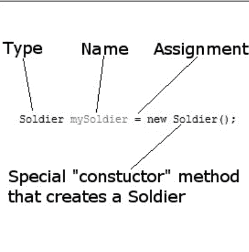
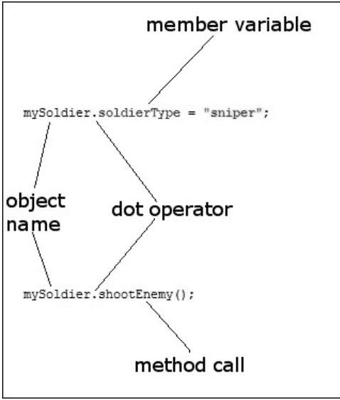
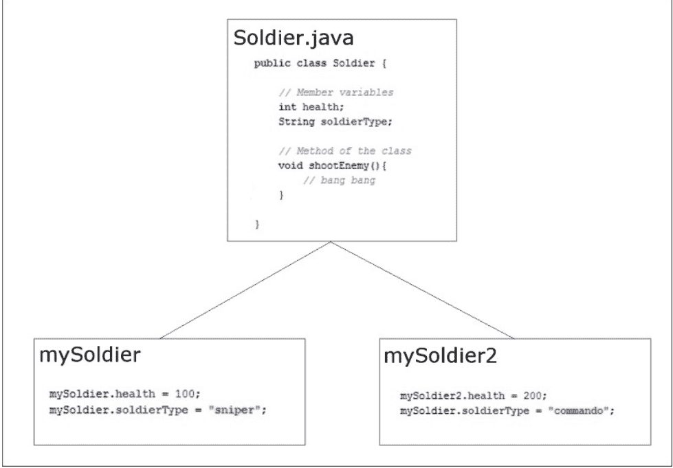
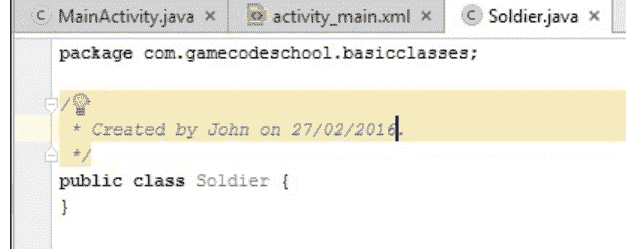
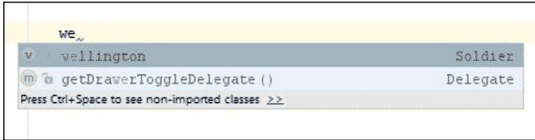

## Chapter 9. Object-Oriented Programming

In this chapter we will discover that in Java, classes are fundamental to just about everything. We will begin to understand why the software engineers at Sun Microsystems back in the early 1990's made Java the way they did.

We have already talked about reusing other people's code, specifically the Android API, but in this chapter, we will really get to grips with how this works and learn about object-oriented programming (OOP) and how to use it.

In short, we will cover the following topics:

- What OOP is including encapsulation, inheritance, and polymorphism
- Writing and using our first, very own class
- Encapsulation in depth and how it helps us
- Inheritance in depth and how to take full advantage of it
- Polymorphism explained in greater detail
- Static classes and how we have been using them already
- Abstract classes and interfaces


## 内存管理的重要警告

在深入探讨OOP究竟是什么之前，先快速提醒一下。

这次我指的是我们的记忆。如果你试图背诵本章，你得在大脑里腾出大量空间，而且很可能会忘掉某样真正重要的东西，比如上班或者感谢作者告诉你不要试图背诵这些东西。

一个不错的目标是尽量理解就好。这样，你的理解会更加全面。需要时可以再回到本章复习。

## 提示

不用担心一开始就完全搞懂本章的一切！继续阅读，并确保完成所有的app和小型app。

## OOP简介

在第1章《第一个App》中，我们提到Java是一门面向对象的语言。面向对象的语言要求我们使用面向对象编程。

## 提示

我十岁的儿子在想出一种独特的记忆OOP的方法方面帮助很大。他建议直接颠倒其字母。我让读者自己决定是使用这个特定的记忆口诀还是他自己的方法。

让我们进一步了解。

## OOP究竟是什么？

OOP是一种编程方式，它涉及将我们的需求分解成比整体更易于管理的块。

每个块都是自包含的，同时可能被其他程序重复使用，同时又与其他块协同工作。

这些块就是我们所说的对象。当我们规划/编码一个对象时，我们使用类。类可以被视为对象的蓝图。

我们实现一个类的对象。这被称为类的实例。想想房子的蓝图。你不能住在里面，但你可以根据它建造一座房子；你构建了它的一个实例。通常，当我们为app设计类时，我们会编写它们来表示现实世界的事物。

不过，OOP不仅仅是如此。它也是一种做事的方式，一种定义最佳实践的方法论。

OOP的三大核心原则是封装、多态和继承。这听起来可能很复杂，但实际上，逐步来看，相当直接。

## 封装

封装意味着保护你的代码的内部工作不受使用它的代码的干扰，只允许你选择的变量和方法被访问。这意味着你的代码可以随时更新、扩展或改进，而不会影响使用它的程序，只要暴露的部分仍然以相同的方式被访问。

还记得第1章《第一个App》中的这一行代码吗？

```
locationManager.getLastKnownLocation(LocationManager.GPS_PROVIDER);
```

通过适当的封装，卫星公司或Android API团队是否需要更新他们的代码运作方式并不重要。只要getLastKnownLocation方法签名保持不变，我们就不必担心内部发生了什么。更新前编写的代码在更新后仍然可以工作。如果汽车制造商去掉车轮，将其制成电力驱动的悬浮汽车，只要它仍然有方向盘、油门踏板和刹车踏板，驾驶它就不应该是个挑战。

当我们使用Android API的类时，我们是按照Android开发者设计他们的类以允许我们的方式进行的。

## 多态

多态允许我们编写的代码较少依赖于我们试图操纵的*类型*，使我们的代码更清晰、更高效。多态意味着*不同的形式*。如果我们编码的对象可以不止一种东西，那么我们就可以利用这一点。本章后面的一些示例将澄清这一点。

## 继承

顾名思义，继承意味着我们可以利用其他人类的所有特性和优势，包括封装和多态，同时进一步完善他们的代码以适应我们的特定情况。事实上，我们每次使用extends关键字时都已经这样做了：

```
public class MyActivity extends AppCompatActivity {
```

AppCompatActivity类本身继承自Activity。因此，每次创建新的Android项目时，我们都继承自Activity。我们可以做得更多，我们将看到它有多有用。

## 为什么要这样做？

当正确编写时，所有这些OOP都允许你添加新功能，而不必太担心它们如何与现有功能交互。当你确实需要更改一个类时，它自包含的（封装的）特性意味着对程序其他部分的影响较少，甚至可能为零。这就是封装部分。

你可以使用他人的代码（例如Android API），而不需要知道或也许甚至不关心它如何工作。想想Android生命周期、Toast、Log、所有UI小部件、监听卫星等等。例如，Button类有近50个方法——我们真的想为一个按钮自己写所有这些吗？使用别人的Button类要好得多。

OOP允许你为高度复杂的情况编写app，而不必费力。

你可以使用继承创建多个相似但又不同的类版本，而不必从头开始编写类；而且由于多态，你仍然可以将原始类型对象的预期方法用于新对象。

真的很有道理。Java从一开始就考虑了所有这些，所以我们被迫使用所有这些OOP；不过，这绝对是一件好事。让我们快速回顾一下类。

## 类回顾

类是一段可以包含方法、变量、循环以及我们学过的所有其他Java语法的代码。类是Java包的一部分，大多数包通常会有多个类。通常（虽然不总是如此），每个新类都将定义在其自己的.java代码文件中，文件名与类名相同，就像我们迄今的所有Activity类一样。

一旦我们写好了一个类，我们就可以使用它来创建任意多个对象。记住，类是蓝图，我们根据蓝图创建对象。房子不是蓝图，就像对象不是类一样；它是由类制成的对象。对象是一个引用变量，就像String一样，以后我们将发现引用变量究竟意味着什么。现在，让我们看看一些实际代码。

## 查看类的代码

假设我们要为军队制作一个app。它旨在让高级军官在战斗中微观管理他们的部队。在许多东西中，我们可能需要一个类来表示一名士兵。

## 类的实现

以下是我们假设类的真实代码。我们称之为类实现。因为类名为Soldier，如果我们要真正实现它，我们会在名为Soldier.java的文件中实现：

```
public class Soldier {
    // Member variables
    int health;
    String soldierType;

    // Method of the class
    void shootEnemy(){
    // bang bang
    }
}
```

前一个示例中的代码片段是名为Soldier的类的实现。有两个**成员变量**或**字段**，一个名为health的int变量和一个名为soldierType的String变量。

还有一个名为shootEnemy的方法。该方法没有参数，返回类型为void，但类方法可以有任何形状或大小，正如我们在[第8章，使用Java编程第2部分——方法]中讨论的那样。

准确地说，关于成员变量和字段，当类被实例化为真实对象时，字段成为对象本身的变量，我们称它们为**实例**或**成员**变量。

它们只是类的变量，无论用什么花哨的名字来称呼它们。然而，字段和在方法中声明的变量（称为**局部**变量）之间的区别随着我们的进展变得更加重要。我们在[第8章，使用Java编程第2部分——方法]的末尾简要讨论了变量作用域。我们将在本章后面再次查看所有类型的变量。


## 类对象的声明、初始化和使用

请记住，Soldier 只是一个类，而非实际可用的对象。它是士兵的蓝图，而非实际的士兵对象，就像 int、String 和 boolean 不是变量一样；它们只是我们可以用来创建变量的类型。以下是如何从我们的 Soldier 类中创建 Soldier 类型的对象：

```
Soldier mySoldier = new Soldier();
```

在代码的第一部分中，Soldier mySoldier 声明了一个名为 mySoldier 的新 Soldier 类型变量。代码的最后一部分，new Soldier()，会调用一个称为 **构造函数** 的特殊方法，该方法由编译器自动为所有类生成，用于创建实际的士兵对象。如您所见，构造函数方法与类同名。我们将在本章后面更深入地探讨构造函数。

当然，中间的赋值运算符 = 会将第二部分的结果赋给第一部分。下图总结了所有这些信息：



这与处理普通变量的方式并无太大区别，只是代码行末尾有点奇怪的圆括号 ()。这些圆括号稍后将加以解释。

嗯，看起来有点像方法调用，对吧？

就像普通变量一样，我们也可以分两步来做，像这样：

```
Soldier mySoldier;
mySoldier = new Soldier();
```

这是如何为我们假设的类分配和使用变量的方式：

```
mySoldier.health = 100;
mySoldier.soldierType = "sniper";
```

```
// Notice that we use the object name mySoldier.
// Not the class name Soldier.
// We didn't do this:
// Soldier.health = 100;
// ERROR!
```

在前面的代码中，点运算符 . 用于访问类的变量；调用方法也是如此，再次使用对象名而不是类名，后跟点运算符：

```
mySoldier.shootEnemy();
```

我们可以用一张图来总结点运算符的使用：



### 提示

我们可以从类的方法能 *做* 什么的角度来思考，并将其实例/成员变量视为了解其自身 *知道* 的内容。

我们还可以继续创建另一个 Soldier 对象并访问其方法和变量：

```
Soldier mySoldier2 = new Soldier();
mySoldier2.health = 150;
mySoldier2.soldierType = "special forces";
mySoldier2.shootEnemy();
```

重要的是要认识到 mySoldier2 是一个完全独立的对象，拥有与 mySoldier 完全分离的实例变量：



同样重要的是，上述代码不会写在类本身内。例如，我们可以在名为 `Soldier.java` 的外部文件中创建 `soldier` 类，然后使用刚才看到的代码，可能在我们的 `MainActivity` 类中。

当我们在实际项目中不久编写第一个类时，这会变得更加清晰。

还要注意，所有操作都直接在对象 _本身_ 上进行。我们必须创建类的对象才能使其有用。

### 注意

一如既往，这条规则也有例外。但例外属于少数情况，我们将在本章后面探讨例外。事实上，迄今为止本书中我们已经见过两个例外：`Toast` 和 `Log` 类。关于它们具体的情况将很快加以说明。

让我们通过实际编写一个类来更深入地探讨基本类。

## 基本类小型应用

将要使用我们应用程序的将军们将需要不止一个 Soldier 对象。在我们即将构建的应用程序中，我们将实例化并使用多个对象。我们还将演示在变量和方法上使用点运算符，以显示不同对象拥有各自独立的实例变量。

您可以在代码下载中获取此示例的完整代码。它位于 chapter 9/Basic Classes 文件夹中。或者，继续阅读以创建您自己的工作示例。

使用空白活动创建一个项目。将应用程序命名为 BasicClasses。现在，我们创建一个名为 Soldier 的新类：

- 1. 在项目资源管理器窗口中右键单击 com.gamecodeschool.basicclasses（或您的包名）文件夹。
- 2. 选择 New | Java Class。
- 3. 在 Name 字段中键入 soldier 并左键单击 OK。

新类已为我们创建，带有一个代码模板，准备好让我们在其中放入实现，就像下图所示：



请注意，Android Studio 已将该类放置与应用程序其余部分相同的包中。现在，我们可以编写其实现。

按所示，在 Soldier 类的开头和结束花括号内编写以下类实现代码。新输入的代码已突出显示：

```
public class Soldier {
    int health;
    String soldierType;

    void shootEnemy(){
    //let's print which type of soldier is shooting
    Log.i(soldierType, " is shooting");
    }
}
```

现在我们有了一个类，一个 Soldier 类型未来对象的蓝图，我们可以开始建立我们的军队了。在编辑器窗口中，左键单击选项卡 **MainActivity.java**。我们将在调用 setContentView 之后的 onCreate 方法中编写此代码。键入此代码：

```
// first we make an object of type soldier
Soldier rambo = new Soldier();
rambo.soldierType = "Green Beret";
rambo.health = 150;
// It takes a lot to kill Rambo

// Now we make another Soldier object
Soldier vassily = new Soldier();
vassily.soldierType = "Sniper";
vassily.health = 50;
// Snipers have less health

// And one more Soldier object
Soldier wellington = new Soldier();
wellington.soldierType = "Sailor";
wellington.health = 100;
// He's tough but no green beret
```

### 提示

如果您还没有这样做，现在是开始利用 Android Studio 自动完成功能的绝佳时机。请注意，在您声明并创建新对象后，只需开始输入对象名称，所有自动完成选项都会显现出来。



现在我们拥有了这个极其多样化且有些不太可能的军队，我们可以使用它并验证每个对象的身份。在上一步的代码下方键入以下代码：

```
Log.i("Rambo's health = ", "" + rambo.health);
Log.i("Vassily's health = ", "" + vassily.health);
Log.i("Wellington's health = ", "" + wellington.health);
```

```
rambo.shootEnemy();
vassily.shootEnemy();
wellington.shootEnemy();
```

现在，我们可以运行我们的应用程序了。所有输出都将显示在 logcat 控制台窗口中。

它的工作原理如下。首先，我们为新的 Soldier 类创建了一个模板。然后，我们实现了该类，包括声明两个字段（成员变量），一个 int 和一个 String，分别名为 health 和 soldierType。

我们的类中还有一个名为 shootEnemy 的方法。让我们再看看它并检查正在发生什么：

```
void shootEnemy(){
//let's print which type of soldier is shooting
Log.i(soldierType, " is shooting");
}
```

在方法体中，我们先将字符串 soldierType 打印到控制台，然后是任意字符串 " is shooting"。这里的妙处在于，字符串 soldierType 将取决于我们在哪个对象上调用 shootEnemy 方法而有所不同。

接下来，我们声明并创建了三个新的 Soldier 类型对象。它们分别是 rambo、vassily 和 wellington。最后，我们为每个对象初始化了不同的 health 和 soldierType 值。

以下是输出：

```
Rambo's health = 150
Vassily's health = 50
Wellington's health = 100
Green Beret: is shooting
Sniper: is shooting
Sailor: is shooting
```

请注意，每次访问每个士兵对象的 health 变量时，都会打印我们为其分配的值，这表明虽然三个对象属于同一类型，但它们是完全独立的单独实例/对象。

或许更有趣的是对 shootEnemy 的三次调用。我们的每个 Soldier 对象的 shootEnemy 方法都会逐个被调用，并且我们将 soldierType 变量打印到控制台。该方法为每个单独的对象提供了相应的值，进一步证明了我们有三个不同的对象（类的实例），尽管它们是从相同的 Soldier 类创建的。

我们看到了每个对象与其他对象是完全独立的。然而，如果我们想象应用程序中有整支士兵对象大军，那么我们意识到将需要学习处理大量对象（以及普通变量）的新方法。

想想仅管理 100 个独立的士兵对象。那当我们有数千个对象时又会怎样？此外，这不够动态。我们目前编写代码的方式依赖于我们（开发者）确切知道将军（用户）将指挥的士兵的详细信息。我们将在第 13 章《处理和显示数据数组》中看到这方面的解决方案。


## 我们可以用第一个类做更多的事

我们可以像处理其他变量一样处理一个类。我们可以在方法签名中使用类作为参数：

```
public void healSoldier(Soldier soldierToBeHealed){
```

当然，当我们实际调用方法时，必须传入该类型的对象。以下是对 healSoldier 方法的假设调用：

```
// Perhaps healSoldier could add to the health instance variable
healSoldier(rambo);
```

当然，前面的例子可能会引发诸如 healSoldier 方法是否应该是类的方法之类的问题。

```
fieldhospital.healSoldier(rambo);
```

可能也可能不是。这取决于该情况的最佳解决方案。我们将了解更多面向对象编程知识，然后许多类似难题的最佳解决方案应该会更容易浮现出来。

如你所料，我们还可以将对象作为方法的返回值。以下是更新后的假设 healSoldier 签名和实现可能的样子：

```
Soldier healSoldier(Soldier soldierToBeHealed){
 soldierToBeHealed.health++;

 return soldierToBeHealed;
}
```

事实上，我们已经见过类被用作参数。例如，这里是第 2 章 Java – 初体验 中的 topClick 方法。它接收一个名为 v 的 View 类型对象：

```
public void topClick(View v){
```

不过，在 topClick 的情况下，我们并没有对传入的 View 类型对象做任何事情，部分是因为我们不需要，部分是因为我们还不知道可以对 View 类型对象做什么。

所有这些信息可能会引发一些问题。面向对象编程就是这样。所以，让我们通过重新审视变量和封装，尝试将所有这些类知识与已有知识整合起来。

## 还记得封装吗？

到目前为止，我们实际看到的不过是一种代码组织约定；尽管我们讨论了所有这些面向对象编程内容的更广泛目标。所以，现在我们将进一步深入，开始了解如何使用 OOP 实际实现封装。

### 提示

### 封装定义

封装涉及将代码的内部运作保护起来，防止使用它的程序干扰，只允许你选择的变量和方法被访问。这意味着只要暴露的部分仍以相同的方式提供，你的代码始终可以更新、扩展或改进而不影响使用它的程序。它还允许使用你封装代码的代码变得更简单、更易于维护，因为任务的大部分复杂性都被封装在你的代码中。

但你不是说我们不需要知道内部发生了什么吗？所以，你可能会质疑我们目前看到的内容，例如，如果我们不断这样设置实例变量：`rambo.health = 100;`，最终事情是否可能开始出错，也许像这样？

```
rambo.soldierType = "fluffy bunny";
```

封装保护你的类/你的类的对象/代码免受非预期方式的使用。通过严格控制代码的使用方式，它只能做你希望它做的事情，并且只能使用你可控制的值范围。

它不能被强制导致错误或崩溃。此外，你然后可以自由地对代码的内部工作方式进行更改，而不会破坏程序的其余部分或任何使用旧版代码的其他程序：

```
weightlifter.legstrength = 100;
weightlifter.armstrength = -100;
weightlifter.liftHeavyWeight();
```

// 一个拼写错误，举重者就会把自己的胳膊撕下来

我们可以封装类以避免这种情况，方法如下。

## 使用访问修饰符控制类使用

类的设计者控制任何使用其类的程序可以看到和操纵的内容。我们可以在 class 关键字之前添加一个**访问修饰符**，如下所示：

```
public class Soldier{
//Implementation goes here
}
```

在迄今为止讨论的上下文中，类有两个主要访问修饰符。让我们逐一简要了解：

- public：这很简单。声明为 public 的类可以被所有其他类看到。
- default：当未指定访问修饰符时，类具有默认访问权限。这将使其变为 public，但仅对同一包中的类可见，对所有其他类不可见。

所以，现在我们可以开始着手封装了。但即使一眼看去，描述的访问修饰符也不够细致。我们似乎只能对包外的任何东西进行完全锁定，或者完全开放。

实际上，这里的好处很容易利用。设想是设计一个完成一组任务的包。然后，包的所有复杂内部运作，即不应被除我们的包以外的任何人动弄的东西，都应给予默认访问权限（仅对包内的类可见）。我们可以提供一组精心挑选的 public 类供其他人（或我们程序的其他不同部分）使用。

### 提示

考虑到本书中应用程序的大小和复杂性，创建多个包可能有些大材小用。当然，我们将使用其他人的包和类，所以这些内容值得了解。

### 类访问权限要点

一个设计良好的应用程序可能会包含一个或多个包，每个包只包含 default 类或 default 和 public 类。

除了类级隐私控制外，Java 还为我们程序员提供了非常细粒度的控制，但要使用这些控制，我们需要更详细地查看变量。

## 使用访问修饰符控制变量使用

在类可见性控制的基础上，我们有变量访问修饰符。以下是使用 private 访问修饰符声明的变量：

```
private int myInt;
```

另请注意，我们关于变量访问修饰符的所有讨论也适用于对象变量。例如，这里声明、创建并分配了我们 Soldier 类的一个实例。如你所见，此处指定的访问权限是 public：

```
public Soldier mySoldier = new Soldier();
```

在向变量应用修饰符之前，必须首先考虑类可见性。如果类 a 对类 b 不可见（例如，因为类 a 具有 default 访问权限而类 b 在另一个包中），那么你在类 a 的变量上使用什么访问修饰符都无关紧要；类 b 看不到其中的任何一个。

因此，有必要在需要时向另一个类显示一个类，但只公开所需的变量，而不是全部变量。

以下是不同变量访问修饰符的说明。它们比类访问修饰符更多且更细致。访问修饰的深度和复杂性不在于修饰符的范围，而在于我们可以以聪明的方式组合它们以实现封装这一崇高目标。以下是变量访问修饰符：

- public：如你所料，任何包中的任何类或方法都可以看到此变量。只有在确定需要时才使用 public。
- protected：这是 public 之后最不严格的一种。只要在同一包中，protected 变量可以被任何类和任何方法看到。
- default：default 听起来不像 protected 那么严格，但实际上更严格。当未指定访问权限时，变量具有 default 访问权限。default 是严格的这一事实也许暗示，我们更应该考虑隐藏变量而非暴露它们。此时，我们需要引入一个新概念。你还记得我们简要讨论过继承，以及我们如何快速采用类的属性并使用 extends 关键字对其进行细化吗？顺便说一下，default 访问变量对子类不可见；也就是说，当我们像对待 Activity 那样扩展一个类时，我们看不到它的 default 变量。我们将在本章后面更详细地了解继承。
- private：private 变量只能在声明它们的类中看到。包括 default 访问权限在内，子类（继承自所在类的类）都看不到它们。

### 变量访问权限摘要

一个设计良好的应用程序可能会包含一个或多个包，每个包只包含 default 类或 default 和 public 类。在这些类中，变量将具有经过精心选择且很可能多种多样的访问修饰符，旨在实现我们的封装目标。

在实际操作之前，所有这些访问修饰内容还有一个转折点。


## 方法也有访问修饰符

我们在上一章中已经简要提到过，方法具有访问修饰符。这很合理，因为方法是我们的类能够 _做_ 的事情。我们希望控制类的用户能做什么和不能做什么。

这里的大致思路是，有些方法只在内部执行操作，因此类的用户不需要它们，而有些方法则是类的用户使用你的类的基础。

方法的访问修饰符与类变量的相同。这使得事情易于记忆，但同样表明，成功的封装是设计问题，而不是遵循任何特定规则集的问题。

例如，只要此方法位于公共类中，任何其他类都可以使用它：

```
public useMeEverybody(){
//do something everyone needs to do here
}
```

而此方法只能由创建它的类在内部使用：

```
private secretInternalTask(){
/*
do something that helps the class function internally
Perhaps, if it is part of the same class,
useMeEverybody could use this method...
On behalf of the classes outside of this class.
Neat!
*/
}
```

而下一个未指定访问修饰符的方法具有默认可见性。它只能由同一包中的其他类使用。如果我们扩展包含此默认访问方法的类，该类将无法访问此方法：

```
fairlySecretTask(){
// allow just the classes in the package
// Not for external use
}
```

在继续之前，作为最后一个示例，这里是一个 protected 方法，仅对包可见，但可被扩展它的我们的类使用，就像 onCreate 一样：

```
protected packageTask(){
// Allow just the classes in the package
// And you can use me if you extend me too
}
```

## 方法访问修饰符总结

应选择方法访问权限以最好地强制执行我们已经讨论的原则。它应为类的用户提供其所需的访问权限，且最好不多提供任何权限。这样一来，我们就实现了封装目标，例如保护代码的内部工作机制免受使用它的程序的干扰，原因都已经讨论过了。

## 使用获取器和设置器访问私有变量

现在，我们需要考虑，如果将变量隐藏为私有是最佳实践，那么我们如何在不破坏封装的情况下允许访问它们呢？如果 Hospital 类的一个对象想要访问 Soldier 类型对象的 health 成员变量，以便将其增加，该怎么办？health 变量应该是私有的，因为我们不希望任何一段代码都能更改它。

为了尽可能多地将成员变量设为私有，同时仍允许对其中一些变量进行某种有限的访问，我们使用 **获取器** 和 **设置器**。获取器和设置器只是获取和设置变量值的方法。

这不是我们必须学习的什么特殊的新 Java 技术。这只是使用我们已知内容的一种约定。让我们使用我们的 Soldier 和 Hospital 类示例来查看获取器和设置器。

在此示例中，我们的两个类分别在各自的文件中创建，但位于同一个包中。首先，这是我们假设的 Hospital 类：

```
class Hospital{
    protected void healSoldier(Soldier soldierToHeal){
    int health = soldierToHeal.getHealth();
    health = health + 10;
    soldierToHeal.setHealth(health);
    }
}
```

我们对 Hospital 类的实现只有一个方法，即 healSoldier。它将 Soldier 对象的引用作为参数接收。因此，此方法将作用于传入的任何 Soldier 对象：vassily、wellington、Rambo 或其他任何人。

它还有一个局部 health 变量，用于暂存并增加士兵的健康值。在同一行中，它将 health 变量初始化为 Soldier 对象的当前健康值。Soldier 对象的 health 是私有的，因此改用公共获取器方法 getHealth。

然后，health 增加 10，setHealth 设置器方法将新的复活后的健康值重新加载回 Soldier 对象。

关键在于，尽管 Hospital 对象可以更改 Soldier 对象的 health，但它只能在获取器和设置器方法的范围内这样做。可以编写获取器和设置器方法来控制和检查可能出现的错误或有害值。

接下来，看看我们假设的 Soldier 类，其获取器和设置器方法采用最简单的实现：

```
public class Soldier{
    private int health;
    public int getHealth(){
        return health;
    }
    public void setHealth(int newHealth){
        // Check for stupid values of newHealth
        health = newHealth;
    }
}
```

我们有一个名为 health 的实例变量，它是私有的。私有意味着它只能由 Soldier 类的方法更改。然后我们有一个公共 getHealth 方法，它不出所料地返回私有 health int 变量中保存的值。由于此方法是公共的，任何可以访问 Soldier 类型对象的代码都可以使用它。

接下来，实现 setHealth 方法。同样，它是公共的，但这次它将 int 数据类型作为参数，并将传入的内容分配给私有 health 变量。在更贴近实际的示例中，我们会在此编写更多代码，以确保传入的值在我们预期的范围内。

现在，我们声明、创建并赋值，来创建我们两个新类的对象，并看看我们的获取器和设置器如何工作：

```
Soldier mySoldier = new Soldier();
// mySoldier.health = 100;//Doesn't work, private
```

```
// we can use the public setter setHealth()
mySoldier.setHealth(100);//That's better

Hospital militaryHospital = new Hospital();
```

```
// Oh no mySoldier has been wounded
mySoldier.setHealth(10);
```

```
/*
 Take him to the hospital
 But my health variable is private
 And Hospital won't be able to access it
 I'm doomed - tell Laura I love her

 No wait-what about my public getters and setters?
 We can use the public getters and setters from another class
 */
```

```
militaryHospital.healSoldier(mySoldier);
```

```
// mySoldiers private variable health has been increased by 10
// I'm feeling much better thanks!
```

我们可以看到，可以直接在 Soldier 类型的对象上调用公共 setHealth 和 getHealth 方法。不仅如此，我们可以调用 Hospital 对象的 healSoldier 方法，传入 Soldier 对象的引用，该对象也可以使用公共获取器和设置器来操纵私有 health 变量。

我们可以看到，私有 health 变量易于访问，但完全受 Soldier 类设计者的控制。

如果你想玩弄这个示例，第 9 章文件夹中的代码包里有一个名为 GettersAndSetters 的可运行应用代码。我添加了几行代码来在控制台打印输出。我们故意以这种方式讲解，是为了让代码的关键部分尽可能清晰。

## 注意

获取器和设置器有时也被称为它们更准确的名称，**访问器** 和 **修改器**。我们将继续使用获取器和设置器。我只是觉得你可能想了解这些行话。

再次，我们的示例和解释可能会引发更多问题。这很好。

通过使用封装特性（例如访问控制），有点像是签署一份关于如何使用和访问类及其方法和变量的非常重要的协议。该契约不仅仅是关于当前的协议，更是对未来的一种隐含担保。随着本章的深入，我们会看到，有更多方法可以细化和加强这个契约。

## 提示

在需要的地方使用封装，或者，当然，如果你受雇主要求使用它。通常，在小型学习项目中（例如本书中的一些示例），封装属于大材小用，当然，除非你学习的主题本身就是封装。

我们学习这些 Java OOP 内容是基于这样的假设：总有一天你会想要编写更复杂的应用，无论是在 Android 上还是使用 OOP 的其他平台上。此外，我们将使用大量使用 OOP 的 Android API 类，这也将帮助我们理解那时发生的事情。通常，在本书中，我们会在实现完整项目时使用封装，但在展示用于演示单个理念或主题的小代码示例时，往往会忽略它。


## 使用构造函数设置对象

有了所有这些私有变量及其 getter 和 setter，是否意味着每个私有变量都需要一个 getter 和一个 setter？

那么，如果一个类有许多在开始时需要初始化的变量呢？

考虑一下：

- mySoldier.name
- mySoldier.type
- mySoldier.weapon
- mySoldier.regiment
- ...

这些变量中的一些可能需要 getters 和 setters，但如果我们只想在对象首次创建时进行设置，以使对象正确运行，该怎么办？

当然，我们不需要为每个变量编写两个方法（一个 getter 和一个 setter）吧？

幸运的是，这不是必须的。为了解决这个潜在问题，有一种特殊的方法，称为 **构造函数**。

在讨论从类实例化对象时，我们简要提及了构造函数的存在。

让我们再看一遍。在这里，我们创建一个 Soldier 类型的对象，并将其赋值给名为 mySoldier 的对象：

```
Soldier mySoldier = new Soldier();
```

这里没有什么新内容，但请看那行代码的最后部分：

```
...Soldier();
```

这看起来可疑地像一个方法。

一直以来，我们都在调用一种特殊的方法，即构造函数，它由编译器在幕后自动创建。

然而，现在重点来了，和方法一样，我们可以重写它，这意味着我们可以在对象 *被使用之前* 执行一些非常有用的操作来设置新对象。

下面的代码展示了我们如何做到这一点：

```
public Soldier(){
// Someone is creating a new Soldier object
health = 200;
// more setup here
}
```

构造函数在语法上与方法有很多相似之处。但是，它只能通过使用 new 关键字来调用，并且由编译器自动为我们创建，除非我们像前面的代码那样自己创建一个。

### 构造函数具有以下属性：

- 它们没有返回类型
- 它们与类名完全相同
- 它们可以有参数
- 它们可以被重载

此时值得介绍的另一条 Java 语法是 Java 关键字 this。

当我们想要明确指的是哪个变量时，会使用 this 关键字。请看这个示例构造函数，同样是针对 Soldier 类的假设性变体：

```
public class Soldier{

String name;
String type;
int health;

public Soldier(String name, String type, int health){
    // Someone is creating a new Soldier object
    this.name = name;
    this.type = type;
    this.health = health;
    // more setup here
}
}
```

这次，构造函数为我们要初始化的每个变量都有一个参数。通过使用 this 关键字，我们指的是成员变量还是参数就一目了然了。

关于变量和 this，还有更多曲折需要学习，当应用于实际项目时，它们会更加容易理解。在下一个小应用中，我们将探讨本章迄今学到的所有内容以及一些新想法。

但在此之前，先再学习一点面向对象编程。

## 静态方法

我们对类了解很多——如何将它们转换为对象并使用它们的方法和变量。但有些不对劲。从本书一开始，我们就使用了比其他任何类都多的两个类。我们反复使用 Log 和 Toast 将内容输出到 logcat 或用户屏幕，但一次都没有实例化它们！这是怎么做到的？

类的静态方法可以在不先实例化类的对象的情况下使用。我们可以把这看作是静态方法属于类，而所有其他方法属于类的对象。

而且你可能已经意识到，Log 和 Toast 都包含静态方法。明确一点：Log 和 Toast 包含静态方法；它们本身仍然是类。

类可以同时拥有静态方法和常规方法，但常规方法需要以常规方式使用，即通过类的实例。

再看一下 Log.i 的实际用法：

```
Log.i("info", "our message here");
```

在这里，i 是被静态访问的方法，该方法接受两个参数，均为 String 类型。

接下来，我们看到 Toast 类的静态方法 makeText 在使用中：

```
Toast.makeText(this, "our message", Toast.LENGTH_SHORT).show();
```

Toast 类的 makeText 方法接受三个参数。

第一个参数是 this，这需要一些解释。在讨论构造函数时，我们看到，要明确引用对象当前实例的成员变量，可以使用 this.health、this.regiment 等等。

当我们像在前一行代码中那样使用 this 时，我们指的是类本身的实例。它不是 Toast 类，而是前一行代码中的 this 关键字是对方法被使用的类的引用。在我们的情况中，我们是从 MainActivity 使用的。Android 中有许多东西需要一个 Activity 实例的引用才能完成工作。在本书中，我们会相当经常地传入 this（Activity 的引用），以帮助 Android API 中的类/对象完成工作。我们还将编写需要将 this 作为其一个或多个方法的参数的类。因此，我们还将看到当 this 被传入时如何处理它。

第二个参数当然是一个 String。

第三个参数是访问一个 final 变量 LENGTH_SHORT，同样是通过类名，而不是类的实例。如果我们像下一行代码这样声明一个变量：

```
public static final int LENGTH_SHORT = 1;
```

假设该变量在名为 MyClass 的类中声明，我们可以像这样访问该变量：MyClass.LENGTH_SHORT，并像使用任何其他变量一样使用它，但 final 关键字确保变量的值永远不会被更改。这种类型的变量称为 **常量**。

static 关键字对变量还有另一个后果，特别是当它不是常量（可以更改）时，我们将在下一个小应用中看到这一点。

现在，如果你仔细查看向用户显示 Toast 消息的那行代码的末尾，你会看到其他新东西：.show()。

这称为 **链式调用**，我们所做的就是在一行代码中调用 Toast 类的第二个方法。是 show 方法实际触发消息。

在本书后续内容中，我们还会看到更多链式调用，例如在第 12 章“与用户对话”中，当我们创建弹出式对话框窗口时，以及在第 17 章“声音效果和支持不同版本的 Android”中，当我们开始在应用中使用声音时。

### 提示

如果你想详细了解 Toast 类及其其他一些方法，可以访问这里：
http://developer.android.com/reference/android/widget/Toast.html。

静态方法通常提供在那些用途非常通用的类中，没必要为该类创建一个对象。另一个非常有用的带有静态方法的类是 Math。这个类实际上是 Java API 的一部分，而不是 Android API。

### 提示

想编写计算器应用吗？利用 Math 类的静态方法，比你想象的更容易。你可以在这里查看它们：
http://docs.oracle.com/javase/7/docs/api/java/lang/Math.html。

如果你尝试这样做，你需要像导入我们使用过的所有其他类一样导入 Math 类。

## 封装和静态方法小应用

我们已经研究了控制变量访问及其作用域的复杂方式，查看它们在实际中的示例对我们可能很有帮助。这些示例与其说是变量使用的实际世界示例，不如说是帮助理解类、方法和变量的访问修饰符的演示。这涵盖了不同类型的类似变量的引用或原始类型和本地实例，以及静态和 final 变量和 this 关键字等新概念。完整的代码在下载包的第 9 章文件夹中。它名为 Access Scope This And Static。

创建一个新的空白活动项目，并将其命名为 Access Scope This And Static。

在项目资源管理器中右键单击现有的 MainActivity 类，单击新建 | 类。将新类命名为 AlienShip。

现在，我们声明新类和一些成员变量。请注意，numShips 是 private 和 static 的。我们很快就会看到，该变量在类的所有实例中都是相同的。shieldStrength 变量是 private 的。shipName 是 public 的：

```
public class AlienShip {

    private static int numShips;
    private int shieldStrength;
    public String shipName;
}
```

接下来是构造函数。我们可以看到，构造函数是 public 的，没有返回类型，并且与类名相同——符合规则。在其中，我们递增私有静态 numShips 变量。请记住，每次创建 AlienShip 类型的新对象时都会发生这种情况。另外，构造函数使用私有 setShieldStrength 方法为私有变量 shieldStrength 设置一个值：

```
public AlienShip(){
    numShips++;

    /*
```


```
Can call private methods from here because I am part
of the class.
If didn't have "this" then this call
might be less clear
But this "this" isn't strictly necessary
Because of "this" I am sure I am setting
the correct shieldStrength
*/
this.setShieldStrength(100);
}
```

这里是公共静态 getter 方法，因此 AlienShip 类外部的类可以找出有多少个 AlienShip 对象。我们还将探讨使用静态方法的方式：

```java
public static int getNumShips(){
return numShips;
}
```

这是我们的私有 setShieldStrength 方法。我们本可以直接在类内部设置 shieldStrength，但下面的代码展示了如何通过使用 this 关键字来区分 shieldStrength 局部变量/参数和 shieldStrength 成员变量：

```java
private void setShieldStrength(int shieldStrength){
// "this" distinguishes between the
// member variable shieldStrength
// And the local variable/parameter of the same name
this.shieldStrength = shieldStrength;
}
```

接下来的方法是 getter，因此其他类可以读取但不能更改每个 AlienShip 对象的 shield strength：

```java
public int getShieldStrength(){
return this.shieldStrength;
}
```

现在，我们有一个公共方法，每次 AlienShip 对象被击中时都可以调用它。它只是向控制台打印信息，然后检测该特定对象的 shieldStrength 是否为零。如果是，它会调用我们即将查看的 destroyShip 方法：

```java
public void hitDetected(){
	shieldStrength -=25;
	Log.i("Incoming: ","Bam!!");
	if (shieldStrength == 0){
		destroyShip();
	}
}
```

最后，对于我们的 AlienShip 类，我们有 destroyShip 方法。我们会打印一条消息，指示根据 shipName 哪艘船被摧毁了，同时递减 numShips 静态变量，以便我们可以跟踪有多少个 AlienShip 类型的对象：

```java
private void destroyShip(){
	numShips--;
	Log.i("Explosion: ", ""+this.shipName + " destroyed");
} // End of the class
```

现在，我们切换到 MainActivity 类，编写一些使用我们新 AlienShip 类的代码。所有代码都放在对 setContentView 调用之后的 onCreate 方法中。首先，我们创建两个名为 girlShip 和 boyShip 的新 AlienShip 对象：

```java
// every time we do this the constructor runs
AlienShip girlShip = new AlienShip();
AlienShip boyShip = new AlienShip();
```

看看我们如何获取 numShips 中的值。我们像预期的那样使用 getNumShips 方法。但是，请仔细看语法。我们使用的是类名而不是对象。我们也可以使用非静态方法来访问静态变量。我们这样做是为了看看静态方法的实际效果：

```java
// Look no objects but using the static method
Log.i("numShips: ", "" + AlienShip.getNumShips());
```

现在，我们为公共 shipName String 变量赋予名称：

```java
// This works because shipName is public
```

```java
girlShip.shipName = "Corrine Yu";
boyShip.shipName = "Andre LaMothe";
```

如果我们尝试直接向私有变量赋值，是不会起作用的。因此，我们使用公共 getter 方法 getShieldStrength 来打印在构造函数中分配的 shieldStrength：

```java
// This won't work because shieldStrength is private
// girlShip.shieldStrength = 999;
```

```java
// But we have a public getter
Log.i("girlShip shieldStrength: ", "" +
girlShip.getShieldStrength());
```

```java
Log.i("boyShip shieldStrength: ", "" + boyShip.getShieldStrength());
```

```java
// And we can't do this because it's private
// boyShip.setShieldStrength(1000000);
```

最后，我们可以通过操纵 hitDetected 方法并偶尔检查两个对象的 shieldStrength 来炸掉一些东西了：

```java
// lets shoot some ships
girlShip.hitDetected();
Log.i("girlShip shieldStrength: ", "" +
girlShip.getShieldStrength());
```

```java
Log.i("boyShip shieldStrength: ", "" + boyShip.getShieldStrength());
boyShip.hitDetected();
boyShip.hitDetected();
boyShip.hitDetected();
```

```java
Log.i("girlShip shieldStrength: ", "" +
girlShip.getShieldStrength());
```

```java
Log.i("boyShip shieldStrength: ", "" + boyShip.getShieldStrength());
```

```java
boyShip.hitDetected(); //ahhh
```

```java
Log.i("girlShip shieldStrength: ", "" +
girlShip.getShieldStrength());
```

```java
Log.i("boyShip shieldStrength: ", "" + boyShip.getShieldStrength());
```

当我们认为已摧毁一艘飞船时，我们会再次使用静态 getNumShips 方法，查看静态变量 numShips 是否已被 destroyShip 方法更改：

```java
Log.i("numShips: ", "" + AlienShip.getNumShips());
```

运行演示并查看控制台输出：

```
numShips: 2
girlShip shieldStrength: 100
boyShip shieldStrength: 100
Incoming: Bam!!
girlShip shieldStrength: 75
boyShip shieldStrength: 100
Incoming: Bam!!
Incoming: Bam!!
Incoming: Bam!!
girlShip shieldStrength: 75
boyShip shieldStrength: 25
Incoming: Bam!!
Explosion: Andre LaMothe destroyed
girlShip shieldStrength: 75
boyShip shieldStrength: 0
numShips: 1
boyShip shieldStrength: 0
numShips: 1
```

在前面的示例中，我们了解到可以通过使用 this 关键字来区分同名的局部变量和成员变量。我们也可以使用 this 关键字来编写引用当前被操作对象的代码。

我们了解到静态变量（在这里是 numShips）在所有实例中都是一致的；此外，通过在构造函数中对其递增并在 destroyShip 方法中对其递减，我们可以跟踪创建了多少个 AlienShip 对象。

我们还了解到，可以通过使用带有点运算符的类名而不是实际对象来使用静态方法。是的，我知道这有点像住在房子的蓝图里，但这非常有用。

最后，我们演示了如何使用访问说明符来隐藏和公开某些方法和变量。

## OOP 和继承

我们已经了解到，可以通过从 Android 等 API 的类中实例化/创建对象来利用他人的辛勤工作。但整个 OOP 的概念远不止于此。

如果有一个类包含大量有用功能，但又不完全是我们想要的，该怎么办？我们可以从该类继承，然后进一步完善或增加其工作方式和功能。

你可能会惊讶地听到，我们已经这样做过了。事实上，我们在创建的每个应用中都这样做过。当我们使用 extends 关键字时，我们就在进行继承。还记得这个吗？

```java
public class MainActivity extends AppCompatActivity ...
```

在这里，我们正在继承 AppCompatActivity 类及其所有功能——或者更具体地说，是类设计者希望我们能够访问的所有功能。现在，我们将讨论可以对已扩展的类做的一些事情。

我们甚至可以重写一个方法 _和_ 同时仍部分依赖我们继承的类中被重写的方法。例如，每次扩展 AppCompatActivity 类时，我们都会重写 onCreate 方法。但当我们这样做时，我们也调用了类设计者提供的默认实现：

```java
super.onCreate(...
```

在第 6 章《Android 应用的生命周期》中，我们几乎重写了 Activity 类的所有生命周期方法。

我们讨论继承主要是为了了解周围正在发生的事情，并作为最终能够设计出我们或他人可以扩展的有用类的第一步。

考虑到这一点，让我们看看一些示例类，看看如何扩展它们，以了解语法并迈出第一步，同时也能说我们已经做到了。

当我们查看本章的最后一个主要主题——多态性时，我们也会同时深入探讨继承。下面是使用继承的代码示例：

这段代码将放在名为 Animal.java 的文件中：

```java
public class Animal{
  // Some member variables
  public int age;
  public int weight;
  public String type;
  public int hungerLevel;

  public void eat(){
    hungerLevel--;
  }

  public void walk(){
    hungerLevel++;
  }

}
```

然后，在名为 Elephant.java 的单独文件中，我们可以这样做：

```java
public class Elephant extends Animal{
  public Elephant(int age, int weight){
    this.age = age;
    this.weight = weight;
    this.type = "Elephant";
    int hungerLevel = 0;
  }

}
```

从前面的代码可以看出，我们实现了一个名为 Animal 的类，它有四个成员变量：age、weight、type 和 hungerLevel。它还有两个方法：eat 和 walk。

然后我们用 Elephant 扩展了 Animal。Elephant 现在可以执行 Animal 能做的所有事情，并且拥有它的所有变量。我们初始化了变量，来自


Animal，在 Elephant 构造函数中拥有。创建 Elephant 对象时，两个变量（age 和 weight）被传入构造函数，而两个变量（type 和 hungerLevel）对所有 Elephant 对象都被赋予相同的值。

我们可以继续编写其他一些扩展自 Animal 类的类，例如 Lion、Tiger 和 ThreeToedSloth。每个类都会拥有 age、weight、type、hungerLevel，并且每个类都能够 walk 和 eat。

仿佛 OOP 还不够有用似的，现在我们可以对现实世界的对象进行建模。我们还发现，通过从其他类进行子类化/扩展/继承，可以让 OOP 变得更加有用。这里我们可能想要学习的术语是：被扩展的类是 **超类**，而从超类继承的类是 **子类**。我们也可以说父类和子类。

### 提示

像往常一样，我们可能会对继承提出这个问题。为什么？原因大概是这样的：我们可以只编写一次通用代码；在父类中，我们可以更新该通用代码，所有继承它的类也都会随之更新。此外，子类只能使用 public/protected 实例变量和方法。因此，如果设计得当，这也进一步增强了封装的目标。

让我们更深入地了解一下最后一个主要的 OOP 概念。然后，我们将能够使用 Android API 做一些更实际的事情。

## 继承小型应用

我们已经了解了如何创建类层次结构来建模适合我们应用的系统。那么，让我们试用一些使用继承的简单代码。完整代码位于代码下载的 Chapter 9 文件夹中。它名为 Inheritance Example。

以通常的方式创建三个新类。将一个命名为 AlienShip，另一个命名为 Fighter，最后一个命名为 Bomber。

以下是 AlienShip 类的代码。它与我们之前的类演示 AlienShip 非常相似。区别在于，构造函数现在接受一个 int 参数，并使用它来设置护盾强度。

构造函数还会向控制台输出一条消息，以便我们可以看到它何时被使用。此外，AlienShip 类有一个名为 fireWeapon 的新方法，该方法被声明为 abstract。这保证了任何子类化 AlienShip 的类都必须实现其自身的 fireWeapon 版本。请注意，该类在其声明中包含 abstract 关键字。我们必须这样做，因为它的一个方法也使用了 abstract 关键字。我们将在讨论此演示时解释 abstract 方法，并在讨论多态时解释 abstract 类。创建一个名为 AlienShip 的类并键入此代码：

```java
public abstract class AlienShip {
    private static int numShips;
    private int shieldStrength;
    public String shipName;

    public AlienShip(int shieldStrength) {
        Log.i("Location: ", "AlienShip constructor");
        numShips++;
        setShieldStrength(shieldStrength);
    }

    public abstract void fireWeapon();
    // Ahh my body where is it?

    public static int getNumShips() {
        return numShips;
    }

    private void setShieldStrength(int shieldStrength) {
        this.shieldStrength = shieldStrength;
    }

    public int getShieldStrength() {
        return this.shieldStrength;
    }

    public void hitDetected() {
        shieldStrength -= 25;
        Log.i("Incoming: ", "Bam!");
        if (shieldStrength == 0) {
            destroyShip();
        }
    }

    private void destroyShip() {
        numShips--;
        Log.i("Explosion: ", "" + this.shipName + " destroyed");
    }
}
```

现在，我们将实现 `Bomber` 类。请注意对 `super(100)` 的调用。这使用 `shieldStrength` 的值调用超类的构造函数。我们可以在此构造函数中进行进一步特定于 `Bomber` 的初始化，但目前，我们只是打印位置，以便我们可以看到 `Bomber` 构造函数何时被执行。由于必须这样做，我们还实现了抽象 `fireWeapon` 方法特定于 `Bomber` 的版本。创建一个名为 `Bomber` 的类并键入此代码：

```java
public class Bomber extends AlienShip {
    public Bomber() {
        super(100);
        // Weak shields for a bomber
        Log.i("Location: ", "Bomber constructor");
    }

    public void fireWeapon() {
        Log.i("Firing weapon: ", "bombs away");
    }
}
```

现在，我们将实现 `Fighter` 类。请注意对 `super(400)` 的调用。这使用 shieldStrength 的值调用超类的构造函数。我们可以在此构造函数中进行进一步特定于 Fighter 的初始化，但目前，我们只是打印位置，以便我们可以看到 Fighter 构造函数何时被执行。由于必须这样做，我们还实现了抽象 fireWeapon 方法特定于 Fighter 的版本。创建一个名为 Fighter 的类并键入此代码：

```java
public class Fighter extends AlienShip {
    public Fighter() {
        super(400);
        // Strong shields for a fighter
        Log.i("Location: ", "Fighter constructor");
    }

    public void fireWeapon() {
        Log.i("Firing weapon: ", "lasers firing");
    }
}
```

以下是 MainActivity 的 onCreate 方法中的我们的代码。像往常一样，在调用 setContentView 之后输入此代码。这是使用我们三个新类的代码。代码看起来相当普通，没有什么新奇之处；有趣的是输出：

```java
Fighter aFighter = new Fighter();
Bomber aBomber = new Bomber();

// Can't do this AlienShip is abstract -
// Literally speaking as well as in code
// AlienShip alienShip = new AlienShip(500);

// But our objects of the subclasses can still do
// everything the AlienShip is meant to do

aBomber.shipName = "Newell Bomber";
aFighter.shipName = "Meier Fighter";

// And because of the overridden constructor
// That still calls the super constructor
// They have unique properties
Log.i("aFighter Shield:", "" + aFighter.getShieldStrength());
Log.i("aBomber Shield:", "" + aBomber.getShieldStrength());

// As well as certain things in certain ways
// That are unique to the subclass
aBomber.fireWeapon();
aFighter.fireWeapon();

// Take down those alien ships
// Focus on the bomber it has a weaker shield
aBomber.hitDetected();
aBomber.hitDetected();
aBomber.hitDetected();
aBomber.hitDetected();
```

运行应用，您将在 logcat 窗口中看到以下输出：

```
Location: AlienShip constructor
Location: Fighter constructor
Location: AlienShip constructor
Location: Bomber constructor
aFighter Shield: 400
aBomber Shield: 100
Firing weapon: bombs away
Firing weapon: lasers firing
Incoming: Bam!!
Incoming: Bam!!
Incoming: Bam!!
Incoming: Bam!!
Explosion: Newell Bomber destroyed
```

我们可以看到子类的构造函数如何调用超类的构造函数。我们还可以清楚地看到 fireWeapon 方法的各个实现按预期工作。

## 多态

我们已经知道多态意味着 _不同形式_。但这对我们意味着什么？

浓缩成最简单的定义，多态是：任何子类都可以作为使用超类的代码的一部分。

这意味着我们可以编写更简单、更易于理解，并且也更容易修改或更改的代码。

此外，我们可以为超类编写代码，并依赖这样一个事实：无论它被子类化多少次，在一定参数范围内，代码仍然可以工作。

让我们讨论一个例子。

假设我们想使用多态来帮助编写一个动物园管理应用。我们可能希望有一个名为 `feed` 的方法。我们还可能希望将要喂食的动物的引用传递给 `feed` 方法。这可能看起来我们需要为每种 `Animal` 类型都编写一个 `feed` 方法。

然而，我们可以编写具有多态返回类型和参数的多态方法：

```java
Animal feed(Animal animalToFeed) {
    // Feed any animal here
    return animalToFeed;
}
```

前面的方法将 `Animal` 作为参数，这意味着 _任何_ 由扩展 `Animal` 的类构建的对象都可以传递给它。正如您在前面的代码中所见，该方法也返回 `Animal`，这具有完全相同的好处。

多态返回类型有一个小陷阱，这就是为什么我们需要了解返回的内容，并在调用方法的代码中明确说明这一点。


例如，我们可以这样处理传入 feed 方法的 Elephant：

```
someElephant = (Elephant) feed(someElephant);
```

请注意前面代码中高亮显示的 (Elephant)。这表明我们想要从返回的 Animal 中获取 Elephant。这称为 **类型转换**。我们将在下一章以及本书剩余部分中，在探讨如何从 Java 代码与 UI 交互时，将 **类型转换** 与 Android API 的方法一起使用。

因此，你甚至可以 *今天* 就写代码，并在一周、一个月或一年后创建另一个子类，相同的方法和数据结构仍然可以工作。

另外，我们可以强制子类遵循一套规则，规定它们可以做什么、不可以做什么，以及如何执行。因此，一个阶段的良好设计可以影响其他阶段。

但是，我们真的会想要实例化一个实际的 Animal 吗？

## 抽象类

抽象类是不能实例化，因此也不能变成对象的类。那么，它就是一张永远不会被使用的蓝图吗？但这就像请建筑师设计你的房子，却从不建造它一样！你可能会对自己说："我大概理解了抽象方法的概念，但抽象类太荒谬了。"

如果我们，或类的设计者，想要强制我们在使用他们的类之前 *先* 继承它，他们可以将类声明为 **抽象**。然后，我们无法从它创建对象；因此，我们必须先扩展它，然后从子类创建对象。

我们还可以将方法声明为抽象方法，那么任何扩展带有抽象方法的类的类都必须重写该方法。

让我们看一个例子；这会有帮助。我们通过使用 abstract 关键字声明类来使其成为抽象类，如下所示：

```
abstract class someClass{
/*
All methods and variables here.
As usual!
Just don't try and make
an object out of me!
*/
}
```

是的，但为什么？

有时，我们想要一个可以用作多态类型的类，但我们需要保证它永远不能作为对象使用。例如，Animal 本身并没有太大意义。

我们谈论的不是动物；我们谈论的是动物的类型。我们不会说："哦，看那只可爱、蓬松、白色的动物！" 或者："昨天我们去宠物店，买了一只动物和一个动物床。" 这实在太过于，嗯，*抽象*。

因此，抽象类有点像模板，供任何扩展它（继承自它）的类使用。

例如，我们可能想要一个工人类，并扩展它以创建 Miner、Steelworker、Officeworker，当然还有 Programmer。但是，一个普通工人到底做什么？我们为什么要实例化一个？

答案是我们不想要实例化一个，但我们可能想要将其用作多态类型，以便在方法之间传递多个工人子类，并拥有可以容纳所有类型工人的数据结构。

我们将这种类称为抽象类，当一个类即使只有一个抽象方法时，它本身也必须声明为抽象类。并且，所有抽象方法都必须由扩展它的任何类重写。这意味着抽象类可以提供其所有子类中都可用的一些共同功能。例如，工人类可能具有 height、weight 和 age 成员变量。

它可能具有 getPayCheck 方法，该方法不是抽象的，在所有子类中都相同，但有一个 doWork 方法，它是抽象的并且必须被重写，因为所有不同类型的工人 doWork 方式截然不同。

这自然地引出了多态的另一个领域，这将在本书中让我们的生活更轻松。

## 接口

接口就像一个类。喂！这里没什么复杂的。但它就像一个始终是抽象的、且只有抽象方法的类。

我们可以将接口视为完全抽象的类，所有方法都是抽象的，也没有成员变量。好吧，你大概能理解抽象类，因为它至少可以通过非抽象方法传递一些功能，并充当多态类型。

但认真说，这个接口似乎有点没意义。让我们看看接口最简单的泛型示例，然后我们可以进一步讨论。

要定义接口，我们输入：

```
public interface myInterface{
void someAbstractMethod();
// omg I've got no body

int anotherAbstractMethod();
// Ahh! Me too

// Interface methods are always abstract and public implicitly
// but we could make it explicit if we prefer

public abstract explicitlyAbstractAndPublicMethod();
// still no body though
}
```

接口的方法没有方法体，因为它们是抽象的，但它们仍然可以有返回类型和参数，也可以没有。

要使用接口，我们在类声明后使用 implements 关键字：

```
public class someClass implements someInterface{
// class stuff here

/*
Better implement the methods of the interface
or we will have errors.
And nothing will work
*/

public void someAbstractMethod(){
    // code here if you like
    // but just an empty implementation will do
}

public int anotherAbstractMethod(){
    // code here if you like
    // but just an empty implementation will do

    // Must have a return type though
    // as that is part of the contract
    return 1;
}
}
```

这使我们能够对来自完全不相关的继承层次结构的多个不同对象使用多态。只要一个类实现了接口，整个东西就可以被传递或使用，就好像它就是那个东西，因为它就是那个东西。它是多态的（多种事物）。

我们甚至可以让一个类同时实现多个不同的接口。只需在每个接口之间添加逗号，并在 implements 关键字后列出它们。只需确保实现所有必要的方法。

在本书中，我们将比编写自己的接口更频繁地使用 Android API 的接口。在下一章中，我们将在 Java Meet UI 小应用中使用的一个这样的接口是 onClickListener 接口。

任何东西可能都想知道自己何时被点击，也许是 Button 或 TextView 小部件等等。因此，使用接口，我们不需要为可能想要点击的每种 UI 元素编写不同的方法。

## 常见问题

- 这个类声明有什么问题？

```
private class someClass{
// class implementation goes here
}
```

不存在私有类。类可以是 public 或 default。public 就是 public；default 就像在其自身包中是私有的一样。

- 什么是封装？

封装是我们包含变量、代码和方法的方式，以便仅公开使用它的代码所需的部分和功能。

## 总结

在本章中，我们涵盖的理论比任何其他章节都多。如果你没有记住所有内容，或者某些代码似乎太深奥，那你也完全成功了。如果你只理解 OOP 是关于通过封装、继承和多态来编写可复用、可扩展和高效代码，那么你有潜力成为 Java 大师。简单来说，OOP 使我们能够使用他人的代码，即使那些人在编写代码时并不知道我们最终会做什么。你所要做的就是不断练习。

在本书中，我们将不断反复使用这些相同的概念，所以你现在甚至不需要开始掌握它们。

在下一章中，我们将回顾本章的一些概念，同时探讨 OOP 的一些新方面，以及它如何使我们的 Java 能够与 XML 布局交互。

但首先，有一条重要的即将发布的新闻！
