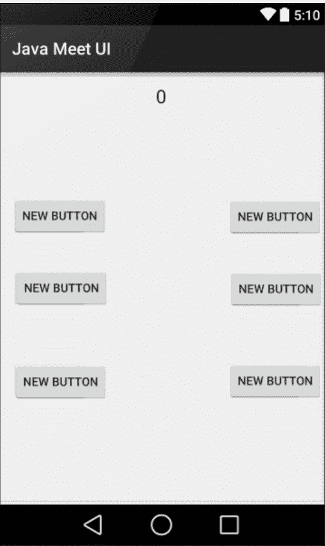
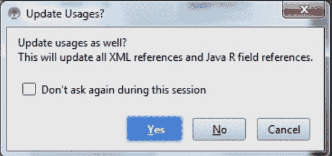
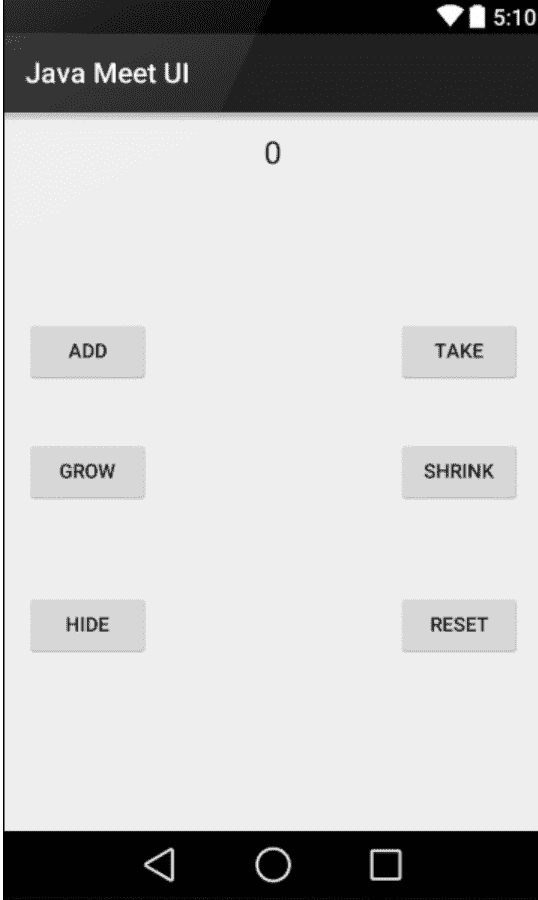
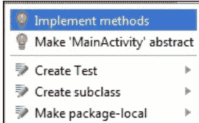

## 第 10 章。万物皆是类

在本章中，我们确实会看到万物皆是类。到本章结束时，Java 与我们 XML 布局之间的缺失环节将被完全揭示，使我们有能力为应用添加各种小部件。

在这里，你将学习以下主题：

- 作为类的 Android UI 元素
- 垃圾回收
- 堆上的我们的 UI
- 包含内部类和匿名类的类的特殊类型

那么，我所说的"万物皆是类"是什么意思？


## 所有 Android UI 元素也是类

当我们的应用程序运行并且在 onCreate 中调用 setContentView 方法时，布局会从 XML UI 类中解析并加载到内存中作为可用对象。它们存储在称为堆的 DVM 内存部分中。

## 再次介绍引用

然而，所有这些 UI 对象/类在哪里？我们当然在代码中看不到它们。我们究竟如何才能获取它们？

每台 Android 设备内的 DVM 负责为我们的应用程序分配内存。此外，它会将不同类型的变量存储在不同的位置。

我们在方法中声明和初始化的变量存储在称为栈的内存区域中。在谈论栈时，我们可以沿用现有的仓库类比——差不多就是这样。我们已经知道如何操作栈上的变量。那么，让我们来谈谈堆以及存储在其中的内容。

### 注意

重要事实：类的所有对象都是引用类型变量，只是指向存储在堆上的实际对象的引用；它们不是实际对象。

将堆视为同一仓库中的一个独立区域。堆有大量地面空间用于存放形状奇特的物体，有用于存放较小物体的货架，有许多带有小型格子的长排，等等。对象就存储在这里。问题是我们无法直接访问堆。让我们来看看引用变量究竟是什么。

这是一个我们通过引用来引用和使用的变量。引用可以松散但有用地定义为地址或位置。对象的引用（地址或位置）位于栈上。因此，当我们使用点运算符时，我们是在要求 Dalvik 在特定位置执行任务，该位置存储在引用中。

### 提示

引用变量就是那样——一个引用。一种访问和操作对象（变量和方法）的方式，但它们本身并不是实际变量。

为什么，天哪，我们为什么会想要这样的系统？直接把我的对象放在栈上给我吧。原因如下。

## 临时休息一下，把垃圾清理掉

栈和堆的整个机制就是为我们做这些事。正如我们所知，DVM 会为我们跟踪所有对象，并将它们存储在仓库中称为堆的特殊区域。在应用程序运行期间，DVM 会定期扫描栈（即仓库中的普通货架），并将引用与堆上的对象进行匹配。它会销毁任何找不到匹配引用的对象。或者用 Java 术语来说，它会进行垃圾回收。

想象一辆非常挑剔的垃圾车正在我们的堆中央行驶，扫描对象以匹配引用（位于栈上）。没有引用，你现在就是垃圾了。毕竟，如果一个对象没有引用变量，我们无论如何都无法对它做任何事，因为我们无法访问它。这种垃圾回收系统通过释放未使用的内存，帮助我们的应用程序更高效地运行。

如果这项任务留给我们来做，我们的应用程序编码将要复杂得多。

因此，在方法中声明的变量是局部的，位于栈上，并且只在声明它们的方法中可见。成员变量（在对象中）位于堆上，可以从任何有对它的引用的位置以及访问规范（封装）允许的任何位置引用它。

## 栈和堆 – 快速总结

让我们快速回顾一下你关于栈和堆所学的内容：

- 你不会删除对象，但 VM 会在认为合适时发送垃圾回收器。这通常发生在对象没有活动引用时。
- 局部变量和方法位于栈上，局部变量仅局限于声明它们的特定方法。
- 实例/类变量位于堆上（与它们的对象一起），但对对象的引用，即地址，是栈上的局部变量。
- 我们控制什么进入栈。我们可以使用堆上的对象，但只能通过引用它们。
- 堆由垃圾回收器维护。
- 当不再有有效引用指向对象时，该对象将被垃圾回收。因此，当引用变量（无论是局部变量还是实例变量）从栈中移除时，其相关对象就有资格进行垃圾回收。当 DVM 决定时机合适时（通常非常及时），它会释放 RAM 内存以避免内存耗尽。
- 如果我们尝试引用不存在的对象，将会出现 NullPointerException 错误，应用程序会崩溃。

## 那么，这个堆机制能帮我什么？

任何设置了 id 属性的 UI 元素都可以使用 findViewById 方法从堆中检索其引用，该方法是 Activity（即 AppCompatActivity 类）的一部分。由于它是我们继承的类的一部分，我们可以访问它：

```
myButton = (Button) findViewById(R.id.myButton);
```

前面的代码假设 myButton 已事先声明为适当的类型；在这里，是 Button。此外，前面的代码还假设在 XML 布局中，存在一个 ID 属性设置为 myButton 的按钮。

请注意，findViewById 也是多态的。我们知道这一点是因为我们使用了强制类型转换 (Button)，以明确将返回的对象从其 View 父类型转换为 Button，就像我们在上一章中对象类型为 Elephant 并使用 feed 方法时所做的那样。

这非常令人兴奋，因为这意味着我们可以从布局中获取大量内容的引用。然后，我们可以开始使用这些对象的所有方法。以下是我们可以用于 Button 对象的一些方法示例：

```
myButton.setText
myButton.setHeight
myButton.setOnClickListener
myButton.setVisibility
```

请记住，Button 单独就有大约 50 个方法！如果你认为在将近 10 章之后，我们终于要开始用 Android 做一些真正酷的事情了，那你就是对的！

## 从我们的布局中使用 Button 和 TextView 小部件

要跟着这个小项目操作，请创建一个新的 Android Studio 项目，将其命名为 Java Meet UI，并将所有其他选项保留为默认值。和往常一样，你可以在第 10 章/Java Meet UI 文件夹中找到 Java 代码和 XML 布局代码。

首先，让我们构建一个简单的 UI：

- 1. 删除自动生成的 TextView 小部件，即显示 "Hello world!" 的那个。
- 2. 在布局顶部和中心添加一个 Large Text 小部件。
- 3. 将其 text 属性设置为 0，id 属性设置为 txtValue。请仔细注意 ID 的大小写。它有一个大写的 v。
- 4. 现在，将六个按钮拖放到布局上，使其看起来与此处下一张截图非常相似。确切的布局并不重要：



- 5. 依次双击每个按钮（从左到右，然后从上到下），并按下表所示设置 text 和 id 属性。当出现如下图所示的弹出消息时，每次都选择“是”：



| text 属性 | id 属性 |
|---|---|
| add | btnAdd |
| take | btnTake |
| grow | btnGrow |
| shrink | btnShrink |
| Hide | btnHide |
| Reset | btnReset |

完成后，你的布局应如下一张截图所示：



按钮的精确位置和文本并不重要，但赋予 id 属性的值必须完全相同。原因是我们将使用这些 ID 从 Java 代码中获取此布局中按钮和 TextView 的引用。

在编辑器中切换到 **MainActivity.java** 选项卡，并找到以下代码：

```
public class MainActivity extends AppCompatActivity{
```

将上一行修改为：

```
public class MainActivity extends AppCompatActivity implements
View.OnClickListener{
```

请注意，我们刚刚修改的整行代码下方有红色下划线，表示有错误。现在，由于我们通过添加接口将 MainActivity 变成了 OnClickListener，因此必须实现 onClickListener 的抽象方法。该方法称为 onClick。当我们添加该方法后，错误将消失。

我们可以通过点击错误所在行的任意位置，然后使用键盘组合 Alt + Enter，让 Android Studio 为我们添加该方法。之后，点击 **实现方法** 选项，如下图所示：



现在，点击 **确定** 以确认我们希望 Android Studio 添加 onClick 方法。错误消失，我们可以继续添加代码。我们也有了一个 onClick 方法，很快就会看到要用它做什么。

现在，我们将声明一个名为 value 的 int 变量，并将其初始化为 0。我们还将声明六个 Button 对象和一个 TextView 对象。我们将赋予它们与 UI 布局中 id 属性值相同的名称。这种名称关联不是必需的，但它有助于跟踪 Java 代码中的哪个 Button 将持有 UI 中哪个 Button 的引用。

此外，我们将它们全部声明为 private 访问规范，因为我们知道它们在该类外部不会被需要。

在开始输入代码之前，请注意，所有这些变量都是 MainActivity 类的成员。这意味着我们将在上一步中修改的类声明后立即输入接下来显示的所有代码。


将所有这些变量设为成员/字段意味着它们具有类作用域，我们可以在MainActivity类的任何位置访问它们。这对本项目至关重要，因为我们将在onCreate和新的onClick方法中用到所有这些变量。

请在MainActivity类的开花括号{之后、onCreate方法之前，输入我们刚才讨论的以下代码：

```
// An int variable to hold a value
private int value = 0;

// A bunch of Buttons and a TextView
private Button btnAdd;
private Button btnTake;
private TextView txtValue;
private Button btnGrow;
private Button btnShrink;
private Button btnReset;
private Button btnHide;
```

### 提示

请记住使用 Alt + Enter 键盘组合来导入新类。

接下来，我们要让所有变量准备就绪，以便投入使用。最佳位置是在onCreate方法中，因为我们知道Android会在应用显示给用户之前调用它。这段代码使用findViewById方法将我们的每个Java对象与UI中的一个小部件关联起来。

它通过返回与堆上UI小部件关联的对象的引用来实现这一点。它知道我们要哪个，是因为我们将适当的id作为参数使用。例如，...(R.id.btnAdd)将返回布局中创建的带有ADD文本的Button。

提醒一下，我们使用看起来奇怪的 = (Button) 语法，因为该方法是多态的，可能返回View类的任何子类对象类型。这称为强制类型转换。

请在onCreate方法中对setContentView的调用之后，输入以下代码：

```
// Get a reference to all the buttons in our UI
// Match them up to all our Button objects we declared earlier
btnAdd = (Button) findViewById(R.id.btnAdd);
btnTake = (Button) findViewById(R.id.btnTake);
txtValue = (TextView) findViewById(R.id.txtValue);
btnGrow = (Button) findViewById(R.id.btnGrow);
btnShrink = (Button) findViewById(R.id.btnShrink);
btnReset = (Button) findViewById(R.id.btnReset);
btnHide = (Button) findViewById(R.id.btnHide);
```

现在我们有了所有Button对象和TextView的引用，可以开始使用它们的方法了。在接下来的代码中，我们在每个Button引用上使用setOnClickListener方法，让Android将用户的任何点击传递到我们的onClick方法。

之所以有效，是因为当我们实现了View.OnClickListener接口后，我们的MainActivity类实际上变成了一个OnClickListener。

因此，我们只需要依次在每个按钮上调用setOnClickListener。提醒一下，this参数是对MainActivity的引用。因此，该方法调用的意思是：“嘿，Android，我想要一个onClickListener，并且希望它是MainActivity类”。Android现在知道调用哪个类的onClick。如果我们没有先实现接口，这段代码将无法工作。另外，我们必须在Activity启动之前设置这些监听器，这就是为什么我们在onCreate中执行此操作。

我们将很快向onClick添加代码来实际处理发生的情况。

请在onCreate方法中的前面代码之后添加以下代码：

```
// Listen for all the button clicks
btnAdd.setOnClickListener(this);
btnTake.setOnClickListener(this);
txtValue.setOnClickListener(this);
btnGrow.setOnClickListener(this);
btnShrink.setOnClickListener(this);
btnReset.setOnClickListener(this);
btnHide.setOnClickListener(this);
```

现在，向下滚动到Android Studio在我们实现OnClickListener接口后为我们添加的onClick方法。在其中添加float size;变量声明和一个空的switch块，使其看起来像下面这段代码。要添加的新代码已在此处高亮显示：

```
public void onClick(View v)

// A local variable to use later
float size;

switch(v.getId()){ }
}
```

请记住，switch会检查case以匹配switch语句内的条件。

在前面的代码中，switch条件是v.getId()。让我们逐步了解一下。v变量是对View类型对象的引用，该对象由Android传递到onClick方法中：

```
public void onClick(View v)
```

View是Button、TextView等的父类。因此，也许正如我们所期望的，调用v.getId()将返回已点击的UI小部件的ID属性，即最初触发对onClick调用的那个小部件。

然后我们需要做的就是为要响应的每个Button引用提供一个case语句（以及相应的操作）。

我们会看到，下面这段代码包含前三个case语句。它们分别处理R.id.btnAdd、R.id.btnTake和R.id.btnReset。

R.id.btnAdd case中的代码只是增加value变量，然后做了一件新事情。它在txtValue对象上调用setText方法。这里的参数是("" + value)。这个参数使用空字符串并将value中存储的任何值添加（连接）到其中。这会导致我们的TextView txtValue小部件显示value中存储的任何值。

TAKE按钮（R.id.btnTake）做的完全相同的事情，但不是给value加1，而是从中减去1。

第三个case语句处理RESET按钮，将value设为0，并再次更新txtValue的文本属性。

然后，在每个case的末尾都有一个break语句。此时，switch块退出，onClick方法返回，生活恢复正常——直到用户下一次点击。

请在switch块的开花括号{之后，输入我们刚才讨论的以下代码：

```
case R.id.btnAdd:
    value ++;
    txtValue.setText(""+ value);

    break;

case R.id.btnTake:
    value--;
    txtValue.setText(""+ value);

    break;

case R.id.btnReset:
    value = 0;
    txtValue.setText(""+ value);

    break;
```

接下来的两个case语句处理我们UI中的**收缩**和**放大**按钮。我们可以从R.id.btnGrow和R.id.btnShrink ID中确认这一点。新的、更有趣的地方是使用的两个新方法。

getTextScaleX方法返回其作用对象内文本的水平缩放比例。我们可以看到它作用的对象是我们的TextView txtValue。代码行开头的size = 将返回值赋给我们的float变量size。

每个case语句中的下一行代码使用setTextScaleX更改文本的水平缩放比例。当按下**放大**按钮时，缩放比例设为size + 1，当按下**收缩**按钮时，缩放比例设为size - 1。

总体效果是允许这两个按钮在每次点击时按1的比例放大和缩小txtValue中的文本。

请在前面的代码下方，输入我们刚才讨论的接下来的两个case语句：

```
case R.id.btnGrow:
    size = txtValue.getTextScaleX();
    txtValue.setTextScaleX(size + 1);

    break;

case R.id.btnShrink:
    size = txtValue.getTextScaleX();
    txtValue.setTextScaleX(size - 1);

    break;
```

在我们即将编写的最后一个case语句中，有一个if-else块。这个条件需要稍微解释一下。下面开始。

要评估的条件是txtValue.getVisibility() == View.VISIBLE。
== 运算符之前的条件第一部分返回txtValue TextView的可见性
属性。返回值将是View类中定义的三个
可能常量值之一。它们是View.VISIBLE、
View.INVISIBLE和View.GONE。

如果TextView在UI上对用户可见，则该方法返回View.VISIBLE，
条件评估为true，并执行if块。

在if块内，我们对txtValue使用setVisibility方法，并使用View.INVISIBLE参数将其对用户不可见。

除此之外，我们还使用setText方法将btnHide上的文本更改为SHOW。

执行if块后，txtValue变得不可见，我们的UI上有一个显示SHOW的按钮。当用户在此状态下点击它时，if
语句将为false并执行else块。在else块中，
我们反转情况。我们将txtValue设回View.VISIBLE，并将btnHide上的文本
属性设回HIDE。

如果这无论如何都不清楚，只需输入代码，运行应用，并在看到它实际运行后重新查看这段最后的
代码和解释。


```
case R.id.btnHide:
    if (txtValue.getVisibility() == View.VISIBLE) {
        // Currently visible so hide it
        txtValue.setVisibility(View.INVISIBLE);

        // Change text on the button
        btnHide.setText("SHOW");
    } else {
        // Currently hidden so show it
        txtValue.setVisibility(View.VISIBLE);

        // Change text on the button
        btnHide.setText("HIDE");
    }

    break;
```

我们已经准备好 UI 和代码，是时候运行应用了。试试所有按钮。注意，**添加** 和 **取出** 按钮会将 `value` 的值在任一方向上改变 1，然后在 `TextView` 中显示结果。同样要注意的是，**收缩** 和 **放大** 按钮会减小和增大文本的宽度，**重置** 将 `value` 变量设置为 `0` 并在 `TextView` 中显示。最后，**隐藏** 按钮不仅隐藏 `TextView`，还会将自身文本更改为 **显示**，如果再次点击，它确实会重新显示 `TextView`。

请注意，此应用中无需使用 `Log` 或 `Toast`，因为我们最终是使用 Java 代码来操作 UI 的。

### 内部类和匿名类

在进入下一章、构建包含大量不同小部件的应用程序（这将让你实践并巩固本章所学的一切内容）之前，我们将对匿名类和内部类做一个非常简短的介绍。

在上一章中，当我们实现 Basic Classes 演示应用时，我们在与 MainActivity 类分离的文件中声明并实现了该类。该文件必须与类名相同。

我们也可以在一个类中声明和实现类。当然，剩下的唯一问题是：我们为什么要这样做？当我们实现一个内部类时，内部类可以访问封闭类的成员变量，而封闭类可以访问内部类的成员。这通常使我们的代码结构更加简单直接。因此，有时内部类是首选方案。

此外，我们还可以在类的某个方法中声明和实现一个完整的类。这样做时，我们使用略有不同的语法，并且不为类命名。这就是匿名类。

在本书的其余部分，我们将看到内部类和匿名类的实际应用，并在使用它们时对它们进行深入讨论。

## 常见问题解答

- 1. 我并不完全明白，实际上，我现在的问题比章节开始时还要多。我该怎么办？

你已经了解了足够多的面向对象编程（OOP）知识，足以在 Android 和任何其他类型的 Java 编程中取得显著进展。如果你现在迫切想了解更多 OOP 知识，有很多高评分的书籍只讨论 OOP。然而，实践和对语法的熟悉程度将大大帮助你达到同样的效果，并且可能更有趣。这正是我们在本书剩余部分要做的事。

## 小结

在本章中，我们终于在代码和 UI 之间实现了真正的交互。事实证明，每次我们向 UI 添加一个小部件时，实际上都是在添加一个 Java 对象（属于某个类），我们可以在 Java 代码中使用适当的引用来访问它。所有这些对象都存储在称为堆的独立内存区域中。

现在你已经处于可以学习并用一些更有趣的小部件做酷事情的位置。我们将在下一章中查看其中大量小部件，然后，在本书的其余部分中，我们还将继续介绍更多新的小部件。
