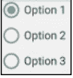
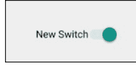
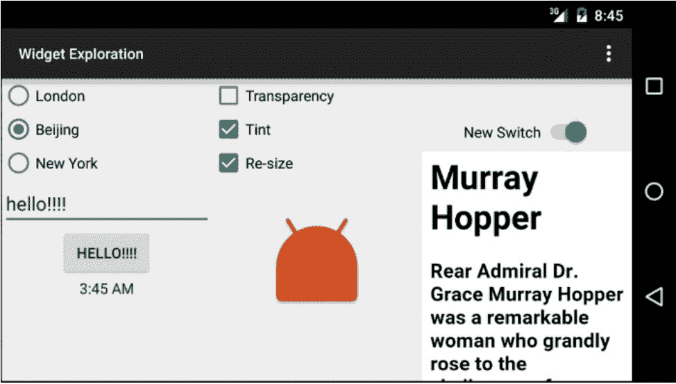
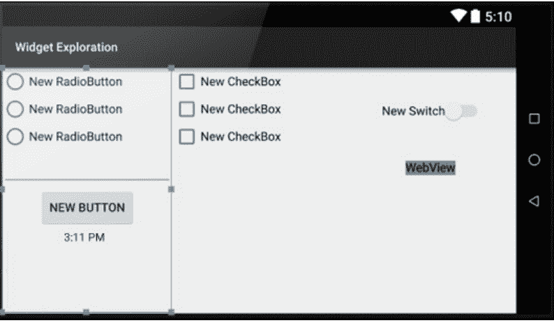
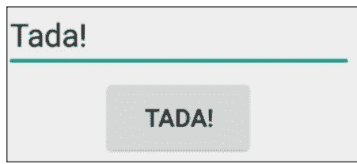

## 第 11 章 小部件狂想曲

现在我们对 Android 应用的布局和编码有了非常好的概览，也对面向对象编程有了新获得的见解，了解了如何从 Java 代码操作 UI，我们已准备好尝试调色板中的更多小部件。

面向对象编程有时很棘手，但通过逐步学习新概念、实践并熟悉它们，随着时间的推移，它实际上会成为我们的朋友。

在本章中，我们将回到 Android Studio 的调色板，查看大约六种我们要么根本没见过、要么尚未充分使用过的小部件，从而大大丰富我们的内容。

完成之后，我们将把它们都放入一个布局中，并练习使用 Java 代码操作它们。在本章中，我们将：

- 回顾如何声明和初始化布局小部件
- 快速了解如何仅使用 Java 代码创建小部件
- 查看 EditText、ImageView、RadioButton（和 RadioGroup）、Switch、CheckBox、WebView 和 TextClock 小部件
- 学习如何使用匿名类
- 使用上述所有小部件制作一个小部件演示小应用

让我们先快速回顾一下。

### 探索 Android UI 对象

让我们启动 Android Studio，准备深入探究调色板。在等待它启动的同时，让我们快速回顾一下对象，特别是使用我们 UI 布局中的对象。

### 声明和初始化对象

我们知道，当我们在 onCreate 方法中调用 setContentView 时，Android 会加载所有小部件和布局，并将它们转换为堆上的 *实际* Java 对象。

我们知道，要使用堆上的小部件，我们必须先声明正确类型的对象，然后使用它通过其唯一的 id 属性获取对堆上 UI 小部件对象的引用。例如，我们获取一个 id 属性为 txtTitle 的 TextView 的引用，并将其赋给一个名为 myTextView 的新对象，如下所示：

```
// Grab a reference to an object on the heap
TextView myTextView = (TextView) findViewById(R.id.txtTitle);
```

现在，使用我们的 myTextView 实例变量，我们可以执行 TextView 类设计用于完成的任何操作。例如，我们可以设置文本以显示如下内容：

```
myTextView.setText("Hi there");
```

我们可以这样使它消失：

```
// Bye bye
myTextView.setVisibility(View.GONE);
```

我们可以再次更改其文本并使其重新出现：

```
myTextView.setText("BOO!");
```

```
// Surprise
myTextView.setVisibility(View.VISIBLE);
```

值得注意的是，我们可以在 Java 中操作之前章节中使用 XML 设置的任何属性。此外，我们曾暗示过，但尚未实际看到，我们可以仅使用 Java 代码从无中创建小部件。

### 小部件新闻快讯

我们还可以从不是布局中对象引用的 Java 对象创建小部件。我们可以在代码中声明、实例化并设置小部件的属性，如下所示：

```
Button myButton = new Button();
```

前面的代码使用 new() 创建了一个新按钮。唯一的注意事项是，Button 必须是布局的一部分才能显示。因此，我们可以从 XML 布局中获取布局元素的引用，也可以在代码中创建一个新的布局。

假设我们在 XML 布局中有一个 id 属性等于 linearLayout1 的 LinearLayout，我们可以将前面一行代码中的按钮放入其中，如下所示：

```
// Get a reference to the LinearLayout
LinearLayout linearLayout = (LinearLayout) findViewById(R.id.linearLayout1);
```

```
// Add our Button to it
linearLayout.addView(myButton);
```

我们甚至可以先创建一个新布局，然后创建我们想要添加的所有小部件，最后在包含我们小部件的布局上调用 setContentView，从而纯用 Java 代码创建整个布局。在接下来的代码中，我们仅使用 Java 创建一个布局，虽然非常简单，只是在 LinearLayout 内部包含一个 Button 小部件：

```
// Create a new LinearLayout
LinearLayout linearLayout = new LinearLayout();
```

```
// Create a new Button
Button myButton = new Button();
```

```
// Add myButton to the LinearLayout
linearLayout.addView(myButton);
```

```
// Make the LinearLayout the main view
setContentView(linearLayout);
```

这可能很明显，但也值得指出的是，仅使用 Java 设计详细且精细的布局会更加笨拙、更难以可视化，而且不是最常见的做法。不过，有时候我们会发现以这种方式操作很有用。

现在我们在布局和小部件方面已经相当高级了。然而，很明显，调色板中还有一大堆我们尚未探索的其他小部件（和 UI 元素）。所以，让我们去探索一下。


## 探索调色板

让我们快速浏览一下调色板中先前未探索过的一些项目，然后可以将其中一批拖放到布局上，查看它们可能有用的一些方法。随后，我们可以实现一个小型项目，将它们全部派上用场。

我们在上一章已经探索了 Button 和 TextView。让我们更仔细地看看另外几个小部件。

### EditText

EditText 小部件名副其实。如果我们让用户可以使用 EditText，他们确实能够在其中编辑文本。我们在第 5 章《实际布局》中见过这一点，当时我们正在设计注册表单。我们未曾了解的是如何从其中捕获信息，或者将这段文本捕获代码放在何处。

接下来的代码块假设我们已声明一个 EditText 类型的对象，并使用它来获取 XML 布局中 EditText 的引用。我们可能会为按钮点击编写如下代码，可能是表单的提交按钮，但也可以将其放在我们认为应用中必要的任何位置：

```
String editTextContents = editText.getText();
// editTextContents now contains whatever the user entered
```

我们将在下一个小型应用中看到这在实际情境中的应用。

### ImageView

目前为止，我们已经几次将图像放置到布局上，但从未从 Java 代码中获取对图像的引用或对其做过任何处理。流程完全相同。按照以下步骤获取 ImageView 的引用，就像获取任何其他小部件的引用一样：

- 声明一个对象
- 使用 findViewById 方法和一个有效的 id 属性获取引用，如下所示：

```
ImageView imageView = (ImageView) findViewById(R.id.imageView);
```

然后，我们可以使用如下代码对图像做一些有趣的事情：

```
// Make the image 50% TRANSPARENT
imageView.setAlpha(.5f);
```

### 注意

那个看起来奇怪的 f 项只是让编译器知道该小部件的值是 float 类型，正如 setAlpha 方法所要求的那样。

在前面的代码中，我们在 imageView 上使用了 setAlpha 方法。setAlpha 方法接受 0 到 1 之间的值。完全透明是 0，完全不透明是 1。

### 提示

还有一个重载的 setAlpha 方法，它接受 0（完全透明）到 255（完全不透明）之间的 int 值。我们可以根据当时情况选择最合适的值。如果想回顾方法重载的知识，请参阅第 8 章《使用 Java 编程 第 2 部分 – 方法》。

我们将在下一个小型应用中使用一些 ImageView 方法。

### 单选按钮和单选组

当用户需要从两个或多个互斥选项中进行选择时，使用 RadioButton。也就是说，如果你选择了一个，其他选项就不能再被选中，就像老式收音机一样。请看下图中带有几个 RadioButton 选项的简单单选组：



当用户选择一个选项时，其他选项将自动被取消选择。我们通过在 UI 布局中将 RadioButton 放置在 RadioGroup 内来控制 RadioButton 小部件。当然，我们可以使用可视化设计器，直接将一堆 RadioButton 拖放到 RadioGroup 上。这样做时，XML 布局看起来大致如下：

```
<RadioGroup
    android:layout_width="match_parent"
    android:layout_height="match_parent"
    android:layout_alignParentTop="true"
    android:layout_alignParentLeft="true"
    android:layout_alignParentStart="true"
    android:id="@+id/radioGroup">
```

```
<RadioButton
    android:layout_width="wrap_content"
    android:layout_height="wrap_content"
    android:text="Option 1"
    android:id="@+id/radioButton1"
    android:checked="true" >
```

```
<RadioButton
    android:layout_width="wrap_content"
    android:layout_height="wrap_content"
    android:text="Option 2"
    android:id="@+id/radioButton2"
    android:checked="false" >
```

```
<RadioButton
    android:layout_width="wrap_content"
    android:layout_height="wrap_content"
    android:text="Option 3"
    android:id="@+id/radioButton3"
    android:checked="false" >
```

```
</RadioGroup>
```

请注意，在前面的代码中，每个单选按钮和单选组都设置了适当的 id 属性。然后，我们可以像预期的那样获取它们的引用，如下所示：

```
// Get a reference to all our widgets
RadioGroup radioGroup = (RadioGroup) findViewById(R.id.radioGroup);
RadioButton rb1 = (RadioButton) findViewById(R.id.radioButton1);
RadioButton rb2 = (RadioButton) findViewById(R.id.radioButton2);
RadioButton rb3 = (RadioButton) findViewById(R.id.radioButton3);
```

不过，在实际操作中，正如我们将看到的，我们仅凭 RadioGroup 引用就可以管理几乎所有内容。

你可能在想，我们怎么知道它们何时被点击了？或者你可能会觉得跟踪哪个被选中可能比较棘手。为此，我们需要 Android API 和 Java 的一些帮助。

### 匿名类

在上一章中，我们简要介绍了匿名类。在这里，你将了解更多关于它们的内容，并看到它们如何帮助我们。当 RadioButton 属于 RadioGroup 时，它们的视觉外观会为我们协调一致。我们只需要在任何单选按钮被按下时做出反应。当然，与任何其他按钮一样，我们需要知道它们何时被点击。

RadioButton 的行为与常规 Button 不同，仅在 onClick 中监听点击（在实现 onClickListener 之后）是不起作用的，因为 RadioButton 不是这样设计的。

我们需要做的是使用另一个 Java 特性。我们需要实现一个类，一个匿名类，其唯一目的是监听 RadioGroup 上的点击。接下来的代码块假设我们有一个名为 radioGroup 的 RadioGroup 引用：

```
radioGroup.setOnCheckedChangeListener(
    new RadioGroup.OnCheckedChangeListener() {
        @Override
        public void onCheckedChanged(RadioGroup group, int checkedId) {
            // Handle clicks here
        }
    }
);
```

在前面的代码中，具体来说，RadioGroup.OnCheckedChangedListener 从其开花括号 { 到闭花括号 }，被称为 **匿名** 类，因为它没有名称。实际类代码在调用 onCreate 时不会运行；它只是准备该类来处理单选组上的任何点击。我们现在将更详细地讨论这一点。

### 注意

从技术上讲，这个类被称为 **匿名内部** 类，因为它位于另一个类中。内部类可以是匿名的，也可以有名称。我们将在第 13 章《处理和显示数据数组》中看到一个带有名称的内部类。

我记得第一次看到匿名类时，几乎想钻进壁橱里躲起来，但它并不像乍看之下那么复杂。

这段代码所做的是向 radioGroup 添加一个监听器。其效果与我们在第 10 章《万物皆类》中实现 View.OnClickListener 时非常相似；只不过这次，我们正在声明并实例化一个监听器类，同时准备让它监听 radioGroup，并重写所需的方法，这里就是 onCheckedChanged。这就像是 RadioGroup 版本的 onClick。

让我们一步步走一遍。首先，我们将在 radioGroup 类上调用 setOnCheckedChangeListener 方法：

```
radioGroup.setOnCheckedChangeListener(
```

我们将一个新的匿名类及其重写方法的详细信息作为参数传入：

```
new RadioGroup.OnCheckedChangeListener() {
  @Override
  public void onCheckedChanged(RadioGroup group, int checkedId) {
    // Handle clicks here
  }
}
```

最后，我们有方法的右括号，当然还有分号来标记行的结束。我们之所以将其分成多行展示，只是为了更易读。就编译器而言，它们完全可以连在一起：

```
);
```

如果我们使用前面的代码来创建和实例化一个监听 RadioGroup 类点击的类，也许是在 onCreate 方法中，那么这个方法将在 Activity 的整个生命周期内监听并响应。你现在需要学习的就是如何在我们重写的 onCheckedChanged 方法中处理点击。

请注意，当按下 radiogroup 时传入的方法参数之一是 int checkedId。它保存当前选中的单选按钮的 ID。这正是我们需要的——差不多。

你可能会惊讶于 checkedId 是 int 类型。Android 将所有 ID 都存储为 int，尽管我们使用字母数字字符（例如 radioButton1 或 radioGroup）来声明它们。应用编译时，所有用户友好的名称都会被转换为 int。那么，我们如何知道哪个 int 元素对应 radioButton1 或 radioButton2 这样的 ID 呢？

我们需要做的是获取 checkedId 所指向的实际对象的引用。我们可以这样做：

```
RadioButton rb = (RadioButton) group.findViewById(checkedId);
```

现在，我们可以获取当前选中的单选按钮的熟悉 ID，我们现在有一个存储在 rb 中的引用。我们可以使用 getId 方法来做到这一点，如下所示：

```
rb.getId();
```


我们可以使用 switch 块来处理 RadioButton 点击事件，为每个可能被按下的 RadioButton 提供 case，并使用 rb.getId() 方法作为 switch 块的表达式。下面的代码展示了我们讨论过的 onCheckedChanged 方法的全部内容：

```
// Get a reference to the RadioButton that is currently checked
RadioButton rb = (RadioButton) group.findViewById(checkedId);

// Switch based on the 'friendly' id
switch (rb.getId()) {
    case R.id.radioButton1:
        // Do something here
        break;

    case R.id.radioButton2:
        // Do something here
        break;

    case R.id.radioButton3:
        // Do something here
        break;
}
// End switch block
```

在下一个可运行的微型应用中亲眼看到该代码块的实际运行效果，并真正按下按钮，这会让事情变得更加清晰。

## A switch widget

Switch 小部件（不要与 Java 关键字小写的 switch 混淆）与 Button 小部件类似，只不过它具有两种可读取和响应的状态。switch 小部件的一个明显用途是显示和隐藏内容。还记得在我们第 10 章“一切都是类”的 Java Meet UI 应用中，我们使用按钮来显示和隐藏 TextView。每次显示/隐藏 TextView 时，我们都会更改按钮上的 Text 属性，以便清楚如果再次点击会发生什么。对用户来说可能更合理，对我们程序员来说也更直接的做法，是使用 Switch，如下图所示：



下面的代码假设我们已经有一个名为 mySwitch 的对象，它引用了布局中的 Switch 对象。我们可以像在第 10 章“一切都是类”的 Java Meet UI 应用中所做的那样显示和隐藏 TextView。为了监听并响应点击，我们再次使用匿名类。不过这次，我们使用的是 CompoundButton 版本的 OnCheckedChangeListener，而不是 RadioGroup。

我们需要重写 onCheckedChanged 方法，该方法带有一个名为 isChecked 的布尔参数。isChecked 变量简单来说，false 表示关闭，true 表示打开。

下面是一种更直观的替换文本显示/隐藏代码的方法：

```
mySwitch.setOnCheckedChangeListener(
 new CompoundButton.OnCheckedChangeListener() {
 public void onCheckedChanged(
 CompoundButton buttonView, boolean isChecked) {
 if(isChecked){
 // Currently visible so hide it
 txtValue.setVisibility(View.INVISIBLE);
 }else{
 // Currently hidden so show it
 txtValue.setVisibility(View.VISIBLE);
 }
 }
 }
);
```

如果匿名类代码看起来仍有点奇怪，请不用担心，因为我们使用得越多，就会越来越熟悉。现在当我们查看 CheckBox 时，我们还会再次这样做。

## CheckBox

我们在第 5 章“实际布局”的表单布局中使用了 CheckBox。然而，与 EditText 类似，我们并没有探讨如何实际从中获取数据。对于 CheckBox，我们只需在某个时刻（例如，当表单的提交按钮被点击时）检测其状态（选中或未选中）。下面的代码让我们一窥这种情况是如何发生的，同样，使用了一个充当监听器的内部类：

```
myCheckBox.setOnCheckedChangeListener(
    new CompoundButton.OnCheckedChangeListener() {

    public void onCheckedChanged(
    CompoundButton buttonView, boolean isChecked) {

    if (myCheckBox.isChecked()) {
    // It's checked so do something
    } else {
    // It's not checked do something else
    }

    }
);
```

在前面的代码中，我们假设 myCheckBox 已经声明并初始化，然后我们使用与 Switch 完全相同类型的匿名类来检测和响应点击。

## WebView

该小部件可以作为整个应用的容器。我们可以将完整网页的代码放在 res 文件夹中，然后从应用内部使用 JavaScript 语言来操作这些网页。将整个应用的功能包含在网页中，仅由 Android 应用进行展示，并可能通过 webView 添加一些额外功能，这是很常见的。

然而，采用这种方式的应用很少能达到真正原生 Android 应用那样专业的外观和手感，因为本书中您学习的 UI 功能远比常规 Web 编程所能实现的更强大、更灵活。

我们还可以在应用中使用 webView 向用户展示网页，但方式是让他们不必离开我们的应用来打开网页浏览器。这段代码在 WebView 中加载 Google：

```
WebView webView = (WebView) findViewById(R.id.webView);
webView.loadUrl("http://google.com");
```

和往常一样，前面的 Java 代码假设我们在布局 XML 中有一个 id 属性设置为 webView 的 WebView 小部件。

使用此小部件时，我们需要让用户知道应用将访问 Internet，并在用户安装应用时征得他们的许可。我们通过在 AndroidManifest.xml 文件中添加以下一行来实现：

```
<uses-permission android:name="android.permission.INTERNET"></uses-permission>
```

我们将在下一个微型应用中实际这样做。

## Date & Time

Android 设备通常带有时钟和日历。不过，有时我们可能希望在应用中显示时钟或让用户选择日期。从调色板中，我们可以选择一系列有用的日期和时间小部件。带有删除线的小部件已弃用，通常不再使用：

| 日期和时间 |
|---|
| TextClock | AnalogClock | DigitalClock | Chronometer | DatePicker |
| TimePicker | CalendarView |

在下一个应用中，我们将使用 TextClock 小部件向您展示其一些功能。

有了所有这些新信息，让我们开发一个应用，以更深入地使用 Android 小部件，超出我们目前所做的范围。不过，我们将先快速跑个偏，讨论 Android 权限，尤其是关于（在编写本书时）最新版本的 Marshmallow。

## Android permissions and Marshmallows

当我们的应用想要做某事，这件事可能会对用户的设备或用户隐私造成潜在危害时，Android 要求我们以特定方式处理，通常是在执行某些操作之前让应用向用户请求权限。

2015 年底 Android Marshmallow 推出后，我们处理事物的方式发生了改变——但仅适用于新的 Marshmallow 设备。

因此，当前的情况是我们需要处理两种可能的情形：Marshmallow 和 Marshmallow 之前。

### Pre-Marshmallow permissions

在 Marshmallow 之前，如果我们希望应用做某件事，这件事可能会造成潜在危害，例如连接 Internet（我们的下一个应用将这样做）、获取 GPS 位置、拍照、访问通讯录等等，我们需要在 AndroidManifest.xml 文件中添加一行代码。

然后，当用户从 Google Play 安装我们的应用时，会弹出一个小警告窗口，告诉他们我们的应用想要执行哪些潜在有害的操作。用户必须同意他们信任我们的应用，否则安装将被中止。

其工作原理如下步骤所示：

- 1. 我们想要添加潜在有害的功能 x。
- 2. 我们在 AndroidManifest.xml 中为功能 x 添加权限。
- 3. 用户从 Google Play 下载应用，并被警告我们的应用使用了功能 x。
- 4. 用户决定是否允许我们的应用使用功能 x。如果用户允许，应用将被安装；如果用户不允许，则不会安装。

### 注意

作为开发者或用户，都无需再考虑该权限

但随后 Marshmallow 出现并改变了一切。

### Marshmallow permissions

Marshmallow 在应用安装时不会请求权限。它会在即将使用需要权限的特定功能时请求权限。这对用户来说可能是件好事，也可能是件坏事，取决于你的看法。

一个潜在的好处是，用户可以安装带有（例如）两个权限的应用：访问其通讯录的权限和拨打电话的权限。这个假设的例子可能是一个通讯录应用，它允许用户添加联系人并点击联系人来拨打电话。

在 Marshmallow 下，用户将能够向其中一个功能授予权限，例如，访问通讯录的权限以允许他们管理联系人。他们可以拒绝允许应用拨打电话的权限，并确信该应用永远不会对巨额电话账单负责。而使用 Marshmallow 之前的权限，则是全有或全无。

一个缺点是，用户会更容易安装包含他们可能不赞同的功能的应用，并且在浪费一些时间，可能错过 Google Play 提供的 15 分钟退款窗口后才意识到这一点。然而，我相信 Google 在设计这个系统时只考虑了用户安全。

这对我们作为开发者意味着，我们不仅需要为 Marshmallow 之前的设备向 `AndroidManifest.xml` 文件添加权限，还需要在所有正确的位置添加代码，以便在运行时处理 Marshmallow 权限。

情况因 Marshmallow 将某些权限视为 *dangerous*，而将其他权限视为 *normal* 而变得更加复杂。这将为我们的代码增加显著的复杂性。


## 此书中使用的权限方案

在着手编写本书之前，我们非常仔细地考虑过，在本书项目中使用 Marshmallow 运行时权限所需的覆盖量会掩盖其他学习目标，并对开发者读者或我们未来的用户提供很少的即时帮助。尤其是在本书需要出版新版之前，Marshmallow 设备的普及率不太可能达到 10% 的市场份额。除此之外，有一个非常简单的变通方法可以让我们的所有应用与 Marshmallow 和 Marshmallow 之前的权限兼容，我们将在第 21 章“Navigation Drawer and Where It's Snap”中构建带有危险权限的首个应用时看到这一点。

现在我们已经考虑了权限，让我们构建需要 android.permission.INTERNET 权限的 Widget 演示应用。这被视为普通权限，因此不需要针对 Marshmallow 设备进行任何特殊处理。

## Widget 探索小应用

我们刚才讨论了七个小部件。EditText、ImageView、RadioButton（和 RadioGroup）、Switch、CheckBox、WebView 和 TextClock 小部件。让我们做一个小应用，并对每个小部件做一些实际操作。我们还将使用 Button。

## 设置 Widget 探索项目和 UI

首先，我们将设置一个新项目并准备 UI 布局。这些快速步骤会将所有小部件放在屏幕上并设置 id 属性，以便获取对它们的引用。这将帮助我们在开始之前查看目标应用（如下图所示），该应用正在运行：



本应用将演示这些新小部件的方式如下：

- 单选按钮将允许用户从三个时区中选择，更改时钟上显示的时间
- 左侧的按钮在被单击时，将把其文本更改为 EditText 小部件中当前的内容
- 三个复选框将为 Android 机器人图像添加和移除视觉效果
- Switch 将打开和关闭 webView，它显示一位著名计算机科学家的相关信息

确切的布局位置并不重要，但指定的 id 属性必须完全匹配。如果你只是想查看/使用代码，可以在下载包的 Chapter 11/Widget Exploration 文件夹中找到所有文件。

- 1. 创建一个名为 Widget Exploration 的新项目，将 **最低 API** 设置为 17，使用空白 Activity，并保持其他所有设置为默认值。我们使用 API 17 是因为 **TextClock** 小部件的一个功能要求如此。
- 2. 让我们创建一个新布局文件，因为我们希望新布局基于 **LinearLayout**。在项目资源管理器中右键单击 **layout** 文件夹，并在弹出菜单的 **新建** 下选择 **布局资源文件**。
- 3. 在 **新建资源文件** 窗口中，在 **文件名** 字段输入 exploration_layout.xml，在 **根元素** 字段输入 **LinearLayout**。现在，单击 **确定**。
- 4. 在属性窗口中，将 **LinearLayout** 的方向属性更改为 **水平**。
- 5. 使用设计视图上方的下拉控件，确保在 **横向** 视图中选择了 **Nexus 5**。
- 6. 我们现在可以开始创建布局了。将三个 **RelativeLayout** 布局拖放到设计区域，以创建设计的三个垂直划分。依次将每个 **RelativeLayout** 布局的 **权重** 属性设置为 .33。我们现在有三个相等的垂直划分，就像前一幅图所示。
- 7. 将 **Switch** 和 **WebView** 从调色板拖放到 **RelativeLayout** 的右侧。我们布局的右侧现在应该看起来就像前一幅图所示。
- 8. 将三个 **CheckBox** 小部件依次上下拖放，然后将 **ImageView** 拖放到它们下方的中间 **RelativeLayout** 布局上。中间列现在应该看起来就像前一幅图所示，只是我们不能看到 **ImageView**，直到在其 src 属性中放入适当的值。我们将在几个步骤后执行此操作。
- 9. 将 **RadioGroup** 拖放到 **RelativeLayout** 的左侧，并在 **RadioGroup** 内添加三个 **RadioButton** 小部件。
- 10. 在 **RadioGroup** 下，从调色板的 **文本字段** 类别中拖放一个 **PlainText** 小部件。将 **Button** 小部件添加到 **PlainText** 小部件的右侧。从调色板添加 **TextClock** 到 **RelativeLayout** 左侧底部一半。你会看到关于 API 级别的警告。我们可以忽略它，因为我们将在最新的 Nexus 5 模拟器上运行。



- 11. 尝试调整布局，使其尽可能类似于前一幅图。请注意，直到我们添加实际图像之前，ImageView 是不可见的。

- 12. 现在，将下表中显示的属性添加到我们刚刚布置的小部件上：

| 小部件类型 | 属性 | 要设置的值 |
|---|---|---|
| RadioGroup | id | radioGroup |
| RadioButton (顶部) | id | radioButtonLondon |
| RadioButton (顶部) | text | London |
| RadioButton (顶部) | checked | true |
| RadioButton (中间) | id | radioButtonBeijing |
| RadioButton (中间) | text | Beijing |
| RadioButton (底部) | id | radioButtonNewYork |
| RadioButton (底部) | text | New York |
| EditText | id | editText |
| Button | id | button |
| TextClock | id | textClock |
| CheckBox (顶部) | text | Transparency |
| CheckBox (顶部) | id | checkBoxTransparency |
| CheckBox (中间) | text | Tint |
| CheckBox (中间) | id | checkBoxTint |
| CheckBox (底部) | text | Re-Size |
| CheckBox (底部) | id | checkBoxReSize |
| ImageView | src | @mipmap/ic_launcher |
| ImageView | id | imageView |
| Switch | id | switch1 |
| Switch | enabled | true |
| Switch | clickable | true |
| WebView | id | webView |

我们刚刚布置并设置了布局所需的属性。除了某些小部件类型对我们是新的之外，没有什么是我们以前没有做过的。

现在，我们可以开始在 Java 代码中使用所有这些小部件了。

## 编写 Widget 探索应用的代码

由于我们有将连接到 Internet（以显示网页）的 WebView，因此还需要用户的权限。所以，我们需要向 AndroidManifest.xml 文件添加一行。从项目资源管理器的 manifests 文件夹中打开它。

现在，在高亮显示的上下文指示的位置添加以下高亮显示的代码行：

```
...
<uses-permission android:name="android.permission.INTERNET" />
	<application
		android:allowBackup="true"
...
```

现在，让我们通过更改 onCreate 中对 setContentView 的调用，确保显示我们的新布局，使其如下所示：

```
setContentView(R.layout.exploration_layout);
```

接下来的这段代码看起来相当长且散乱，但我们所做的就是获取布局中每个小部件的引用。当我们准备使用它们时，我们将更详细地讨论代码。

接下来的代码块中唯一新的东西是某些对象被声明为 final。这是因为它们将在匿名类中使用。

### 提示

### 但是 final 不意味着对象不能被更改吗？

如果你记得，在第 9 章“面向对象编程”中，我们看到声明为 final 的变量不能被更改，它们是常量。那么，我们将如何更改这些对象的属性呢？请记住，对象是引用类型变量。也就是说，它们指向堆上的对象。它们本身并不是对象。我们可以把它们视为保存对象地址。地址是不能更改的。我们仍然可以使用该地址来引用堆上的对象，并随意更改实际对象。


在 onCreate 方法中调用 setContentView 之后立即输入此代码：

```java
// Get a reference to all our widgets
RadioGroup radioGroup = (RadioGroup) findViewById(R.id.radioGroup);
RadioButton rbBeijing = (RadioButton) findViewById(R.id.radioButtonBeijing);
RadioButton rbLondon = (RadioButton) findViewById(R.id.radioButtonLondon);
RadioButton rbNewYork = (RadioButton) findViewById(R.id.radioButtonNewYork);
final EditText editText = (EditText) findViewById(R.id.editText);
final Button button = (Button) findViewById(R.id.button);
final TextClock tClock = (TextClock) findViewById(R.id.textClock);
final CheckBox cbTransparency = (CheckBox) findViewById(R.id.checkBoxTransparency);
final CheckBox cbTint = (CheckBox) findViewById(R.id.checkBoxTint);
final CheckBox cbReSize = (CheckBox) findViewById(R.id.checkBoxReSize);
final ImageView imageView = (ImageView) findViewById(R.id.imageView);
Switch switch1 = (Switch) findViewById(R.id.switch1);
final WebView webView = (WebView) findViewById(R.id.webView);
```

现在我们可以创建一个匿名类来监听和处理复选框的点击。接下来的三段代码分别为每个复选框实现一个匿名类。不过，接下来三段代码中不同之处在于我们响应点击的方式，我们将逐一讨论它们。

第一个复选框标记为 Transparency，我们使用 imageView 上的 setAlpha 方法来更改其透明度（可见程度）。setAlpha 方法接受 0 到 1 之间的浮点数作为参数。这里，0 表示不可见，1 表示完全不透明。因此，当此复选框被选中时，我们将 alpha 设置为 .1，图像几乎不可见；当它未被选中时，我们将其设置为 1，表示图像完全可见且无透明度。onCheckedChanged 的布尔型 isChecked 参数包含 true 或 false，指示复选框是否被选中。

在 onCreate 中前一段代码之后添加此代码：

```java
/*
Now we need to listen for clicks
on the button, the CheckBoxes
and the RadioButtons
*/

// First the check boxes using an anonymous class
cbTransparency.setOnCheckedChangeListener(new CompoundButton.OnCheckedChangeListener() {
    public void onCheckedChanged(CompoundButton buttonView, boolean isChecked) {
        if(cbTransparency.isChecked())
        // Set some transparency
        imageView.setAlpha(.1f);
        }else{
        imageView.setAlpha(1f);
        }
    }
});
```

在下一个匿名类中，我们处理标记为 **色调** 的复选框。在 onCheckedChanged 方法中，我们使用 imageView 上的 setColorFilter 方法在图像上叠加一个颜色层。当 isChecked 为 true 时，我们叠加一种颜色；当 isChecked 为 false 时，我们移除它。

setColorFilter 方法接受以 **alpha、红、绿、蓝 (ARGB)** 格式表示的颜色作为参数。颜色由 Color 类的 argb 静态方法提供。如您所料，argb 方法的四个参数分别是 alpha、红、绿和蓝的值。这四个值创建了一种颜色。在我们的示例中，150, 255, 0, 0 这些值创建了一个强红色色调。而 0, 0, 0, 0 这些值则不创建任何色调。

## 提示

要了解更多关于 Color 类的信息，请访问 Android 开发者网站 http://developer.android.com/reference/android/graphics/Color.html，要深入了解 RGB 颜色系统，请查看 Wikipedia 网站 https://en.wikipedia.org/wiki/RGB_color_model。

在 onCreate 中前一段代码之后添加此代码：

```java
// Now the next checkbox
cbTint.setOnCheckedChangeListener(new CompoundButton.OnCheckedChangeListener() {
    public void onCheckedChanged(CompoundButton buttonView, boolean isChecked) {
    if (cbTint.isChecked()) {
    // Checked so set some tint
    imageView.setColorFilter(Color.argb(150, 255, 0, 0));
    } else {
    // No tint required
    imageView.setColorFilter(Color.argb(0, 0, 0, 0));
    }
    }
    });
```

在处理标记为 **调整大小** 的复选框的匿名类中，我们使用 setScaleX 方法来调整机器人图像的大小。当我们在 imageView 上调用 setScaleX(2) 和 setScaleY(2) 时，图像大小将加倍；setScaleX(1) 和 setScaleY(1) 将使其恢复正常。

在 onCreate 中前一段代码之后添加此代码：

```java
// And the last check box
cbReSize.setOnCheckedChangeListener(new CompoundButton.OnCheckedChangeListener() {
    public void onCheckedChanged(CompoundButton buttonView, boolean isChecked) {
    if (cbReSize.isChecked()) {
    // It's checked so make bigger
    imageView.setScaleX(2);
    imageView.setScaleY(2);
    } else {
    // It's not checked make regular size
    imageView.setScaleX(1);
    imageView.setScaleY(1);
    }
    }
    });
```

现在我们将处理三个单选按钮。因为它们属于 RadioGroup，所以我们可以比处理 CheckBox 对象更简洁地处理它们。做法如下。

首先，我们通过在 radioGroup 上调用 clearCheck() 来确保它们在开始时处于未选中状态。然后，我们创建 OnCheckedChangedListener 类型的匿名类并重写 onCheckedChanged 方法。

当 RadioGroup 中的任何单选按钮被点击时，将调用此方法。我们只需要获取被点击的 RadioButton 部件的 ID，并使用包含三种可能情况的 switch 语句做出相应响应，每个 RadioButton 部件对应一种情况。

还记得我们最初讨论 RadioButton 时，onCheckedChanged 的 checkedId 参数中提供的 ID 是 int 类型吗？这就是为什么我们必须首先从 checkedId 创建一个新的 RadioButton 对象：

```java
RadioButton rb = (RadioButton) group.findViewById(checkedId);
```

然后，我们可以在新的 RadioButton 部件上调用 getId 作为 switch 的条件：

```java
switch (rb.getId())
```

然后，在每个 case 中，我们使用适当的 Android 时区代码作为参数调用 setTimeZone 方法。

## 提示

您可以在此处查看所有 Android 时区代码 https://gist.github.com/arpit/1035596。

添加以下代码，它包含我们刚才讨论的所有内容并包括前两行代码。在 onCreate 中处理复选框的最后一段代码之后添加它：

```java
// Now for the radio buttons
// Uncheck all buttons
radioGroup.clearCheck();

radioGroup.setOnCheckedChangeListener(new RadioGroup.OnCheckedChangeListener() {
    @Override
    public void onCheckedChanged(RadioGroup group, int checkedId) {
        RadioButton rb = (RadioButton) group.findViewById(checkedId);

        switch (rb.getId()) {
        case R.id.radioButtonLondon:
            tClock.setTimeZone("Europe/London");
            break;

        case R.id.radioButtonBeijing:
            tClock.setTimeZone("CST6CDT");
            break;

        case R.id.radioButtonNewYork:
            tClock.setTimeZone("America/New_York");
            break;
        }
        // End switch block
    }
});
```

现在是时候了解一些新内容了。在这段代码中，我们使用匿名类来处理普通按钮的点击。我们像之前一样调用了 button.setOnClickListener。不过，这次我们没有将 this 作为参数传递，而是创建了一个全新的 View.OnClickListener 类型的类，并将重写的 onClick 作为参数，这与我们处理其他匿名类的方式相同。

## 提示

在这种情况下，此方法可能更可取，因为只有一个按钮。如果有许多按钮，则让 MainActivity 实现 View.OnClickListener 并重写 onClick 以在一个方法中处理所有点击可能更可取，就像我们之前做的那样。

在 onClick 方法中，我们使用 setText 设置 button 的文本属性，并使用 editText 的 getText 方法获取 EditText 部件中当前的文本。

在 onCreate 中前一段代码之后添加此代码：

```java
/**
 * Let's listen for clicks on our regular Button.
 * We can do this with an anonymous class as well.
 */
button.setOnClickListener(new View.OnClickListener() {
    @Override
    public void onClick(View v) {
        // We only handle one button
        // So no switching required
        button.setText(editText.getText());
    }
});
```

在下一段代码中，我们使用 loadUrl 方法将网页加载到 webView 中：

接下来，我们将创建另一个匿名类来监听和处理对 Switch 部件所做的更改。当 isChecked 变量为 true 时，我们显示 webView；当它为 false 时，我们隐藏它。

在 onCreate 中前一段代码之后添加此代码：

```java
// Make the webview display a page
webView.loadUrl("http://www.cs.yale.edu/homes/tap/Files/hopper-story.html");

webView.setVisibility(View.INVISIBLE);

switch1.setOnCheckedChangeListener(new CompoundButton.OnCheckedChangeListener() {
    public void onCheckedChanged(CompoundButton buttonView, boolean isChecked) {
        if(isChecked){
            webView.setVisibility(View.VISIBLE);
        }else{
            webView.setVisibility(View.INVISIBLE);
        }
    }
});
```

现在，我们可以运行我们的应用并尝试所有功能。Android 模拟器可以


通过在 PC 上按下 Ctrl + F11 键盘组合或在 Mac 上按下 Ctrl + fn + F11，可将其旋转为横向模式。

## 提示

撰写本文时，使用 Ctrl + F11 更改模拟器方向时，模拟器似乎会崩溃。因此，如果在让模拟器以横向模式显示时遇到任何问题，只需将其重新配置为以横向模式启动即可。你可以通过点击工具栏中的 AVD 图标，然后点击 Nexus 5 AVD 旁边的编辑（铅笔图标），并选择 Landscape 来完成此操作。点击 Finish 后，即可准备运行应用。

尝试勾选单选按钮，查看时钟上的时区变化。向 EditText 中输入不同的值，然后单击按钮，即可查看它如何获取文本并在自身上显示。



通过不同组合的选中和未选中复选框来更改图像的外观，并使用开关小部件隐藏和显示网页。

让我们继续了解另一种可以显著增强我们 UI 的方式。

## 摘要

在本章中，我们探索了大量小部件，了解了如何在不使用任何 XML 布局的情况下在 Java 代码中实现小部件，使用我们的第一个匿名类来处理对小部件的点击，并将我们所有新掌握的小部件技能应用到一个小型应用中。

在下一章中，我们将看到一个全新的 UI 元素，它不能直接从调色板拖放，但我们仍将获得 Android API 的大量帮助。接下来是对话框。我们还将着手开发目前为止最重要的应用——Note To Self 备忘录、待办事项和个人备忘应用。
