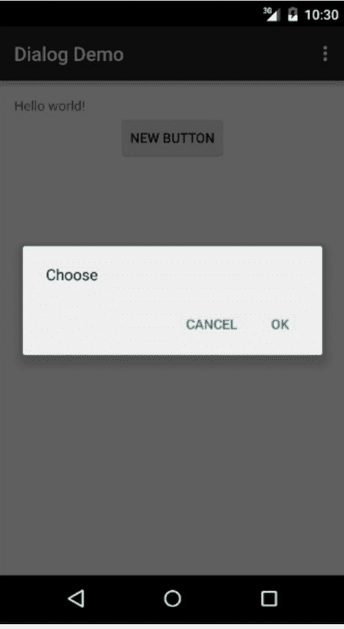
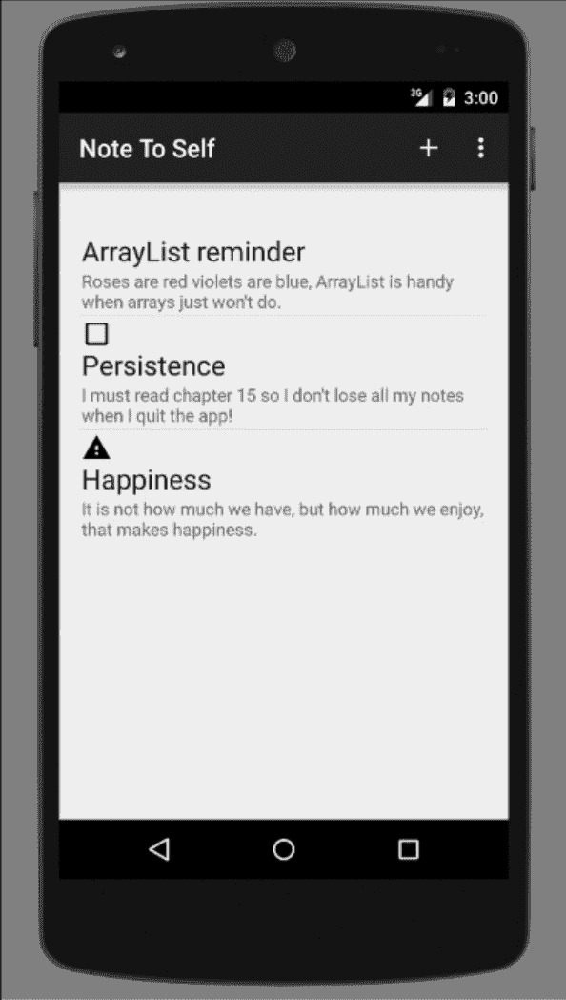
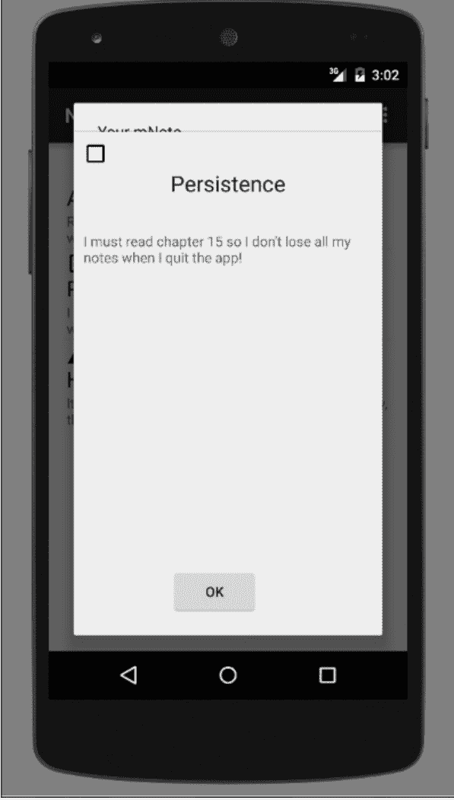
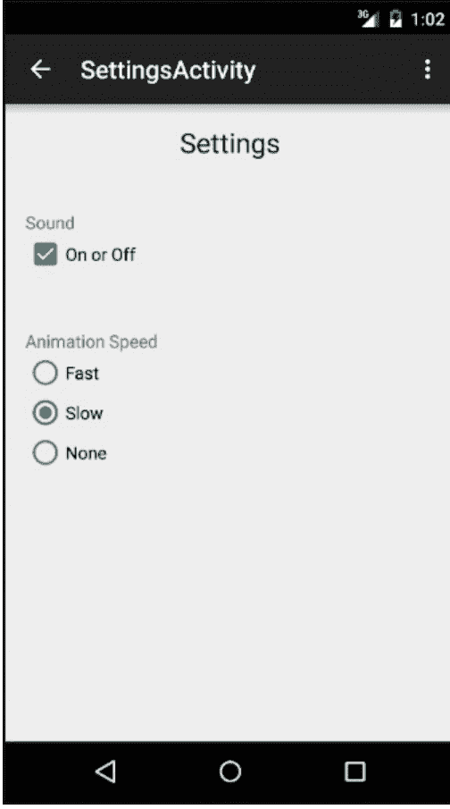
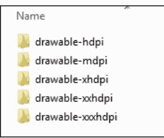
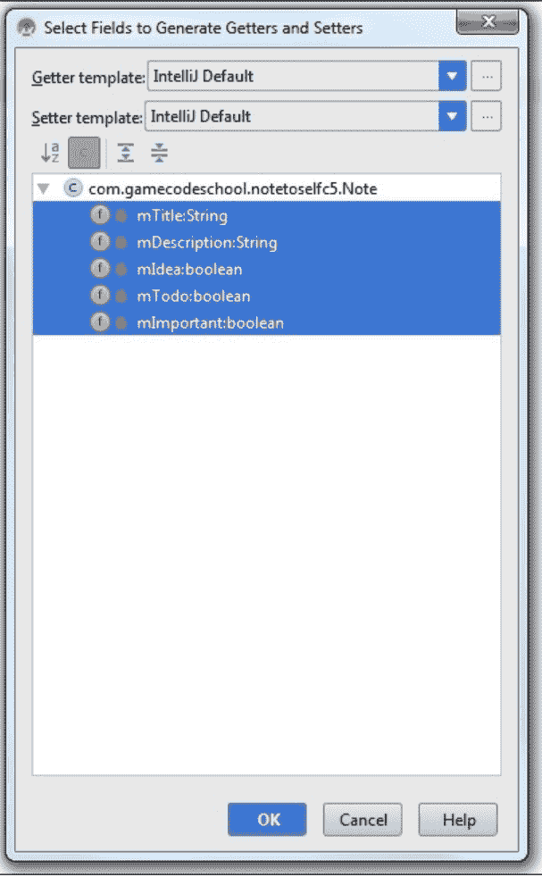
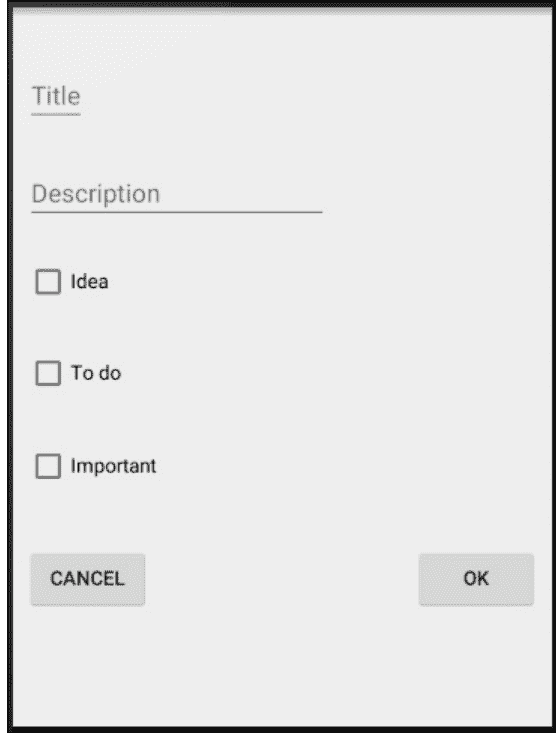
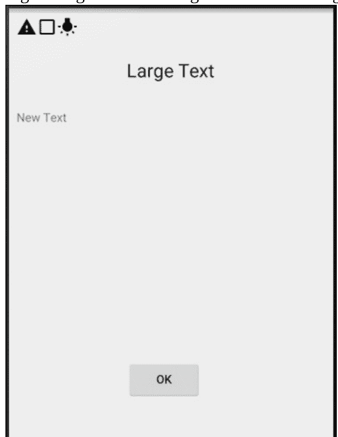

## 第 12 章。与用户对话

在本章中，我们将了解如何向用户展示弹出式对话框窗口。然后，我们可以将所学知识应用到我们的第一个应用 Note To Self 的第一阶段中。在本章及接下来的五个章节中，你将学习新的 Android 和 Java 功能，我们将使用你新获得的知识每次都增强 Note To Self 应用。

在每个章节中，我们还将构建一系列与主应用分离的小型应用。因此，本章为你准备了以下内容：

- 如何实现带有弹出式对话框的简单应用
- 如何添加 DialogFragments 以启动 Note To Self 应用
- 如何将 Strings 和图形等资源添加到项目中
- 如何首次使用 Android 命名约定使我们的代码更易读
- 如何实现更复杂的对话框以捕获用户输入

让我们开始吧。

### 对话框窗口

通常，我们希望在弹出式窗口中向用户显示一些信息，或者询问用户是否确认某项操作。这被称为 **对话框** 窗口。如果你快速浏览调色板，可能会惊讶地发现完全没有提到对话框。

Android 中的对话框比简单的小部件甚至布局更高级。它们是可以包含自身布局和小部件的类。

在 Android 中创建对话框窗口的最佳方法是使用 `Fragment` 类。Fragment 是 Android 中广泛且重要的主题，我们将花费本书下半部分的大部分时间来探索和使用它们。

不过，为我们的用户创建一个整洁的弹出式对话框进行交互，是了解 Fragment 的绝佳入门，并且一点也不复杂。

### 对话框演示小型项目 – 链式调用简介

我们之前提到，在 Android 中创建对话框的最佳方法是使用 Fragment 类。在 Android 中，还有一种创建对话框的方法，可以说简单一些。但这个稍微简单一点的 Dialog 类的问题是，它在 Activity 生命周期中受到的支持不够好。甚至有可能 Dialog 意外导致应用崩溃。

如果你正在编写一个具有一个固定方向布局且需要一个简单弹出式对话框的应用，有人可能会认为应该使用更简单的 Dialog 类。但是，由于我们致力于构建具有高级功能的现代、专业应用，因此忽略该类对我们有益。更具体地说，我们将使用 DialogFragment 类。

要启动小型项目，请在 Android Studio 中创建一个新的空白项目，并将其命名为 Dialog Demo。和往常一样，该项目的完整代码位于下载包的 Chapter 12/Dialog Demo 文件夹中。

通过右键单击包含 MainActivity.java 文件的包名称文件夹，创建一个新类。在“新建”下选择 Java 类，并将其命名为 MyDialog。单击 OK 以创建该类。

首先要做的是更改类声明以扩展 DialogFragment。完成后，你的新类将如下所示：

```java
public class MyDialog extends DialogFragment {
...
}
```

现在，让我们逐步向此类添加代码，并查看每个步骤中发生了什么。

首先，我们重写 onCreateDialog 方法，该方法将在我们稍后通过 MainActivity 中的代码显示对话框窗口时被调用。

然后，在 onCreateDialog 方法中，我们接触到一个新类。我们声明并初始化一个 AlertDialog.Builder 类型的对象，该对象需要一个对 MainActivity 的引用，该引用通过其构造函数传递。这就是为什么我们将 getActivity() 用作参数的原因。getActivity 方法是 Fragment 类的一部分（因此 DialogFragment 也是），它返回创建 DialogFragment 的 Activity 的引用。在此例中，它是我们的 MainActivity 类。添加此代码以准备好使用 builder 引用变量，然后我们将看看可以用它做什么：

```java
@Override
public Dialog onCreateDialog(Bundle savedInstanceState) {
    // Use the Builder class because this dialog has a simple UI
    AlertDialog.Builder builder =
    new AlertDialog.Builder(getActivity());
}
```

现在，我们可以使用 builder 对象来完成其余工作。接下来的三段代码中有一点点奇怪。如果你快速浏览接下来的三段代码，会注意到明显缺少分号；。这表明，对于编译器来说，这三段代码实际上只是一行。

这里发生的事情，我们在不太明显的情况下实际上之前见过。当我们创建 Toast 消息并在末尾添加 .show() 方法时，我们正在进行 **链式调用**，也就是说，我们正在按顺序对同一个对象调用多个方法。这等同于编写多行代码；只是这样更清晰、更简洁。

在使用链式调用的三个代码块的第一个中，我们调用 builder.setMessage，它设置用户在对话框中将看到的主消息。还要注意的是，在链式方法调用的各个部分之间插入注释是可以的，因为编译器会完全忽略它们。

然后，我们使用 .setPositiveButton 方法向对话框添加一个按钮，第一个参数将按钮上的文本设置为 OK。第二个参数是一个匿名 DialogInterface.OnClickListener 类，用于处理对按钮的点击。请注意，我们不会向 onClick 方法添加任何代码。

添加此代码，当然，没有任何分号：

```java
// Dialog will have "Make a selection" as the title
builder.setMessage("Make a selection")
```

接下来，我们在同一个 builder 对象上调用另一个方法。这次是 setNegativeButton 方法。同样，两个参数将 Cancel 设置为按钮的文本，并指定一个匿名类来监听点击。为了此演示的目的，我们不会在重写的 onClick 方法中采取任何操作。

在调用 setNegativeButton 之后，我们终于看到了标记代码行结束的分号。然后我们编写 return builder.create()。这将把控制权返回给 MainActivity（最初调用 onCreateDialog 的地方），即我们新的、完全配置好的对话框窗口。我们很快就会看到这段调用代码。

在前面的代码块之后直接添加以下代码，并在 onCreateDialog 方法内：

```java
// A "Cancel" button that does nothing
.setNegativeButton("Cancel", new DialogInterface.OnClickListener() {
    public void onClick(DialogInterface dialog, int id) {
        // Nothing happening here either
    }
});
// Create the object and return it
return builder.create();
};// End onCreateDialog
```

现在，我们有了扩展 DialogFragment 的 MyDialog 类；我们所要做的

为此，需要声明一个 MyDialog 对象，将其实例化，并调用其 createDialog 方法。

让我们向布局中添加一个按钮。导航到 **layout_main.xml** 选项卡，然后切换到 **Design** 选项卡。将按钮拖放到布局上，并确保其 id 属性设置为 button。

现在，转到 **MainActivity** 选项卡，我们将使用匿名类处理对该按钮的点击事件。由于布局中只有一个按钮，这样做似乎很合理。

请注意，在下面的代码中，匿名类的类型与我们在第 10 章 Everything's a Class 中为其实现接口的那个类的类型完全相同。将此代码添加到 onCreate 方法中。

请注意，在这样做之前，还要注意代码中唯一发生的事情是：onClick 方法创建了一个 MyDialog 的新实例并调用其 show 方法，这将不出所料地显示我们在 MyDialog 类中配置的对话框窗口。show 方法需要一个对 FragmentManager 的引用（我们通过 getFragmentManager 获取它）；这是用于跟踪和控制 Activity 中所有 Fragment 实例的类。我们还传入一个 ID（我们传入 123）。有关 FragmentManager 的更多详细信息将在我们更深入地研究 Fragments 时揭晓，该内容在第 18 章 Design Patterns, Fragments, and the Real World 中讨论：

```
/*
Let's listen for clicks on our regular Button.
We can do this with an anonymous class.
*/

Button button = (Button) findViewById(R.id.button);

button.setOnClickListener(
    new View.OnClickListener() {
    @Override
    public void onClick(View v) {
    // We only handle one button
    // So no switching required
    MyDialog myDialog = new MyDialog();
    myDialog.show(getFragmentManager(), "123");
    // This calls onCreateDialog
// Don't worry about the strange looking 123
// We will find out about this in chapter 18
}
}
);
```

现在，我们可以运行应用程序，欣赏在主布局中点击按钮时出现的新对话框窗口。请注意，点击对话框窗口中的任何按钮都会关闭它。这是默认行为。下面的截图展示了我们的对话框窗口在运行中的样子：



接下来，在本章中，我们将创建两个实现对话框的类，作为 Note To Self 应用的第一阶段。我们将看到，对话框窗口可以拥有几乎我们选择的任何布局，我们不必依赖 Dialog.Builder 类在本小应用中提供的简单布局。

## 关于 Note To Self 应用

欢迎来到本书中我们将实现的三个主要应用中的第一个。在进行这些项目时，我们将比处理小应用更专业地对待它们。我们将使用 Android 命名规范、字符串资源和合适的封装。

有时，当你尝试学习新的 Android/Java 主题时，这些东西可能有些大材小用，但对于真实世界的项目来说，它们非常有用且重要。尽早开始使用它们是件好事。然后，它们会变得像本能一样，我们的应用质量也会从中受益。以下是关于字符串资源和 Android 命名规范的快速回顾。

## 使用命名规范和字符串资源

在第 3 章 Exploring Android Studio 中，我们讨论了在布局文件中使用字符串资源而非硬编码文本。这样做有几个好处，但也稍微有点啰嗦。

由于这是我们的第一个真实世界项目，现在是用正确的方法做事的好时机，这样我们可以获得这方面的经验。如果你想快速回顾字符串资源的好处，请参阅第 3 章 Exploring Android Studio。

命名规范是用于为代码中的变量、方法和类命名的约定或规则。在整本书中，我们比较宽松地应用了 Android 命名规范。由于这是我们的第一个真实世界应用，我们在应用这些命名规范时会稍微严格一些。最重要的是，当变量是类的成员时，我们会在其前面添加小写前缀 m。

### 提示

你可以在 https://source.android.com/source/code-style.html 上找到更多关于 Android 命名规范和代码样式的信息。

总的来说，在整本书中，在学习新事物或构建小应用时，我们对命名规范和字符串资源会比较宽松，但在构建主要应用时会比较严格。整本书中有三个这样的应用（如果包含第 18 章 Design Patterns, Fragments, and the Real World，则为四个），其中 Note To Self 是第一个。

## 如何获取 Note To Self 代码

完成的完整应用（包括所有代码和资源）可以在下载包中的 Chapter 17/Note to self 文件夹中找到。由于我们将在接下来的六个章节中实现此应用，在几乎每个章节结束时查看部分完成的可运行应用也可能很有用。部分完成的可运行应用及其所有相关代码和资源可以在各自的文件夹中找到：

- Chapter 12/Note to self
- Chapter 14/Note to self
- Chapter 15/Note to self
- Chapter 16/Note to self
- Chapter 17/Note to self

第 16 章 UI Animations 的可运行项目与第 17 章 Sound FX and Supporting Different Versions of Android 的新代码合并在一起。

请注意，每个项目都是一个独立的可运行项目，并且每个项目都包含在其自身唯一的 Java 包中。这样做是为了让你能轻松查看应用运行情况，就像完成某个特定章节后那样。在复制和粘贴代码时，要小心不要包含包名，因为它很可能与你的不同，代码将无法编译。

如果你跟随本书并打算从头到尾构建 Note To Self，我们只需创建一个名为 Note To Self 的项目。不过，如果你想在任何时候进行一些复制和粘贴，仍然可以查看每个章节的项目代码文件。只需不要从文件顶部复制包指令，并且请注意，在说明中的极少数地方，你会被要求删除/替换之前章节中的某一行代码。

因此，即使你复制粘贴的代码多于输入的代码，也请务必完整阅读说明，并查看书中的代码以了解可能有用的额外注释。

在每个章节中，代码将像你已经完全完成上一章一样呈现，并在必要时显示来自之前章节的代码作为我们新代码的上下文。

每个章节并不仅仅专注于 Note To Self 应用；你还将学习其他通常相关的事物，并构建几个小应用。因此，当我们进行 Note To Self 实现时，我们在技术上将为此做好准备。

## 我们将做什么以及何时做

值得提前了解我们将在何时实现应用的不同部分：

- 在本章中，我们将研究资源、对话框和 Note 类。我们将收集并添加到项目中整个项目期间所需的所有字符串和图像资源。图像资源非常重要，出于版权原因，它们不包含在下载包中。但是，它们可以免费从 Android 开发者网站下载。我们还将创建两个扩展 DialogFragment 的类，并创建自定义布局文件，使用户能够添加新笔记或查看现有笔记。我们还将看到对话框窗口如何与 MainActivity 类通信。此外，我们还将实现一个简单的类，用于表示笔记中包含的数据结构。

- 在第 13 章 Handling and Displaying Arrays of Data 中，我们将完成几个小应用；这将为我们在第 14 章 Handling and Displaying Notes in Note To Self 中为 Note To Self 添加新功能做好准备。

- 在第 14 章 Handling and Displaying Notes in Note To Self 中，我们将使用新掌握的数据处理技能以及 Android API 中的几个漂亮的新类，使应用中所有需要显示在滚动列表中的数据能够显示。

- 在第 15 章 Android Intent and Persistence 中，如果这些数据在用户退出应用或关闭手机时消失，那对用户来说毫无用处。你将学习并使用两种策略来永久持久化数据。一种策略用于应用设置屏幕中的简单数据，另一种用于实际应用数据：笔记。

- 在第 16 章 UI Animations 中，我们将添加漂亮的动画，例如当用户将笔记标记为重要时闪烁笔记。

- 在第 17 章 Sound FX and Supporting Different Versions of Android 中，我们将为应用添加一个简单的声音，以及从应用中删除笔记的功能。

那么，我们的新应用的用户究竟能做什么？


## 用户可以做什么

以下功能和截图来自已完成的应用。在开发的各个阶段，应用的外观会与此略有不同。在必要时，我们会查看更多图片，无论是作为提醒，还是为了查看开发过程中的细微差异。

已完成的应用将允许用户点击应用操作栏中的 + 图标，打开一个对话框窗口以添加新笔记。以下是突出显示 + 图标的操作栏：


此截图显示了用户可以在其中添加新笔记的对话框窗口：

## 添加新笔记

标题

描述

- 想法
- 待办事项
- 重要

取消

确定

用户将在应用的主屏幕上看到他们添加的所有笔记列表，如下一个截图所示。注意某些笔记上方的小图标吗？通过这些图标，用户可以查看笔记是否为重要笔记、想法和/或待办事项列表。



他们将能够向下滚动列表，并点击某条笔记在另一个专门用于该笔记的对话框窗口中查看它。以下是该对话框窗口：



还将有一个可从操作栏菜单访问的 **设置** 屏幕，允许用户配置基本设置，例如声音和动画速度。以下是设置菜单选项的运行情况：


这是设置屏幕本身：



用户还可以长按列表中的某条笔记，在不再需要时将其永久删除。

既然我们确切地知道要构建什么，现在可以着手开始实现了。

## 构建项目并收集资源

现在让我们创建新项目。创建一个新项目并将其命名为 Note to self。将其他设置保留为默认值，包括选择空白活动。

### 下载图片

打开网络浏览器，访问 Android 开发者网站 https://www.google.com/design/icons/index.html。

我们想要下载四个图标集，列表如下：

- 我们将在本章后面添加到操作栏中的添加图标
- 看起来像灯泡的图标，我们将使用它来表示想法
- 感叹号图标，我们将使用它来表示重要笔记
- 空白复选框图标，我们将使用它来表示用户需要做的事

在查看应用最终外观时，我们已经看到了所有这些图标。

您可以在上述 URL 中按以下描述的类别找到所有这些图标：

1. 在 **内容** 类别下查找名为 add 的图像。选择 **白色**（白色与深色默认操作栏搭配效果最佳）。单击 PNGs 下载 add - ic_add_white_24dp。
2. 在 **切换** 类别中，您会找到 **复选框轮廓空白**；选择 ic_outline_blank_black_24dp 的黑色版本。单击 PNGs 下载它。
3. 在 **警报** 类别中，查找 **警告** 并选择 ic_warning_black_24dp 的黑色版本。单击 PNGs 下载它。
4. 在 **图像** 类别中，查找 **白炽灯** 并选择 ic_wb_incandescent_black_24dp 的黑色版本。单击 PNGs 下载它。
5. 解压每个前述下载的文件。在每个解压后的下载文件中，我们需要 Android 文件夹的全部内容。请注意，Android 文件夹内部有一个相当复杂的文件夹和图标层次结构。以下是 incandescent (black) - ic_wb_incandescent_black_24dp/Android 文件夹内容的示例图：



- 将所有文件夹（来自 `Android` 文件夹内部）及其内容复制并粘贴到项目资源管理器的 `res` 文件夹中。Android Studio 会为我们整理它们。请注意，拖放操作无效。您需要选择前一图中显示的每个文件夹，将其复制，然后选择 `res` 文件夹，右键单击它，并选择 **粘贴**。
- 最后，为了确保 Android Studio 已正确准备并注册我们刚刚添加的所有新文件和文件夹，请从菜单栏导航到 **工具 | Android | 使用 Gradle 文件同步项目**。给此过程一点时间完成。您可以在状态栏中查看进度。

我们需要这种带有多个相同图像版本的文件夹层次结构，是为了让我们的应用能够根据运行应用的 Android 设备的屏幕密度，使用适当大小的图标。

以下是执行上述操作后，项目资源管理器窗口中 `drawable` 文件夹的截图。请将下一个图中的结果与您自己的进行比较：

```
res
drawable
ic_add_white_24dp.png (ldpi)
ic_add_white_24dp.png (hdpi)
ic_add_white_24dp.png (mdpi)
ic_add_white_24dp.png (xhdpi)
ic_add_white_24dp.png (xxhdpi)
ic_add_white_24dp.png (xxxhdpi)
ic_check_box_outline_blank_black_24dp.png (ldpi)
ic_check_box_outline_blank_black_24dp.png (hdpi)
ic_check_box_outline_blank_black_24dp.png (mdpi)
ic_check_box_outline_blank_black_24dp.png (xhdpi)
ic_check_box_outline_blank_black_24dp.png (xxhdpi)
ic_check_box_outline_blank_black_24dp.png (xxxhdpi)
ic_warning_black_24dp.png (ldpi)
ic_warning_black_24dp.png (hdpi)
ic_warning_black_24dp.png (mdpi)
ic_warning_black_24dp.png (xhdpi)
ic_warning_black_24dp.png (xxhdpi)
ic_warning_black_24dp.png (xxxhdpi)
ic_wb_incandescent_black_24dp.png (ldpi)
ic_wb_incandescent_black_24dp.png (hdpi)
ic_wb_incandescent_black_24dp.png (mdpi)
ic_wb_incandescent_black_24dp.png (xhdpi)
ic_wb_incandescent_black_24dp.png (xxhdpi)
ic_wb_incandescent_black_24dp.png (xxxhdpi)
```

我们现在已经拥有整个项目所需的所有图像。

### 准备字符串资源

在这里，我们将创建所有要从布局文件中引用的字符串资源，而不是像目前这样对 text 属性进行硬编码。严格来说，这是一个可以避免的步骤；但是，如果您打算在不久的将来开发深度 Android 应用，学习以这种方式操作肯定会受益。

要开始，请从项目资源管理器的 values 文件夹中打开 strings.xml 文件。您会在那里看到一些自动生成的资源。添加以下我们将在项目剩余部分中使用的字符串资源。将代码添加到关闭的 </resources> 标记之前：

```
...
<resources>
	<string name="app_name">Note To Self</string>
	<string name="hello_world">Hello world!</string>
	<string name="action_settings">Settings</string>

	<string name="action_add">add</string>
	<string name="title_hint">Title</string>
	<string name="description_hint">Description</string>
	<string name="idea_checkbox">Idea</string>
	<string name="important_checkbox">Important</string>
	<string name="todo_checkbox">To do</string>
	<string name="cancel_button">Cancel</string>
	<string name="ok_button">OK</string>

	<string name="sound_checkbox">On or Off</string>
	<string name="settings_title">Settings</string>
	<string name="sound_title">Sound</string>
	<string name="anims_title">Animation Speed</string>
	<string name="rb_fast">Fast</string>
	<string name="rb_slow">Slow</string>
	<string name="rb_none">None</string>
</resources>
```

请注意，在上述代码中，每个字符串资源都有一个唯一的 name 属性，它将资源与其他所有资源区分开来，并提供一个有意义且（希望）易记的线索，以指示它所表示的实际字符串值。正是这些 name 值，我们将用来在布局文件中引用我们想要使用的字符串。


## 注意

在后续章节中，我们还将以声音和动画的形式添加更多资源。

在应用程序的其余部分，我们不需要再次访问此文件。

## 编写 Note 类

这是应用程序的基本数据结构。这是一个我们将从头开始自己编写的类，它包含表示一个用户笔记所需的所有成员变量。在第 13 章“处理和显示数据数组”中，您将学习一些新的 Java 知识，以了解如何让用户拥有几十、几百或几千个笔记。

右键单击包含 `MainActivity.java` 文件的包名文件夹，新建类。在 **新建** 下选择 `Java class`，并将其命名为 `Note`。单击 **确定** 创建类。

将高亮代码添加到新的 Note 类中：

```
public class Note {

private String mTitle;
private String mDescription;
private boolean mIdea;
private boolean mTodo;
private boolean mImportant;

}
```

请注意，我们的成员变量名称前缀为 `m`，符合 Android 约定。此外，由于没有理由让其他类直接访问这些变量，因此它们都被声明为私有。

因此，我们需要为每个成员提供 getter 和 setter 方法。Android Studio 可以快速为我们完成此操作：

- 在类的最后一个成员变量声明下方、右花括号上方右键单击。
- 从上下文菜单中，在 **生成** 下选择 **getter 和 setter**。
- 由于我们要为所有成员生成 getter 和 setter，在 **选择要生成 getter 和 setter 的字段** 窗口中，按住 `Shift` 键并逐个单击每个成员来单独选择每个成员。完成此步骤后，该窗口将如下一个截图所示：



- 现在，单击 **确定**，所有 getter 和 setter 方法都将为我们生成。

查看刚刚生成的代码，然后我们可以讨论它。请注意，Android Studio 通过生成许多方法为我们节省了大量时间。还要注意，方法名称不够完美。它们被生成 getmTitle、setmTitle 等等。我们希望它们更整洁、更易于阅读。因此，请快速修改每个方法名称，从每个方法名称的中间删除 m，使它们变成 getTitle 和 setTitle 这样。

此时，我们的 getter 和 setter 方法应该如下所示：

```
public String getTitle() {
    return mTitle;
}

public void setTitle(String mTitle) {
    this.mTitle = mTitle;
}

public String getDescription() {
    return mDescription;
}

public void setDescription(String mDescription) {
    this.mDescription = mDescription;
}

public boolean isIdea() {
    return mIdea;
}

public void setIdea(boolean mIdea) {
    this.mIdea = mIdea;
}

public boolean isTodo() {
    return mTodo;
}

public void setTodo(boolean mTodo) {
    this.mTodo = mTodo;
}

public boolean isImportant() {
    return mImportant;
}

public void setImportant(boolean mImportant) {
    this.mImportant = mImportant;
}
```

这里有相当多的代码，但并不复杂。每个方法都指定了 public 访问权限，因此任何持有 Note 类型对象引用的其他类都可以使用它。此外，对于每个变量，都有一个名为 get... 的方法和一个名为 set... 的方法。布尔类型变量的 getter 名为 is...。如果您仔细想想，这是一个合乎逻辑的名称，因为返回的答案要么是 true，要么是 false。

每个 getter 只需返回变量的值，而每个 setter 则将传递给方法的任何值/参数设置为变量的值。

事实上，我们应该对 setter 进行一些增强，以检查传入的值是否在合理范围内。例如，我们可能希望为 String mTitle 和 String mDescription 设置最大长度或最小长度。不过，我们在这里不会这样做，因为这些多余的内容只会掩盖本项目的真正学习目标。

## 实现对话框设计

现在，我们将做一件我们以前做过很多次的事情，但原因不同。众所周知，我们将有两个对话框窗口。一个用于用户输入新笔记，另一个用于用户查看其选择的笔记。

我们可以以与以前设计所有布局完全相同的方式设计这两个对话框窗口的布局。当我们创建 DialogFragment 类的 Java 代码时，将看到如何将这些布局融入其中。

首先，让我们为我们的“新建笔记”对话框添加一个布局：

- 在项目资源管理器中右键单击 layout 文件夹，在 **新建** 下选择 **布局资源文件**。在 **文件名** 字段中输入 dialog_new_note，在 **根元素** 字段中输入 RelativeLayout。单击 **确定** 生成新布局。
- 按照其余说明操作，同时参考下一个截图中的目标设计：



- 将 **普通文本**（来自 **文本字段** 类别）拖放到布局的最上方和左侧，然后在其正下方再添加一个。暂时不必担心内边距和外边距。
- 将三个 **复选框** 小部件逐个向下拖放。参考之前的参考图进行操作。同样，暂时不必担心内边距、外边距等。
- 在布局上拖放两个按钮，第一个位于上一步最后一个 **复选框** 小部件正下方，第二个按钮水平与第一个按钮对齐，但位于布局的最右侧。
- 现在，我们将快速整理布局，从最上方的小部件（**普通文本**）开始。在 **属性** 窗口中，找到 **布局外边距** 属性，并将 **顶部** 设置为 35dp。
- 对布局中的每个小部件（最终按钮除外）执行与上一步完全相同的操作。然后所有小部件都应该带有新的外边距，整齐且均匀地分布开来，而最终按钮（右侧）也会自动与左侧按钮对齐，尽管我们没有调整它的外边距。
- 在 **组件树** 窗口中单击 **相对布局** 根节点。将 **全部内边距** 属性设置为 10dp，以进一步整理布局，将所有小部件移离屏幕边缘。
- 现在，我们可以设置所有文本、id 和提示属性。可以使用下表中的值来完成。请记住，我们正在为文本和提示属性使用字符串资源：

| 小部件类型 | 属性 | 设置值 |
|---|---|---|
| 普通文本（顶部） | id | editTitle |
| 普通文本（顶部） | hint | @string/title_hint |
| 普通文本（底部） | id | editDescription |
| 普通文本（底部） | hint | @string/description_hint |
| 普通文本（底部） | inputType | textMultiline |
| 复选框（顶部） | id | checkBoxIdea |
| 复选框（顶部） | text | @string/idea_checkbox |
| 复选框（中间） | id | checkBoxTodo |
| 复选框（中间） | text | @string/todo_checkbox |
| 复选框（底部） | id | checkBoxImportant |
| 复选框（底部） | text | @string/important_checkbox |
| 按钮（左侧） | id | btnCancel |
| 按钮（左侧） | text | @string/cancel_button |
| 按钮（右侧） | id | btnOK |
| 按钮（右侧） | text | @string/ok_button |

现在，我们有一个整洁漂亮的布局，准备好供我们的 Java 代码显示。请务必记住不同小部件的名称，因为我们在编写 Java 代码时会看到它们的实际作用。重要的是，我们的布局看起来不错，并且每个相关项都有一个 ID，以便我们可以获取对它的引用。

让我们布局我们的对话框，以向用户 *显示笔记*：

- 在项目资源管理器中右键单击 `layout` 文件夹，在 **新建** 下选择 **布局资源文件**。在 **文件名** 字段中输入 `dialog_show_note`，在 **根元素** 字段中输入 `RelativeLayout`。单击 **确定** 生成新布局。
- 按照其余说明操作，同时参考下一个图中的目标设计：



- 首先，将三个 **ImageView** 小部件并排拖放到布局的左上角。如果将它们拖放到组件树中的 **相对布局** 上，这非常容易完成。
- 接下来，将 **大文本** 小部件拖放到图片正下方，但在中心位置。


- 在 大文本 正下方立即（硬性约束）位于左侧添加 普通文本视图。

- 现在在布局中水平居中并靠近底部添加一个按钮。

- 点击 RelativeLayout 根布局，找到 padding: all 属性，并将其设置为 10dp。

- 让我们快速配置以下表格中的属性：

| 小部件类型 | 属性 | 设置的值 |
|---|---|---|
| ImageView (左侧) | id | imageViewImportant |
| ImageView (左侧) | src | @drawable/ic_warning_black_24dp |
| ImageView (中心) | id | imageViewTodo |
| ImageView (中心) | src | @drawable/ic_check_box_outline_black_24dp |
| ImageView (右侧) | id | imageViewIdea |
| ImageView (右侧) | src | @drawable/ic_wb_incandescent_black_24dp |
| 大文本 | id | txtTitle |
| 普通文本视图 | id | txtDescription |
| Button | id | btnOK |
| Button | text | @string/ok_button |

现在我们有了一个可以向用户显示笔记的布局。请注意，我们可以为 OK 按钮重用字符串资源。我们的应用越大，这样做越有益。

## 编写对话框

既然我们已经为两个对话框窗口（显示笔记和新建笔记）制定了设计，就可以利用对 DialogFragment 类的了解，实现一个代表用户可交互的各个对话框窗口的类。

我们将从新建笔记屏幕开始。

## 编写 DialogNewNote 类

在包含所有 .java 文件的项目文件夹上右键单击，在“新建”下选择“Java 类”，将类命名为 DialogNewNote。

首先，修改类声明并继承 DialogFragment。此外，重写 onCreateDialog 方法，此类中其余所有代码都将放在此方法中：

```
public class DialogNewNote extends DialogFragment {
    @Override
    public Dialog onCreateDialog(Bundle savedInstanceState) {
        // All the rest of the code goes here
    }
}
```

由于需要 return 语句，我们暂时会有一个错误，但我们马上就会处理这个问题。

在下一段代码中，我们首先声明并初始化一个 AlertDialog.Builder 对象，就像我们以前创建对话框窗口时所做的那样。不过，这次我们将少得多地使用这个对象。

接下来，我们初始化一个 LayoutInflater 对象，用于加载（inflate）我们的 XML 布局。加载（inflate）简单来说就是将 XML 布局转换为 Java 对象。完成此操作后，我们就可以像往常一样访问所有小部件。我们可以把 inflater.inflate 视为对话框中的 setContentView 替代品。在第二行中，我们正是使用 inflate 方法这样做了。

添加如下代码，正如我们刚才讨论的：

```
AlertDialog.Builder builder = new AlertDialog.Builder(getActivity());

LayoutInflater inflater = getActivity().getLayoutInflater();
View dialogView = inflater.inflate(R.layout.dialog_new_note, null);
```

我们现在有一个名为 dialogView 的视图对象，它包含 dialog_new_note.xml 布局文件中的所有 UI 元素。

在前一段代码之后，我们像往常一样简单地获取每个 UI 小部件的引用。许多对象被声明为 final，因为它们将在匿名类中使用，正如你之前所学，这是必需的。请记住，是引用本身是 final（不可更改），我们仍然可以更改它们在堆上引用的对象。

在前一段代码之后立即添加此代码：

```
final EditText editTitle = (EditText) dialogView.findViewById(R.id.editTitle);
final EditText editDescription = (EditText) dialogView.findViewById(R.id.editDescription);
final CheckBox checkBoxIdea = (CheckBox) dialogView.findViewById(R.id.checkBoxIdea);
final CheckBox checkBoxTodo = (CheckBox) dialogView.findViewById(R.id.checkBoxTodo);
final CheckBox checkBoxImportant = (CheckBox) dialogView.findViewById(R.id.checkBoxImportant);
Button btnCancel = (Button) dialogView.findViewById(R.id.btnCancel);
Button btnOK = (Button) dialogView.findViewById(R.id.btnOK);
```

在下一段代码中，我们只是使用 builder 设置对话框的消息。然后，我们编写一个匿名类来处理 btnCancel 的点击。在重写的 onClick 方法中，我们只需调用 dismiss()（它是 DialogFragment 的公共方法）来关闭对话框窗口。这正是用户点击取消时所需要的。

添加如下代码，正如我们刚才讨论的：

```
builder.setView(dialogView).setMessage("Add a new note");

// Handle the cancel button
btnCancel.setOnClickListener(new View.OnClickListener() {
    @Override
    public void onClick(View v) {
        dismiss();
    }
});
```

现在，我们添加一个匿名类来处理用户单击 OK 按钮（btnOK）时发生的情况。

首先，我们创建一个名为 newNote 的新 Note。然后，我们将 newNote 的每个成员变量设置为表单中的相应内容。

在此之后，我们要做一些新的事情。我们使用 getActivity 方法创建一个对 MainActivity 的引用，然后使用该引用调用 MainActivity 中的 createNewNote 方法。请注意，我们尚未编写此方法。此方法中发送的参数是我们新初始化的 newNote 对象。其效果是将用户的笔记发送回 MainActivity。我们将在本章后面看到我们将如何处理它。

最后，我们调用 dismiss 来关闭对话框窗口。

在最后一块代码之后添加以下代码：

```
// Handle the OK button
btnOK.setOnClickListener(new View.OnClickListener() {
    @Override
    public void onClick(View v) {

        // Create a new note
        Note newNote = new Note();

        // Set its variables to match the user's entries on the form
        newNote.setTitle(editTitle.getText().toString());
        newNote.setDescription(editDescription.getText().toString());
        newNote.setIdea(checkBoxIdea.isChecked());
        newNote.setTodo(checkBoxTodo.isChecked());
        newNote.setImportant(checkBoxImportant.isChecked());

        // Get a reference to MainActivity
        MainActivity callingActivity = (MainActivity) getActivity();

        // Pass newNote back to MainActivity
        callingActivity.createNewNote(newNote);

        // Quit the dialog
        dismiss();
    }
});
```

```
return builder.create();
```

现在，我们的第一个对话框完成了。我们尚未将其连接到从 MainActivity 类中显示，我们还需要实现 createNewNote 方法。我们将在创建完下一个对话框后立即执行此操作。

## 编写 DialogShowNote 类

在包含所有 .java 文件的项目文件夹上右键单击，在 **新建** 下选择 **Java 类**，将类命名为 DialogShowNote。

首先，修改类声明，继承 DialogFragment，并重写 onCreateDialog 方法。由于此类的大部分代码都在 onCreateDialog 方法中，请按下一段代码片段所示实现签名和空函数体，我们稍后会再讨论它。请注意，我们声明了一个 Note 类型的成员变量 mNote。此外，添加 sendNoteSelected 方法及其用于初始化 mNote 的一行代码。该方法将由 MainActivity 调用，并传入用户单击的 Note 对象。

```java
public class DialogShowNote extends DialogFragment {
    private Note mNote;
    @Override
    public Dialog onCreateDialog(Bundle savedInstanceState) {
        // All the other code goes here
    }
    // Receive a note from the MainActivity
    public void sendNoteSelected(Note noteSelected) {
        mNote = noteSelected;
    }
}
```

接下来，如常，我们将声明并初始化一个 AlertDialog.Builder 实例。接下来，与 DialogNewNote 一样，我们将声明并初始化 LayoutInflater，然后使用它来创建一个包含对话框布局的 View 对象。在此例中，它是 dialog_show_note.xml 中的布局。


最后，在以下代码块中，我们获取每个 UI 小部件的引用，并将 txtTitle 和 textDescription 的文本属性设置为 mNote 的相应成员变量（mNote 已在 sendNoteSelected 中初始化）。

将我们刚才讨论的代码添加到 onCreateDialog 方法中：

```
AlertDialog.Builder builder = new
AlertDialog.Builder(getActivity());

LayoutInflater inflater = getActivity().getLayoutInflater();
View dialogView = inflater.inflate(R.layout.dialog_show_note,
    null);

TextView txtTitle = (TextView)
dialogView.findViewById(R.id.txtTitle);

TextView txtDescription = (TextView) dialogView.findViewById
(R.id.txtDescription);

txtTitle.setText(mNote.getTitle());
txtDescription.setText(mNote.getDescription());

ImageView ivImportant = (ImageView) dialogView.findViewById
(R.id.imageViewImportant);

ImageView ivTodo = (ImageView) dialogView.findViewById
(R.id.imageViewTodo);
ImageView ivIdea = (ImageView) dialogView.findViewById
(R.id.imageViewIdea);
```

接下来的代码也在 onCreateDialog 方法中。它检查要显示的笔记是否重要，然后相应地显示或隐藏 ivImportant ImageView。我们对 ivTodo 和 ivIdea 做完全相同的操作。

在上一代码块之后添加此代码，该代码块仍在 onCreateDialog 方法中：

```
if (!mNote.isImportant()){
    ivImportant.setVisibility(View.GONE);
}

if (!mNote.isTodo()){
    ivTodo.setVisibility(View.GONE);
}

if (!mNote.isIdea()){
    ivIdea.setVisibility(View.GONE);
}
```

现在我们只需要在用户单击 **OK** 按钮时关闭对话框窗口。这是通过匿名类完成的，就像我们之前多次看到的那样。onClick 方法只需调用 dismiss 方法即可实现。

在上一代码块之后，在 onCreateDialog 方法中添加此代码：

```
Button btnOK = (Button) dialogView.findViewById(R.id.btnOK);

builder.setView(dialogView).setMessage("Your Note");

btnOK.setOnClickListener(new View.OnClickListener() {
    @Override
    public void onClick(View v) {
        dismiss();
    }
});

return builder.create();
```

我们已经准备好两个对话框窗口可以投入使用了。现在，我们只需要向 MainActivity 添加一些代码来完成任务。

## 显示我们的新对话框

在 MainActivity 声明后立即添加一个新的临时成员变量。这不会出现在最终应用中，因为它只是为了让我们可以测试我们的对话框：

```
// Temporary code
Note mTempNote = new Note();
```

现在，添加此方法，以便我们可以从 DialogNewNote 类接收新笔记：

```
public void createNewNote(Note n){
// Temporary code
mTempNote = n;
}
```

现在，要将笔记发送到 DialogShowNote 方法，我们需要在 layout_main.xml 布局文件中添加一个带有按钮 ID 的按钮。

为了明确此按钮的用途，请将其文本属性更改为“显示笔记”，将按钮拖动到 layout_main.xml 上，并按我们刚才描述的方式对其进行配置。

为了澄清，这是一个仅用于测试目的的临时按钮，不会出现在最终应用中。

现在，在 onCreate 方法中，我们将设置一个匿名类来处理对临时按钮的点击。onClick 中的代码执行以下操作：

- 1. 创建一个名为 dialog 的新 DialogShowNote 实例。
- 2. 在 dialog 上调用 sendNoteSelected 方法，将我们的 Note 对象 mTempNote 作为参数传递。
- 3. 最后，我们调用 show，使我们的新对话框活跃起来。

将我们刚才描述的以下代码添加到 onCreate 中：

```
// Temporary code
Button button = (Button) findViewById(R.id.button);
button.setOnClickListener(new View.OnClickListener() {
@Override
public void onClick(View v) {
    // Create a new DialogShowNote called dialog
    DialogShowNote dialog = new DialogShowNote();

    // Send the note via the sendNoteSelected method
    dialog.sendNoteSelected(mTempNote);

    // Create the dialog
    dialog.show(getFragmentManager(), "123");
}
});
```

现在，我们可以通过点击按钮召唤我们的 DialogShowNote 对话框窗口。

## 向操作栏添加 + 图标

接下来，我们将向操作栏添加 + 图标，并将其连接以显示我们的 DialogNewNote 对话框。

在 menu 文件夹中，打开 menu_main.xml 文件，并在关闭的 </menu> 标签之前添加突出显示的代码，如以下代码所示以提供上下文：

```
<!-- Our add icon will have its own button -->
<item android:id="@+id/action_add"
    android:icon="@drawable/ic_add_white_24dp"
    android:title="@string/action_add"
    app:showAsAction="ifRoom" />
</menu>
```

这将把我们之前在收集资源时下载的图标添加到操作栏中。

最后，回到 MainActivity.java，在 return 语句之前将此代码添加到 onOptionsItemSelected 方法中。当点击 + 图标时，这将显示一个新对话框来添加新笔记：

```
if (id == R.id.action_add) {
    DialogNewNote dialog = new DialogNewNote();
    dialog.show(getFragmentManager(), "");
    return true;
}
```

现在我们可以运行应用了。点击 + 图标并添加一条笔记。然后，点击“显示笔记”按钮以在对话框窗口中查看它。请注意，如果添加第二条笔记，它将覆盖第一条，因为我们只有一个 Note 对象。

## 摘要

在本章中，我们使用 FragmentDialog 类查看并实现了带有对话框窗口的常见用户界面设计。

当我们启动 Note To Self 应用并实现可以从用户那里捕获信息的更复杂的对话框时，我们更进一步。我们看到 DialogFragment 基本上使我们能够在对话框中拥有任何喜欢的 UI。

在下一章中，我们将通过探索 Java 数组及其近亲 ArrayList 来解决用户只能有一条笔记这一明显问题。
