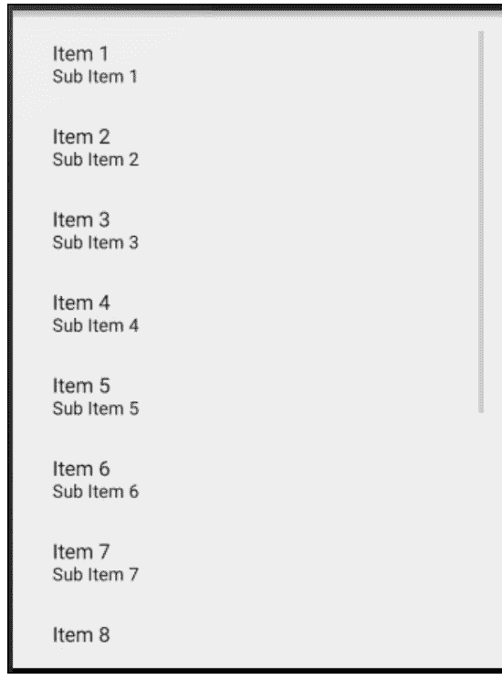

## 第 13 章. 处理和显示数组数据

在本章中，您将了解 Java 数组，它们允许我们以有组织且高效的方式处理潜在的大量数据。我们还将使用与 Java 数组关系密切的 ArrayList，并了解它们之间的区别。

一旦我们熟悉处理大量数据，我们将看到 Android API 提供了什么，可以帮助我们轻松地将新掌握的数据处理技能连接到用户界面，而无需费力。

本章的主题如下：

- 一个随机的小插曲
- 使用数组处理大量数据
- 简单的数组示例
- 动态数组示例
- 多维数组示例
- ArrayLists
- 增强型 for 循环
- ListViews 和 BaseAdapter

首先，让我们看看一个随机的小插曲

### 一个随机的小插曲

有时在我们的应用中，我们会需要一个随机数。随机数有很多可能的用途，例如，当我们的应用想要显示每日随机提示、一个必须在场景之间进行选择的游戏，或者一个提出随机问题的测验时。

Random 类是 Java API 的一部分，与我们的 Android 应用完全兼容。

让我们看看如何创建随机数，本章稍后我们将将其付诸实践。所有艰苦的工作都由 Random 类完成。首先，我们需要创建一个 Random 类型的对象：

```
Random randGenerator = new Random();
```

然后，我们使用新对象的 nextInt 方法在某个范围内生成随机数。

此行代码使用我们的 Random 对象生成随机数，并将结果存储在 ourRandomNumber 变量中：

```
int ourRandomNumber = randGenerator.nextInt(10);
```

我们为范围输入的数字从 0 开始。因此，上一行将生成 0 到 9 之间的随机数。如果我们想要 1 到 10 之间的随机数，只需使用以下内容：

```
ourRandomNumber ++;
```

我们还可以使用 Random 对象通过 nextLong、nextFloat 和 nextDouble 获取其他类型的随机数。

本章稍后，我们将使用一个快速地理测验应用将 Random 类付诸实践。


## 使用数组处理大量数据

你可能在想，当我们有一个需要跟踪大量变量的应用程序时会发生什么。比如我们的“Note To Self”应用有 100 条笔记，或者游戏中前 100 名的高分表？我们可以声明并初始化 100 个独立变量，如下所示：

```
Note note1;
Note note2;
Note note3;
//96 more lines like the above
Note note100;
```

或者，我们可以这样开始处理高分场景：

```
int topScore1;
int topScore2;
int topScore3;
//96 more lines like the above
int topScore100;
```

乍一看，这似乎很笨拙，但如果有人获得了新的高分，或者我们想让用户按顺序排序笔记的显示方式，该怎么办？使用高分场景，我们必须将每个变量中的分数下移一位。噩梦开始了。我们可以这样处理高分：

```
topScore100 = topScore99;
topScore99 = topScore98;
topScore98 = topScore97;
//96 more lines like the above
topScore1 = score;
```

一定有更好的方法。当我们有一整套变量数组时，我们需要的是 Java **数组**。数组是一个引用变量，最多可容纳预先确定的固定最大数量的元素。每个元素都是具有一致类型的变量。

以下代码声明了一个可容纳 int 类型变量的数组，例如高分表或一系列考试成绩：

```
int [] intArray;
```

我们也可以声明其他类型的数组，包括 Note 等类，如下所示：

```
String [] classNames;
boolean [] bankOfSwitches;
float [] closingBalancesInMarch;
Note [] notes;
```

这些数组在使用前都需要分配固定最大的存储空间。就像其他对象一样，我们必须在使用前初始化数组：

```
intArray = new int [100];
```

上述行最多为 100 个 int 值分配存储空间。可以将其想象为我们变量仓库中 100 个连续存储空间的长过道。这些空间可能标记为 intArray[0]、intArray [1]、intArray [2]，以此类推，每个空间存储一个 int 值。这里稍微令人惊讶的是，存储空间从 0 开始，而不是 1。因此，在宽度为 100 个元素的数组中，存储空间的范围是 0 到 99。

我们可以像这样初始化其中一些存储空间：

```
intArray[0] = 5;
intArray[1] = 6;
intArray[2] = 7;
```

但是，请注意，我们只能将预先声明的类型放入数组中，且数组所持有的类型永远不能更改：

```
intArray[3]= "John Carmack"; // Won't compile String not int
```

那么，当我们有一个 int 类型的数组时，这些 int 变量每个叫什么？这些变量的名称是什么，我们如何访问其中存储的值？数组表示法语法替换了名称，我们可以对数组中的变量做任何我们可以对带有名称的普通变量做的事情，如下面的代码所示：

```
intArray [3] = 123;
```

这里是初始化数组元素的另一个示例：

```
intArray[10] = intArray[9] - intArray[4];
```

此声明还包括将数组中的值赋给相同类型的普通变量，如下所示：

```
int myNamedInt = intArray [3];
```

但是，请注意，myNamedInt 是一个独立且不同的基本类型变量，对它的任何更改都不会影响 intArray 引用中存储的值。它在仓库中有自己的空间，与数组无关。更具体地说，数组在堆上，而 int 在栈上。

### 数组是对象

我们说过数组是引用变量。可以将数组变量视为一组给定类型变量的地址。也许，使用仓库类比，someArray 是一个过道编号。因此，someArray[0]、someArray[1] 等等是过道编号后跟过道中的位置编号。

数组也是对象，也就是说，它们具有我们可以使用的方法和属性，例如：

```
int lengthOfSomeArray = someArray.length;
```

在这里，我们将 someArray 的长度赋给了名为 lengthOfSomeArray 的 int 变量。

我们甚至可以声明一个数组的数组。这是一个在每个元素中潜藏着另一个数组的数组。声明如下所示：

```
String[][] countriesAndCities;
```

在前面的数组中，我们可以在每个国家中保存一个城市列表。不过，我们暂时还不要过分迷恋数组。只需记住，数组最多可容纳预先确定数量的任何预先确定类型的变量，并且这些值是使用以下语法访问的：

```
someArray[someLocation];
```

让我们实际使用一些数组，以了解如何在实际代码中使用它们以及我们可能用它们来做什么。

## 一个简单的数组示例小应用

让我们制作一个非常简单的可用数组示例。您可以在可下载的代码包中获取此示例的完整代码。它位于 Chapter 13/Simple Array Example/MainActivity.java。

创建一个带有空白 Activity 的项目，并将其命名为 Simple Array Example。

首先，我们声明数组，分配五个空间，并为每个元素初始化值。然后，我们将每个值输出到 logcat 控制台。将此代码添加到 onCreate 方法中，位于 setContentView 调用之后：

```java
// Declaring an array
int[] ourArray;

// Allocate memory for a maximum size of 5 elements
ourArray = new int[5];

// Initialize ourArray with values
// The values are arbitrary as long as they are int
// The indexes are not arbitrary. 0 through 4 or crash!

ourArray[0] = 25;
ourArray[1] = 50;
ourArray[2] = 125;
ourArray[3] = 68;
ourArray[4] = 47;
```

```java
// Output all the stored values
Log.i("info", "Here is ourArray:");
Log.i("info", "[0] = " + ourArray[0]);
Log.i("info", "[1] = " + ourArray[1]);
Log.i("info", "[2] = " + ourArray[2]);
Log.i("info", "[3] = " + ourArray[3]);
Log.i("info", "[4] = " + ourArray[4]);
```

接下来，我们将数组中的每个元素相加，就像我们处理普通 int 类型变量一样。请注意，当我们将数组元素相加时，是分多行进行的。这没问题，因为我们直到最后一个操作才省略分号，因此 Java 编译器将这些行视为一个语句。将我们刚刚讨论的代码添加到 MainActivity.java：

只要与包含的类型相匹配，我们就可以对数组元素进行任何计算，如下所示：

```
```
/*
int answer = ourArray[0] +
ourArray[1] +
ourArray[2] +
ourArray[3] +
ourArray[4];

Log.i("info", "Answer = " + answer);
*/
```

运行示例并观察 logcat 窗口中的输出。

请记住，模拟器显示上不会有任何事情发生，因为所有输出都将发送到 Android Studio 中的 logcat 控制台窗口。以下是输出：

```
info: Here is ourArray:
info: [0] = 25
info: [1] = 50
info: [2] = 125
info: [3] = 68
info: [4] = 47
info: Answer = 315
```

我们声明了一个名为 ourArray 的数组来保存 int 变量，然后为该类型分配了最多 5 个空间。

接下来，我们为数组中的每个空间赋予一个值。请记住，第一个空间是 ourArray[0]，最后一个空间是 ourArray[4]。

接下来，我们只是在控制台上打印了每个数组位置中的值。从输出中，我们可以看到它们保存了上一步中我们初始化的值。然后，我们将 ourArray 中的每个元素相加并将其值初始化到 answer 变量。我们随后在控制台上打印了 answer，我们可以看到，确实所有值都相加在一起了，就像它们是普通的旧 int 类型一样，它们确实是，只是存储方式不同。

## 使数组动态化

正如我们在开头讨论数组时所说，如果我们需要分别声明和初始化数组的每个元素，那么数组相比普通变量并没有太大优势。让我们看一个动态声明和初始化数组的示例。


## 动态数组示例

让我们制作一个非常简单的动态数组示例。您可以在下载包中获取此示例的可用项目。它位于 Chapter 13/Dynamic Array Example/MainActivity.java。

创建一个带有空白 Activity 的项目，并将其命名为 Dynamic Array Example。

在 onCreate 中调用 setContentView 之后输入以下内容。在我们讨论和分析代码之前，先看看你能否推断出输出结果：

```
// Declaring and allocating in one step
int[] ourArray = new int[1000];

// Let's initialize ourArray using a for loop
// Because more than a few variables is a lot of typing!
for(int i = 0; i < 1000; i++){
    // Put the value of ourValue into our array
    // At the position determined by i.
    ourArray[i] = i*5;

    // Output what is going on
    Log.i("info", "i = " + i);
    Log.i("info", "ourArray[i] = " + ourArray[i]);
}
```

运行示例应用，请记住屏幕上不会有任何显示，因为所有输出都将发送到 Android Studio 中的 logcat 控制台窗口。以下是输出：

```
info: i = 0
info: ourArray[i] = 0
info: i = 1
info: ourArray[i] = 5
info: i = 2
info: ourArray[i] = 10
```

为简洁起见，我们删除了循环的 994 次迭代，输出将如下所示：

```
info: ourArray[i] = 4985
info: i = 998
info: ourArray[i] = 4990
info: i = 999
info: ourArray[i] = 4995
```

首先，我们声明并分配了一个名为 ourArray 的数组，用于容纳最多 1000 个 int 值。请注意，这次我们将这两个步骤合并在一行代码中：

```
int[] ourArray = new int[1000];
```

然后，我们使用了一个设置为循环 1000 次的 for 循环：

```
for(int i = 0; i < 1000; i++){
```

我们用 i 乘以 5 的值初始化数组中的位置，从 0 开始一直到 999，如下所示：

```
ourArray[i] = i*5;
```

然后，为了演示 i 的值以及数组中每个位置保存的值，我们输出 i 的值，后跟数组中对应位置保存的值，如下所示：

```
Log.i("info", "i = " + i);
Log.i("info", "ourArray[i] = " + ourArray[i]);
```

所有这些都发生了 1000 次，产生了我们看到的输出。当然，我们尚未在真实应用中使用这种技术，但我们很快就会使用它，使我们的 Note To Self 应用能够容纳近乎无限数量的笔记。

## 使用数组进入第 n 维

我们曾非常简要地提到，数组甚至可以在每个位置持有其他数组。当然，如果一个数组持有大量数组，而这些数组又持有大量其他类型，我们如何访问包含数组中的值？我们为什么需要这个呢？请看下一个示例，了解多维数组在何处可能很有用。

## 多维数组小型应用

让我们制作一个非常简单的多维数组示例。您可以在下载包中获取此示例的可用项目。它位于 Chapter 13/Multidimensional Array Example/MainActivity.java。

创建一个带有空白 Activity 的项目，并将其命名为 Multidimensional Array Example。

在 onCreate 中调用 setContentView 之后，按如下方式声明并初始化一个二维数组：

```
// Random object for generating question numbers
Random randInt = new Random();
// a variable to hold the random value generated
int questionNumber;

// declare and allocate in separate stages for clarity
// but we don't have to
String[][] countriesAndCities;
// Now we have a 2 dimensional array

countriesAndCities = new String[5][2];
// 5 arrays with 2 elements each
// Perfect for 5 "What's the capital city" questions

// Now we load the questions and answers into our arrays
// You could do this with less questions to save arrays typing
// But don't do more or you will get an exception
countriesAndCities [0][0] = "United Kingdom";
countriesAndCities [0][1] = "London";
countriesAndCities [1][0] = "USA";
countriesAndCities [1][1] = "Washington";
countriesAndCities [2][0] = "India";
countriesAndCities [2][1] = "New Delhi";
countriesAndCities [3][0] = "Brazil";
countriesAndCities [3][1] = "Brasilia";
countriesAndCities [4][0] = "Kenya";
countriesAndCities [4][1] = "Nairobi";
```

现在，我们使用 for 循环和我们的 Random 对象输出数组的内容。请注意我们如何确保尽管问题是随机的，我们始终可以选出正确答案。在前面的代码之后添加以下代码：

```
/*
Now we know that the country is stored at element 0
The matching capital at element 1
Here are two variables that reflect this
*/
int country = 0;
int capital = 1;

// A quick for loop to ask 3 questions
for(int i = 0; i < 3; i++){
    // get a random question number between 0 and 4
    questionNumber = randInt.nextInt(5);

    // and ask the question and in this case just
    // give the answer for the sake of brevity
    Log.i("info", "The capital of "
    +countriesAndCities[questionNumber][country]);

    Log.i("info", "is "+countriesAndCities[questionNumber][capital]);
} // end of for loop
```

运行示例，请记住屏幕上不会有任何显示，因为所有输出都将发送到 Android Studio 中的 logcat 控制台窗口。以下是输出：

```
info: The capital of USA
info: is Washington
info: The capital of India
info: is New Delhi
info: The capital of United Kingdom
info: is London
```

刚才发生了什么？让我们逐块分析，以便确切了解正在发生的事情。

我们创建一个名为 randInt 的 Random 类型新对象，如以下代码所示，准备在程序后面生成随机数：

```
Random randInt = new Random();
```

并且，一个用于保存问题编号的简单 int 变量声明如下：

```
int questionNumber;
```

这里，我们声明了名为 countriesAndCities 的数组的数组。外部数组持有数组：

```
String[][] countriesAndCities;
```

现在，我们在数组中分配空间。第一个外部数组现在将能够容纳 5 个数组，每个内部数组将能够容纳 2 个 String。

```
countriesAndCities = new String[5][2];
```

现在，我们初始化数组，使其持有国家名称及其对应的首都名称。请注意，在每对初始化中，外部数组编号保持不变，表明每个国家/首都对都在一个内部数组（String 数组）中。当然，这些内部数组中的每一个都保存在外部数组（持有数组）的一个元素中，如以下代码所示：

```
countriesAndCities [0][0] = "United Kingdom";
countriesAndCities [0][1] = "London";

countriesAndCities [1][0] = "USA";
countriesAndCities [1][1] = "Washington";

countriesAndCities [2][0] = "India";
countriesAndCities [2][1] = "New Delhi";

countriesAndCities [3][0] = "Brazil";
countriesAndCities [3][1] = "Brasilia";

countriesAndCities [4][0] = "Kenya";
countriesAndCities [4][1] = "Nairobi";
```

为了使即将到来的 for 循环更清晰，我们声明并初始化 int 变量，以表示数组中的国家名称和首都名称。如果您回头看数组初始化，所有国家名称都保存在内部数组的位置 0，所有相应的首都名称都保存在位置 1：

```
int country = 0;
int capital = 1;
```

现在，我们设置一个运行 3 次的 for 循环。请注意，这并不只是访问数组的前三个元素，它只是决定我们循环的次数。我们可以让它循环一次或一千次，示例仍然有效：

```
for(int i = 0; i < 3; i++){
```

接下来，我们实际确定要问哪个问题。或者更具体地说，需要访问外部数组的哪个元素。请记住，randInt.nextInt(5) 返回 0 到 4 之间的数字。这正是我们需要的，因为我们有一个包含 5 个元素（0 到 4）的外部数组：

```
questionNumber = randInt.nextInt(5);
```

现在，我们可以通过输出内部数组中保存的 String 来提问，而该内部数组又由前一行由随机生成的数字选择的外部数组保持：

```
Log.i("info", "The capital of " +countriesAndCities[questionNumber][country]);
Log.i("info", "is " +countriesAndCities[questionNumber][capital]);
```

}//end of for loop

顺便说一句，本书其余部分将不使用任何多维数组。因此，如果对这些数组中的数组还有点模糊，那也没关系。你知道它们存在，知道它们能做什么，并且如果需要可以随时回顾。


## 数组越界异常

当我们尝试访问不存在的数组元素时，会发生数组越界异常。有时，编译器会为我们捕获它，以防止错误进入可运行的应用。例如，我们可以这样声明数组：

```
int[] ourArray = new int[1000];
int someValue = 1; // Arbitrary value
ourArray[1000] = someValue;
// Won't compile as compiler knows this won't work.
// Only locations 0 through 999 are valid
```

但是，如果我们做这样的事情呢：

```
int[] ourArray = new int[1000];
int someValue = 1; // Arbitrary value
int x = 999;
if (userDoesSomething) { x++; // x now equals 1000
}
```

```
ourArray[x] = someValue;
/*
Array out of bounds exception if userDoesSomething evaluates to
true! This is because we end up referencing position 1000 when
the array only has positions 0 through 999.
Compiler can't spot it. App will crash!
*/
```

避免此问题的唯一方法是了解规则。规则指出，数组从0开始，直到其长度-1。我们也可以使用清晰可读的代码，轻松评估我们所做的事情并更容易发现问题。

## ArrayLists

ArrayList就像打了兴奋剂的普通Java数组。它克服了数组的一些缺点，例如必须预先确定其大小。它添加了一些非常有用的方法来使其数据易于管理，并且它使用了增强版的for循环，比普通for循环更清晰易用。

让我们看看使用ArrayList的一些代码：

```java
// Declare a new ArrayList called myList to hold int variables
ArrayList<int> myList;

// Initialize the myList ready for use
myList = new ArrayList<int>();
```

在前面的代码中，我们声明并初始化了一个名为myList的新ArrayList。我们也可以一步完成，如下面的代码所示：

```java
ArrayList<int> myList = new ArrayList<int>();
```

到目前为止，我们还没有看到特别有趣的东西，所以让我们看看实际上可以用ArrayList做什么。这次我们使用String ArrayList：

```java
// declare and initialize a new ArrayList
ArrayList<String> myList = new ArrayList<String>();

// Add a new String to myList in the next available location
myList.add("Donald Knuth");
// And another
myList.add("Rasmus Lerdorf");
// And another
myList.add("Richard Stallman");
// We can also choose 'where' to add an entry
myList.add(1, "James Gosling");

// Is there anything in our ArrayList?
if (myList.isEmpty()) {
// Nothing to see here
} else {
// Do something with the data
}

// How many items in our ArrayList?
int numItems = myList.size();

// Now where did I put James Gosling?
int position = myList.indexOf("James Gosling");
```

在前面的代码中，我们看到可以在ArrayList对象中使用ArrayList类的一些非常有用的方法。我们可以添加一个项目（myList.add），在特定位置添加它（myList.add(x, value)），检查ArrayList是否为空（myList.isEmpty），查看数组的大小（myList.size()），并获取给定项目的当前位置（myList.indexOf）。

### 注意

ArrayList类中还有更多方法，你可以在http://docs.oracle.com/javase/7/docs/api/java/util/ArrayList.html上阅读它们。到目前为止我们看到的内容足以完成这本书。

有了所有这些功能，我们现在只需要一种动态处理ArrayList的方法。

## 增强for循环

增强for循环的条件如下所示：

```
for (String s : myList)
```

前面的示例将逐个遍历myList中的所有项目。在每一步中，s将保存当前的字符串。

因此，这段代码将在控制台上打印前一节ArrayList代码示例中的所有杰出程序员：

```
for (String s : myList){
    Log.i("Programmer: ","" + s);
}
```

我们也可以在普通数组中使用增强for循环：

```
int[] anArray = new int[];
// We can initialize arrays quickly like this
anArray = {0, 1, 2, 3, 4, 5};
```

```
for (int s : anArray){
    Log.i("Contents = ","" + s);
}
```

还有另一则新闻！

## 数组和ArrayList是多态的

我们已经知道可以将对象放入数组和ArrayList中。但是，多态意味着它们可以处理多种不同类型的对象，只要它们有一个共同的父类型，所有对象都在同一个数组或ArrayList中。

在第9章《面向对象编程》中，你了解到多态大约意味着*不同形式*。但在数组和ArrayList的上下文中，这对我们意味着什么？

简单来说，任何子类都可以用作使用超类的代码的一部分。

例如，如果我们有一个Animal数组，我们可以将任何是Animal类型（即Animal的子类）的对象放入Animal数组中，也许是Cats和Dogs。

这意味着我们可以编写更简单、更易于理解、更容易修改或更改的代码：

```java
// This code assumes we have an Animal class
// And we have a Cat and Dog class that extends Animal
Animal myAnimal = new Animal();
Dog myDog = new Dog();
Cat myCat = new Cat();
Animal[] myAnimals = new Animal[10];
myAnimals[0] = myAnimal; // As expected
myAnimals[1] = myDog; // This is OK too
myAnimals[2] = myCat; // And this is fine as well
```

此外，我们可以为超类编写代码，并依赖于这样一个事实：无论它被子类化多少次，在某些参数范围内，代码仍然有效。让我们继续我们的前一个示例：

```java
// 6 months later we need elephants
// with its own unique aspects
// As long as it extends Animal we can still do this
Elephant myElephant = new Elephant();
myAnimals[3] = myElephant; // And this is fine as well
```

但是，当我们从多态数组中删除一个对象时，必须记得将其强制转换为我们想要的类型。这就像我们每次从XML布局中使用findViewById获取UI元素引用时所做的那样：

```
Cat newCat = (Cat) myAnimals[2];
```

我们刚才讨论的一切对于ArrayLists也成立。有了数组和ArrayLists的这套新工具包，以及它们是多态的这一事实，我们可以继续学习一些我们很快将用于增强我们的Note To Self应用的更多Android类。

## ListView和BaseAdapter

在第5章《现实世界布局》中，我们使用了ScrollView，并用大约20个TextView小部件填充了它，这样我们就可以看到它滚动。我们可以利用刚刚学到的数组和ArrayList知识，创建一个TextView数组并用它们来填充ScrollView。这听起来像是在我们的Note To Self应用中显示笔记摘录的完美解决方案。

我们可以在Java代码中动态创建TextViews，将它们的文本属性设置为笔记的标题，然后将TextViews添加到包含在ScrollView中的LinearLayout中。但是，这并不完美。

### 显示大量小部件的问题

这可能看起来没问题，但如果有几十个、几百个，甚至几千个笔记怎么办？我们不能让几千个TextViews存在内存中，因为Android设备可能会简单地耗尽内存，或者至少在尝试处理如此大量数据的滚动时运行缓慢。

现在考虑一下，我们希望ScrollView中的每个笔记都显示一个关于笔记类型的图片——它是重要的、待办事项列表还是一个想法。再加上描述中的一小段摘录如何。

我们需要设计一些非常巧妙的代码，从数组中加载和销毁Note对象、TextViews和ImageViews。这可以做到，但要高效地做到这一点远非易事。

### 解决方案

幸运的是，这是移动开发者面临的如此常见的问题，以至于Android API内置了解决方案。

我们可以将一个ListView小部件（像加强版的ScrollView）添加到我们的UI布局中，然后使用适配器与它进行交互。我们将使用BaseAdapter类，扩展它，自定义它，然后使用它来控制来自ArrayList的数据并在ListView中显示它。

让我们了解一下ListView和BaseAdapter类的工作原理。


## 如何使用 ListView 和 BaseAdapter

要将 ListView 添加到我们的布局中，我们可以像往常一样，直接从调色板中将其拖放到 UI 上。ListView 在 UI 设计器中看起来会是这样：



不过，这种外观更多是可能性的展示，而非应用中的实际效果。如果在添加 ListView 后立即运行应用，我们只会看到一片空白。

要让 ListView 发挥实际作用，我们首先需要决定每个列表项长什么样子。上一幅图暗示了一种简单情况：一个条目和一个子条目，例如标题和描述。

列表项需要在其自身的 XML 文件中定义，然后 ListView 就可以容纳多个列表项的实例。

当然，以上都没有解释如何克服管理哪些数据显示在哪个列表项中，以及如何从 `ArrayList` 检索数据的复杂性。

这种数据处理由我们对 `BaseAdapter` 的实现来完成。`BaseAdapter` 类实现了 `Adapter` 接口。我们不需要知道 `Adapter` 内部如何工作；我们只需要重写相应的方法，然后 `BaseAdapter` 就会处理与 `ListView` 通信的所有工作。

将 `BaseAdapter` 的实现连接到 `ListView` 当然比将 20 个 `TextView` 拖放到 `ScrollView` 上要复杂；但一旦完成，我们就可以忘掉 `ListView`，它会一直正常工作。

我们需要重写四个方法，并添加少量自己的代码。让我们来看看扩展 `BaseAdapter` 并使其与我们的数据和 `ListView` 配合使用所需的代码框架。

以下是扩展并实现 `BaseAdapter` 本身的示例代码：

```
public class MyAdapter extends BaseAdapter {
    List<MyObject> myList = new ArrayList<MyObject>();

    @Override
    public int getCount() {
        return myList.size();
    }

    @Override
    public MyObject getItem(int whichItem) {
        // Simply returns the position of the required item
        return myList.get(whichItem);
    }

    @Override
    public long getItemId(int whichItem) {
        return whichItem;
    }

    @Override
    public View getView(int whichItem, View view, ViewGroup viewGroup)
    {
/*
 * Prepare a list item to show our data.
 * The list item is contained in the
 * view parameter. The position of the
 * data in our ArrayList is contained
 * in whichItem parameter
 */

return view;
}
}
```

乍一看，上面的代码可能略显复杂，但如果我们逐步分析，就会发现它并没有看起来那么令人望而生畏。

在扩展 `BaseAdapter` 的类声明之后（当然），我们声明并初始化一个名为 `myList` 的 `ArrayList`，它持有一系列假设的 `MyObject` 对象。例如，这很容易更改为持有 `Note` 对象列表。

接下来，我们重写 `getCount` 方法。它所做的就是通过调用 `myList.size()` 返回 `ArrayList` 的大小。请注意，我们不需要自己直接使用此方法。

下一个被重写的方法是 `getItem`。该方法只不过是从 `ArrayList`（`myList`）返回一个项目。因此，签名中的返回类型与 `ArrayList` 中持有的类型匹配。

下一个方法 `getItemId` 乍一看略有反直觉。它返回一个 long 变量，而不是传入的 `int`。`BaseAdapter` 在内部使用此方法，因为它需要区分我们给列表中某个项目的 `id` 属性和内部持有的 `id`。同样，我们不会直接使用此方法。

最后，我们来到 `getView` 方法。这是对我们至关重要的方法。该方法有一个名为 `view` 的 `View` 对象作为参数。这个对象就是列表项，根据 `MyAdapter`（通过其内部工作原理）确定需要准备好以便向用户显示的内容。我们可以在这里使用你已经学过的技术来准备列表项。

在 getView 方法中，我们只需加载 view，从列表项布局中获取我们想要的小部件引用，并设置小部件的属性。我们以前多次做过所有这些事情。下一章在完善我们的 Note To Self 应用时，我们会真正看到这部分代码。

所以情况是，BaseAdapter 类已经处理了一切，我们只需插入我们的自定义部分（对象类型、ArrayList 和 getView 代码），之后一切都会为我们妥善处理。

先看一下所需步骤的概要，这样当我们真正实施时就知道会有什么情况。要整体设置并运行起来，我们将执行以下操作：

- 将 ListView 添加到我们的布局中，并设置适当的 id 属性。
- 创建一个 XML 布局来表示列表项。
- 按照我们刚才讨论的方式扩展 BaseAdapter。
- 在 onCreate 中添加代码，创建 MyAdapter 实例，获取 ListView 的引用，并将其绑定到我们的适配器实例。同样，我们将在下一章中实际看到这一点。

唯一需要注意的是，我们假设 myAdapter 持有的 ArrayList 中有一些数据，并且我们还没有列表项的实现。

让我们通过给我们的 Note To Self 应用添加功能来真正实现这一切。首先，让我们快速了解一下内部类。

## 再论内部类

由于 BaseAdapter 与其创建所在的 Activity 紧密关联，因此它是成为内部类的完美人选。回顾第 9 章“面向对象编程”中提到的，内部类是声明在另一个类内部的类。与匿名类不同，它们必须声明在包含类的任何方法体之外，并且拥有自己的名称。内部类可以是我们自己的类，也可以是 Android API 中某个类的子类，例如 BaseAdapter。

内部类的优势在于它可以访问其包含类的所有成员变量和方法，我们将在下一章看到这有多有用。只需注意，BaseAdapter 不必是内部类，它只是在这次场景中适合我们。

## 常见问题解答

### 1. 一台只能进行实际计算的计算机如何可能生成真正的随机数？

实际上，计算机无法创建真正随机的数字，但 Random 类使用一个 **种子**，生成的数字在严格的统计检验下经得起考验，可被视为真正随机。要了解更多关于种子和生成随机数的信息，请查看 https://en.wikipedia.org/wiki/Random_number_generation 上的文章。

### 2. 管理列表项和 *列表视图* 创建、显示、隐藏和滚动的代码在哪里？

它被藏匿在 `BaseAdapter` 类中，我们不需要知道它如何工作。但如果你很好奇，可以在 http://developer.android.com/reference/android/widget/BaseAdapter.html 上了解更多信息。

## 总结

在本章中，我们探讨了如何使用简单的 Java 数组来存储大量相同类型的数据。我们还使用了 ArrayList，它就像一个具有许多额外功能的数组。此外，我们发现数组和 ArrayList 都是多态的，这意味着一个单独的数组（或 ArrayList）可以容纳多个不同的对象，只要它们都派生自同一个父类。

此外，我们还了解了实现 Adapter 接口的 BaseAdapter 类。它允许我们将 ListView 和 ArrayList 绑定在一起，从而实现数据的无缝显示，而我们（程序员）不必担心这些类中包含的复杂代码。

在下一章中，我们将把理论付诸实践，完善我们的 Note To Self 应用。
