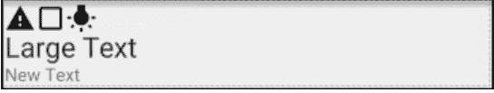
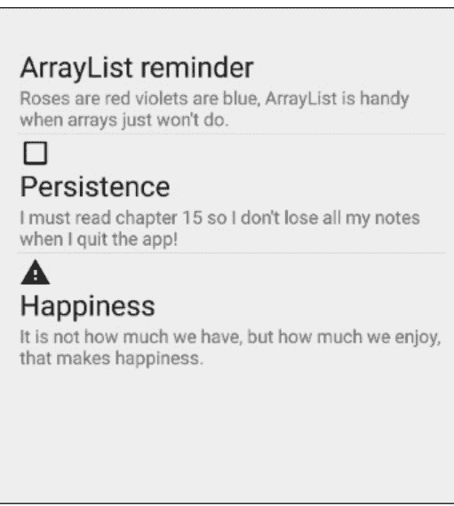
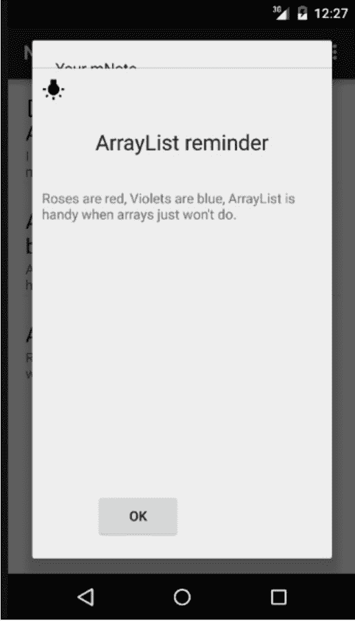

## 第 14 章。在 Note To Self 中处理和显示笔记

既然我们已经充分练习并理论化了数据处理以及 Android SDK 如何通过 ListView 和 BaseAdapter 为我们提供帮助，我们就可以稍微拓展知识，使我们的 Note To Self 应用能够处理几乎无限的笔记。

在本章中，我们将执行以下操作：

- 创建列表项布局
- 实现适配器
- 将适配器绑定到 ListView
- 讨论如何改进我们的应用


# 给自己的便条 续

打开“给自己的便条”应用。提醒一下，如果你想在完成本章后看到完整代码和可运行的应用，可以在第 14 章/给自己的便条文件夹中找到。由于本章的操作要求你在不同文件、类和方法之间来回跳转，我建议你打开下载包中的文件作为参考，跟着操作。

## 更新 onCreate 并准备 UI

现在，让我们准备我们的 UI。为此，请执行以下步骤：

- 1. 在 layout_main.xml 文件中，删除先前为测试目的添加的带按钮 ID 的临时按钮。

- 2. 在 MainActivity.java 的 onCreate 方法中，我们可以删除处理其点击事件的匿名类。为此，请删除如下所示的代码：

```java
// Temporary code
Button button = (Button) findViewById(R.id.button);
button.setOnClickListener(new View.OnClickListener() {
  @Override
  public void onClick(View v) {
    DialogShowNote dialog = new DialogShowNote();
    dialog.sendNoteSelected(mTempNote);
    dialog.show(getFragmentManager(), "");
  }
});
```

- 3. 现在，切换回 layout_main.xml，从调色板中将 **ListView** 拖动到布局上。

- 4. 将其 id 属性设置为 listView。

## 为 ListView 创建列表项

接下来，让我们创建一个要在 ListView 中使用的列表项。请按照给定步骤操作：

- 1. 右键单击 `layout` 文件夹，导航至 **新建 | 布局资源文件**。在 **名称** 字段中输入 `listitem`，并将 **根元素** 字段设置为 RelativeLayout。

- 2. 查看下一张截图，了解我们要实现的效果：



- 3. 将三个 **ImageView** 小部件拖动到布局的左上角。

- 4. 如果为每个 ImageView 小部件输入 src 属性，其余布局将更易于完成。因此，在这样做的同时，我们也可以顺便添加 id 属性。从下表中添加以下属性：

| 小部件类型 | 属性 | 设置的值 |
|---|---|---|
| ImageView（左） | id | imageViewImportant |
| ImageView（左） | src | @drawable/ic_warning_black_24dp |
| ImageView（中间） | id | imageViewTodo |
| ImageView（中间） | src | @drawable/ic_check_box_outline_blank_black_24dp |
| ImageView（右） | id | imageViewIdea |
| ImageView（右） | src | @drawable/ic_wb_incandescent_black_24dp |

- 5. 将 **LargeText** 小部件紧随 **ImageView** 小部件下方拖放，同样放在布局的最左侧。

- 6. 现在，将 **Plain TextView** 小部件紧随上一步的 LargeText 小部件下方拖放。

- 7. 按照下表为属性分配值：

| 小部件类型 | 属性 | 设置的值 |
|---|---|---|
| LargeText | id | txtTitle |
| Plain TextView | id | txtDescription |

现在，我们有了 ListView 和可用于每个列表项的布局。我们可以继续编写 BaseAdapter 的实现代码。

让我们将新类命名为 NoteAdapter。下面是完整的实现代码，其中 getView 方法仅包含骨架代码，因为它需要单独进行额外讨论和演示。将此代码添加到 MainActivity 类内部，位于其右花括号 } 之前，因为它将是一个内部类：

```java
public class NoteAdapter extends BaseAdapter {

    List<Note> noteList = new ArrayList<Note>();

    @Override
    public int getCount() {
        return noteList.size();
    }

    @Override
    public Note getItem(int whichItem) {
        return noteList.get(whichItem);
    }

    @Override
    public long getItemId(int whichItem) {
        return whichItem;
    }

    @Override
    public View getView(int whichItem, View view, ViewGroup viewGroup) {

        // Implement this method next
        return view;
    }
}
```

前面的类与我们之前讨论的代码几乎相同，只是将其命名为 NoteAdapter。该类持有一个名为 noteList 的 ArrayList，并且 getItem 方法返回一个 Note 对象。

现在，我们来看看 getView 方法的代码。首先要注意的是，这些参数为我们提供了一些有用的变量。最重要的是，View 类型的 view 和 int 类型的 whichItem。

view 对象引用实际上是 BaseAdapter 评估后需要显示的列表项的实例，而 whichItem 是 ArrayList 中需要在其中显示的 Note 对象的位置。BaseAdapter 似乎一定是读了我们的心思。

我们需要做的就是编写代码，将 Note 对象中的数据放入 listitem.xml 布局中的列表项中。

首先，我们检查 if (view == null)。如果为真，则表示此视图尚未被填充以供使用。因此，在 if 块内部我们填充 view，这使得 listitem.xml 中的所有小部件都可以以通常的方式使用。

然后，我们可以根据当前 Note 对象是 TODO、Important 还是 Idea 的组合，隐藏任何 ImageView 小部件。

然后，我们最终在 TextView 小部件上使用 setText 方法来显示标题和描述。

为 getView 方法添加代码。下面再次显示包含签名和返回语句的完整方法，以提供上下文，新代码已按如下突出显示：

```java
@Override
public View getView(
int whichItem, View view, ViewGroup viewGroup) {

// Implement this method next
// Has view been inflated already
if(view == null){
    // If not, do so here
    // First create a LayoutInflater
    LayoutInflater inflater = (LayoutInflater)
    getSystemService(Context.LAYOUT_INFLATER_SERVICE);
    // Now instantiate view using inflater.inflate
    // using the listitem layout
    view = inflater.inflate(R.layout.listitem, viewGroup,false);
    // The false parameter is necessary
    // because of the way that we want to use listitem
}// End if

// Grab a reference to all our TextView and ImageView widgets
TextView txtTitle = (TextView) view.findViewById(R.id.txtTitle);
TextView txtDescription = (TextView) view.findViewById
(R.id.txtDescription);
ImageView ivImportant = (ImageView) view.findViewById
(R.id.imageViewImportant);
ImageView ivTodo = (ImageView) view.findViewById(R.id.imageViewTodo);
ImageView ivIdea = (ImageView) view.findViewById
(R.id.imageViewIdea);

// Hide any ImageView widgets that are not relevant
Note tempNote = noteList.get(whichItem);
if (!tempNote.isImportant()){
    ivImportant.setVisibility(View.GONE);
}
if (!tempNote.isTodo()){
    ivTodo.setVisibility(View.GONE);
}
if (!tempNote.isIdea()){
    ivIdea.setVisibility(View.GONE);
}

// Add the text to the heading and description
txtTitle.setText(tempNote.getTitle());
txtDescription.setText(tempNote.getDescription());
return view;
}
```

现在，我们将向类中添加另一个方法。不是重写的方法，而是我们自己的方法。在 NoteAdapter 类的右花括号 } 之前，添加 addNote 方法。当我们想要将 Note 对象添加到 noteList 时，将调用此方法：

```java
public void addNote(Note n){
    noteList.add(n);
    notifyDataSetChanged();
}
```

notifyDataSetChanged 方法正如其名称所暗示的那样。它告诉 NoteAdapter noteList 中的数据已更改，ListView 可能需要更新。

现在，在 MainActivity 类中，修改我们之前编写的 createNewNote 方法。在 NoteAdapter 类中添加对我们刚刚编写的 addNote 方法的调用。整个方法现在应如下所示：

```java
public void createNewNote(Note n){
    mNoteAdapter.addNote(n);
}
```

现在，当 DialogNewNote 调用 createNewNote 时，createNewNote 会将其直接传递给 NoteAdapter 类中的 addNote 方法，并将其添加到 ArrayList (noteList) 中。适配器也会收到变更通知，这将触发 BaseAdapter 类执行其工作并使视图保持最新。

将新 NoteAdapter 对象声明为成员，以便我们可以在整个类中访问它。将此代码添加到 MainActivity 类左花括号 { 之后：

```java
private NoteAdapter mNoteAdapter;
```

同时，也删除上一章中的这个临时成员：

```java
// Temporary code
```


```
Note mTempNote = new Note();
```

接下来，在onCreate方法中，我们需要初始化mNoteAdapter，获取ListView的引用，并将它们绑定在一起：

```
mNoteAdapter = new NoteAdapter();
ListView listNote = (ListView) findViewById(R.id.listView);
listNote.setAdapter(mNoteAdapter);
```

现在，我们离使用新功能非常近了。如果你记得，我们删除了打开DialogShowNote对话框窗口的临时按钮。现在，我们将点击ListView中的列表项，以打开DialogShowNote窗口。

首先，我们将创建一个新的AdapterView.OnItemClickListener匿名类，将其设置到listNote（ListView），并重写onItemClick方法。

在此方法中，我们将通过调用mNoteAdapter.getItem(whichItem)创建一个名为tempNote的临时Note引用。

然后，我们将创建一个名为dialog的新DialogShowNote实例，使用sendNoteSelected发送临时Note引用，然后显示对话框窗口。

在onCreate方法内，在右花括号}之前，输入我们刚才讨论的以下代码：

```
// Handle clicks on the ListView
listNote.setOnItemClickListener(new
AdapterView.OnItemClickListener() {

@Override
public void onItemClick(AdapterView<?> adapter, View view, int
whichItem, long id) {

/*
Create a temporary Note
Which is a reference to the Note
that has just been clicked
*/
Note tempNote = mNoteAdapter.getItem(whichItem);
// Create a new dialog window
DialogShowNote dialog = new DialogShowNote();
// Send in a reference to the note to be shown
dialog.sendNoteSelected(tempNote);

// Show the dialog window with the note in it
dialog.show(getFragmentManager(), "");
});
});
```

你现在可以运行应用程序，创建一堆笔记，在列表中查看它们，并从列表中选择任何笔记进行显示：



这是列表中的一条笔记：



不过，不要花太多时间添加新笔记，因为有一个小问题。关闭并重启应用程序。哎呀，所有笔记都不见了！

## Note To Self中的改进

接下来的几个章节中，我们将修复其中的一些方面。

## 持久性

看起来，我们的ArrayList、BaseAdapter和ListView组合，虽然灵活且节省时间，但在退出应用程序时不会持久保存。在第15章 Android Intent和持久性 中，我们将添加设置菜单，并探讨两种单独的持久化数据保存方法。一种用于简单数据，例如设置屏幕选项；另一种用于更复杂的数据，例如ArrayList中的对象。

## 动画

在第16章 UI动画 中，我们还将为Note To Self添加一些简单的动画，使用户体验更加悦目。我们还将尝试一个动画小型应用程序。

## 音效

添加悦耳的声音不仅可以增强应用程序，还可以向用户提供可听反馈，表明他们刚才执行的操作成功了。在第17章 音效与支持不同版本的Android 中，我们将为Note To Self添加声音，还将在小型应用程序中尝试声音。

## 代码设计的问题

如果noteList是一个独立的类，那可能是值得的。事实上，它很可能应该是。拥有一个持有ArrayList并通过getter方法提供对该列表访问权限的类是非常合理的。此外，它将允许我们实施其他最佳实践。例如，我们可以确保只有一个noteList，并且无论在应用程序中从何处访问这个noteList，都不会有创建第二个、第三个或第四个列表的危险。

在过去的几个章节中，你已经学习了许多新类和概念，在接下来的三个章节中，你还会学到更多。因此，我认为将Java单例的讨论推迟到第18章 设计模式、片段和现实世界 会更好，届时我们还将讨论对Android和编程一般都有用的设计模式。Java单例可以帮助我们实现所有这些事情。

## 常见问题解答

- 1. 我仍然不理解BaseAdapter是如何工作的？

这是因为我们并没有真正讨论它。之所以没有讨论幕后细节，是因为我们不需要知道它们。只要重写所需的方法，就像我们刚才看到的那样，一切就会正常工作。BaseAdapter以及我们使用的大多数其他类本应如此：隐藏实现，并通过公共方法暴露必要的功能。

- 2. 我觉得我也需要知道BaseAdapter和其他类内部发生了什么。

确实，BaseAdapter（以及本书中使用的几乎每个类）有更多细节我们没有空间讨论。阅读你所使用的类的官方文档是一种良好的做法。你可以在http://developer.android.com/reference/android/widget/BaseAdapter.html上阅读更多关于BaseAdapter的内容。

## 总结

既然我们已经添加了保存多个笔记的功能，就可以着手处理我们刚才讨论的改进列表了。

我们将从使用户笔记在退出应用程序或关闭设备时持久保存开始。除此之外，我们将创建一个设置屏幕，并了解如何使设置也持久保存。我们将使用不同的技术来实现每个目标。
