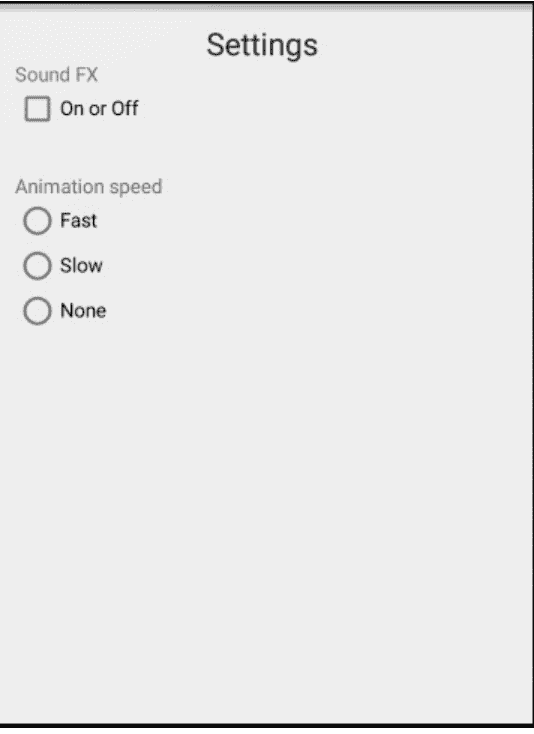
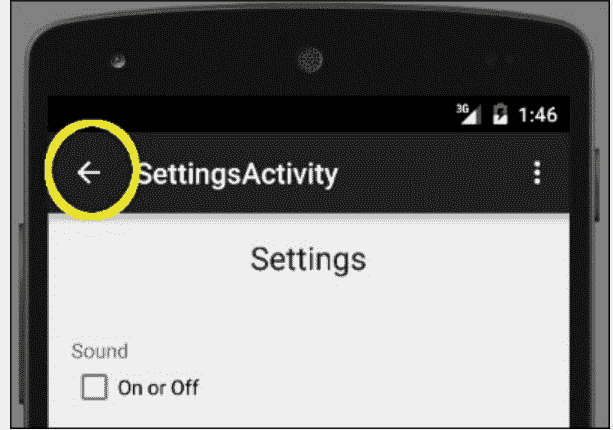

## 第15章 Android Intent和持久性

在本章中，我们将探讨几种将数据保存到Android设备永久存储的不同方法。此外，我们第一次将向应用程序添加第二个Activity。在实现单独的“屏幕”（例如我们应用中的设置屏幕）时，通常在新Activity中进行更合理。我们可以费力地隐藏原始UI，然后显示新UI，但这会迅速导致混乱且容易出错的代码。因此，我们将了解如何添加Activity并在它们之间导航用户。

在本章中，我们将：

- 了解Android Intent以切换Activity并传递数据
- 在新Activity中创建设置屏幕
- 使用SharedPreferences类持久保存设置屏幕数据
- 了解用于序列化的JavaScript对象表示法
- 探索Java try-catch-finally
- 在我们的Note To Self应用程序中实现数据保存

## 良好的Intent

Intent类命名得当。它是一个展示我们应用中Activity意图的类。它既明确Intent，也促进Intent。

到目前为止，我们的所有应用程序都只有一个Activity，但大多数Android应用程序由多个Activity组成。

在最常见的用法中，Intent对象允许我们在activity之间切换。但是，活动当然是类。那么，当我们在它们之间切换时，它们的数据会怎样呢？Intent也帮我们处理这个问题，允许我们在activity之间传递数据。

Intent不仅仅是连接我们应用程序的activity。它们还使我们能够与其他应用程序交互。例如，我们可以在应用程序中提供一个链接，让用户发送电子邮件、拨打电话、与社交媒体交互，并在浏览器中打开网页，并让电子邮件、拨号器、浏览器或相关社交媒体应用程序完成所有工作。

页面不足以深入探讨与其他应用程序的交互，我们将主要集中在activity之间切换和传递数据上。

### 提示

如果你想了解比本章篇幅所能涵盖的更多关于Intent类的内容，我推荐Muhammad Usama bin Aftab和Wajahat Karim合著的《Learning Android Intents》，由Packt Publishing出版（https://www.packtpub.com/application-development/learning-android-intents）。这本书假设你已经知道如何用Java编程，但学习曲线非常平缓，对Intent类的探讨远比本书篇幅所允许的更加详尽。

在本书的其余部分，我们将偶尔再次遇到Intent类，并了解它能做的更多事情。


## 切换活动

假设我们的应用有两个活动，因为我们很快就会用到它们。我们可以像往常一样假设，有一个名为 MainActivity 的 Activity，它是应用的启动点，还有一个名为 SettingsActivity 的第二个 Activity。以下是我们如何从 MainActivity 切换到 SettingsActivity：

```
// Declare and initialize a new Intent object called myIntent
Intent myIntent = new Intent(this, SettingsActivity.class);

// Switch to the SettingsActivity
startActivity(myIntent);
```

仔细看看我们是如何初始化 Intent 对象的。Intent 类有一个构造函数，接受两个参数。第一个是对当前 Activity 的引用，即 this。第二个参数是我们要打开的 Activity 的名称，SettingsActivity.class。SettingsActivity 末尾的 .class 使其成为 Activity 的全名，如在 AndroidManifest.xml 文件中声明的那样，我们在稍后尝试 Intents 时会查看它。

唯一的问题是 SettingsActivity 不共享 MainActivity 的任何数据。从某种意义上说，这是一件好事，因为如果你需要 MainActivity 的所有数据，那么切换活动可能不是应用设计的最佳方式，这是一个合理的指示。但是，封装得如此彻底以至于两个活动对彼此一无所知，这是不合理的。

## 在活动之间传递数据

如果我们为用户有一个登录屏幕，并且想要将登录凭据传递给应用中的每个 Activity，该怎么办？我们可以使用 Intents 来实现。

我们可以这样向 Intent 添加数据：

```
// Create a String called username
// and set its value to bob
String username = "Bob";

// Create a new Intent as we have already seen
Intent myIntent = new Intent(this, SettingsActivity.class);

// Add the username String to the Intent
// using the putExtra method of the Intent class
myIntent.putExtra("USER_NAME", username);

// Start the new Activity as we have before
startActivity(myIntent);
```

在 SettingsActivity 中，我们可以这样检索字符串：

```
// Here we need an Intent also
// But the default constructor will do
// as we are not switching Activity
Intent myIntent = new Intent();

// Initialize username with the passed in String
String username = myIntent.getExtras().getStringExtra("USER_NAME");
```

在前面两个代码块中，我们以已经见过的方式切换了 Activity。但在调用 startActivity 之前，我们使用了 putExtra 方法将字符串加载到 Intent 中。

我们使用 **键值对** 添加数据。每个数据都需要附带一个标识符，该标识符可在检索 Activity 中用于识别和检索数据。

标识符名称是任意的，但应使用有用/易记的值。

然后，在接收 Activity 中，我们只需使用默认构造函数创建 Intent：

```
Intent myIntent = new Intent();
```

然后，我们可以使用 getExtras 方法和键值对中的适当标识符来检索数据。

一旦我们想要发送多个以上的值，就值得考虑不同的策略了。

Intent 类可以帮助我们发送比这更复杂的数据，但 Intent 类确实有其局限性。例如，我们将无法传递 Note 对象。

我们还可以将数据（复杂和简单）保存到设备的磁盘上，这将在本章后面介绍。我们甚至可以创建和使用专门用于我们应用的数据库。数据库将主要在第 23 章“在我们的应用中使用 SQLite 数据库”中讨论。

## 为 Note To Self 应用添加设置页面

现在我们掌握了关于 Android Intents 的所有这些知识，可以为我们的 Note To Self 应用添加另一个屏幕（Activity）了。

我们将首先创建一个新 Activity，并查看它对 AndroidManifest.xml 文件的影响。然后，我们将为设置屏幕创建一个布局，并添加 Java 代码以从 MainActivity 切换到新 Activity。但是，我们将推迟使用 Java 将设置屏幕连接起来，直到我们学会如何将这些设置保存到磁盘。我们将在本章后面完成此操作，然后回到设置屏幕以使数据持久化。

首先，让我们创建该新 Activity。

### 创建 SettingsActivity

这将是一个用户可以开启或关闭音效以及选择动画速度的屏幕。显然，我们的应用还没有声音和动画，但我们仍然可以完全编写这个屏幕，并通过遵循给定的步骤来了解如何将数据保存到设备的永久存储中：

- 1. 在项目资源管理器中，右键单击包含所有 .java 文件且与包同名的文件夹。从弹出的上下文菜单中，选择 **新建 | Activity | 空白 Activity**。
- 2. 在 **Activity 名称** 字段中，输入 `SettingsActivity`。
- 3. 保留所有其他选项的默认值，然后单击 **完成**。

Android Studio 为我们创建了一个新 Activity 及其关联的 .java 文件。让我们快速看看背后为我们完成的一些工作，因为了解正在发生的事情是有用的。

在项目资源管理器的 manifests 文件夹中打开 AndroidManifest.xml 文件。注意此文件末尾附近的以下四行代码：

```
<activity
    android:name=".SettingsActivity"
    android:label="@string/title_activity_settings" >
</activity>
```

这就是 Activity 与操作系统 **注册** 的方式。如果未注册 Activity，则尝试运行它会导致应用崩溃。我们可以通过在新 .java 文件中创建扩展 `Activity` 类（或 `AppCompatActivity`）的类来简单地创建 Activity。但是，我们那时就必须自己添加上述代码。另外，通过使用新 Activity 向导，我们自动获得了布局 XML 文件和菜单 XML 文件。

### 设计设置屏幕的布局

我们将为 **设置** 屏幕快速构建用户界面，以下步骤和图片应该使这变得简单：

- 1. 打开 activity_settings.xml 文件，切换到 **设计** 选项卡，我们将快速布置 **设置** 屏幕。
- 2. 删除自动放置的 **你好，世界！** 小部件。
- 3. 在遵循其余步骤时，将下一张图片用作指南：



- 将 **大文本** 小部件拖放到布局的顶部中心。
- 将 **普通文本视图** 小部件拖放到布局上，并将其放置在上一个小部件的左侧稍下方。
- 将 **复选框** 小部件立即放置在上一个小部件下方。
- 将 **普通文本视图** 小部件拖到上一个 **复选框** 小部件下方，并留出如上图所示的小空间。
- 将 **单选按钮组** 小部件从 **Palette** 拖放，并将其立即放置在上一步中的小部件下方。
- 将三个 **单选按钮** 小部件拖放，并将它们一个接一个地放置在 **单选按钮组** 小部件内部。
- 使用以下表格设置我们刚刚添加的布局元素的属性。如果对表格中我所指的小部件有任何疑问，我们正在从上到下处理布局：

| 小部件类型 | 属性 | 设置的值 |
|---|---|---|
| 大文本 | text | @string/settings_title |
| 普通文本视图 | text | @string/sound_title |
| 复选框 | text | @string/sound_checkbox |
| 复选框 | id | checkBoxSound |
| 普通文本视图 | text | @string/aims_title |
| 单选按钮组 | id | radioGroup |
| 单选按钮 (顶部) | text | @string/rb_fast |
| 单选按钮 (顶部) | id | radioFast |
| 单选按钮 (中间) | text | @string/rb_slow |
| 单选按钮 (中间) | id | radioSlow |
| 单选按钮 (底部) | text | @string/rb_none |
| 单选按钮 (底部) | id | radioNone |

我们现在为 **设置** 屏幕有了一个漂亮的新布局，`id` 属性已就绪，准备在本章后面使用 Java 代码将其连接起来。


## 使用户能够切换到设置屏幕

我们已经知道如何切换到 SettingsActivity。而且，由于我们不会向其中传递任何数据，也不从其中接收任何数据，只需两行 Java 代码即可实现此功能。

你可能已经注意到，在我们应用的操作栏中，有一个菜单图标。


它在下图中有所示：

如果你点击它，那里已经有一个 **Settings** 菜单选项，这是我们最初创建应用时默认提供的。我们所需要做的就是将切换到 SettingsActivity 的代码放在 onOptionsItemSelected 方法中。Android Studio 甚至为我们提供了一个 if 块来粘贴代码，假设我们总有一天会想要添加设置菜单。多么体贴！

在 MainActivity.java 的 onOptionsItemSelected 方法中找到以下代码块：

```
//noinspection SimplifiableIfStatement
if (id == R.id.action_settings) {
    return true;
}
```

将此代码添加到前面显示的 if 块中，放在 return true 语句之前：

```
Intent intent = new Intent(this, SettingsActivity.class);
startActivity(intent);
```

现在你可以运行应用，并通过点击 **Settings** 屏幕的菜单选项访问新的 **Settings** 屏幕了。

要从 SettingsActivity 返回 MainActivity，你可以点击设备上的返回按钮。我们将在本章后面的“指定父 Activity”部分中，为用户使其更加直观。

## 使用 SharedPreferences 持久化数据

在 Android 中，有多种方法可以使数据持久化。这里的“持久化”是指，如果用户退出应用，当他们再次打开时，他们的数据仍然可用。使用哪种正确方法取决于应用和数据类型。

在本书中，我们将探讨三种使数据持久化的方法。对于保存用户设置，我们只需要一种非常简单的方法。毕竟，我们只需要知道他们是否想要声音，以及他们希望动画以什么速度播放。

让我们看看如何使我们的应用将变量保存到设备的内部存储并重新加载。我们需要使用 SharedPreferences 类。SharedPreferences 是一个类，它提供对可以被应用中所有 Activity 访问和编辑的数据的访问。让我们看看如何使用它：

```
// A SharedPreferences for reading data
SharedPreferences prefs;
```

```
// A SharedPreferences.Editor for writing data
SharedPreferences.Editor editor;
```

与所有对象一样，我们需要在使用前初始化它们。我们可以使用 getSharedPreferences 方法并传入一个字符串来初始化 prefs 对象，该字符串将用于引用使用此对象读取和写入的所有数据。通常，我们可以使用应用名称作为这个字符串。在下面的代码中，MODE_PRIVATE 表示在这个应用中，只有任何类可以访问它：

```
prefs = getSharedPreferences("My App", MODE_PRIVATE);
```

然后，我们使用新初始化的 prefs 对象，通过调用 edit 方法来初始化 editor 对象：

```
editor = prefs.edit();
```

假设我们想要保存用户的姓名，它存储在一个名为 username 的字符串中。我们可以像这样将数据写入设备的内部存储器：

```
editor.putString("username", username);
```

```
editor.putString("username", username);
editor.commit();
```

putString 方法的第一个参数是一个标签，可用于引用数据，第二个参数是包含我们要保存的数据的实际变量。前面代码中的第二行启动保存过程。因此，我们可以像这样将多个变量写入磁盘：

```
editor.putString("username", username);
editor.putInt("age", age);
editor.putBoolean("newsletter-subscriber", subscribed);

// Save all the above data
editor.commit();
```

前面的代码演示了你可以保存其他变量类型，并且它当然假设 username、age 和 subscribed 变量之前已使用适当的值进行了初始化。

一旦 editor.commit() 被执行，数据就被存储。我们可以退出应用，甚至关闭设备，数据都将持久保存。

让我们看看下次运行应用时如何重新加载我们的数据。这段代码将重新加载前面代码保存的三个值。我们甚至可以声明我们的变量，并使用存储的值来初始化它们：

```
String username = prefs.getString("username", "new user");

int age = prefs.getInt("age", -1);

boolean subscribed = prefs.getBoolean("newsletter-subscriber", false)
```

在前面的代码中，我们使用适合数据类型的方法从磁盘加载数据，并使用最初保存数据时使用的相同标签。不太清楚的是每个方法调用中的第二个参数。getString、getInt 和 getBoolean 方法要求第二个参数作为默认值。如果没有带有该标签的存储数据，它将返回默认值。然后我们可以在代码中检查这些默认值，并尝试获取真实值。例如：

```
if (age == -1){
    // Ask the user for his age
}
```

我们现在已经了解足够的知识，可以在“记事本”应用中保存用户的设置了。

## 使“记事本”应用的设置持久化

我们已经学习了如何将数据保存到设备的内存中。在实现保存用户设置时，我们也将再次了解如何处理 CheckBox、RadioGroup 和 RadioButton 输入。

## 编码 SettingsActivity 类

大部分操作将在 SettingsActivity.java 文件中进行。所以，点击相应的标签，我们将逐步添加代码。

首先，我们需要一些成员变量，它们将为我们提供一个可用的 SharedPreferences 和 Editor 引用。我们还希望有一个成员变量来表示每个用户设置选项。我们需要一个用于声音（boolean 用于开或关）和一个 int 用于他们首选的动画选项（快速、慢速或无）。此外，正如你将在下面的代码中看到的，我们有三个成员变量：public、static 和 final。这些变量有几个用途。

因为它们是 final 的，所以不能被更改，因此对于记住动画选项可以设置的三种可能状态很有用。这比试图记住哪个值代表哪个动画状态要容易得多。此外，这些变量是 static 的。

### 提示

提醒：静态变量持久存在，并且在类的多个实例中是相同的。它们在 MainActivity 和 SettingsActivity 中都可访问，即使 SettingsActivity 的实例不存在。我们很快就会看到这有什么用处。

将以下成员变量添加到 SettingsActivity：

```
private SharedPreferences mPrefs;
private SharedPreferences.Editor mEditor;

private boolean mSound;

public static final int FAST = 0;
public static final int SLOW = 1;
public static final int NONE = 2;

private int mAnimOption;
```

现在，在 onCreate 中，添加高亮代码来初始化 mPrefs 和 mEditor：

```
mPrefs = getSharedPreferences("Note to self", MODE_PRIVATE);
mEditor = mPrefs.edit();
```

接下来，仍然在 onCreate 中，让我们获取复选框的引用并加载代表用户声音之前选择的保存数据。我们以通常的方式获取复选框的引用，并根据 mSound 的值，我们要么选中要么取消选中该框：

```
mSound = mPrefs.getBoolean("sound", true);

CheckBox checkBoxSound = (CheckBox) findViewById(R.id.checkBoxSound);

if(mSound){
 checkBoxSound.setChecked(true);
}else{
 checkBoxSound.setChecked(false);
}
```

接下来，我们创建一个匿名类来处理声音选项的任何更改，通过检测 CheckBox 类上的点击。

请注意，onCheckedChanged 方法有一个 Boolean 参数 isChecked。我们添加一些日志代码，以便在控制台中查看发生了什么，但实际功能很简单。通过反转来更改 mSound 的状态，即使其变为之前状态的 !(非)。然后，使用 Editor 将新值放入 sound 键值对中。

将以下代码添加到我们刚刚讨论过的 onCreate 方法中：

```
checkBoxSound.setOnCheckedChangeListener(new CompoundButton.OnCheckedChangeListener()
{
 public void onCheckedChanged(CompoundButton buttonView, boolean isChecked)
 {
   Log.i("sound = ", "" + mSound);
   Log.i("isChecked = ", "" + isChecked);
   // If mSound is true make it false
   // If mSound is false make it true
   mSound = ! mSound;
   mEditor.putBoolean("sound", mSound);
 }
});
```


接下来，让我们将注意力转向 RadioGroup/RadioButtons 以及用户对动画速度的偏好。我们使用 mPrefs.getInt 获取当前设置，然后以常规方式获取对 RadioGroup 的引用。接着，清除任何可能已被按下的 RadioButtons。

我们然后使用以 mAnimOption 为参数的 switch 语句，并根据加载的值检查相应的按钮。

将此新代码添加到 onCreate：

```
// Now for the radio buttons
mAnimOption = mPrefs.getInt("anim option", FAST);

RadioGroup radioGroup = (RadioGroup) findViewById(R.id.radioGroup);

// Deselect all buttons
radioGroup.clearCheck();

// Which radio button should be selected?
switch(mAnimOption){

case FAST:
    radioGroup.check(R.id.radioFast);
    break;

case SLOW:
    radioGroup.check(R.id.radioSlow);
    break;

case NONE:
    radioGroup.check(R.id.radioNone);
    break;

}
```

现在，我们可以处理单选按钮的点击事件了。在 onCheckedChanged 方法中，我们使用基于刚被选中按钮的 ID 的 switch 块。在每个 case 语句中，我们将适当的值赋给 mAnimOption，并在 switch 块之后，使用 Editor 对象将该值存储到适当的键值对中。

将此代码添加到 onCreate 方法中：

```
radioGroup.setOnCheckedChangeListener(new RadioGroup.OnCheckedChangeListener() {
    @Override
    public void onCheckedChanged(RadioGroup group, int checkedId) {
        RadioButton rb = (RadioButton) group.findViewById(checkedId);
        if (null != rb && checkedId > -1) {

            switch (rb.getId()){

            case R.id.radioFast:
                mAnimOption = FAST;
                break;

            case R.id.radioSlow:
                mAnimOption = SLOW;
                break;

            case R.id.radioNone:
                mAnimOption = NONE;
                break;

            }
            // End switch block

            mEditor.putInt("anim option", mAnimOption);
        }
    }
});
```

你可能已经注意到，在上述代码的任何地方，我们都没有调用 mEditor.commit 来实际保存用户的设置。我们本可以将其放在检测到 CheckBox 或 RadioButton 变化之后；然而，将其放在保证被调用但仅调用一次的位置要简单得多。

我们将利用对 Activity 生命周期的了解，并重写 onPause 方法。当用户离开 SettingsActivity 以返回 MainActivity 或退出应用时，onPause 将被调用，设置将被保存。添加此代码以重写 onPause 并保存用户的设置。将代码添加到 SettingsActivity 类的右花括号之前：

```
@Override
protected void onPause() {
    super.onPause();
    // Save the settings here
    mEditor.commit();
}
```

## 编写 MainActivity 类

最后，我们可以向 MainActivity 添加一些代码，以便在应用启动时或用户从 **设置** 界面切换回主界面时加载设置。

在 NoteAdapter 之后添加此突出显示的代码以添加一些成员变量：

```
private NoteAdapter mNoteAdapter;
private boolean mSound;
private int mAnimOption;
private SharedPreferences mPrefs;
```

此时，我们将重写 onResume 方法，初始化 mPrefs 变量，并将设置加载到 mSound 和 mAnimOption 变量中。现在，当我们在第 16 章 UI 动画 和第 17 章 音效及支持不同版本的 Android 中添加声音和动画代码时，我们将在合适的时间和速度使用动画和音效。

按如下所示添加重写的 onResume 方法：

```
@Override
protected void onResume() {
    super.onResume();

    mPrefs = getSharedPreferences("Note to self", MODE_PRIVATE);
    mSound = mPrefs.getBoolean("sound", true);
    mAnimOption = mPrefs.getInt("anim option",
            SettingsActivity.FAST);
}
```

用户现在可以选择自己的设置了。应用将根据需要保存和重新加载它们。

## 指定父 Activity

为新活动声明父 Activity 并非必要，但这是良好的做法（有好处）。这样做，我们还将在视觉上增强应用并改善其可用性。

从 manifests 文件夹打开 AndroidManifest.xml 文件。在所示位置添加以下代码中的突出显示行：

```
...
<activity
    android:name=".SettingsActivity"
    android:parentActivityName=".MainActivity"
    android:label="@string/title_activity_settings" >
</activity>
...
```

SettingsActivity 现在正式将 MainActivity 作为其父 Activity。现在，我们可以运行应用并看到一个微小的视觉增强。用户现在可以使用设备的返回按钮或添加那最后一段代码后添加到 UI 中的图标：



现在我们有一个整洁的设置屏幕，可以永久保存用户的选择。当然，关于持久性的一个重大缺失环节是，用户的基本数据（即他的笔记）仍然无法持久化。

## 更高级的持久化

让我们思考一下需要做什么。我们想将一堆笔记保存到内部存储中。更具体地说，我们想存储一组字符串和相关的布尔值。这些字符串和布尔值代表用户的笔记标题、笔记文本，以及它是否是待办事项、重要事项或想法。

根据我们对 **共享偏好设置** 类的已有知识，乍一看这似乎并不特别具有挑战性，直到我们深入挖掘一下我们的要求。如果用户喜欢我们的应用并最终拥有 100 条笔记怎么办？我们将需要 100 个键值对的标识符。这并非不可能，但开始变得笨拙。

现在，考虑我们想要增强笔记应用，并让用户能够为笔记添加日期。Android 有一个 **日期** 类，非常适合此目的。然后添加提醒等整洁功能到我们的应用将相当直接。但说到保存数据时，事情突然开始变得复杂。

我们将如何使用 **共享偏好设置** 来存储日期？它并非为此设计。我们可以在保存时将其转换为字符串，在加载时再转换回来，但这远非简单。

随着我们的应用功能不断增长，用户拥有的笔记越来越多，整个持久性问题变得一团糟。我们需要一种保存和加载对象（实际的 Java 对象）的方式。如果我们可以简单地保存和加载对象，包括其内部数据（字符串、布尔值、日期或其他任何内容），我们的应用可以拥有任何我们能想到的数据类型以适应用户。

将数据对象转换为位和字节以存储在磁盘上的过程称为 **序列化**；反向过程称为 **反序列化**。序列化本身是一个庞大的主题，远非简单直接。幸运的是，正如我们越来越预期的那样，有一个类可以为我们处理大部分复杂性。

## JSON 是什么？

JSON 代表 **JavaScript 对象表示法**，广泛用于 Android 和 Java 语言之外的领域。它可能更常用于在 Web 应用程序和服务器之间发送数据。

幸运的是，Android 上有可用的 JSON 类，几乎完全隐藏了序列化过程的复杂性。通过了解一些更多的 Java 概念，我们可以快速开始使用这些类，并开始将整个 Java 对象写入设备存储，而不必担心构成对象的原始类型是什么。

与我们迄今所见的其他类相比，JSON 类执行的操作有更大的可能性因超出其控制的原因而失败。要找出为什么会这样以及可以做些什么，让我们来看看 Java 异常。

## Java 异常 - try, catch, 和 finally

所有这些关于 JSON 的讨论要求我们学习一个新的 Java 概念：**异常**。当我们编写执行可能失败操作的类时，尤其是由于超出我们控制的原因而失败，最好在代码中明确说明这一点，以便任何使用我们类的人都为这种可能性做好准备。

保存和加载数据就是这样一个场景，其中失败可能超出我们的控制。想想当 SD 卡被移除或损坏时尝试加载数据。代码可能失败的另一个例子是，当我们编写依赖于网络连接的代码时——如果用户在数据传输过程中断网怎么办？

Java 异常是解决方案，JSON 类使用它们，因此现在学习它们是个好时机。

当我们编写使用可能失败代码的类时，可以通过使用带有 try、catch 和 finally 的异常来为我们的类的用户做好准备。

我们可以在类中编写方法，在签名末尾使用 throws Java 关键字。大概像这样：

```
public void somePrecariousMethod() throws someException{
 // Risky code goes here
 }
```

现在，任何使用 somePrecariousMethod 的代码都需要 **处理** 异常。我们处理异常的方式是将代码包装在 try 和 catch 块中。大概像这样：

```
try{
 ...
 somePrecariousMethod();
 ...
 }catch(someException e){
 Log.e("Exception:" + e, "Uh ohh")
 // Take action if possible
 }
```

可选地，如果我们想在 try 和 catch 块之后采取任何进一步操作，还可以添加一个 finally 块，如下所示：


```
finally{
 // More action here
}
```

在我们的 Note To Self 应用中，我们将采取处理异常所需的最小必要操作，并简单地向 logcat 输出一个错误，但你可以采取诸如通知用户、重试操作或实施某个巧妙的备用计划等措施。

## 在 Note To Self 中备份用户数据

那么，在对异常有了新的认识之后，让我们修改 Note To Self 的代码，然后我们就可以了解 JSONObject 和 JSONException 了。

首先，让我们对 Note 类进行一些小的修改。添加更多成员，这些成员将作为 Note 类中每个方面的键值对中的键：

```java
private static final String JSON_TITLE = "title";
private static final String JSON_DESCRIPTION = "description";
private static final String JSON_IDEA = "idea";
private static final String JSON_TODO = "todo";
private static final String JSON_IMPORTANT = "important";
```

现在，添加一个接收 JSONObject 并抛出 JSONException 的构造函数和一个空默认构造函数。构造函数的主体通过调用 JSONObject 的 getString 或 getBoolean 方法并将键作为参数传入，来初始化定义单个 Note 对象属性的每个成员。由于我们提供了专用构造函数，因此还需要提供一个空默认构造函数：

```java
// Constructor
// Only used when new is called with a JSONObject
public Note(JSONObject jo) throws JSONException {
    mTitle = jo.getString(JSON_TITLE);
    mDescription = jo.getString(JSON_DESCRIPTION);
    mIdea = jo.getBoolean(JSON_IDEA);
    mTodo = jo.getBoolean(JSON_TODO);
    mImportant = jo.getBoolean(JSON_IMPORTANT);
}
// Now we must provide an empty default constructor
// for when we create a Note as we provide a
// specialized constructor that must be used.
public Note() {

}
```

在接下来的代码中，我们将看到如何将给定 Note 对象的成员变量加载到 JSONObject 中。这就是将 Note 对象的成员打包为单个 JSONObject 的地方，以便在实际序列化发生时使用。

我们只需要使用适当的键和匹配的成员变量调用 put 即可。该方法返回 JSONObject（我们稍后将看到在哪里），并且还会抛出 JSONException 异常。添加我们刚刚讨论的代码：

```java
public JSONObject convertToJSON() throws JSONException{
    JSONObject jo = new JSONObject();

    jo.put(JSON_TITLE, mTitle);
    jo.put(JSON_DESCRIPTION, mDescription);
    jo.put(JSON_IDEA, mIdea);
    jo.put(JSON_TODO, mTodo);
    jo.put(JSON_IMPORTANT, mImportant);

    return jo;
}
```

现在，让我们创建一个 JSONSerializer 类来执行实际的序列化和反序列化。创建一个新类并将其命名为 JSONSerializer。

让我们将其分成几个部分，并在编写每个部分时讨论我们在做什么。

首先，我们将包含类的声明和几个成员变量——一个用于保存数据将被保存到的文件名的字符串，以及一个在 Android 中将数据写入文件时所必需的 Context 对象：

```java
public class JSONSerializer {

    private String mFilename;
    private Context mContext;

    // All the rest of the code for the class goes here
}// End of class
```

前面的代码显示了类的右花括号以及随后的所有代码，此类中的所有代码都应写入其内部。下面是非常简单的构造函数，我们在其中初始化作为参数传递给构造函数的两个成员变量：

```java
public JSONSerializer(String fn, Context con){
    mFilename = fn;
    mContext = con;
}
```

现在，我们可以开始编写类的核心部分了。接下来是 save 方法。它首先创建一个 JSONArray 对象，这是一种用于处理 JSON 对象的特殊 ArrayList。

接下来，代码使用增强型 for 循环遍历 notes 中的所有 Note 对象，并使用我们之前添加的 Note 类中的 convertToJSON 方法将它们转换为 JSON 对象。然后，我们将这些转换后的 JSONObject 加载到 jArray 中。

接下来，代码结合 Writer 实例和 OutputStream 实例将数据写入实际文件。请注意，OutputStream 实例需要 mContext 进行初始化。添加我们刚刚讨论的代码：

```java
public void save(List<Note> notes)
    throws IOException, JSONException{
    // Make an array in JSON format
    JSONArray jArray = new JSONArray();
    // And load it with the notes
    for (Note n : notes)
        jArray.put(n.convertToJSON());
    // Now write it to the private disk space of our app
    Writer writer = null;
    try {
        OutputStream out = mContext.openFileOutput
            (mFilename, mContext.MODE_PRIVATE);
        writer = new OutputStreamWriter(out);
        writer.write(jArray.toString());
    } finally {
        if (writer != null) {
            writer.close();
        }
    }
}
```

现在来看反序列化——加载数据。这一次，如我们所料，该方法不接收任何参数，而是返回 ArrayList。使用 mContext.openFileInput 创建一个 InputStream 实例，并打开包含我们所有数据的文件。

我们使用 while 循环将所有数据追加到字符串中，并配合我们的新 Note 构造函数，该构造函数将 JSON 数据提取为常规原始变量，以将每个 JSONObject 解包为 Note 对象并将其添加到 ArrayList 中，然后将其返回给调用代码：

```java
public ArrayList<Note> load() throws IOException, JSONException{
    ArrayList<Note> noteList = new ArrayList<Note>();
    BufferedReader reader = null;
    try {
        InputStream in = mContext.openFileInput(mFilename);
        reader = new BufferedReader(new InputStreamReader(in));
        StringBuilder jsonString = new StringBuilder();
        String line = null;

        while ((line = reader.readLine()) != null) {
            jsonString.append(line);
        }

        JSONArray jArray = (JSONArray) new JSONTokener
        (jsonString.toString()).nextValue();
        for (int i = 0; i < jArray.length(); i++) {
            noteList.add(new Note(jArray.getJSONObject(i)));
        }
    } catch (FileNotFoundException e) {
        // we will ignore this one, since it happens
        // when we start fresh. You could add a log here.
    } finally {// This will always run
        if (reader != null)
            reader.close();
    }

    return noteList;
}
```

现在，我们只需要让新类在 MainActivity 类中发挥作用，或者更具体地说，是在 MainActivity 内部的 NoteAdapter 类中发挥作用。在 MainActivity.java 的 NoteAdapter 类中，在 NoteAdapter 声明之后添加一个新成员：

```java
public class NoteAdapter extends BaseAdapter {
    private JSONSerializer mSerializer;
    List<Note> noteList = new ArrayList<Note>();
    ...
    ...
}
```

现在，在同一个类中，我们将添加一个新构造函数。在构造函数中，我们通过使用文件名和 MainActivity.this.getApplicationContext()（即应用程序所需的 Context）调用 JSONSerializer 构造函数来初始化 mSerializer。然后我们可以使用 JSONSerializer 的 load 方法来加载任何保存的数据：

```java
public NoteAdapter(){
    mSerializer = new JSONSerializer("NoteToSelf.json",
    MainActivity.this.getApplicationContext());

    try {
        noteList = mSerializer.load();
    } catch (Exception e) {
        noteList = new ArrayList<Note>();
        Log.e("Error loading notes: ", "", e);
    }
}
```

现在，为我们的 NoteAdapter 内部类添加一个新方法，我们可以调用该方法来保存所有用户数据。这个新方法所做的就是调用 JSONSerializer 类的 save 方法，并传入所需的 Note 对象列表：

```java
public void saveNotes(){
    try{
        mSerializer.save(noteList);
    }catch(Exception e){
        Log.e("Error Saving Notes","", e);
    }
}
```

现在，与保存用户设置时所做的一样，我们将重写 onPause 方法来保存用户数据。请务必将此代码添加到 MainActivity 类中，而不是我们刚才一直在使用的内部类中：

```java
@Override
```


```java
protected void onPause(){
super.onPause();

mNoteAdapter.saveNotes();

}
```

就这样。现在我们可以运行应用并添加任意数量的笔记。ArrayList 将在运行中的应用中存储所有笔记，BaseAdapter 会管理在 ListView 中显示它们，现在 JSON 将负责从磁盘加载它们并将其保存回来。

## FAQ

- 1. 我没完全理解本章中的所有内容，所以也许我不适合做程序员。

本章介绍了许多新类、概念和方法。如果你的脑袋有点疼，那很正常。如果有些细节不清楚，不要让它阻止你。继续学习接下来的几章（它们要简单得多），然后回头复习本章，尤其要检查完成的代码文件。

- 2. 那么，序列化的详细工作原理是什么？

序列化确实是一个庞大的主题。你可以编写整个生命周期的应用，却永远不需要真正理解它。这是那种会作为计算机科学学位课程主题的主题。如果你想了解更多，可以查看这篇文章：https://en.wikipedia.org/wiki/Serialization。

- 3. 文件中写入的数据究竟是什么样子的？

JSON 数据采用文本格式，实际上可以查看此文件。你可以使用 Android Debug Bridge 与模拟器“对话”。如果你感兴趣，可以在此处查看 ADB 快速指南：http://developer.android.com/tools/help/adb.html。然后，你可以使用 pull 命令将文件从模拟器拉取到你的 PC 上。或者，如果你很赶时间，可以在此处查看一些示例 JSON 数据及相关讨论：http://www.w3schools.com/json/json_syntax.asp。

## Summary

在我们学习 Android API 的旅程中，到此为止，回顾一下我们所掌握的知识是很有价值的。我们可以布置自己的 UI 设计，并从相当广泛且多样的小部件范围中进行选择，以允许用户进行交互。我们可以创建多个屏幕，以及弹出对话框，并可以捕获全面的用户数据。此外，我们现在可以使这些数据持久化。

当然，Android API 还有很多内容需要学习，甚至超出了本书所教授的范围，但重点是我们现在已经掌握足够的知识来规划和实现一个可运行的应用。你可以直接跳到第 29 章“发布应用”并发布。

如果你很想立即开始自己的项目，那么我的建议是：大胆去做。不要等到你自认为是“专家”或“更准备好了”。阅读这本书，更重要的是，实现这些应用会让你成为一名更好的 Android 程序员，但没有什么比设计和实现自己的应用更能快速教会你了！同时完成本书并进行自己的项目开发是完全可行的。

我们将再花两章学习声音和动画，然后转向更高级的主题，以真正使你的应用变得专业。

接下来是如何在我们的应用中使用 Android SoundPool 类播放声音。
