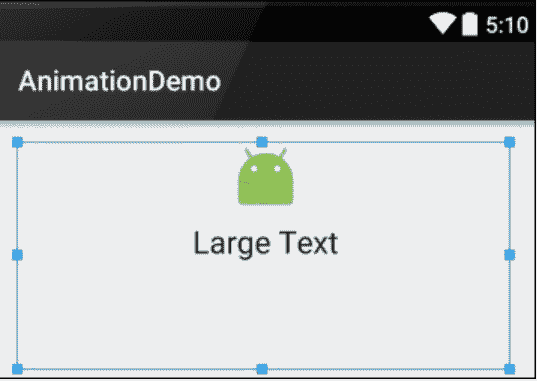
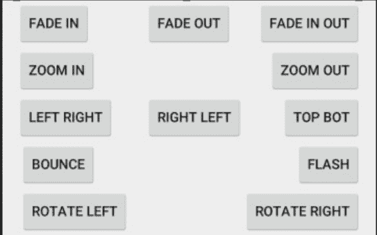
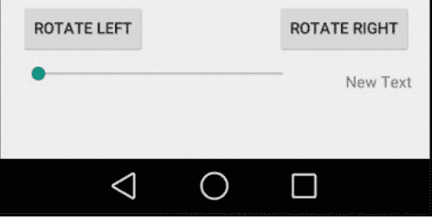
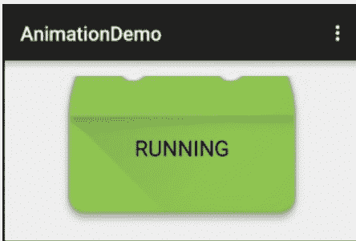
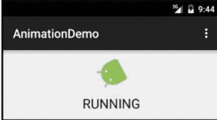

## 第 16 章。UI 动画

在本章中，我们将学习如何使用 `Animation` 类来使我们的 UI 更加生动有趣。和我们习惯的一样，`Animation` 类也不例外，Android API 将允许我们使用相对简单的代码完成一些相当高级的操作。

本章大致可以分为以下主题：

- Android 动画的工作原理及其实现介绍
- 新 UI 小部件介绍：**SeekBar**
- 一个可运行的动画小应用
- 向 Note To Self 应用添加简单且悦目的动画

首先，让我们看看 Android 中的动画是如何工作的？

## Android 中的动画

在 Android 中创建动画的常用方式是通过 XML。我们可以编写 XML 动画，然后在 Java 中加载并在指定的 UI 小部件上播放它们。例如，我们可以编写一个在 3 秒内淡入淡出五次的动画，然后在 **ImageView** 或任何其他小部件上播放该动画。我们可以将这些 XML 动画视为脚本，因为它们定义了动画的类型、顺序和时序。

让我们探讨一下可以分配给动画的一些不同属性，以及如何在 Java 代码中使用它们，最后，我们可以制作一个整洁的动画小应用来全部试一试。

## 在 XML 中设计酷炫的动画

我们已经了解到 XML 也可以用于描述动画以及 UI 布局，但让我们来看看具体怎么做。我们可以说明动画的属性，这些属性描述小部件的起始和结束外观。然后，我们的 Java 代码可以通过引用包含它的 XML 文件的名称来加载 XML，并将其转换为可用的 Java 对象，同样，就像 UI 布局一样。

让我们快速看一下为了创建动画可以声明的一些动画属性对。在看了一些 XML 之后，我们将看到如何在 Java 中使用它。

## 淡入和淡出

Alpha 是透明度的度量。因此，通过声明起始 fromAlpha 值和结束 toAlpha 值，我们可以使项目淡入和淡出。值 0.0 是不可见的，值 1.0 是对象的正常外观。在两者之间稳定移动会产生淡入效果，如以下代码所示：

```xml
<alpha
 android:fromAlpha="0.0"
 android:toAlpha="1.0" />
```

## 移动

我们可以使用类似的技术在 UI 中移动对象：fromXDelta 和 toXDelta 可以设置为动画对象大小的百分比。

因此，这里的代码将把对象从左侧移动到右侧，移动距离等于对象本身的宽度：

```xml
<translate
 android:fromXDelta="-100%"
 android:toXDelta="0%" />
```

除此之外，还有 fromYDelta 和 toYDelta 属性，可用于动画化上下移动。

## 缩放或拉伸

fromXScale 和 toXScale 值会增加或减小对象的缩放比例。例如，这里显示的代码将运行动画的对象从正常大小更改为不可见：

```xml
<scale
 android:fromXScale="1.0"
 android:fromYScale="0.0"
/>
```

另一个示例，我们可以使用 android:fromYScale="0.1" 将对象缩小到通常大小的十分之一，或者使用 android:fromYScale="10.0" 将其放大 10 倍。

## 控制持续时间

当然，如果这些动画只是立即到达结论，那就不太有趣了。因此，为了使我们的动画更有趣，我们可以以毫秒为单位设置它们的持续时间。毫秒是一秒的千分之一。我们还可以通过设置 startOffset（同样以毫秒为单位）来简化时序，尤其是在与其他动画关系时。

下面的代码将在我们启动动画后三分之一秒开始，并且需要三分之二秒才能完成：

```
android:duration="666"
android:startOffset="333"
```

## 旋转动画

如果你想让某物旋转，只需使用 fromDegrees 和 toDegrees。以下代码可预见地会让小部件旋转一整圈，因为圆周当然有 360 度：

```xml
<rotate android:fromDegrees="360"
 android:toDegrees="0"
/>
```

## 重复动画

重复在某些动画中可能很重要，例如，晃动或抖动效果，因此我们可以添加 repeatCount 属性。此外，我们可以通过设置 repeatMode 来指定动画的重复方式。

以下代码将重复动画 10 次，每次都会反转动画方向。repeatMode 属性相对于动画的当前状态。这意味着，例如，如果你将按钮从 0 度旋转到 360 度，那么动画的第二部分（第一次重复）会将其从 360 度旋转回 0 度。动画的第三部分（第二次重复）会再次反转并从 0 度旋转到 360 度：

```
android:repeatMode="reverse"
android:repeatCount="10"
```

## 使用 set 标签组合动画属性

要组合一组这些效果，我们需要一个 set 标签。以下代码演示了如何将我们刚刚看到的所有先前代码片段组合成一个实际的 XML 动画，该动画将被编译：

```xml
<?xml version="1.0" encoding="utf-8"?>
<set xmlns:android="http://schemas.android.com/apk/res/android"
...All our animations go here
</set>
```

我们仍然没有看到任何可以让这些动画生动起来的 Java 代码。让我们现在来修复这个问题。


## 使用 Java 代码实例化动画并对其进行控制

以下这段 Java 代码展示了如何声明 Animation 类型的对象，使用名为 fade_in.xml 的 XML 文件中包含的动画对其进行初始化，并在 ImageView 上启动动画。不久，我们将在一个项目中这样做，并了解 XML 动画应放置的位置：

```
// Declare an Animation object
Animation animFadeIn;

// Initialize it
animFadeIn = AnimationUtils.loadAnimation(getApplicationContext(),
R.anim.fade_in);

// Get an ImageView from the UI in the usual way
ImageView imageView = (ImageView) findViewById(R.id.imageView);

// Start the animation on the ImageView
imageView.startAnimation(animFadeIn);
```

我们已经拥有相当强大的动画和控制功能库，用于计时等功能，但 Android API 还提供了更多。

## 更多动画功能

我们可以监听动画状态，就像监听按钮点击一样。我们还可以使用插值器让动画更加生动悦目。先来看看监听器。

### 监听器

如果我们实现了 `AnimationListener` 接口，确实可以通过重写三个方法来监听动画状态，这些方法会告诉我们何时发生了事件。然后我们可以根据这些事件采取行动。

在以下代码片段中，`onAnimationEnd` 宣布动画结束；`onAnimationRepeat` 在动画每次开始重复时被调用，可想而知，`onAnimationStart` 在动画开始时被调用。如果动画的 XML 中设置了 `startOffset`，这可能与调用 `startAnimation` 的时间不同：

```
@Override
public void onAnimationEnd(Animation animation) {
    // Take some action here
}

@Override
public void onAnimationRepeat(Animation animation) {
    // Take some action here
}

@Override
public void onAnimationStart(Animation animation) {
    // Take some action here
}
```

我们将在 Animations Demo 应用中看到 `AnimationListener` 的工作原理，以及如何让另一个小部件 **SeekBar** 发挥作用。

### 动画插值器

如果你回想一下高中时期，可能还记得那些关于计算加速度的精彩课程。如果我们以恒定速度对某物进行动画处理，乍一看可能没问题。但如果将其与使用渐进加速度的另一个动画进行比较，后者几乎肯定更令人愉悦。也许如果不被告知这两个动画之间唯一的区别是一个使用了加速度而另一个没有，我们也无法说出为何更喜欢它。我们的大脑更愿意接受符合周围世界规律的事物。这就是为什么添加一些现实世界的物理效果，例如加速度和减速度，能改进我们的动画。

不过，我们最不想做的事情，就是为了让按钮滑入屏幕或让一段文字旋转而进行一堆计算。

插值器正是为此而生。它们是我们可以在 XML 中一行代码内设置的动画修饰符。

插值器的示例包括 accelerate_interpolator 和 bounce_interpolator，如下所示：

```
android:interpolator="@android:anim/accelerate_interpolator"
android:interpolator="@android:anim/cycle_interpolator"
```

接下来，我们将让一些插值器与一些 XML 动画及相关的 Java 代码一起发挥作用。

## 提示

您可以在开发者网站上了解更多关于插值器和 Android Animation 类的信息：
http://developer.android.com/guide/topics/resources/animation-resource.html.

## Animations Demo 应用 – 介绍 SeekBar

理论讲得足够了，尤其是对于如此直观的东西。让我们构建一个动画演示应用，探索我们刚才讨论的所有内容以及更多。

这个应用涉及许多不同文件中的少量代码。因此，我尽量明确哪段代码在哪个文件中，以便您可以跟踪正在发生的事情。这也会让我们在这个小应用中编写的 Java 代码更易于理解。

该应用将展示旋转、淡入淡出、平移、动画事件、插值以及使用 SeekBar 控制持续时间。解释 SeekBar 的作用的最佳方式就是构建它，然后观察它的运行效果。

## 布局动画演示

创建一个名为 Animation Demo 的新项目，所有设置保持默认，和往常一样。

以下是我们可以为这个应用布局 UI 的方式：

- 1. 删除默认的 **Hello world!** 小部件。
- 2. 添加 **LinearLayout (vertical)**。
- 3. 在上一步的布局内，放置 **LinearLayout (vertical)** 和 **RelativeLayout**。
- 4. 将前几步添加的两个布局的 layout_weight 设置为 LinearLayout 的 .3 和 RelativeLayout 的 .7。
- 5. 现在，将两者的 layout_height 都设置为 unset，使它们分别占据屏幕的三十分之三和七十分之七。
- 6. 对于 **LinearLayout (vertical)**，将其 gravity 属性更改为 center_horizontal。
- 7. 向内层 **LinearLayout (vertical)** 添加 **ImageView**。将 ImageView 的 src 属性设置为 @mipmap/ic_launcher 以显示 Android 机器人。当然，你也可以选择任何已添加到 drawable 文件夹中的图片。
- 8. 将 ImageView 的 id 属性设置为 imageView。
- 9. 在 ImageView 正下方（仍在 LinearLayout 内），添加 LargeText。将 id 属性设置为 textStatus，layout_marginTop 设置为 10dp。效果应如下一个截图所示：



- 10. 现在，我们将向 RelativeLayout 添加一些 **SmallButton** 小部件。它们与 Button 相同，只是初始尺寸更小。确切位置不重要，但几个步骤后我们将添加的 id 属性值至关重要。按照下图在 RelativeLayout 中布置 12 个按钮：



- 11. 在按钮下方左侧添加 **SeekBar**。将 id 属性设置为 seekBarSpeed，layout_width 属性设置为 250dp，max 属性设置为 5000。这意味着当用户从左向右拖动时，**SeekBar** 小部件将保存 0 到 5000 之间的值。我们很快就会看到如何读取和使用这些数据。

- 12. 在 **SeekBar** 右侧添加一个普通的 **TextView** 小部件，并将其 id 属性设置为 textSeekerSpeed。

- 13. 我们设计的 RelativeLayout 部分现在应如下图所示：



- 14. 接下来，根据已设置的 text 属性，为按钮添加以下 id 属性：

| 已设置的 text 属性 | 要设置的 id 属性值 |
| :--- | :--- |
| FADE IN | btnFadeIn |
| FADE OUT | btnFadeOut |
| FADE IN OUT | btnFadeInOut |
| ZOOM IN | btnZoomIn |
| ZOOM OUT | btnZoomOut |
| LEFT RIGHT | btnLeftRight |
| RIGHT LEFT | btnRightLeft |
| TOP BOT | btnTopBottom |
| BOUNCE | btnBounce |
| FLASH | btnFlash |
| ROTATE LEFT | btnRotateLeft |
| ROTATE RIGHT | btnRotateRight |

当我们开始编写 MainActivity 时，将看到如何在 UI 中使用这个新来者（SeekBar）。

## 编写 XML 动画

右键点击 res 文件夹，导航至 New | Android 资源目录。在 Directory name 字段中输入 anim，然后单击 OK。

现在，右键点击新的 anim 目录，导航至 New | 动画资源文件。在 File name 字段中输入 fade_in，然后单击 OK。删除全部内容，并添加以下代码来创建动画：

```
<?xml version="1.0" encoding="utf-8"?>
<set xmlns:android="http://schemas.android.com/apk/res/android"
android:fillAfter="true" >

<alpha
android:fromAlpha="0.0"
android:interpolator="@android:anim/accelerate_interpolator"
android:toAlpha="1.0" >

</set>
```

右键点击 anim 目录，导航至 New | 动画资源文件。在 File name 字段中输入 fade_out，然后单击 OK。删除所有内容，并添加以下代码来创建动画：

```
<?xml version="1.0" encoding="utf-8"?>
<set xmlns:android="http://schemas.android.com/apk/res/android"
android:fillAfter="true" >

<alpha
android:fromAlpha="1.0"
android:interpolator="@android:anim/accelerate_interpolator"
android:toAlpha="0.0" >

</set>
```

右键点击 anim 目录，导航至 New | 动画资源文件。在 File name 字段中输入 fade_in_out，然后单击 OK。删除所有内容，并添加以下代码来创建动画：

```
<?xml version="1.0" encoding="utf-8"?>
<set xmlns:android="http://schemas.android.com/apk/res/android"
android:fillAfter="true" >
```


```xml
<alpha
    android:fromAlpha="0.0"
    android:interpolator="@android:anim/accelerate_interpolator"
    android:toAlpha="1.0" >

<alpha
    android:fromAlpha="1.0"
    android:interpolator="@android:anim/accelerate_interpolator"
    android:toAlpha="0.0" >

<set>
```

在 anim 目录上右键单击并导航到 **新建 | 动画资源文件**。在 **文件名** 字段中，键入 left_right 然后单击 **确定**。删除所有内容并添加此代码以创建动画：

```xml
<?xml version="1.0" encoding="utf-8"?>
<set xmlns:android="http://schemas.android.com/apk/res/android">
    <translate
        android:fromXDelta="-500%"
        android:toXDelta="0%"/>
</set>
```

在 anim 目录上右键单击并导航到 **新建 | 动画资源文件**。在 **文件名** 字段中，键入 right_left 然后单击 **确定**。删除所有内容并添加此代码以创建动画：

```xml
<?xml version="1.0" encoding="utf-8"?>
<set xmlns:android="http://schemas.android.com/apk/res/android">
    <translate
        android:fillAfter="false"
        android:fromXDelta="500%"
        android:toXDelta="0%"/>
</set>
```

在 anim 目录上右键单击并导航到 **新建 | 动画资源文件**。在 **文件名** 字段中，键入 top_bot 然后单击 **确定**。删除所有内容并添加此代码以创建动画：

```xml
<?xml version="1.0" encoding="utf-8"?>
<set xmlns:android="http://schemas.android.com/apk/res/android">
    <translate
        android:fillAfter="false"
        android:fromYDelta="-100%"
        android:toYDelta="0%"/>
</set>
```

在 anim 目录上右键单击并导航到 New | **动画资源文件**。在 **文件名** 字段中，键入 flash 然后单击 **确定**。删除所有内容并添加此代码以创建动画：

```xml
<?xml version="1.0" encoding="utf-8"?>
<set xmlns:android="http://schemas.android.com/apk/res/android">
    <alpha android:fromAlpha="0.0"
        android:toAlpha="1.0"
        android:interpolator="@android:anim/accelerate_interpolator"
        android:repeatMode="reverse"
        android:repeatCount="10">
</set>
```

在 anim 目录上右键单击并导航到 New | **动画资源文件**。在 **文件名** 字段中，键入 bounce 然后单击 **确定**。删除所有内容并添加此代码以创建动画：

```xml
<?xml version="1.0" encoding="utf-8"?>
<set xmlns:android="http://schemas.android.com/apk/res/android"
    android:fillAfter="true"
    android:interpolator="@android:anim/bounce_interpolator">
<scale
    android:fromXScale="1.0"
    android:fromYScale="0.0"
    android:toXScale="1.0"
    android:toYScale="1.0" >
</set>
```

在 anim 目录上右键单击并导航到 **新建 | 动画资源文件**。在 **文件名** 字段中，键入 rotate_left 然后单击 **确定**。删除所有内容并添加此代码以创建动画。这里，我们看到了一些新内容，pivotX="50%" 和 pivotY="50%"。这使得旋转动画以将要动画的小部件为中心。我们可以将此视为设置动画的枢轴点：

```xml
<?xml version="1.0" encoding="utf-8"?>
<set xmlns:android="http://schemas.android.com/apk/res/android">
    <rotate android:fromDegrees="360"
        android:toDegrees="0"
        android:pivotX="50%"
        android:pivotY="50%"
        android:interpolator="@android:anim/cycle_interpolator">
</set>
```

在 anim 目录上右键单击并导航到 New | Animation resource file。在 File name 字段中，键入 rotate_right 然后单击 OK。删除所有内容并添加此代码以创建动画：

```xml
<?xml version="1.0" encoding="utf-8"?>
<set xmlns:android="http://schemas.android.com/apk/res/android">
    <rotate android:fromDegrees="0"
        android:toDegrees="360"
        android:pivotX="50%"
        android:pivotY="50%"
        android:interpolator="@android:anim/cycle_interpolator">
</set>
```

现在，我们可以编写 Java 代码将动画添加到我们的 UI 中。

## 在 Java 中连接动画演示应用

打开 MainActivity.java 文件。现在，在类声明之后，我们可以为动画声明以下成员变量：

```java
Animation animFadeIn;
Animation animFadeOut;
Animation animFadeInOut;

Animation animZoomIn;
Animation animZoomOut;

Animation animLeftRight;
Animation animRightLeft;
Animation animTopBottom;

Animation animBounce;
Animation animFlash;

Animation animRotateLeft;
Animation animRotateRight;
```

现在，在前面的代码之后添加以下用于 UI 的成员变量：

```java
ImageView imageView;
TextView textStatus;

Button btnFadeIn;
Button btnFadeOut;
Button btnFadeInOut;
Button zoomIn;
Button zoomOut;
Button leftRight;
Button rightLeft;
Button topBottom;
Button bounce;
Button flash;
Button rotateLeft;
Button rotateRight;
SeekBar seekBarSpeed;
TextView textSeekerSpeed;
```

接下来，我们添加一个 int 成员变量，用于跟踪 SeekBar 的当前值/位置：

```java
int seekBarProgress;
int seekSpeedProgress;
```

现在，让我们在 setContentView 调用之后从 onCreate 中调用两个新的突出显示方法：

```java
@Override
protected void onCreate(Bundle savedInstanceState) {
    super.onCreate(savedInstanceState);
    setContentView(R.layout.activity_main);

    loadAnimations();
    loadUI();
}
```

现在，我们将实现 loadAnimations 方法。虽然此方法中的代码非常广泛，但也非常直接。我们所做的就是使用 AnimationUtils 类的 loadAnimation 静态方法，用我们的一个 XML 动画来初始化每个动画引用。还要注意，对于 animFadeIn 动画，我们在其上调用 setAnimationListener。我们很快将编写用于监听事件的方法。

添加 loadAnimations 方法：

```java
private void loadAnimations(){
    animFadeIn = AnimationUtils.loadAnimation(this, R.anim.fade_in);
    animFadeIn.setAnimationListener(this);
    animFadeOut = AnimationUtils.loadAnimation(this,
            R.anim.fade_out);
    animFadeInOut = AnimationUtils.loadAnimation(this,
            R.anim.fade_in_out);

    animZoomIn = AnimationUtils.loadAnimation(this, R.anim.zoom_in);
    animZoomOut = AnimationUtils.loadAnimation(this,
            R.anim.zoom_out);

    animLeftRight = AnimationUtils.loadAnimation(this,
            R.anim.left_right);
    animRightLeft = AnimationUtils.loadAnimation(this,
            R.anim.right_left);
    animTopBottom =
            AnimationUtils.loadAnimation(this,R.anim.top_bot);

    animBounce = AnimationUtils.loadAnimation(this, R.anim.bounce);
    animFlash = AnimationUtils.loadAnimation(this, R.anim.flash);

    animRotateLeft = AnimationUtils.loadAnimation(this,
            R.anim.rotate_left);
    animRotateRight = AnimationUtils.loadAnimation(this,
            R.anim.rotate_right);
}
```

我们将分三部分讨论并实现 loadUI 方法。首先，让我们以通常的方式获取对 XML 布局部分的引用：

```java
private void loadUI(){
imageView = (ImageView) findViewById(R.id.imageView);
textStatus = (TextView) findViewById(R.id.textStatus);
btnFadeIn = (Button) findViewById(R.id.btnFadeIn);
btnFadeOut = (Button) findViewById(R.id.btnFadeOut);
btnFadeInOut = (Button) findViewById(R.id.btnFadeInOut);
zoomIn = (Button) findViewById(R.id.btnZoomIn);
zoomOut = (Button) findViewById(R.id.btnZoomOut);
leftRight = (Button) findViewById(R.id.btnLeftRight);
rightLeft = (Button) findViewById(R.id.btnRightLeft);
topBottom = (Button) findViewById(R.id.btnTopBottom);
bounce = (Button) findViewById(R.id.btnBounce);
flash = (Button) findViewById(R.id.btnFlash);
rotateLeft = (Button) findViewById(R.id.btnRotateLeft);
rotateRight = (Button) findViewById(R.id.btnRotateRight);
```

现在，我们将为每个按钮添加 ClickListener。在 loadUI 方法的最后一个块之后立即添加此代码：

```java
btnFadeIn.setOnClickListener(this);
btnFadeOut.setOnClickListener(this);
btnFadeInOut.setOnClickListener(this);
zoomIn.setOnClickListener(this);
zoomOut.setOnClickListener(this);
leftRight.setOnClickListener(this);
rightLeft.setOnClickListener(this);
topBottom.setOnClickListener(this);
bounce.setOnClickListener(this);
flash.setOnClickListener(this);
rotateLeft.setOnClickListener(this);
rotateRight.setOnClickListener(this);
```

loadUI 方法的第三部分和最后一部分设置了一个匿名类以


处理 **进度条** 组件。我们本可以像处理按钮点击和动画事件监听一样，将其作为接口添加到 MainActivity 中，但对于像这样的单个 **进度条**，直接处理它更合理。

我们将重写三个方法，因为在实现 OnSeekBarChangeListener 接口时，接口要求如此：

- 一个用于检测进度条位置变化的方法，名为 onProgressChanged
- 一个用于检测用户是否开始改变位置的方法，名为 onStartTrackingTouch
- 一个用于检测用户完成进度条使用时的方法，名为 onStopTrackingTouch

为了实现我们的目标，我们只需向 onProgressChanged 方法添加代码，但仍必须全部重写它们。

在 onProgressChanged 方法中，我们所做的就是将 **进度条** 组件的当前值赋给 seekSpeedProgress 成员变量，以便从其他位置访问。然后，我们将此值与 **进度条** 的最大可能值（通过调用 seekBarSpeed.getMax() 获取）一起使用，并向 textSeekerSpeed TextView 输出一条消息。

将我们刚才讨论的代码添加到 loadUI 方法中：

```
seekBarSpeed = (SeekBar) findViewById(R.id.seekBarSpeed);
textSeekerSpeed = (TextView) findViewById(R.id.textSeekerSpeed);

seekBarSpeed.setOnSeekBarChangeListener(new
        SeekBar.OnSeekBarChangeListener() {

    @Override
    public void onProgressChanged(SeekBar seekBar, int value, boolean
            fromUser) {
        seekSpeedProgress = value;
        textSeekerSpeed.setText("" + seekSpeedProgress + " of " +
                seekBarSpeed.getMax());
    }

    @Override
    public void onStartTrackingTouch(SeekBar seekBar) {
    }

    @Override
    public void onStopTrackingTouch(SeekBar seekBar) {
    }
});
}
```

现在，我们需要修改 MainActivity 类声明以实现两个接口。在此应用中，我们将监听点击和动画事件，因此将使用的两个接口是 View.OnClickListener 和 Animation.AnimationListener。请注意，要实现多个接口，只需用逗号分隔接口即可。

通过添加我们刚才讨论的高亮代码来修改 MainActivity 类声明：

```
public class MainActivity extends AppCompatActivity
        implements View.OnClickListener, Animation.AnimationListener {
```

接下来，我们可以为这些接口添加并实现所需的方法。首先是 AnimationListener 方法：onAnimationEnd、onAnimationRepeat 和 onAnimationStart。我们只需向其中两个方法添加少量代码。在 onAnimationEnd 中，我们将 textStatus 的 text 属性设置为 STOPPED，在 onAnimationStart 中，我们将其设置为 RUNNING。这将证明我们的动画监听器确实在监听并正常工作：

```
@Override
public void onAnimationEnd(Animation animation) {
    textStatus.setText("STOPPED");
}

@Override
public void onAnimationRepeat(Animation animation) {
}

@Override
public void onAnimationStart(Animation animation) {
    textStatus.setText("RUNNING");
}
```

onClick 方法相当长，但并不复杂。处理 UI 中每个按钮的每个 case 都只是根据进度条的当前位置设置动画的持续时间，设置动画以便可以监听事件，然后启动动画。

添加我们刚才讨论的 onClick 方法，现在，我们已完成这个小应用：

```
@Override
public void onClick(View v) {

    switch(v.getId()){
        case R.id.btnFadeIn:
            animFadeIn.setDuration(seekSpeedProgress);
            animFadeIn.setAnimationListener(this);
            imageView.startAnimation(animFadeIn);
            break;

        case R.id.btnFadeOut:
            animFadeOut.setDuration(seekSpeedProgress);
            animFadeOut.setAnimationListener(this);
            imageView.startAnimation(animFadeOut);
            break;

        case R.id.btnFadeInOut:
            animFadeInOut.setDuration(seekSpeedProgress);
            animFadeInOut.setAnimationListener(this);
            imageView.startAnimation(animFadeInOut);
            break;

        case R.id.btnZoomIn:
            animZoomIn.setDuration(seekSpeedProgress);
            animZoomIn.setAnimationListener(this);
            imageView.startAnimation(animZoomIn);
            break;

        case R.id.btnZoomOut:
            animZoomOut.setDuration(seekSpeedProgress);
            animZoomOut.setAnimationListener(this);
            imageView.startAnimation(animZoomOut);
            break;

        case R.id.btnLeftRight:
            animLeftRight.setDuration(seekSpeedProgress);
            animLeftRight.setAnimationListener(this);
            imageView.startAnimation(animLeftRight);
            break;

        case R.id.btnRightLeft:
            animRightLeft.setDuration(seekSpeedProgress);
            animRightLeft.setAnimationListener(this);
            imageView.startAnimation(animRightLeft);
            break;

        case R.id.btnTopBottom:
            animTopBottom.setDuration(seekSpeedProgress);
            animTopBottom.setAnimationListener(this);
            imageView.startAnimation(animTopBottom);
            break;

        case R.id.btnBounce:
            /*
            Divide seekSpeedProgress by 10 because with
            the seekbar having a max value of 5000 it
            will make the animations range between
            almost instant and half a second
            5000 / 10 = 500 milliseconds
            */
            animBounce.setDuration(seekSpeedProgress / 10);
            animBounce.setAnimationListener(this);
            imageView.startAnimation(animBounce);
            break;

        case R.id.btnFlash:
            animFlash.setDuration(seekSpeedProgress / 10);
            animFlash.setAnimationListener(this);
            imageView.startAnimation(animFlash);
            break;

        case R.id.btnRotateLeft:
            animRotateLeft.setDuration(seekSpeedProgress);
            animRotateLeft.setAnimationListener(this);
            imageView.startAnimation(animRotateLeft);
            break;

        case R.id.btnRotateRight:
            animRotateRight.setDuration(seekSpeedProgress);
            animRotateRight.setAnimationListener(this);
            imageView.startAnimation(animRotateRight);
            break;
    }
}
```

现在，运行应用。将进度条移动到大约中心位置，以便动画运行合理的时间。之后，应用将如下所示：

## AnimationDemo

STOPPED

- FADE IN
- FADE OUT
- FADE IN OUT
- ZOOM IN
- ZOOM OUT
- LEFT RIGHT
- RIGHT LEFT
- TOP BOTTOM
- BOUNCE
- FLASH
- ROTATE LEFT
- ROTATE RIGHT

2943 of 5000

现在，点击 ZOOM IN 按钮：



注意观察 Android 机器人上的文本如何在适当的时间从 **运行中** 变为 **已停止**。现在，点击其中一个 **旋转** 按钮：



其他的大多数动画在截图中无法充分展示效果，因此请务必亲自全部尝试一下。

现在，让我们为我们的 Note To Self 应用添加一些简单的动画。

## 为 Note To Self 添加动画

本章的完整代码位于常规位置：Chapter 16/Note to self。不过请注意，代码还包含我们将在下一章中进行的少量添加。

## 在 XML 中定义动画

首先，让我们在 XML 中定义两个可用的动画。一个是淡入动画，这是笔记出现在列表时的正常行为；另一个是闪烁动画，这将是可以从设置屏幕调整的行为。如果笔记很重要，用户可以将其设置为快速闪烁、缓慢闪烁或根本不闪烁。

右键单击 res 文件夹，然后导航到 New | Android 资源目录。在目录名称字段中输入 anim，然后单击确定。

现在，右键单击新的 anim 目录，然后导航到 New | 动画资源文件。在文件名字段中输入 fade_in，然后单击确定。删除所有内容，并添加此代码以创建动画：

```
<set xmlns:android="http://schemas.android.com/apk/res/android">
    <alpha
            android:fromAlpha="0.0"
            android:toAlpha="1.0"
            android:duration="500"
            android:interpolator="@android:anim/accelerate_interpolator">
    </alpha>
</set>
```

现在，右键单击新的 anim 目录，然后导航到 New | 动画资源文件。在文件名字段中输入 flash，然后单击确定。删除所有内容，并添加此代码以创建动画：

```
<?xml version="1.0" encoding="utf-8"?>
<set xmlns:android="http://schemas.android.com/apk/res/android">
    <alpha android:fromAlpha="0.0"
           android:toAlpha="1.0"
           android:interpolator="@android:anim/accelerate_interpolator"
           android:repeatMode="reverse"
           android:repeatCount="infinite">
    </alpha>
</set>
```

我们的 XML 动画已准备就绪，因此让我们添加 Java 代码。


## 在 Java 中控制动画

将这些高亮的成员变量添加到 MainActivity 类声明之后：

```java
public class MainActivity extends AppCompatActivity {

    Animation mAnimFlash;
    Animation mFadeIn;
    ...
}
```

现在，让我们根据用户的当前设置初始化这些动画。在 onResume 中完成此操作是最佳位置，因为我们在加载设置的地方，而且每次运行 MainActivity 时都保证会执行该方法，无论是应用刚刚启动，还是用户正从设置屏幕返回（也许刚刚更改了设置）。在上一章中我们实现的加载设置代码之后添加此代码。下一个清单显示了完整的 onResume 方法。新增的代码在此处高亮显示：

```java
@Override
protected void onResume(){
    super.onResume();

    mPrefs = getSharedPreferences("Note to self", MODE_PRIVATE);
    mSound   = mPrefs.getBoolean("sound", true);
    mAnimOption = mPrefs.getInt("anim option",
            SettingsActivity.FAST);

    mAnimFlash =
            AnimationUtils.loadAnimation(getApplicationContext(),
                    R.anim.flash);
    mFadeIn = AnimationUtils.loadAnimation(getApplicationContext(),
            R.anim.fade_in);    // Set the rate of flash based on settings
    if(mAnimOption == SettingsActivity.FAST){
        mAnimFlash.setDuration(100);
        Log.i("anim = ",""+ mAnimOption);
    }else if(mAnimOption == SettingsActivity.SLOW){
        Log.i("anim = ",""+ mAnimOption);
        mAnimFlash.setDuration(1000);
    }

    mNoteAdapter.notifyDataSetChanged();
}
```

```
}
```

现在，我们只需要将适当的动画应用到 UI 的相应部分。我们可以在 NoteAdapter 内部类的 getView 方法中这样做，就在使用当前处理的笔记详情初始化 tempNote 之后。然后，我们可以调用 isImportant 来决定播放哪个动画。我还包含了新代码前后的行，并高亮显示新代码，以准确显示此代码应放置的位置：

```java
...
Note tempNote = noteList.get(whichItem);

// To animate or not to animate
if (tempNote.isImportant() && mAnimOption != SettingsActivity.NONE
) {
    view.setAnimation(mAnimFlash);
} else {
    view.setAnimation(mFadeIn);
}
```

```java
if (!tempNote.isImportant()) {
...
```

如果现在运行 Note To Self，您将能够看到不错的淡入动画，以及用户标记为重要的任何笔记上的闪烁动画。当然，您还可以从设置屏幕更改闪烁动画的速度或将其完全关闭。关于 Note To Self 中的动画就介绍到这里。

## 常见问题解答

- 1. 现在我们知道如何为小部件添加动画了，但我自己创建的形状或图片呢？

ImageView 可以保存您喜欢的任何图片。只需将图片添加到 drawable 文件夹，然后在 ImageView 上设置相应的 src 属性。然后，您可以为 ImageView 小部件中显示的任何图片添加动画。

- 2. 如果我想要更多灵活性，更像绘图应用甚至游戏怎么办？

要实现这种功能，您需要学习另一个通用计算概念（线程）以及一些更多的 Android 类（例如 Paint、Canvas 和 SurfaceView）。您将学习如何从单个像素绘制任何东西到形状，然后在第 28 章“线程、触摸、绘图和简单游戏”中学习如何在屏幕上移动它们。

## 摘要

现在，我们又掌握了一种增强应用的新技巧，并且我们看到 Android 中的动画相当简单。我们在 XML 中设计动画，并将文件添加到 anim 文件夹。接下来，我们在 Java 代码中使用 Animation 对象获取对 XML 中动画的引用。

然后，我们可以使用 UI 中小部件的引用，通过 setAnimation 并传入 Animation 对象来为其设置动画。我们通过在小部件引用上调用 startAnimation 来实际启动动画。

在本章中，我们还了解到可以控制动画的时序以及监听动画事件。

是我一个人觉得这里有点安静吗？
