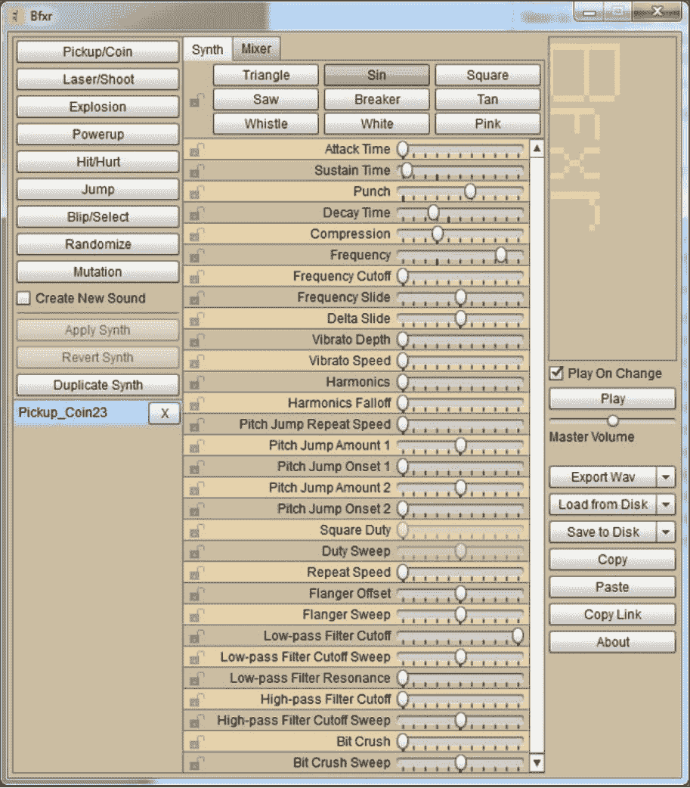
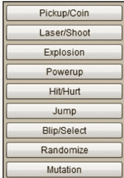
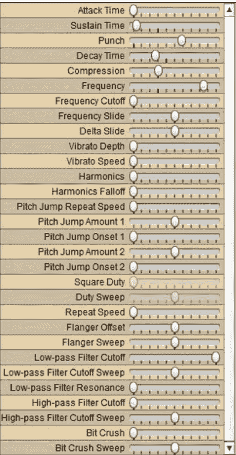
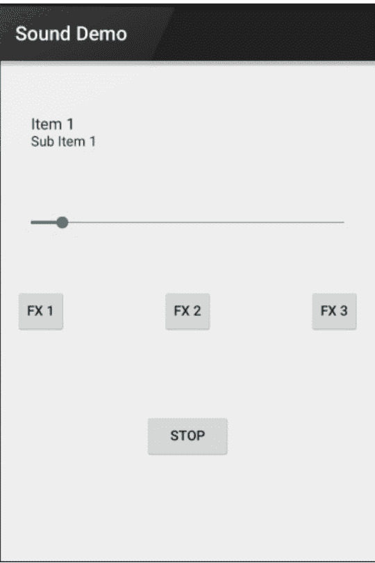
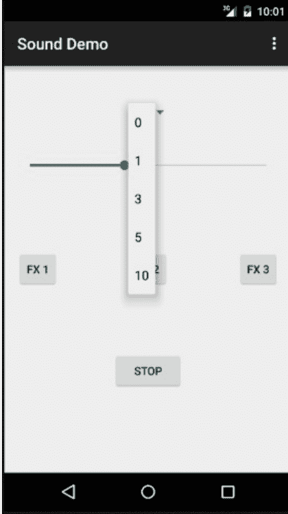
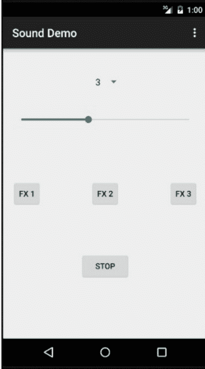

## 第 17 章 音效及支持不同版本的 Android

在本章中，您将学习如何在 Android 上加载和播放 **音效 (FX)**。由于 Android API 的声音部分最近已更新，这也是探讨支持不同版本 Android 策略的好机会。在本书中，我们一直在编写默认可在 95% 设备上运行的应用，但有时我们希望支持更多设备。此外，当我们知道编写的代码最终可能无法在新设备上运行时，能够对应用做一些未来兼容性处理是很有用的。本章包括以下主题：

- 如何在同一应用中为不同版本的 Android 编写代码
- SoundPool 类如何工作
- 音效小应用
- 如何为 Note To Self 应用添加声音

## 支持多个版本的 Android

在本书的大部分时间里，我们都没有关注过对旧版 Android 设备的支持，因为这似乎不值得。主要原因是，我们一直在使用的 API 中最新的部分在超过 95% 的设备上都能正常工作。除非您打算为古老的 Android 遗物开发细分市场应用，否则这似乎是一种合理的做法。但是，关于播放声音，Android API 最近做了一些修改。

实际上，这并不立即成为一个大问题，因为更新的设备仍然可以使用 API 的旧部分。但是，专门处理这些兼容性差异是一种良好的做法，因为最终有一天，旧部分可能无法在较新版本的 Android 上工作。

在此处讨论这一点的主要原因是，Android Lollipop 之前和之后声音处理的细微差别为我们提供了一个很好的机会，来了解如何在代码中处理此类问题。

在本章中，我们将了解如何使我们的应用既兼容最新设备，也兼容 Lollipop 之前的设备。

我们将用来发出声音的类是 SoundPool 类。首先，让我们看看一些简单的代码来检测当前 Android 版本。

## 检测当前 Android 版本

我们可以使用 Build.VERSION 类的静态变量 SDK_INT 来确定当前 Android 版本，并通过将其与相应的版本变量 Build.VERSION_CODES 进行比较来确定它是否高于某个特定版本，如下面的代码片段所示。如果这个解释有点绕，只需看看我们如何确定当前版本是否等于或高于（大于）Lollipop：

```java
if (Build.VERSION.SDK_INT >= Build.VERSION_CODES.LOLLIPOP) {
    // Lollipop or newer code goes here
} else {
    // Code for devices older than lollipop here
}
```

现在，让我们看看如何在新旧 Lollipop 的 Android 设备上发出声音。

## SoundPool 类

SoundPool 类允许我们持有和操作一组音效——实际上是一个声音池。该类处理从解压缩声音文件（如 .wav 或 .ogg）到通过整数 ID 保存其标识引用的所有事情，当然还包括播放声音。播放声音时，是以非阻塞方式进行的，不会干扰应用的平稳运行或用户与应用的交互。

首先，我们需要将音效添加到主文件夹中的 assets 文件夹。接下来，在 Java 代码中，我们声明一个 SoundPool 类型的对象，以及我们打算使用的每个音效的 int 标识符。我们还声明另一个名为 nowPlaying 的 int 标识符，我们可以用它来跟踪当前正在播放的声音，我们很快就会看到如何操作。请看下面的代码片段：

```java
// create an identifier
SoundPool sp;
int nowPlaying = -1;
int idFX1 = -1;
```

### 构建 SoundPool 的新方式和旧方式

新方式涉及使用 AudioAttributes 对象来设置我们想要的声音池的属性。我们使用链式调用和该类的 Builder 方法来初始化 AudioAttributes 对象，以让它知道它将用于具有 USAGE_ASSISTANCE_SONIFICATION 的用户界面交互。我们还将使用 CONTENT_TYPE_SONIFICATION，它让类知道它将用于响应性声音，例如用户按钮点击或类似任务。

现在，我们可以通过传入 AudioAttributes 对象 (audioAttributes) 和我们可能想要同时播放的最大声音数量来初始化 SoundPool (sp) 本身：

```java
// Instantiate a SoundPool dependent on Android version
if (Build.VERSION.SDK_INT >= Build.VERSION_CODES.LOLLIPOP) {
// The new way
```


```
// The new way
// Build an AudioAttributes object
AudioAttributes audioAttributes = new AudioAttributes.Builder()
.setUsage(AudioAttributes.USAGE_ASSISTANCE_SONIFICATION)
.setContentType(AudioAttributes.CONTENT_TYPE_SONIFICATION)
.build();

// Initialize the SoundPool
sp = new SoundPool.Builder()
.setMaxStreams(5)
.setAudioAttributes(audioAttributes)
.build();
}
```

这里所示的 else 代码块当然会包含旧方法的代码。不需要 AudioAttributes 对象；我们只需通过传入同时播放的声音数量来初始化 SoundPool (sp)。最后一个参数用于声音质量，传入零即可。这比新方法简单得多，但在可选方面也缺乏灵活性：

```
else {
  // The old way
  sp = new SoundPool(5, AudioManager.STREAM_MUSIC, 0);
}
```

现在，我们已经在 assets 文件夹中准备好了声音效果，并以某种方式构建了 SoundPool 对象，可以继续加载（解压缩）SoundPool 类中的声音文件了。

## 将声音文件加载到内存中

与加载或保存磁盘文件的方法一样，我们需要将代码包装在 try-catch 块中。这很合理，因为读取文件可能会因超出我们控制的原因而失败，而且由于我们使用的方法会抛出异常，否则我们编写的代码无法编译，所以被迫这样做。

在 try 块中，我们声明并初始化 AssetManager 和 AssetFileDescriptor 类型的对象。这里使用 AssetManager 对象的 openFd 方法初始化 AssetFileDescriptor，该方法实际解压缩声音文件。然后，我们在将 AssetFileDescriptor 的内容加载到 SoundPool 的同时初始化我们的 ID (idFX1)。catch 块只是向控制台输出一条消息，以告知是否出了问题。请注意，无论 Android 版本如何，此代码都相同：

```
try{
    // Create objects of the 2 required classes
    AssetManager assetManager = this.getAssets();
    AssetFileDescriptor descriptor;

    // Load our fx in memory ready for use
    descriptor = assetManager.openFd("fx1.ogg");
    idFX1 = sp.load(descriptor, 0);
}catch(IOException e){
    // Print an error message to the console
    Log.e("error", "failed to load sound files");
}
```

现在，我们准备发出一些声音了。

## 播放声音

此时，我们的 SoundPool 类中有一个声音效果，并且有一个 ID 可以用来引用它。

无论我们如何构建 SoundPool 对象，此代码都相同，这就是播放声音的方法。请注意，我们使用实际播放声音的同一方法的返回值来初始化 nowPlaying 变量。因此，以下代码同时播放声音，并将正在播放的 ID 值加载到 nowPlaying 中。当我们制作一个真正的小应用来播放一些声音时，我们将看到这将有何用处：

```
nowPlaying = sp.play(idFX1, volume, volume, 0, repeats, 1);
```

play 方法的参数为：声音效果的 ID、左扬声器音量、右扬声器音量、相对于其他声音的优先级、声音重复次数，以及播放速率/速度（1 为正常速率）。

在制作真正的应用之前，还有一个快速的事情。

## 停止声音

使用 stop 方法停止正在播放的声音也非常简单。请注意，任何给定时间可能有多个声音效果同时播放，因此 stop 方法需要要停止的声音效果的 ID：

```
sp.stop(nowPlaying);
```

现在，我们将尝试一个尚未使用过的 UI 小部件的同时，真正地发出一些声音。

## 介绍 Spinner 小部件

当然，说了这么多音效，我们需要一些实际的声音文件。您可以从各种免费网站下载音效，也可以购买高级音效。此应用的音效包含在下载包中，位于 Chapter 17/Sound Demo 文件夹的 assets 文件夹里。但您也可以自己制作。

## 制作音效

有一个名为 Bfxr 的开源应用，允许我们制作自己的音效。以下是使用 Bfxr 快速制作自己音效的指南。从 www.bfxr.net 获取免费副本。

按照网站上的简单说明进行设置。尝试其中一些内容来制作酷炫的音效。

## 提示

这是一个非常精简的教程。使用 Bfxr 可以做很多事情。要了解更多信息，请阅读之前网址上的提示。

- 1. 运行 Bfxr，如图所示：



- 2. 尝试所有预设类型，如下一张屏幕截图所示，它们会生成该类型的随机声音。当您有了接近想要的声音时，进入下一步：



- 3. 使用滑块微调新声音的音调、时长和其他方面，如下图所示：



- 4. 单击 **导出 WAV** 按钮保存声音。尽管该按钮上的文字如此，但我们也可以以 .wav 以外的格式保存声音：


- 5. Android 与 OGG 格式的声音配合得很好，因此在要求命名文件时，请在文件名末尾使用 .ogg 扩展名。

- 6. 重复步骤 2 到 5 来创建三个酷炫的音效。将它们命名为 fx1.ogg、fx2.ogg 和 fx3.ogg。我们使用 .ogg 文件格式，因为它比 WAV 等格式压缩得更多。当您的声音文件准备好后，我们可以继续开发应用。

## 布局 Sound Demo 界面

与之前的项目相比，我会更简洁地描述我们正在熟悉的项目部分。不过，每次遇到新概念时，我都会确保进行完整解释。我想您将几个小部件拖放到 RelativeLayout 上并更改它们的文本属性应该没问题。

牢记这一点，请完成以下步骤。如果有任何问题，可以复制或查看下载包中 chapter 17/Sound Demo 文件夹里的代码：

- 1. 创建一个新项目，将其命名为 Sound Demo，并选择 Blank Activity。将所有其他设置保留默认值，并删除 Hello world! 小部件。

- 2. 按此顺序，从调色板中拖放 Spinner、SeekBar 和四个 Button 到布局上，同时排列它们并设置它们的文本属性，如下一张屏幕截图所示：



- 3. 使用以下表格设置我们在 Java 代码中需要的小部件属性：

| 小部件 | 要更改的属性 | 设置的值 |
|---|---|---|
| Spinner | id | spinner |
| Spinner | spinnerMode | dropdown |
| Spinner | entries | @array/spinner_options |
| SeekBar | id | seekBar |
| SeekBar | max | 10 |
| Button (FX 1) | id | btnFX1 |
| Button (FX 2) | id | btnFX2 |
| Button (FX 3) | id | btnFX3 |
| Button (STOP) | id | btnStop |

接下来，将以下高亮代码添加到 values 文件夹中的 strings.xml 文件中。我们在上一步中为 options 属性使用了名为 spinner_options 的字符串资源数组。它将表示我们 Spinner 小部件中可供选择的选项：

```
<resources>
<string name="app_name">Sound Demo</string>
<string name="hello_world">Hello world!</string>
<string name="action_settings">Settings</string>
<string-array name="spinner_options">
    <item>0</item>
    <item>1</item>
    <item>3</item>
    <item>5</item>
    <item>10</item>
</string-array>
</resources>
```

现在运行应用，起初您不会看到任何新内容。不过，如果您单击 Spinner 小部件，则会看到我们名为 spinner_options 的字符串数组中的选项。我们将使用 spinner 来控制声音效果播放时重复的次数，如下图所示：




让我们编写 Java 代码来使这个应用程序运行，包括我们如何与 spinner 进行交互。

使用操作系统的文件浏览器，进入项目的 app\src\main 文件夹，添加一个名为 assets 的新文件夹。

下载包中的 Chapter 17/SoundDemo/assets 文件夹里为您准备好了三个声音文件。将这三个文件放入您刚才创建的 assets 目录中，或使用您自己创建的文件。重要的是，它们的文件名必须是 fx1.ogg、fx2.ogg 和 fx3.ogg。

## 编写 Sound Demo 应用

要编写 Sound Demo 应用，我们首先添加一些成员变量，用于 SoundPool、声音效果 ID 和之前讨论过的 nowPlaying int，还会添加一个 float 来保存 0（静音）到 1（相对于设备当前音量的最大音量）之间的音量值。我们还会添加一个名为 repeats 的 int，它保存了我们要重复给定声音效果的次数：

```
SoundPool sp;

int idFX1 = -1;
int idFX2 = -1;
int idFX3 = -1;
int nowPlaying = -1;

float volume = .1f;
int repeats = 2;
```

现在，在 onCreate 中，我们可以以通常的方式获取按钮的引用并设置点击监听器：

```
Button buttonFX1 = (Button) findViewById(R.id.btnFX1);
buttonFX1.setOnClickListener(this);

Button buttonFX2 = (Button) findViewById(R.id.btnFX2);
buttonFX2.setOnClickListener(this);

Button buttonFX3 = (Button) findViewById(R.id.btnFX3);
buttonFX3.setOnClickListener(this);

Button buttonStop = (Button) findViewById(R.id.btnStop);
buttonStop.setOnClickListener(this);
```

同样在 onCreate 中，我们可以根据设备使用的 Android 版本初始化 SoundPool（sp）：

```
// Instantiate our sound pool dependent upon which version of Android
if (Build.VERSION.SDK_INT >= Build.VERSION_CODES.LOLLIPOP) {
 AudioAttributes audioAttributes = new AudioAttributes.Builder()
 .setUsage(AudioAttributes.USAGE_ASSISTANCE_SONIFICATION)
 .setContentType(AudioAttributes.CONTENT_TYPE_SONIFICATION)
 .build();
}
sp = new SoundPool.Builder()
.setMaxStreams(5)
.setAudioAttributes(audioAttributes)
.build();
} else {
sp = new SoundPool(5, AudioManager.STREAM_MUSIC, 0);
}
```

接下来，我们依次加载每个声音效果，并用指向我们加载到 SoundPool 中的相关声音效果的值初始化我们的 ID。整个内容按要求包装在 try-catch 块中：

```
try{
// Create objects of the 2 required classes
AssetManager assetManager = this.getAssets();
AssetFileDescriptor descriptor;

// Load our fx in memory ready for use
descriptor = assetManager.openFd("fx1.ogg");
idFX1 = sp.load(descriptor, 0);

descriptor = assetManager.openFd("fx2.ogg");
idFX2 = sp.load(descriptor, 0);

descriptor = assetManager.openFd("fx3.ogg");
idFX3 = sp.load(descriptor, 0);

}catch(IOException e){
// Print an error message to the console
Log.e("error", "failed to load sound files");
}
```

接下来，我们看看如何处理 SeekBar。如您可能已经料到的，我们将使用一个匿名类。我们将使用 OnSeekBarChangeListener 并重写 onProgressChanged、onStartTrackingTouch 和 onStopTrackingTouch 方法。

我们只需要在 onProgressChanged 方法中添加代码。在此方法中，我们只需更改 volume 变量的值，然后在 SoundPool 对象上使用 setVolume 方法，传入当前正在播放的声音效果以及声音左声道和右声道的音量：

```
// Now setup the seekbar

SeekBar seekBar = (SeekBar) findViewById(R.id.seekBar);

seekBar.setOnSeekBarChangeListener(new SeekBar.OnSeekBarChangeListener() {

@Override
public void onProgressChanged(SeekBar seekBar, int value, boolean fromUser) {
volume = value / 10f;
sp.setVolume(nowPlaying, volume, volume);
}

@Override
public void onStartTrackingTouch(SeekBar seekBar) {
}

@Override
public void onStopTrackingTouch(SeekBar seekBar) {

});
```

SeekBar 之后是 Spinner，以及另一个用于处理用户交互的匿名类。我们使用 AdapterView.OnItemSelectedListener 来重写 onItemSelected 和 onNothingSelected 方法。

我们的所有代码都放在 onItemSelected 方法中，该方法创建一个名为 temp 的临时 String，然后使用 Integer.valueOf 方法将 String 转换为 int，我们可以使用它来初始化 repeats 变量：

```
// Now for the spinner
Spinner spinner = (Spinner) findViewById(R.id.spinner);
spinner.setOnItemSelectedListener(new AdapterView.OnItemSelectedListener() {

@Override
public void onItemSelected(AdapterView<?> parentView, View selectedItemView, int position, long id) {
String temp = String.valueOf(spinner.getSelectedItem());
repeats = Integer.valueOf(temp);
}

@Override
public void onNothingSelected(AdapterView<?> parentView) {
}
```

```
);
});
```

这就是 onCreate 中的所有内容。现在，将类声明更改为实现 View.OnClickListener，如下一个代码中突出显示的那样：

```
public class MainActivity extends AppCompatActivity implements View.OnClickListener {
```

现在，实现 onClick 方法。很简单，每个按钮都有一个 case 语句。有一个 case 用于播放我们的三个声音效果中的每一个，设置音量和设置重复声音的次数。请注意，每次 play 调用的返回值都存储在 nowPlaying 中。当用户单击 STOP 按钮时，我们只需使用 nowPlaying 的当前值调用 stop，导致最近启动的声音效果停止，如以下代码所示：

```
@Override
public void onClick(View v) {
    switch (v.getId()){
    case R.id.btnFX1:
        sp.stop(nowPlaying);
        nowPlaying = sp.play(idFX1, volume, volume, 0, repeats, 1);
        break;

    case R.id.btnFX2:
        sp.stop(nowPlaying);
        nowPlaying = sp.play(idFX2, volume, volume, 0, repeats, 1);
        break;

    case R.id.btnFX3:
        sp.stop(nowPlaying);
        nowPlaying = sp.play(idFX3, volume, volume, 0, repeats, 1);
        break;

    case R.id.btnStop:
        sp.stop(nowPlaying);
        break;
    }
}
```

现在我们可以运行应用程序了。如果您听不到任何声音，请确保设备的音量已打开。以下是声音演示应用的截图：



单击您想播放的声音效果的相应按钮。更改音量和重复次数，当然，尝试使用 STOP 按钮停止它。

还要注意，当声音效果已经在播放时，您可以反复点击多个播放按钮，声音将同时播放，最多可达我们设置的最大流数（5）。然而，这显示了我们处理停止声音方式的一点不足，因为停止按钮只会停止最近启动的声音。

## 为 Note To Self 添加声音效果

如过去几章所惯例的那样，我们将运用新学到的知识为我们的 Note To Self 应用添加一个增强功能。不过，在我们转向新的编程领域之前，这是最后一次这样做。

使用操作系统的文件浏览器，进入项目的 app\src\main 文件夹，添加一个名为 assets 的新文件夹。

下载包中的 chapter 17/Note To Self/assets 文件夹里为您准备好了一个名为 beep.ogg 的声音文件。当然，如果您愿意，可以使用 Bfxr 制作自己的声音效果。

将文件放入您刚才创建的 assets 目录中。

现在，我们可以添加一些 Java 代码，每次从列表中选择一条笔记时播放 beep 声音。

首先，让我们向 MainActivity 类添加几个新的成员变量：

```
public class MainActivity extends AppCompatActivity {
    Animation mAnimFlash;
    Animation mFadeIn;

    int mIdBeep = -1;
    SoundPool mSp;

    private NoteAdapter mNoteAdapter;
    private boolean mSound;
    private int mAnimOption;
    private SharedPreferences mPrefs;
```

```
@Override
protected void onCreate(Bundle savedInstanceState) {
...
...
```


现在，在onCreate中，就像我们在Sound Demo应用中所做的那样，在调用setContentView之后，添加代码以特定于版本的方式初始化SoundPool，如下一个代码所示：

```
@Override
protected void onCreate(Bundle savedInstanceState) {
    super.onCreate(savedInstanceState);
    setContentView(R.layout.activity_main);

    // Instantiate our sound pool
    if (Build.VERSION.SDK_INT >= Build.VERSION_CODES.LOLLIPOP) {
        AudioAttributes audioAttributes = new AudioAttributes.Builder()
            .setUsage(AudioAttributes.USAGE_MEDIA)
            .setContentType(AudioAttributes.CONTENT_TYPE_SONIFICATION)
            .build();

        mSp = new SoundPool.Builder()
            .setMaxStreams(5)
            .setAudioAttributes(audioAttributes)
            .build();
    } else {
        mSp = new SoundPool(5, AudioManager.STREAM_MUSIC, 0);
    }

    try{
        // Create objects of the 2 required classes
        AssetManager assetManager = this.getAssets();
        AssetFileDescriptor descriptor;

        // Load our fx in memory ready for use
        descriptor = assetManager.openFd("beep.ogg");
        mIdBeep = mSp.load(descriptor, 0);
    }catch(IOException e){
        // Print an error message to the console
        Log.e("error", "failed to load sound files");
    }
    mNoteAdapter = new NoteAdapter();

    ListView listNote = (ListView) findViewById(R.id.listView);

    listNote.setAdapter(mNoteAdapter);
    ...
    ...
```

现在，添加下一段代码，它在onItemClick方法中播放声音。我添加了一些上下文并高亮显示了新代码，以清楚地说明它放在哪里：

```
...
public void onItemClick(AdapterView<?> adapter, View view, int
whichItem, long id) {

if(mSound) {
  mSp.play(mIdBeep, 1, 1, 0, 0, 1);
}

Note tempNote = mNoteAdapter.getItem(whichItem);
...
```

好了。现在你可以运行Note To Self应用，每次点击列表中的一条笔记时都会听到令人满意的咔哒声。

### 删除一条笔记 – 引入OnLongClick

作为对Note To Self的最后一项改进，也是为了聊聊一个酷炫的Android UI特性，我们将添加删除笔记的功能。在Android应用中，上下文操作通常通过长按来选择。长按是指用户将手指按在设备屏幕上，而不是简单地点击后抬起手指。

首先，让我们向NoteAdapter类添加一个删除笔记的方法。以下是从数组列表中删除Note对象，然后要求适配器自身及ListView更新的代码：

```
public void deleteNote(int n){
    noteList.remove(n);
    notifyDataSetChanged();
}
```

现在，在onCreate中，我们可以让ListView准备好接受长按，然后使用匿名类来监听并响应长按。这个内部类简单地调用我们的新deleteNote方法。在处理ListView常规点击的匿名类之前以及在调用setAdapter之后添加这段代码。在此，我包含了上下文并高亮显示了要添加的新代码：

```
...
listNote.setAdapter(mNoteAdapter);
// So we can long click it
listNote.setLongClickable(true);
// Now to detect long clicks and delete the note
listNote.setOnItemLongClickListener(new
AdapterView.OnItemLongClickListener() {
public boolean onItemLongClick(AdapterView<?> adapter, View view,
int whichItem, long id) {
// Ask NoteAdapter to delete this entry
mNoteAdapter.deleteNote(whichItem);
return true;
} });
```

```
listNote.setOnItemClickListener(new
AdapterView.OnItemClickListener() {
...
```

现在你可以长按删除一条笔记。在我们即将发布给真实用户的应用中，我们可能希望在删除笔记之前使用弹出对话框窗口来确认用户的决定。

### 常见问题解答

- 1. 如果我想播放音乐，该怎么办？

你可以使用MediaPlayer类在应用后台播放一些音乐。以下是示例代码，展示这有多简单：

```
// Create a MediaPlayer object
MediaPlayer mp = new MediaPlayer();
// Choose where to load the music from
mp.setDataSource(musicFileToLoad);
// Call the prepare method
mp.prepare();
// Play some music
mp.start();
```

有关完整详情，请参阅官方文档：http://developer.android.com/reference/android/media/MediaPlayer.html。

- 2. 如果我想制作一个真正的音乐播放应用，用户可以从自己的库中选择音乐播放，该怎么办？

Android也为我们简化了这一点。在Android Studio调色板上，你可以拖放一个MediaController小部件，它不仅允许用户控制音乐播放，还可以控制视频。在Android开发者网站上了解如何使用此小部件：http://developer.android.com/reference/android/widget/MediaController.html。

### 总结

现在我们知道如何让我们的应用发出声音了。本书中我们构建的大多数应用，你可能只需添加几个提示音或嗡嗡声，但当你设计自己的应用时，你可能想要做得更多，而现在你可以做到了。我们还学习了如何使用调色板中另一个有用的小部件：**Spinner**。

本章结束了Note To Self应用，是时候进入更高级的Android编程了。正如我们将看到的，更高级并不一定意味着更复杂；然而，在本书剩余部分中将介绍相当多的新主题。

在下一章中，我们将看到如何开始使用**Fragment**类编写更多实际应用，以及如何使用**设计模式**来保持不断增长的代码井井有条。
