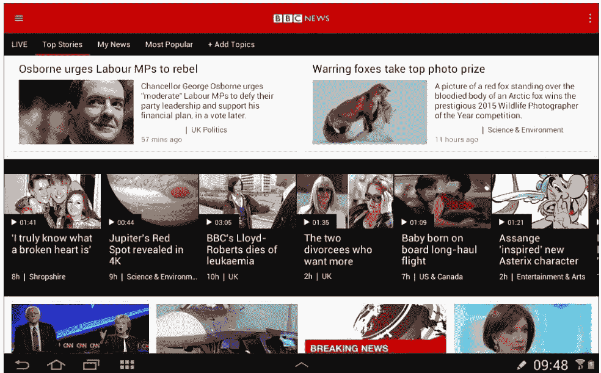
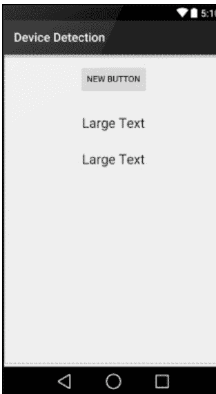
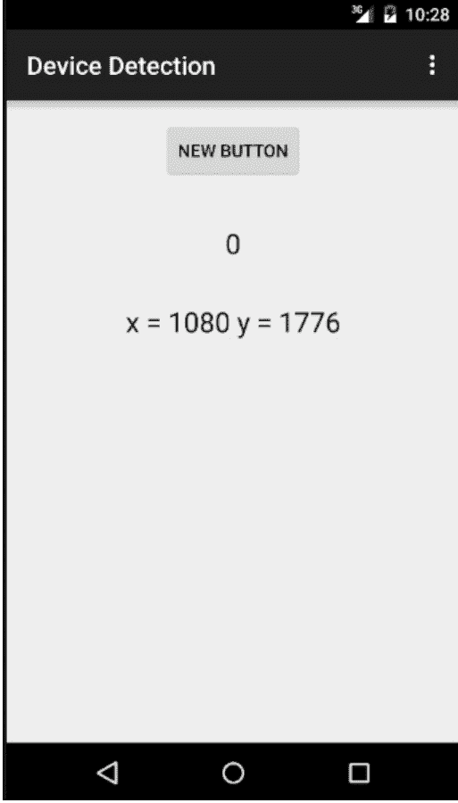
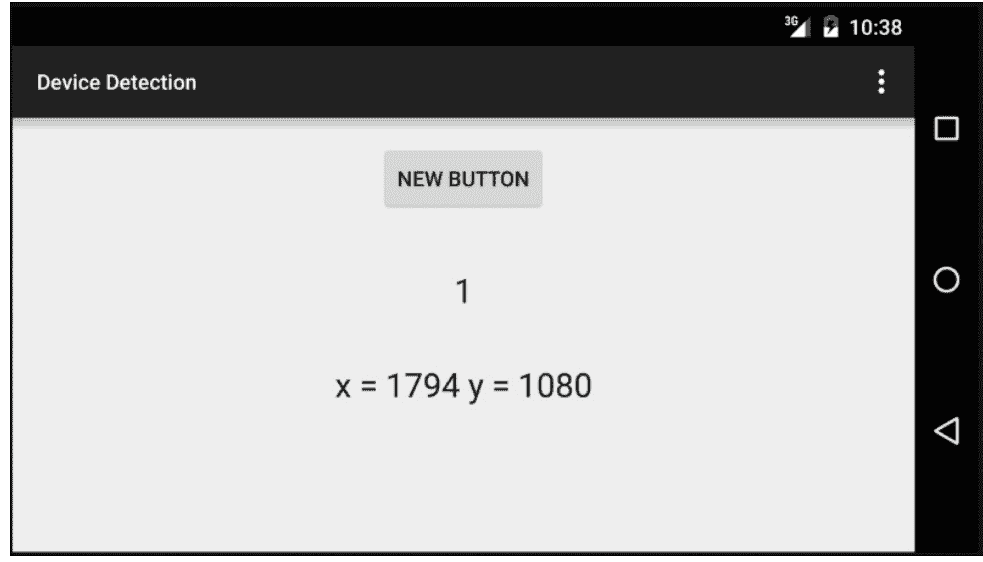
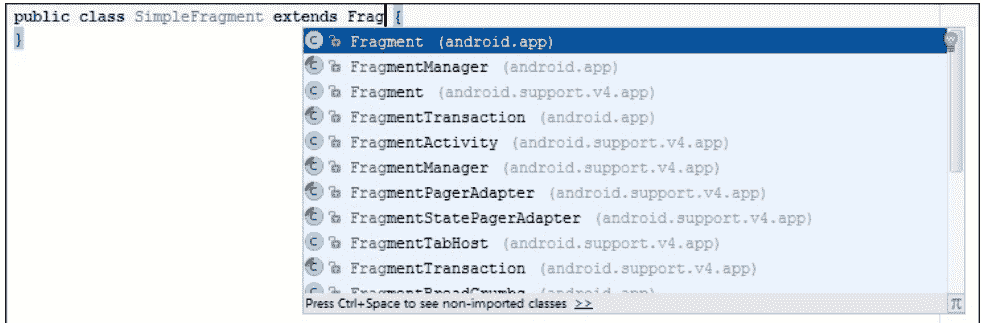
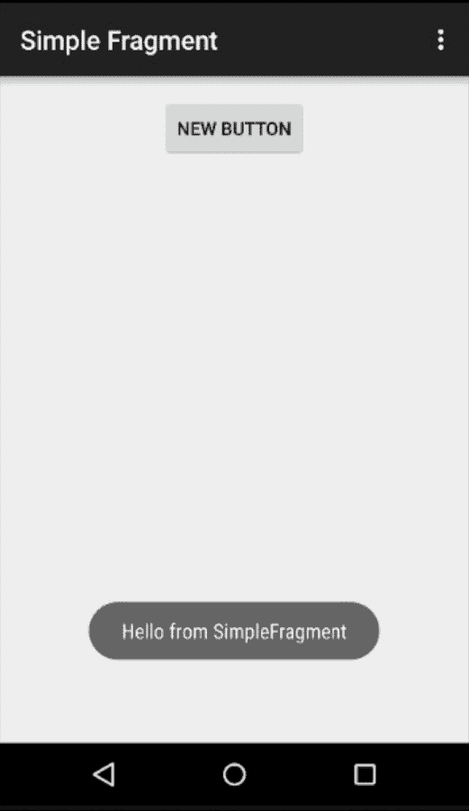

## 第18章 设计模式、Fragment以及实际应用

自本书开始时我们只是在设置Java和Android Studio以来，我们已经走得很远了。那时，我们逐步介绍了所有内容。但随着我们的进展，我们不仅试图向你展示如何给y添加x或给应用b添加功能a，还试图使你能够以自己的方式使用所学知识，从而将自己的想法变为现实。

本章更多地关乎你未来的应用，与迄今在本书中涵盖的任何内容都不同。我们将探讨Java和Android的许多方面，你可以将它们作为框架或模板，在构建更激动人心、更复杂的应用的同时保持代码的可维护性。此外，在本章中，我将建议你可以查阅的进一步学习领域，这些领域超出了本书的范围。

在本章中，你将学习以下主题：

- 模式和模型-视图-控制器模式
- Android设计准则
- 实际设计入门及处理多种不同设备
- Fragments简介

让我们开始吧。

### 介绍模型-视图-控制器模式

MVC是指将应用的不同方面分离到称为**层**的不同部分中。Android应用通常使用模型-视图-控制器**模式**。模式只是一种结构化我们的代码和其他应用资源（如布局文件、图像、数据库等）的公认方式。模式对我们很有用，因为通过遵循模式，我们可以更有信心地做正确的事情，并不太可能因为将自己编程陷入尴尬境地而不得不推翻大量辛苦的工作。

计算机科学中有许多模式，但理解MVC足以创建一些非常专业的Android应用。

我们实际上已经部分使用MVC了，所以让我们依次看看这三个层。

### 模型

模型是指驱动我们的应用的数据，以及专门管理它并使其可供其他层使用的任何逻辑/代码。例如，在我们的Note To Self应用中，Note类及其getter、setter和JSON代码就是数据和逻辑。

### 视图

Note To Self应用的视图是指所有不同布局中的所有小部件。用户在屏幕上可以看到或与之交互的任何内容通常都属于视图。并且，你可能还记得，这些小部件实际上来自Android API的视图类层次结构。


## 控制器

控制器是位于视图和模型之间的部分。它与两者交互，并使它们保持分离。它包含了在极客语言中被称为应用程序逻辑的内容。如果用户单击按钮，应用层决定如何处理。当用户单击“确定”以添加新便签时，应用逻辑会监听视图层上的交互。它捕获视图中包含的数据，并将其传递给模型层。几乎…

## Note To Self 的不足之处再探讨

实际上，如前所述，我们在那个应用中并没有使用严格的 MVC 模式。如果你记得，存储便签的 ArrayList 实际上是在 Activity 类中保存的。在我们的下一个应用中，我们将看到如何通过使用一个专门设计的 Java 类（即单例）来改善对 MVC 模式的遵守。单例并不是另一种类类型，如内部类、匿名类、静态类、接口等等。它只是一种设计和编写普通类的方式，以使我们的代码更符合 MVC 模式，因此随着复杂度增加，代码更易于管理，未来更具潜在可复用性，并且更容易让其他可能参与项目的开发者理解。

所以，我们在 Note To Self 应用中为什么做错了？为了简单。在设计 Note To Self 应用时，我们知道它永远不会成为一个庞大或复杂的项目，也不会同时由多个开发者共同开发。它仅仅服务于学习 Android 相关方面的目的，而不想在能够取得任何有意义成果之前，将更多概念（MVC 和单例）塞进需要知道的事物列表中。话虽如此，在 Note To Self 的设计上，我们大约做对了 95%。

总之，Note To Self 应用是 MVC 的一个绝佳演示，我们只需要看看在未来的应用中可以如何稍作调整，因为随着我们的应用变得更复杂，这将对我们有好处。我们使用 MVC 模式的原因是，通过将代码分成类，再将类分成 MVC 层，我们可以增强面向对象设计的目标，并使用经过验证的技术。

这一切乍一看可能显得过度设计和不必要的复杂化，但即使在本入门编程书籍的背景下，我们也将从遵循它中获益。因此，这就是为什么尽快引入所有这些概念是值得的——但不要太快。

## Tip

设计模式是一个庞大的主题。有许多不同的设计模式，如果你想要一个对主题本身的入门友好的介绍，我建议你阅读 O'Reilly Media 出版的 Head First Design Patterns。如果你想真正深入设计模式的世界，那么你可以尝试阅读 Design Patterns: Elements of Reusable Object-Oriented Software，这本书被公认为设计模式领域的“圣经”，但阅读难度更大。

随着我们进入第 19 章《使用多个片段》和第 20 章《分页和滑动》，我们将逐步介绍需要的 Java 知识，以更紧密地遵循 MVC 模式。我们还将开始利用更多我们讨论过但迄今尚未充分受益的面向对象编程方面。我们将一步步来。

## Android 设计准则

应用设计是一个庞大的主题。这是一个如果单独成书，我们才能开始涉及的主题。同样，像编程一样，只有通过不断的实践、回顾和改进，你才能开始在应用设计方面变得出色。

那么，我所说的设计到底是什么意思？我指的是在屏幕上放置小部件的位置、使用哪些小部件、颜色应该是什么、大小应该是多少、如何在屏幕之间过渡、滚动页面的最佳方式、何时以及使用哪些插值器、你的应用应该被分成哪些屏幕，以及更多。

这本书希望让你具备足够的资格，以便你能够*实施*前面问题中的所有选择以及更多选择。遗憾的是，这本书没有足够的篇幅，作者可能也没有足够的技能来教你如何*做出*这些选择。

## Tip

你可能在想，我该怎么办？继续制作应用，不要让缺乏设计经验和知识阻止你！甚至可以在应用商店发布你的应用。不过请记住，如果你的应用要真正达到世界级水平，设计是一个需要关注的整个不同主题。

在中型开发公司中，设计师很少也是程序员，即使是非常小的公司也经常将其应用的设计外包（或者设计师可能将编码外包）。

设计既是艺术也是科学，谷歌已经表明他们认识到这一点，为现有设计师和有志成为新设计师提供了非常高质量的支持。

## Tip

我强烈建议你访问并收藏此页面：[Android 设计指南页面](http://developer.android.com/design/index.html)。它非常详细且全面，完全专注于 Android。它还以图像、调色板和指南的形式提供了大量资源。

将理解设计原则作为你的短期目标。将提高实际设计技能作为一项持续的任务。访问并阅读专注于设计的网站，并尝试实施你发现有趣的想法。

不过，最重要的是，不要等到你成为设计专家才制作应用。继续将你的想法变为现实并发布它们。力求使每个应用都比上一个设计得更好一点。

在即将到来的章节中，我们已经看到了，Android API 为我们提供了大量超时尚的 UI，我们可以用很少的代码加以利用。这些在很大程度上能让你的应用看起来像是由专业人士设计的。

## 真实世界应用

到目前为止，我们设计了一个相当重要的应用和十几个微型应用。我们为平板电脑设计了一些，但大部分是在 Nexus 5 手机上设计的。此外，本书中的大多数屏幕截图是在 Nexus 5 模拟器上拍摄的。

当然，在现实世界中，我们的应用需要在任何设备上都能正常工作，并且必须能够处理在横向或纵向视图（在所有设备上）下发生的情况。

而且，我们的应用仅仅在不同设备上运行正常且外观可接受通常是不够的。通常，我们的应用需要根据设备是手机、平板电脑还是横向/纵向方向，以显著不同的 UI 表现出不同的*表现*并呈现不同的界面。

## Note

Android 已经支持大屏幕电视应用程序一段时间了，并且在 2015 年，它推出了 Wear API 来为 Android 手表构建应用程序。本书将不介绍这两种最极端的情况。

看看这个 BBC 新闻应用在 Android 手机纵向方向下运行的截图。查看基本布局，但也要注意新闻类别（**头条新闻**、**世界**、**英国**）都可见，并允许用户向下滚动，以便他们可以看到更多类别，或在每个类别中的故事之间向左或向右滑动。


我们将看到如何使用 ImagePager 和 FragmentPager 类在第 20 章《分页和滑动》中实现滑动/分页 UI。目前，该图表的目的不在于向你展示特定的 UI 功能，而是让你将其与下一个截图进行比较。看看同一个应用在平板电脑横向方向下运行的情况：



请注意，故事（数据层）是相同的，但布局（视图层）非常不同。用户不仅可以从应用顶部的选项卡菜单中选择类别，还可以通过“+ 添加主题”选项添加他们自己的选项卡。

再次强调，这张图片的重点不在于特定的 UI，甚至不在于我们如何实现类似的 UI，而在于它们差异如此之大，以至于很容易被误认为是完全不同的应用。

Android 允许我们设计这样的现实世界应用，其中不仅布局会因设备类型/方向/尺寸而异，行为也会如此。使这一切成为可能的 Android 秘密武器是片段（Fragments）。

## Note

## Google says

片段（Fragment）表示活动中的行为或用户界面的一部分。你可以在单个活动中组合多个片段来构建多窗格 UI，并在多个活动中重用片段。


并在多个活动中重用一个片段。

可以把 Fragment 视为活动中的一个模块化部分，它拥有自己的生命周期，接收自己的输入事件，并且你可以在活动运行时添加或删除它（有点像你可以在不同活动中重用的子活动）。

Fragment 必须始终嵌入在活动中，Fragment 的生命周期直接受到宿主活动生命周期的影响。

我们可以在不同的 XML 文件中设计多种不同的布局，我们很快就会这么做。我们还可以在代码中检测设备方向和屏幕分辨率等信息，以便动态做出布局决策。

让我们先试试，然后我们将了解 Fragments。

## 设备检测小应用

要创建此应用，新建一个项目并将其命名为 Device Detection。删除默认的 **你好世界！** 小部件。将 **按钮** 拖到屏幕顶部，并将其 **onClick** 属性设置为 detectDevice。我们稍后会编写此方法。

将两个 **大文本** 小部件拖到布局上，并将它们的 **id** 属性分别设置为 txtOrientation 和 txtResolution。你现在的布局应该看起来像这样：



在 MainActivity 类声明后立即添加以下成员，以保存对两个 TextView 小部件的引用：

```
private TextView txtOrientation;
private TextView txtResolution;
```

现在，在 MainActivity 的 onCreate 方法中，在 setContentView 调用之后立即添加此代码：

```
// Get a reference to our TextView widgets
txtOrientation = (TextView) findViewById(R.id.txtOrientation);
txtResolution = (TextView) findViewById(R.id.txtResolution);
```

在 onCreate 之后，添加处理按钮点击并运行检测代码的方法：

```
public void detectDevice(View v){
    // What is the orientation?
    Display display = getWindowManager().getDefaultDisplay();
    txtOrientation.setText("" + display.getRotation());

    // What is the resolution?
    Point xy = new Point();
    display.getSize(xy);
    txtResolution.setText("x = " + xy.x + " y = " + xy.y);
}
```

现在运行应用。在某些计算机上，模拟器在旋转时容易崩溃。如有必要，请在真实设备上测试：



将设备旋转为横向（PC 上使用 Ctrl + F11，Mac 上使用 Ctrl + fn + F11）。现在，点击 **新按钮** 按钮，如下所示：



如果关于设备方向的 0 和 1 结果不太明显，它们指的是 Surface 类的 public static final 变量，其中 Surface.ROTATION_0 等于 0，Surface.ROTATION_180 等于 1。

我们可以根据这些检测测试的结果进行切换，并加载不同的布局。

Android 允许我们将特定布局添加到带有配置限定符的文件夹中，从而为我们简化了这一过程。

## 配置限定符

我们在第 3 章“探索 Android Studio”的 Android Studio 引导之旅部分中已经见过 `layout-large` 或 `layout-xhdpi` 等配置限定符。在这里，我们将刷新并扩展对它们的理解。

我们可以开始使用配置限定符来消除对控制器层影响应用布局的依赖。存在针对大小、方向和像素密度的配置限定符。要利用配置限定符，我们只需以常规方式设计针对首选配置优化的布局，然后将该布局放入 Android 识别为该特定配置的文件夹中即可。

因此，如果我们想为横向和竖向提供不同的布局，我们会在 res 文件夹中创建一个名为 `layout-land` 的文件夹，并将特别设计的布局放入其中。当设备处于竖向位置时，将使用 `layout` 文件夹中的常规布局；当设备处于横向位置时，将使用 `layout-land` 文件夹中的布局。

如果我们要针对不同尺寸的屏幕进行设计，我们将布局放入以下名称的文件夹中：

- layout-small
- layout-normal
- layout-large
- layout-xlarge

如果我们要针对像素密度不同的屏幕进行设计，我们可以将 XML 布局放入名称如下的文件夹中：

- layout-ldpi 布局适用于低 DPI 设备
- layout-mdpi 布局适用于中等 DPI 设备
- layout-hdpi 布局适用于高 DPI 设备
- layout-xhdpi 布局适用于超高 DPI 设备
- layout-xxhdpi 布局适用于超超高 DPI 设备
- layout-xxxhdpi 布局适用于超超超高 DPI 设备
- layout-nodpi 布局适用于你未针对其他情况处理 DPI 的设备
- layout-tvdpi 布局适用于电视

什么确切算作低、高或超高 DPI，可以在下一个信息框中的链接里研究。这里的要点是原理，我们将在下一个小应用中用这些知识做些实际的事情。

你可能还记得，当我们在第 12 章“与用户对话”中启动 Note To Self 应用时，我们曾将不同尺寸的图标添加到 drawable-mdpi 和 drawable-hdpi 等名称的文件夹中。这是因为 Android 会根据运行我们应用的设备的屏幕密度使用不同的图形。

值得指出的是，我们刚才讨论的内容距离配置限定符的完整故事还很遥远，和设计一样，值得把这件事列入你的进一步学习清单中。

### 注意

如同经常发生的情况一样，Android 开发者网站有关于处理不同设备布局的大量详细信息。如需更多信息，请访问 http://developer.android.com/guide/practices/screens_support.html。

现在让我们来试用一些设备限定符。

## 使用配置限定符 – 小应用

新建一个项目并将其命名为 Configuration Qualifiers，然后按以下步骤操作：

- 在项目资源管理器中右键单击 res 文件夹，依次选择 New | **Android 资源目录**。键入 layout-land 并单击 OK。

### 提示

如果你在项目资源管理器中看不到新目录，则需要通过项目资源管理器窗口顶部的下拉选择器更改项目资源管理器的视图。单击下拉选择器并选择 **项目**。

- 在 layout_main.xml 文件中，将默认 **文本视图** 小部件的文本从 Hello world 更改为 你好，竖向屏幕！。
- 右键单击 layout-land 文件夹，依次选择 New | **布局资源**。将文件命名为 layout_main.xml。添加一个 **纯文本视图** 小部件，并将 text 属性更改为 你好，横向屏幕！。
- 运行应用，在横向和竖向方向之间旋转设备。请注意，操作系统会自动使用适当版本的 layout_main.xml。

如果我们在 Java 代码中获取了对 TextView（或任何其他小部件）的引用，只要不同布局中的 id 值相同，完全相同的代码也能工作。

实际上，我们有两个由同一段 Java 代码控制的不同布局。

## 配置限定符总结

过去两个小应用以及我们关于配置限定符的讨论所展示的内容在多种情况下当然非常有用。然而，不幸的是，配置限定符和在代码中检测属性仅解决了 MVC 模式中视图层的问题。如在“实际应用”部分所讨论，我们的应用有时不仅需要不同的布局，还需要不同的行为。这或许暗示控制器层中我们的代码有多个分支，并或许会唤起噩梦般的景象：巨大的 if 或 switch 块，为每种不同场景编写不同的代码。

幸运的是，情况并非如此。对于此类情况（实际上对于大多数应用），Android 提供了片段。


## 片段

片段很可能会成为你几乎每个真实应用中的必备要素。它们非常有用；使用它们的理由多不胜数；一旦你习惯了它们，它们就非常简单。几乎没有不使用它们的理由。

片段是应用中可复用的元素，就像任何类一样，但如前面所述，它们具有特殊功能，例如能够加载自己的视图，以及拥有自己的生命周期方法，这使它们非常适合实现我们在“实际应用”部分讨论的目标。

让我们逐个功能深入探讨片段。

### 片段也有生命周期

我们可以像设置和控制活动一样，通过重写适当的生命周期方法来设置和控制片段。

#### onCreate

在 onCreate 方法中，我们可以初始化变量，并做几乎所有我们通常在 `Activity` 的 `onCreate` 方法中会做的事情。最大的例外是初始化我们的 UI。

#### onCreateView

在这个方法中，正如名称所暗示的那样，我们将获取对任何 UI 小部件的引用，设置匿名类以监听点击，并做除这些任务之外的更多事情，你很快就会看到。

#### onAttach 和 onDetach

这些方法在片段实际投入使用/停止使用之前被调用。

#### onStart、onPause 和 onStop

在这些方法中，我们可以执行某些操作，例如创建或删除对象或保存数据，就像我们对基于活动的对应方法所做的那样。

#### 提示

还有其他片段生命周期方法，但我们已经了解足够多，可以开始使用片段了。如果你想研究片段生命周期的细节，可以在 Android 开发者网站上访问 http://developer.android.com/guide/components/fragments.html。

这一切都很好，但我们首先需要一种创建片段的方法，并能够在适当的时候调用这些方法。

## 使用 FragmentManager 管理片段

FragmentManager 类是活动的一部分。我们使用它来初始化片段，将片段添加到活动的布局中，以及结束片段。我们实际上之前初始化一些 FragmentDialog 时简要地见过 FragmentManager。不接触 Fragment 类就很难深入了解 Android，就像不了解面向对象编程就很难深入了解 Java 一样。这里突出显示的代码展示了我们如何使用作为参数传入的 FragmentManager（它已经是活动的一部分）来创建弹出对话框：

```
button.setOnClickListener(new View.OnClickListener() {
@Override
public void onClick(View v) {
    // Create a new DialogShowNote called dialog
    DialogShowNote dialog = new DialogShowNote();

    // Send the note via the sendNoteSelected method
    dialog.sendNoteSelected(mTempNote);

    // Create the dialog
    dialog.show(getFragmentManager(), "123");
}
});
```

当我们使用之前的代码时，我曾要求你不要担心方法调用的参数。方法调用的第二个参数是片段的 ID。我们将看到如何更广泛地使用 FragmentManager，以及如何使用片段 ID。

FragmentManager 确实如其名称所暗示的那样。重要的是，活动只有一个 FragmentManager，但它可以管理许多片段；这正是我们需要在单个应用中拥有多种行为和布局的东西。

FragmentManager 还会调用其负责的片段的各种生命周期方法。这与由 Android 调用的活动生命周期方法不同，但又密切相关，因为 FragmentManager 在活动生命周期方法被调用时会响应调用许多片段生命周期方法。惯例一样，只要我们在每种情况下适当响应，就不必太担心何时以及如何调用。

### 注意

片段将成为我们未来许多（如果不是全部）应用的基础部分。然而，就像我们对待命名约定、字符串资源和封装一样，当使用片段会过于繁琐时，我们不会将其用于简单的学习目的或小型应用。当然，例外情况是当我们专门学习或制作用于演示片段的小型应用时。

此外，还将有一些基于片段的小型应用，我们将只关注与片段相关的代码，以便正确理解它。

## 第一个可用的片段小型应用

让我们以最简单的形式构建一个片段，以便在后面几章开始到处制作片段之前，先了解发生了什么。

### 提示

我敦促所有读者通读并实际构建这个项目。在文件之间来回切换很多，仅靠阅读会让它看起来比实际更复杂。你可以从下载包中复制和粘贴代码，但请也按照步骤创建自己的项目和类。片段并不太难，但正如其名称所暗示的那样，其实现有点碎片化。

创建一个名为 Simple Fragment 的新项目，使用与往常相同的默认设置。请注意，有一个创建带片段的项目的选项，但你会通过从头开始做来学到更多关于它们的知识。

切换到 activity_main.xml 并删除默认的 Hello world! 小部件。现在，确保在组件树窗口中点击它来选择 RelativeLayout 根节点。将其 id 属性更改为 fragmentHolder。我们现在将能够在 Java 代码中获取对这个布局的引用，正如 id 属性所暗示的那样，我们将向其中添加一个片段。

现在，我们将创建一个定义片段外观的布局。右键点击 layout 文件夹并导航到 New | Layout resource file。在 File name 字段中键入 fragment_layout 并点击 OK。

在布局的任何位置添加一个 Button 小部件，并将其 id 属性设置为 button。

既然我们有了片段使用的简单布局，让我们编写一些 Java 代码来创建实际的片段。

### 提示

请注意，你可以通过从调色板拖放一个片段来创建它，但这样做的灵活性和可控性要低得多。此外，灵活性和控制力是片段的巨大优势，我们将在本章后面看到。通过创建一个扩展 Fragment 的类，我们可以从中制作出任意数量的片段。

在项目资源管理器中，右键点击包含 MainActivity 文件的文件夹。从上下文菜单中导航到 New | Java class。在 Name 字段中键入 SimpleFragment 并点击 OK。

### 提示

请注意，有创建各种预编码状态的 Fragment 类的选项以更快地实现 Fragment，但目前，它们会稍微模糊这个小型应用的学习目标。

在我们新的 SimpleFragment 类中，将代码更改为扩展 Fragment。在你输入代码时，系统会要求你选择要导入的特定 Fragment 类，如下一个截图所示：



选择顶部选项（如上一张截图所示），它是一个常规 Fragment 类。

现在，添加一个名为 myString 的字符串变量和一个名为 myButton 的 Button 变量作为成员，并重写 onCreate 方法。在 onCreate 方法中，将 myString 初始化为 Hello from SimpleFragment。到目前为止的代码（不包括包声明）将完全如下所示：

```
import android.app.Fragment;
import android.os.Bundle;
public class SimpleFragment extends Fragment {
// member variables accessible from anywhere in this fragment
String myString;
Button myButton;
@Override
public void onCreate(Bundle savedInstanceState){
super.onCreate(savedInstanceState);
myString = "Hello from SimpleFragment";
}
}
```

在之前的代码中，我们创建了一个名为 myString 的成员变量，然后在 onCreate 方法中初始化了它。这与我们以前的应用程序在仅使用活动时所做的非常相似。然而，区别在于我们没有设置视图或尝试获取我们的 Button 成员变量 myButton 的引用。

当使用片段时，我们需要在 onCreateView 方法中做这个。现在让我们重写它，看看我们如何设置视图并获取 Button 的引用。

将此代码添加到 SimpleFragment 类的 onCreate 方法之后：

```
@Override
public View onCreateView(LayoutInflater inflater, ViewGroup container, Bundle savedInstanceState) {
View view = inflater.inflate(R.layout.fragment_layout, container, false);
myButton = (Button) view.findViewById(R.id.button);
return view;
}
```

要理解上述代码块，我们必须首先查看 onCreateView 方法签名。首先，请注意方法开头说明它必须返回 View 类型的对象：

```
public View onCreateView...
```


接下来，我们有三个参数。现在先来看前两个：

```java
(LayoutInflater inflater, ViewGroup container, ...
```

我们需要 LayoutInflater，因为我们无法调用 setContentView，因为 Fragment 没有提供此类方法。在 onCreateView 的主体中，我们使用 inflater 的 inflate 方法来加载 fragment_layout.xml 中包含的布局，并使用结果初始化 view（View 类型的对象）。

我们将传递给 onCreateView 的 container 作为参数用于 inflate 方法。container 变量是对 activity_main.xml 中布局的引用。

activity_main.xml 是包含布局这一点可能显而易见，但如我们将在本章后面看到的，ViewGroup container 参数允许任何带有任何布局的 Activity 成为我们 fragment 的容器。这非常灵活，并在很大程度上使我们的 Fragment 代码可重用。我们传递给 inflate 的第三个参数是 false，这意味着我们不希望布局立即添加到包含布局中。我们将很快从代码的另一部分执行此操作。

onCreateView 的第三个参数是 Bundle savedInstanceState，它用于帮助我们维护 fragment 持有的数据。我们将在第 22 章“捕获图像”中看到这一点的实际应用。

现在 view 中包含已加载的布局，我们可以这样使用它来获取 Button 的引用：

```java
myButton = (Button) view.findViewById(R.id.button);
```

我们也可以按要求将其用作调用代码的返回值：

```java
return view;
```

现在，我们可以以通常的方式添加一个匿名类来监听按钮上的点击。在 onClick 方法中，我们显示一个弹出式 Toast 消息，以证明一切按预期工作。将此代码添加到 onCreateView 中 return 语句之前，如下一个代码块中所示：

```java
@Override
public View onCreateView(LayoutInflater inflater, ViewGroup container, Bundle savedInstanceState) {
    View view = inflater.inflate(R.layout.fragment_layout, container,
            false);
    myButton = (Button) view.findViewById(R.id.button);
    myButton.setOnClickListener(new View.OnClickListener() {
        @Override
        public void onClick(View v) {
            Toast.makeText(getActivity(), myString,
                    Toast.LENGTH_SHORT).show();
        }});
    return view;
}
```

作为提醒，作为 makeText 参数使用的 getActivity() 调用会获取包含 Fragment 的 Activity 的引用。这是显示 Toast 消息所必需的。我们还在基于 FragmentDialog 的 Note To Self 应用程序的类中使用了 getActivity。

我们暂时还不能运行我们的小应用，因为它无法工作，因为还有一个步骤需要完成。我们需要创建 SimpleFragment 的实例并适当地初始化它。这里将介绍 FragmentManager。

下一个代码通过调用 getFragmentManager 创建一个新的 FragmentManager。它使用 FragmentManager 并传入将容纳它的布局（在 Activity 中）的 ID，基于我们的 SimpleFragment 类创建一个新的 Fragment。

将此代码添加到 MainActivity.java 的 onCreate 方法中，在 setContentView 调用之后：

```java
// Get a fragment manager
FragmentManager fManager = getFragmentManager();
// Create a new fragment using the manager
// Passing in the id of the layout to hold it
Fragment frag = fManager.findFragmentById(R.id.fragmentHolder);

// Check the fragment has not already been initialized
if (frag == null) {
    // Initialize the fragment based on our SimpleFragment
    frag = new SimpleFragment();
    fManager.beginTransaction()
            .add(R.id.fragmentHolder, frag)
            .commit();
}
```

现在，运行应用，惊叹于我们的可点击按钮，创建它用了两个布局和两个完整的类，如以下截图所示：



我想我们需要进行一次 fragment 现实检查，来回答一些问题，比如“为什么”！

## Fragment 现实检查

那么，这些 Fragment 到底能为我们做什么？如果我们根本不使用 Fragment，我们的第一个 Fragment 小应用程序将具有完全相同的外观和功能。事实上，使用 Fragment 反而让整件事变得更加复杂！我们为什么要这么做？

我们其实已经知道这个问题的答案，但根据目前为止看到的内容，这并不特别清楚。我们知道 Fragment 可以添加到 Activity 的布局中。我们知道 Fragment 不仅包含其自己的布局（view），还包含其自己的代码（controller），尽管由 Activity 托管，但 Fragment 几乎是独立的。

我们的快速小应用程序只展示了一个 Fragment 的运作，但我们可以有一个托管两个或更多 fragments 的 Activity。然后我们可以在单个屏幕上有效地显示两个几乎独立的控制器。这听起来可能很有用。

然而，其中最有用的是，当 Activity 启动时，我们可以检测应用运行的设备属性，也许是手机或平板，或者是竖屏或横屏方向。然后我们可以使用这些信息来决定同时显示一个还是两个 fragments。

这不仅有助于实现本章开头“现实世界应用”部分讨论的那种功能，还允许我们对两种可能场景都使用完全相同的 Fragment 代码！这才是 fragments 的真谛。我们可以将功能（controller）和外观（view）配对成一组 fragments 来创建完整的应用程序，并以不同的方式重复使用它们，几乎无需担心。

当然，我们可以预见到一些绊脚石，所以请查看这些常见问题解答。

## 常见问题解答

- 1. 由于每个 Fragment 都是一个完全独立的类，它们将如何相互通信？

我们将从下一章开始，使用你们已经学过的 Java 实践用法——接口——以及一些其他工具来解决这个问题。

- 2. 另一个缺失的环节是，如果所有这些 fragments 都是功能完整的独立控制器，那么您需要更多地了解如何实现我们的模型层。如果我们仅仅像 Note To Self 那样有一个 ArrayList，它会放在哪里？我们将如何在 fragments 之间共享它（假设两个 fragments 都需要访问相同的数据）？

有一个更优雅的解决方案可用于创建模型层（包括数据本身和维护数据的代码）。我们可以使用 Java 单例，我们将在下一章中这样做。

## 摘要

现在我们对 Fragments 的用途以及如何开始使用它们有了广泛的了解，可以开始深入了解它们的使用方式。在下一章中，我们将完成几个应用程序，使我们能够最终按预期实现应用程序的数据层，并创建一个使用多个布局、多个 fragments 和我们新数据层的简单应用程序。同时，我们将看到另一种用于将 UI 链接到数据层的适配器。
