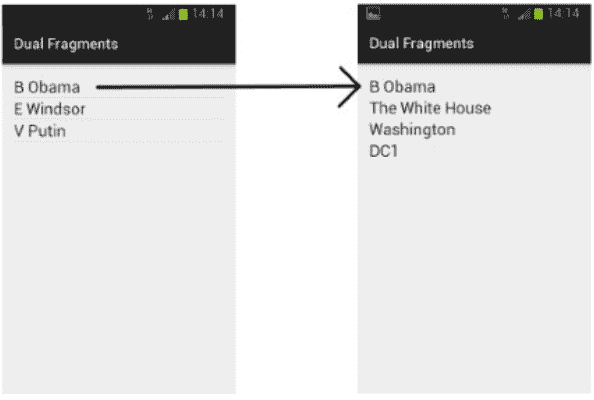
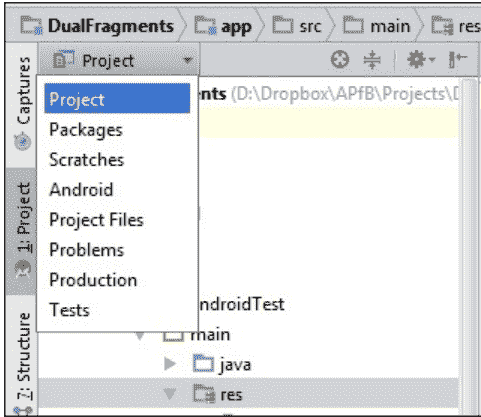
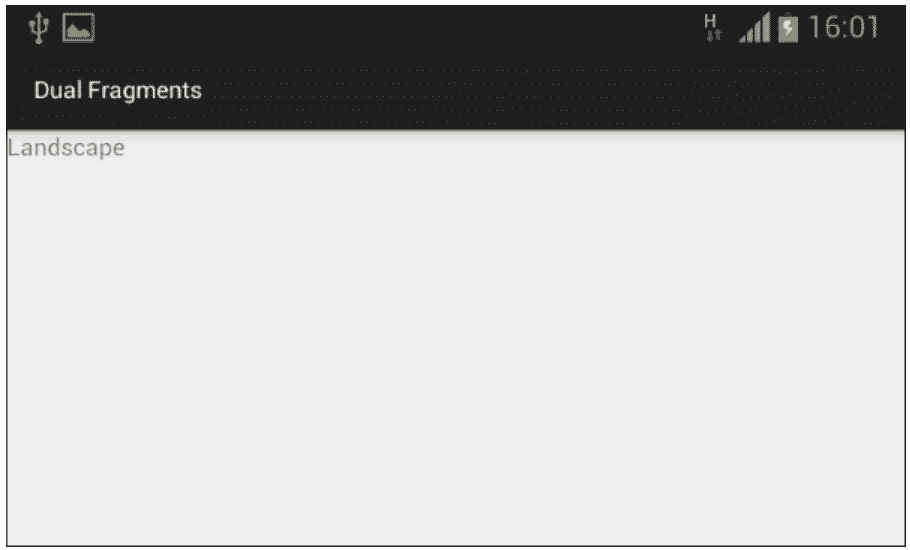
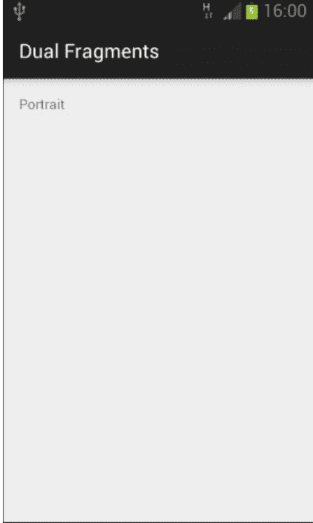
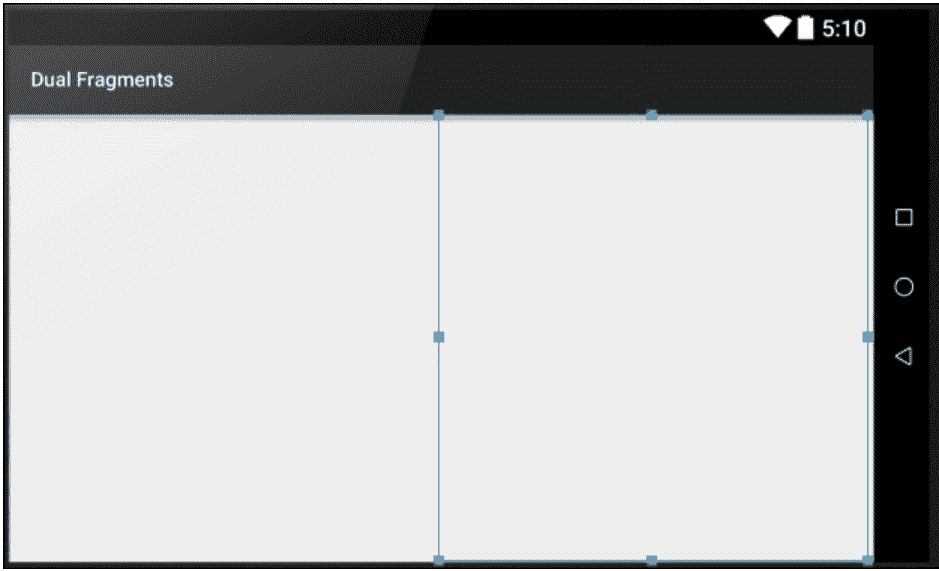
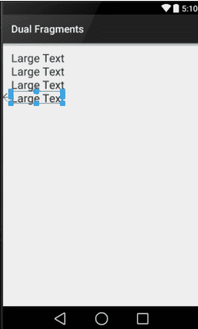
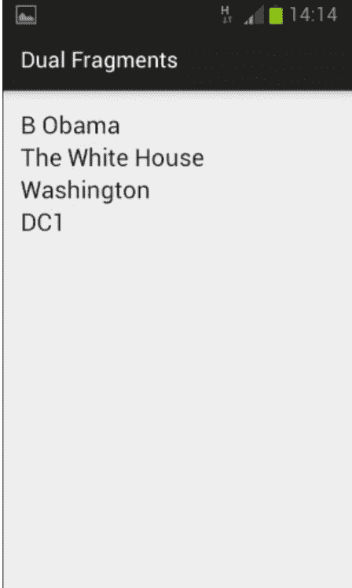
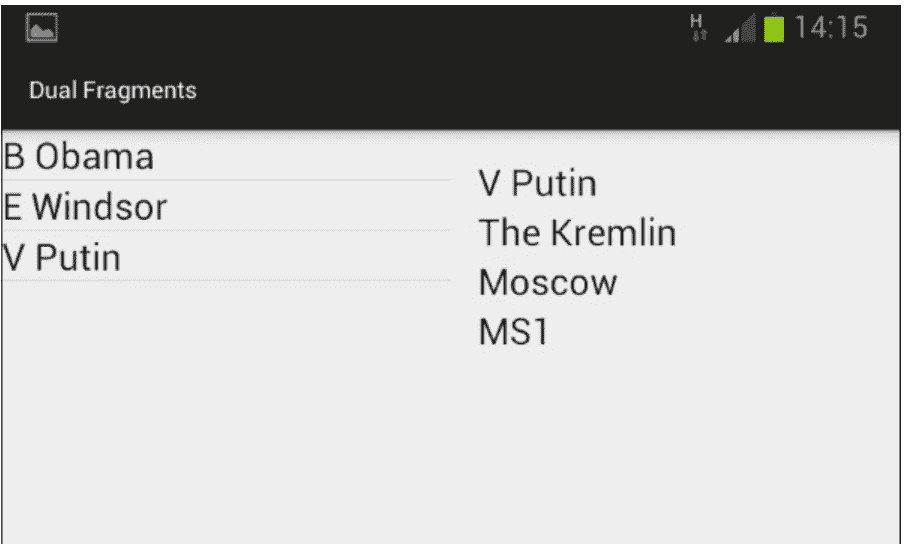

## 第 19 章。使用多个 Fragments

现在我们已经讨论了 MVC 原则并了解了如何实现 Fragment，可以进一步深入。您将学习如何使用 Java 单例分离数据层，然后我们将看到 Fragments 如何相互通信。

一旦我们实现了这两点，就可以实现我们的第一个多 Fragment、方向感知应用程序，将我们目前为止所学的一切付诸实践。

## 注意

在本章中，为了节省墨水，我将不再提供创建类和布局文件的具体说明。作为提醒，要创建新类，右键单击包含所有 .java 文件的文件夹，然后导航到“新建 | 类”。输入名称并单击“确定”。要创建新布局文件，右键单击 layout 文件夹，然后导航到“新建 | 资源布局文件”。

简而言之，在本章中我们将做以下事情：

- 探索 Java 单例以实现数据层
- 使用 Java 接口实现 Fragment 之间的通信
- 构建一个包含两个 Fragments 的地址簿应用程序，这两个 Fragments 在横屏视图和竖屏视图之间表现不同


## 为模型层使用单例

顾名思义，单例是指一个类中只能有一个该类的实例。如果你想想数据存储，这很合理。如果你不止一个地方存储同一组数据，那么有可能（甚至很有可能）在某个时刻你会尝试以不一致的方式存储或检索数据。

想想如果要用两套完全相同的文件夹来管理你的电子邮件。如果你有两个（或更多）标记为紧急的文件夹，你怎么知道要把那封紧急邮件存到哪里。而且当你需要检查是否有紧急邮件时，你需要检查两个文件夹。万一你忘了，只检查了一个呢？

另外，考虑一个购物应用，用户在页面间浏览，每个页面可能是一个独立的 Fragment/Activity。如果他们在多个页面向购物车添加物品，最终可能会得到两个独立的购物车，而不是一个同时包含两件物品的购物车。

当我们开发简单的应用时，可能不用单例也能存活下来。但随着应用迅速变得复杂，我们的数据存储方案很容易变得无处不在。

如果听起来单例可能很复杂，请放心，它们实际上非常简单。在软件工程中，单例模式只是一种限制类实例化/创建为一个对象的设计模式。当需要恰好一个对象来协调整个系统的操作时，这很有用。请注意，我们的单例将在整个应用中可访问，但对其他应用不可访问。

我们单例设计确保的另一件事是，数据将在整个应用生命周期内持久化，并可在应用的所有类中（包括片段）使用。

这对我们来说很有意义，因为虽然类之间有通信方式（其中一些我们已经见过），但如果数据对应用至关重要，它应该在整个应用中易于获取。

让我们回顾一下需求。我们需要一个只能有一个实例的类，但这个唯一实例必须在整个应用生命周期内对所有人可用，同时控制其数据的访问方式。

请看这段代码示例：

```
public class Movie{
private String mTitle;
private boolean mOnLoan;
public void setTitle(String title){
mTitle = title;
}
public String getTitle(){
return mTitle;
}
public void setLoanStatus(boolean loanStatus){
mOnLoan = loanStatus;
}
public boolean getLoanStatus(){
return mLoanStatus;
}
}
```

在前面的代码中，我们有一个名为 Movie 的简单类，包含两个私有成员：mTitle 和 mOnLoan。这两个变量分别用于存储电影标题以及该电影是否当前已出租的状态。这可能是一个有用的类，可用于应用来管理电影租赁店或个人电影收藏。代码中还有两个 getter 和两个 setter，用于检查和更改这两个私有成员变量的值，否则这些变量无法从类外部访问。

该类是公开的，所以应用的任何部分都可以创建该类的实例来操作 Movie 类型的数据。关键在于我们的应用如何获取这些实例，而单例正是派上用场的地方。请看下一段代码示例：

```
public class RentalStore {
// I am instantiating an instance of myself - weird!
// This is the only RentalStore that will ever exist
// This is the only RentalStore class that will ever exist
private static RentalStore ourInstance = new RentalStore();

private ArrayList <Movie> mMovies;

// Anyone who wants my one and only instance will
// need to use this method
public static RentalStore getInstance() {
    return ourInstance;
}

// Here is the constructor and it is private
// So only this class itself can ever instantiate it
private RentalStore() {
    mMovies = new ArrayList<Movie>();
}

// Anyone can get the list of movies though
public ArrayList <Movie> getMovies() {
    return mMovies;
}
}
```

这段代码看起来可能很复杂，但当我们拆解开来看，其实并不复杂。首先，看构造函数（与类同名的方法）。RentalStore 构造函数是私有的。由于我们提供了一个私有的默认构造函数，乍看之下似乎无法实例化 RentalStore。

在构造函数之前，我们有一个名为 getInstance 的公共静态方法。还记得我们在 [第 9 章，面向对象编程](#) 中讨论过，静态方法可以在没有类实例的情况下调用。再看一遍 getInstance 方法，注意它的返回类型是 RentalStore。这意味着应用中任何地方的任何代码都可以调用 getInstance 方法并获得一个 RentalStore 实例。

现在，看看 getInstance 的方法体，它确实返回 ourInstance，该实例在类声明后立即被实例化。

这意味着没有人可以实例化 RentalStore，但每个人都可以获得我们单例中唯一一个 RentalStore 的引用。

此外，该类有一个公共方法 getMovies，它返回迄今创建的所有 Movie 对象的 ArrayList，以便它们可以对其中的电影做任何事情——只要 Movie 类的 getter 和 setter 允许。这是一种数据悖论。完全自由，完全控制！任何对 ArrayList 中任何电影进行操作、添加或删除的代码，都保证在处理与我们应用中其他任何部分相同的那一组数据。

我们可以继续为单例添加更多功能，也许是添加 getter 和 setter，并控制对 ArrayList 可以做什么和不可以做什么，而不仅仅是将 ArrayList 交给调用代码。对于接下来的几个应用来说，关于单例的讨论已经足够深入了。

我们现在可以这样在代码中使用 RentalStore：

```
RentalStore myRentalShop = RentalStore.getInstance();
```

然后我们可以这样获取电影列表：

```
ArrayList <Movie> myMovies = myRentalShop.getMovies();
```

我们现在可以在 Movie 类的约束下做任何我们想做的事情。如果后来在代码中（可能在另一个 Activity 或 Fragment 中）有类似这样的代码，我们可以确信该代码正在处理与其他 Activity 或 Fragment 中代码完全相同的那一组数据：

```
RentalStore someRentalShop = RentalStore.getInstance();
ArrayList <Movie> myMovies = someRentalShop.getMovies();
```

## Fragment 间通信 – 再探接口

Fragment 的主要优点在于其灵活性和可重用性。如果你还记得，在第 12 章《与用户对话》中，当我们向 Fragment 对话框传递 Note 或从中接收 Note 时，我们向 Fragment 添加了一个方法，然后从对话框的实例调用该方法，以传入要显示的正确 note。当我们在对话框中添加新 note 时，我们使用 getActivity() 获取 MainActivity 的引用，以便将新 note 返回并添加到 notes 的 ArrayList 中。下面是作为提醒的代码：

```
// Get a reference to MainActivity
MainActivity callingActivity = (MainActivity) getActivity();
// Pass newNote back to MainActivity
callingActivity.createNewNote(newNote);
```

这种做法的问题在于它假设通信是与一个名为 MainActivity 的 Activity 进行的。

虽然这在 Note To Self 场景中有效，但它不够灵活，因为这意味着我们的片段只能在具有正确方法的 Activity 中使用，或者片段必须具有正确的方法，以便我们的 Activity 可以被调用。

在 Note To Self 应用中，这并没有让我们太困扰，但当我们将要在不同的 Activity 中显示不同的片段组合时，我们需要一种统一的通信方式，并且需要一种方式来保证/强制使用我们片段的代码意识到这种通信方法。

接口就是解决方案！还记得在第 9 章，面向对象编程中，我们看到接口是一个类，其中所有方法都没有方法体，且所有方法默认都是抽象的。因此，任何实现该接口的类都必须使用正确的名称和参数重写它的所有方法。

请看这个接口中的代码。它有一个方法，


onListItemSelected。它接受一个 Movie 对象作为参数，但当然，这个参数可以是我们想要的任何东西，并且可能不止一个参数：

```
public interface ActivityComs {
    void onListItemSelected(Movie movie);
}
```

然后，我们可以在任何需要通信的 Fragment 中声明该接口的一个实例：

```
private ActivityComs mActivityComs;
```

然后，我们可以重写 Fragment 的 onAttach 方法，并像下一段代码所示进行初始化。请注意，onAttach 将 Activity 作为参数接收。这是创建 Fragment 的父 Activity。因此，只要 Activity 实现了该接口，当我们从 Fragment 调用接口的方法时，实际调用的将是 Activity 中重写的方法。观察实际运行效果是理解这一点的最佳方式，我们很快就会看到。以下是 Fragment 中重写的 onAttach 方法：

```
@Override
public void onAttach(Activity activity) {
    super.onAttach(activity);

    /*
     * activity is a ActivityComs but must
     * still be explicitly cast to the type
     */
    mActivityComs = (ActivityComs)activity;
}
```

在 onDetach 方法中，我们可以像这样使其无害：

```
@Override
public void onDetach() {
    super.onDetach();

    /*
     Set the reference to null.
     Now there is no active reference
     the garbage collector will clean it up
     */
    mActivityComs = null;
}
```

最重要的是，我们当然可以在希望通信发生的事件（最可能是点击，也许是 ListView 中某个项目上的点击）时调用它唯一的方法，如下一个代码片段所示。请记住，此代码仍在 Fragment 中执行，我们稍后将看到 Activity 代码：

```
public void onListItemClick(ListView l, View v, int position, long id) {
    Movie movie =
    ((MovieListAdapter)getListAdapter()).getItem(position);

    mActivityComs.onListItemSelected(movie);
}
```

上述代码假设我们有一个名为 MovieListAdapter 的适配器。它创建一个新的 Movie 对象并在接口上调用 onListItemSelected，将新的 Movie 对象作为参数传入。因此，如果创建 Fragment 的 Activity 已实现 ActivityComs，则新的 Movie 对象将传入 Activity 中重写的 onListItemSelected 方法。

拼图的最后一部分发生在相关 Activity 中，当我们首次实现该接口时：

```
public class MainActivity extends AppCompatActivity implements ActivityComs {
```

然后，我们必须重写该方法来处理传入的数据：

```
public void onListItemSelected(Movie movie) {
    // Do whatever you want with the Movie
}
```

如我们将在通讯录应用中看到的，也如前一段代码所暗示的，我们仍然需要决定确切地要如何处理传入的数据。

我们可以直接在 Activity 中对数据做些什么，或者使用 onCreate 方法的 Bundle 将其传递给另一个 Fragment。

将这些 Bundle 在同一位置、同一接口方法中配置（填充数据）是合理的，以便传入新 Activity 的 Bundle（我们知道最终它将前往某个特定 Fragment）能够从同一位置进行管理。

我们很快就会在通讯录应用中看到这一点发生，但你可能会高兴地听到，一旦我们在 Bundle 中准备好数据并将其传递给相应的 Activity，Fragment 也可以以与 onCreate 方法签名所暗示的相同方式接收和解包这些 Bundle 包，如下所示：

```
public void onCreate(Bundle savedInstanceState)
```

现在，我们可以将关于 Fragment、接口、单例以及一项新技巧（配置限定符）的所有新信息整合到下一个应用中，创建一个真正的双 Fragment 应用，其行为取决于设备是处于横向还是纵向方向。

在这个下一个应用中，我们不会将数据保存到磁盘，也不会通过 UI 添加新数据，因为这几乎可以直接从 "Note To Self" 应用复制粘贴，只需做小幅修改以适应姓名和地址，而非笔记。

## 双 Fragment 通讯录小应用

该应用将显示一个姓名列表，并允许用户点击姓名以显示地址。此应用的新之处在于，与 "Note To Self" 应用相比，它的行为将取决于它处于纵向还是横向方向。

在纵向方向下，点击姓名将打开一个新 Activity 并显示地址。在横向模式下，点击姓名将导致地址在同一 Activity 中屏幕右侧显示。下一张图形直观地说明了这一点：

## 横向


## 纵向



这是用户可能期望从移动应用中获得的行为类型。最棒的是，无论用户处于纵向还是横向方向，列表和详情部分都将使用完全相同的 Java 代码和 XML 布局。我们将，当然，通过使用 Fragment 来实现这一成就。

## 开始使用

创建一个名为 Dual Fragment 的新空白项目。这个小应用需要我们在文件和目录之间跳转。我已竭力确保操作发生的确切位置说清楚。如果对确切放置位置有任何疑问，请务必参考 Chapter 19/Dual Fragments 文件夹中的下载包里的代码。我们需要创建或修改的每个文件或文件夹都在其中。

## 别名资源

首先，你将学习一项新技巧，这是一种更灵活（尽管稍微复杂一点）的方法，用于根据设备方向确定使用哪个布局文件。

项目资源管理器窗口有多种不同的布局选项。有些差异非常微妙，对于小应用的下一部分，使用正确的布局非常重要，因为我们将创建新目录。

单击下拉 **项目** 列表，并确保已选中 **项目** 选项。可能已经选中，但如果没有，下一部分将无法工作。下一张截图清楚地说明了这一步：



首先，我们将使用一种被称为 **别名资源** 的 Android 技巧。

请跟随本教程一直操作到结束。在实施最后几步时，将更清楚地明白我们到底在实现什么：

- 1. 右键单击 `res/values` 并导航到 **新建 | 值资源文件**。在 **文件名** 字段中，输入 `refs` 然后单击 **确定**。

- 2. 在我们刚创建的新 `refs.xml` 文件中，添加接下来显示的高亮代码：

```
<?xml version="1.0" encoding="utf-8"?>
<resources>
<item name = "activity_dualfragment" type= "layout">
@layout/activity_main
</item>
</resources>
```

当我们实施下一步时，刚才所做的事情会更有意义。

- 3. 右键单击 **res** 文件夹并导航到 **新建 | Android 资源目录**。现在，在 **目录名** 字段中输入 values-land。

- 4. 右键单击你刚创建的目录并导航到 **新建 | 值资源文件**。在 **文件名** 字段中，输入 refs 然后单击 **确定**。

- 5. 现在，在 **values-land** 目录中的新 refs 文件里，添加此处显示的高亮代码行：

```
<?xml version="1.0" encoding="utf-8"?>
<resources>
<item name = "activity_dualfragment" type= "layout">
@layout/activity_main_land
</item>
</resources>
```

- 6. 右键单击 layout 文件夹并导航到 **新建 | 布局资源文件**。在 **文件名** 字段中，输入 activity_main_land。

为快速测试，在 activity_main_land 中添加 **普通文本视图** 并将其 text 属性更改为 Landscape。在 activity_main 中，添加 **普通文本视图** 并将其 text 属性更改为 Portrait。

现在，我们可以更新 MainActivity 中 onCreate 方法里对 setContentView 的调用，使其如下所示：

```
@Override
protected void onCreate(Bundle savedInstanceState) {
super.onCreate(savedInstanceState);
setContentView(R.layout.activity_dualfragment);
}
```

这行 setContentView 代码传递了 activity_dualfragment 别名和


并非实际布局文件之一。两个 refs.xml 文件均包含 activity_dualfragment 的别名，它将确保根据设备所处的方向使用不同的布局文件。因此，当设备处于横向方向时，activity_main_land 将作为视图加载，而当设备处于纵向方向时，将使用 activity_main。

## 提示

我们本可以同样轻松地添加一个名为 layout_land 的文件夹，并将横向布局放在那里。我们不必使用别名。但是，使用别名更加灵活，因为随着潜在布局数量的增长，它允许我们在多个不同的设备/方向之间使用相同的布局。例如，如果我们决定在宽度超过 1,000 像素的平板电脑上使用 activity_main_land 布局，即使它们处于纵向方向呢？别名将为我们提供这种灵活性，而无需重复 activity_main_land 文件，也不会创建维护问题，即我们需要记住在两个不同的位置更新文件。

现在运行应用并尝试一下。请注意，当您旋转设备时，会加载一个新布局。这是横向方向的布局：



这是纵向方向的布局：



我们的应用现在使用资源别名在不同方向之间显示不同的布局。很快，我们将对这些布局进行添加，以便它在横向模式下容纳两个片段（列表和详情），或在纵向模式下容纳一个片段（仅列表）。

在取得重大进展之前，我们需要一个类来存储单个姓名和地址。

## NameAndAddress 类

创建一个新类，将其命名为 NameAndAddress。我们实现 Serializable 接口，因为这是 ArrayAdapter 所要求的，ArrayAdapter 将充当 ListView 和我们数据之间的适配器。我们很快就会看到这一点。我们将看到，ArrayAdapter 以牺牲少量灵活性为代价，为我们节省了大量代码。

为 NameAndAddress 类添加以下代码：

```
public class NameAndAddress implements Serializable{

private String mName;
private String mAddress1;
private String mAddress2;
private String mZipCode;

public NameAndAddress(String name,
String address1,
String address2,
String zipCode){

mName = name;
mAddress1 = address1;
mAddress2 = address2;
mZipCode = zipCode;
}
}
```

我们需要为每个成员提供一个 getter 方法，因此您可以使用以下三种方法之一：

- 1. 输入下一个代码块。
- 2. 从下载包中复制并粘贴它。
- 3. 在代码最后一行下方右键单击，并导航到 Generate | Getters。
- 然后，选中所有成员并单击 OK。这将生成名为 getmName 等的 getter 方法，您需要整理名称以匹配我们将要使用的更友好的方法名称，例如 getName，如下一个代码块所示。

以下是使用您选择的方法需要添加到 NameAndAddress 类的代码：

```
public String getName() {
    return mName;
}
```

```
public String getAddress1() {
    return mAddress1;
}
```

```
public String getAddress2() {
    return mAddress2;
}
```

```
public String getZipCode() {
    return mZipCode;
}
```

接下来，我们可以实现模型层的逻辑，当然，我们将使用单例类来完成。右键单击包含 MainActivity.java 文件的文件夹。现在，导航到 New | Java 类。在 Name 字段中键入 AddressBook，并单击 Kind 下拉菜单并选择 Singleton。Android Studio 将为我们提供名为 AddressBook 的单例类模板。以下是生成的代码：

```
public class AddressBook {
    private static AddressBook ourInstance = new AddressBook();

    public static AddressBook getInstance() {
        return ourInstance;
    }

    private AddressBook() {
    }
}
```

现在，我们可以添加自己的代码。我们需要一个 ArrayList 成员来保存 NameAndAddress 类的所有实例。我们将此成员命名为 mNamesAndAddresses，并在私有构造函数中初始化它。我们还需要一个公共 getter 方法，以返回对 ArrayList 的引用。我们将此方法命名为 getBook。以下是 AddressBook 类的下一阶段，其中新添加的代码已加以突出：

```
public class AddressBook {
private static AddressBook ourInstance = new AddressBook();

private ArrayList<NameAndAddress> mNamesAndAddresses;

public static AddressBook getInstance() {
return ourInstance;
}

private AddressBook() {
mNamesAndAddresses = new ArrayList<NameAndAddress>();
}

public ArrayList<NameAndAddress> getBook(){	return mNamesAndAddresses;
}
}
```

由于这不是一个功能齐全的应用，我们需要稍微作弊一下，创建一些用于测试的假数据。我们知道构造函数只会被调用一次，因此让我们在初始化 ArrayList 后将一些姓名和地址添加到构造函数中，如下一个代码片段所示：

```
private AddressBook() {
mNamesAndAddresses = new ArrayList<NameAndAddress>();

// Some hardcoded dummy data

// Create a new entry
NameAndAddress tempEntry = new NameAndAddress("B Obama",
"The White House",
"Washington",
"DC1");

// Add it to the ArrayList
mNamesAndAddresses.add(tempEntry);

// Create a new entry
tempEntry = new NameAndAddress("E Windsor",
"Buckingham Palace",
"London",
"SW1A 1AA");

// Add it to the ArrayList
mNamesAndAddresses.add(tempEntry);

// Create a new entry
tempEntry = new NameAndAddress("V Putin",
       "The Kremlin",
       "Moscow",
       "MS1");

// Add it to the ArrayList
mNamesAndAddresses.add(tempEntry);
}
```

模型层已处理完毕，我们的控制器也已根据设备方向确定应使用哪个布局，现在可以继续创建将处理姓名列表的片段了。

以常规方式创建一个新的 Java 类，并将其命名为 AddressListFragment。修改代码，使其继承 ListFragment。确保在出现选择时，导入 android.app.ListFragment。

AddressListFragment 中的代码应该如下所示：

```
import android.app.ListFragment;
public class AddressListFragment extends ListFragment {
}
```

现在，添加由 ArrayAdapter 管理并将绑定到 ListFragment 的 ArrayList 成员。请注意，ArrayList 将保存模型层中内容的副本，但不会替换它。

此外，添加覆盖的 onCreate 方法。在 onCreate 中，我们还将创建并初始化 AddressListAdapter 的一个实例，我们稍后会为其编写类。

迄今为止类的所有内容都显示在以下代码中，其中我们刚刚讨论的新部分已加以突出：

```
public class AddressListFragment extends ListFragment {
private ArrayList<NameAndAddress> mNamesAndAddresses;

@Override
public void onCreate(Bundle savedInstanceState) {
    super.onCreate(savedInstanceState);

    mNamesAndAddresses = AddressBook.getInstance().getBook();
    AddressListAdapter adapter = new AddressListAdapter
        (mNamesAndAddresses);
    setListAdapter(adapter);

}
}
```

现在，我们可以向 AddressListFragment 添加一个内部类，该内部类继承 ArrayAdapter 并将 ListView 绑定到我们的数据。大部分代码应该看起来像我们扩展 BaseAdapter 时的简化版本。我们使用 getView，inflate list_item.xml，并从相应的 NameAndAddress 对象中向其中添加一个姓名。

不过，您可能好奇为什么我们不必费心处理 getCount、getItem 或 getItemID。这是因为 ArrayAdapter 本身继承 BaseAdapter 并为我们处理这些内容。

将此内部类添加到 AddressListFragment：

```
private class AddressListAdapter extends
ArrayAdapter<NameAndAddress> {
/*
* This simple constructor lets the ArrayAdapter
* super class
* know what data to use. Notice we didn't need to bind
* the data in onCreate.
Neither do we need to override getCount,
getItem or getItemId
It is all handled by ArrayAdapter because it is a more
* specialized version of BaseAdapter
*/
public AddressListAdapter(ArrayList<NameAndAddress>
namesAndAddresses) {
    super(getActivity(), R.layout.list_item, namesAndAddresses);
}
```

```
@Override
```


```java
public View getView(int whichItem, View view, ViewGroup viewGroup) {
    if (view == null) {
        LayoutInflater inflater = (LayoutInflater)
        getActivity().getLayoutInflater();
        view = inflater.inflate(R.layout.list_item, null);
    }
    // We also have this super-handy getItem method
    NameAndAddress tempNameAndAddress = getItem(whichItem);
    TextView txtName = (TextView)
    view.findViewById(R.id.txtName);
    txtName.setText(tempNameAndAddress.getName());
    return view;
}
}
```

现在，我们需要为列表项创建一个名为 list_item.xml 的布局。以通常的方式在 layout 文件夹中创建一个名为 list_item 的新布局资源文件，将一个 Plain TextView 小部件拖放到布局上，并将 id 属性设置为 txtName。

在处理布局时，我们需要修改 activity_main 和 activity_main_land 布局文件。前者应包含一个 Fragment，后者应包含并排排列的两个 Fragment。我们将设置用于放置 Fragment 的 ID。

在 activity_main.xml 中，删除竖屏 TextView 小部件，并从调色板的 Containers 类别中添加 FrameLayout。将其 id 属性设置为 listFragmentHolder。以下是 activity_main.xml 中你现在应该拥有的代码。检查你是否拥有与我们刚才讨论的以下代码相同的代码：

```xml
<RelativeLayout
xmlns:android="http://schemas.android.com/apk/res/android"
xmlns:tools="http://schemas.android.com/tools"
android:layout_width="match_parent"
android:layout_height="match_parent"
android:paddingLeft="@dimen/activity_horizontal_margin"
android:paddingRight="@dimen/activity_horizontal_margin"
android:paddingTop="@dimen/activity_vertical_margin"
android:paddingBottom="@dimen/activity_vertical_margin"
tools:context=".MainActivity"
android:id="@+id/layout">
<FrameLayout
android:layout_width="match_parent"
android:layout_height="match_parent"
android:layout_alignParentTop="true"
android:layout_alignParentLeft="true"
android:layout_alignParentStart="true"
android:id="@+id/listFragmentHolder"/></FrameLayout>
</RelativeLayout>
```

切换到 activity_main_land.xml 文件并删除横屏 TextView 小部件。

将现有的 LinearLayout 更改为将 orientation 属性设置为 horizontal。将两个 FrameLayout 拖放到布局上，并将它们的 width 属性都设置为 unset，layout_weight 属性都设置为 .5。将左侧 FrameLayout 的 id 属性设置为 listFragmentHolder，将右侧 FrameLayout 的 id 属性设置为 detailFragmentHolder。

为确保 activity_main_land.xml 的代码完全正确，你可以将其与此清单对比。如果需要，直接复制并粘贴代码：

```xml
<?xml version="1.0" encoding="utf-8"?>
<LinearLayout
xmlns:android="http://schemas.android.com/apk/res/android"
android:orientation="horizontal"
android:layout_width="match_parent"
android:layout_height="match_parent">
<FrameLayout
android:layout_width="wrap_content"
android:layout_height="match_parent"
android:id="@+id/listFragmentHolder"
android:layout_weight=".5"/>
<FrameLayout
android:layout_width="wrap_content"
android:layout_height="match_parent"
android:id="@+id/detailFragmentHolder"
android:layout_weight=".5"/>
</LinearLayout>
```

activity_main_land 布局现在应如设计器中下一个屏幕截图所示。请记住，你可以在设计器中切换横屏和竖屏视图，但无论以何种方式在设计器中查看布局，它在应用中都能正常工作。设计器不知道我们的 Java 代码或别名将会做什么：



进展顺利。此时，我们可以运行应用，来自通讯录的略显简短且有些不太可能的姓名列表将在竖屏和横屏模式下都显示出来。

横屏视图可能不是我们期望的那样，因为列表侧会扩展以填满整个屏幕，而详情侧目前为空。但我们的两个不同布局都使用相同的 AddressListFragment 类，它本身不需要布局文件，因为 ListView 由 ListFragment 提供。

现在，我们需要管理列表项被点击时的情况。我们已经知道如何处理列表项点击，但有一些小问题：

- 如果在横屏视图中点击列表项，我们需要在详情窗格（右侧）中显示相应的详情
- 如果在竖屏视图中点击列表项，我们需要一个全新的 Activity 来显示详情（尽管仍然是同一个 Fragment 的一个实例）

无论是哪种情况，详情视图都是一个不同的类。因此，我们需要以某种方式与该类进行通信。在研究解决方案之前（我们之前在本章前面的 *跨 Fragment 通信 – 重新审视接口* 部分已经讨论过），值得注意的是，我们尚未创建这个类。

然而，最好先处理通信问题。我们需要一种高效的方式让 AddressListFragment 与 MainActivity 通信，以便 MainActivity 可以填充详情窗格（如果是横屏模式）或启动一个新 Activity 来显示详情窗格（如果是竖屏模式）。

我们将首先编写通信问题的解决方案。然后，我们将创建 AddressDetailFragment，它可以同时用于我们的双 Fragment 横屏布局以及一个名为 PortraitDetailActivity 的新 Activity，该 Activity 用于以竖屏方式持握的设备。

## 创建通信接口

这段代码将出乎意料地简单，并且与我们在本章前面的 *跨 Fragment 通信 – 重新审视接口* 部分讨论的几乎完全相同。唯一的区别是，我们将看到确切的接口实现位置和方式，并且 onListItemClicked 方法将被完整编码，以查看它如何要么启动一个包含 Fragment 详情的新 Activity，要么在横屏模式下重新填充/刷新现有的 Fragment 详情。

我会先展示代码，然后我们将再次讨论在哪里以及如何使用代码，以巩固我们正在做的事情：

```java
public interface ActivityComs {
    void onListItemSelected(int pos);
}
```

我们将创建一个（刚才看到的）带有单个方法的接口。然后我们将让 MainActivity 实现这个接口，这样它就被迫重写 onListItemSelected 方法。

然后，AddressListFragment 类可以在点击列表项时调用该方法，并传递适当的 NameAndAddress 引用及其在 ArrayList 中的位置。我们将看到为什么要同时使用这两个数据。

MainActivity 然后可以处理要么启动一个新 Activity（当处于竖屏模式时），要么直接将数据传递给 DetailFragment（当处于横屏模式时）。

右键单击包含所有 .java 文件的文件夹，导航到 新建 | 类。在名称字段中输入 ActivityComs，并在名为 Kind 的下拉列表中选择 接口。然后单击 确定，并按照之前代码块所示准确编写新接口。

接下来，我们需要在 AddressListFragment 类中创建此接口的一个实例作为成员。在类声明后立即添加此成员，如下一个代码片段中突出显示的那样：

```java
public class AddressListFragment extends ListFragment {
private ActivityComs mActivityComs;

private ArrayList<NameAndAddress> mNamesAndAddresses;
```

现在，我们需要将成员初始化为指向 MainActivity 但转换为 ActivityComs 类型的引用，我们在重写的 onAttach 方法中执行此操作。然后，我们需要在 onListItemClick 方法中使用它，最后，我们需要通过在 onDetach 方法中将其设置为 null 来删除引用。将这三个方法添加到 AddressListFragment 类中，如下一个代码片段所示：

```java
@Override
public void onAttach(Activity activity) {
    super.onAttach(activity);

    /*
    activity is a ActivityComs but must
    still be explicitly cast to the type
    */
    mActivityComs = (ActivityComs)activity;
}
```

```java
@Override
public void onDetach() {
    super.onDetach();
    mActivityComs = null;
}
```

```java
public void onListItemClick(ListView l, View v, int position, long id) {
    // pass the position to MainActivity
    mActivityComs.onListItemSelected(position);
}
```

现在，更改 MainActivity.java 中的类声明以实现我们的新接口：

```java
public class MainActivity extends ActionBarActivity implements ActivityComs{
```

现在，我们需要在 ... 中实现 onListItemClicked 方法


MainActivity 类。我们一次性完成，这样就不需要反复回到这个方法。请仔细研究这段代码，因为我们稍后会逐一讲解。向 MainActivity 添加 onListItemClicked 方法：

```
public void onListItemSelected(int position) {
    // Is there a layout with an id that matches the detail container?
    if (findViewById(R.id.detailFragmentHolder) == null) {
        // If not we need to start a new activity

        Intent i = new Intent(this, PortraitDetailActivity.class);
        // We can't pass an object in an intent.
        // Neither do we want to.
        // So we pass its position in the array list
        i.putExtra("Position", position);
        startActivity(i);
    } else {
        // Fragment already exists
        FragmentManager fManager = getFragmentManager();
        FragmentTransaction fTransaction = fManager.beginTransaction();
        Fragment fragOld =
        fManager.findFragmentById(R.id.detailFragmentContainer);
        Fragment fragNew = AddressDetailFragment.newInstance(position);
        if (fragOld != null) {
            fTransaction.remove(fragOld);
        }

        fTransaction.add(R.id.detailFragmentContainer, fragNew);
        fTransaction.commit();
    }
}
```

我们现在将分三部分来研究这段代码。

## 解释 onListItemSelected 方法的结构

在前面的代码中，我们首先检查是否存在适合 Fragment 详细信息的 Fragment 容器。如果没有，则意味着我们处于纵向（portrait）方向；如果有，则意味着我们处于横向（landscape）方向。以下是先前的 if-else 块结构，目前已去掉功能代码：

```
// Is there a layout with an id that matches the detail container?
if (findViewById(R.id.detailFragmentHolder) == null) {
    // If not we need to start a new activity
    ...
} else {
    // Fragment already exists
    ...
}
```

如果 findViewById(R.id.detailFragmentHolder) 等于 null，则 detailFragmentHolder 不存在，程序将访问 if-else 块的相应部分。

现在，让我们来看看每个部分的代码。

## 解释启动新 Activity 的代码

现在，我们可以解释以下代码，该代码处理需要新 Activity 来承载详情 Fragment 的情况。我们只需创建一个新 Intent，加载 ArrayList 中 NameAndAddress 的位置，然后启动 Activity。请记住，所有数据都存储在我们的单例中，我们不需要担心传递实际详细信息，只需传递位置即可：

```
Intent i = new Intent(this, PortraitDetailActivity.class);
// We can't pass an object in an intent
// So we pass its position in the array list
i.putExtra("Position", position);
startActivity(i);
```

当我们实现 PortraitDetailActivity 时，将看到启动它后会发生什么。现在，我们将看到如何更新现有的 Fragment。

## 解释详情 Fragment 已存在时的代码

现在，您可以了解处理详情 Fragment 已存在情况的代码。以下是该代码，分段说明。

首先，我们获取 FragmentManager 的引用，然后开始一个事务：

```
FragmentManager fManager = getFragmentManager();
FragmentTransaction fTransaction = fManager.beginTransaction();
```

其次，我们获取现有 Fragment 的引用并创建一个新 Fragment。请注意，我们传入 NameAndAddress 的位置，以便在构造函数中显示：

```
Fragment fragOld =
fManager.findFragmentById(R.id.detailFragmentContainer);
Fragment fragNew = AddressDetailFragment.newInstance(position);
```

现在，我们检查旧 Fragment 是否实际存在，如果存在，则将其移除/销毁：

```
if (fragOld != null) {
fTransaction.remove(fragOld);
}
```

最后，我们以常规方式添加新 Fragment：

```
fTransaction.add(R.id.detailFragmentContainer, fragNew);
fTransaction.commit();
```

现在我们离运行这个项目已经很近了。

## 我们需要做什么？

现在，为了让前面的代码工作，我们需要做以下事情：

- 1. 创建一个名为 AddressDetailFragment 的新类，其构造函数接受 int 参数。
- 2. 为 AddressDetailFragment 创建合适的布局。
- 3. 创建一个名为 PortraitDetailActivity 的新 Activity 类，当设备处于纵向（portrait）方向时，用于承载 AddressDetailFragment。
- 4. 为 PortraitDetailActivity 创建一个简单的布局，其中包含一个 id 属性为 detailFragmentHolder 的 FrameLayout。

接下来的三个部分将处理这些要点。

## 创建 AddressDetailFragment 类和布局

创建一个新类并将其命名为 AddressDetailFragment。修改类声明，添加两个新成员，分别用于保存 NameAndAddress 对象的整个集合以及当前的单个对象。添加代码，使新类如下所示：

```
public class AddressDetailFragment extends Fragment {
    private ArrayList<NameAndAddress> mNamesAndAddresses;
    private NameAndAddress mCurrentNameAndAddress;
}
```

现在，添加 onCreate 方法，从我们的单例中获取 AddressBook 实例。然后，我们链式调用 getArguments 和 getInt 来获取所需 NameAndAddress 对象的位置。

现在，使用以下代码覆盖 onCreate：

```
@Override
public void onCreate(Bundle savedInstanceState) {
    super.onCreate(savedInstanceState);

    mNamesAndAddresses = AddressBook.getInstance().getBook();

    // Get the position from the Bundle
    // using the constant string
    int position = (int) getArguments().getInt("Position");

    // Initialize with the current name and address
    mCurrentNameAndAddress = mNamesAndAddresses.get(position);
}
```

在继续之前，您可能会好奇 getArguments().getInt 从哪里神奇地获取了我们需要的 NameAndAddress 对象的位置？答案是它是在 newInstance 方法中放置的。以下是如何将值添加到 Bundle 中。

现在，如以下代码片段所示，添加 newInstance 方法：

```
public static AddressDetailFragment newInstance(int position) {
    Bundle args = new Bundle();
    args.putInt("Position", position);

    AddressDetailFragment frag = new AddressDetailFragment();
    frag.setArguments(args);

    return frag;
}
```

接下来，我们覆盖 onCreateView 方法，以加载和初始化我们的简单界面，该界面由四个 TextView 小部件组成，它们的文本属性已使用当前 NameAndAddress 对象中的适当值进行初始化：

```
@Override
public View onCreateView(LayoutInflater inflater, ViewGroup container, Bundle savedInstanceState) {
    View view = inflater.inflate(R.layout.detail_fragment,
            container, false);

    TextView txtName = (TextView) view.findViewById(R.id.txtName);
    TextView txtAddress1 = (TextView)
            view.findViewById(R.id.txtAddress1);
    TextView txtAddress2 = (TextView)
            view.findViewById(R.id.txtAddress2);
    TextView txtZip = (TextView) view.findViewById(R.id.txtZip);

    txtName.setText(mCurrentNameAndAddress.getName());
    txtAddress1.setText(mCurrentNameAndAddress.getAddress1());
    txtAddress2.setText(mCurrentNameAndAddress.getAddress2());
    txtZip.setText(mCurrentNameAndAddress.getZipCode());

    return view;
}
```

现在，我们需要实际为 AddressDetailFragment 创建该布局。以常规方式创建一个名为 detail_fragment 的新布局。

拖动四个 **TextView** 小部件，设置以下 id 属性：从上到下，id 属性分别为 txtName、txtAddress1、txtAddress2 和 txtZip。

完成后的效果将如该屏幕截图所示：



为了让前面的布局绝对清晰，以下是 XML 布局代码。如果您有任何不确定之处，请将此代码复制并粘贴到 detail_fragment 布局文件中：

```
<RelativeLayout
xmlns:android="http://schemas.android.com/apk/res/android"
xmlns:tools="http://schemas.android.com/tools"
android:layout_width="fill_parent"
android:layout_height="fill_parent"
android:paddingLeft="@dimen/activity_horizontal_margin"
android:paddingRight="@dimen/activity_horizontal_margin"
android:paddingTop="@dimen/activity_vertical_margin"
android:paddingBottom="@dimen/activity_vertical_margin"
tools:context=".MainActivity"
android:id="@+id/layout">

<TextView
android:layout_width="match_parent"
```


```xml
android:layout_height="wrap_content"
android:textAppearance="?android:attr/textAppearanceLarge"
android:text="Large Text"
android:id="@+id/txtName"
android:layout_alignParentTop="true"
android:layout_alignParentLeft="true"
android:layout_alignParentStart="true" >
```

```xml
<TextView
    android:layout_width="wrap_content"
    android:layout_height="wrap_content"
    android:textAppearance="?android:attr/textAppearanceLarge"
    android:text="Large Text"
    android:id="@+id/txtAddress1"
    android:layout_below="@+id/txtName"
    android:layout_alignParentLeft="true"
    android:layout_alignParentStart="true" >
```

```xml
<TextView
    android:layout_width="wrap_content"
    android:layout_height="wrap_content"
    android:textAppearance="?android:attr/textAppearanceLarge"
    android:text="Large Text"
    android:id="@+id/txtAddress2"
    android:layout_below="@+id/txtAddress1"
    android:layout_alignParentLeft="true"
    android:layout_alignParentStart="true" >
```

```xml
<TextView
    android:layout_width="wrap_content"
    android:layout_height="wrap_content"
    android:textAppearance="?android:attr/textAppearanceLarge"
    android:text="Large Text"
    android:id="@+id/txtZip"
    android:layout_below="@+id/txtAddress2"
    android:layout_alignParentLeft="true"
    android:layout_alignParentStart="true" >
</RelativeLayout>
```

现在我们所要做的就是添加一个托管 Activity，以便在纵向模式下查看详情 Fragment 时使用。

## 为 PortraitDetailActivity 编写代码及其布局

首先，我们需要一个非常简单的布局。要创建简单的布局，请执行以下步骤：

- 1. 创建名为 activity_portrait_layout 的布局。
- 2. 添加一个 FrameLayout。
- 3. 将其 id 属性设置为 detailFragmentHolder。

现在，我们可以创建一个名为 PortraitDetailActivity 的新 Activity。方法是右键单击包含所有 Java 文件的文件夹。导航到 New | Activity | Blank Activity。这几乎与创建新类并添加 extends... 代码以将其转换为 Activity 相同。以这种方式操作的区别在于，Android Studio 还会为我们将新 Activity 添加到 AndroidManifest.xml 文件中，从而节省了几分钟的工作。

在 PortraitDetailActivity 的 onCreate 方法中（这是本类中我们需要关心的唯一方法），我们执行以下操作：

- 1. 首先，我们获取 FragmentManager 的引用并开始一个事务。
- 2. 其次，我们获取现有 Fragment 的引用并创建一个新引用。现在，我们检查旧 Fragment 是否实际存在，如果存在，则将其移除/销毁。
- 3. 然后，我们提取 MainActivity 传入的单个 int 变量。最后，以常规方式添加新 Fragment，传入要显示的 NameAndAddress 对象的位置。
- 4. 添加下面所示的刚刚讨论过的重写的 onCreate 方法：

```java
@Override
protected void onCreate(Bundle savedInstanceState) {
    super.onCreate(savedInstanceState);
    setContentView(R.layout.activity_portrait_detail);

    // Get a fragment manager
    FragmentManager fManager = getFragmentManager();

    // Create a new fragment using the manager
    // Passing in the id of the layout to hold it
    Fragment frag =
    fManager.findFragmentById(R.id.detailFragmentHolder);

    // Pass the Bundle onto the fragment
    int position = 0;
    Bundle extras = getIntent().getExtras();
    if (extras != null) {
    position = extras.getInt("Position");
    }

    // Check the fragment has not already been initialized
    if(frag == null){
        frag = AddressDetailFragment.newInstance(position);

        fManager.beginTransaction()
        .add(R.id.detailFragmentHolder, frag)
        .commit();
    }
}
```

现在我们可以以纵向模式运行应用并查看列表：

## 双 Fragment

- B 奥巴马
- E 温莎
- V 普京

点按某个项目，查看详细信息在新 Activity 中打开：



点按返回按钮，将设备旋转为横向模式，并点按 **V 普京** 以查看我们的两个 Fragment 并排显示：



让我们通过查看一些常见问题来思考何时应该使用 Fragments，何时不应该使用。

## 常见问题

- 1. 我何时应该使用 Fragments？

希望，你在本章中已经学到了足够多的内容，认识到使用 Fragments 可以进一步增强我们代码的可重用性和封装性，并且每当我们实现的内容不仅仅是一个简单的 UI 时，使用 Fragments 所带来的开销也是值得的。

- 2. 还有哪些时候我应该使用 Fragments？

还要考虑到，即使是最简单的应用也可能会发展。如果你简单的仅限手机的单屏应用突然需要移植到平板电脑，你将需要重构所有内容以使用 Fragments。这总是比从一开始就使用 Fragments 更困难。

- 3. 所以你是说我应该始终使用 Fragments 吗？

可能是的！除非你有极充分的理由不使用。然而，在这本书中，为了学习新概念（例如在 Android 设备上捕获图像或在地图中显示用户位置），我们将不让 Fragments 妨碍新代码。

## 总结

这可能是我们构建过的最复杂的应用之一。如果对确切发生的事情仍有不清楚之处，克服这一点的方法是将其分解为片段（或 fragments）。

每个 Fragment 都有一个类和一个布局。带有列表的 Fragment 通过接口与 `Activity` 通信，Activity 要么将一个新的（详情）Fragment 加载到自身中（在横向模式下），要么启动一个新的 `Activity`，该 Activity 在纵向模式下加载相同的（详情）`Fragment`。所有数据都存储在我们的单例中，基本上可以忽略不计，因为它只能实例化一次，并且保证任何更改或读取数据的类都将从同一个实例进行操作。

当然，本章中的某些代码方面或原则对你来说可能仍然不清楚，但通过反复使用，你可以使它们变得像本能一样自然。

在下一章中，我们不会再增加复杂度。所以，如果所有这些 Fragments 和接口都不完全清楚，也没关系。我们将在本书剩余的内容中逐一重新讨论这些概念，同时深入了解 Android API。

如果你曾经想制作像愤怒的小鸟关卡选择菜单那样酷炫的滑动 UI（可以在屏幕之间滑动），那么下一章就是为你准备的。而且正如你可能料到的，在过程中我们会更多地熟悉 Fragments。
