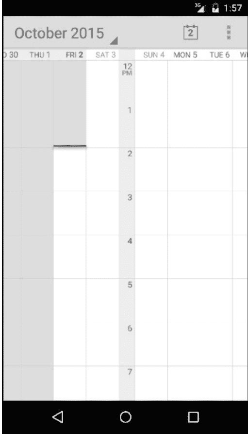
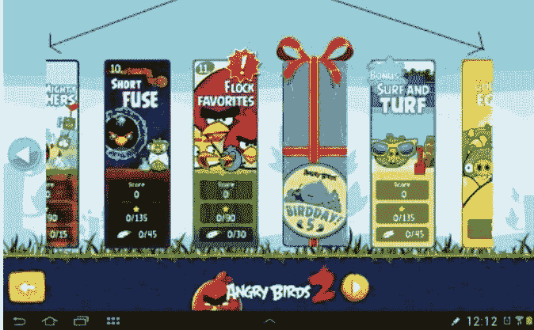
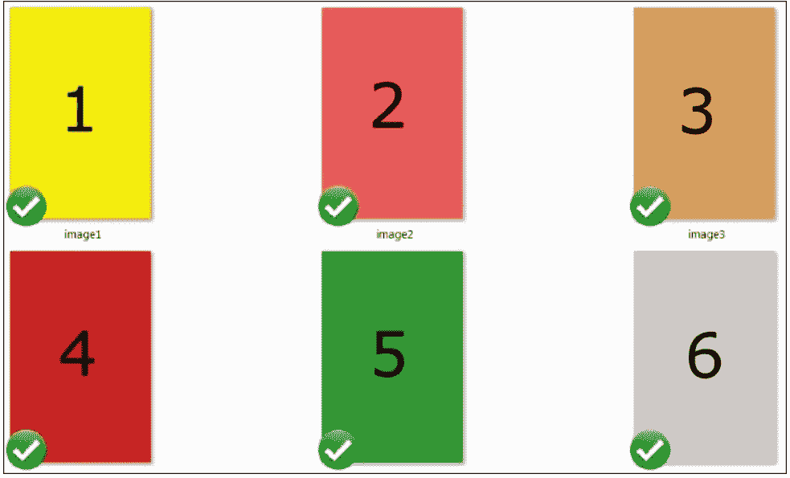
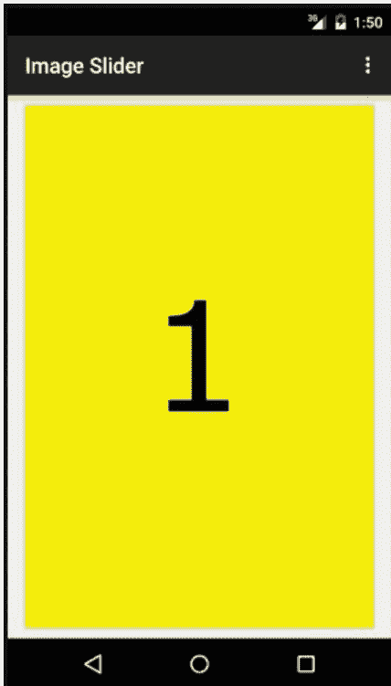
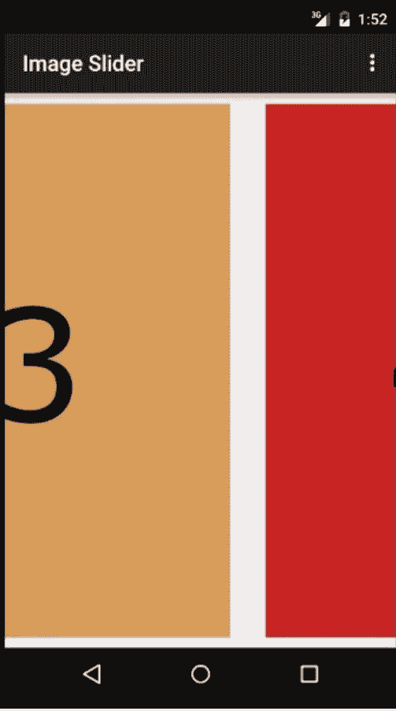
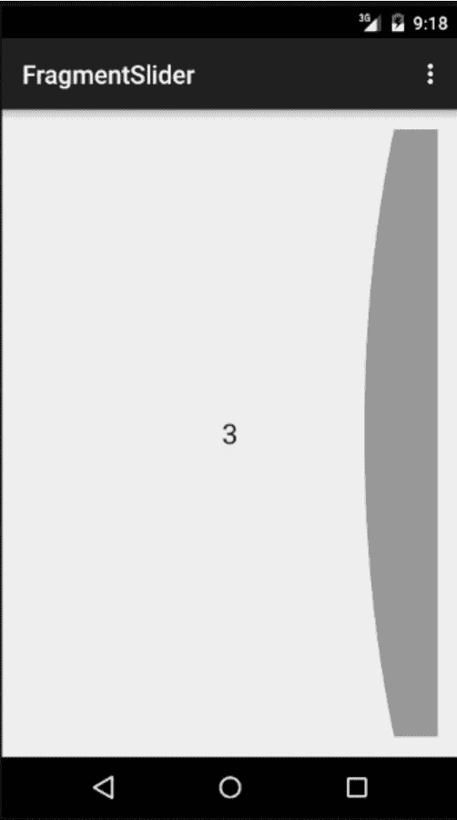

## 第 20 章 分页和滑动

分页是指从一页移动到另一页，在 Android 上，我们通过在屏幕上滑动手指来实现这一点。当前页面会以与手指移动相匹配的方向和速度进行过渡。这是一种在应用中导航的有用且实用的方式，但也许更重要的是，它为用户提供了极其令人满意的视觉效果。此外，与 ListView 类似，我们可以选择性地仅加载当前页所需的数据，也许还包括前一页和下一页的数据。

在下一个截图中，你可以看到 Nexus 5 模拟器上的日历应用在月份之间分页。如果你不确定分页和滑动的工作原理，请务必启动模拟器并亲自试用：



在下一个图中，我们可以看到著名的愤怒的小鸟关卡选择菜单展示滑动/分页的实际效果：

### “页面”滚入和滚出视图



正如你现在所料，Android API 提供了一些解决方案，可以让你以相当简单的方式实现分页。

在本章中，你将学习如何：

- 使用图片实现分页和滑动，就像在照片库应用中所做的那样。
- 使用 Fragments 实现分页和滑动，这将使我们的应用有可能让用户能够在多个用户界面之间滑动。这将为我们的应用带来巨大的潜力。

我们不会将分页/滑动添加到 Where it's snap 应用中，但让我们构建两个分页小应用：一个使用图片，另一个使用 Fragments。


## 构建图片画廊/滑块应用

我们首先要做的是将画廊中将使用的六张图片添加到 drawable 文件夹中。但我们希望在此处以略有不同的方式操作。您可以在下载包的 Chapter 20/Image Slider/drawable-xhdpi 文件夹中找到这些图片。以下是这些图片的表示：



通过右键单击 res 文件夹并导航到 New | Android resource directory，在 res 文件夹中创建一个名为 drawable-xhdpi 的新文件夹。将目录命名为 drawable-xhdpi 并单击 OK。

将图片添加到您刚刚创建的文件夹中，或者，您当然也可以添加更有趣的图片，或许是您拍摄的一些照片。

我们这样做的原因是因为少数现代 Android 设备处理图片的方式。我们已经知道，在理想情况下，我们应该为整个不同屏幕密度范围提供图片，并将其放置在相应的文件夹中。为本演示这样做会过度设计；事实上，根据具体项目，在实际应用中有时也是过度设计的。

这是因为某些现代手机制造商希望他们的设备看起来很棒，因此他们会自动放大设备认为可能尚未是高质量的任何图片。这会导致我们放置在常规 drawable 文件夹中的任何图片都可能被这些高密度屏幕的设备放大。

这通常会导致设备内存耗尽并崩溃。通过将图片放置在 drawable-xhdpi 文件夹中，我们避免了这个问题，因为设备假设图片不需要放大。此外，低密度屏幕的设备也会愉快地使用 drawable-xhdpi 文件夹中的图片。

## 实现布局

对于简单的图片分页应用，我们使用 PagerAdapter 类。我们可以将其视为类似于 BaseAdapter，因为它将处理 ViewPager 小部件中图片数组的显示。这很像 BaseAdapter 处理 ListView 中 ArrayList 内容显示的方式。我们需要做的就是重写相应的方法。

要使用 PagerAdapter 实现图片画廊，我们首先需要在主布局中添加 ViewPager。因此，您可以在此处看到所需的确切内容是 layout_main.xml 的实际 XML 代码。编辑 layout_main.xml 使其完全如下所示：

```
<RelativeLayout
    xmlns:android=
    "http://schemas.android.com/apk/res/android"
    android:layout_width="fill_parent"
    android:layout_height="fill_parent" >

    <android.support.v4.view.ViewPager
    android:id="@+id/pager"
    android:layout_width="wrap_content"
    android:layout_height="wrap_content" >

</RelativeLayout>
```

名称略显不寻常的类 android.support.v4.view.ViewPager 是使此功能在 ViewPager 发布之前的 Android 版本中可用的类。

与我们需要布局来表示列表项的方式相同，我们需要一个布局来表示一个项；在此例中，是我们分页器中的图片。以通常方式创建一个新布局文件并将其命名为 pager_item.xml。它将具有一个 ID 为 ImageView 的 ImageView 小部件。

使用可视设计器实现此功能，或将以下 XML 复制到 pager_item.xml 中：

```
<RelativeLayout
    xmlns:android=
    "http://schemas.android.com/apk/res/android"
    android:layout_width="fill_parent"
    android:layout_height="fill_parent"
    android:gravity="center"
    android:padding="10dp" >

    <ImageView
    android:id="@+id/imageView"
    android:layout_width="match_parent"
    android:layout_height="match_parent">
</RelativeLayout>
```

现在，我们可以开始编写 PagerAdapter 类了。

## 编写 PagerAdapter 类

接下来，我们需要扩展 PagerAdapter 以便它处理图片。创建一个名为 ImagePagerAdapter 的新类并使其扩展 PagerAdapter。

将以下导入添加到 ImagePagerAdapter 类的顶部。我们通常依赖使用快捷键 Alt + Enter 来添加导入。这次我们以略有不同的方式操作，因为有几个名称非常相似的类不适合我们的目标。

将以下导入添加到 ImagePagerAdapter 类中：

```
import android.content.Context;
import android.support.v4.view.PagerAdapter;
import android.support.v4.view.ViewPager;
import android.view.LayoutInflater;
import android.view.View;
import android.view.ViewGroup;
import android.widget.ImageView;
import android.widget.RelativeLayout;
```

以下是带有扩展代码添加的类声明以及几个成员变量。这些变量是我们将很快使用的上下文对象和名为 images 的 int 数组。之所以为图片使用 int 数组，是因为我们将存储图片的 int 标识符。我们将在几个代码块后了解此工作原理。最后一个成员变量是 LayoutInflater，您可能已经猜到，它将用于膨胀 pager_item.xml 的每个实例。

扩展 PagerAdapter 并添加我们刚才讨论的成员变量：

```
public class ImagePagerAdapter extends PagerAdapter {
    Context context;
    int[] images;
    LayoutInflater inflater;
}
```

现在，我们需要一个构造函数，它通过从 MainActivity 接收 Context 以及用于图片的 int 数组来设置 ImagePagerAdapter，并使用它们初始化成员变量。

将突出显示的构造函数方法添加到 ImagePagerAdapter 类中：

```
public class ImagePagerAdapter extends PagerAdapter {
    Context context;
    int[] images;
    LayoutInflater inflater;

    public ImagePagerAdapter(Context context, int[] images) {
        this.context = context;
        this.images = images;
    }
}
```

现在，我们必须重写 PagerAdapter 的必需方法。在前面代码之后立即添加重写的 getCount 方法，它只需返回数组中图片 ID 的数量。该方法由类内部使用：

```
@Override
public int getCount() {
    return images.length;
}
```

现在，我们必须重写 isViewFromObject 方法，该方法仅返回一个布尔值，取决于当前 View 是否与作为参数传入的当前对象相同或相关联。同样，这是一个由类内部使用的方法。在前面代码之后立即添加此重写方法：

```
@Override
public boolean isViewFromObject(View view, Object object) {
    return view == object;
}
```

现在，我们必须重写 instantiateItem 方法，这就是我们完成大部分相关工作的地方。首先，我们声明一个新的 ImageView 对象，然后初始化我们的 LayoutInflater 成员。接下来，我们使用 LayoutInflater 从 pager_item.xml 布局文件声明并初始化一个新的 View。

之后，我们获取 pager_item.xml 布局中 ImageView 的引用。我们现在可以根据 instantiateItem 方法的 position 参数和 images 数组中的相应 ID 将合适的图片添加为 ImageView 的内容。

最后，我们使用 addView 将布局添加到 PagerAdapter 并从方法返回。

现在，我们将在此处添加刚才讨论的方法：

```java
@Override
public Object instantiateItem(ViewGroup container, int position) {

    ImageView image;

    inflater = (LayoutInflater)
    context.getSystemService(Context.LAYOUT_INFLATER_SERVICE);
    View itemView = inflater.inflate(R.layout.pager_item,
    container,false);

    // get reference to imageView in pager_item layout
    image = (ImageView) itemView.findViewById(R.id.imageView);

    // Set an image to the ImageView
    image.setImageResource(images[position]);

    // Add pager_item layout as the current page to the ViewPager
    ((ViewPager) container).addView(itemView);

    return itemView;
}
```

我们必须重写的最后一个方法是 destroyItem，当类需要根据 position 参数的值移除合适的项时可以调用它。

在前面代码之后和 ImagePagerAdapter 类的闭合花括号之前添加 destroyItem 方法：


@Override
public void destroyItem(ViewGroup container, int position, Object object) {
	// Remove pager_item layout from ViewPager
	((ViewPager) container).removeView((RelativeLayout) object);
}

正如我们在编写 ImagePagerAdapter 时所看到的，这非常简单。只需正确实现 instantiateItem 方法，并添加 PagerAdapter 类使用的简单重写方法，即可帮助幕后操作顺利运行。

## 编写 MainActivity 类

最后，我们可以编写 MainActivity 类。与 ImagePagerAdapter 类一样，为清晰起见，请在类声明之前手动将以下导入语句添加到 MainActivity.java 类中，如下一个代码片段所示：

```java
import android.support.v4.view.PagerAdapter;
import android.support.v4.view.ViewPager;
import android.support.v7.app.AppCompatActivity;
import android.os.Bundle;
import android.view.Menu;
import android.view.MenuItem;
```

现在，我们需要一些成员变量。不出所料，我们需要 ViewPager，它将用于获取布局中 ViewPager 的引用，以及我们刚刚编写的类的 ImagePagerAdapter 引用。我们还需要一个 int 数组来保存图像 ID 数组：

```java
public class MainActivity extends AppCompatActivity {

    ViewPager viewPager;
    PagerAdapter adapter;

    int[] images;

    @Override
    public void onCreate(Bundle savedInstanceState) {
        super.onCreate(savedInstanceState);
```

其余所有代码都放在 onCreate 中。我们使用添加到 drawable-xhdpi 文件夹中的每张图像来初始化 int 数组。

我们以通常的方式使用 findViewById 方法初始化 ViewPager。我们还通过传入 MainActivity 的引用和 images 数组来初始化 ImagePagerAdapter，如我们之前编写的构造函数所要求的。最后，我们使用 setAdapter 将适配器绑定到视图页。

在 onCreate 方法中添加高亮代码：

```java
public void onCreate(Bundle savedInstanceState) {
    super.onCreate(savedInstanceState);

    setContentView(R.layout.activity_main);

    // reference the images and put them in our array
    images = new int[] { R.drawable.image1,
        R.drawable.image2,
        R.drawable.image3,
        R.drawable.image4,
        R.drawable.image5,
        R.drawable.image6 };

    // get a reference to the ViewPager in the layout
    viewPager = (ViewPager) findViewById(R.id.pager);

    // Initialize our PagerAdapter
    adapter = new ImagePagerAdapter(MainActivity.this, images);

    // Bind the PagerAdapter to the ViewPager
    viewPager.setAdapter(adapter);
}
```

现在，我们可以运行应用了。

## 运行画廊应用

以通常的方式在模拟器或真实设备上运行应用。使用真实设备而不是模拟器会更令人满意，因为您可以用手指进行真正的滑动操作，而不是使用鼠标模拟滑动(拖动)。在此截图中，我们可以看到 int 数组中的第一张图像：



向右和向左轻轻滑动，以查看图像过渡的平滑悦目方式：



现在，我们将构建一个功能几乎相同的应用，只不过分页器中的每个页面将是一个 Fragment，它可以具有常规 Fragment 所能拥有的任何或全部功能，因为它们就是常规 Fragment。

## 构建 Fragment 分页器/滑块应用

我们可以将完整的 Fragment 放在 PagerAdapter 中作为页面。这非常强大，因为众所周知，一个 Fragment 可以拥有大量功能，甚至是功能齐全的 UI。

为保持代码简短直截了当，我们将在每个 Fragment 布局中添加一个 TextView，仅为了演示分页器正在工作。不过，当我们看到获取 TextView 引用是多么容易时，应该清楚如何轻松添加迄今所学的任何布局，然后让用户与之交互。

我们要做的第一件事是为滑块构建内容。当然，在这里，内容就是 Fragment。我们将构建一个名为 SimpleFragment 的简单类和一个名为 fragment_layout 的非常简单的布局。

这意味着每个幻灯片的外观将相同，但我们将使用实例化时 FragmentManager 传入的 Fragment ID 作为唯一 TextView 的文本。这样，当我们翻页/滑动浏览 Fragment 时，就会清楚每个 Fragment 都是一个新的独立实例。

当我们看到从列表加载 Fragment 的代码时，将非常简单地设计完全不同的 Fragment 类，就像我们之前做过的那样，并使用这些不同的类作为部分或全部幻灯片。当然，这些类中的每个类还可以使用不同的布局。

## 编写 SimpleFragment 类

与图片滑块应用一样，哪些类需要由 Android Studio 自动导入并不完全明确。我们使用这些类是因为它们彼此兼容，而且如果你让 Android Studio 建议导入哪些类，Android Studio 可能会“搞错”。项目文件位于 Chapter 20/Fragment Pager 文件夹中。

创建一个名为 Fragment Slider 的新项目，并将所有设置保留为默认值。

现在，创建一个名为 SimpleFragment 的新类，使其扩展 Fragment，并添加导入语句和一个成员变量，如以下代码片段所示：

```java
import android.os.Bundle;
import android.support.v4.app.Fragment;
import android.view.LayoutInflater;
import android.view.View;
import android.view.ViewGroup;
import android.widget.TextView;

public class SimpleFragment extends Fragment {
    // Holds the fragment id passed in when created
    public static final String MESSAGE = "";
}
```

我们需要添加两个方法。第一个是 newInstance，我们将从 MainActivity 调用它来设置并返回对 Fragment 的引用。接下来的代码做了我们之前见过的事情。它创建类的一个新实例，但也将一个 String 放入 Bundle 对象中，该对象最终将从 onCreate 方法读取。添加到 Bundle 的 String 是传递给此 newInstance 方法的唯一参数。

将 newInstance 方法添加到 SimpleFragment 类：

```java
// Our newInstance method which we call to make a new Fragment
public static SimpleFragment newInstance(String message)
{
    // Create the fragment
    SimpleFragment fragment = new SimpleFragment();
    // Create a bundle for our message/id
    Bundle bundle = new Bundle(1);
    // Load up the Bundle
    bundle.putString(MESSAGE, message);
    // Call setArguments ready for when onCreate is called
    fragment.setArguments(bundle);
    return fragment;
}
```

在 SimpleFragment 类的最后一个方法中，我们需要重写 onCreateView，在那里，像往常一样，我们将获取传入布局的引用，并将 fragment_layout 加载为布局。

然后，第一行代码使用 getArguments.getString 和键值对的 MESSAGE 标识符从 Bundle 中解包 String。

添加我们刚刚讨论的 onCreateView 方法：

```java
@Override
public View onCreateView(LayoutInflater inflater, ViewGroup
container, Bundle savedInstanceState) {
    // Get the id from the Bundle
    String message = getArguments().getString(MESSAGE);

    // Inflate the view as normal
    View view = inflater.inflate(R.layout.fragment_layout, container,
    false);

    // Get a reference to textView
    TextView messageTextView =
    (TextView)view.findViewById(R.id.textView);

    // Display the id in the TextView
    messageTextView.setText(message);

    // We could also handle any UI
    // of any complexity in the usual way
    // ..
    // ..

    return view;
}
```


## fragment_layout

fragment_layout 是我们迄今为止制作的最简单的布局。右键单击 **layout** 文件夹并导航到 **新建 | 资源布局文件**。将文件命名为 fragment_layout 并单击 **确定**。现在，添加一个 `TextView` 并将其 id 属性设置为 `textView`。

我们现在可以编写 `MainActivity` 类，该类处理 `FragmentPager` 并使我们的 `SimpleFragment` 实例栩栩如生。

## 编写 MainActivity 类

该类包含两个主要部分。第一，我们将对重写的 onCreate 方法所做的更改；第二，我们内部类及其重写的 FragmentPagerAdapter 方法的实现。

编写此类时，我们首先添加以下导入语句和一个成员变量，该变量将是我们对 FragmentPagerAdapter 和 SimpleFragmentPagerAdapter 实现的实例：

```java
import android.support.v4.app.Fragment;
import android.support.v4.app.FragmentManager;
import android.support.v4.app.FragmentPagerAdapter;
import android.support.v4.view.ViewPager;
import android.support.v7.app.AppCompatActivity;
import android.os.Bundle;
import android.view.Menu;
import android.view.MenuItem;
import java.util.ArrayList;
import java.util.List;

public class MainActivity extends AppCompatActivity {

    SimpleFragmentPagerAdapter pageAdapter;

    @Override
    public void onCreate(Bundle savedInstanceState) {
        super.onCreate(savedInstanceState);
        setContentView(R.layout.activity_main);
    }
}
```

接下来，在 onCreate 方法中，我们为 Fragments 创建一个 List，然后创建并添加三个 SimpleFragment 实例，传入一个数值标识符，该标识符将被打包到 Bundle 中。

然后，我们初始化 SimpleFragmentPagerAdapter（我们将很快编写它），传入我们的 Fragment 列表。

我们使用 findViewById 获取 ViewPager 的引用，并使用 setAdapter 将我们的适配器绑定到它。

现在，将高亮代码添加到 MainActivity 的 onCreate 方法中：

```java
@Override
public void onCreate(Bundle savedInstanceState) {
    super.onCreate(savedInstanceState);
    setContentView(R.layout.activity_main);

    // Initialize a list of three fragments
    List<Fragment> fragmentList = new ArrayList<Fragment>();

    // Add three new Fragments to the list
    fragmentList.add(SimpleFragment.newInstance("1"));
    fragmentList.add(SimpleFragment.newInstance("2"));
    fragmentList.add(SimpleFragment.newInstance("3"));

    pageAdapter = new SimpleFragmentPagerAdapter
            (getSupportFragmentManager(), fragmentList);

    ViewPager pager = (ViewPager)findViewById(R.id.pager);
    pager.setAdapter(pageAdapter);
}
```

现在，我们将添加内部类 SimpleFragmentPagerAdapter。我们所要做的就是将用于 Fragments 的 List 作为成员变量添加进去，并添加一个构造函数，使用传入的 List 对其进行初始化。

然后，我们重写 getItem 和 getCount 方法，这些方法在内部使用方式与我们在上一个项目中使用它们的方式相同，只不过这次我们使用 List 的方法而不是数组的大小。

将我们刚刚讨论的以下内部类添加到 MainActivity 类中：

```java
private class SimpleFragmentPagerAdapter extends FragmentPagerAdapter {
    // A List to hold our fragments
    private List<Fragment> fragments;

    // A constructor to receive a fragment manager and a List
    public SimpleFragmentPagerAdapter(FragmentManager fm,
            List<Fragment> fragments) {
        // Call the super class' version
        // of this constructor
        super(fm);
        this.fragments = fragments;
    }

    // Just two methods to override
    // to get the current position of
    // the adapter and the size of the List

    @Override
    public Fragment getItem(int position) {
        return this.fragments.get(position);
    }

    @Override
    public int getCount() {
        return this.fragments.size();
    }
}
```

我们需要做的最后一件事是为 MainActivity 添加布局。

### activity_main 布局

通过复制以下代码实现 activity_main 布局。它包含一个小部件 ViewPager，重要的是它来自 android.support.v4.view 层次结构，以便与本项目中使用的其他类兼容。

修改我们刚刚讨论过的 layout_main.xml 文件中的代码：

```xml
<RelativeLayout
xmlns:android="http://schemas.android.com/apk/res/android"
xmlns:tools="http://schemas.android.com/tools"
android:layout_width="match_parent"
android:layout_height="match_parent"
android:paddingLeft="@dimen/activity_horizontal_margin"
android:paddingRight="@dimen/activity_horizontal_margin"
android:paddingTop="@dimen/activity_vertical_margin"
android:paddingBottom="@dimen/activity_vertical_margin"
tools:context=".MainActivity">

<android.support.v4.view.ViewPager
android:id="@+id/pager"
android:layout_width="wrap_content"
android:layout_height="wrap_content" >
</RelativeLayout>
```

现在让我们看看我们的 **Fragment** 滑块运行效果。

## 运行 Fragment 滑块应用

运行应用，您可以左右滑动以浏览滑块中的 Fragments。下一张图片显示了当用户尝试滑动超过 List 中最后一个 Fragment 时，FragmentPagerAdapter 产生的视觉效果：



### 总结

在本章中，我们了解到可以使用分页器来制作简单的图片画廊或滑动浏览整个 UI 的复杂页面；不过，我们使用一个非常简单的 TextView 来演示这一点。

在下一章中，我们将探讨另一个非常酷的 UI 元素，它被用于许多最新的 Android 应用中，可能是因为它看起来很棒，使用起来既令人愉快又极其实用。让我们来看看 NavigationDrawer。
