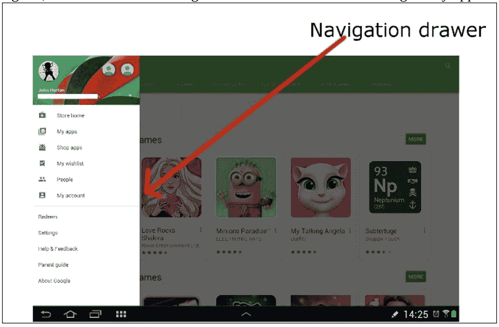
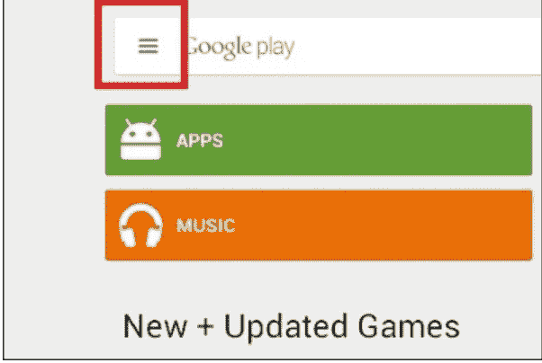
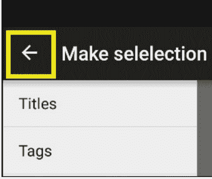
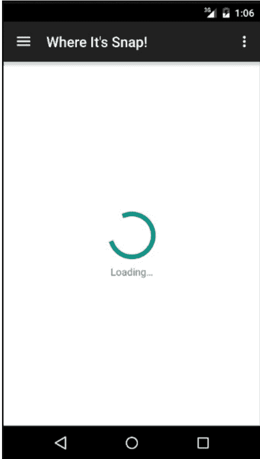
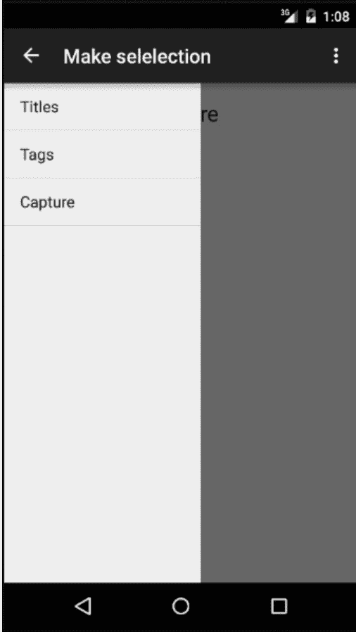

## 第 21 章。Navigation Drawer 与 Where It's Snap

在本章中，我们将启动 "Where it's snap" 项目，并稍后详细讨论其将具备的功能。该项目将被讨论直至 [第 27 章，本地化 – Hola！] 完成，但我们不仅仅会开发这个应用。

"Where it's snap" 将使用导航抽屉作为用户访问应用功能和屏幕的一种手段，这将是本章的主要重点。

在本章中，我们将：

- 介绍导航抽屉
- 查看 "Where it's snap" 项目的功能
- 开始 "Where it's snap" 项目，包括实现其导航抽屉

让我们来看看这个非常酷的 UI 模式。

### 介绍导航抽屉

导航抽屉有什么好处。嗯，首先映入眼帘的是，它可以设计得非常时尚。请看下一张图片，它展示了 Google Play 应用中导航抽屉的实际效果：



老实说，从一开始，我们的导航抽屉不会像 Google Play 应用中的那样花哨。但是，我们的应用中将具备相同的功能。

导航抽屉另一个巧妙之处在于，它可以在需要时滑动来隐藏/显示自己。正是由于这种行为，它可以相当大，从而可以在其中放置的选项方面极其灵活。当用户使用完毕后，它会像抽屉一样完全消失。

我建议您现在打开 Google Play 应用并查看其工作原理（如果您还没有打开的话）。

您可以从屏幕左侧边缘滑动拇指/手指，抽屉将缓慢滑出。当然，您也可以向相反方向将其滑回。

当导航抽屉打开时，屏幕的其余部分会变暗一些，如上图所示，帮助用户专注于所提供的导航选项。

您还可以在导航抽屉打开时点击其外部的任意位置，它会自行滑回，为应用的其余部分留出整个屏幕。

抽屉还可以通过点击左上角的菜单图标打开，如下一张截图中高亮所示：



我们还可以像本章末尾将要看到的那样，通过重写在恰当时机调用的几个生命周期方法来调整和改进导航抽屉的行为。

在这里，我们将看到 onPostCreate 和 onConfigurationChanged 方法。让我们先看看我们将对 "Where it's snap" 应用做什么，然后，我们就可以着手实现导航抽屉了。


## Where it's snap 应用

Where it's snap 将是我们最先进的应用！它将具备以下功能：

- 它将按标题显示照片列表。
- 它将提供标签列表作为替代方案，点击标签后将跳转到包含该匹配标签的标题列表。
- 它将允许用户使用设备相机拍照，并分配标题以及相关标签。
- 所有所需数据（标题和标签）将存储在数据库中。你将在 [第 23 章，在我们的应用中使用 SQLite 数据库] 中了解数据库，我们将在第 [第 24 章，向 Where It's Snap 添加数据库] 中为 Where it's snap 添加数据库功能。
- 当用户在列表中点击照片标题时，他/她将看到该照片，并且还会看到显示拍摄地点 Google 地图的选项。
- 我们还将了解如何使此应用支持多语言（西班牙语和英语）。Hola！

与 Note To Self 应用一样，我们会尽可能正确地做事，并在代码中使用字符串资源和 Android 命名约定。

我们将在未来六个章节中构建这个应用。在探索和练习 Android API 新功能的过程中，我们将通过改进或向 Where it's snap 添加功能来利用它们。

我们要做的第一件事是准备项目的资源并实现导航抽屉。这将是本项目 UI 的基本部分。

代表本章结束时此应用可运行版本的项目文件，可以在下载包中的 chapter 21/where its snap 1 文件夹中找到。

像往常一样，创建一个名为 where_its_snap 的新项目并接受所有默认设置。

为了处理 Marshmallow 运行时权限，如 [第 11 章，Android 权限与棉花糖中的微件狂热] 中讨论的，我们需要将目标 API 设置为 22。

要做到这一点，从项目资源管理器顶部的下拉列表中选择 **Android**。现在，双击项目资源管理器窗口底部附近的 **build.gradle (module: app)** 选项。

更改突出显示的代码行，以确保 targetSdkVersion 设置为 22，如以下代码片段所示：

```
defaultConfig {
    applicationId "com.gamecodeschool.whereitssnap"
    minSdkVersion 15
    targetSdkVersion 22
    versionCode 1
    versionName "1.0"
}
```

现在，我们可以添加未来六个章节所需的资源了。

## 准备资源

在本节中，我们将准备字符串资源。为此，从 res 文件夹中打开 strings.xml 文件。在整个项目期间，我们不需要再次返回此文件。有些资源看起来可能有点奇怪，确实可能不会立即使用，但如果你回头查看项目的功能，将很容易猜测这些字符串资源最终将在哪里使用。不过，我们将在第 27 章，本地化 – Hola！中创建另一个 strings.xml 文件，届时我们将使应用支持多语言。

除了常规字符串资源外，还有一个 name 属性设置为 nav_drawer_items 的 string-array 元素。我们很快就会看到，在我们的 Java 代码中如何像使用常规 Java 数组一样使用它，就像我们在第 13 章，处理和显示数据数组中讨论的那些一样。

修改 strings.xml 文件的内容，使其与以下代码相同：

```
<resources>
<string name="app_name">Where It's Snap</string>
<string name="action_settings">Settings</string>
<string name="drawer_open">Open navigation drawer</string>
<string name="drawer_close">Close navigation drawer</string>
<string name="enter_photo_title">Enter photo title</string>
<string name="tag1">Tag 1</string>
<string name="tag2">Tag 2</string>
<string name="tag3">Tag 3</string>
<string name="capture">Capture</string>
<string name="save">Save</string>
<string name="tags">Tags</string>
<string name="titles">Titles</string>
<string name="show_map">Show Map</string>
<!-- These are the items in our Navigation drawer -->
<string-array name="nav_drawer_items">
<item>Titles</item>
<item>Tags</item>
<item>Capture</item>
</string-array>
</resources>
```

我们现在几乎准备好实现导航抽屉了。在此之前，让我们添加一些可用于抽屉各个选项的空占位符 Fragment。

## 三个 Fragment 的占位符代码

如我们从计划中所知，共有四个 Fragment：图像捕获、标题列表、标签列表和显示图片。

前三个可以直接从主导航抽屉 UI 访问。对于这三个 Fragment，我们将快速创建占位符类和布局，以便让 MainActivity 正常运作。然后，在接下来的章节中，我们将添加真正的功能和布局。

这三个 Fragment 中的两个（标题视图和标签视图）将是可点击选项的列表，因此使用 ListFragment 似乎是个不错的选择。第三个（图像捕获视图）更像是一个常规布局，因此 Fragment 是最佳选择。

让我们继续快速创建这些类。

创建一个新类并将其命名为 TitlesFragment。修改代码，使其与以下代码完全相同，其中我们扩展 ListFragment 并实现一个基本的 onCreate 方法，以便在项目中日后使用：

```
public class TitlesFragment extends ListFragment {

    @Override
    public void onCreate(Bundle savedInstanceState) {
        super.onCreate(savedInstanceState);
    }

}
```

现在，对于标签列表视图，创建一个新类并将其命名为 TagsFragment。修改代码，使其与以下代码完全相同，其中我们扩展 ListFragment 并实现一个基本的 onCreate 方法，以便在项目中日后使用：

```
public class TagsFragment extends ListFragment {

    @Override
    public void onCreate(Bundle savedInstanceState) {
        super.onCreate(savedInstanceState);
    }
}
```

现在，对于将最终允许用户拍照并添加标题和标签的 Fragment。

创建一个新类并将其命名为 captureFragment。修改代码，使其与以下代码完全相同，其中我们扩展 Fragment 并实现 onCreate 和 onCreateView 的基本版本，以便在项目中日后使用。

以下是 CaptureFragment.java 的代码：

```
public class CaptureFragment extends Fragment{

@Override
public void onCreate(Bundle savedInstanceState){
super.onCreate(savedInstanceState);

}

@Override
public View onCreateView(LayoutInflater inflater, ViewGroup container, Bundle savedInstanceState) {
//Inflate the layout file then get all necessary references
View view = inflater.inflate(R.layout.fragment_capture, container, false);

return view;
}

}
```

### 提示

CaptureFragment 之前的两个类不需要 onCreateView 方法的原因是 ListFragment 内置了 ListView，其功能和外观将在项目后期由数组适配器处理。

现在，我们还需要为 fragment_capture.xml 创建一个占位符布局，以消除先前代码中引用 R.id.fragment_capture 导致的错误。

在 layout 文件夹上右键单击并导航到 **新建 | 布局资源文件**。将其命名为 *fragment_capture* 并单击 **确定**。

最后，将一个单独的 `TextView` 拖放到布局上，并将其 `text` 属性设置为 `Capture`。

我们现在可以在 `MainActivity.java` 中编写代码来让这些 Fragment 活起来。但是，它们目前只是空白，除了我们刚刚添加到 *fragment_capture.xml* 的单个 `TextView`。

## 编码 MainActivity 类和布局

让我们添加一个非常简单但全新的布局，它将定义我们应用的外观。不出所料，该布局将包含我们的导航抽屉。

稍后将出现的布局代码看起来又长又复杂，但仔细检查后，它只是常规 RelativeLayout 中的 DrawerLayout。然后，在 DrawerLayout 内部是一个 id 为 fragmentHolder 的 RelativeLayout。这个 RelativeLayout 就是我们将用于替换各种 Fragment 的地方。然后，仍在 DrawerLayout 内部，我们有 ListView。正是这个 ListView 将保存导航抽屉的所有选项。

请注意，ListView 的 id 属性是 navList。我们将很快了解如何使用这个 id 属性让它活起来（滑入和滑出）。

另外，请注意，我们将 ListView 的宽度属性设置为 200dp。请随意尝试，按喜好将其设得更宽或更窄。

由于前面的两个 UI 元素（RelativeLayout 和 ListView）都没有给出任何相对布局指令，它们都将从屏幕左上角开始并填充整个屏幕，例外情况是 ListView 的宽度仅为 200dp。另外，由于 ListView 在将保存我们 Fragment 的 RelativeLayout 之后声明，它将位于顶层。这正是我们需要的。

以下是我们刚刚讨论过的 activity_main.xml 的代码。编辑 activity_main.xml，使其完全如下所示：

```
<RelativeLayout
xmlns:android="http://schemas.android.com/apk/res/android"
    xmlns:tools="http://schemas.android.com/tools"
    android:layout_width="match_parent"
    android:layout_height="match_parent"
    tools:context=".MainActivity">

<android.support.v4.widget.DrawerLayout
    xmlns:android="http://schemas.android.com/apk/res/android"
    xmlns:tools="http://schemas.android.com/tools"
    android:id="@+id/drawerLayout"
    android:layout_width="match_parent"
    android:layout_height="match_parent">
```


<!-- For our fragments-->
<RelativeLayout
    android:layout_width="match_parent"
    android:layout_height="match_parent"
    android:paddingLeft="@dimen/activity_horizontal_margin"
    android:paddingRight="@dimen/activity_horizontal_margin"
    android:paddingTop="@dimen/activity_vertical_margin"
    android:paddingBottom="@dimen/activity_vertical_margin"
    tools:context=".MainActivity"
    android:background="#ffffffff"
    android:id="@+id/fragmentHolder">
</RelativeLayout>

<!-- Side navigation drawer UI -->
<ListView
    android:id="@+id/navList"
    android:layout_width="200dp"
    android:layout_height="match_parent"
    android:layout_gravity="left|start"
    android:background="#ffeeeeee">
<android.support.v4.widget.DrawerLayout>
</RelativeLayout>

现在，我们可以着手编写 MainActivity.java 本身了。与本项目中的许多文件一样，它会随着我们的进展而不断演变。以下代码是使导航抽屉正常工作并加载我们的 Fragment 所需的最低要求。

首先，我们需要添加一些导入，而且这些导入必须是恰当的类。就像上一章中的分页应用一样，Android Studio 不一定总是建议导入最佳的类。

此外，我们需要一些成员变量，如下所示：

- ListView：这将保存导航选项。
- DrawerLayout：这是我们的导航抽屉。
- ArrayAdapter：这是用于将我们的数组（来自 strings.xml）绑定到 ListView 的。
- ActionBarDrawerToggle：这使我们能够让操作栏中的菜单图标活起来，并与 DrawerLayout 交互以打开和关闭它。我们将通过调用其方法来实现此目的，而 ActionBarDrawerToggle 将处理所有复杂性，并在菜单图标上提供一个整洁的动画。
- String：这将用于保存我们的应用标题。

通过以下代码片段添加我们刚刚讨论的导入和成员变量：

```
package com.gamecodeschool.whereitssnap1;

import android.app.Fragment;
import android.app.FragmentManager;
import android.content.res.Configuration;
import android.os.Bundle;
import android.support.v4.view.GravityCompat;
import android.support.v4.widget.DrawerLayout;
import android.support.v7.app.AppCompatActivity;
import android.support.v7.app.ActionBarDrawerToggle;
import android.util.Log;
import android.view.Menu;
import android.view.MenuItem;
import android.view.View;
import android.widget.AdapterView;
import android.widget.ArrayAdapter;
import android.widget.ListView;
```

```
public class MainActivity extends AppCompatActivity {

private ListView mNavDrawerList;
private DrawerLayout mDrawerLayout;
private ArrayAdapter<String> mAdapter;
private ActionBarDrawerToggle mDrawerToggle;
private String mActivityTitle;

@Override
protected void onCreate(Bundle savedInstanceState) {
super.onCreate(savedInstanceState);
setContentView(R.layout.activity_main);

// We will come back here in a minute!
}

// ...
// Usual auto-generated methods
// ...
```

}

现在我们可以考虑如何处理 Fragment 了。由于我们正在处理越来越多种类的 Fragment，让我们创建一个可以调用的方法，专门用于处理 Fragment 之间的切换。

## 在 Fragments 之间切换

接下来，在 onCreate 之后立即添加一个名为 switchFragment 的方法，该方法将处理当用户在导航抽屉界面中点击选项时在我们的 Fragment 之间进行切换。

请注意，该方法接受一个名为 position 的 int 类型参数。然后我们声明一个名为 fragment 的 Fragment 并将其设置为 null。接着，我们将一个名为 fragmentID 的 String 初始化为空字符串。无论用户选择哪个导航选项，我们都会使用相同的 null Fragment 对象和空字符串。然而，变化的将是我们如何初始化它。

初始化是通过使用 switch 并以 position 作为参数来处理的。我们有三个 case 语句：0、1 和 2。这些值分别代表 TitlesFragment、TagsFragment 和 CaptureFragment。

对于每个 case，我们使用 Fragment 类的相应类型来初始化 fragment，并将 fragmentID 字符串设置为相应的值，因为我们很快就需要能够检测当前显示的 Fragment。

另请注意，对于 TitlesFragment，我们还会创建一个 Bundle。目前，Bundle 没有任何功能。我们在此处添加它，以便以后不需要修改此方法。它最终将传入用户点击的标签，以帮助 TitlesFragment 显示相关标题的适当列表。

添加我们刚刚讨论的 switchFragment 方法的第一部分：

```
private void switchFragment(int position) {
    Fragment fragment = null;
    String fragmentID = "";
    switch (position) {
        case 0:
            fragmentID = "TITLES";
            Bundle args = new Bundle();
```

```
args.putString("Tag", "NOTAG");
fragment = new TitlesFragment();
fragment.setArguments(args);
break;

case 1:
fragmentID = "TAGS";
fragment = new TagsFragment();
break;

case 2:
fragmentID = "CAPTURE";
fragment = new CaptureFragment();
break;

default:
break;
}
// More code goes here next
}
```

在下一段代码中（它完成了我们在上一块中开始的方法），我们像往常一样创建一个新的 FragmentManager。之后，我们调用 beginTransaction，它与 replace 方法链式调用，replace 方法处理现有 Fragment 的销毁，同时使用我们新初始化的 Fragment 和 ID（分别保存在 fragment 和 fragmentID 中）。

最后一行代码将关闭抽屉，以便完全显示新选择的选项/Fragment。

将突出显示的代码添加到 switchFragment 方法中，位置由以下代码中突出显示的注释指示：

```
private void switchFragment(int position) {
```

```
...
```

```
// More code goes here next
```

```
FragmentManager fragmentManager = getFragmentManager();
fragmentManager.beginTransaction()
.replace(R.id.fragmentHolder, fragment, fragmentID).commit();
```

```
// Close the drawer
mDrawerLayout.closeDrawer(mNavDrawerList);
}
```

## 设置抽屉

接下来，我们将创建一个单独的方法来实际设置导航抽屉的所有内容。该方法名为 setupDrawer，我们很快将编写代码在 onCreate 中调用它。

其工作原理如下。我们在创建新的 ActionBarDrawerToggle 引用的同时初始化 mDrawerToggle。

在其中，我们处理以下两个关键事件：

- 抽屉打开时的事件
- 抽屉关闭时的事件

onDrawerOpened 方法首先调用父方法，然后设置操作栏的标题。当抽屉打开时，我们希望鼓励用户进行选择。我们通过将标题设置为“进行选择”来做到这一点。最后，在此方法中，调用 invalidateOptionsMenu 会导致操作栏被重绘。

在 onDrawerClosed 方法中，我们同样先调用父方法。同样，我们设置操作栏的标题，但这次我们使用 mActivityTitle 字符串，我们将在本章稍后的 onCreate 方法中看到它是如何配置的。

此类中的最后两行代码在创建实例时被调用，用于设置 mDrawerToggle 并将其传递给 setDrawerListener，其综合效果是在抽屉在打开和关闭之间切换时，为操作栏左侧的菜单按钮添加动画。

以下屏幕截图显示了抽屉关闭时的抽屉切换按钮：


下一张屏幕截图显示了抽屉打开时的抽屉切换按钮：



在本章末尾，我们将能够亲眼看到这一点，包括一个整洁的动画如何在前述两个高亮状态之间进行变形。

在 MainActivity.java 的 switchFragment 方法之后立即添加我们刚刚讨论的 setupDrawer 方法：

```
private void setupDrawer() {
    mDrawerToggle = new ActionBarDrawerToggle(this, mDrawerLayout,
    R.string.drawer_open, R.string.drawer_close) {
    // Called when drawer is opened
    public void onDrawerOpened(View drawerView) {


```
super.onDrawerOpened(drawerView);
getSupportActionBar().setTitle("Make selection");
// triggers call to onPrepareOptionsMenu
invalidateOptionsMenu();
}
// Called when drawer is closed
public void onDrawerClosed(View view) {
super.onDrawerClosed(view);
getSupportActionBar().setTitle(mActivityTitle);
// triggers call to onPrepareOptionsMenu
invalidateOptionsMenu();
}
};
mDrawerToggle.setDrawerIndicatorEnabled(true);
mDrawerLayout.setDrawerListener(mDrawerToggle);
}
```

接下来，我们重写 onPostCreate 和 onConfigurationChanged 方法，并对 mDrawerToggle 调用 syncState 和 onConfigurationChanged。

此前我们未见过 onPostCreate 或 onConfigurationChanged，且需要使用它们的情况并不多。

正如名称所暗示的，它们分别在 onCreate 之后和 Activity 配置更改之后被调用。

我们在此使用它们，以便当应用进入后台或设备旋转时，应用会使用 onPostCreate 和 onConfigurationChanged 来确保它记住抽屉和切换开关的状态，并使两者保持同步。

将这两个重写方法添加到 MainActivity 类中：

```
@Override
protected void onPostCreate(Bundle savedInstanceState) {
super.onPostCreate(savedInstanceState);
mDrawerToggle.syncState();
}

@Override
public void onConfigurationChanged(Configuration newConfig) {
    super.onConfigurationChanged(newConfig);

    mDrawerToggle.onConfigurationChanged(newConfig);
}
```

## 处理返回按钮

在我们将注意力转回 onCreate 并使所有这些代码正常运行之前，还有两个区域需要注意。

onBackPressed 方法是一个重写方法，在按下返回按钮时被调用。应用此方法来添加功能非常有用，因为我们可以让应用的表现更符合用户的预期。

第一个 if 语句检测抽屉是否打开，如果是，则将其关闭。else 块更微妙一些，它的作用如下。

如果你在应用的主屏幕上点击返回按钮，你可能期望它退出。如果你在应用的第二个屏幕上点击返回按钮，你可能期望返回到第一个屏幕。

else 块通过创建一个临时 Fragment 引用 f，并使用 f instanceof TitlesFragment 条件来实现这一点，如果 TitlesFragment 当前是 fragmentHolder 中的类型，则该条件返回 true。由于标题屏幕实际上是我们的主屏幕，当此条件为 true 时，应用通过调用 finish 然后是 System.exit(0) 来退出。

另一方面，如果存在任何其他 Fragment，那么我们可以假设用户想要返回上一个屏幕，因此我们以 0 作为参数调用 switchFragment 方法来加载 TitlesFragment。

输入 onBackPressed 方法的代码：

```
@Override
public void onBackPressed() {

    // Close drawer if open
    if (mDrawerLayout.isDrawerOpen(GravityCompat.START)) {
//drawer is open so close it
mDrawerLayout.closeDrawer(mNavDrawerList);

}else {
// Go back to titles fragment
// Quit if already at titles fragment
Fragment f =
getFragmentManager().findFragmentById(R.id.fragmentHolder);
if (f instanceof TitlesFragment) {
    finish();
    System.exit(0);
}else{
    switchFragment(0);
}
}
}
```

现在，将高亮代码添加到 onOptionsItemSelected 方法中，这将确保每次按下抽屉切换开关时都能正确处理：

```
@Override
public boolean onOptionsItemSelected(MenuItem item) {

int id = item.getItemId();

//noinspection SimplifiableIfStatement
if (id == R.id.action_settings) {
    return true;
}

// Activate the navigation drawer toggle
if (mDrawerToggle.onOptionsItemSelected(item)) {
    return true;
}

return super.onOptionsItemSelected(item);
}
```

最后，在 onCreate 中，我们可以将代码的其他所有部分组合在一起。

首先，我们通过调用 findViewById 获取 ListView 的引用。然后，以同样的方式获取 DrawerLayout 的引用。

接下来，我们使用 getTitle().toString() 方法并将结果赋值给 mActivityTitle。其效果是我们的应用标题现在保存在 mActivityTitle 中。

将我们刚才讨论的新代码的第一部分，如高亮所示，添加到 onCreate 方法中：

```
@Override
protected void onCreate(Bundle savedInstanceState) {
 super.onCreate(savedInstanceState);
 setContentView(R.layout.activity_main);

 // We will come back here in a minute!
 mNavDrawerList = (ListView)findViewById(R.id.navList);
 mDrawerLayout = (DrawerLayout)findViewById(R.id.drawerLayout);
 mActivityTitle = getTitle().toString();

 // We will finish off this method next
 // From here

}
```

现在，我们将讨论从刚才停止的地方开始，添加到 onCreate 方法中的代码的最后一部分。

我们通过调用 getResources().getStringArray 并传入 strings.xml 文件中我们的数组名称来创建一个 String 数组。

之后，我们使用（之前的）数组初始化 ArrayAdapter，并将其设置为 ListView 的适配器。

查看这两行代码（暂时不要添加）：

```
getSupportActionBar().setDisplayHomeAsUpEnabled(true);
getSupportActionBar().setHomeButtonEnabled(true);
```

它们启用了我们在 setupDrawer 方法中初始化抽屉时之前配置过的操作栏中的抽屉控件。

最后，我们创建一个匿名类来处理 ListView 上的点击，并简单地调用 switchFragment 并传入被点击的适当位置（whichItem）。

将我们刚才讨论的高亮代码添加到之前添加的代码之后的 onCreate 方法中：

```
@Override
protected void onCreate(Bundle savedInstanceState) {
	super.onCreate(savedInstanceState);
	
	...
	
	// We will finish off this method next
	// From here
	
	// Initialize an array with our titles from strings.xml
	String[] navMenuTitles =
	getResources().getStringArray(R.array.nav_drawer_items);
	// Initialize our ArrayAdapter
	mAdapter = new ArrayAdapter<String>(this,
	android.R.layout.simple_list_item_1, navMenuTitles);
	// Set the adapter to the ListView
	mNavDrawerList.setAdapter(mAdapter);
	
	setupDrawer();
	
	getSupportActionBar().setDisplayHomeAsUpEnabled(true);
	getSupportActionBar().setHomeButtonEnabled(true);
	
	mNavDrawerList.setOnItemClickListener(new
	AdapterView.OnItemClickListener() {
	
	@Override
	public void onItemClick(AdapterView<?> adapter, View view, int
	whichItem, long id) {
	
	switchFragment(whichItem);
	}
	});
	
	switchFragment(0);
}
```

我们的导航抽屉部分到此结束，目前为止可以运行项目。现在，我们可以看到来自 TitlesFragment 和 ListFragment 的 ListView 中默认提供的加载数据动画：



当我们从屏幕左侧边缘拖动时，抽屉会滑动打开：



注意按下返回键时抽屉的行为。这是因为我们在 onBackPressed 中添加的代码。你也可以滑动关闭抽屉，或点击/轻触操作栏中的左指箭头。

请注意，如果你在导航抽屉中点击 **捕获**，你将看到来自 fragment_capture 布局的带有单词 "Capture" 的单个 TextView，表明我们的 Fragment 确实按预期在相互切换。

## 摘要

现在，我们有一个可正常工作的 Activity，它乐意在 id 属性为 fragmentHolder 的 RelativeLayout 中交换不同的 Fragment。当然，这些 Fragment 目前什么也不做，我们将在下一章开始纠正这一点，届时我们将看到如何使用设备的相机拍照。然后，我们将扩展已有知识，在 Where it's snap 应用的 CaptureFragment 类中添加图片捕获功能。
