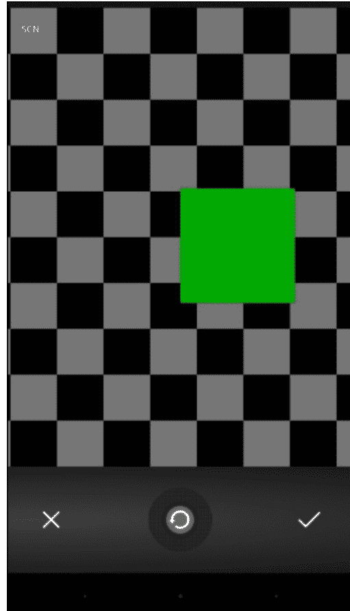
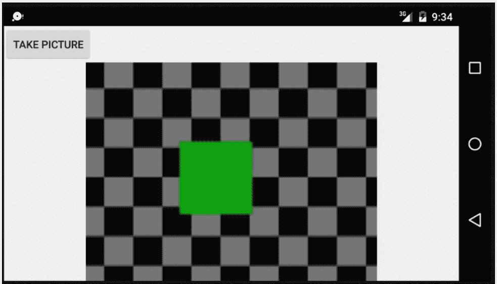
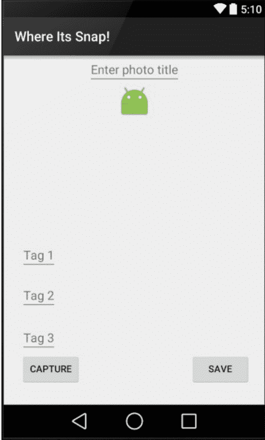
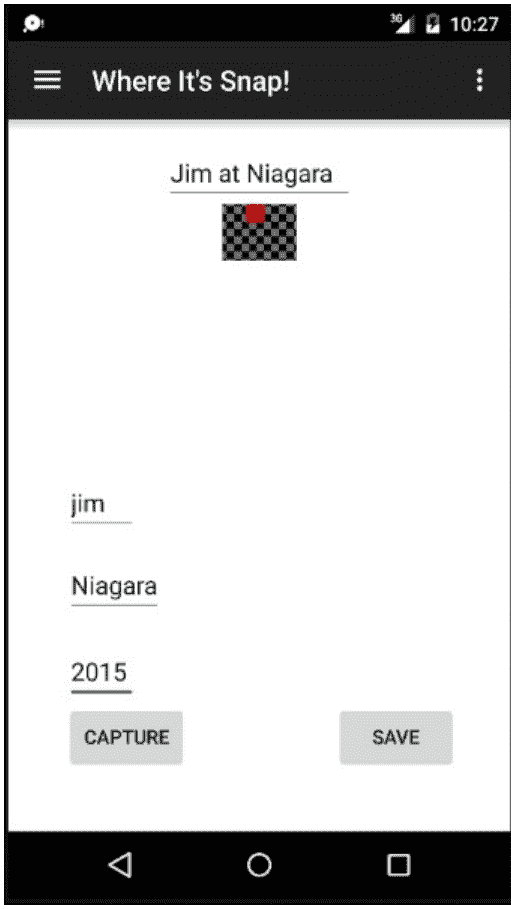

## 第 22 章。捕获图像

在本章中，我们将看到如何利用 Android Intent 类轻松添加原本复杂的功能。虽然本章较短，但在这几页中我们能完成的工作数量令人惊讶。我们不仅会构建一个带有图片捕获功能的快速小应用，还会将此功能添加到 Where it's snap 应用中。同时，我们将看到 Android 如何存储相机捕获的图像以及如何与它们交互。在本章中，我们将：

- 查看如何使用 Intent 类从相机捕获图像
- 将此知识应用于相机小应用
- 为 Where it's snap 编写捕获 Fragment


## 使用相机捕获图像

Android 提供了两种编写使用相机的应用的方法：

- 一种方法是从头开始编写相机应用，并利用设备可能拥有的任何相机的任何或全部功能。这是一个大话题，通常仅在应用设计为添加某种新相机功能时才使用。
- 另一种方法是使用现有的相机应用为我们完成工作。

我们将通过使用设备的现有相机应用（选项 2）来“作弊”（以一种好的方式）。我们可以使用我们在第 15 章 Android Intent 和 持久性 中首次看到的 Intent 类来完成此操作。

通过仔细构建传递给 Intent 类构造函数的参数，我们可以让其他应用为我们完成工作。我们将看到捕获图像的代码，但同样的简单技术也可用于发送电子邮件、在社交媒体平台上发布消息、播放媒体等，远不止于此。

要让 Intent 类启动相机应用，我们将使用 android.provider.MediaStore.ACTION_IMAGE_CAPTURE 构建一个 Intent 类。

我们所需要做的就是像这样构建一个 Intent 类：

```
Intent intent = new Intent(android.provider.MediaStore.ACTION_IMAGE_CAPTURE);
```

完成此操作后，我们使用新的 Intent 对象启动一个 Activity，但与第 15 章 Android Intent 和 持久性 中调用 startActivity 不同，这次我们调用 startActivityForResult，以便新 Activity 知道我们希望将结果（一些数据）返回给我们的 Activity。

我们将像这样启动 Intent 类：

```
startActivityForResult(cameraIntent, CAMERA_REQUEST);
```

然后，我们可以在 onActivityResult 方法中捕获结果（希望是一张图片），这是 Android 在这些情况下会调用的方法。我们可以借助以下代码来实现：

```
Bitmap photo = (Bitmap) data.getExtras().get("data");
```

在前面的代码中，我们创建了一个新的 Bitmap（图像）对象，并将返回的数据赋值给它。前面的解释中有一些注意事项和缺失部分，最好通过演示而非解释来展示。让我们看看如何在快速小应用中使所有这些正常工作。

当我们着手编写 Where it's snap 应用的图像捕获功能时，我们会将事情推得更远。

## 捕获图像小应用

创建一个新项目并将其命名为 Simple Photo。和往常一样，可以将所有设置保留为默认值。

如第 11 章 Widget Mania 中 Android 权限和 Marshmallows 部分所讨论，为了处理 Marshmallow 运行时权限，我们需要将目标 API 设置为 22。

为此，在项目资源管理器顶部的下拉列表中选择 Android。现在，双击项目资源管理器窗口底部的 build.gradle (module: app) 选项。

更改高亮代码行，使 targetSdkVersion 设置为 22，如下面的代码所示：

```
defaultConfig {
    applicationId "com.gamecodeschool.simplephoto"
    minSdkVersion 15
    targetSdkVersion 22
    versionCode 1
    versionName "1.0"
}
```

现在，我们需要请求用户允许使用相机。

## 将相机权限添加到清单中

我们需要做的第一件事是编辑 AndroidManifest.xml 文件。这样做是因为我们需要请求用户允许访问他们的相机。当我们向 AndroidManifest.xml 文件添加权限时，会触发通知用户我们的应用打算使用其相机，并在安装时请求其许可。此外，我们可以将相机的使用添加为一个功能，这样我们的应用就会对没有相机的设备用户隐藏。

幸运的是，添加相机权限和功能很容易。从项目资源管理器的 manifests 文件夹中打开 AndroidManifest.xml 文件。添加下面代码中显示的高亮行：

```
<?xml version="1.0" encoding="utf-8"?>
<manifest
xmlns:android="http://schemas.android.com/apk/res/android"
package="com.gamecodeschool.simplephoto" >
<application
android:allowBackup="true"
android:icon="@mipmap/ic_launcher"
android:label="@string/app_name"
android:theme="@style/AppTheme" >
<activity
android:name=".MainActivity"
android:label="@string/app_name" >
<intent-filter>
<action android:name="android.intent.action.MAIN" >
<category android:name="android.intent.category.LAUNCHER" >
</intent-filter>
</activity>
</application>
<uses-permission android:name="android.permission.CAMERA" />
<uses-feature android:name="android.hardware.camera" />
</manifest>
```

现在，我们可以处理布局。

## 定义简单布局

这个布局非常基础。当我们在本章后面将图片捕获功能添加到 Where it's snap 时，我们会花更多时间和精力来布局捕获 Fragment：

```
<LinearLayout
xmlns:android="http://schemas.android.com/apk/res/android"
android:orientation="vertical"
android:layout_width="fill_parent"
android:layout_height="fill_parent">

<Button android:id="@+id/button1"
android:layout_width="wrap_content"
android:layout_height="wrap_content"
android:text="Take picture">

<ImageView android:id="@+id/imageView1"
android:layout_height="wrap_content"
android:layout_width="wrap_content">

</LinearLayout>
```

前面的布局包含 id 属性为 button1 的 Button 和用于放置新捕获图像的 ImageView，其 id 属性为 imageView1。

现在，我们可以开始在 MainActivity 中编写 Java 代码了。

## 编写 MainActivity 类

首先，我们需要添加两个成员变量：

- 我们有一个名为 CAMERA_REQUEST 的 `final int`。当我们启动一个新 Activity 并期望返回一些数据时，必须为请求发送一个 ID。使用 `final` 变量是一种良好的做法，因为当我们在 `onActivityResult` 中接收数据时，需要确定自己处理的是相机数据。每次调用 `startActivityForResult` 时，响应都会返回到 `onActivityResult`。我们将看到如何验证我们实际处理的是认为的那种数据。在这个简单的应用中，我们理所当然地认为会从相机应用接收数据，但随着我们的应用变得更加复杂，情况并非总是如此。
- ImageView 将用于显示返回的 Bitmap。

添加两个高亮的成员变量：

```
public class MainActivity extends AppCompatActivity {
    private static final int CAMERA_REQUEST = 123;
    private ImageView imageView;

    @Override
    protected void onCreate(Bundle savedInstanceState) {
        super.onCreate(savedInstanceState);
        setContentView(R.layout.activity_main);
    }
}
```

接下来，在 onCreate 方法中，我们获取布局中 ImageView 和 Button 的引用。

然后，我们编写一个匿名类来监听 Button 的点击。请注意，onClick 方法会创建前面讨论过的新 Intent 类，并调用 startActivityForResult，传入 Intent 类以及我们的 id 属性 CAMERA_REQUEST。

现在，将刚才讨论的代码添加到 onCreate 方法中。它在下一个代码清单中高亮显示：

```
@Override
protected void onCreate(Bundle savedInstanceState) {
    super.onCreate(savedInstanceState);
    setContentView(R.layout.activity_main);

    imageView = (ImageView)this.findViewById(R.id.imageView1);
    Button photoButton = (Button) this.findViewById(R.id.button1);
    photoButton.setOnClickListener(new View.OnClickListener() {

        @Override
        public void onClick(View v) {
            Intent cameraIntent = new
            Intent(android.provider.MediaStore.ACTION_IMAGE_CAPTURE);
            startActivityForResult(cameraIntent, CAMERA_REQUEST);
        }});
    }
```

最后，我们可以添加至关重要的 onActivityResult 方法，它捕获作为参数传入的 Intent 类中的结果（一张照片）。请注意这里的 int requestCode 参数，它应与我们传入 startActivityForResult 的 id 属性匹配。还要注意 resultCode，它也是 int。

我们使用 if 语句来测试两点：

- 这是我们认为的那种数据吗（requestCode == CAMERA_REQUEST）？
- Intent 类中是否实际上包含任何适当的数据（resultCode == RESULT_OK）？

Activity 可能失败，也有可能用户改变了主意，没有拍照。if 语句会处理这些可能性。

如果一切正常，执行将进入 if 语句体，我们从 Intent 类中声明并初始化一个新 Bitmap，然后使用 setImageBitmap 方法将其显示在 ImageView 上。

添加刚才讨论的 onActivityResult 方法：

```
protected void onActivityResult(int requestCode, int resultCode,
Intent data) {

if (requestCode == CAMERA_REQUEST && resultCode == RESULT_OK) {

Bitmap photo = (Bitmap) data.getExtras().get("data");
```


Bitmap photo = (Bitmap) data.getExtras().get("data");
imageView.setImageBitmap(photo);
}
}

我们现在准备好测试我们的小应用了。

## 运行 Simple Photo 应用

如果你在模拟器上运行此应用，那么现在是一个稍微更改模拟器配置以提高兼容性的好时机。

为此，请点击 Android Studio 菜单栏中的 AVD Manager 图标。点击铅笔图标以编辑模拟器。点击 **高级设置** 按钮。找到 **相机** 部分。并将 **前置** 和 **后置** 选项都设置为 **模拟**。

运行应用并点击 **拍照** 按钮。你会看到设备的默认相机应用已打开。你可以使用与正常拍照时相同的所有选项来拍摄照片。但是，拍摄照片后，系统会提供保存或丢弃图像的选项：



如果你选择丢弃它（通过点击叉号图标），那么在调用 onActivityResult 时，resultCode == RESULT_OK 将为 false，if 语句主体中的代码将不会被执行。

但是，如果你选择保存它（通过点击对勾图标），那么你拍摄的照片将如预期般显示在 ImageView 中：



前两个图看起来有点奇怪。它们展示了模拟器如何处理相机使用。如果你在真实设备上运行此应用，你将能够拍摄真实照片。

让我们将这种功能添加到 Where it's snap 中，但也让我们走得更远一些。

## Where it's snap – 编码捕获 Fragment

现在我们可以将捕获功能添加到 Where it's snap 应用中。我们将实现从相机拍摄图像的功能，并允许用户为图像添加标题和标签。但是，我们不会添加保存任何这些数据的功能，因为在这样做之前，你首先需要了解数据库。

但是，为保存数据做准备，我们将遇到 Android Uri 和 File 类，它们允许我们识别和定位用户捕获的照片。

本章结束时的完整应用可以在 chapter 22/Where Its Snap 2 中找到。

我们将首先添加 CaptureFragment 将使用的布局，然后添加一些代码（其中一些代码到现在应该看起来很熟悉），以拍摄图像。接下来的两章将研究数据库以保存和显示我们所有的数据。

## 为捕获 Fragment 创建布局

如果你愿意，可以手动添加所有字符串资源和 id 属性，但最快的方法是将下一段代码复制到 capture_fragment.xml 文件中。但是，请务必审查代码，并牢记 id 属性，因为当我们稍后编码 CaptureFragment 类时，这将使你更容易跟进。

将此代码添加到 capture_fragment.xml 文件中：

```
<?xml version="1.0" encoding="utf-8"?>
<RelativeLayout
xmlns:android="http://schemas.android.com/apk/res/android"
android:orientation="vertical"
android:layout_width="match_parent"
android:layout_height="match_parent">

<Button
android:layout_width="wrap_content"
android:layout_height="wrap_content"
android:text="@string/capture"
android:id="@+id/btnCapture"
android:layout_marginBottom="28dp"
android:layout_alignParentBottom="true"
android:layout_alignParentLeft="true"
android:layout_alignParentStart="true"
android:layout_marginLeft="25dp"
android:layout_marginStart="25dp" >

<ImageView
android:layout_width="150dp"
android:layout_height="150dp"
android:id="@+id/imageView"
android:src="@mipmap/ic_launcher"
android:layout_below="@+id/editTextTitle"
android:layout_centerHorizontal="true" >

<Button
android:layout_width="wrap_content"
android:layout_height="wrap_content"
android:text="@string/save"
android:id="@+id/btnSave"
android:layout_alignTop="@+id/btnCapture"
android:layout_alignParentRight="true"
android:layout_alignParentEnd="true"
android:layout_marginRight="22dp"
android:layout_marginEnd="22dp" >

<EditText
    android:layout_width="wrap_content"
    android:layout_height="wrap_content"
    android:id="@+id/editTextTitle"
    android:hint="@string/enter_photo_title"
    android:layout_alignParentTop="true"
    android:layout_centerHorizontal="true" >

<EditText
    android:layout_width="wrap_content"
    android:layout_height="wrap_content"
    android:id="@+id/editTextTag1"
    android:hint="@string/tag1"
    android:layout_marginBottom="121dp"
    android:layout_above="@+id/btnCapture"
    android:layout_alignLeft="@+id/btnCapture"
    android:layout_alignStart="@+id/btnCapture" >

<EditText
    android:layout_width="wrap_content"
    android:layout_height="wrap_content"
    android:id="@+id/editTextTag2"
    android:hint="@string/tag2"
    android:layout_alignTop="@+id/editTextTag1"
    android:layout_alignLeft="@+id/editTextTag1"
    android:layout_alignStart="@+id/editTextTag1"
    android:layout_marginTop="59dp" >

<EditText
    android:layout_width="wrap_content"
    android:layout_height="wrap_content"
    android:id="@+id/editTextTag3"
    android:hint="@string/tag3"
    android:layout_above="@+id/btnCapture"
    android:layout_alignLeft="@+id/btnCapture"
    android:layout_alignStart="@+id/btnCapture" >

</RelativeLayout>
```

请查看并确保你的布局如下图所示。但是，不必完全一致，id 属性必须一致，并且为了使第 27 章“本地化 – Hola！”中的代码正确工作，我们需要使用字符串资源（如前述代码所示），而不是对任何内容进行硬编码：



## 编码捕获 Fragment

由于我们所做的准备工作，这段代码的大部分都相当简单，但我会在新代码出现时逐一指出。

首先，我们需要向 AndroidManifest.xml 文件添加一些更多权限。现在打开它，并在下一个代码清单中添加高亮显示的行：

```
<?xml version="1.0" encoding="utf-8"?>
<manifest
    xmlns:android="http://schemas.android.com/apk/res/android"
    package="com.gamecodeschool.whereitssnap2" >

    <uses-permission
        android:name="android.permission.WRITE_EXTERNAL_STORAGE" />

    <application
        android:allowBackup="true"
        android:icon="@mipmap/ic_launcher"
        android:label="@string/app_name"
        android:theme="@style/AppTheme" >
        <activity
            android:name=".MainActivity"
            android:label="@string/app_name" >
            <intent-filter>
                <action android:name="android.intent.action.MAIN" >
                <category android:name="android.intent.category.LAUNCHER" >
                </intent-filter>
            </activity>
        </application>
</manifest>
```

正如我们很快就会看到的，我们将创建自己的文件，用于保存照片。这就是为什么我们需要 WRITE_EXTERNAL_STORAGE 权限的原因。

现在，向 CaptureFragment 类添加四个高亮显示的成员变量：

```
public class CaptureFragment extends Fragment {

    private static final int CAMERA_REQUEST = 123;
    private ImageView mImageView;

    // The filepath for the photo
    String mCurrentPhotoPath;

    // Where the captured image is stored
    private Uri mImageUri = Uri.EMPTY;

    @Override
    public void onCreate(Bundle savedInstanceState) {
        super.onCreate(savedInstanceState);
    }
```

在接下来显示的 onCreateView 方法中，我们将获取每个 UI 小部件的引用，包括 ImageView、两个 Button 小部件和四个 EditText。

然后我们添加一个匿名类来监听用户点击 **拍摄** 按钮。在 onClick 方法中，我们使用与小应用中 onClick 方法相同的代码。此次唯一的区别是，操作发生在 onCreateView 中而不是 onCreate 中，处理 Fragment 时需要如此。

此外，我们通过调用我们很快将编写的 createImageFile 方法为我们的图像创建一个新文件。之后，我们使用 Uri.fromFile 方法获取一个指向新创建文件的 URI。我们将在第 24 章“向 Where It's Snap 添加数据库”中详细讨论 URI 是什么，届时我们将使用它们在数据库中存储图像。目前，我们可以将它们视为指向图像的链接。

请注意，然后我们使用 putExtra 方法将相同的 Uri 添加到 Intent 类。这将告诉相机应用将此 uri 指向图像保存的位置。实际上，我们现在有了一个指向将要捕获的图像的链接。

请注意，接下来的代码不处理 **保存** 按钮。在你几章后学习如何处理数据时，我们将处理它。

将我们刚刚讨论的代码添加到 onCreateView：

```
@Override
public View onCreateView(LayoutInflater inflater, ViewGroup container, Bundle savedInstanceState) {


```
// Inflate the layout file then get all necessary references
View view = inflater.inflate(R.layout.fragment_capture,
container, false);
```

```
mImageView = (ImageView)view.findViewById(R.id.imageView);
Button btnCapture = (Button)view.findViewById(R.id.btnCapture);
Button btnSave = (Button)view.findViewById(R.id.btnSave);
```

```
final EditText mEditTextTitle =
(EditText)view.findViewById(R.id.editTextTitle);
final EditText mEditTextTag1 =
(EditText)view.findViewById(R.id.editTextTag1);
final EditText mEditTextTag2 =
(EditText)view.findViewById(R.id.editTextTag2);
final EditText mEditTextTag3 =
(EditText)view.findViewById(R.id.editTextTag3);
```

```
// Listen for clicks on the capture button
btnCapture.setOnClickListener(new View.OnClickListener() {

@Override
public void onClick(View v) {

Intent cameraIntent = new
Intent(MediaStore.ACTION_IMAGE_CAPTURE);

File photoFile = null;
try {
photoFile = createImageFile();
} catch (IOException ex) {
// Error occurred while creating the File
Log.e("error", "error creating file");

}
// Continue only if the File was successfully created
if (photoFile != null) {
mImageUri = Uri.fromFile(photoFile);
cameraIntent.putExtra(MediaStore.EXTRA_OUTPUT,
Uri.fromFile(photoFile));
startActivityForResult(cameraIntent, CAMERA_REQUEST);
}

}
}));
```

```
return view;
}
```

接下来，让我们编写这个新的 createImageFile 方法。该方法的完整细节有些绕，但确实有必要。

我们实际上所做的只是创建一个新文件。这本来可以用一行代码完成。之所以我们的代码比一行代码冗长得多，是因为我们使用 SimpleDateFormat 及其相关类和方法来创建唯一文件名，以确保当用户拍摄越来越多照片时，我们的文件不会重复。

然后，我们使用 getExternalStoragePublicDirectory 来获取创建文件的位置。

请注意，该方法的最后一步是将 File 引用返回给调用代码：

```
private File createImageFile() throws IOException {
    // Create an image file name
    String timeStamp = new
    SimpleDateFormat("yyyyMMdd_HHmmss").format(new Date());
    String imageFileName = "JPEG_" + timeStamp + "_";
    File storageDir = Environment.getExternalStoragePublicDirectory(
    Environment.DIRECTORY_PICTURES);
    File image = File.createTempFile(
    imageFileName, // filename
    ".jpg", // extension
    storageDir // folder
    );

    // Save for use with ACTION_VIEW Intent
    mCurrentPhotoPath = "file:" + image.getAbsolutePath();
    return image;
}
```

现在，将 onActivityResult 方法添加到 CaptureFragment 类中，以将捕获的 Bitmap 图像设置到 ImageView：

```
@Override
public void onActivityResult(int requestCode, int resultCode,
Intent data) {
if (requestCode == CAMERA_REQUEST && resultCode ==
Activity.RESULT_OK) {
try {
    mImageView.setImageURI(Uri.parse(mImageUri.toString()));
}catch(Exception e){
    Log.e("Error","Uri not set");
}

}else{
    mImageUri = Uri.EMPTY;
}
}
```

我们还需要重写 onDestroy，以便我们可以进行清理。接下来的代码从 drawable 中获取 Bitmap，通过调用其链式的 getBitmap().recycle() 方法，我们可以防止应用程序内存耗尽的可能性：

```
public void onDestroy(){
    super.onDestroy();

    // Make sure we don't run out of memory
    BitmapDrawable bd = (BitmapDrawable) mImageView.getDrawable();
    bd.getBitmap().recycle();
    mImageView.setImageBitmap(null);
}
```

现在，我们可以测试图像捕获功能了。

## 测试捕获 Fragment

运行 "Where it's snap" 应用，并在导航抽屉中点按 **拍摄**。现在，您可以添加标签和标题并拍摄图像：



当然，我们有一个小问题，即用户的数据都没有被保存。

## 摘要

在本章中，我们了解了如何使用用户设备上安装的其他应用来从中获取数据。具体来说，我们学习了如何从相机应用获取图像，但我们也知道可以使用类似的技术与许多其他应用交互；然而，这超出了本初学者指南的范围。

在接下来的两章中，您将首先学习必要的技术，然后我们将实现一种使用 SQLite 数据库保存用户数据的方法。数据库是在我们的应用中存储数据的一种非常高效的方式。当然，在本应用中使用 JSON 也没有什么问题，就像我们在第 15 章“Android Intent 和持久性”中所做的那样，但随着项目的推进，我们将看到使用数据库的一些优势。其中至少包括能够轻松对数据进行排序，以及升级/更新数据结构的能力。
