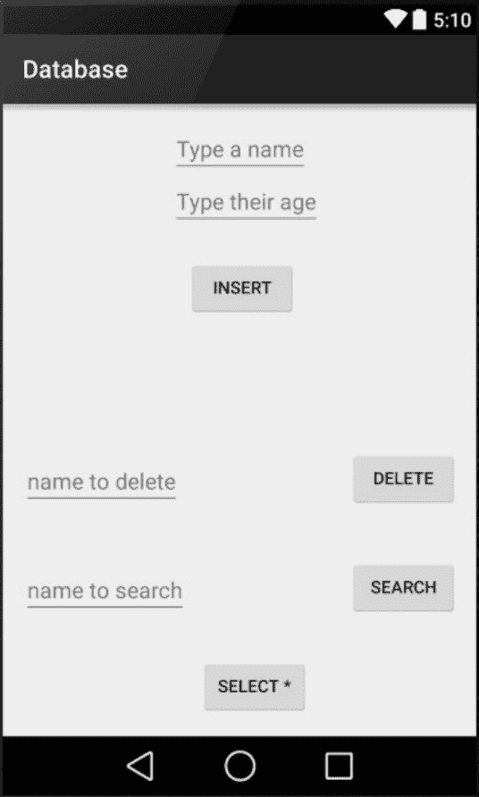
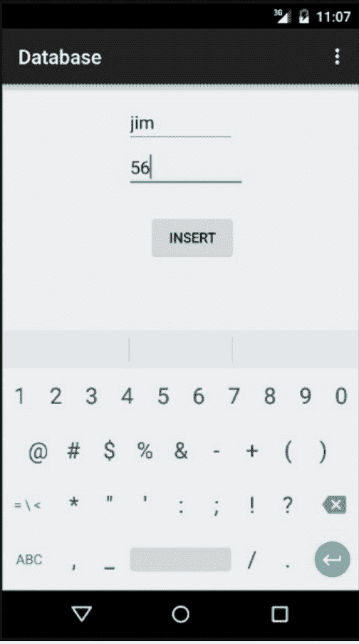

## 第 23 章 在我们的应用中使用 SQLite 数据库

如果我们要开发为用户提供重要功能的应用，那么几乎可以肯定，我们需要一种方法来管理、存储和筛选大量数据。

使用 JSON 可以高效地存储非常大量的数据，但当我们需要选择性地使用这些数据时，而不仅仅局限于“保存一切”和“加载一切”这两个选项，我们需要考虑还有哪些其他选项可用。

一门优秀的计算机科学课程可能会教授处理数据排序和筛选所需的算法，但做到这一点所需的精力将非常巨大。此外，我们想出一个与提供 Android API 的人所提供的方案一样好的解决方案的可能性有多大呢？

一如既往，我们使用 Android API 提供的解决方案是合理的。正如我们所见，JSON 和 SharedPreferences 类各有用途，但到某个阶段，我们需要转向使用真正的数据库来解决实际问题。Android 使用 SQLite 数据库管理系统，正如您所期望的，有一个 API 可以使这尽可能简单。

在本章中，我们将执行以下操作：

- 了解数据库究竟是什么
- 了解 SQL 和 SQLite 是什么
- 学习 SQL 语言的基础知识
- 查看 Android SQLite API
- 构建一个 SQLite 小型应用

### 数据库入门

让我们回答一大堆与数据库相关的问题，然后我们就可以开始构建使用 SQLite 的应用了。那么，什么是数据库呢？

### 什么是数据库？

数据库既是存储场所，也是检索、存储和操作数据的手段。在学习如何使用数据库之前，先在脑中构建数据库的可视化模型会很有帮助。数据库内部的实际结构因具体数据库而异。SQLite 实际上将所有数据都存储在一个文件中。

不过，如果我们将数据可视化为电子表格（有时是多个电子表格）中的数据，这将极大地帮助我们理解；就像电子表格一样，我们的数据库将被划分为多个列，这些列代表不同的数据类型，以及代表数据库中条目的行。

想象一个包含姓名和考试成绩的数据库。请查看下面该数据的可视化表示，以了解数据库的外观：

| _ID | 姓名 | 成绩 |
| --- | --- | --- |
| 1 | Bart | 23 |
| 2 | Lisa | 100 |
| 3 | Jim | 66 |

不过，请注意，这里有一列额外的数据：一个 _ID 列。我们将在后续内容中详细讨论这一点。这种类似电子表格的单一结构称为表。如前所述，数据库中可能存在，而且通常确实存在多个表。表中的每个列都有一个名称，在讨论数据库时可以引用该名称。

### 什么是 SQL？

SQL 是 **结构化查询语言** 的缩写。它是用于操作数据库的语法。

### 什么是 SQLite？

SQLite 是 Android 偏好的整个数据库系统的名称，并且它有自己的 SQL 版本。SQLite 版本的 SQL 需要与其他一些版本略有不同，原因是该数据库具有不同的功能。

以下的 SQL 语法入门将专注于 SQLite 版本。


## SQL 语法入门

在学习如何将 SQLite 与 Android 结合使用之前，你首先需要在平台中立的上下文中了解如何使用 SQLite 的基础知识。

让我们先看一些可以直接在 SQLite 数据库上使用的示例 SQL 代码，无需任何 Java 或 Android 类，这样我们就能更轻松地理解后来我们的 Java 代码将做什么。

## SQLite 示例代码

SQL 与 Java 一样拥有关键字来触发操作。以下是我们即将使用的一些 SQL 关键字示例：

- INSERT：这允许我们将数据添加到数据库中
- DELETE：这允许我们从数据库中删除数据
- SELECT：这允许我们从数据库中读取数据
- WHERE：这允许我们指定数据库中符合特定条件的部分，我们想要从中插入、删除或选取数据
- FROM：这用于指定数据库中的表名或列名

### 注意

SQLite 的关键字远不止这些，如需查看关键字完整列表，请参阅 [SQLite 关键字列表](https://sqlite.org/lang_keywords.html)。

除了关键字，SQL 还有数据类型。以下是 SQL 类型的几个示例：

- integer：这正是我们用来存储整数所需要的
- text：这非常适合存储简单的名称或地址
- real：这用于存储大型浮点数

### 注意

SQLite 的数据类型远不止这些，如需查看类型完整列表，请参阅 [SQLite 数据类型](https://www.sqlite.org/datatype3.html)。

让我们看看如何将这些类型与关键字结合起来，使用完整的 SQLite 语句来创建表以及添加、删除、修改和读取数据。

### 创建表

你可能会合理地问，为什么我们不先创建一个新数据库。原因在于，每个应用默认都可以访问一个 SQLite 数据库。该数据库对该应用是私有的。以下是我们在该数据库中创建表所使用的语句。我高亮显示了几个部分，以便让语句更清晰：

```
create table StudentsAndGrades
_ID integer primary key autoincrement not null,
name text not null,
score int;
```

前面的代码创建了一个名为 StudentsAndGrades 的表，其中包含一个整数类型的行 ID，每次添加一行数据时，该 ID 都会自动增加（递增）。

该表还将包含一个 name 列，其类型为文本，且不能为空（not null）。

它还将包含一个 score 列，其类型为 int。另外请注意，语句以分号结束。

### 向数据库插入数据

以下是我们如何向该数据库插入新数据行的示例：

```
INSERT INTO StudentsAndGrades
(name, score)
VALUES
("Bart", 23);
```

前面的代码向数据库添加了一行。执行上述语句后，数据库将有一个条目，其 _ID、name 和 score 列的值分别为 1、"Bart" 和 23。

以下是我们如何向该数据库插入另一行新数据的示例：

```
INSERT INTO StudentsAndGrades
(name, score)
VALUES
("Lisa", 100);
```

前面的代码添加了一行新数据，其 _ID、name 和 score 列的值分别为 2、"Lisa" 和 100。

我们的电子表格式结构现在如下图所示：

| _ID | name | score |
| --- | --- | --- |
| 1 | Bart | 23 |
| 2 | Lisa | 100 |

### 从数据库检索数据

以下是我们如何访问数据库中所有行和列的方法：

```
SELECT * FROM StudentsAndGrades;
```

前面的代码请求每一行和每一列。* 符号可读作 "all"。

我们也可以更具选择性，如这段代码所示：

```
SELECT score FROM StudentsAndGrades
where name = "Lisa";
```

前面的代码只会返回 100，当然，这是与名字 Lisa 关联的分数。

### 更新数据库结构

我们甚至可以在创建表并添加数据后添加新列。就 SQL 而言这很简单，但可能会对已发布应用上的用户数据造成一些问题。我们将在第 26 章“升级 SQLite – 添加位置和地图”中更深入地探讨这个问题。

下一条语句添加了一个名为 age 的新列，其类型为 int：

```
ALTER TABLE StudentsAndGrades
ADD
age int;
```

远不止我们目前看到的这些数据类型、关键字和用法。我们将在即将构建的两个数据库驱动应用中看到其中许多。这只是一小部分。接下来，让我们来看看 Android SQLite API，现在我们将开始看到如何运用我们新掌握的 SQLite 技能。

## Android SQLite API

Android API 提供了多种方式，让我们可以比较轻松地使用应用的数据库。我们需要首先熟悉的第一个类是 SQLiteOpenHelper。

### SQLiteOpenHelper 和 SQLiteDatabase

SQLiteDatabase 类表示实际的数据库。然而，SQLiteOpenHelper 类才是大部分操作发生的地方。这个类将使我们能够访问数据库并初始化 SQLiteDatabase 的实例。

此外，我们将在即将开发的小应用中扩展的 SQLiteOpenHelper 类有两个需要重写的方法。首先，它有一个 onCreate 方法，该方法在数据库首次使用时被调用，因此我们将 SQL 放在此方法中以创建表结构是很合理的。

我们必须重写的另一个方法是 onUpgrade，正如你可能猜到的，它在我们升级数据库（更改其结构）时被调用。其具体工作原理最好通过实际示例来解释，我们将在几个章节后看到。

### 构建和执行查询

随着我们的数据库结构变得更加复杂，SQL 知识不断增长，我们的 SQL 语句会变得相当冗长和别扭。出错的可能性很高。

我们帮助解决复杂性问题的方法是将查询由各部分构建为一个字符串。然后，我们可以将这个字符串传递给将为我们执行查询的方法（我们很快就会看到）。

此外，我们将使用 `final` 字符串来表示表名和列名等内容，以免搞混它们。

例如，我们可以声明以下成员，它们将表示前面虚构示例中的表名和列名。请注意，我们还将为数据库本身命名，并为此准备一个字符串：

```
private static final String DB_NAME = "MyCollegeDB";
private static final String TABLE_S_AND_G = "StudentsAndGrades";

public static final String TABLE_ROW_ID = "id";
public static final String TABLEROW_NAME = "name";
public static final String TABLE_ROW_SCORE = "score";
```

正如你在前面的代码中看到的，我们将受益于在类外部访问这些字符串，因为我们将它们声明为 public。

然后，我们可以像下一个示例一样构建查询。以下示例向我们的假设数据库添加一个新条目，并将我们的 Java 变量纳入 SQL 语句中：

```
String name = "Divij";
int score = 94;

// Add all the details to the table
String query = "INSERT INTO " + TABLE_S_AND_G + " (" +
    TABLE_ROW_NAME + ", " +
    TABLE_ROW_SCORE + ") " +
    "VALUES (" +
    "" + name + "" + ", " +
    score +
    ");";
```

请注意，在前面的代码中，常规 Java 变量 name 和 score 被突出显示。前面名为 query 的字符串现在是与以下代码完全等价的 SQL 语句：

```
INSERT INTO StudentsAndGrades (
 name, score)
 VALUES ('Divij',94);
```

### 提示

要继续学习 Android 编程，完全掌握前面两段代码并非必不可少。但如果你想构建自己的应用并编写完全符合需求的 SQL 语句，研究这两段代码会有所帮助。何不研究一下前面两段代码，以辨别以下区别：用 + 连接的字符串部分中的成对双引号 "，属于 SQL 语法的成对单引号 '，常规 Java 变量，以及字符串和 Java 中 SQL 语句里的不同分号。

在输入查询的整个过程中，Android Studio 会提示我们变量的名称，尽管这比直接输入查询更冗长，但出错的机会也小得多。

现在，我们可以使用之前介绍的类来执行查询：

```
// This is the actual database
private SQLiteDatabase db;

// Create an instance of our internal CustomSQLiteOpenHelper class
CustomSQLiteOpenHelper helper = new CustomSQLiteOpenHelper(context);

// Get a writable database
db = helper.getWritableDatabase();

// Run the query
db.execSQL(query);
```

向数据库添加数据时，我们将使用 execSQL，如前面的代码所示；而从数据库获取数据时，我们将使用 rawQuery 方法，如下一个代码片段所示：

```
Cursor c = db.rawQuery(query, null);
```


请注意，rawQuery 方法返回一个游标类型的对象。

## 提示

我们与 SQLite 交互有多种不同的方式，各有优缺点。这里，我们选择使用原始 SQL 语句，因为这样做完全透明，我们知道自己在做什么，同时还能加强对 SQL 语言的了解。如果想了解更多，请参阅下一个提示。

## 数据库游标

除了让我们访问数据库的类和允许我们执行查询的方法之外，还有一个问题，即我们从查询中获取的结果究竟以何种格式返回。

幸运的是，有 cursor 类。我们的所有数据库查询都将返回 Cursor 类型的对象。我们可以使用 Cursor 类的方法，像在这段代码中使用的那样，有选择地访问查询返回的数据：

```
Log.i(c.getString(1), c.getString(2));
```

之前的代码会将查询返回结果中前两列存储的两个值输出到 logcat。正是 Cursor 对象本身决定了我们当前将读取返回数据中的哪一行。

我们可以访问 Cursor 对象的许多方法，包括 moveToNext 方法，它不出所料地会将 Cursor 移动到下一可读行：

```
c.moveToNext();
```

```
/*
 * This same code now outputs the data in the
 * first and second column of the returned
 * data but from the SECOND row.
 */
```

```
Log.i(c.getString(1), c.getString(2));
```

在某些情况下，我们将能够将 Cursor 绑定到我们 UI 的一部分（例如 ListView），并将一切交给 Android API。当我们在下一章为 Where it's snap 应用添加数据库时，将看到此过程。

Cursor 类还有更多有用的方法，我们很快就会看到其中一些。

### 提示

对 Android SQLite API 的这篇介绍其实只是触及了其功能的表面。随着我们深入学习，还会遇到更多方法和类。然而，如果你的应用构想需要复杂的数据管理，深入学习是值得的。如果你想了解更多，我推荐你阅读 Jason Wei 所著的《Android 数据库编程》（Packt Publishing 出版），你可以在 https://www.packtpub.com/application-development/android-database-programming 找到它。

现在，我们可以看到所有这些理论是如何结合在一起的，以及我们将如何在实际可用的小型应用中构建数据库代码。

## 数据库小型应用

在本节中，我们将付诸实践迄今所学的一切，并创建一个小型数据库，使我们能够添加、删除、搜索和选择数据。

首先，让我们创建一个新项目，所有设置均使用默认值，并将其命名为 Database。此小型应用的代码位于 Chapter 23/Database 文件夹的下载包中。

## 实现布局

通过复制并粘贴下一块 XML 代码来创建布局。代码中没有什么新的或复杂的内容，但请务必审查它，记住 EditText 和 Button 小部件上的各种 id 属性，因为这将使理解 Java 代码更加简单。

将此 XML 添加到 layout_main.xml 文件中：

```
<RelativeLayout
xmlns:android="http://schemas.android.com/apk/res/android"
xmlns:tools="http://schemas.android.com/tools"
android:layout_width="match_parent"
android:layout_height="match_parent"
android:paddingLeft="@dimen/activity_horizontal_margin"
android:paddingRight="@dimen/activity_horizontal_margin"
android:paddingTop="@dimen/activity_vertical_margin"
android:paddingBottom="@dimen/activity_vertical_margin"
tools:context=".MainActivity">

<EditText
android:layout_width="wrap_content"
android:layout_height="wrap_content"
android:id="@+id/editName"
android:hint="Type a name"
android:layout_alignParentTop="true"
android:layout_centerHorizontal="true" >

<EditText
android:layout_width="wrap_content"
android:layout_height="wrap_content"
android:id="@+id/editAge"
android:hint="Type their age"
android:layout_below="@+id/editName"
android:layout_alignLeft="@+id/editName"
android:layout_alignStart="@+id/editName" >

<Button
android:layout_width="wrap_content"
android:layout_height="wrap_content"
android:text="INSERT"
android:id="@+id/btnInsert"
android:layout_below="@+id/editAge"
android:layout_toRightOf="@+id/editSearch"
android:layout_toEndOf="@+id/editSearch"
android:layout_marginTop="24dp" >

<Button
    android:layout_width="wrap_content"
    android:layout_height="wrap_content"
    android:text="DELETE"
    android:id="@+id/btnDelete"
    android:layout_above="@+id/btnSearch"
    android:layout_alignParentRight="true"
    android:layout_alignParentEnd="true"
    android:layout_marginBottom="40dp" />

<Button
    android:layout_width="wrap_content"
    android:layout_height="wrap_content"
    android:text="SELECT *"
    android:id="@+id/btnSelect"
    android:layout_alignParentBottom="true"
    android:layout_alignRight="@+id/editName"
    android:layout_alignEnd="@+id/editName" >

<Button
    android:layout_width="wrap_content"
    android:layout_height="wrap_content"
    android:text="Search"
    android:id="@+id/btnSearch"
    android:layout_above="@+id/btnSelect"
    android:layout_alignLeft="@+id/btnDelete"
    android:layout_alignStart="@+id/btnDelete"
    android:layout_marginBottom="32dp" >

<EditText
    android:layout_width="wrap_content"
    android:layout_height="wrap_content"
    android:id="@+id/editSearch"
    android:hint="name to search"
    android:layout_alignBottom="@+id/btnSearch"
    android:layout_alignParentLeft="true"
    android:layout_alignParentStart="true" >

<EditText
    android:layout_width="wrap_content"
    android:layout_height="wrap_content"
    android:id="@+id/editDelete"
    android:hint="name to delete"
    android:layout_alignBottom="@+id/btnDelete"
    android:layout_alignParentLeft="true"
    android:layout_alignParentStart="true"
    android:focusableInTouchMode="true" >
</RelativeLayout>
```

以下是 Android Studio 设计器中完成的布局：



## 编写数据库类

我们将通过实现 SQLiteOpenHelper 来创建一个管理数据库的类。它还将定义一些 final 字符串，用于表示表及其列的名称。此外，它将提供一系列帮助方法，我们可以调用这些方法来执行所有必要的查询。在必要时，这些帮助方法将返回一个 Cursor 对象，我们可以在 MainActivity 中使用它来显示检索到的数据。然后，如果我们的应用需要发展，添加新的帮助方法也将非常容易。

创建一个名为 DataManager 的新类，并添加以下成员变量：

```
public class DataManager {
    // This is the actual database
    private SQLiteDatabase db;

    /*
     Next we have a public static final string for
     each row/table that we need to refer to both
     inside and outside this class
     */

    public static final String TABLE_ROW_ID = "id";
    public static final String TABLE_ROW_NAME = "name";
    public static final String TABLE_ROW_AGE = "age";

    /*
    Next we have a private static final strings for
    each row/table that we need to refer to just
    inside this class
    */

    private static final String DB_NAME = "address_book_db";
    private static final int DB_VERSION = 1;
    private static final String TABLE_N_AND_A =
     "names_and_addresses";
}
```

接下来，我们添加构造函数，它将创建我们自定义版本的 SQLiteOpenHelper 的实例。我们很快将把此类实现为内部类。构造函数还将初始化 db 成员，即我们的 SQLiteDatabase 引用。

将刚才讨论的以下构造函数添加到 DataManager 类中：

```
public DataManager(Context context) {
    // Create an instance of our internal //CustomSQLiteOpenHelper
    class
    CustomSQLiteOpenHelper helper = new
    CustomSQLiteOpenHelper(context);

    // Get a writable database
    db = helper.getWritableDatabase();
}
```

现在，我们可以添加将从 MainActivity 访问的帮助方法。首先是 insert 方法，它将基于传入方法的 name 和 age 参数执行 INSERT SQL 查询。

将 insert 方法添加到 DataManager 类中：

```
// Here are all our helper methods

// Insert a record
public void insert(String name, String age){
    // Add all the details to the table
    String query = "INSERT INTO " + TABLE_N_AND_A + " (" +
            TABLE_ROW_NAME + ", " +
            TABLE_ROW_AGE + ") " +
            "VALUES (" +
            "'" + name + "'" + ", " +
            "'" + age + "'" +
            ");";
    
    Log.i("insert() = ", query);
    
    db.execSQL(query);
}
```

这个名为 delete 的下一个方法将在数据库中删除一条记录，如果它在 name 列中具有与 name 参数中传递的值匹配的值。它使用 SQL DELETE 关键字来实现这一点。

将 delete 方法添加到 DataManager 类中：


// Delete a record
public void delete(String name){

    // Delete the details from the table if already exists
    String query = "DELETE FROM " + TABLE_N_AND_A +
    " WHERE " + TABLE_ROW_NAME +
    " = '" + name + "';";

    Log.i("delete() = ", query);

    db.execSQL(query);
}

接下来，我们有 selectAll 方法，它也如其名称所示。它通过使用 * 参数的 SELECT 查询来实现这一点，这相当于单独指定所有列。还要注意，该方法返回 Cursor，我们将在 MainActivity 类中使用它。

将 selectAll 方法添加到 DataManager 类中：

```
// Get all the records
public Cursor selectAll() {
    Cursor c = db.rawQuery("SELECT * "+" from " +
    TABLE_N_AND_A, null);

    return c;
}
```

现在，我们添加一个 searchName 方法，它有一个 String 参数，用于用户想要搜索的名称。它也返回 Cursor，其中将包含找到的所有条目。请注意，SQL 语句使用 SELECT、FROM 和 WHERE 来实现这一点：

```
// Find a specific record
public Cursor searchName(String name ) {
    String query = "SELECT " +
    TABLE_ROW_ID + ", " +
    TABLE_ROW_NAME +
    ", " + TABLE_ROW_AGE +
    " from " +
    TABLE_N_AND_A + " WHERE " +
    TABLE_ROW_NAME + " = '" + name + "';";

    Log.i("searchName() = ", query);
    Cursor c = db.rawQuery(query, null);

    return c;
}
```

最后，对于 DataManager 类，我们创建一个内部类，它将是我们对 SQLiteOpenHelper 的实现。这是一个精简版实现，在接下来的几个章节中，我们将制作一个更高级的实现，该实现还将处理为我们的 Where it's snap 应用升级数据库的任务。

我们有一个构造函数，接收一个 Context 对象、数据库名称和数据库版本。我们将在第 26 章“升级 SQLite – 添加位置和地图”中了解数据库版本的用途。

我们还重写了 onCreate 方法，该方法包含创建带有 _ID、name 和 age 列的数据库表的 SQL 语句。

对于这个小应用，onUpgrade 方法被故意留空。

将内部 CustomSQLiteOpenHelper 类添加到 DataManager 类中：

```
private class CustomSQLiteOpenHelper extends SQLiteOpenHelper {
    public CustomSQLiteOpenHelper(Context context) {
        super(context, DB_NAME, null, DB_VERSION);
    }
}

// This method only runs the first time the database is created
@Override
public void onCreate(SQLiteDatabase db) {

    // Create table for photos and all their details
    String newTableQueryString = "create table "
            + TABLE_N_AND_A + " ("
            + TABLE_ROW_ID
            + " integer primary key autoincrement not null,"
            + TABLE_ROW_NAME
            + " text not null,"
            + TABLE_ROW_AGE
            + " text not null);";
    db.execSQL(newTableQueryString);
}

// This method only runs when we increment DB_VERSION
// We will look at this in chapter 26
@Override
public void onUpgrade(SQLiteDatabase db,
int oldVersion, int newVersion) {

}
}
```

现在，我们可以添加代码来使用我们的新 DataManager 类。

## 编码 MainActivity

让 MainActivity 实现 View.OnClickListener，以便它可以监听按钮点击。还要为每个 EditText 和 Button 小部件添加以下成员。还要注意，我们声明了一个 DataManager 类型的对象。

按照我们刚才讨论的修改 MainActivity 类，使其与以下代码匹配：

```
public class MainActivity extends AppCompatActivity implements
View.OnClickListener{

    // For all our buttons and edit text
    Button btnInsert;
    Button btnDelete;
    Button btnSelect;
    Button btnSearch;

    EditText editName;
    EditText editAge;
    EditText editDelete;
    EditText editSearch;

    // This is our DataManager instance
    DataManager dm;

    @Override
    protected void onCreate(Bundle savedInstanceState) {
        super.onCreate(savedInstanceState);
        setContentView(R.layout.activity_main);
    }
    ...
    ...
```

现在，我们向 onCreate 添加代码，通过调用其构造函数来初始化 DataManager (dm)，获取布局中所有 EditText 和 Button 小部件的引用，并为每个按钮设置监听器。

将高亮代码添加到 onCreate 方法中：

```
@Override
protected void onCreate(Bundle savedInstanceState) {
    super.onCreate(savedInstanceState);
    setContentView(R.layout.activity_main);
}
```

```
dm = new DataManager(this);

// get a reference to the UI item
btnInsert = (Button) findViewById(R.id.btnInsert);
btnDelete = (Button) findViewById(R.id.btnDelete);
btnSelect = (Button) findViewById(R.id.btnSelect);
btnSearch = (Button) findViewById(R.id.btnSearch);

editName = (EditText) findViewById(R.id.editName);
editAge = (EditText) findViewById(R.id.editAge);
editDelete = (EditText) findViewById(R.id.editDelete);
editSearch = (EditText) findViewById(R.id.editSearch);

// Register MainActivity as a listener
btnSelect.setOnClickListener(this);
btnInsert.setOnClickListener(this);
btnDelete.setOnClickListener(this);
btnSearch.setOnClickListener(this);
}
```

现在，添加一个方法，用于打印由我们的某些 DataManager 方法返回的游标的内容。moveToNext 方法根据游标中是否有下一行数据返回 true 或 false。因此，将其作为 while 语句的条件，可以确保读取并输出到 logcat 中的所有返回条目。

将 showData 方法添加到 MainActivity：

```
// Output the cursor contents to the log
public void showData(Cursor c){
    while (c.moveToNext())
    Log.i(c.getString(1), c.getString(2));
}
}
```

现在，我们可以实现重写的 onClick 方法来处理所有按钮。请注意，switch 语句中的 R.id.btnSearch 分支通过在 showData 方法调用中直接链式调用 getText 和 toString 方法，使用相应的 EditText 内容调用 DataManager 类的相应方法。这样做的效果是只用一行代码就将返回的游标对象传递给 showData 方法。

R.id.btnInsert 和 R.id.btnDelete 分支只是将相应 EditText 小部件的内容分别传递给 DataManager 类的 insert 和 delete 方法。

将 onClick 方法添加到 MainActivity 类中：

```
@Override
public void onClick(View v){
	switch (v.getId()){
	case R.id.btnInsert:
	dm.insert(editName.getText().toString(),
	editAge.getText().toString());
	break;

	case R.id.btnSelect:
	showData(dm.selectAll());
	break;

	case R.id.btnSearch:
	showData(dm.searchName(editSearch.getText().toString()));
	break;

	case R.id.btnDelete:
	dm.delete(editDelete.getText().toString());
	break;
	}
}
```

让我们来看看该应用的实际运行情况。

## 运行小应用

通过输入名称和年龄然后点击 INSERT，向数据库中添加一些名称和年龄，如下面的屏幕截图所示：



添加几个名称后，尝试点击 SELECT 按钮，然后查看 logcat 窗口中的输出：

```
I/bob: 42
I/jim: 56
I/Ed: 22
I/Divij: 23
I/Merwyn: 24
```

点击 SEARCH，传入要搜索的名称。请注意，只返回与搜索词匹配的行：


最后，在 DELETE 按钮旁边的 EditText 中输入一个名称，然后点击 DELETE 按钮：


现在，点击 SELECT，我们可以看到 "bob" 不再是数据库的一部分：

```
I/delete() := DELETE FROM names_and_addresses WHERE name = 'bob';
I/jim: 56
I/Ed: 22
I/Divij: 23
I/Merwyn: 24
```

让我们回顾一下本章所做的工作。

## 摘要

本章我们学习了很多内容。您了解了数据库，特别是 Android 应用的数据库 SQLite。我们练习了使用 SQL 语言与数据库通信的基础知识。

我们了解了 Android API 如何帮助我们使用 SQLite 数据库，并实现了我们第一个带有数据库的可运行应用。

在下一章中，我们将使用一个更高级的 `DataManager` 类，并将其在 Where it's snap 应用中用于保存用户的所有标题、标签和照片。


