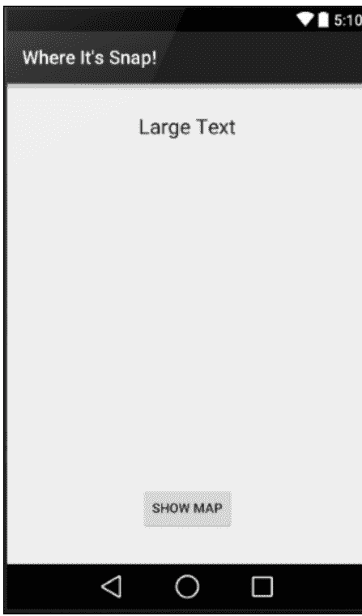
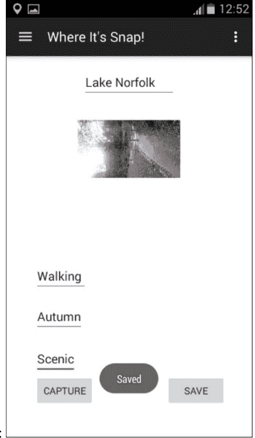

## 第24章。为Where It's Snap添加数据库

在本章中，我们将完全专注于利用我们所掌握的关于片段、接口和SQLite的所有知识，为Where It's Snap添加重要功能。

我们将涵盖以下任务：

- 创建一个新类来表示照片
- 创建一个DataManager类来处理我们的数据库，包括一系列辅助方法以执行适当的查询
- 从FragmentCapture类启用将照片保存到数据库的功能
- 编写一个接口来处理通信
- 编写TagsFragment以显示标签列表，并在点击某个标签时将其发送到MainActivity
- 编写TitlesFragment以显示标题列表，该列表基于特定标签或wis_table_photos的全部内容
- 编写MainActivity类以通过接口处理片段的通信

与往常一样，上述所有文件都位于下载包中的chapter 24/Where Its Snap 3文件夹中。

## Photo类

我们需要的第一个新东西是一个用于保存照片数据结构的类。

我们需要该类拥有四个字符串成员，分别用于标题和三个标签。这非常直接。然而，照片本身值得进一步讨论。我们在第22章“捕获图像”中已经看到，我们实际上是从相机捕获一个位图。可以将图像直接存储在数据库中，但我们可能可以比这更高效，同时保持代码更加简单。

当Android设备上的相机应用拍摄照片时，它会将其保存在内部存储中。如果有办法引用存储中的这张图像，那么我们可以将位置存储在数据库中，然后在需要时从常规内部存储加载图像。

这样的位置称为URI。以某种简化的方式，我们可以将URI视为指向页面、图像或其他资源类型的文件路径或地址（如网页地址）。Android API中甚至有一个Uri类来让我们更轻松。

### 注意

那么，URI到底是什么？URI代表统一资源标识符，用于在计算机系统或网络中标识资源。如果你想了解URI工作原理的完整细节（并且你有相当多的空闲时间），请查看这篇Wikipedia文章：[统一资源标识符](https://en.wikipedia.org/wiki/Uniform_Resource_Identifier)。

除了成员变量外，我们还需要添加getter和 setter方法，以便保持成员私有化同时仍提供访问权限。

创建一个新类，将其命名为Photo，并添加我们讨论过的以下成员以及getter和 setter方法：

```java
import android.net.Uri;
public class Photo {
private String mTitle;
private Uri mStorageLocation;
private String mTag1;
private String mTag2;
private String mTag3;

public String getTitle() {
	return mTitle;
}

public void setTitle(String title) {
	this.mTitle = title;
}

public Uri getStorageLocation() {
	return mStorageLocation;
}

public void setStorageLocation(Uri storageLocation) {
	this.mStorageLocation = storageLocation;
}

public String getTag1() {
	return mTag1;
}

public void setTag1(String tag1) {
	this.mTag1 = tag1;
}

public String getTag2() {
	return mTag2;
}

public void setTag2(String tag2) {
	this.mTag2 = tag2;
}

public String getTag3() {
	return mTag3;
}

public void setTag3(String tag3) {
	this.mTag3 = tag3;
}
}
```

现在，我们可以开始编写DataManager类了。

## 处理SQLite数据库

创建一个名为DataManager的新类。我们需要一个SQLiteDatabase对象以及一大堆用于表名和列名的final字符串成员。

我们首先要添加到DataManager的所有代码都很简单，但值得注意的是，这个数据库实际上会有两个表。一个名为wis_table_photos的表将为Photo类的每个成员变量设置一列。

另一个名为wis_table_tags的表将只有两列：自增_ID和一个tag列。

wis_table_photos表将为用户拍摄的每张照片包含一行数据。tags列仅会为用户输入的每个新/唯一标签包含一行。因此，如果用户有多张带有“Barbados”或“2016”标签的照片，它在wis_table_tags表中只会出现一次，但在wis_table_photos表中会与每个使用它的照片一起出现。

这样，就可以向用户显示他们添加的所有唯一标签列表，当他们点击一个标签时，将显示所有带有该标签的照片列表。

为了帮助澄清以下代码中所有字符串的用途，采用电子表格式的视图来帮助可视化我们的两个表可能会有所帮助：

| _id | 图片标题 | 图片URI | 标签1 | 标签2 | 标签3 |
|---|---|---|---|---|---|
| 1 | Dave在泳池中 | /external/ima | 2016 | Barbados | Fun |
| 2 | Sarah在沙滩上 | /external/ima | 2015 | Barbados | Pretty |
| 3 | 我的新车 | /external/ima | 2016 | UK | Sad |

在前面的图中，你可以看到wis_table_photos表为每一行包含了用户可能输入的所有数据。然而，如果你查看下一个图（wis_table_tags），你可以看到每个标签只存储一次。我们如何插入数据以实现这一点，以及如何选择数据，将在我们继续进行时变得清晰。

### wis_table_tags

| _id | 标签 |
| --- | --- |
| 1 | Barbados |
| 2 | 2015 |
| 3 | 2016 |
| 4 | Fun |
| 5 | Pretty |
| 6 | UK |
| 7 | Sad |

### 提示

请记住，从上一章我们知道，当从另一个类直接引用成员很有用时，我们会将成员声明为public。它们也是static的，因为即使最终出现多个DatabaseManager实例，我们也不需要新实例。

你可能会想知道MVC模式和我们只能实例化一次的独立数据层如何对应到这个DataManager类。之所以可行，是因为我们的所有字符串都是static的，因此在DataManager的多个实例中都是同一个实例。当我们调用getWritableDatabase时，操作系统将始终返回同一个数据库，因此不可能出现多个不同步的数据库，而且同一个数据库会自动从我们应用的任何Activity中访问。

添加我们刚刚讨论的将用于构建数据库查询的成员变量：

```java
public class DataManager {
// This is the actual database
private SQLiteDatabase db;

/*
Next we have a public static final string for
each row/table that we need to refer to both
inside and outside this class
*/

public static final String TABLE_ROW_ID = "id";
public static final String TABLE_ROW_TITLE = "image_title";
public static final String TABLE_ROW_URI = "image_uri";

/*
Next we have a private static final strings for
each row/table that we need to refer to just
inside this class
*/

private static final String DB_NAME = "wis_db";
private static final int DB_VERSION = 1;
private static final String TABLE_PHOTOS = "wis_table_photos";
private static final String TABLE_TAGS = "wis_table_tags";
private static final String TABLE_ROW_TAG1 = "tag1";
private static final String TABLE_ROW_TAG2 = "tag2";
private static final String TABLE_ROW_TAG3 = "tag3";
public static final String TABLE_ROW_TAG = "tag"; // For the tags table

public DataManager(Context context) {
    // Create an instance of our internal CustomSQLiteOpenHelper class
    CustomSQLiteOpenHelper helper = new CustomSQLiteOpenHelper(context);

    // Get a writable database
    db = helper.getWritableDatabase();
}
}
```


```
}
```

我们现在将介绍第一个名为 addPhoto 的帮助器方法。它接受一个 Photo 对象参数，然后使用 Photo 类的 getter 方法将所有值作为新行添加，同时向 wis_table_photos 表执行 INSERT 查询。

接下来的代码只是 addPhoto 方法的第一部分。我们将在下一部分查看第二部分。

## 向 DataManager 类添加 addPhoto 方法:

```java
// Here are all our helper methods
public void addPhoto(Photo photo){

// Add all the details to the photos table
String query = "INSERT INTO " + TABLE_PHOTOS + " (" +
TABLE_ROW_TITLE + ", " + 
TABLE_ROW_URI + ", " + 
TABLE_ROW_TAG1 + ", " + 
TABLE_ROW_TAG2 + ", " + 
TABLE_ROW_TAG3 +
") " +

"VALUES (" +
"'" + photo.getTitle() + "'" + ", " +
"'" + photo.getStorageLocation() + "'" + ", " +
"'" + photo.getTag1() + "'" + ", " +
"'" + photo.getTag2() + "'" + ", " +
"'" + photo.getTag3() + "'" +
");";

Log.i("addPhoto()", query);

db.execSQL(query);
```

接下来，仍在 addPhoto 中，我们执行三个查询，每个标签一个，并将它们 INSERT 到 wis_table_tags 表中，但请注意我们在构建的 SQL 中高亮显示的 WHERE NOT EXISTS 子句。这确保我们只有在标签尚未添加时才添加标签。

## 通过添加此代码完成 addPhoto 方法:

```java
// Add any NEW tags to the tags table
query = "INSERT INTO " + TABLE_TAGS + "(" +
TABLE_ROW_TAG + ") " +
"SELECT '" + photo.getTag1() + "' '" +
"WHERE NOT EXISTS ( SELECT 1 FROM " +
TABLE_TAGS +
" WHERE " + TABLE_ROW_TAG + " = " +
"'" + photo.getTag1() + "');";
db.execSQL(query);

query = "INSERT INTO " + TABLE_TAGS + "(" +
TABLE_ROW_TAG + ") " +
"SELECT '" + photo.getTag2() + "' '" +
"WHERE NOT EXISTS ( SELECT 1 FROM " +
TABLE_TAGS +
" WHERE " + TABLE_ROW_TAG + " = " +
"'" + photo.getTag2() + "');";
db.execSQL(query);

query = "INSERT INTO " + TABLE_TAGS + "(" +
TABLE_ROW_TAG + ") " +
"SELECT '" + photo.getTag3() + "' '" +
"WHERE NOT EXISTS ( SELECT 1 FROM " +
TABLE_TAGS +
" WHERE " + TABLE_ROW_TAG + " = " +
"'" + photo.getTag3() + "');";
db.execSQL(query);
}

// End addPhoto
```

现在，我们有一个非常简单的查询，用于从 wis_table_photos 表获取所有标题。请注意，我们返回 Cursor，它包含查询的数据。

## 向 DataManager 类添加 getTitles 方法:

```java
public Cursor getTitles() {
Cursor c = db.rawQuery("SELECT " + TABLE_ROW_ID + ", " +
TABLE_ROW_TITLE + " from " + TABLE_PHOTOS, null);
c.moveToFirst();
return c;
}
```

现在我们开始了解如何选择性地过滤要显示给用户的标题。getTitlesWithTag 方法返回带有照片标题的 Cursor，但仅当它们包含传递给该方法的特定标签时才返回。

## 向 DataManager 类添加 getTitlesWithTag 方法:

```java
public Cursor getTitlesWithTag(String tag) {
Cursor c = db.rawQuery("SELECT " + TABLE_ROW_ID + ", " +
TABLE_ROW_TITLE + " from " +
TABLE_PHOTOS + " WHERE " +
TABLE_ROW_TAG1 + " = '" + tag + "' or " +
TABLE_ROW_TAG2 + " = '" + tag + "' or " +
TABLE_ROW_TAG3 + " = '" + tag + "';",
null);
c.moveToFirst();
return c;
}
```

此方法返回具有特定 _id 值的照片的所有列。

## 向 DataManager 类添加 getPhoto 方法:

```java
public Cursor getPhoto(int id) {
Cursor c = db.rawQuery("SELECT * from " +
TABLE_PHOTOS +
" WHERE " +
TABLE_ROW_ID + " = " + id, null);
c.moveToFirst();
return c;
}
```

下一个方法返回所有标签，这正是我们 TagsFragment 类所需要的。

## 向 DataManager 类添加 getTags 方法:

```java
public Cursor getTags(){
Cursor c = db.rawQuery("SELECT " + TABLE_ROW_ID + ", " +
TABLE_ROW_TAG + " from " + TABLE_TAGS, null);
c.moveToFirst();
return c;
}
```

最后，我们来到内部类 CustomSQLiteOpenHelper，它扩展了 SQLiteOpenHelper。与上一章一样，我们有相同的简单构造函数，但 onCreate 方法构建并执行两个查询以创建我们所需的两个表。

onUpgrade 方法将保持空白，直到第 26 章，升级 SQLite – 添加位置和地图。

## 将 CustomSQLiteOpenHelper 类作为 DataManager 的内部类添加:

```java
// This class is created when our DataManager is initialized
private class CustomSQLiteOpenHelper extends SQLiteOpenHelper {
    public CustomSQLiteOpenHelper(Context context) {
        super(context, DB_NAME, null, DB_VERSION);
    }
}

// This method only runs the first time the database is created
@Override
public void onCreate(SQLiteDatabase db) {
    // Create a table for photos and all their details
    String newTableQueryString = "create table "
        + TABLE_PHOTOS + " ("
        + TABLE_ROW_ID
        + " integer primary key autoincrement not null,"
        + TABLE_ROW_TITLE
        + " text not null,"
        + TABLE_ROW_URI
        + " text not null,"
        + TABLE_ROW_TAG1
        + " text not null,"
        + TABLE_ROW_TAG2
        + " text not null,"
        + TABLE_ROW_TAG3
        + " text not null" + ")";

db.execSQL(newTableQueryString);

// Create a separate table for tags
newTableQueryString = "create table "
    + TABLE_ROW_ID
    + " integer primary key autoincrement not null,"
    + TABLE_ROW_TAG
    + " text not null" + ");";

db.execSQL(newTableQueryString);
}

// This method only runs when we increment DB_VERSION
@Override
public void onUpgrade(SQLiteDatabase db, int oldVersion, int newVersion) {
}
}
```

现在我们已实现 DataManager 类及其所有帮助器方法，可以使用它们并增强 Where it's Snap 的功能。

## 从捕获片段保存新照片

在编辑器中打开 CaptureFragment.java 文件。

我们需要为 CaptureFragment 类添加一个新成员变量，以保存我们新的 DataManager 类实例。

将我们刚刚讨论过的新高亮成员变量添加到 CaptureFragment 中：

```java
public class CaptureFragment extends Fragment{
    private static final int CAMERA_REQUEST = 123;
    private ImageView mImageView;

    // Where the captured image is stored
    private Uri mImageUri = Uri.EMPTY;

    // Where to save the image
    String mCurrentPhotoPath;

    // A reference to our database
    private DataManager mDataManager;

    @Override
    public void onCreate(Bundle savedInstanceState){
        super.onCreate(savedInstanceState);
    }
}
```

现在，我们可以通过在 CaptureFragment 的 onCreate 方法中添加此高亮代码行来初始化 DataManager 实例：

```java
@Override
public void onCreate(Bundle savedInstanceState) {
    super.onCreate(savedInstanceState);

    mDataManager =
        new DataManager(getActivity()
                .getApplicationContext());
}
```

由于我们的 `DataManager` 已编码完毕并可供使用，并且我们已有一个已初始化的实例，可以继续实现 **保存** 按钮。我们已通过 btnSave 获取所有相关 **编辑文本** 小部件以及 **按钮** 小部件的引用。

我们可以通过实现匿名类来处理按钮点击，从而在 `onCreateView` 中完成数据保存工作。在 `onClick` 方法中，我们按以下步骤操作：

- 首先，使用 `if (mImageUri != null)` 检查 `mImageUri` 是否已初始化。
- 接下来，使用 `if (!mImageUri.equals(Uri.EMPTY))` 检查 `mImageUri` 成员是否非空。
- 假设我们有照片要保存，则进入 `if` 块并声明一个新的 `Photo` 对象。
- 通过调用 `setTitle` 并传入 `mEditTextTitle` **编辑文本** 小部件的内容来存储用户标题。
- 通过调用 `setStorageLocation` 并传入 `mImageUri` 来存储 URI。
- 在三个字符串中捕获用户为每个标签输入的值，然后使用 `Photo` 类的相应 setter 将它们存储在 `Photo` 对象中。
- 在 `if` 块内我们要做的最后一件事是使用我们的 `DataManager` 实例调用 `addPhoto`，当然，我们会传入刚刚构建的 `Photo` 对象。`DataManager` 类会将所有数据添加到所需的表中。
- 在 `if` 块末尾，我们有一个 `else` 块，如果用户尝试保存不存在的照片，或者保存成功，它会向用户弹出一条消息。

将我们刚刚讨论过的高亮代码添加到 `onCreateView` 中，位置紧随处理 **捕获** 按钮的代码之后：

```java
// Listen for clicks on the capture button
btnCapture.setOnClickListener(new View.OnClickListener() {
  ...
}); // End capture button handling

// Listen for clicks on the save button
btnSave.setOnClickListener(new View.OnClickListener() {

@Override
public void onClick(View v) {
```


if(mImageUri != null){
    if(!mImageUri.equals(Uri.EMPTY)) {
    // We have a photo to save

    Photo photo = new Photo();
    photo.setTitle(mEditTextTitle.getText().toString());
    photo.setStorageLocation(mImageUri);

    // What is in the tags
    String tag1 = mEditTextTag1.getText().toString();
    String tag2 = mEditTextTag2.getText().toString();
    String tag3 = mEditTextTag3.getText().toString();

    // Assign the strings to the Photo object
    photo.setTag1(tag1);
    photo.setTag2(tag2);
    photo.setTag3(tag3);

    // Send the new object to our DataManager
    mDataManager.addPhoto(photo);
    Toast.makeText(getActivity(), "Saved",
    Toast.LENGTH_LONG).show();
    }else {
    // No image
    Toast.makeText(getActivity(), "No image to save",
    Toast.LENGTH_LONG).show();
    }
} else {
    // Uri not initialized
    Log.e("Error ", "uri is null");
}

});

return view;

}// End onCreateView

到此为止，我们可以运行应用并开始将照片保存到数据库中。当然，问题在于，我们还没有任何方法来查看可用标签列表、照片标题或照片本身。

在 TitlesFragment 能响应点击并显示照片之前，我们需要一个 fragment 来显示这些照片。所以，让我们来编写一个用于查看照片的 fragment。

## 从数据库中显示照片

让我们先构建一个即将构建的 fragment 可以使用的简单布局。

### 准备 View 布局

通过右键单击 `layout` 文件夹并选择 **新建** | **资源布局文件**，将其命名为 `fragment_view`，然后左键单击 **确定**。

这张图是我们要达到的效果，但还有一个不可见的 `ImageView` 覆盖了整个布局：



为了实现此布局，请将以下 XML 代码添加到 `fragment_view.xml` 文件中。我已标出几个值得注意的点，我们将稍后讨论：

```xml
<?xml version="1.0" encoding="utf-8"?>
<RelativeLayout
xmlns:android="http://schemas.android.com/apk/res/android"
android:orientation="vertical"
android:layout_width="match_parent"
android:layout_height="match_parent">

<ImageView
    android:layout_width="match_parent"
    android:layout_height="match_parent"
    android:id="@+id/imageView"
    android:layout_gravity="center_horizontal" />

<Button
    android:layout_width="wrap_content"
    android:layout_height="wrap_content"
    android:text="@string/show_map"
    android:id="@+id/buttonShowLocation"
    android:layout_alignParentBottom="true"
    android:layout_centerHorizontal="true"
    android:layout_marginBottom="35dp" >

<TextView
    android:layout_width="wrap_content"
    android:layout_height="wrap_content"
    android:textAppearance="?android:attr/textAppearanceLarge"
    android:text="Large Text"
    android:id="@+id/textView"
    android:layout_alignParentTop="true"
    android:layout_centerHorizontal="true"
    android:layout_marginTop="33dp" >

</RelativeLayout>
```

请注意，**图像视图** 小部件的 layout_width 和 layout_height 属性已设置为 match_parent 以填充整个屏幕。

请注意，有一个按钮（buttonShowLocation）使用字符串资源来设置其文本。此按钮已准备好用于 [第 26 章，升级 SQLite – 添加位置和地图，在学习处理 GPS 位置并升级数据库之后。](Chapter 26, Upgrading SQLite – Adding Locations and Maps, after we have learned to handle GPS locations and upgrade a database.)

同时请注意这三个小部件的 id 属性，以便更好地理解我们在编写新 Fragment 类时会发生什么。

### 编写 ViewFragment 类

创建一个名为 ViewFragment 的新类。现在，我们需要添加一些成员，并让新类扩展 Fragment 类。我们有一个 Cursor 成员，准备好使用我们将从数据库中获取的数据。我们还有一个 **图像视图** 成员，不出所料，它将用于获取布局中 **图像视图** 小部件的引用。

按照我们刚才讨论的内容，修改 ViewFragment 类以匹配下面的代码：

```java
public class ViewFragment extends Fragment {
    private Cursor mCursor;
    private ImageView mImageView;
}
```

接下来，我们继续添加重写的 onCreate 方法。首先，我们声明并初始化一个名为 position 的新 int 变量，从传入 onCreate 的 Bundle 中获取。从 getInt 方法可以看出，我们正在获取一些以前作为键值对加载的数据，其键为 Position。当然，我们还没有编写任何实际发送此数据的代码，但本章稍后会介绍。

接下来，我们声明并实例化一个 DataManager 对象，以便与数据库通信，然后通过调用 DataManager 方法 getPhoto 并传入 position 变量来初始化我们的 Cursor 成员，该变量的值是我们刚才从 Bundle 中提取的。

现在我们已经有了包含 Photo 的 cursor，可以了解如何显示它，然后了解如何传入 position。

按照刚才讨论的内容，在 ViewFragment 类中编写 onCreate 方法：

```java
@Override
public void onCreate(Bundle savedInstanceState) {
    super.onCreate(savedInstanceState);

    // Where is the photo object we want to show?
    int position = getArguments().getInt("Position");

    // Load the appropriate photo from db
    DataManager d = new DataManager(getActivity().getApplicationContext());
    mCursor = d.getPhoto(position);

}
```

和往常一样，当我们想要初始化常规 Fragment 的视图时，我们会在 onCreateView 方法中完成。下面的代码块的工作原理如下。

我们像之前多次所做的那样扩充视图。然后，我们获取 TextView、Button 和 ImageView 小部件的引用。不过，暂时不会对 Button 做任何处理。

然后，我们了解如何访问 cursor 中的数据，以使用照片标题设置 TextView，并使用图像设置 ImageView。

请注意，我们可以通过使用 DataManager 类中的 public static 字符串来识别返回数据（在 cursor 中）的正确列。DataManager.TABLE_ROW_TITLE 字符串是照片标题的列名，而 DataManager.TABLE_ROW_URI 字符串，当然，是存储 URI 的列名。

我们还可以看到，Cursor 有一些有用的方法，允许我们使用列名来提取数据。它们是 getString 和 getColumnIndex。

将我们刚才讨论的 onCreateView 方法添加到 ViewFragment 类中：

```java
public View onCreateView(LayoutInflater inflater, ViewGroup container, Bundle savedInstanceState) {

    View view = inflater.inflate(R.layout.fragment_view, container,
            false);
    TextView textView = (TextView) view.findViewById(R.id.textView);
    Button buttonShowLocation = (Button)
            view.findViewById(R.id.buttonShowLocation);
    // Set the text from the title column of the data.
    textView.setText(mCursor.getString(mCursor.getColumnIndex(DataManager.TABLE_ROW_TITLE)));

    mImageView = (ImageView) view.findViewById(R.id.imageView);
    // Load the image into the TextView via the URI
    mImageView.setImageURI(Uri.parse(mCursor.getString(mCursor.getColumnIndex(DataManager.TABLE_ROW_URI))));
    return view;
}
```

最后，对于 ViewFragment 类，我们需要重写 onDestroy 方法。这样做是为了确保当用户查看多张图片时（现代设备上的高质量相机拍摄的图片可能非常大），我们会调用 recycle 回收通过 uri 加载的图像，并将 ImageView 的源设置为 null。这样做可以释放 RAM 内存，并防止设备最终内存耗尽而崩溃。

### 提示

实际上，设备可能不会耗尽内存，但操作系统准备为我们的应用分配的内存量可能会耗尽。

将我们刚才讨论的 onDestroy 方法添加到 ViewFragment 类中：

```java
public void onDestroy(){
    super.onDestroy();
    // Make sure we don't run out of memory
    BitmapDrawable bd = (BitmapDrawable) mImageView.getDrawable();
    bd.getBitmap().recycle();
    mImageView.setImageBitmap(null);
}
```

现在，应用程序有了一个地方来显示用户点击的任何标题关联的照片。在能够做到这一点之前，它还需要一种与新 ViewFragment 进行通信的方式。所以，让我们创建一个接口来实现这一目标。


## 编写通信接口

我们知道 TitlesFragment 需要一种与 ViewFragment 通信的方式，同时 TagsFragment 也需要一种方式来告诉 TitlesFragment 它希望使用哪个标签作为搜索条件，以查找数据库中与该标签匹配的条目。

同一个接口将处理所有这些工作。MainActivity 随后可以实现该接口并处理片段间通信。

创建一个名为 ActivityComs 的新类，并按照接下来所示的代码将其编码为我们的接口：

```
public interface ActivityComs {
    void onTitlesListItemSelected(int pos);

    void onTagsListItemSelected(String tag);
}
```

现在我们有两个方法可用于在 Fragment 类与 MainActivity 之间进行通信。其中一个（onTitlesListItemSelected）将传入一个 int，以表示数据库中所需 Photo 对象行的 _id。另一个（onTagsListItemSelected）将传入一个字符串，即要搜索并与 wis_table_photos 表中行匹配的标签。

我们将分三个阶段处理此问题：

- 1. 首先，我们将所需代码添加到 TitlesFragment。
- 2. 接下来，我们将代码添加到 TagsFragment。
- 3. 最后，我们将整个东西整合在一起，并在 MainActivity 中实现该接口。

由于我们将在现有方法中来回切换，同时也会编写新方法，如果您在任何地方感到困惑，只需打开 Chapter 24/Where Its Snap 3 文件夹中的相关文件，即可看到本章中我们添加的所有代码，并完整地放在相应的位置。

### 编写 TitlesFragment

我们离在照片应用中实际显示一张照片已经非常近了。我们需要从数据库加载照片标题列表到由 ListFragment 提供的 ListView 中，并处理用户单击列表项时发生的情况。

其中一些代码在完成 MainActivity 的编码之前可能无法完全理解，而 MainActivity 自然会处理 TitlesFragment 与 ViewFragment 之间的通信，以及 TagsFragment 与 TitlesFragment 之间的通信。

让我们向 TitlesFragment 添加两个新成员：一个用于加载数据的 Cursor 成员，以及我们新接口的一个实例。

在所示位置添加两个高亮的成员变量：

```
public class TitlesFragment extends ListFragment {
    private Cursor mCursor;
    private ActivityComs mActivityComs;

    @Override
    public void onCreate(Bundle savedInstanceState) {
        super.onCreate(savedInstanceState);
    }
}
```

接下来，在 onCreate 方法中，我们执行以下操作：

- 使用 getArguments().getString 从 Bundle 中获取表示标签的字符串，以便在数据库中搜索。
- 获取 DataManager 的实例。
- 如果 TitlesFragment 接收到要搜索的标签，它只会显示带有该匹配标签的照片标题，但如果未接收到标签，它将显示所有标题。考虑到这一点，if 块将使用 getTitles 或 getTitlesWithTag 将 Cursor 对象加载数据。
- 接下来，我们创建一个 SimpleCursorAdapter 实例。Cursor 适配器就像数组适配器，只是它使用 Cursor 对象。SimpleCursorAdapter 非常适合从 Cursor 在 ListView 中显示简单数据。其构造函数接受的参数列表看起来有些令人生畏，但并不像看起来那么糟糕。重要的参数是 ListView 中每个列表项的布局。list_item_1 默认提供，我们不需要创建它。接着是包含数据的 Cursor，然后是用于在 Cursor 中识别数据的方式，我们传递表中的列名。
- 然后，我们调用 setListAdapter 将新的 SimpleCursorAdapter 设置为 ListView 的适配器。

### 提示

要了解有关 SimpleCursorAdapter 的更多信息，请查看 Android 开发者网站：http://developer.android.com/reference/android/widget/SimpleCursorAdapter.html

将我们刚才讨论的以下高亮代码添加到 onCreate 中：

```
@Override
public void onCreate(Bundle savedInstanceState) {
    super.onCreate(savedInstanceState);

    // Get the tag to search for
    String tag = getArguments().getString("Tag");

    // Get an instance of DataManager
    DataManager d = new DataManager(getActivity().getApplicationContext());

    if(tag == "NOTAG"){
    // Get all the titles from the database
    mCursor = d.getTitles();
    }else{
    // Get all the titles with a specific related tag
    mCursor = d.getTitlesWithTag(tag);
    }

    // Create a new adapter
    SimpleCursorAdapter cursorAdapter = new SimpleCursorAdapter(getActivity(),
    android.R.layout.simple_list_item_1, mCursor,
    new String[] { DataManager.TABLE_ROW_TITLE },
    new int[] { android.R.id.text1 }, 0 );

    // Attach the adapter to the ListView
    setListAdapter(cursorAdapter);
}
```

现在，我们可以处理用户在 ListView 中点击标题时发生的情况。我们实现 onListItemClick 方法，只需该方法的 position 参数即可完成我们的工作。

我们使用 Cursor 的 moveToPosition 方法并传入 position，将光标设置到下一行代码所需的正确位置。

然后我们声明并初始化一个名为 dBID 的 int 变量，其值来自数据库中的 _id 列，代码如下：

```
int dBID = mCursor.getInt(
mCursor.getColumnIndex(
DataManager.TABLE_ROW_ID));
```

最后，我们可以调用我们接口的 onTitlesListItemSelected 方法，将适当的 _id 值传递给 MainActivity。

将我们刚才讨论的 onListItemClick 方法添加到 TitlesFragment：

```
public void onListItemClick(ListView l, View v, int position, long id) {
    // Move the cursor to the clicked item in the list
    mCursor.moveToPosition(position);

    // What is the database _id of this item?
    int dBID = mCursor.getInt(
    mCursor.getColumnIndex(
    DataManager.TABLE_ROW_ID));

    // Use the interface to send the clicked _id
    mActivityComs.onTitlesListItemSelected(dBID);
}
```

当然，我们尚未初始化 mActivityComs 成员，我们会以第 19 章《使用多个片段》中的相同方式进行初始化，并以同样的方式将其设置为 null。

在适当的时间添加最后两个方法以实现此目的：

```
@Override
public void onAttach(Activity activity) {
    super.onAttach(activity);
    mActivityComs = (ActivityComs)activity;
}
```

```
@Override
public void onDetach() {
    super.onDetach();
    mActivityComs = null;
}
```

现在我们可以为 TagsFragment 编写代码，让它通过 MainActivity 与 TitlesFragment 通信。

### 编写 TagsFragment

TagsFragment 类需要做的就是从相应表中显示标签列表，当用户点击其中一个时，通过 ActivityComs 接口让 MainActivity 知道。

将 ActivityComs 接口作为新成员变量添加，如以下代码中高亮所示：

```
public class TagsFragment extends ListFragment {

    private ActivityComs mActivityComs;

    @Override
    public void onCreate(Bundle savedInstanceState) {
        super.onCreate(savedInstanceState);
    }
}
```

就像刚才编写 TitlesFragment 时所见，接下来的代码允许我们：

- 获取对数据库的访问权限
- 从 wis_table_tags 获取标签列表
- 设置 SimpleCursorAdapter 并将其绑定到 ListView

将我们刚才讨论的高亮代码添加到 onCreate 方法中：

```
@Override
public void onCreate(Bundle savedInstanceState) {
    super.onCreate(savedInstanceState);

    DataManager d = new DataManager(getActivity().getApplicationContext());
    Cursor c = d.getTags();

    // Create a new adapter
    SimpleCursorAdapter cursorAdapter = new SimpleCursorAdapter(getActivity(),
    android.R.layout.simple_list_item_1, c,
    new String[] { DataManager.TABLE_ROW_TAG },
    new int[] { android.R.id.text1 }, 0);

    // Attach the Cursor to the adapter
    setListAdapter(cursorAdapter);
}
```

现在，处理触摸操作。这段代码执行以下操作：

- 通过链式调用 getAdapter 和 getCursor 从 SimpleCursorAdapter 获取 Cursor 对象，并将结果强制转换为 SimpleCursorAdapter
- 根据刚刚点击的标签创建一个字符串
- 使用接口的 onTagsListItemSelected 方法将字符串传递给 MainActivity

添加我们讨论过的 onListItemClick 方法：

```
public void onListItemClick(ListView l, View v,
int position, long id) {
// What tag has just been clicked?
Cursor c = ((SimpleCursorAdapter)l.getAdapter()).getCursor();
c.moveToPosition(position);

String clickedTag = c.getString(1);
// 1 is the position of the string
Log.e("clickedTag = ", "" + clickedTag);

mActivityComs.onTagsListItemSelected(clickedTag);
}
```

现在，我们需要使用通常的两种方法来处理 ActivityComs 实例的创建和销毁，如下所示：

```
@Override
public void onAttach(Activity activity) {
super.onAttach(activity);
mActivityComs = (ActivityComs)activity;
}
```

```
@Override
public void onDetach(


## 在 MainActivity 中编写片段通信代码

我们只需实现 ActivityComs 接口并添加 DataManager 类的一个实例。然后，我们处理接口的两个方法，就可以开始了。

按如下高亮显示的代码实现接口并添加 DataManager 的实例：

```
public class MainActivity extends ActionBarActivity implements ActivityComs{
    private ListView mNavDrawerList;
    private DrawerLayout mDrawerLayout;
    private ArrayAdapter<String> mAdapter;
    private ActionBarDrawerToggle mDrawerToggle;
    private String mActivityTitle;

    public DataManager dataManager;
```

在 onCreate 中添加高亮显示的代码行来初始化 DataManager 实例：

```
@Override
protected void onCreate(Bundle savedInstanceState) {
    super.onCreate(savedInstanceState);
    setContentView(R.layout.activity_main);

    dataManager = new DataManager(getApplicationContext());

    // We will come back here in a minute!
    mNavDrawerList = (ListView)findViewById(R.id.navList);
    mDrawerLayout = (DrawerLayout)findViewById(R.id.drawerLayout);
    mActivityTitle = getTitle().toString();

    ...
```

现在，我们来编写 onTagsListItemSelected 方法。在这里，我们将传入的表示标签的字符串放入 Bundle，并传递给 TitlesFragment 的新实例。我们已经了解了 TitlesFragment 如何处理这个字符串。

按讨论内容实现接口所需的 onTagsListItemSelected 方法：

```
public void onTagsListItemSelected(String clickedTag){
    // We have just received a String for the TitlesFragment

    // Prepare a new Bundle
    Bundle args = new Bundle();

    // Pack the string into the Bundle
    args.putString("Tag", clickedTag);

    Create a new instance of TitlesFragment
    TitlesFragment fragment = new TitlesFragment();

    // Load the Bundle into the Fragment
    fragment.setArguments(args);

    // Start the fragment
    FragmentManager fragmentManager = getFragmentManager();
    fragmentManager.beginTransaction().replace(R.id.fragmentHolder,
    fragment, "TAGS").commit();

    // update selected item and title, then close the drawer
    mNavDrawerList.setItemChecked(1, true);
    mNavDrawerList.setSelection(1);
    mDrawerLayout.closeDrawer(mNavDrawerList);
}
```

在 onTitlesListItemSelected 方法中，我们接收了一个 int，它表示 wis_table_photos 表中一行的 _id，需要在 ViewFragment 中向用户显示。

代码将 int 添加到 Bundle，然后在启动 Fragment 之前将 Bundle 添加到 Fragment。

实现接口的 onTitlesListItemSelected 方法：

```
// Open ViewFragment with the photo indicated by position
public void onTitlesListItemSelected(int position) {
    // Load up the bundle with the row _id
    Bundle args = new Bundle();
    args.putInt("Position", position);

// Create the fragment and add the bundle
ViewFragment fragment = new ViewFragment();
fragment.setArguments(args);

// Start the fragment
if (fragment != null) {
    FragmentManager fragmentManager = getFragmentManager();
    fragmentManager.beginTransaction().replace(R.id.fragmentHolder,
    fragment, "VIEW").commit();

    // update selected item and title, then close the drawer
    mNavDrawerList.setItemChecked(1, true);
    mNavDrawerList.setSelection(1);
    //setTitle(navMenuTitles[position]);
    mDrawerLayout.closeDrawer(mNavDrawerList);
} else {
    // error in creating fragment
    Log.e("MainActivity", "Error in creating fragment");
}
}
```

这是一个代码量很大的章节，但现在我们有幸看到我们的应用程序运行起来了。

## 到目前为止运行应用程序

向数据库中添加一些照片、标签和标题，然后运行你的应用程序。你



将看到以下内容：

在 **标签** 屏幕上，点击一个标签以查看包含该标签的照片标题列表：

- 2015
- 巴哈马
- 乐趣
- 秋天
- 步行
- 英国
- 风景
- 风景
- 2016
- 假期
- 可爱

标签：

点击标题以在 ViewFragment 中查看照片：

- 吉姆在度假
- 玛里奥特大道
- 诺福克湖
- 诺福克湖
- 诺福克湖
- 神秘小径
- 巴哈马海滩
- 克里斯在冲浪板上

## 总结

这可能是迄今为止代码量最大的章节。有可能这个工作原理的每个细节都不完全清楚。让事情更清晰的方法是逐步构建项目。回顾第 19 章 *使用多个片段* 以复习接口，也可能会有所帮助。

如果你的知识中有几个模糊的地方，这不必阻止你继续前进，因为本书的其余部分仍将提供大量不需要掌握本章内容的 Android API 精华。

接下来，我们将探讨如何将 GPS 位置和 Google Maps 集成到我们的应用程序中。
