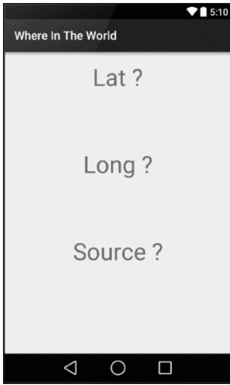
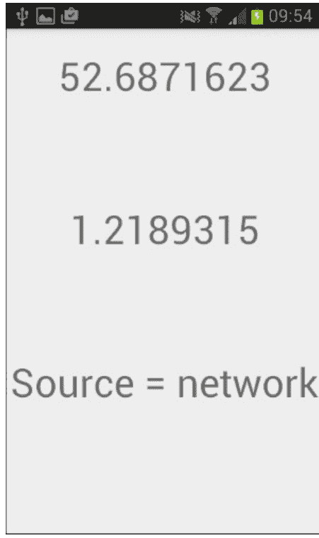
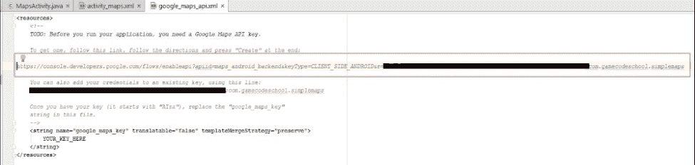
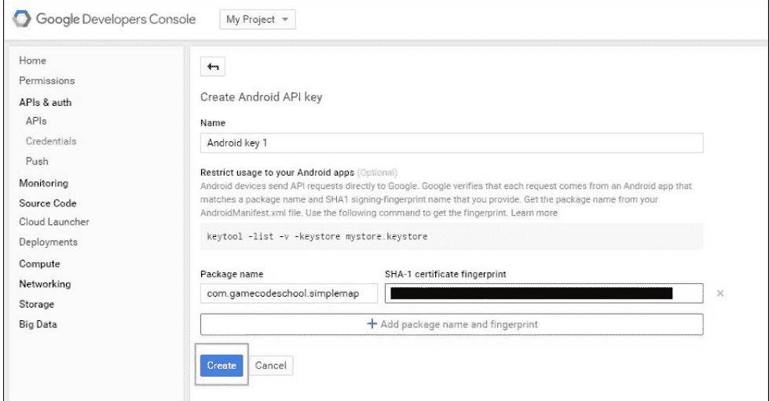
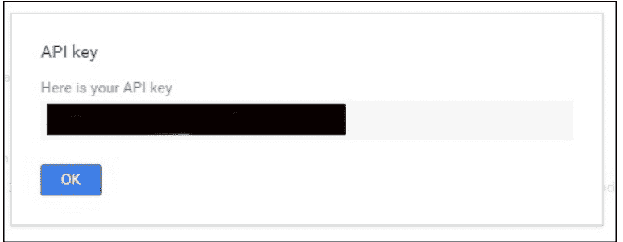
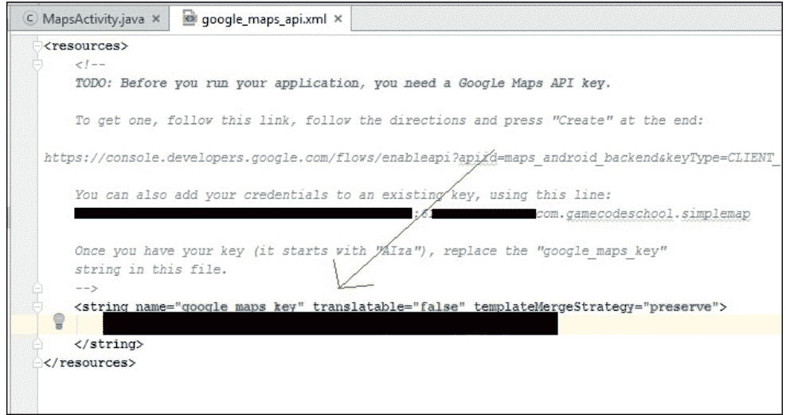
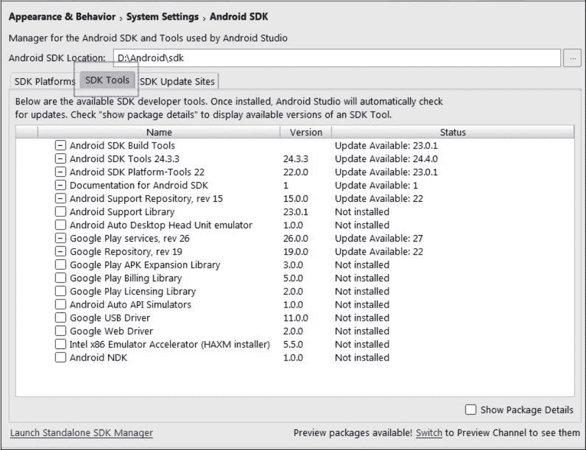
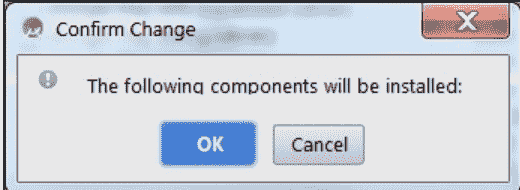
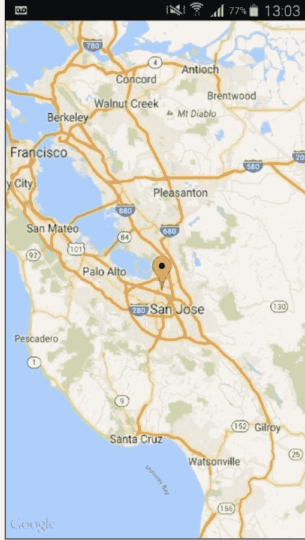

## 第 25 章. 集成 Google Maps 和 GPS 位置

在本章中，我们将走向全球，甚至简要涉足太空。我们将看到 Android API 如何与 GNSS（全球导航卫星系统）协同工作以提供位置数据。然后，我们可以使用这些数据在 Google Maps 上绘制位置。

在本章中，我们将：

- 了解 GPS 的基础知识
- 构建一个 GPS 小型应用程序
- 了解 Google Maps
- 连接到 Google Maps 服务器以获取地图数据

让我们先快速了解一下 GPS。

## 全球定位系统

GPS 是那些让你在坐下来思考其工作原理时总能让你感到惊叹的技术之一。当你还考虑到你可以放在口袋里的手机也能使用它时，这就更是令人难以置信的非凡。

### 提示

警告：如果你出生于 1990 年之后，可能无法理解上一段，并且可能认为 GPS 相当乏味。

该系统与太空中称为 GNSS 的 27 颗卫星协同工作。其中，24 颗卫星处于活动状态，三颗是备份。每颗卫星每 12 小时绕地球运行一圈，不断广播变化的位置数据。

通过对至少三颗这些卫星的数据进行计算，我们的设备可以为我们提供世界上的经度和纬度位置。稍微简化一下（好吧，是大幅简化），这些是相对于极点和赤道的度数。它们是非常精确的值，正如我们将看到的，因此可能精确到五米。

正如我们已知的第 1 章《第一个应用程序》，所有复杂性都由 Android API 隐藏了起来，现在我们可以构建一个超级简单的应用程序来查看 GPS 的运行情况。

## 世界在哪里 – GPS 小型应用程序

创建一个新项目并将其命名为 where in the world。

如第 11 章“控件狂想曲”中关于 Android 权限和 Marshmallow 的部分所讨论，为了处理 Marshmallow 运行时权限，我们需要将目标 API 设置为 22。

为此，从项目资源管理器顶部的下拉列表中选择 **Android**。现在，双击项目资源管理器窗口底部附近的 **build.gradle (module: app)** 选项。

确保也更改高亮显示的代码行，以便 targetSdkVersion 设置为 22，如下面的代码片段所示：

```
defaultConfig {
    applicationId "com.gamecodeschool.whereitssnap3"
    minSdkVersion 15
    **targetSdkVersion 22**
    versionCode 1
    versionName "1.0"
}
```

现在，我们可以将所需权限添加到 AndroidManifest.xml 文件中。

打开文件，如下面的代码中高亮所示添加三个权限：

```
<?xml version="1.0" encoding="utf-8"?>
<manifest
    xmlns:android="http://schemas.android.com/apk/res/android"
    package="com.gamecodeschool.whereintheworld" >
    <uses-permission
    android:name="android.permission.ACCESS_FINE_LOCATION" />
    <uses-permission
    android:name="android.permission.ACCESS_COARSE_LOCATION" />
    <uses-permission android:name="android.permission.INTERNET" />
    <application
    android:allowBackup="true"
    android:icon="@mipmap/ic_launcher"
    android:label="@string/app_name"


```
android:theme="@style/AppTheme" >
<activity
    android:name=".MainActivity"
    android:label="@string/app_name" >
    <intent-filter>
        <action android:name="android.intent.action.MAIN" >
        <category android:name="android.intent.category.LAUNCHER" >
        </intent-filter>
    </activity>
</application>
</manifest>
```

现在，我们可以着手开发这个应用了。

## 世界在哪里——实现简单布局

要创建布局，请将以下XML代码复制并粘贴到layout_main.xml中：

```
<LinearLayout
xmlns:android="http://schemas.android.com/apk/res/android"
android:layout_width="match_parent"
android:layout_height="match_parent"
android:orientation="vertical" >

<TextView
android:id="@+id/txtLat"
android:layout_width="wrap_content"
android:layout_height="wrap_content"
android:text="Lat ?"
android:textSize="40dip"
android:layout_gravity="center_horizontal"
android:layout_marginTop="20dp" />

<TextView
android:id="@+id/txtLong"
android:layout_width="wrap_content"
android:layout_height="wrap_content"
android:text="Long ?"
android:textSize="40dip"
android:layout_gravity="center_horizontal"
android:layout_marginTop="100dp" />

<TextView
android:id="@+id/txtSource"
android:layout_width="wrap_content"
android:layout_height="wrap_content"
android:text="Source ?"
android:textSize="40dip"
android:layout_gravity="center_horizontal"
android:layout_marginTop="100dp" />

</LinearLayout>
```

如你所见，该布局只是三个TextView小部件，它们的id属性从上到下分别设置为txtLat、txtLong和txtSource。结果如下一张截图所示：



现在，让我们向MainActivity.java添加一些Java代码。

## 编写世界在哪里小应用

我们需要的大部分功能由LocationListener接口及其方法提供。使MainActivity实现LocationListener，并为我们的UI、一个String和一个新类LocationManager添加成员变量，如以下代码所示：

```
public class MainActivity extends Activity implements LocationListener {

private TextView txtLat;
private TextView txtLong;
private TextView txtSource;
private LocationManager locationManager;
private String provider;

@Override
public void onCreate(Bundle savedInstanceState) {
super.onCreate(savedInstanceState);
setContentView(R.layout.activity_main);
}
...
```

现在，在onCreate中，我们可以执行以下任务：

- 获取UI中所有TextView小部件的引用
- 通过调用getSystemService并相应地转换结果来初始化LocationManager
- 声明并初始化一个Criteria实例
- 通过调用locationManager.getBestProvider方法来初始化我们的成员字符串（provider）
- 通过在我们的LocationManager对象上调用getLastKnownLocation来声明并初始化一个Location对象
- 最后，在检查位置引用不为null后，设置txtSource小部件的文本并调用onLocationChanged

将我们刚才讨论的代码添加到onCreate方法中，如下一段代码片段所示：

```
@Override
public void onCreate(Bundle savedInstanceState) {
super.onCreate(savedInstanceState);
setContentView(R.layout.activity_main);
txtLat = (TextView) findViewById(R.id.txtLat);
txtLong = (TextView) findViewById(R.id.txtLong);
txtSource = (TextView) findViewById(R.id.txtSource);

// Initialize locationManager
locationManager = (LocationManager)
getSystemService(Context.LOCATION_SERVICE);

Criteria criteria = new Criteria();
provider = locationManager.getBestProvider(criteria, false);
Location location =
locationManager.getLastKnownLocation(provider);

// Initialize the location
if (location != null) {
txtSource.setText("Source = " + provider);
onLocationChanged(location);
}
}
```

现在，我们通过在onResume中调用requestLocationUpdates并在onPause中调用removeUpdates来开始和停止监听GPS位置更新。

requestLocationUpdates方法接受四个参数。第一个是我们在provider变量中建立并保存的提供程序。第二个是更新之间的最小毫秒数，第三个是位置的最小变化（以米为单位）。因此，用户只需稍微移动一下，因为我们传入了1米，就会触发另一次更新。最后一个参数需要是LocationListener的引用。由于我们的MainActivity类实现了LocationListener，它确实是LocationListener，因此我们传入this。

现在，每当有GPS更新时，它们都将发送到MainActivity，我们将在片刻后实现所有必要的方法。

添加我们刚才讨论的两个重写方法：

```
// Start updates when app starts/resumes
@Override
protected void onResume() {
super.onResume();
locationManager.requestLocationUpdates(provider, 500, 1, this);
}
// pause the location manager when app is paused/stopped
@Override
protected void onPause() {
    super.onPause();
    locationManager.removeUpdates(this);
}
```

现在，我们只需要添加LocationListener接口所需的方法。

在onLocationChanged中，我们通过调用getLatitude和getLongitude来获取纬度和经度。请注意，我们将结果存储在double类型的变量中，这正是我们需要的非常精确的小数部分。然后，我们更新TextView小部件。

在onStatusChanged、onProviderEnabled和onProviderDisabled中，我们更新显示我们提供程序的TextView小部件。

添加我们刚才讨论的LocationListener方法：

```
@Override
public void onLocationChanged(Location location) {
    double lat = location.getLatitude();
    double lng = location.getLongitude();
    txtLat.setText(String.valueOf(lat));
    txtLong.setText(String.valueOf(lng));
    txtSource.setText("Source = " + provider);
}

@Override
public void onStatusChanged(String provider, int status, Bundle extras) {
    txtSource.setText("Source = " + provider);
}

@Override
public void onProviderEnabled(String provider) {
    txtSource.setText("Source = " + provider);
}

@Override
public void onProviderDisabled(String provider) {
    txtSource.setText("Source = " + provider);
}
```

我们现在准备好测试该应用了。

## 运行世界在哪里小应用

如果启用了GPS且有连接，您将看到您所在位置的精确详细信息；否则，位置源可能是您的无线网络或移动网络。前者在您移动太远时会断开连接，后者可能相差很远。当GPS关闭时，我的位置相差约60英里。



如果您有连接并走动一下，您将看到纬度和经度的值发生变化。

当然，在现实生活中，当你试图找到方向时，一堆数字并不特别有帮助。如果我们能在地图上标记我们的GPS位置，那就更好了。

## Google Maps小应用

创建一个新项目并将其命名为`simple Map`。由于我们将使用一个相当新的API，在**目标Android设备**屏幕上，在**最低SDK**字段中选择**API 19 Android 4.4(KitKat)**。另外，在**向移动设备添加Activity**屏幕上，选择**Google Maps Activity**选项。我们会看到，这不仅能为我们节省一些工作，还能提供一些有用的信息，帮助我们以较低的复杂度让应用运行起来。

## **注意**

当然，您还需要一部运行Android 4.4或更高版本的设备来运行这个小应用。此外，此应用无法在模拟器上运行。

使用Google Maps有几种方法。我们可以使用Intent来打开Google Maps应用，这有点像我们使用相机应用时所做的那样；或者，我们可以直接连接到Google Maps服务器，这使我们能够开发功能更丰富的应用。

我们将使用刚才讨论的第二种方法，通过直接连接到Google Maps服务器来为我们的应用获取地图数据。在下一章中，当我们增强Where it's snap应用时，我们将使用通过Intent和Google Maps应用的更简单但灵活性较低的方法。

那么，我们如何连接到Google Maps服务器呢？这肯定很复杂。幸运的是并非如此；正如我们所料，有几个类可以为我们处理所有复杂的工作。不过，在我们开始编码之前，还需要做一些准备工作。


## 准备连接到 Google Maps

入门主要有两个阶段。首先，我们将了解如何获取应用用于与服务器通信的 API 密钥，其次，我们需要构建该应用。

首先，让我们获取一个 API 密钥。

## 获取 API 密钥

要获取 API 密钥，你首先需要一个 Google 账号。如果你使用 Gmail 或 Google+，那么你已经拥有一个。如果没有，可以免费在 https://accounts.google.com 上获取一个。

在项目资源管理器的 values 文件夹中，找到 Android Studio 为你创建的 google_maps_api.xml 文件。它可能已经在编辑器中打开了。

在这个文件中，有一个指向 Google Developers Console 网站的链接，我们将在那里获取 API 密钥。Android Studio 非常有帮助，因为它生成了这个链接。不仅如此，在该链接中，所有关于我们应用的详细信息（这些信息我们原本需要查找，且获取密钥所必需）都已编码。链接在文件中的位置在以下屏幕截图中被突出显示。我模糊了一些细节，因为它们特定于我的账号。你的会在完全相同的位置，但具有不同的具体值：



将上一张屏幕截图中标识的 google_maps_api.xml 文件中的链接复制，并粘贴到你的网络浏览器中。随后你将看到下一个屏幕。同意服务条款，然后点击 **同意并继续**：

## 在 Google Developers Console 中为 Google Maps Android API 注册你的应用

Google Developers Console 允许你管理应用并监控 API 使用情况。

### 选择将注册你的应用的项目

你可以使用一个项目来管理所有应用，也可以为每个应用创建不同的项目。

我同意，我对任何 [服务和相关 API]() 的使用都应遵守适用的 [服务条款]()。

同意并继续

你将看到下一个屏幕。点击 **前往凭据**：

## API 已启用

项目已创建，Google Maps Android API 已启用。

接下来，要使用 API，你需要正确的凭据。

前往凭据

现在，点击下一张屏幕截图中所示的 **创建** 按钮：



新的 API 密钥将在弹出窗口中显示，如本屏幕截图所示：



将 API 密钥复制到 `google_maps_api.xml` 文件的 `<string>` 元素中，如下一张屏幕截图所示：



你始终可以通过登录开发者控制台，并从左侧主菜单导航到 **API 和身份验证 | 凭据**，来重新获取密钥。

既然我们有了 API 密钥，只需检查是否已安装最新的 API 并准备好供我们的代码使用即可。

## 安装 Google Play 服务 API

从 Android Studio 菜单导航到 **工具 | Android | SDK 管理器**。点击下一张屏幕截图中所示的 **SDK 工具** 选项卡：



找到以 **Google Play 服务** 开头的行。如果该行旁边的复选框为空，则需要安装。如果它有一个短横线，则需要更新。如果它有一个勾标记，则可以跳过标题为 *编码 maps_activity 布局* 的部分。

如果你有一个空复选框或短横线，请点击复选框，直到其中出现绿色勾标记，如本图所示：

```
[x] Google Play services, rev 26       26.0.0       Update Available: 27
```

现在，点击 **确定**。接下来，你将在 **确认更改** 弹出窗口中看到确认提示：



点击 OK，等待下载和安装完成。

## 编码 maps_activity 布局

编辑 maps_activity.xml 布局文件，使其与以下代码片段完全相同：

```
<fragment
xmlns:android="http://schemas.android.com/apk/res/android"
    xmlns:tools="http://schemas.android.com/tools"
    android:layout_width="match_parent"
    android:layout_height="match_parent"
    android:id="@+id/map"
    tools:context=".MapsActivity"
    android:name="com.google.android.gms.maps.SupportMapFragment" />
```

上述代码片段实际上是一个具有 map id 属性的 Fragment。

## 编码 MapsActivity

由于我们需要确保已导入完全正确的类，请将导入语句修改为与以下代码相同，并创建一个新的 SupportMapFragment，如下一张代码片段所示。另外，请注意代码已实现 OnMapReadyCallback：

```
import android.os.Bundle;
import android.support.v4.app.FragmentActivity;
import com.google.android.gms.maps.CameraUpdateFactory;
import com.google.android.gms.maps.GoogleMap;
import com.google.android.gms.maps.OnMapReadyCallback;
import com.google.android.gms.maps.SupportMapFragment;
import com.google.android.gms.maps.model.LatLng;
import com.google.android.gms.maps.model.MarkerOptions;

public class MapsActivity extends FragmentActivity implements
OnMapReadyCallback {
@Override
protected void onCreate(Bundle savedInstanceState) {
super.onCreate(savedInstanceState);
setContentView(R.layout.activity_maps);
SupportMapFragment mapFragment = (SupportMapFragment)
getSupportFragmentManager()
.findFragmentById(R.id.map);
mapFragment.getMapAsync(this);
}
}
```

现在，在 onMapReady 方法中，我们将在加利福尼亚州硅谷放置一个定位标记。

为此，我们使用一个同时存储纬度和经度的 LatLng 对象，并将硅谷的坐标传递给 LatLng 构造函数。

接下来，我们调用 addMarker 方法在该位置添加一个标记，然后调用 moveCamera 方法更改视图，使标记位于屏幕中央：

```
@Override
public void onMapReady(GoogleMap map) {
// Add a marker in Silicon Valley
// 37.3876° N, 123.0575° W
LatLng siliconValley = new LatLng(37.3876, 123.0575);
map.addMarker(new
MarkerOptions().position(siliconValley).title("Silicon Valley"));
map.moveCamera(CameraUpdateFactory.newLatLng(siliconValley));
}
```

该应用现在将连接到 Google 服务器并获取所需的地图数据。

## 运行 Simple Map 应用

请记住，在运行 Android 4.4 或更高版本的真实设备上运行该应用。此外，设备上的 Google 应用需要保持最新，此应用才能运行。以下是来自 Samsung Galaxy S4 手机的屏幕截图：



## 摘要

确实，Maps API 提供的功能远比我们在此探讨的要多得多。同样，一旦你连接到 Google 服务器并拥有 `SupportMapFragment` 及其地图对象，就可以快速做更多事情。

请查看 Google 开发者网站上的 Google Maps 页面 https://developers.google.com/maps/documentation/android-api/，并了解如何添加更多自定义功能。

在下一章中，我们将进行更多位置和地图编码，同时学习如何在应用发布后，为我们的 SQLite 数据库升级/添加功能。
