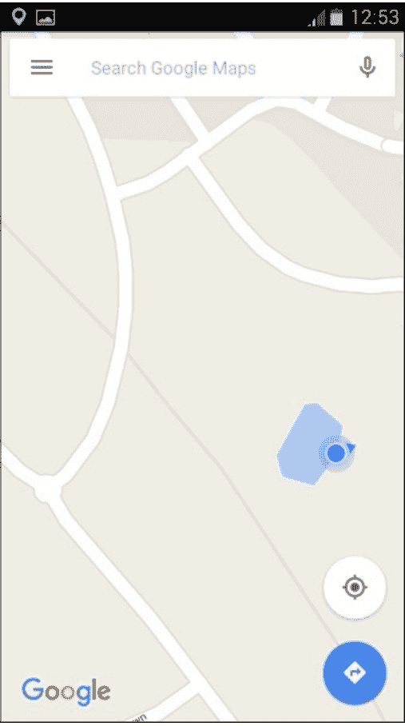

## 第 26 章。升级 SQLite – 添加位置和地图

既然我们知道 GPS 和 Google Maps 如何协同工作，我们将探讨使用它们的另一种方法。为此，我们需要在整个应用中进行一些小修改，但我们将了解如何实现这一点，同时仍允许现有用户保留他们的数据。

在本章中，我们将：

- 更新我们的数据库代码，这将导致我们的应用用户获得更新后的数据库
- 向 Photo 类添加代码，以处理照片拍摄位置的地理信息
- 升级 captureFragment 和 ViewFragment 中的代码，以实现我们目标的功能

## 向 Where it's Snap 添加位置和地图

我们希望在应用中添加一个功能：用户查看照片时，可以点击 SHOW MAP 按钮，然后应用会显示一张地图，标示照片在世界各地拍摄的位置。

我们在上一章中查看 Google Maps 上的特定 GPS 位置时，已经对此有了很好的了解。

我们需要添加的功能以及需要克服的问题如下：

- 每次拍照时捕获并存储位置
- 点击 SHOW MAP 按钮时，启动该位置的地图屏幕
- 更改 Photo 类和数据库结构以存储 GPS 位置
- 修改 DataManager 和帮助方法以存储和检索额外数据
- 将 Google Maps 功能添加到 SHOW MAP 按钮

起初，在仅开发应用的背景下，这可能看起来很简单。现在，想象一下，我们的应用已经发布。我们有百万用户，他们的数据库中已经存储了大量照片。如果我们仅使用新帮助方法和存储 GPS 位置的新数据库结构更新应用，那么所有用户现有的数据都将丢失。

幸运的是，SQLite 及其支持的 Android API 正是为此问题而设计的。我们现在将逐步更新 Where it's Snap 数据库、Photo 类和帮助方法，同时添加地图功能。

### 提示

如果你要为未发布的应用添加功能，可以简单地更新数据库结构、Photo 类等等。我们凭空设置这个问题，仅仅是为了了解这种真实世界中的情况。


## 更新数据库

我们需要更新数据库，而不是删除现有数据库并创建新数据库。

我们需要处理两种场景：

- 我们应用的现有用户需要对其现有数据库进行更新（而非替换），以便保留所有当前数据
- 第一次安装我们应用的新用户需要新数据库

为了应对第一种情况，我们需要的 SQL 关键字是 ALTER。此外，我们需要将代码和 SQL 放入 DataManager 类中 CustomSQLiteOpenHelper 类的 onUpgrade 方法中。

如何在已安装应用的设备上触发升级？我们所要做的就是递增数据库版本。在我们的情况中，该版本存储在 DB_VERSION int 中。每次实例化 CustomSQLiteOpenHelper 类时，它都会将 DB_VERSION int 中保存的版本与设备上当前数据库的实际版本进行检查。进行此检查的时点是当我们从构造函数中调用超类构造函数时，这在下一个代码片段中突出显示：

```
public CustomSQLiteOpenHelper(Context context) {
    super(context, DB_NAME, null, DB_VERSION);
}
```

此代码已是我们应用的一部分。要开始，我们所要做的就是递增版本。

既然知道了需要做什么，我们可以继续更新数据库结构（针对新用户和现有用户）、递增数据库版本，并在 onUpgrade 中添加代码（针对现有用户）。

### 添加表示位置数据的成员变量

首先，向我们的 DataManager 类添加两个额外的 public static final String 变量，以表示我们的新字段，如下一个代码所示：

```
public static final String TABLE_ROW_ID = "id";
public static final String TABLE_ROW_TITLE = "image_title";
public static final String TABLE_ROW_URI = "image_uri";

// New with version 2
public static final String TABLE_ROW_LOCATION_LAT = "gps_location_lat";
public static final String TABLE_ROW_LOCATION_LONG = "gps_location_long";

/*
Next we have a private static final strings for
each row/table that we need to refer to just
inside this class
*/
```

## 更新数据库版本

下一步将导致当前数据库为版本 1 的任何用户调用 onUpgrade 方法。在 DataManager 类中编辑 DB_VERSION 的值，如下面的代码所示：

```
private static final String DB_NAME = "wis_db";
private static final int DB_VERSION = 2;
private static final String TABLE_PHOTOS = "wis_table_photos";
private static final String TABLE_TAGS = "wis_table_tags";
private static final String TABLE_ROW_TAG1 = "tag1";
private static final String TABLE_ROW_TAG2 = "tag2";
private static final String TABLE_ROW_TAG3 = "tag3";
...
```

## 为现有用户添加 onUpgrade 中的代码以升级数据库

现在，我们可以在 onUpgrade 方法中添加代码来执行修改后的 SQL。在 onUpgrade 方法中，我们添加代码，在两个单独的查询中使用 ALTER，使用我们的两个新字符串，并将列添加到结构中。请记住，此代码仅在用户设备上的数据库版本号低于 DB_VERSION 中保存的版本号时才运行。在上一步中，我们递增了 DB_VERSION，因此此下一个方法将对所有现有用户运行一次。

将我们刚才讨论的代码添加到 onUpgrade 方法中：

```
// This method only runs when we increment DB_VERSION
@Override
public void onUpgrade(SQLiteDatabase db, int oldVersion, int newVersion) {

    // Update for version 2
    String addLongColumn = "ALTER TABLE " +
    TABLE_PHOTOS +
    " ADD " +
    TABLE_ROW_LOCATION_LONG +
    " real;";

db.execSQL(addLongColumn);

String addLatColumn = "ALTER TABLE " +
    TABLE_PHOTOS + " ADD " +
    TABLE_ROW_LOCATION_LAT +
    " real;";
db.execSQL(addLatColumn);

}
```

## 为新用户更新 onCreate 中的数据库创建代码

当然，有些用户对我们的应用完全陌生，可能在数据库为版本 1 时从未使用过它。当他们第一次安装我们的应用时，onUpgrade 不会运行，因此我们需要修改创建数据库的代码，以在其中添加额外字段。

我们只需在 SQLiteOpenHelper 类的重写 onCreate 方法中修改 create table 语句，并添加两个新的 real 列。

将我们刚才讨论的 onCreate 中的代码修改为与下一个代码相同：

```
// This method only runs the first time the database is created
@Override
public void onCreate(SQLiteDatabase db) {

    // Create a table for photos and all their details
    String newTableQueryString = "create table "
    + TABLE_PHOTOS + " ("
    + TABLE_ROW_ID
    + " integer primary key autoincrement not null,"
    + TABLE_ROW_TITLE
    + " text not null,"
    + TABLE_ROW_URI
    + " text not null,"
    + TABLE_ROW_LOCATION_LAT
    + " real,"
    + TABLE_ROW_LOCATION_LONG
    + " real,"
    + TABLE_ROW_TAG1
    + " text not null,"
    + TABLE_ROW_TAG2
    + " text not null,"
    + TABLE_ROW_TAG3
    + " text not null" + ");";

    db.execSQL(newTableQueryString);

    // Create a separate table for tags
    newTableQueryString = "create table "
    + TABLE_TAGS + " ("
    + TABLE_ROW_ID
    + " integer primary key autoincrement not null,"
    + TABLE_ROW_TAG
    + " text not null" + ");";

    db.execSQL(newTableQueryString);
}
```

## 更新 addPhoto 方法以处理 GPS 坐标

现在，我们需要对存储照片的辅助方法进行以下小更改，以确保它处理两个额外列。

按以下代码修改 addPhoto 辅助方法：

```
// Here are all our helper methods
public void addPhoto(Photo photo){

// Add all the details to the photos table
String query = "INSERT INTO " + TABLE_PHOTOS + " (" +
TABLE_ROW_TITLE + ", " +
TABLE_ROW_URI + ", " +
TABLE_ROW_LOCATION_LAT + ", " +
TABLE_ROW_LOCATION_LONG + ", " +
TABLE_ROW_TAG1 + ", " +
TABLE_ROW_TAG2 + ", " +
TABLE_ROW_TAG3 +
")" +
"VALUES (" +
"\"" + photo.getTitle() + "\"" + ", " +
"\"" + photo.getStorageLocation() + "\"" + ", " +
photo.getGpsLocation().getLatitude() + ", " +
photo.getGpsLocation().getLongitude() + ", " +
"\"" + photo.getTag1() + "\"" + ", " +
"\"" + photo.getTag2() + "\"" + ", " +
"\"" + photo.getTag3() + "\"" +
");";

Log.i("addPhoto()", query);

db.execSQL(query);

// Add any NEW tags to the tags table
...
...
```

这就是 DataManager 类所需的所有更改。

## 更新 Photo 类

我们需要向 Photo 类添加一个新成员以及 getter 和 setter 方法。新成员是 Location 类型，用于存储纬度和经度。添加下一个代码中突出显示的部分：

```
private String mTitle;
private Uri mStorageLocation;
private Location mGpsLocation;
private String mTag1;
private String mTag2;
private String mTag3;

public Location getGpsLocation() {
    return mGpsLocation;
}

public void setGpsLocation(Location mGpsLocation) {
    this.mGpsLocation = mGpsLocation;
}

public String getTitle() {
    return mTitle;
}
...
...
```

更新后的 Photo 类已准备就绪。

## 更新 CaptureFragment

这将是小菜一碟，因为我们在上一章中已经见过大部分需要的代码。

使 CaptureFragment 实现 LocationListener 并添加突出显示的成员变量：

```
public class CaptureFragment extends Fragment implements LocationListener {

    private static final int CAMERA_REQUEST = 123;
    private ImageView mImageView;

    // The filepath for the photo
    String mCurrentPhotoPath;

    // Where the captured image is stored
    private Uri mImageUri = Uri.EMPTY;

    // A reference to our database
    private DataManager mDataManager;

    // For the Location
    private Location mLocation = new Location("");
    private LocationManager mLocationManager;
    private String mProvider;
}
```

在 onCreate 方法中，让我们以常规方式获取位置。添加突出显示的代码来查找它：

```
@Override
public void onCreate(Bundle savedInstanceState) {
    super.onCreate(savedInstanceState);

    mDataManager = new DataManager(getActivity().getApplicationContext());

    // Initialize mLocationManager
    mLocationManager = (LocationManager) getActivity().getSystemService(Context.LOCATION_SERVICE);
    Criteria criteria = new Criteria();
    mProvider = mLocationManager.getBestProvider(criteria, false);
}
```


// Listen for clicks on the save button
btnSave.setOnClickListener(new View.OnClickListener() {

    @Override
    public void onClick(View v) {
        if(mImageUri != null){
            if(!mImageUri.equals(Uri.EMPTY)) {

                // We have a photo to save

                Photo photo = new Photo();
                photo.setTitle(mEditTextTitle.getText().toString());
                photo.setStorageLocation(mImageUri);

                // Set the current GPS location
                photo.setGpsLocation(mLocation);

                // What is in the tags
                String tag1 = mEditTextTag1.getText().toString();
                String tag2 = mEditTextTag2.getText().toString();
                String tag3 = mEditTextTag3.getText().toString();

                // Assign the strings to the Photo object
                photo.setTag1(tag1);
                photo.setTag2(tag2);
                photo.setTag3(tag3);

                // Send the new object to our DataManager
                mDataManager.addPhoto(photo);
                Toast.makeText(getActivity(), "Saved", Toast.LENGTH_LONG).show();
            }else {
                // No image
                Toast.makeText(getActivity(), "No image to save", Toast.LENGTH_LONG).show();
            }
        }else {
            // No image
            Toast.makeText(getActivity(), "No image to save", Toast.LENGTH_LONG).show();
        }
    }
});

当然，我们必须重写 LocationListener 接口所需的必要方法。虽然接下来的这三个方法我们不会全部使用，但接口要求必须重写它们。将以下方法添加到 CaptureFragment 类中：

```java
@Override
public void onLocationChanged(Location location) {
    // Update the location if it changed
    mLocation = location;
}
```

```java
@Override
public void onStatusChanged(String provider, int status, Bundle extras) {

}
```

```java
@Override
public void onProviderEnabled(String provider) {

}
```

```java
@Override
public void onProviderDisabled(String provider) {

}
```

正如我们在 Where in the World 小型应用中所做的那样，必须在 onResume 和 onPause 方法中启动和停止位置更新。如果不调用 requestLocationUpdates，我们将永远无法获得任何更新；如果不调用 removeUpdates，即使我们的 Activity 已结束，设备仍会继续通信和接收更新：

```java
// Start updates when app starts/resumes
@Override
public void onResume() {
    super.onResume();

    mLocationManager.requestLocationUpdates(mProvider, 500, 1, this);
}
```

// 在应用暂停/停止时暂停位置管理器

```java
@Override
public void onPause() {
    super.onPause();

    mLocationManager.removeUpdates(this);
}
```

CaptureFragment 类现在已准备就绪。

## 更新 ViewFragment

现在，让我们继续了解 ViewFragment。我们将使用 Intent 类来启动内置的 Google Maps 应用，并添加一个图钉来标记拍摄照片的位置。

GPS 位置已存在于 Photo 对象中，我们只需执行以下操作：

- 在 Double 变量中捕获纬度和经度
- 从这些值构建一个字符串，该字符串表示创建 Intent 对象所需的 URI
- 创建 Intent 类
- 启动 Google Maps Activity 并传入 Intent 类

当然，所有这些都在处理 SHOW MAP 按钮点击事件的类中进行。

添加我们刚才讨论的高亮代码，以处理用户点击 SHOW MAP 按钮时的操作：

```java
public View onCreateView(LayoutInflater inflater, ViewGroup container, Bundle savedInstanceState) {
    View view = inflater.inflate(R.layout.fragment_view, container, false);
    TextView textView = (TextView) view.findViewById(R.id.textView);
    Button buttonShowLocation = (Button) view.findViewById(R.id.buttonShowLocation);

    textView.setText(mCursor.getString(mCursor.getColumnIndex(DataManager.TABLE_ROW_TITLE)));

    mImageView = (ImageView) view.findViewById(R.id.imageView);

    mImageView.setImageURI(Uri.parse(mCursor.getString(mCursor.getColumnIndex(DataManager.TABLE_ROW_URI))));

    buttonShowLocation.setOnClickListener(new View.OnClickListener() {
        @Override
        public void onClick(View v) {
            double latitude = Double.valueOf(mCursor.getString(mCursor.getColumnIndex(DataManager.TABLE_ROW_LOCATION_LAT)));
            double longitude = Double.valueOf(mCursor.getString(mCursor.getColumnIndex(DataManager.TABLE_ROW_LOCATION_LONG)));
            // Create a URI from the latitude and longitude
            String uri = String.format(Locale.ENGLISH, "geo:%f,%f", latitude, longitude);
            // Create a Google maps intent
            Intent intent = new Intent(Intent.ACTION_VIEW, Uri.parse(uri));
            // Start the maps activity
            getActivity().startActivity(intent);
        }
    });
    return view;
}
```

## 添加位置权限

在尝试我们的近乎完整的 Where it's Snap 应用之前，最后要做的事情是添加允许我们使用设备获取 GPS 坐标的权限。

### 提示

由于我们在第 21 章“侧边栏导航和 Where It's Snap”中配置项目的方式，这些权限在 Android 6（Marshmallow）上将正常工作。如果您想了解 Marshmallow 中新 Android 权限的提醒，请参阅第 11 章“小部件狂热”，这是本书中第一次使用权限的章节。

将高亮权限添加到 AndroidManifest.xml 文件中：

```xml
<?xml version="1.0" encoding="utf-8"?>
<manifest xmlns:android="http://schemas.android.com/apk/res/android" package="com.gamecodeschool.whereitsapp" >

<uses-permission android:name="android.permission.ACCESS_FINE_LOCATION" />
<uses-permission android:name="android.permission.ACCESS_COARSE_LOCATION" />
<uses-permission android:name="android.permission.INTERNET" />

<application android:allowBackup="true" android:icon="@mipmap/ic_launcher" android:label="@string/app_name" android:theme="@style/AppTheme" >
<activity android:name=".MainActivity" android:label="@string/app_name" >
<intent-filter>
<action android:name="android.intent.action.MAIN" >

<category android:name="android.intent.category.LAUNCHER" >
</intent-filter>
</activity>
</application>

</manifest>
```

现在我们可以运行我们的应用了。

## 测试新的地图功能

运行 Where it's Snap 应用，点击 **拍摄** 按钮，并拍摄一张照片。然后，保存照片。现在，通过标题或标签和标题导航回该照片。点击 SHOW MAP 按钮：



## 摘要

Where it's Snap 应用几乎完成了。在本章中，我们添加了位置和地图功能。我们使用 Intent 类打开了 Google Maps 应用。这使我们的代码更加简单，而且我们也不需要直接连接到 Google 服务器。这种方法的另一个优势是，我们不需要将最低操作系统版本设置为 4.4 版，因此我们的应用适用于更广泛的 Android 设备。

本应用的最后阶段将是使其对不说英语的用户可访问。在下一章中，我们将构建一个简单的应用来尝试添加多种语言，然后利用所学知识将 Where it's Snap 制作成西班牙语版本。
