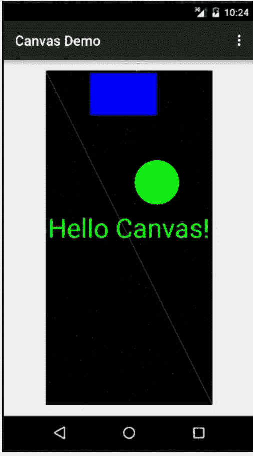
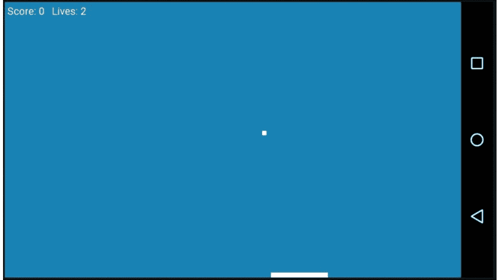

## 第 28 章。线程、触摸、绘图和一个简单的游戏

在本书迄今为止，我们一直专注于使用 Android API 提供的各种 UI 小部件。在传统应用中，这几乎总是做事的最佳方式。

例如，为什么我们要重新发明一个由专家设计和改进的小部件？

然而，许多 Android 应用并非基于这种传统外观。想想众多儿童或艺术家的绘图应用。那么 Google Play 上最畅销的类别呢：游戏？

在本章中，我们将探讨并尝试构建此类应用所需的技能和 Android 类。本章的主题包括：

- **线程：** 如何同时运行多个代码块
- **绘图：** 我们如何使用 canvas 和 Paint 类处理像素、线条、形状和自定义文本，包括一个小应用
- **屏幕触摸：** 检测并响应不在 UI 小部件上的屏幕触摸
- **Pong：** 结合前三者制作一款复古街机游戏

首先是线程。

### 线程

那么，什么是线程？你可以像思考故事中的线程一样思考 Java 编程中的线程。在故事的一个线程中，主角可能正在前线与敌人作战，而在另一个线程中，士兵的家人正在日复一日地度日。当然，故事不一定只有两个线程。我们可以引入第三个线程；也许故事还讲述了政客和军事指挥官做出决策。这些决定随后会微妙地，或不那么微妙地，影响其他线程中发生的事情。

编程线程也是如此。我们在程序中创建部分/线程来为我们控制不同的方面。当我们需要确保任务不会干扰应用的主（UI）线程，或者有长时间运行的后台任务且不得中断主执行线程时，线程特别有用。我们引入线程来表示这些不同方面，原因如下：

- 从组织角度来看，它们很合理
- 它们是构建可运行程序的经过验证的方法
- 我们正在使用的系统的性质迫使我们不时使用它们

在 Android 中，我们同时出于这三个原因使用线程。这很合理，它有效，而且由于系统的设计，我们必须使用线程。

我们经常在不知情的情况下使用线程。这是因为我们使用代表我们使用线程的类。例如，SoundPool 在线程中加载声音，BaseAdapter 在线程中对数据进行排序并加载 ListView。线程在游戏中也非常有用，正如我们将看到的。

在游戏中，想想一个接收玩家左右移动按钮点击的线程和另一个将所有图形绘制到屏幕上的线程。

### 线程的问题

多线程程序可能会出现问题，就像故事中的线程一样，如果没有发生适当的同步，事情就会出错。如果我们的士兵在战斗或战争甚至还没有存在之前就进入了战斗呢？很奇怪。

如果我们有一个变量 int x，它表示程序中三个线程使用的关键数据呢。如果一个线程稍微超前，使数据对另外两个线程来说“错误”，会发生什么？这个问题是多个线程毫无察觉地竞相完成导致的正确性问题——毕竟，它们只是愚蠢的代码。

正确性问题可以通过密切监督线程和加锁来解决，加锁意味着暂时阻止一个线程的执行，以确保事情以同步方式工作。这有点像阻止士兵登上开往战争的船，直到船实际上靠岸并放下登船舷梯，避免一个尴尬的扑通声。

多线程程序的另一个问题是死锁问题，其中一个或多个线程被锁定等待访问 int x 的时机，但那个时机永远不会到来，最终整个程序停止运行。

你可能已经注意到，解决第一个问题（正确性）的方法正是导致第二个问题（死锁）的原因。现在，考虑我们刚刚讨论的一切，并将其与 Android Activity 生命周期结合起来，你可能会开始觉得复杂性有点令人恶心。

幸运的是，这个问题已经为我们解决了。就像我们使用 Activity 类并重写其方法来与生命周期交互一样，我们也可以使用其他类来创建和管理线程。就像 Activity 一样，我们只需要知道如何使用它们，不需要知道它们如何工作。

“那么，为什么在我不需要知道时要告诉我所有这些关于线程的事情？”你理直气壮地问道。仅仅因为如果我们可以：我们将编写看起来不同且以陌生方式构建的代码

- 接受我们引入的新概念是我们需要处理的，以便使用 Android 特定的线程相关问题解决方案
- 理解线程的一般概念，这与故事线程几乎同时发生是同一回事
- 学习使用线程的几条规则

那么，我们编写 Java 代码来创建并在线程中工作将毫不费力。有几个不同的 Android 类处理线程。不同的线程类在不同情况下效果最好。

### 提示

Android API 中有许多不同的线程相关类，本书只涵盖其中一个。如果你想了解更多关于线程的知识，我推荐 Steve Liles 的书 *异步 Android*，你可以通过此链接了解更多：https://www.packtpub.com/application-development/asynchronous-android。

我们只需要记住，我们将编写程序的一部分，这些部分将*几乎*同时运行。

### 提示

我所说的“几乎”是什么意思？实际上发生的情况是 CPU 在线程之间轮流切换。然而，这发生得太快，以至于我们只能感知到同时性，而无法感知其他任何东西。

让我们看看我们的线程代码长什么样：

我们可以这样声明一个 Thread 类型的对象：

```
Thread gameThread;
```

这样初始化并启动它：

```
gameThread = new Thread(this);
gameThread.start();
```

然后，我们可以使用 Java @Override 关键字来更改当操作系统允许我们的 gameThread 对象运行其代码时发生的事情。在重写的 run 方法中，我们将调用在 Pong 游戏中编写的两个方法。第一个是 update，所有我们的计算、人工智能和碰撞检测都将放在那里，然后是 draw，也许不出所料，我们将在那里绘制所有图形：

```
@Override
public void run() {
    // Update the game world based on
    // user input, physics,
    // collision detection and artificial intelligence
    update();

    // Draw all the game objects in their updated locations
    draw();
}
```

必要时，我们也可以这样停止线程：

```
gameThread.join();
```

现在，run 方法中的所有内容都在单独的线程中执行，将默认或 UI 线程留给监听触摸和系统事件。我们将在 Pong 项目中看到这两个线程如何相互通信。

请注意，这些代码部分在我们的游戏中的确切位置尚未解释，但在真实项目中向你展示要容易得多。

当我们构建复古游戏时，我们将看到让两组代码表面上同时运行是多么简单。

那么，我们如何绘制事物呢？


## 使用 Canvas 和 Paint 进行绘画

到目前为止，我们一直在使用 Android Studio UI 设计器来实现用户交互界面的所有方面。

如果我们想要流畅移动的自定义图形，那么需要远离预定义的 UI 小部件。

我们需要开始使用单个像素和线条来观察和设计。幸运的是，如你所料，Android 提供了一些类来让这变得轻而易举。我们将学习如何开始使用 Canvas 和 Paint 类。

为实现这一目标，我们将学习用于绘制像素和线条的坐标系统。然后，我们将查看 Paint 和 Canvas 类本身。

### Android 坐标系统

像素是我们使用 Paint 和 Canvas 类可以操作的最小图形元素。本质上，它是一个点。如果你的设备分辨率如 Nexus 5 模拟器那样为 1920 x 1080，那么设备最长边上有 1920 个像素，另一边有 1080 个像素。

因此，我们可以将要绘图的屏幕视为一个网格。我们将通过在这网格上使用坐标来绘制点（像素）、线条、形状和文本。

坐标系统从屏幕的左上角开始。

例如，请查看以下代码行：

```
drawPoint(0, 0); // Not actual code
```

使用此代码，我们会在屏幕左上角绘制一个像素。现在，请查看以下代码：

```
drawPoint(1919, 1079); // Not actual code
```

如果这样使用，我们会在屏幕右下角绘制一个点（在高端设备横向模式下）。

我们也可以通过指定起始和结束坐标位置来绘制线条，大致如下：

```
drawLine(0,0,1919, 1079); // Not actual code
```

这将从屏幕左上角绘制一条线到右下角。

现在，你可能已经注意到一些潜在问题。首先，并非所有 Android 设备都有如此高的分辨率；实际上，大多数设备的分辨率要低得多。即使在分辨率很高的设备上，横向或竖向持有时也会有完全不同的坐标。我们将如何编写无论屏幕分辨率如何都能自适应的代码？我们很快就会看到解决方案。首先，我们将进行一些基本绘图并忽略此问题。

名副其实的 Canvas 类提供了你所期望的一切：一个用于绘制图形的虚拟画布。

我们可以使用任何 Android UI 元素上的 Canvas 类来创建虚拟画布。在我们的演示应用中，我们将在 ImageView 上绘图，而在制作游戏时，我们将直接在一种特殊视图上绘图，这将带来一些额外优势，正如我们将看到的那样。

因此，要开始，我们需要一个用于绘图的小部件。假设布局中有 ImageView，我们可以执行以下操作来获取其引用：

```
ImageView ourView = (ImageView) findViewById(R.id.imageView);
```

现在，我们需要一个位图。位图本身具有类似于屏幕的坐标系统。我们正在创建一个位图来将其变成我们的绘图画布：

```
Bitmap ourBitmap = Bitmap.createBitmap(300, 600,
Bitmap.Config.ARGB_8888);
```

上一行代码声明并创建了 Bitmap 类型的对象。它的大小为 300 x 600 像素。我们将在稍后在其上绘图时牢记这一点。

### 提示

createBitmap 方法的最后一个参数 Bitmap.Config.ARGB_8888 只是一种格式。如果你想了解更多关于位图格式的信息，可以访问此处：https://en.wikipedia.org/wiki/BMP_file_format。

现在，我们可以通过创建一个 Canvas 对象来为 Bitmap 准备绘图：

```
Canvas ourCanvas = new Canvas(ourBitmap);
```

接下来，我们获取一个 Paint 类型的对象。从字面上看，我们可以将此对象视为我们虚拟画布的刷子和颜料：

```
Paint paint = new Paint();
```

到此为止，我们准备好使用 Paint 和 Canvas 对象进行绘图了。在屏幕左上角绘制像素的实际代码如下所示：

```
ourCanvas.drawPoint(0, 0, paint); // How simple is that?
```

让我们看看一个可用的绘图小型应用程序。

### Android Canvas 演示应用

让我们创建一个使用 Canvas 和 Paint 类并进行一些绘图的应用程序。此示例将完全是静态的（无动画），因此我们可以清楚地看到如何使用 Canvas 和 Paint，而不会用我们稍后才会学到的内容使代码变得混乱。

在此演示应用中，我们使用一些概念上有帮助的变量名，以帮助我们理解每个对象所扮演的角色。但我们会在最后逐一讲解，以确保我们确切知道每个阶段正在发生什么。当然，你不需要全部输入这些内容；你可以从下载包中第 28 章文件夹的 Canvas Demo 文件夹中打开已完成的代码文件。

启动一个新项目并将其命名为 Canvas Demo。打开 layout_main.xml 文件，将其编辑为只包含一个 ID 为 imageView 的 ImageView，如下代码所示：

```
<RelativeLayout
xmlns:android="http://schemas.android.com/apk/res/android"
xmlns:tools="http://schemas.android.com/tools"
android:layout_width="match_parent"
android:layout_height="match_parent"
android:paddingLeft="@dimen/activity_horizontal_margin"
android:paddingRight="@dimen/activity_horizontal_margin"
android:paddingTop="@dimen/activity_vertical_margin"
android:paddingBottom="@dimen/activity_vertical_margin"
tools:context="com.gamecodeschool.canvasdemo.app.MainActivity">

<ImageView
android:layout_width="match_parent"
android:layout_height="match_parent"
android:id="@+id/imageView" >

</RelativeLayout>
```

现在，我们可以编写 MainActivity 类并在我们的 ImageView 上进行一些绘图。

添加一些导入指令：

```
import android.graphics.Bitmap;
import android.graphics.Canvas;
import android.graphics.Color;
import android.graphics.Paint;
import android.os.Bundle;
import android.support.v7.app.AppCompatActivity;
import android.view.Menu;
import android.view.MenuItem;
import android.widget.ImageView;
import java.util.Random;

public class MainActivity extends AppCompatActivity {
    @Override
    protected void onCreate(Bundle savedInstanceState) {
        super.onCreate(savedInstanceState);
        setContentView(R.layout.activity_main);

        // All our code will go here
    }
    ...
```

通过添加我们已经讨论过的以下代码来设置 Paint 和 Canvas 类。此外，我们调用 drawColor 方法来更改 Canvas 的背景颜色，并调用 setColor 方法，该方法决定我们开始绘图时将使用的颜色：

```
@Override
protected void onCreate(Bundle savedInstanceState) {
    super.onCreate(savedInstanceState);
    setContentView(R.layout.activity_main);

    // All our code will go here

    // Get a reference to our ImageView in the layout
    ImageView ourFrame = (ImageView) findViewById(R.id.imageView);

    // Create a bitmap object to use as our canvas
    Bitmap ourBitmap = Bitmap.createBitmap(750,1500,
    Bitmap.Config.ARGB_8888);   Canvas ourCanvas = new
    Canvas(ourBitmap);

    // A paint object that does our drawing, on our canvas
    Paint paint = new Paint();

    // Set the background color
    ourCanvas.drawColor(Color.BLACK);

    // Change the color of the virtual paint brush
```

```
paint.setColor(Color.argb(255, 255, 255, 255));
```

...

接下来，添加这段代码，它将循环六百次，每次在随机位置绘制一个像素，有点像星空。这段代码紧跟在上一段代码之后，仍在 onCreate 方法中：

```
// Draw a bunch of random points
Random random = new Random();
for (int i = 0; i < 600; i++) {
    int x = random.nextInt(750);
    int y = random.nextInt(1500);
    ourCanvas.drawPoint(x, y, paint);
}
```

通过添加以下代码来绘制一些形状和一条消息：

```
// Draw a line
ourCanvas.drawLine(0, 0, 750, 1500, paint);

// Change the color of the virtual paint brush
paint.setColor(Color.argb(255, 0, 255, 0));

// Make the text bigger
paint.setTextSize(120f);

// Draw some text
ourCanvas.drawText("Hello Canvas!", 10, 750, paint);

// Draw a circle
ourCanvas.drawCircle(500, 500, 100, paint);

// Change the color of the virtual paint brush
paint.setColor(Color.argb(255, 0, 0, 255));

// Draw a rectangle
ourCanvas.drawRect(500, 10, 200, 200, paint);

//Now put the canvas in the frame
ourFrame.setImageBitmap(ourBitmap);
```

运行应用。你应该会看到类似这样的内容：


运行微型应用，惊叹于我们精美的图形。它还未达到虚幻引擎的水准，但这是一个很好的第一步：



在上一张图片中，我们可以看到绘制的线条、矩形、圆形和文本。如果你正在阅读纸质版，600 像素可能很难看清。

现在，我们还需要更智能地管理屏幕。此外，我们需要研究一种系统，以便以固定间隔擦除并重绘图像，从而创造出运动的错觉。当我们构建乒乓球游戏时，将解决所有这些问题。

## 提示

画布类，就像我们在本书中见过的众多类一样，其深度远超我们在此所涵盖的内容。如果你想了解如何制作绘图应用及更多内容，请尝试阅读 Nauman Tahir 编写的 *《学习 Android Canvas》*，该书可在 https://www.packtpub.com/application-development/learning-android-canvas 找到。

现在，让我们看看玩家将如何控制游戏。毕竟，我们不会有现成的按钮小部件来为我们完成此任务。

### 处理触摸

在我们的乒乓球游戏中，将没有 UI 按钮，因此无法使用 onClickListener 接口并重写 onClick 方法。不过，这不是问题。我们只需使用另一个适合我们情况的接口。我们将使用 OnTouchListener 并重写 onTouchEvent 方法。它的工作方式略有不同，因此在深入游戏代码之前，让我们先看一看。

我们必须为想要监听触摸的 Activity 实现 OnTouchListener 接口，如下所示：

```
public class MainActivity extends Activity implements
View.OnTouchListener{
```

然后，我们可以重写 onTouchEvent 方法，大致如下所示：

```
@Override
public boolean onTouchEvent(MotionEvent motionEvent) {
    float x = motionEvent.getX();
    float y = motionEvent.getY();

    //do something with the x and y values

    return false;
}
```

变量 x 将保存触摸位置的水平值，y 将保存垂直位置。值得注意的是，motionEvent 对象参数除了包含 x 和 y 位置外，还包含大量信息。例如，根据屏幕被触摸还是释放，我们可以利用这些信息制作一些非常有用的 switch 语句，正如我们将看到的那样。

要在 squash 游戏中利用此功能实现我们的目标，我们首先需要考虑游戏的设计。

### 简单游戏引擎

绘制形状、线条和像素固然很好，但如何让它们看起来会动呢？我们将使用卡通、电影和其他视频游戏中常用的相同动画技巧，具体如下：

- 1. 绘制对象
- 2. 擦除它
- 3. 在其新位置绘制它
- 4. 重复步骤 1 到 3，足够快地欺骗玩家的大脑，让其认为游戏对象在移动
- 5. 在监听单独线程上的触摸的同时执行上述所有操作

理论使其听起来比实际更复杂。让我们制作乒乓球游戏，一切都会变得清晰。

## 构建简单的乒乓球游戏

创建一个名为 Pong 的新项目，并将所有设置保持默认。

### 将声音文件添加到项目

使用操作系统的文件浏览器，进入项目的 app/src/main 文件夹，并添加一个名为 assets 的新文件夹。

在下载包的 Chapter 28/Pong/assets 文件夹中，已经为你准备好了四个声音文件。将这四个文件放入你刚刚创建的 assets 目录中，或者你可以使用自己创建的音效。重要的是，它们的文件名必须为 beep1.ogg、beep2.ogg、beep3.ogg 和 loseLife.ogg。

### 编码球

创建一个名为 Ball 的新类。不出所料，这个类将处理游戏中与球相关的所有内容。我们将用八个简短的片段来编写它。

首先，添加以下成员变量。唯一完全新的是 RectF 对象。这只是一个持有四个浮点数值的对象，用于定义矩形的四个坐标。这非常适合看起来像 1970 年代原始图形的球。此外，我们还有四个独立的浮点变量，用于表示球在 x 轴和 y 轴上的速度，以及球的宽度和高度。

将成员变量添加到 Ball 类：

```
public class Ball {

private RectF mRect;
private float mXVelocity;
private float mYVelocity;
private float mBallWidth;
private float mBallHeight;

}
```

在 Ball 构造方法中，我们根据传入构造方法的屏幕宽度来初始化球的宽度和高度。然后，我们根据屏幕高度初始化 x 和 y 方向的速度。球的宽度将是屏幕宽度的百分之一，速度将是每秒屏幕高度的四分之一。我们将在稍后的线程中了解如何控制这一点。

我们还初始化了 RectF 对象，但暂不分配任何坐标。

添加我们刚才讨论过的 Ball 构造方法：

```
public Ball(int screenX, int screenY){

// Make the mBall size relative to the screen resolution
mBallWidth = screenX / 100;
mBallHeight = mBallWidth;

/*
Start the ball travelling straight up
at a quarter of the screen height per second
*/
mYVelocity = screenY / 4;
mXVelocity = mYVelocity;

// Initialize the Rect that represents the mBall
mRect = new RectF();

}
```

接下来，我们将编写一个 getter 方法，以便从 Ball 类外部获取 RectF（它将表示球的位置）。添加 getRect 方法：

```
// Give access to the Rect
public RectF getRect(){
    return mRect;
}
```

接下来，我们看到 update 方法，不要与我们将在线程中编写的 update 方法混淆。这个 update 方法将在游戏的每一帧被调用一次。

它基于速度成员变量（mXVelocity 和 mYVelocity）除以设备运行游戏的每秒帧数（fps）来更新球的顶部和左侧值。然后，mRect 的其他点根据左上角和球的大小进行相对更新。

这样做的效果是，无论设备的 CPU 多快或多慢，球都将以相同的速度移动。我们很快就会看到如何获取 **fps**（每秒帧数），并将其传递给球的 update 方法。

将 update 方法添加到 Ball 类：

```
// Change the position each frame
public void update(long fps){
    mRect.left = mRect.left + (mXVelocity / fps);
    mRect.top = mRect.top + (mYVelocity / fps);
    mRect.right = mRect.left + mBallWidth;
    mRect.bottom = mRect.top + mBallHeight;
}
```

现在，我们需要一些小帮助方法，以便轻松处理我们即将学习的各种情况。我们需要能够反转垂直和水平方向，设置新的随机 x 速度，并提高 10% 的速度。reverseYVelocity、reverseXVelocity、setRandomXVelocity 和 increaseVelocity 方法实现了这些功能。

将我们刚才讨论的四个方法添加到 Ball 类：

```
// Reverse the vertical heading
public void reverseYVelocity(){
    mYVelocity = -mYVelocity;
}

// Reverse the horizontal heading
public void reverseXVelocity(){
    mXVelocity = -mXVelocity;
}

public void setRandomXVelocity(){
    Random generator = new Random();
    int answer = generator.nextInt(2);

    if(answer == 0){
        reverseXVelocity();
    }
}

// Speed up by 10%
// A score of 25 is quite tough on this setting
public void increaseVelocity(){
    mXVelocity = mXVelocity + mXVelocity / 10;
    mYVelocity = mYVelocity + mYVelocity / 10;
}
```

接下来，我们添加三个更多的帮助方法：一个用于清除 y 轴上的障碍物（clearObstacleY），另一个用于清除 x 轴上的障碍物（clearObstacleX），还有一个用于将球的位置重置到屏幕底部中央（reset）。这些方法只是微调/重新定位球。当我们看到它们实际运行时，它们的用处就会显而易见：

```
public void clearObstacleY(float y){
    mRect.bottom = y;
    mRect.top = y - mBallHeight;
}
```


public void clearObstacleX(float x){
    mRect.left = x;
    mRect.right = x + mBallWidth;
}

public void reset(int x, int y){
    mRect.left = x - 2;
    mRect.top = y - 20;
    mRect.right = x - 2 + mBallWidth;
    mRect.bottom = y - 20 - mBallHeight;
}

球准备好开始四处弹跳了，所以让我们先编写球拍代码，然后就可以开始开发游戏引擎本身了。

## 编写球拍

创建一个新类并将其命名为 Paddle。首先，我们将添加构造方法。我们有 RectF 用于保存球拍的四个坐标。我们还拥有分别的 mXCoord 和 mYCoord 浮点变量，用于保存左侧和顶部位置。

我们有一个用于速度的浮点数（mPaddleSpeed）。接下来，我们有三个 final int 成员（STOPPED、LEFT 和 RIGHT），它们是公共的。我们将能够从类外部引用这些值来操纵球拍的方向。

我们还有一个私有变量（mPaddleMoving），它将始终被赋予上述三个公共 final 值之一。我们首先将其设置为 STOPPED。

在 Paddle 类中，我们希望保留屏幕分辨率（以像素为单位的大小）的永久副本，因此我们声明 mScreenX 和 mScreenY，我们很快就会对它们进行初始化。

添加我们刚才讨论过的 Paddle 成员：

```
public class Paddle {

    // RectF is an object that holds four coordinates - just what
    // we need
    private RectF mRect;

    // How long and high our mPaddle will be
    private float mLength;
    private float mHeight;

    // X is the far left of the rectangle which forms our mPaddle
    private float mXCoord;

    // Y is the top coordinate
    private float mYCoord;

    // This will hold the pixels per second speed that
    // the mPaddle will move
    private float mPaddleSpeed;

    // Which ways can the mPaddle move
    public final int STOPPED = 0;
    public final int LEFT = 1;
    public final int RIGHT = 2;

    // Is the mPaddle moving and in which direction
    private int mPaddleMoving = STOPPED;

    // The screen length and width in pixels
    private int mScreenX;
    private int mScreenY;
}
```

在构造方法中，我们使用传入的 x 和 y 值初始化 mScreenX 和 mScreenY。我们将球拍长度初始化为屏幕宽度的八分之一，高度初始化为二十五分之一。

我们将 mXCoord 和 mYCoord 初始化为屏幕底部中央附近。我们将 mPaddleSpeed 设置为与 mScreenX 相同的值，这使得球拍的移动能够在一秒钟内覆盖整个屏幕。这乍看之下可能并没有那么过分。

添加我们刚才讨论过的 Paddle 构造方法：

```
// This is the constructor method
// When we create an object from this class we will pass
// in the screen width and mHeight
public Paddle(int x, int y){
    mScreenX = x;
    mScreenY = y;

    // 1/8 screen width wide
    mLength = mScreenX / 8;

    // 1/25 screen mHeight high
    mHeight = mScreenY / 25;

    // Start mPaddle in roughly the screen center
    mXCoord = mScreenX / 2;
    mYCoord = mScreenY - 20;

    mRect = new RectF(mXCoord, mYCoord, mXCoord + mLength, mYCoord + mHeight);

    // How fast is the mPaddle in pixels per second
    mPaddleSpeed = mScreenX;
    // Cover entire screen in 1 second
}
```

添加公共 getter 以返回表示球拍位置的 RectF：

```
// This is a getter method to make the rectangle that
// defines our paddle available in GameView class
public RectF getRect(){
    return mRect;
}
```

setMovementState 方法接收 int 作为参数。我们将使用三个 public final int 成员之一（LEFT、RIGHT 或 STOPPED）来调用此方法。该方法将简单地将该状态设置给 mPaddleMoving 成员：

```
// This method will be used to change/set if the mPaddle is
// going
// left, right or nowhere
public void setMovementState(int state){
    mPaddleMoving = state;
}
```

Paddle 类的最后一个方法是其 update 方法。首先，它使用几个 if 语句来查看它是向左还是向右移动。如果是，它将 mXCoord 按 mPaddleSpeed 除以每秒帧数的量进行移动，就像球一样。

然后，它会执行两个检查，以查看球拍是否可能移出屏幕。如果球拍即将从屏幕左侧消失，它会通过将 mXCoord 设置为 0 来防止这种情况。如果即将从屏幕右侧消失，它会将 mXCoord 设置为 mScreenX 减去球拍的宽度。

最后，基于所有这些 if 语句的结果，它更新 RectF 所持有的值，以便游戏引擎在调用 getRect 时可以使用它们：

```
// This update method will be called from update in GameView
// It determines if the paddle needs to move and changes the
// coordinates
// contained in mRect if necessary
public void update(long fps){
    if(mPaddleMoving == LEFT){
    mXCoord = mXCoord - mPaddleSpeed / fps;
    }
    if(mPaddleMoving == RIGHT){
    mXCoord = mXCoord + mPaddleSpeed / fps;
    }

    // Make sure it's not leaving screen
    if(mRect.left < 0){
    mXCoord = 0;
    }

    if(mRect.right > mScreenX){
    mXCoord = mScreenX -
        // The width of the paddle
        (mRect.right - mRect.left);
    }

    // Update the paddle graphics
    mRect.left = mXCoord;
    mRect.right = mXCoord + mLength;
}
```

## 编写 MainActivity

大部分操作将在我们创建的下一个类中进行。我们将把该类命名为 GameView。因此，MainActivity 的工作是与操作系统的生命周期事件进行通信，并将任何相关信息传递给 GameView。它还需要实例化一个 GameView 对象。请注意，在接下来的代码中，确实有一个类型为 GameView 的对象被声明为成员。

在 onCreate 方法中，我们使用 Display 对象和 getWindowManager().getDefaultDisplay() 链式方法对其进行初始化。然后，我们声明一个类型为 Point 的对象。使用 Display 对象，我们可以使用 getSize 方法将屏幕分辨率加载到 point 中。

我们现在可以调用 GameView 的构造方法来初始化 gameView。请注意，这样做时我们传入 x 和 y，即屏幕分辨率。正是从这里，我们的 Paddle 和 Ball 对象最终会获取到这些值。

最后，在 onCreate 中，我们做了一件乍看之下可能有点奇怪的事情。看看对 setContentView 的调用。我们不是传入 XML 布局文件，而是传入我们的 GameView 引用。

这正是我们所需要的。GameView 将扩展一个名为 SurfaceView 的类，这不仅允许我们拥有一个线程，还实现了 onTouchListener 并允许我们直接将 Canvas 对象附加到它上。

因此，由于 GameView 扩展了 SurfaceView，它就像是我们线程、触摸和绘制需求的一体化解决方案，我们只需将其设置为整个 Activity 的视图即可。

将高亮的成员变量和代码添加到 onCreate 中：

```
// gameView will be the view of the game
// It will also hold the logic of the game
// and respond to screen touches as well
GameView gameView;
```

```
@Override
protected void onCreate(Bundle savedInstanceState) {
    super.onCreate(savedInstanceState);

    // Get a display object to access screen details
    Display display = getWindowManager().getDefaultDisplay();
    // Load the resolution into a Point object
    Point size = new Point();
    display.getSize(size);
    // Initialize gameView and set it as the view
    gameView = new GameView(this, size.x, size.y);
    setContentView(gameView);
}
```

最后，在 MainActivity 中，我们将覆盖 onResume 和 onPause 方法。在这些方法中，我们将调用 GameView 的 resume 和 pause 方法。在这些方法中，在 GameView 类里，我们将启动和停止我们的线程。这正是我们需要的，因为在 GameView 类设置完成后，其构造方法在 onCreate 中被调用，然后 onResume 会运行并启动线程。接着，当玩家退出应用且操作系统调用 onPause 时，我们的 pause 方法会被调用，线程将停止。否则，我们的球将继续在屏幕上弹跳并发出声音，也许这时玩正在接老板的电话。

将覆盖的 onResume 和 onPause 方法添加到 MainActivity 类中：

```
// This method executes when the player starts the game
@Override
protected void onResume() {
    super.onResume();
    // Tell the gameView resume method to execute
    gameView.resume();
}
```

```
// This method executes when the player quits the game
@Override
protected void onPause() {
    super.onPause();
    // Tell the gameView pause method to execute
    gameView.pause();
}
```

现在，我们可以编写游戏的主类了。


## 编写 SurfaceView

创建一个名为 GameView 的新类，扩展 SurfaceView，并实现 Runnable。

现在，我们将添加一大堆成员：

- 一个名为 mGameThread 的线程，我们将在很快实现的 pause 和 resume 方法中启动和停止它。这些方法当然由 MainActivity 类的 onResume 和 onPause 方法调用。
- SurfaceHolder 是我们允许进行绘制所需要的。
- 当线程运行时，volatile 布尔值 mPlaying 为 true，否则为 false。它将用于确定是否进入控制整个游戏循环的 while 循环。我们以前没见过 volatile 关键字，我们使用它是因为 mPlaying 可以从线程内外访问。
- 我们有一个布尔变量 mPaused，它将确定游戏当前是否暂停。
- 我们有一个 Paint 和 Canvas 对象，我们将以与 Canvas Demo 小应用中相同的方式使用它们。
- 接下来，我们有一个 long 变量 mFPS，它将保存我们的游戏循环当前实现的每秒帧数，当然，这是我们将传递给 Paddle 和 Ball 类的 update 方法的值，以使它们移动正确的量。
- 接下来，我们声明 mScreenX 和 mScreenY 来保存屏幕分辨率，如前所述，当我们实例化 GameView 对象时，它从 MainActivity 传入构造函数。我们很快就会编写该构造函数。
- 现在，我们来看看有趣的部分：一个名为 mBall 的 Ball 对象和一个名为 mPaddle 的 Paddle 对象。
- 接下来，我们有所有负责音效的成员，包括一个 SoundPool 和四个用于音效的 int ID。
- 最后，mLives 和 mScore 将跟踪玩家的得分以及他或她还剩下多少条命。

按照我们刚才讨论的，编写 GameView 类及其成员：

```java
// Notice we implement runnable so we have
// A thread and can override the run method.
class GameView extends SurfaceView implements Runnable {
    // This is our thread
    Thread mGameThread = null;

    // This is new. We need a SurfaceHolder
    // When we use Paint and Canvas in a thread
    // We will see it in action in the draw method soon.
    SurfaceHolder mOurHolder;

    // A boolean which we will set and unset
    // when the game is running-or not
    volatile boolean mPlaying;

    // Game is mPaused at the start
    boolean mPaused = true;

    // A Canvas and a Paint object
    Canvas mCanvas;
    Paint mPaint;

    // This variable tracks the game frame rate
    long mFPS;

    // The size of the screen in pixels
    int mScreenX;
    int mScreenY;

    // The players mPaddle
    Paddle mPaddle;

    // A mBall
    Ball mBall;

    // For sound FX
    SoundPool sp;
    int beep1ID = -1;
    int beep2ID = -1;
    int beep3ID = -1;
    int loseLifeID = -1;

    // The mScore
    int mScore = 0;

    // Lives
    int mLives = 3;
}
```

构造函数有相当多的代码，但我们之前已经见过其中大部分，剩下的部分相当简单。

我们从传入的屏幕分辨率初始化 mScreenX 和 mScreenY。

我们通过调用 getHolder 初始化 mOurHolder，并通过调用默认的 Paint 构造函数初始化 mPaint。

接下来，我们通过调用它们的构造函数并传入屏幕分辨率来实例化我们的 paddle 和 ball，如所要求的那样。

剩下的几乎所有代码都以与第 17 章“音效和支持不同版本的 Android”中看到的完全相同的方式设置声音。

代码的最后一行调用 setupAndRestart 方法来开始一局新游戏，我们很快就会编写该方法。

添加我们刚才讨论的 GameView 构造函数：

```java
/*
When we call new() on gameView
This custom constructor runs
*/

public GameView(Context context, int x, int y) {
    // The next line of code asks the SurfaceView class to set up our object.
    super(context);

    // Set the screen width and height
    mScreenX = x;
    mScreenY = y;

    // Initialize mOurHolder and mPaint objects
    mOurHolder = getHolder();
    mPaint = new Paint();

    // A new mPaddle
    mPaddle = new Paddle(mScreenX, mScreenY);

    // Create a mBall
    mBall = new Ball(mScreenX, mScreenY);

    /*
    Instantiate our sound pool
    dependent upon which version
    of Android is present
    */

    if (Build.VERSION.SDK_INT >= Build.VERSION_CODES.LOLLIPOP) {
        AudioAttributes audioAttributes = new AudioAttributes.Builder()
                .setUsage(AudioAttributes.USAGE_MEDIA)
                .setContentType(AudioAttributes.CONTENT_TYPE_SONIFICATION)
                .build();

        sp = new SoundPool.Builder()
                .setMaxStreams(5)
                .setAudioAttributes(audioAttributes)
                .build();
    } else {
        sp = new SoundPool(5, AudioManager.STREAM_MUSIC, 0);
    }

    try {
        // Create objects of the 2 required classes
        AssetManager assetManager = context.getAssets();
        AssetFileDescriptor descriptor;

        // Load our fx in memory ready for use
        descriptor = assetManager.openFd("beep1.ogg");
        beep1ID = sp.load(descriptor, 0);

        descriptor = assetManager.openFd("beep2.ogg");
        beep2ID = sp.load(descriptor, 0);

        descriptor = assetManager.openFd("beep3.ogg");
        beep3ID = sp.load(descriptor, 0);

        descriptor = assetManager.openFd("loseLife.ogg");
        loseLifeID = sp.load(descriptor, 0);

        descriptor = assetManager.openFd("explode.ogg");
        explodeID = sp.load(descriptor, 0);
    } catch (IOException e) {
        // Print an error message to the console
        Log.e("error", "failed to load sound files");
    }
    setupAndRestart();
}
```

这是 setupAndRestart 方法，我们首先从构造函数中调用它。我们还会在每局游戏结束时调用此方法以开始一局新游戏。代码在球上调用 reset 方法以将其定位到游戏开始位置，如果需要，则将 mScore 和 mLives 变量分别重置为 0 和 3。

将 setupAndRestart 方法添加到 GameView 类：

```java
public void setupAndRestart() {

    // Put the mBall back to the start
    mBall.reset(mScreenX, mScreenY);

    // if game over reset scores and mLives
    if (mLives == 0) {
        mScore = 0;
        mLives = 3;
    }

}
```

这里是我们的 run 方法，它是在线程中运行的代码。我们有一个由名为 mPlaying 的 volatile 布尔值控制的 while 循环。这个 while 循环包裹了 run 方法内部的所有其他代码。

在 while 循环内部，我们获取以毫秒（秒的千分之一）为单位的系统时间，并用结果初始化 startFrameTime 变量。然后，我们检查游戏当前是否暂停 if(!mPaused)，如果游戏没有暂停，我们调用 update 方法。请注意，这是 GameView 类的 update 方法，而不是 Ball 或 Paddle 类的 update 方法。我们很快就会编写该方法。

接下来，我们调用 draw 方法，它将包含我们所有的绘制代码。现在，我们通过再次获取当前系统时间并从结果中减去 startFrameTime 来计算帧执行所花费的时间。然后我们将结果放入 mFPS，当然，当 Ball 和 Paddle 类的 update 方法被调用时，该值将被传递给它们。

我们将最后一段代码包装在 if (timeThisFrame >= 1) 中的原因是因为如果 timeThisFrame 等于零，尝试除以零会导致应用程序崩溃。

### 提示

在任何语言和平台上，除以零都是个坏主意。如果你想了解更多，请查看这篇文章：https://en.wikipedia.org/wiki/Division_by_zero.

编写我们刚才讨论的重写的 run 方法：

```java
@Override
public void run() {
    while (mPlaying) {
        // Capture the current time in milliseconds in startFrameTime
        long startFrameTime = System.currentTimeMillis();

        // Update the frame
        // Update the frame
        if (!mPaused) {
            update();
        }

        // Draw the frame
        draw();

        /*
        Calculate the FPS this frame
        We can then use the result to
        time animations in the update methods.
        */
        long timeThisFrame = System.currentTimeMillis() - startFrameTime;
        if (timeThisFrame >= 1) {
            mFPS = 1000 / timeThisFrame;
        }
    }
}
```

现在，我们可以编写 update 方法了。


## 编写 update 方法

update 方法相当长，因此我们将分段逐步编写，以确保所有内容都得到解释。

添加 update 方法的签名和方法体，我们将逐步将所有代码添加到其中：

```
// Everything that needs to be updated goes in here
// Movement, collision detection etc.
public void update(){
}
```

对我们的球和球拍调用 update 方法以处理任何所需的移动。将我们刚刚讨论的高亮代码添加到 update 方法中：

```
// Everything that needs to be updated goes in here
// Movement, collision detection etc.
public void update() {
    // Move the mPaddle if required
    mPaddle.update(mFPS);
    mBall.update(mFPS);
}
```

现在球和球拍已处于本帧的新位置，我们可以运行一系列测试，查看游戏中是否发生了任何重要情况。

第一个测试是查看球是否击中了球拍。使用球和球拍的 getRect 方法，我们将两个返回结果传递给 RectF 的静态 intersects 方法。如果球和球拍重叠（已接触），intersects 方法返回 true。

如果检测到碰撞，执行将进入 if 块并执行多项操作：

- 对球调用 setRandomXVelocity 以选择球返回屏幕上方时的随机水平方向
- 调用 reverseYVelocity 以开始返回屏幕上方
- 调用 clearObstacle，将球跳开几个像素，避免球卡在球拍上的可能性
- 递增 mScore 以增加玩家得分
- 从 SoundPool 播放一声提示音

将我们刚刚讨论的代码添加到 update 方法中：

```
// Check for mBall colliding with mPaddle
if(RectF.intersects(mPaddle.getRect(), mBall.getRect())) {
    mBall.setRandomXVelocity();
    mBall.reverseYVelocity();
    mBall.clearObstacleY(mPaddle.getRect().top - 2);

    mScore++;
    mBall.increaseVelocity();

    sp.play(beepID, 1, 1, 0, 0, 1);
}
...
```

接下来，我们处理球击中屏幕底部时的情况。检测此情况的方法是计算球底部的位置（mBall.getRect().bottom），并将其与屏幕的像素高度（mScreenY）进行比较。

如果发生了碰撞，则 if 块内会发生以下步骤：

- 反转球的速度
- 跳开几个像素，以防球卡住
- 递减 mLives
- 播放一段沉闷的声音
- 检查是否是最后一条生命，如果是，暂停游戏并调用 setupAndRestart

将我们刚刚讨论的高亮代码添加到 update 方法中：

```
// Bounce the mBall back when it hits the bottom of screen
if(mBall.getRect().bottom > mScreenY){
    mBall.reverseYVelocity();
    mBall.clearObstacleY(mScreenY - 2);

    // Lose a life
    mLives--;
    sp.play(loseLifeID, 1, 1, 0, 0, 1);

    if(mLives == 0){
        mPaused = true;
        setupAndRestart();
    }
}
```

接下来的代码使用球的顶部并将其与零进行比较，以查看是否已到达屏幕顶部。如果是，它只需在 y 轴上反转球，清除任何潜在障碍，并播放一声提示音。

将我们刚刚讨论的高亮代码添加到 update 方法中：

```
// Bounce the mBall back when it hits the top of screen
if(mBall.getRect().top < 0){
    mBall.reverseYVelocity();
    mBall.clearObstacleY(12);

    sp.play(beep2ID, 1, 1, 0, 0, 1);
}
```

接下来的代码使用球的左侧并将其与零进行比较，以查看是否已到达屏幕左侧。如果是，它只需在 x 轴上反转球，清除任何潜在障碍，并播放一声提示音。

将我们刚刚讨论的高亮代码添加到 update 方法中：

```
// If the mBall hits left wall bounce
if(mBall.getRect().left < 0){
    mBall.reverseXVelocity();
    mBall.clearObstacleX(2);

    sp.play(beep3ID, 1, 1, 0, 0, 1);
}
```

接下来的代码使用球的右侧并将其与 mScreenX 进行比较，以查看是否已到达屏幕右侧。如果是，它只需在 x 轴上反转球，清除任何潜在障碍，并播放一声提示音。

将我们刚刚讨论的高亮代码添加到 update 方法中：

```
// If the mBall hits right wall bounce
if(mBall.getRect().right > mScreenX){
    mBall.reverseXVelocity();
    mBall.clearObstacleX(mScreenX - 2);

    sp.play(beep3ID, 1, 1, 0, 0, 1);
}
```

现在，我们进入 draw 方法。

## 编写 draw 方法

我们首先要做的是尝试获取可绘图表面的锁并检查其是否有效。可以通过以下代码行实现（暂时不要添加它）：

```
if (mOurHolder.getSurface().isValid()) {

// Draw everything here

}
```

如果测试返回 true，我们几乎准备好进行绘制了。在开始使用画布之前，我们只需要这段代码（暂时不要添加）：

```
// Lock the mCanvas ready to draw
mCanvas = mOurHolder.lockCanvas();
```

现在，我们可以尽情使用 mPaint 了。按以下顺序，我们：

- 1. 确保表面有效并锁定画布，如刚才讨论的那样
- 2. 绘制背景
- 3. 更改画笔颜色
- 4. 通过传入 getRect 作为参数，将球拍绘制为矩形
- 5. 调用 getRect 作为参数，将球绘制为矩形
- 6. 再次更改画笔颜色
- 7. 更改文本大小
- 8. 在屏幕上绘制得分和生命数量
- 9. 调用 mOurHolder.unlockCanvasAndPost(mCanvas) 以完成本帧的绘制过程

将我们刚刚讨论的 draw 方法添加到 GameView 类中：

```
public void draw() {
// Make sure our drawing surface is valid or we crash
if (mOurHolder.getSurface().isValid()) {
// Draw everything here
// Lock the mCanvas ready to draw
mCanvas = mOurHolder.lockCanvas();
// Draw the background color
mCanvas.drawColor(Color.argb(255, 26, 128, 182));
// Choose the brush color for drawing
mPaint.setColor(Color.argb(255, 255, 255, 255));
// Draw the mPaddle
mCanvas.drawRect(mPaddle.getRect(), mPaint);
// Draw the mBall
mCanvas.drawRect(mBall.getRect(), mPaint);
// Choose the brush color for drawing
mPaint.setColor(Color.argb(255, 255, 255, 255));
// Draw the mScore
mPaint.setTextSize(40);
mCanvas.drawText("Score: " + mScore + "    Lives: " + mLives,
10, 50, mPaint);
// Draw everything to the screen
mOurHolder.unlockCanvasAndPost(mCanvas);
}
}
```

现在，我们可以实现 pause 和 resume 方法，它们停止和启动线程。当然，这些方法由 MainActivity 类在响应 Activity 生命周期方法时调用：

```
public void pause() {
mPlaying = false;
try {
mGameThread.join();
} catch (InterruptedException e) {
    Log.e("Error:", "joining thread");
}
}

// If the Activity starts/restarts
// start our thread.
public void resume() {
    mPlaying = true;
    mGameThread = new Thread(this);
    mGameThread.start();
}
```

我们乒乓球游戏的最后一大部分是处理用户触摸。为了让控制尽可能简单，我们规定：按住右侧任意位置会将球拍向右移动，按住左侧任意位置会将球拍向左移动。

当调用 onTouchEvent 方法时，我们根据事件类型进行切换。我们处理的第一个 case 是 MotionEvent.ACTION_DOWN。当玩家触摸屏幕时会发生这种情况。我们可以使用 motionEvent.getX 方法访问精确位置。

因此，在以下代码中，我们使用如下 if 语句：

```
if(motionEvent.getX() > mScreenX / 2){
```

这将确定是否在屏幕宽度一半以上的位置（即右侧）触摸了屏幕。如果上述语句为真，我们只需调用 paddle.setMovementState(mPaddle.RIGHT)，Paddle 类将在下次调用 update 时负责正确移动。

如果之前的 if 语句为假，则一定是在左侧触摸了屏幕，我们调用 paddle.setMovementState(mPaddle.LEFT)。

我们还需要记住，如果玩家从屏幕上移开手指，应停止球拍。我们可以在 switch 块的 MotionEvent.ACTION_UP case 中处理这一点。

添加重写的 onTouchEvent 方法：


```java
// The SurfaceView class implements onTouchListener
// So we can override this method and detect screen touches.
@Override
public boolean onTouchEvent(MotionEvent motionEvent) {
    switch (motionEvent.getAction() & MotionEvent.ACTION_MASK) {
        // Player has touched the screen
        case MotionEvent.ACTION_DOWN:
            mPaused = false;

            // Is the touch on the right or left?
            if(motionEvent.getX() > mScreenX / 2){
                mPaddle.setMovementState(mPaddle.RIGHT);
            }else{
                mPaddle.setMovementState(mPaddle.LEFT);
            }

            break;
        // Player has removed finger from screen
        case MotionEvent.ACTION_UP:
            mPaddle.setMovementState(mPaddle.STOPPED);
            break;
    }
    return true;
}
```

如果你在想我们为什么在 `MotionEvent.ACTION_DOWN` 情况下将 `mPaused` 设置为 `false`，那是因为当玩家的生命耗尽时我们会暂停游戏。当玩家点击屏幕时，这将重新开始游戏。

我们就快完成了。

### 锁定屏幕方向并设为全屏

我们可以通过在 `AndroidManifest.xml` 文件中添加高亮显示的行来实现这一点：

```xml
<?xml version="1.0" encoding="utf-8"?>
<manifest
xmlns:android="http://schemas.android.com/apk/res/android"
package="com.gamecodeschool.pong" >

<application
android:allowBackup="true"
android:icon="@mipmap/ic_launcher"
android:label="@string/app_name"
android:theme="@style/AppTheme" >
<activity
android:name=".MainActivity"
android:theme="@android:style/Theme.NoTitleBar.Fullscreen"
android:screenOrientation="landscape"

android:label="@string/app_name" >
<intent-filter>
<action android:name="android.intent.action.MAIN" >

<category android:name="android.intent.category.LAUNCHER"
>
</intent-filter>
</activity>
</application>

</manifest>
```

我们就可以开始游戏了！

### 运行游戏

这类应用在真实设备上通常效果更好（如果你有一台的话），但它们在模拟器上也能正常运行：



你可能会发现，当得分大约达到 15 分时（在模拟器上可能更低），游戏会变得相当具有挑战性。

### Pong 增强

虽然我们的游戏相当简约，但我们已经了解足够多的 Android API 知识来构建主屏幕和也许设置屏幕。我们也可以轻松实现一个高分小数据库。

## 摘要

在本章中，我们涵盖了大量内容——线程、绘制、触摸和基本游戏。我已经建议了你可以在哪里获取有关线程和绘制的更多信息，所以希望你能原谅我做一次不厌其烦的自我推销，推荐我另一本专注于 Android 游戏的书籍。如果你想构建射击游戏、平台游戏和像“ flappy bird ”这样的游戏，并学习如何以每秒六十帧的速度绘制超快图形，请查看 https://www.packtpub.com/game-development/android-game-programming-example 上的《Android Game Programming by Example》。

现在我们可以规划和构建多种类型的应用了，我们最好去了解如何在 Google Play 市场上发布和销售它们。
