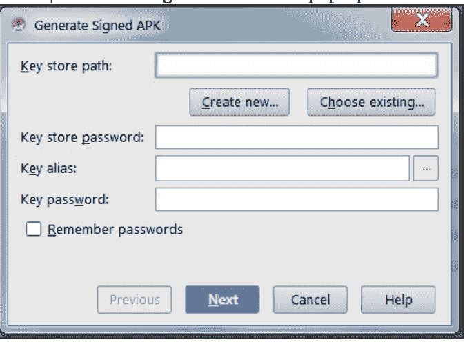
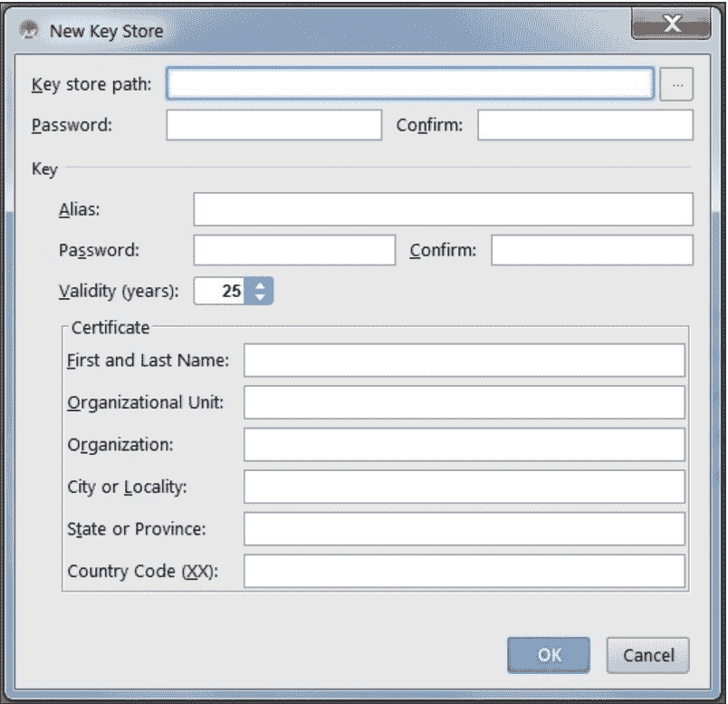
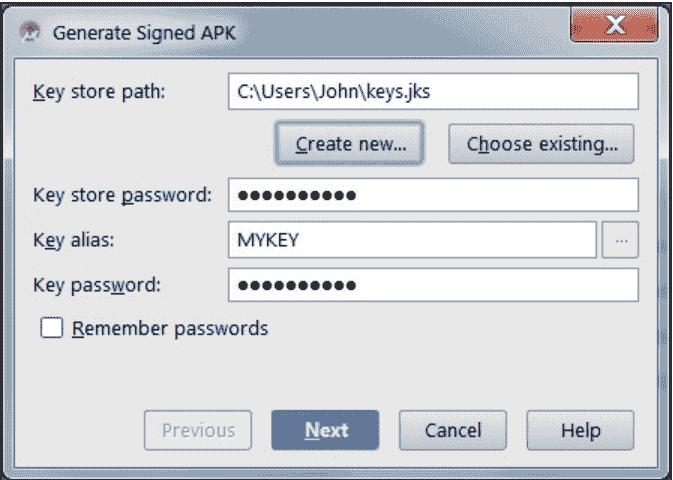
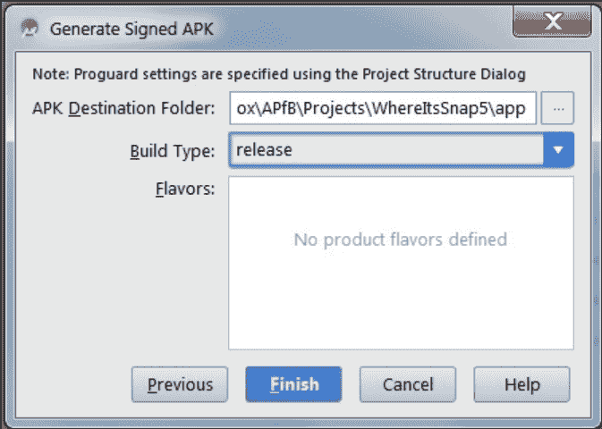
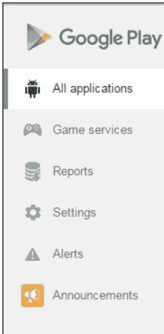
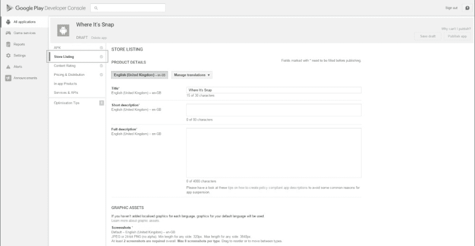
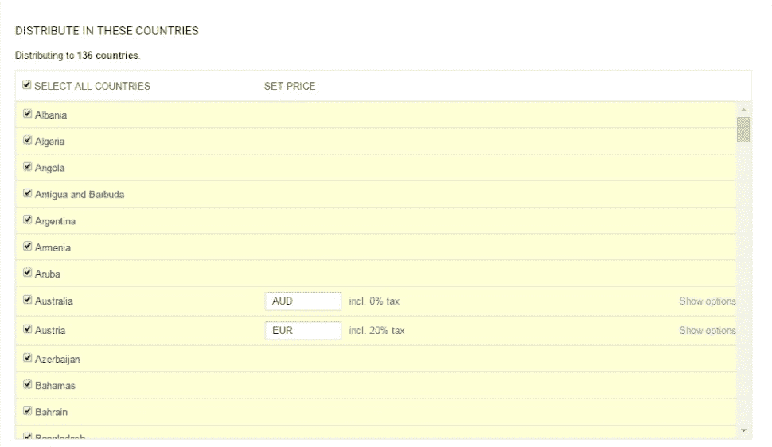

## 第 29 章. 发布应用

这是最短的章节之一，其中完全没有任何技术内容。但是，完成它需要一段时间。在本章中，在上传应用之前，我们将准备好所有所需资源，以及导出可发布的 APK 文件。

本章将涵盖以下主题：

- 准备发布
- 构建可发布的 APK 文件
- 发布应用
- 推广应用的基础知识

### 准备发布

你可能不想上传本书中的任何应用，因此第一步是开发一个你想要发布的应用。

前往 https://play.google.com/apps/publish/ 并按照说明获取 Google Play 开发者账户。撰写时这需要 25 美元，是一次性收费，没有应用发布数量限制。

### 创建应用图标

如何设计图标超出了本书的范围。但简单来说，你需要为每种 Android 屏幕密度分类创建一张漂亮的图片。

这比听起来容易。在你最喜欢的绘图程序中设计一个漂亮的应用图标，并将其保存为 .png 文件。然后，访问 [Android 资源工作室启动器图标](http://romannurik.github.io/AndroidAssetStudio/icons-launcher.html)。这将把你的单个图标转换为适用于每种屏幕密度的完整图标集。

### 提示

警告！使用此服务的代价是，该网站会出于自身营销目的收集你的电子邮件地址。

有很多网站提供类似的免费服务。从前面的网站下载 .zip 文件后，你可以将下载中的 res 文件夹简单地复制到资源管理器中的主项目文件夹。所有密度的所有图标现在都已更新。

### 准备所需资源

当我们登录 Google Play 以在商店中创建新条目时，没有什么技术需要处理，但我们确实需要准备相当多的图片来上传。

为应用兼容的每种设备类型（手机/平板电脑/电视/手表）准备最多 8 个屏幕截图。不要裁剪或填充这些图片。

创建一个 512 x 512 像素的图片，用于在 Google Play 商店中展示你的应用图标。你可以准备自己的图标，或者我们刚才讨论的创建应用图标的过程已经为你自动生成了图标。

你还需要创建三个横幅图形，尺寸如下：

- 1024 x 500
- 180 x 120
- 320 x 180

这些可以是屏幕截图，但通常值得花点时间创建一些更特别的东西。如果你不擅长艺术，可以将屏幕截图放在相当酷的设备图形中，然后添加一张背景图片。你可以在 https://developer.android.com/distribute/tools/promote/device-art.html 生成一些设备图形。

然后，只需在背景中添加你的应用标题或功能即可。下面的横幅完全没有技巧制作而成，只使用了一个花费 10 美元的漂亮背景和我刚才提到的设备图形工具：

此外，考虑为你的应用制作一个视频。除非你的设备已 Root，否则在 Android 设备上录制视频几乎是不可能的。我不建议你 Root 设备；但是，有一个名为 ARC（App Runtime for Chrome）的工具，它允许你在桌面上运行 APK 文件。没有调试输出，但它可以比模拟器更流畅地运行要求较高的应用。然后，使用免费开源的桌面捕获程序（例如 OBS（Open Broadcaster Software））记录你的应用在 ARC 中运行就非常简单了。你可以在 https://developer.chrome.com/apps/getstarted_arc 了解更多关于 ARC 的信息，并在 https://obsproject.com/ 了解 OBS。

### 构建可发布的 APK 文件

在本节中，我们正在准备将上传到 Google Play 的文件。我们将要创建的文件格式是 .apk。这类文件通常被称为 APK。该文件的实际内容是编译后的类文件、我们添加的所有资源，以及 Android Studio 自动生成的文件和资源。我们不需要担心细节，只需按照以下步骤操作即可。

这些步骤不仅创建 APK，还创建一个密钥并使用该密钥为你的应用签名。此过程是必需的，并且还保护你的应用所有权：

### 注意

请注意，这与复制保护/数字版权管理不同。

- 1. 在 Android Studio 中，打开你想要发布的项目，导航到 Build | Generate Signed APK，将打开一个弹出窗口，如下所示：

- 在 Generate Signed APK 窗口中，单击 Create new 按钮。之后，你将看到 New Key Store 窗口，如以下所示。

截图：

- 在 **密钥库路径** 字段中，浏览到硬盘上你想保存新密钥的位置，并为你的密钥库输入名称。如果你没有偏好，直接输入 keys 并单击 **确定**。
- 添加密码，然后再次输入以确认。
- 接下来，你需要选择一个别名并将其输入到 **别名** 字段中。你可以将其视为密钥的名称。它可以是任何你喜欢的单词。现在，为密钥本身输入另一个密码，并再次输入以确认。
- 保持 **有效期（年）** 为默认值 25。
- 现在，你只需要填写个人/商业详细信息。这不需要 100% 完整，因为唯一的必填字段是 **名和姓**。
- 单击 **确定** 按钮继续。你将被带回到 **生成签名的 APK** 窗口，所有字段均已填写完毕并准备继续，如下图所示：

- 现在，单击下一步进入下一屏幕：

- 选择你想导出新 APK 文件的位置，并为 **构建类型** 字段选择 **发布版**。单击 **完成**，Android Studio 会将崭新的 APK 构建到你指定的位置，准备上传到应用商店。

### Note

## 在多个安全位置备份你的密钥库！

密钥库极其宝贵。如果你丢失它，你将实际失去对你的应用的控制。例如，如果你尝试更新你在 Google Play 上的应用，它需要由相同的密钥签名。没有它，你将无法更新它。想想如果你有很多用户，你的应用需要数据库更新，但由于丢失了密钥库，你不得不发布一个全新的应用，那将是一片混乱。

由于我们很快就会用到它，请找到已构建且以 .apk 扩展名结尾的文件。

## 发布应用

登录你在 https://play.google.com/apps/publish/ 的开发者账户。从开发者控制台的左侧，确保 **所有应用** 选项卡已选中，如图所示：

在右上角，单击 **添加新应用** 按钮，如下一张截图所示：

现在，我们需要填写一些表单，你需要用到 *准备发布* 部分中的所有图片，该部分位于本章开头附近。

在接下来显示的 **添加新应用** 窗口中，选择默认语言并输入你的应用标题：

### 添加新应用

默认语言 * 英语（英国）– en-GB

标题 * Where It's Snap 15 of 30 个字符

你想从哪里开始？上传 APK 准备商店详情页 取消

现在，单击 **上传 APK** 按钮，然后单击 **上传你的第一个 APK** 按钮，浏览到你在 *构建可发布 APK 文件部分* 中构建并签名的 APK 文件。等待文件上传完成：

### 将新 APK 上传到生产环境

正在上传 app-release.apk，49% 完成

取消

现在，从内部左侧菜单中，单击 **商店详情页**：

这里有很多表单需要填写。不过，如果你已准备好所有图片，大约 10 分钟就能完成。

几乎所有字段都不言自明，而那些不言自明的字段在输入框旁边都有有用的提示。以下是一些提示和技巧，可以使过程顺利并产生良好的最终结果：

- 在 **完整描述** 和 **简短描述** 字段中，输入将显示给潜在用户/购买者的文本。请务必使描述尽可能诱人和有趣。以清晰列表提及所有最佳功能，但先用一句总结性的话开头，概括你的应用及其功能。
- 不必担心 **新内容评级** 字段，我们稍后会介绍。
- 如果你尚未为平板电脑/手机设备构建应用，那么不要在这些选项卡中添加图片。如果你已经构建，请确保为每个设备添加完整的图片系列，因为这些是该类型设备用户将看到的唯一图片。

完成表单后，单击网页右上角的 **保存草稿** 按钮。

现在，单击 **内容评级** 选项卡，你可以回答关于应用的问题，以获得在多个国家/地区有效（有时各不相同）的内容评级。

你需要完成的最后一个选项卡是 **定价和分发** 选项卡。单击该选项卡并选择 **付费** 或 **免费** 分发按钮。然后，如果你选择了 **付费**，请输入价格。

### Tip

请注意，如果你选择 **免费**，则永远无法更改。不过，你可以取消发布它。

如果你选择了 **付费**，可以单击 **立即自动转换价格** 为全球所有货币设置等效价格。

在 **在这些国家/地区分发** 部分，你可以单独选择国家/地区，或勾选 **选择所有国家/地区** 复选框，如下一张截图所示：

在 **设备类别** 和 **用户计划** 部分下的接下来六个选项，根据你在本书中所学的内容，全部应保持未勾选状态。不过，请阅读提示以了解有关 Android Wear、Android TV、Android Auto、Designed for families、Google Play for work 和 Google Play for education 的更多信息。

最后，你必须勾选两个复选框，以同意 Google 同意准则和美国出口法律。

单击网页右上角的 **发布应用** 按钮，你的应用将很快在 Google Play 上线。恭喜。

## 营销

此时，诱惑是坐等你的应用在畅销应用中占据顶端。这永远不会发生。你可以做一些事情来提升你的应用，如下所示：

- **改进它**：为确保我们的应用发挥全部潜力，我们需要通过修复 bug、使其运行更流畅以及使其更易于使用/更直观来不断改进它。
- **推广它**：这可能是另一本书的主题，但有很多方式可以宣传我们的应用。例如，我们可以在所有社交媒体网站上创建页面/个人资料，比如 Facebook、Twitter、Flickr 等。添加定期更新和公告。我们可以创建一个网站来推广我们的应用，并以推广任何其他网站的方式推广它。我们可以在应用本身中添加一条消息，要求玩家对其进行评分。或许，在他们成功使用某个关键功能后弹出一条消息。我们可以请每个人和每个访问我们社交媒体/网站的人进行评分并留下评论。推广应用还有很多其他方式。所有这些的秘诀就是：坚持做下去。例如，不要创建一个 Facebook 页面，然后就指望它自行变得流行。继续在所有推广渠道上添加内容。
- **添加有价值的功能**：总有新东西可以添加到你的应用中。不要为了添加而添加。例如，在 Where it's snap 应用中玩 Pong 的能力是一个不好的功能示例，但能够在照片上绘制或自定义的功能可能是你的用户想要的。
- **各种营销活动**：你也可以直接从你的 Google Play 开发者控制台运行付费的 Google Adwords 活动。

## 更多内容

你的 Google Play 开发者控制台中充满了值得探索的功能和工具。其中一些很简单；而另一些则相当技术性。但是，所有这些都值得至少快速看一下：

- All Applications 选项卡：单击该选项卡，你可以查看下载量、评分和当前安装量的统计数据。此外，还可以查看你的应用所遭受的 ANR（应用无响应）崩溃数量概览。
- Reports 选项卡：通过该选项卡，你可以搜索所有应用并下载应用统计数据的详细 PDF 报告。
- Crashes & ANRs 选项卡：如果你从 All Applications 选项卡中点击某个应用，然后可以点击 Crashes & ANRs 以查看发生的崩溃的特定详细信息，格式与我们在 logcat 中看到的非常相似。然后你可以修复问题并快速发布更新。
- Optimization tips 选项卡：如果你从 All Applications 选项卡中点击某个应用，然后可以点击 Optimization tips，它将显示一个推荐步骤列表，你可以采取这些步骤来改善你的应用销售。例如，针对你的应用的特定本地化步骤和对其他外形因素的支持将像待办事项列表一样显示。
- User Acquisition 选项卡：该选项卡是新的，允许你通过显示页面访问者、安装者和购买者等统计数据来查看你的商店详情页的有效性。

## 摘要

这是一段漫长的旅程，如果你已读到此处，现在可以着手从事 Android 应用开发的职业生涯。还不要急着去开发下一个 Evernote、Runtastic 或 Angry Birds。先看看最后这一简短章节，了解你接下来可能想做什么。
