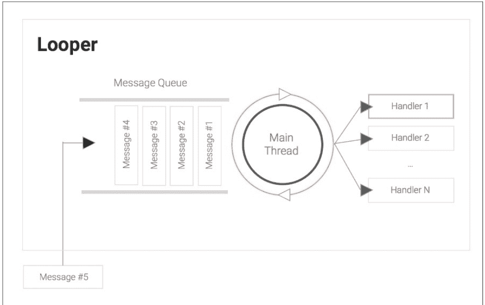
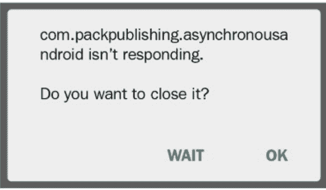
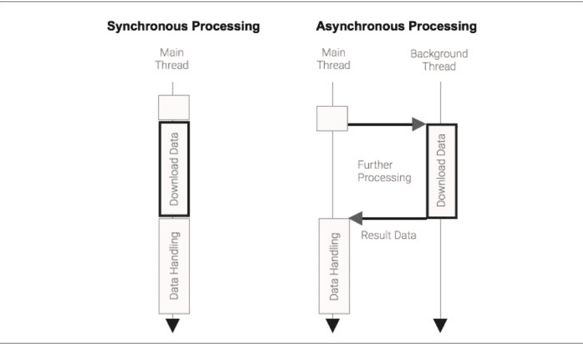

## 第 1 章 Android 中的异步编程

在过去几年里，异步编程已成为一个重要的讨论话题，尤其是在利用最新移动硬件上可用的并发处理能力时。

近年来，CPU 上可用的独立处理单元（内核）数量增加了，因此为了从这种新的处理能力中获益，一种称为异步编程的新编程模型应运而生，用于协调设备上多个独立硬件处理单元之间的工作。异步编程前来解救，解决这种新处理范式可能带来的问题。

由于 Android 应用大多在具有多个处理单元的设备上运行，应充分利用异步编程来提升性能，改善应用在涉及阻塞操作以及需要 CPU 密集型任务时的表现。

Android 是一种开源操作系统（OS），基于 Linux 内核，由 Andy Rubin、Nick Sears、Chris White 和 Rick Miner 于 2003 年构思，随后于 2005 年 7 月被 Google 收购。

Android OS 由 Google 和开放手持设备联盟（Open Handset Alliance）实际维护，其创建目的是为计算、内存和能源资源有限的设备提供一个开放的移动设备平台。

该平台一直在融合先进的移动设备标准，例如 NFC 和 Bluetooth LE，其范围已从纯智能手机平台扩展为面向智能手表、电视、平板电脑和游戏机的更广泛软件平台。

自首个版本发布以来，维护者一直在定期更新平台，添加出色的功能，并在小版本和大版本发布中进行一些改进。

以下图表展示了 Android 版本随时间变化的情况：

- 2008
  - v1.0
- 2009
  - v1.1
  - (Donut)
  - v1.6
  - v1.5 (Cupcake)
  - v2.0 (Eclair)
- 2010
  - (Froyo)
  - v2.2
  - v2.3 (Gingerbread)
- 2011
  - (Honeycomb)
  - v3.0
  - v4.0 (Ice Cream Sandwich)
- 2012
  - (Jelly Bean)
  - v4.1
- 2013
  - v4.4 (KitKat)
- 2014
  - (Lollipop)
  - v5.0
- 2015
  - v6.0 (Marshmallow)

### Android 软件栈

Android 软件栈（C 库和 Java 框架）由 Android 运行时（Dalvik VM，以及最近的 ART）协调，构建在 Linux 内核之上，旨在基于经过验证的一组技术提供高度交互式的用户体验。

在每个新的操作系统版本中，都会为开发者提供一个明确定义的应用程序接口（API），以便围绕该版本引入的新功能和标准创建应用程序。

编译后的 Android 应用程序代码（字节码），通常是 Java 编译后的代码，运行在基于 Dalvik 或 ART 的虚拟机上。

### Dalvik 运行时

Dalvik VM（DVM）运行时由 Dan Bornstein 创建，是该平台的第一个运行时，是一种基于寄存器的虚拟机，旨在在处理能力、RAM 和电力有限的受限运行时中高效运行 Java 代码。

Dalvik 的创建者声称，DVM 平均比标准 Java VM（Oracle）高效约 30%。据 Bornstein 介绍，它需要少 30% 的指令和少 35% 的代码单元。

显然，Google 已竭尽全力榨干每台移动设备的每一滴性能，以帮助开发者构建响应迅速的应用程序。

运行 Java 代码的虚拟机，该代码经过 dx 工具编译并转换为 dex 格式，在具有自己的内存空间和文件描述符的 Linux 进程上运行。它还管理自己的线程组。

在更高级的架构中，Android 应用程序可能在单独的进程中运行服务，并通过 IPC 机制进行通信，但大多数情况下，它在一个单一的自包含进程中运行。

dex 文件和应用程序资源由 AAPT 打包到 Android 应用程序包（APK）中，并通过 Google Play 安装到最终用户设备上。

### 注

自 2007 年 Apple iPhone 推出以来，应用商店分发模式在移动平台上变得极其流行。

自 Android 2.2 起，DVM 带有基于跟踪的即时编译（JIT）功能，可在应用程序运行某些称为“跟踪”的频繁使用字节码短片段时主动进行优化。

生成的机器代码在应用程序执行以及处理某些 CPU 密集型任务所花费的时间方面带来了显著的性能改进，从而降低了电池电量的消耗。

### ART 运行时

ART 运行时是 DVM 的一个新版本，旨在改进运行时性能和内存消耗。该新运行时在 Android 4.4 KitKat 中作为实验性运行时引入，自 Android 5.0 Lollipop 起，已成为主要的 Android 运行时。

这个新运行时利用 **预编译（AOT）** 带来启动时间和应用程序执行方面的新应用性能优化。与 DVM JIT（即时编译）不同，AOT 在安装时使用设备的 dex2oat 工具编译 dex 文件。dex2oat 工具生成的编译代码为目标设备生成特定于系统的代码，并消除了每次应用程序执行期间 JIT 编译引入的延迟。

AOT 编译器还减少了应用程序使用的处理器周期数，因为它消除了 JIT 编译器将代码转换为机器代码所花费的时间，然后使用更少的电池电量来运行应用程序。

AOT 编译的一个缺点是与 DVM 使用的 JIT 相比，内存占用更大。

使用新运行时，内存分配和 **垃圾回收（GC）** 方面也引入了一些改进，从而带来了更灵敏的 UI 和更好的应用体验。

### 内存共享和 Zygote

基本上，平台为每个应用程序运行一个 DVM/ART 实例，但平台的大量优化来自于创建和管理新 DVM 实例的方式。

当 Android 设备最初启动时，会启动一个称为 Zygote（动物繁殖中的第一个生命单元）的特殊进程——所有 Android 应用程序都基于该进程。

Zygote 启动一个虚拟机，预加载核心库，并初始化各种共享结构。然后通过监听套接字等待指令。

当启动新的 Android 应用程序时，Zygote 会收到创建虚拟机以运行该应用程序的命令。它通过分叉其预热的 VM 进程来实现这一点，创建一个新的子进程，该子进程使用一种称为写时复制（COW）的技术与父进程共享部分内存。

COW 技术在大多数 Unix 系统上可用，仅在子进程尝试更改从父进程克隆的内存时才分配新内存。

这种技术有许多绝妙的好处，如下列所示：

- 首先，虚拟机和核心库已加载到内存中。无需从文件系统读取这大量数据来初始化虚拟机，大幅降低了启动开销。
- 其次，这些核心库和公共结构所在的内存由 Zygote 与所有其他应用程序共享，当用户运行多个应用时，可节省大量内存。


## Android 进程模型

Android 是一个多用户、多任务系统，可以并行运行多个应用程序，其中所有应用程序都试图获取 CPU 时间来执行其任务。

每个应用程序都从 Zygote 进程克隆的隔离 Linux 进程中独立运行，默认情况下，所有 Android 组件都在同一进程中运行，其名称与 Android 应用清单 (AAM) 中指定的应用程序包名称相同。

Linux 内核会公平地为应用程序执行分配少量 CPU 时间，称为 CPU 时间片。这种时间片方式意味着，即使是单处理器设备，也看起来像是在同一时间积极处理多个应用程序，而实际上，每个应用程序都在 CPU 上轮流运行很短的时间。

## 进程排名

Android 操作系统会尽可能长时间地保持应用程序运行，但当可用内存不足时，它会优先杀死重要性较低的进程，以释放系统资源。

这时就用到了进程排名；Android 进程从高优先级到低优先级分为以下五个类别：

- **前台进程**：这是一个托管用户当前正在交互的 Activity 或 Service 的进程：在前台启动的服务或运行其生命周期回调的服务
- **可见进程**：这是一个托管已暂停 Activity 或绑定到可见 Activity 的 Service 的进程
- **服务进程**：这是一个托管未绑定到可见 Activity 的 Service 的进程
- **后台进程**：这是一个托管不可见 Activity 的进程；所有后台进程都按照 **最近最少使用** (LRU) 列表排序，因此，当具有相同排名时，最近使用的进程是最后被杀死的进程
- **空进程**：这是一个用于缓存非活动 Android 组件并提高任何组件启动时间的进程

当系统需要释放资源时，可被杀死的进程会进行排序，并考虑进程排名、最后使用的进程以及运行中的组件。

## 进程沙箱

Android 应用程序始终在应用程序安装期间分配给该应用程序的唯一 **Linux 用户 ID (UID)** 下运行，因此进程在沙箱环境中运行，默认情况下，该环境将您的数据和代码执行与其他应用隔离。

在某些情况下，用户可能会被明确要求与另一个应用程序共享 UID，以便访问其数据：

| 用户 | PID | PPID | VSIZE | RSS | PC | 进程名 |
|---|---|---|---|---|---|---|
| root | 319 | 1 | 1537236 | 31324 | S | zygote |
| ... | | | | | | |
| u0_a221 | 5993 | 319 | 1731636 | 41504 | S | com.whatsapp |
| u0_a96 | 3018 | 319 | 1640252 | 29540 | S | com.dropbox.android |
| u0_a255 | 4892 | 319 | 1583828 | 34552 | S | com.accuweather.android... |

上述表格是通过在安装了 Android SDK 的计算机上运行 `adb shell ps` 命令得到的 Android 运行进程列表。

第一列显示安装时分配的 **用户 ID (UID)**，第二列是 **进程 ID (PID)**，第三列显示 **父进程 ID (PPID)**（对于 Android 应用程序，父进程是 Zygote 进程），最后一列显示应用程序包。

从这个列表，我们可以确定 WhatsApp 应用程序正在使用用户 ID u0_a221 和进程 ID 5993 运行，其父进程是 PID 为 319 的 Zygote 进程。

## Android 线程模型

在 Android 进程中，可能存在许多执行线程。每个线程都是整个程序中的独立顺序控制流——它按顺序依次执行其指令，并且还共享由操作系统任务调度器管理的分配 CPU 时间片。

虽然应用程序进程由系统启动，并且不能直接干扰其他进程内存地址空间中的数据，但线程可以由应用程序代码启动，并可以与同一进程中的其他线程通信和共享数据。除了同一进程中所有线程共享的共享数据外，线程还可以使用自己的内存缓存在自己的内存空间中存储数据。

### 主线程

当应用程序进程启动时，除了 DVM 维护线程外，系统会创建一个名为 `main` 的执行线程。正如其名称所解释的，这个线程在应用程序生命周期中起着至关重要的作用，因为它是与 Android UI 组件交互、更新设备屏幕上的状态和外观的线程。

此外，默认情况下，所有 Android 应用程序组件（Activity、Service、ContentProvider 和 BroadcastReceiver）也在主线程执行线上执行。下图显示了应用程序进程中运行的线程列表，主线程位于列表顶部，并分配有由系统分配的唯一线程 ID (TID)：

| ID | 线程 ID | 状态 | 用户时间 | 系统时间 | 名称 |
|---|---|---|---|---|---|
| 1 | 30155 | 可运行 | 4 | 8 | main |
| 2 | 30161 | 等待 | 0 | 0 | Signal Catcher |
| 3 | 30162 | 可运行 | 104 | 94 | JDWP |
| 4 | 30166 | 等待 | 0 | 0 | FinalizerDaemon |
| 5 | 30165 | 等待 | 0 | 0 | ReferenceQueueDaemon |
| 6 | 30164 | 可运行 | 0 | 0 | Binder_1 |
| 7 | 30170 | 监视器 | 0 | 0 | GCDaemon |
| 8 | 30169 | 等待 | 0 | 0 | HeapTrimmerDaemon |
| 9 | 30167 | 可运行 | 0 | 0 | Binder_2 |
| 10 | 30168 | 等待 | 0 | 0 | FinalizerWatchdogDaemon |
| 11 | 30198 | 可运行 | 4 | 5 | RenderThread |

主线程，也称为 UI 线程，也是发生 UI 事件处理的线程，因此为了使您的应用程序尽可能响应迅速，您应该：

- 避免任何长时间执行的任务，例如可能无限期阻塞处理的 **输入/输出 (I/O)**
- 避免可能长时间占用此线程的 CPU 密集型任务

下图显示了参与 Looper 执行线程的主要交互和组件：



UI/主线程附带有 Looper 设施，持有一个消息队列 (MessageQueue)，其中包含一些要按顺序执行的工作单元。

当队列中的消息准备好处理时，Looper 线程从队列中弹出消息，并将其同步转发到消息中指定的目标处理程序。

当目标 Handler 完成对当前消息的处理后，Looper 线程将准备好处理队列中可用的下一条消息。因此，如果 Handler 处理消息花费了明显的时间，它将阻止 Looper 处理其他待处理消息。

例如，当我们在 Activity 类的 `oncreate()` 方法中编写代码时，它将在主线程上执行。同样，当我们向用户界面组件附加监听器以处理点击和其他用户输入手势时，监听器回调在主线程上执行。

对于执行很少 I/O 或处理的应用程序（例如不执行复杂数学计算、不使用网络实现功能或不使用文件系统资源的应用程序），这种单线程模型是足够的。但是，如果我们需要执行 CPU 密集型计算、从永久存储读取或写入文件，或与 Web 服务通信，那么在执行此工作期间到达的任何进一步事件都将被阻塞，直到我们完成为止。

### 注意

自 Android 5.0 (Lollipop) 起，引入了一个名为 **呈现线程** 的新重要线程，以便在主线程忙于处理其他事务时保持 UI 动画流畅。

## 应用无响应 (ANR) 对话框

您可以想象，如果主线程忙于执行大量计算或从网络套接字读取数据，它将无法立即响应点击或滑动等用户输入。

一个不能快速响应用户交互的应用程序会感觉无响应——任何超过几百毫秒的延迟都会被察觉。这是一个如此有害的问题，以至于 Android 平台保护用户免受在主线程上执行过多任务的应用程序的影响。

### 注意

如果应用程序在五秒内没有响应用户输入，用户将看到 **应用无响应 (ANR)** 对话框，并将被提供退出应用程序的选项。

下图显示了典型的 Android ANR 对话框：



Android 努力将用户界面重绘与硬件刷新率同步。这意味着它以每秒 60 帧的速率重绘，即每帧仅 16.67 毫秒。如果我们在主线程上执行接近 16 毫秒的工作，我们就有可能影响帧率，导致卡顿——动画停顿、滚动抖动等。


理想情况下，我们当然不希望丢掉任何一帧。卡顿、无响应，尤其是 ANR，都会带来非常糟糕的用户体验，这会转化为差评和不受欢迎的应用。构建 Android 应用程序时应牢记的一条准则是：不要阻塞主线程！

## 注意

Android 在每台设备的开发者选项中提供了一个有用的严格模式设置，当应用程序在主线程上执行耗时操作时，它会在屏幕上闪烁。

在 Honeycomb（API 级别 11）中，平台引入了一个新的异常类 NetworkOnMainThreadException，它是 RuntimeException 的子类。如果系统检测到网络活动是在主线程上发起的，则会抛出该异常，从而提供了进一步的保护。

## 保持响应性

因此，理想情况下，我们可能希望将任何耗时操作从主线程转移出去，以便由后台的另一个线程处理，而主线程可以继续平滑处理用户界面更新，并及时响应用户交互。

应在后台线程处理的典型耗时任务包括以下内容：

- 网络通信
- 本地文件系统上的输入和输出文件操作
- 图像和视频处理
- 复杂的数学计算
- 文本处理
- 数据编码和解码

为了使此方法有用，我们必须能够协调工作，并在合作线程之间安全地传递数据——尤其是在后台线程和主线程之间，而异步编程正是为了解决这个问题而使用的。

让我们先从同步与异步图示入手：



前面的示例以图形方式展示了两种处理模型之间的主要区别。在左侧，数据下载任务发生在主线程上，占用该线程直到下载完成。因此，如果用户与 UI 交互并生成诸如触摸事件之类的事件，如果下载任务花费大量时间才能完成，应用程序将出现卡顿或变得无响应。

在右侧，异步模型会将下载数据任务交给另一个后台线程，使主线程可用于处理来自 UI 交互的任何事件。当下载的数据可用时，如果数据处理需要更新任何 UI 状态，后台任务可以将结果发布到主线程。

当我们使用异步模型来编程应用程序时，Android 操作系统还会利用最新设备上可用的额外 CPU 核心，同时执行多个后台线程，并提高应用程序的能效。

## 注意

这种同时执行的、可能相互交互的独立代码路径称为 **并发**。

为了完成一个工作单元而并行执行工作子单元称为 **并行**。

## Android 中的并发

如前所述，为了在多核设备环境中实现可扩展的应用程序，Android 开发者应该能够创建并发执行路径，以合并和聚合来自多个资源的数据。

Android SDK 基于源自 Apache Harmony 项目的 Java SDK 子集，提供对低级并发构造（如 java.lang.Thread、java.lang.Runnable 以及 synchronized 和 volatile 关键字）的访问。

这些构造是实现并发和并行的最基本构建块，所有高级异步构造都是围绕这些构建块创建的。

最基本的一个是 java.lang.Thread，它是最常用的类，也是在 Java 程序中创建新独立执行路径的构造：

```
public class MyThread extends Thread {
    public void run() {
        Log.d("Generic", "My Android Thread is running ...");
    }
}
```

在前面的代码中，我们子类化了 java.lang.Thread 来创建自己的独立执行路径。当 Thread 启动时，run 方法会自动被调用，并在 Android 日志中打印消息：

```
MyThread myThread = new MyThread();
myThread.start();
```

此时，我们将创建 MyThread 的实例，并在第二行启动它时，系统会在进程内创建一个线程并执行 run() 方法。

其他有用的线程相关方法包括以下内容：

- Thread.currentThread(): 检索当前正在运行的线程实例
- Thread.sleep(time): 在给定时间内暂停当前线程的执行
- Thread.getName() 和 Thread.getId(): 分别获取名称和 TID，以便用于调试目的
- Thread.isAlive(): 检查线程当前是否正在运行或是否已完成工作
- Thread.join(): 阻塞当前线程，并等待被访问的线程完成执行或终止

Runnable 接口是来自 Java API 的另一个构建块，是一个定义用于指定和封装旨在由 Java 线程实例或任何其他处理该 Runnable 的类执行的代码的接口：

```
package java.lang;

public interface Runnable {
    public abstract void run();
}
```

在下面的代码中，我们基本上创建了 Runnable 子类，使其实现 run() 方法，并可以被线程传递和执行：

```
public class MyRunnable implements Runnable {
    public void run(){
        Log.d("Generic", "Running in the Thread " +
        Thread.currentThread().getId());
        // Do your work here
        ...
    }
}
```

现在，我们的 Runnable 子类可以传递给 Thread，并在并发执行路径中独立执行：

```
Thread thread = new Thread(new MyRunnable());
thread.start();
```

虽然启动新线程很容易，但并发实际上是一件非常困难的事情。并发软件面临许多问题，分为两大类：正确性（产生一致且正确的结果）和活性（朝着完成取得进展）。线程创建也可能导致一些性能开销，线程过多会降低性能，因为操作系统必须在这些执行路径之间切换。

## 并发程序中的正确性问题

正确性问题的一个常见示例是，当两个线程需要根据当前值修改同一变量的值时。假设我们有一个名为 myInt 的整数变量，当前值为 2。

为了递增 myInt，我们首先需要读取其当前值，然后向其中加 1。在单线程世界中，两次递增将严格按顺序发生——我们将读取初始值 2，向其中加 1，将新值设回变量，然后重复该序列。两次递增后，myInt 的值为 4。

在多线程环境中，我们会遇到潜在的时序问题。尝试递增变量的两个线程可能会都读取相同的初始值 2，向其中加 1，并将结果（两种情况均为 3）设回变量：

```
int myInt = 2;
...
public class MyThread extends Thread {
    public void run() {
        super.run();
        myInt++;
    }
}
...
Thread t1 = new MyThread();
Thread t2 = new MyThread();
t1.start();
t2.start();
```

两个线程在其局部视图中都表现正确，但就整体程序而言，我们显然会遇到正确性问题；2 + 2 不应该等于 3！这种时序问题称为竞态条件。

解决竞态条件等正确性问题的常见方法是互斥——防止多个线程同时访问某些资源。通常，这是通过确保线程在读取或更新共享数据之前获取独占锁来实现的。


要实现这一正确性，我们可以利用 synchronized 构造来解决以下代码片段中的正确性问题：

```
Object lock = new Object();
public class MyThread extends Thread {
    public void run() {
        super.run();
        synchronized(lock) {
            myInt++;
        }
    }
}
```

在前面的代码中，我们使用每个 Java 对象可用的内置锁来创建一个互斥的代码作用域，这将强制执行自增语句正常工作，并且不会像前面解释的那样遭受正确性问题。当其中一个线程访问受保护作用域时，我们说该线程获取了锁，在线程退出受保护作用域后，它会释放锁，以便另一个线程可以获取。

创建互斥作用域的另一种方法是使用 synchronized 方法创建一个方法：

```
int myInt = 2;
synchronized void increment(){
    myInt++;
}
...
public class IncrementThread extends Thread {
    public void run() {
        super.run();
        increment();
    }
}
```

synchronized 方法将使用定义 myInt 的对象内置锁来创建互斥区，因此 IncrementThread 通过 increment() 递增 myInt 时，将防止任何线程干扰和内存一致性错误。

## 并发程序中的活性问题

活性可以被视为应用程序执行有用工作并朝着目标取得进展的能力。活性问题往往是解决正确性问题的不幸副作用。

在适当的并发程序中，应同时实现这两种特性，尽管活性关注于在程序中防止发生死锁、活锁或饥饿以取得进展，而正确性关注于生成一致且正确的结果。

## 注意

死锁是指两个或多个线程无法继续执行，因为每个线程都在等待其他线程做某事。活锁是指两个或多个线程响应其他线程的变化而不断改变自身状态，却不执行任何有用工作。

通过锁定对数据或系统资源的访问，可能会创建瓶颈，即许多线程竞争访问单一锁，从而导致潜在的显著延迟。

更糟糕的是，当使用多个锁时，可能会创建这样一种情况：没有任何线程能够取得进展，因为每个线程都需要独占访问当前由另一个线程拥有的锁——这种情况称为死锁。

### 线程协调

线程协调是并发编程中的一个重要主题，尤其是在我们想要执行以下任务时：

- 同步线程对共享资源或共享内存的访问：
  - 共享数据库、文件、系统服务、实例/类变量或队列
- 协调一组线程内的工作和执行：
  - 并行执行、流水线执行、相互依赖的任务等等

当我们想要协调线程努力以实现目标时，应尽量避免在等待另一个线程中的事件时占用 CPU 的等待或轮询机制。

以下示例展示了一个小循环，在等待某个状态变化发生时会持续占用 CPU：

```
while(!readyToProcess) {
// do nothing .. busy waiting wastes processor time.
}
```

为了克服协调问题并实现我们自己的构造，应使用一些低级信号或消息机制来在线程之间通信并协调交互。

在 Java 中，每个对象都有 wait()、notify() 和 notifyAll() 方法，它们提供了低级机制，用于在一组线程之间发送线程信号，并将线程置于等待状态，直到满足某个条件。

这种机制（也称为监视器或守卫）是其他语言中常用的设计模式，它确保在任何给定时间只有一个线程可以进入某个代码段，并能够等待直到某个条件发生。

与我们之前的示例相比，这种设计模式在等待另一个线程中发生任何特定情况时，能提供更好的、更高效的 CPU 周期管理，并且通常用于需要在不同执行线之间协调工作的情况。

在以下代码示例中，我们将解释如何使用此构造来创建一个带有 10 个线程的基本多线程 Logger，这些线程将在监视器部分等待，直到应用程序中的任何其他线程推送一条消息（条件）。

负责将日志输出的 Logger 具有一个最多 20 个位置的队列，用于存储新的日志文本消息：

```
public class Logger {
    LinkedList<String> queue = new LinkedList<String>();
    private final int MAX_QUEUE_SIZE = 20;
    private final int MAX_THREAD_COUNT = 10;
}
```

在接下来的代码中，我们将创建一个无限运行的 Runnable 工作单元，它从队列中检索消息并将消息打印到 Android 日志。

之后，我们将创建并启动 10 个线程来执行 Runnable 工作单元任务：

```
public void start() {
    // Creates the Loop as a Runnable
    Runnable task = new Runnable() {
        @Override
        public void run() {
            while(true) {
                String message = pullMessage();
                Log.d(Thread.currentThread().
                    getName(),message);
                // Do another processing
            }
        }
    };
    // Create a Group of Threads for processing
    for(int i=0; i< MAX_THREAD_COUNT; i++){
        new Thread(task).start();
    }
}
```

pullMessage() 是一个 synchronized 方法，它执行互斥操作，并在到达 wait() 方法时将线程置于等待状态。所有创建的线程都将保持此状态，直到另一个线程调用 notifyAll()：

```
// Pulls a message from the queue
// Take a message from the queue
// Only returns when a new message is retrieved
// from the queue.
private synchronized String pullMessage(){
 while (queue.isEmpty()) {
  try {
   wait();
  } catch (InterruptedException e) { ... }
 }
 return queue.pop();
}
// Push a new message to the tail of the queue if
// the queue has available positions
public synchronized void pushMessage(String logMsg) {
 if ( queue.size()< MAX_QUEUE_SIZE ) {
  queue.push(logMsg);
  notifyAll();
 }
}
```

当任何线程处于等待状态时，它会暂时释放锁，并给另一个线程一个机会进入互斥区以推送新消息或进入等待状态。

在以下片段中，我们将首先创建 Logger 实例，然后调用 start 方法启动工作线程，并将 10 条消息推送到待处理的工作队列中。

当调用 pushMessage() 方法时，一条新的日志消息会被插入到队列末尾，并调用 notifyAll() 来通知所有可用线程。

由于 pullMessage() 方法在互斥（synchronized）区域中运行，只有一个线程会唤醒并从拉取方法返回。一旦 pullMessage() 返回，日志消息就会被打印：

```
Logger logger = new Logger();
logger.start();
for ( int i=0; i < 10 ; i++) {
 ...
 logger.pushMessage(date + ": Log Message #" + i);
}
```

在以下控制台输出中，我们有一个示例，展示了此代码将生成的输出，日志消息由任何可用线程按有序方式处理：

```
D/Thread-108(23915): <Date>: Log Message #0
D/Thread-109(23915): ....: Log Message #1
D/Thread-110(23915): ....: Log Message #2
D/Thread-111(23915): ....: Log Message #3
```

这种低级构造还可用于控制共享资源（轮询）以管理后台执行（并行性）并控制线程池。


## Concurrent package constructs

Other Java concurrent constructs provided by java.util.concurrent, which are also available on Android SDK are as follows:

- **锁对象** (java.util.concurrent): 它们使用更高级别的惯用法实现锁定行为。
- **执行程序**: 这些是用于启动和管理一组线程执行（线程池等）的高级别 API。
- **并发集合**: 这些是修改集合的方法受到保护以避免同步问题的集合。
- **同步器**: 这些是用于协调和控制线程执行（信号量、循环栅栏等）的高级别构造。
- **原子变量** (java.util.concurrent.atomic): 这些是提供对单个变量进行线程安全操作的类。其中一个示例是 AtomicInteger，可在我们的示例中用于解决正确性问题。

Some Android-specific constructs use these classes as basic building blocks to implement their concurrent behavior, although they could be used by a developer to build custom concurrent constructs to solve a specific use case.

## Executor framework

The Executor framework is another framework available on java.util.concurrent that provides an interface to submit Runnable tasks, decoupling the task submission from the way the task will run:

```
public interface Executor {
 void execute(Runnable command);
}
```

Each Executor, which implements the interface that we defined earlier, can manage the asynchronous resources, such as thread creation destruction and caching, and task queueing in a variety of ways to achieve the perfect behavior to a specific use case.

The java.util.concurrent comes with a group of implementations available out of the box that cover most generic use cases, as follows:

- Executors.newCachedThreadPool(): 这是一个可以增长并重用先前创建的线程的线程池
- Executors.newFixedThreadPool(nThreads): 这是一个具有固定数量线程和用于存储工作的消息队列的线程池
- Executors.newSingleThreadPool(): 这与 newFixedThreadPool 类似，但只有一个工作线程

To run a task on Executor, the developer has to invoke execute() by passing Runnable as an argument:

```
public class MyRunnable implements Runnable {
    public void run() {
        Log.d("Generic", "Running From Thread " +
        Thread.currentThread().getId());
        // Your Long Running Computation Task
    }
}
public void startWorking(){
    Executor executor = Executors.newFixedThreadPool(5);
    for ( int i=0; i < 20; i++ ) {
        executor.execute(new MyRunnable());
    }
}
```

In the preceding code, we created ThreadPool over the factory methods with a fixed number of five threads ready to process work.

After the ExecutorService instance creation, new Runnable tasks are posted for asynchronous processing.

When a new unit of work is submitted, a thread that is free to work is chosen to handle the task; but when all the threads are occupied, Runnable will wait in a local queue until a thread is ready to work.

## Android primary building blocks

A typical Android application is composed of the following four main building blocks:

- android.app.Activity
- android.app.Service
- android.content.BroadcastReceiver
- android.content.ContentProvider

The Activity, Service, and BroadcastReceiver are activated explicitly or implicitly over an asynchronous message called Intent.

Each of these building blocks have their own life cycle, so they could be exposed to different concurrency issues if an asynchronous architecture is used to offload work from the main thread.

## Activity concurrent issues

The Activity building block has a tight connection with a presentation layer because it's the entity that manages the UI view over a defined tree of fragments and views that display information and respond to user interactions.

Android applications are typically composed of one or more subclasses of android.app.Activity. An Activity instance has a very well-defined lifecycle that the system manages through the execution of lifecycle method callbacks, all of which are executed on the main thread.

To keep the application responsive and reactive, and the activity transition smooth, the developer should understand the nature of each Activity lifecycle callback.

The most important callbacks on the Activity lifecycle are as follows:

- onCreate(): 此时 Activity 不可见，但所有私有 Activity 资源（视图和数据）都是在这里创建的。长时间和密集的计算应异步完成，以减少用户在 Activity 转换期间无法获得可视反馈的时间。
- onStart(): 当 UI 可见但无法在屏幕上交互时调用的回调。此阶段的任何滞后都可能让用户感到不悦，因为此时生成的任何触摸事件都会被系统错过。
- onResume(): 当 Activity 即将进入前台并处于可交互状态时调用的回调。
- onPause(): 当 Activity 即将进入后台且不可见时调用的回调。计算应尽快结束，因为下一个 Activity 不会在该方法结束之前恢复。
- onStop(): 当 Activity 不再可见但可以重新启动时调用的回调。
- onDestroy(): 当 Activity 实例即将在后台销毁时调用的回调。属于该实例的所有资源和引用都必须释放。

An Activity instance that is completed should be eligible for garbage collection, but background threads that refer to Activity or part of its view hierarchy can prevent garbage collection and create a memory leak.

Similarly, it is easy to waste CPU cycles (and battery life) by continuing to do background work when the result can never be displayed as Activity is completed.

Finally, the Android platform is free at any time to kill processes that are not the user's current focus. This means that if we have long-running operations to complete, we need some way of letting the system know not to kill our process yet.

All of this complicates the do-not-block-the-main-thread rule as we need to worry about canceling background work in a timely fashion or decoupling it from the Activity lifecycle where appropriate.

## Manipulating the user interface

The other Android-specific problem lies not in what you can do with the UI thread, but in what you cannot do.

### Note

You cannot manipulate the user interface from any thread other than the main thread.

This is because the user interface toolkit is not thread-safe, that is, accessing it from multiple threads may cause correctness problems. In fact, the user interface toolkit protects itself from potential problems by actively denying access to user interface components from threads other than the one that originally created these components.

If the system detects this, it will instantly notify the application by throwing CalledFromWrongThreadException.

The final challenge then lies in safely synchronizing background threads with the main thread so that the main thread can update the user interface with the results of the background work.

If the developer has access to an Activity instance, the runOnUiThread instance method can be used to update the UI from a background thread.

The method accepts a Runnable object like the one used to create an execution task for a thread:

```
public final void runOnUiThread (Runnable)
```

In the following example, we are going to use this facility to publish the result from a synonym search that was processed by a background thread.

To accomplish the goal during the onCreate activity callback, we will set up onClickListener to run searchTask on a created thread:

```
// Get the Views references
Button search = (Button) findViewById(R.id.searchBut);
final EditText word = (EditText) findViewById(R.id.wordEt);
```


```
// When the User clicks on the search button
// it searches for a synonym
search.setOnClickListener(new View.OnClickListener() {
    @Override
    public void onClick(View v) {
        // Runnable that Searchs for the synonym and
        // and updates the UI.
        Runnable searchTask = new Runnable() {
            @Override
            public void run() {
                // Retrieves the synonym for the word
                String result = searchSynonym(
                    word.getText().toString());
                // Runs the Runnable SetSynonymResult
                // to publish the result on the UI Thread
                runOnUiThread(new SetSynonymResult(result));
            }
        };
        // Executes the search synonym an independent thread
        Thread thread = new Thread(searchTask);
        thread.start();
    }
}));
```

当用户单击 **搜索** 按钮时，我们将创建一个 Runnable
匿名类，用于搜索在 R.id.wordEt EditText 中输入的单词，并
启动线程来执行 Runnable。

搜索完成后，我们将创建 Runnable
SetSynonymResult 的一个实例，以通过 UI 线程将结果发布回同义词 TextView。

```
class SetSynonymResult implements Runnable {
    final String synonym;

    SetSynonymResult(String synonym){
        this.synonym = synonym;
    }
    public void run() {
        TextView tv = (TextView)findViewById(R.id.synonymTv);
        tv.setText(this.synonym);
    }
};
```

这种技术有时并不是最方便的，尤其是在我们无法访问 Activity 实例时；因此，在后续章节中，我们将讨论从后台计算任务更新 UI 的更简单、更清晰的技术。

## 服务并发问题

这些是在后台运行的 Android 实体，通常执行以应用程序名义运行且无需任何用户交互的任务。

`service` 默认在应用程序进程的主线程中运行。它不会创建自己的线程，因此如果您的 `service` 将执行任何阻塞操作（例如下载图片、播放视频或访问网络 API），用户应设计策略，将工作从主线程卸载到另一个线程。

由于 `service` 可能有自己的并发策略，它还应考虑到，与 Activity 一样，它应通过主线程更新 UI，因此将后台结果发布回主循环的策略至关重要。

在 Android 服务领域，服务的启动方式将 `service` 的性质区分为以下两组：

- **启动的服务**：这是由 `startService()` 启动的服务，即使启动它的组件已被销毁，也可以持续运行。启动的服务不会直接与启动它的组件交互。
- **绑定的服务**：只要至少有一个 Android 组件通过调用 `bindService()` 绑定到它，该服务就存在。它为组件之间的通信提供双向（客户端-服务器）通信通道。

## 启动的服务问题

当我们实现一个启动的服务时，任何应用程序组件在调用 startService(Intent) 方法时都可以启动
它。一旦系统接收到 startService(Intent) 且服务尚未启动，系统会调用
onCreate() 然后调用 onStartCommand()，并将参数封装在 Intent
对象中。如果 Service 已存在，则仅调用 onStartCommand()。

启动的服务使用的回调如下：

```
// Called every time a component starts the Service
// The service arguments are passed over the intent
int onStartCommand(Intent intent, int flags, int startId)

// Used to initialize your Service resources
void onCreate()

// Used to release your Service resources
void onDestroy()
```

在 onStartCommand() 回调中，一旦需要长时间计算任务来处理服务请求，就应明确实现并协调向后台线程的切换，以避免不想要的 ANR：

```
int onStartCommand (Intent intent, int flags, int startId){
  // Hand over the request processing to your
  // background tasks

  ...
}
```

当服务完成并需要将结果发布到 UI 时，应使用适当的技术与主线程通信。

## 绑定的服务问题

当需要 Android 组件与服务之间进行强交互时，通常会使用绑定的服务。

当服务在同一进程中运行时，Android 组件（客户端）与绑定的服务（服务器）之间的交互始终由 onBind() 返回的 Binder 类提供。持有 Binder 实例后，客户端可以访问服务的公共方法，因此当任何组件调用绑定的服务公共方法时，组件应注意以下几点：

- 如果在方法调用期间预计会发生长时间运行的操作，则调用必须在单独的线程中发生
- 如果方法在单独的线程中调用，并且服务想要更新 UI，则服务必须在主线程上运行更新：

```
public class MyService extends Service {
    // Binder given to clients
    private final IBinder mBinder = new MyBinder();

    public class MyBinder extends Binder {
        MyService getService() {
            // Return this instance of MyService
            // so clients can call public methods
            return MyService.this;
        }
    }

    @Override
    public IBinder onBind(Intent intent) {
        return mBinder;
    }

    /** Method for clients */
    public int myPublicMethod() {
        // ...
    }
...
```

## 独立进程中的服务

当 Android 服务在其自身进程中运行时，它在独立进程中运行，拥有自己的地址空间，这使得与主进程 UI 线程的通信更难以实现以下内容：

```
<service
    android:name="SynonymService"
    android:process=":my_synonym_search_proc"
    android:icon="@drawable/icon"
    android:label="@string/service_name"
    >
</service>
```

要在不同进程中实现服务，我们需要使用 **进程间通信 (IPC)** 技术在应用程序和服务之间发送消息。

### 注意

IPC 是跨多个进程共享数据的活动，通常使用定义明确的通信协议。它通常有一个充当客户端的进程和一个充当服务器的进程。

Android SDK 中可用于实现此功能的两种技术如下：

- **AIDL (Android 接口定义语言)**：这允许您在一组原始类型之上定义接口。它允许您创建多线程处理服务，但会为您的实现增加其他复杂性层级。这仅推荐给高级程序员。
- **Messenger**：这是一个简单的接口，可在服务端为您创建工作队列。这会在由 Handler 管理的单线程上顺序执行所有任务。

我们尚未详细介绍这些技术；不过，此结构的示例将在后面更高级的章节中介绍，届时涉及的所有概念都会更加成熟。

## 广播接收器并发问题

此构建块是一个组件，用于订阅系统和应用程序事件，并在这些事件在系统中发生时收到通知。广播接收器在应用程序清单中静态定义，或通过 `Context.registerReceiver()` 动态定义。

广播接收器通过 `onReceive()` 回调激活，该方法在主线程上运行，如果我们尝试执行耗时任务，会阻止另一个 Android 组件运行。

一旦 `onReceive()` 完成，系统会认为该对象处于非活动状态，并可以释放附加到该实例的资源并回收整个对象。这种行为对我们在其中可以执行的操作有巨大影响，因为如果我们将某些处理交给并发线程，属于 `BroadcastReceiver` 的资源可能会被回收且不再可用，或者在极端情况下，如果进程中没有运行重要组件，进程可能会被终止。

### 提示

Android 11 版本在广播接收器上引入了 `goAsync()` 方法，以便在从 `onReceive()` 函数返回后保持广播处于活动状态。


## Android 并发构造

好消息是，Android 平台提供了特定的构造来解决通用并发问题，并解决 Android 特有的问题。

有些构造允许我们将任务延迟到主线程稍后运行，在协作线程之间轻松通信，并将工作分发给受管理的工作线程池，然后将结果重新整合回主线程。

有针对 Activity 生命周期约束的解决方案，既适用于密切涉及用户界面的中期操作，也适用于即使用户离开应用程序也必须完成的长期工作。

虽然其中一些构造仅在较新版本的 Android 平台上引入，但它们可以通过支持库获得，并且除少数例外外，本书中的示例面向运行 API 级别 8（Android 2.2）及更高版本的设备。

## 摘要

在本章中，我们详细了解了可用的 Android 运行时、Android 进程和线程模型。

然后，我们介绍了在尝试实现健壮的并发程序时需要应对的并发问题。

最后，我们列出了 SDK 中可用于设计并发程序的基本并发构建块。

在下一章中，我们将了解一些 Android 特有的低级构建块，其他并发机制都是基于它们构建的：Handler、Looper 和 LooperThread。
