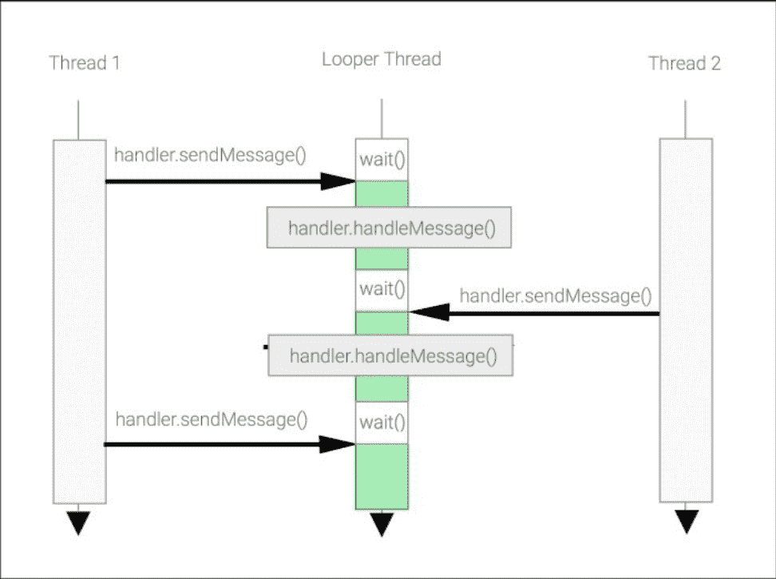
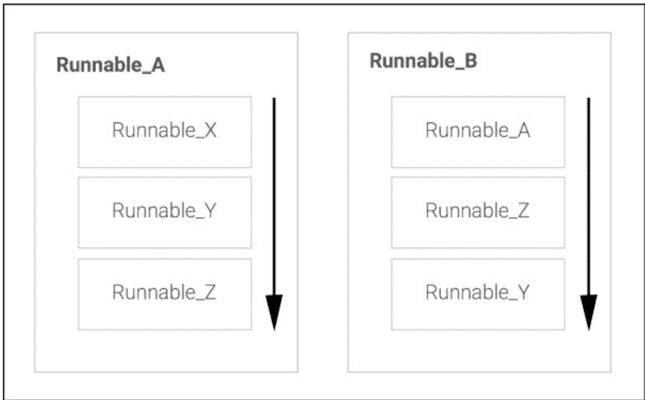

## 第 2 章。使用 Looper、Handler 和 HandlerThread 执行工作

在上一章中，您了解了开发响应式且并发的 Android 应用程序时开发人员可能面临的最基本并发问题。由于最可交互的项目在主线程上运行，因此协调后台代码来处理工作而不会出现影响用户体验的 UI 卡顿至关重要。

在本章中，我们将了解 Android 系统中用于在主线程或开发者创建的普通后台线程上执行任务和调度长时间运行操作的最基本构造。

我们将涵盖以下主题：

- 了解 Looper
- 了解 Handler
- 向 Looper 发送工作
- 使用 post 调度工作
- 使用 Handler 延迟工作
- 泄漏隐式引用
- 泄漏显式引用
- 使用 Handler 更新 UI
- 取消挂起的消息
- 使用 Handler 和 HandlerThread 进行多线程
- Handler 和 HandlerThread 的应用

### 了解 Looper

在理解 Looper 之前，我们需要了解它名称的来源。

> **注意**
> 循环是一组指令，直到满足终止条件之前会不断重复。

根据此定义，Android 的 Looper 在拥有 MessageQueue 的线程上执行，执行持续循环等待工作，并在没有待处理工作时阻塞。当工作提交到其队列时，它会将其分派到 Message 对象上明确定义的目标 Handler。

> **注意**
> 消息是包含描述和任意数据对象的通知对象，可以发送到 Handler。

Android 上的 Looper 是一种常见 UI 编程概念（称为事件循环）的实现。稍后，在处理序列的末尾，Handler 将处理 Message 并执行您的领域逻辑，以解决应用程序用户问题。

Android 上的 Looper 序列遵循以下步骤：

- 1. 等待从其 MessageQueue 中检索到 Message
- 2. 如果启用了日志记录，打印分派信息
- 3. 将消息分派到目标 Handler
- 4. 回收 Message
- 5. 转到步骤 1

如前一章所述，主线程会隐式创建自己的 Looper 来按顺序处理保持应用程序运行并管理应用程序组件之间交互所需的所有内容。

要访问主线程的 Looper 实例，请使用静态方法 getMainLooper()：

```
Looper mainLooper = Looper.getMainLooper();
```

要设置我们自己的 Looper 线程，我们需要在线程中调用 Looper 的两个静态方法 prepare 和 loop，它们将处理持续循环。这是一个简单示例：

```
class SimpleLooper extends Thread {
    public void run() {
        // Attach a Looper to the current Thread
        Looper.prepare();
        // Start the message processing
        Looper.loop();
    }
}
```

在此代码片段中，当创建 SimpleLooper 对象并通过调用 start() 方法启动时，在当前应用程序进程中会创建一个新线程，并在新线程中自动调用 run()。当调用 run() 方法时，我们通过调用静态 Looper.prepare() 方法将 Looper 附加到当前线程。随后，当调用 loop() 时，我们开始处理消息。prepare() 方法负责初始化 MessageQueue 并将队列作为 ThreadLocal 参数附加到当前线程。

当调用 loop() 时，run() 方法会阻塞，直到 Looper 被中断以处理要添加到队列的新消息。

> **注意**
> Looper.prepare() 必须仅在同一线程中调用一次；否则，会抛出一个 RuntimeException，指出每个线程只能创建一个 Looper。

当我们想要停止持续的 Looper 执行时，可以调用其成员函数 quit() 在不处理队列中剩余消息的情况下停止它，或者调用 quitSafely() 来处理队列上的剩余工作并停止。

### 了解 Handler

与 Looper 一起，Handler 类是 Android 应用程序基础架构的基础。它支撑主线程所做的一切事情——包括调用 Activity 生命周期方法。

虽然 Looper 负责在其消息循环线程上分派工作，但 Handler 服务于两个目的：提供向其 Looper 队列提交消息的接口，并实现回调以在 Looper 分派这些消息时对其进行处理。

同样重要的是，每个 Handler 都绑定到单个 Looper，并由此绑定到一个线程及其 Looper MessageQueue。

要绑定到当前线程的 Looper，我们需要在调用 prepare 方法初始化 Looper 之后，通过默认 Handler() 构造函数实例化它。由于我们在 SimpleLooper 线程中通过默认构造函数 Handler() 创建处理程序，myHandler 将附加到当前线程的 Looper 而不是主线程的 Looper：

```java
public class SimpleLooper extends Thread{
    private Handler myHandler;
    @Override
    public void run() {
        Looper.prepare();
        myHandler = new MyHandler();
        Looper.loop();
    }
    public Handler getHandler(){
        return myHandler;
    }
}
```

除了向 Looper 线程提交工作的接口外，Handler 还定义了处理提交消息的代码。在以下代码中，MyHandler 类重写了超类（Handler）的 handleMessage 成员方法来定义我们的消息处理代码：

```java
public class MyHandler extends Handler {

	@Override
	public void handleMessage(Message msg) {
		// Add here your message handling
		// processing
	}
}
```

启动后，Looper 线程将在 Looper.loop() 中等待将消息添加到其队列。

当另一个线程使用提交方法将 Message 添加到队列时，等待线程将通过调用处理程序的 handleMessage() 方法将消息分派到我们的目标 MyHandler。

只要手头有 Handler 对象引用，我们就可以从任何线程向 Handler 发送消息，结果消息始终会被分派到 Looper 线程并由正确的 Handler 处理，如以下图表所示：




图 2.1: 将工作发布到其他线程

我们已经看到可以创建自己的 Looper 线程，但如前面详细提及的那样，主线程也是一个 Looper 线程。为了更清晰地说明，我们将创建一个 StackTraceHandler，用于打印当前线程的堆栈跟踪：

```
public class StackTraceHandler extends Handler {

    @Override
    public void handleMessage(Message msg) {
        // Prints the Stack Trace on the Android Log
        Thread.currentThread().dumpStack();
    }
}
```

创建 Handler 实例后，我们通过调用 handler 的 obtainMessage 从其回收消息池中检索一条消息，并将空消息发布到主线程的 Looper。通过 obtainMessage 获得的消息会被缓存，并且还会将 handler 设置为目标的 Handler 对象：

```java
public void onCreate(Bundle savedInstanceState) {
    super.onCreate(savedInstanceState);
    ...
    Handler handler = new StackTraceHandler();
    Message msg = handler.obtainMessage();
    handler.sendMessage(msg);
}
```

如前面所述，当我们的 handleMessage() 被分派时，它会在 handleMessage() 执行时打印活动堆栈帧，如下面的堆栈跟踪所示：

```
......StackTraceHandler.handleMessage(StackTraceHandler.java:18)
android.os.Handler.dispatchMessage(Handler.java:99)
android.os.Looper.loop(Looper.java:137)
android.app.ActivityThread.main(ActivityThread.java:4424)
java.lang.reflect.Method.invokeNative(Native Method)
java.lang.reflect.Method.invoke(Method.java:511)
```

没错，handleMessage() 正在主 Looper 调用的 dispatchMessage() 调用中运行，并且它被分派到主线程的执行流中。

## 将工作发送到 Looper

此前，StackTraceHandler 隐式绑定到当前主线程的 Looper，因此为了使其更灵活，让我们进一步将其设计为可附加到任何 Looper。

在以下代码中，我们将重写默认的 Handler 构造函数，并定义一个接受将进入队列的 Looper 的构造函数，然后我们将处理和分派该消息：

```java
public class StackTraceHandler extends Handler {
    StackTraceHandler(Looper looper){
        super(looper);
    }
}
```

我们的新构造函数基本上将 Handler 附加到作为参数传递的 Looper，使 StackTraceHandler 可附加到任何 Looper，而不是当前线程的 Looper。

我们的 SimpleLooper 也被扩展，以提供一个获取方法来检索与其线程关联的 Looper 对象：

```java
public class SimpleLooper extends Thread{
    // start condition
    boolean started = false;
    Object startMonitor = new Object();
    Looper threadLooper = null;

    @Override
    public void run() {
        Looper.prepare();
        threadLooper = Looper.myLooper();
        synchronized (startMonitor){
            started = true;
            startMonitor.notifyAll();
        }
        Looper.loop();
    }

    Looper getLooper(){
        return threadLooper;
    }

    // Threads could wait here for the Looper to start
    void waitForStart(){
        synchronized (startMonitor){
            while (!started){
                try {
                    startMonitor.wait(10);
                } catch (InterruptedException e) {
                } ...
            }
        }
    }
}
```

现在，从主线程，我们启动 SimpleLooper 及其自身线程，当它启动时，我们获取 Looper 实例以将我们的 Handler 绑定到 SimpleLooper 线程和 Looper：

```java
SimpleLooper looper = new SimpleLooper();
looper.start();
looper.waitForStart();
Handler handler = new StackTraceHandler(looper.getLooper());
```

现在，我们将像在之前的示例中一样，从运行在主线程中的 Activity 的 onCreate() 回调发送消息：

```java
Message msg = handler.obtainMessage();
handler.sendMessage(msg);
```

如下面的堆栈跟踪所示，底部的线程堆栈帧指向 SimpleLooper.run()，而在堆栈跟踪的顶部，我们有我们的 Handler 回调 StackTraceHandler.handleMessage：

```
at ...activity.StackTraceHandler.handleMessage(StackTraceHandler.java:18)
at android.os.Handler.dispatchMessage(Handler.java:99)
at android.os.Looper.loop(Looper.java:137)
at ...activity.SimpleLooper.run(SimpleLooper.java:23)
```

这里需要意识到的有趣之处是，我们可以从主线程向 SimpleLooper 管理的后台线程发送消息（甚至可以从后台线程向主线程发送消息），从而将后台线程的工作交给主线程——例如，让主线程使用后台处理的结果来更新用户界面。

## 使用 post 调度工作

如前一段所讨论的，我们可以通过将 Looper 实例的引用传递给 Handler 构造函数，将工作提交到主线程或后台线程。

我们所说的工作可以由 java.lang.Runnable 的子类或 android.os.Message 的实例来描述。我们可以将 Runnable 发布到 Handler 实例或向其发送消息，它会将它们添加到关联 Looper 实例所属的 MessageQueue 中。

我们可以很容易地将工作发布到 Handler，例如，通过创建一个匿名内部 Runnable：

```java
final TextView myTextView = (TextView) findViewById(R.id.myTv);
// Get the main thread Looper by calling the Context
// function getMainLooper
Handler handler = new Handler(getMainLooper());

handler.post(new Runnable(){
    public void run() {
        String result = processSomething();
        myTextView.setText(result);
    }
});
```

Handler 绑定的 Looper 实例会处理队列，尽可能快地执行每个 Runnable。使用 post 方法发布只是简单地在队列末尾添加一个新的 Runnable。

如果我们希望我们的 Runnable 优先于队列中当前的任何内容，我们可以将其发布到队列前面，优先于现有工作：

```java
handler.postAtFrontOfQueue(new Runnable(){
    public void run() {
        ...
    }
});
```

在单线程应用中，这样将工作发布到主线程似乎好处不大，但将事物分解为小任务，这些任务可以交错并可能被重新排序，对于保持响应能力非常有用。

此外，通过将工作封装为更细粒度的工作单元，我们鼓励组件的重用，提高代码的可测试性，并增加工作组合的能力：



图 2.2: Runnable 组合

## 使用 Handler 推迟工作

当我们使用常规 post 工作函数时，工作会在 Looper 上处理完所有先前的工作单元后立即处理——但是如果我们想在 10 秒后调度一些工作会发生什么呢？

使用 Thread.sleep 阻塞主线程 10 秒意味着我们阻止主线程执行其他工作，并且必然会弹出 ANR 对话框。

替代方案是使用提供推迟功能的 handler 函数：

```java
public class MyRunnable implements Runnable {
    @Override
    public void run() {
        // do some work
    }
};
// Defer work in the main Thread
// by 10 seconds time
handler.postDelayed(new MyRunnable(),
TimeUnit.SECONDS.toMillis(10));
```

我们仍然可以在此期间发布额外的工作以供执行，我们的延迟 Runnable 实例将在指定延迟后执行。请注意，我们使用 java.util.concurrent 包中的 TimeUnit 类将秒转换为毫秒。

发布工作的另一种调度选项是 postAtTime，它根据系统正常运行时间（系统启动以来的时间）安排 Runnable 在特定时间执行：

```java
// Work to be run at a specific time
handler.postAtTime(new MyRunnable(),
SystemClock.uptimeMillis() +
TimeUnit.SECONDS.toMillis(10));
```

由于 postAtTime() 是基于 SystemClock 正常运行时间的偏移量实现的，调度可能会出现一些延迟问题，尤其是当设备最近处于深度睡眠状态时。考虑到这一点，并且在需要时序精度时，通常最好使用


handler.postDelayed to defer work.

## 隐式引用泄漏

使用 Handler 和匿名或非静态嵌套类延迟工作需要小心，以避免潜在的资源泄漏。在这些情况下，提交给 handler 的对象通常会创建一个指向其定义或创建所在类的引用。由于 Looper 消息队列会在预定时间之前保持 Runnable 对象存活，对原始 Android 组件的间接引用可能会阻止整个组件及其对象被垃圾回收。

让我们通过以下示例来看看这个问题：

```
public class MyActivity extends Activity {
  // nonstatic inner class
  public class MyRunnable implements Runnable {

    @Override
    public void run() {
      // do some work
    }
  }

  @Override
  public void onCreate(Bundle savedInstanceState) {
    // ...
    // Post Inner class instance Runnable
    handler.postDelayed(new MyRunnable(),
        TimeUnit.MINUTES.toMillis(10));

    // Post an Anonymous class instance
    handler.postDelayed(new Runnable() {
      @Override
      public void run() {
        // do some work
      }
    }, TimeUnit.MINUTES.toMillis(20));
    ...
  }
}
```

这两个对象，即通过默认构造函数创建的 MyRunnable 对象和在第二个 handler.postDelayed 中创建的匿名 Runnable 类，都持有 Activity 对象的引用。

通过在活动中声明匿名内部 Runnable，我们对包含的 Activity 实例建立了一个隐式引用。然后我们将 Runnable 发布到 handler，并告诉它在 10 分钟后执行。

如果在 10 分钟结束前活动完成，它尚未可以被垃圾回收，因为我们的 runnable 中的隐式引用意味着活动仍然可由存活对象访问。

因此，虽然这构成了一个简洁的示例，但在实践中，将非静态 Runnable 发布到主线程的 Handler 队列（尤其是使用 postDelayed 或 postAtTime）并不是个好主意，除非我们非常小心地清理自己对非活动 Activity 的所有引用。

如果 MyActivity 对象在 10 分钟内未被垃圾回收，包含所有活动视图和资源的内存泄漏将增加您的内存消耗，直到达到每个应用程序可用的最大堆空间。更糟的是，如果用户在应用程序中导航时创建此活动的多个实例，应用程序将会立即内存耗尽。

### 注意

每个应用程序可用的堆大小限制因设备而异。当应用程序达到此限制时，系统将抛出 OutOfMemoryError。

最大限度地减少此问题的一种方法是在创建延迟 Runnable 工作任务时，使用静态嵌套类或在其自己的文件中的顶级类（包的直接成员），以移除对原始 Activity 对象的引用。这意味着引用必须是显式的，这使得它们更容易被发现并设置为 null：

```
public class MyActivity extends Activity {
 // static inner class
 public static class MyRunnable implements Runnable {
}
```

## 显式引用泄漏

如果我们要与用户界面交互，我们至少需要对 View 层次结构中的一个对象的引用，我们可能将其传递给静态或顶级 runnable 的构造函数：

```java
static class MyRunnable implements Runnable {
    private View view;
    public MyRunnable(View view) {
        this.view = view;
    }
    public void run() {
        // ... do something with the view.
    }
}
```

然而，通过保持对 View 的强引用，如果我们的 Runnable 比 View 存活时间长，我们同样面临潜在的内存泄漏风险；例如，如果我们的代码的其他部分在我们的 Runnable 执行之前将此 View 从显示中移除。

解决此问题的一个方法是使用弱引用，并在使用被引用的视图之前检查是否为 null：

```java
static class MyRunnable implements Runnable {
    private WeakReference<View> view;
    public MyRunnable(View view) {
        this.view = new WeakReference<View>(view);
    }
    public void run() {
        View v = view.get(); // might return null
        if (v != null) {
            // ... do something with the view.
        }
    }
}
```

如果您之前没有使用过 WeakReference，它为我们提供了一种方法：只有在其他存活对象持有对它的较强引用时（例如，普通属性引用），才引用一个对象。

当所有强引用都被垃圾回收时，我们的 WeakReference 也将丢失对 View 的引用，get() 将返回 null，并且 View 将被垃圾回收。

这解决了资源泄漏问题，但在使用返回对象之前，我们必须始终检查是否为 null，以避免潜在的 NullPointerException 实例。

如果我们向 Handler 发送消息并期望它更新用户界面，它也将需要对视图层次结构的引用。一种很好的管理方式是从 onResume 和 onPause 附加和分离 Handler：

```java
private static class MyHandler extends Handler {
    private TextView view;
    public void attach(TextView view) {
        this.view = view;
    }
    public void detach() {
        view = null;
    }
    @Override
    public void handleMessage(Message msg) {
        // handle message
    }
}
```

```java
@Override
protected void onResume() {
    super.onResume();
    myHandler.attach(myTextView);
}
```

```java
@Override
protected void onPause() {
    super.onPause();
    myHandler.detach();
}
```

## 使用 Handler 更新 UI

由于我们在主线程中实例化了 handler，提交给它的所有工作都在主线程上执行。这意味着我们不能向这个特定的 handler 提交长时间运行的操作，但我们可以安全地与用户界面交互：

```
handler.post(new Runnable(){
public void run() {
TextView text = (TextView) findViewById(R.id.text);
text.setText("updated on the UI thread");
}
});
```

无论哪个线程发布 Runnable，这都适用，这使得 Handler 成为将其他线程执行的工作结果发送到主线程的理想方式：

```
public void onCreate(Bundle savedInstanceState) {
...
// Handler bound to the main Thread
final Handler handler = new Handler();
// Creates an async line of execution
Thread thread = new Thread() {
public void run() {
final String result = searchSynonym("build");
handler.post(new Runnable() {
public void run() {
TextView text = (TextView)
findViewById(R.id.text);
text.setText(result);
}
}
});
}
};
// Start the background thread with a lower priority
thread.setPriority(Thread.MIN_PRIORITY);
thread.start();
```

## 注意

如果您为后台工作启动自己的线程，请务必将优先级设置为 Thread.MIN_PRIORITY，以免主线程的 CPU 时间被剥夺。系统 CPU 调度程序会给优先级更高的线程分配更多的 CPU 周期。

Handler 非常基本，以至于其 API 直接集成到 View 类的成员函数中：

- View.post(Runnable).
- View.postDelayed(action, delayMillis).

因此，我们可以像下面这样重写前面的示例：

```
final TextView text = (TextView) findViewById(R.id.text);
Thread thread = new Thread(){
public void run(){
final String result = searchSynonym("build");
// Using the view post capabilities
text.post(new Runnable(){
public void run() {
text.setText(result);
}
});
}
};
thread.setPriority(Thread.MIN_PRIORITY);
thread.start();
```

在 Activity 类中编写代码时，有一种替代方法可以使用 Activity 的 runOnUiThread(Runnable) 方法在主线程上提交 Runnable，如上一章所述。如果当前线程是 UI 线程，则该操作会立即执行。如果当前线程不是 UI 线程，则该操作会发布到主 UI 线程的事件队列中。


## 取消挂起的 Runnable

在应用程序执行期间，您可能会遇到想要取消已发布 Runnable 的情况，例如，在 activity 的 onCreate() 中提交延迟任务，并在执行 onDestroy() 时取消它，因为 activity 即将被销毁。Handler 函数 removeCallbacks() 可以通过从工作队列中移除已发布的 Runnable 任务来取消挂起的操作：

```
final Runnable runnable = new Runnable(){
    public void run() {
        // ... do some work
    }
};
handler.postDelayed(runnable, TimeUnit.SECONDS.toMillis(10));
Button cancel = (Button) findViewById(R.id.cancel);
cancel.setOnClickListener(new OnClickListener(){
    public void onClick(View v) {
        handler.removeCallbacks(runnable);
    }
});
```

需要注意的是，为了能够指定要移除的内容，我们必须保留对 Runnable 实例的引用，并且取消仅适用于挂起的任务——它不会尝试停止已经在执行中的 Runnable。

### 注意

请记住，如果您多次发布同一个对象，removeCallbacks() 将移除所有引用该对象的非运行条目。

## 使用 send 安排工作

当我们发布 Runnable 时，如前示例所示，可以使用匿名 Runnable 在本地或成员作用域中定义工作。因此，Handler 事先不知道可能被要求执行哪种工作。

如果我们经常需要从不同作用域执行相同的工作，可以定义一个静态或顶级 Runnable 类，并从应用生命周期中的任何位置实例化它。

或者，我们可以通过向 Handler 发送消息并定义 Handler 根据不同消息做出相应反应，来颠覆这种方法。

举个简单的例子，假设我们希望 Handler 根据接收到的消息类型显示 hello 或 goodbye。为此，我们将扩展 Handler 并重写其 handleMessage() 方法：

```
public static class SpeakHandler extends Handler {
    public static final int SAY_HELLO = 0;
    public static final int SAY_BYE = 1;

    @Override
    public void handleMessage(Message msg) {
        switch (msg.what) {
        case SAY_HELLO:
            sayWord("hello");
            break;
        case SAY_BYE:
            sayWord("goodbye");
            break;
        default:
            super.handleMessage(msg);
        }
    }
    private void sayWord(String word) {
        // Say word
    }
}
```

在这里，我们实现了 handleMessage() 方法，以处理两种不同 what 值的消息并做出相应反应。除了用于标识消息内容的 what 属性外，消息对象还提供三个额外的整数字段 arg1、arg2 和 obj，可用于识别和指定消息。

### 注意

如果您仔细查看前面解释的 Speak handler 类示例，会发现我们将其定义为静态类。Handler 的子类应始终声明为顶级类或静态内部类，以避免意外的内存泄漏！

要将 Handler 实例绑定到主线程，只需从在主线程上运行的任何方法（例如 Activity onCreate() 回调）中实例化它即可：

```
private Handler handler;
protected void onCreate(Bundle savedInstanceState) {
    super.onCreate(savedInstanceState);
    handler = new SpeakHandler();
    ...
}
```

请记住，我们可以从任何线程向此 Handler 发送消息，并且它们将由主线程处理。我们向 Handler 发送消息，如下所示：

```
handler.sendEmptyMessage(SpeakHandler.SAY_HELLO);
...
handler.sendEmptyMessage(SpeakHandler.SAY_BYE);
```

使用前一种方法发布消息时，Handler 会为我们创建消息，用传入的整数填充消息的 what 属性，并将消息发布到 Handler 的 Looper 队列。当我们需要向 handler 发送基本命令时，这种结构非常有用；尽管当我们需要更复杂的消息时，需要使用其他消息属性（如 arg1、arg2 和 obj）来携带有关请求的更多信息。

由于消息可能携带对象有效负载作为消息执行的上下文，让我们扩展示例，允许 Handler 说出消息发送者想要的任何单词：

```
public static class SpeakHandler extends Handler {
    public static final int SAY_HELLO = 0;
    public static final int SAY_BYE = 1;
    public static final int SAY_WORD = 2;
    @Override
    public void handleMessage(Message msg) {
        switch(msg.what) {
        case SAY_HELLO:
        sayWord("hello"); break;
        case SAY_BYE:
        sayWord("goodbye"); break;
        case SAY_WORD:
        // Get an Object
        sayWord((String)msg.obj); break;
        default:
        super.handleMessage(msg);
        }
    }
    private void sayWord(String word) { ... }
}
```

在 handleMessage 方法中，我们可以通过访问公共 obj 属性来直接访问消息的有效负载。消息有效负载可以通过备用静态 obtain 方法轻松设置：

```
Message msg = Message.obtain(handler,
SpeakHandler.SAY_WORD, "Welcome!");
handler.sendMessage(msg);
```

在前面的示例中，我们基本上创建了一个 what 属性为 SAY_WORD、obj 属性为 Welcome! 的消息。

虽然这段代码的作用应该相当清楚，但您可能会好奇，为什么我们没有通过调用其构造函数来创建 Message 的新实例，而是调用了其静态方法 obtain。

原因是效率。消息只使用很短时间——我们实例化、分发、处理然后丢弃它们。因此，如果每次都创建新实例，我们就给垃圾回收器制造了工作。

垃圾回收开销很大，Android 平台会尽可能减少对象分配。虽然如果需要，我们可以实例化新的 Message 对象，但推荐的方法是从池中获取可重用的 Message 实例，以减少垃圾回收开销。通过减少内存占用，回收的对象更少，从而实现更快且频率更低的垃圾回收。

### 注意

在可以通过低成本整数参数构建消息的情况下，应该使用它们，而不是 obj 或 data 等复杂参数，因为这些参数始终会给 GC 制造额外工作。

正如我们可以使用 post 方法的变体来安排 Runnable，也可以使用 send 的变体来安排消息：

```
handler.sendMessageAtFrontOfQueue(msg);
handler.sendMessageAtTime(msg, time);
handler.sendMessageDelayed(msg, delay);
```

当没有有效负载时，还有一些空消息变体，方便使用：

```
handler.sendEmptyMessageAtTime(what, time);
handler.sendEmptyMessageDelayed(what, delay);
```

## 取消挂起的消息

取消已发送的消息也是可能的，并且实际上比取消已发布的 Runnable 更容易，因为我们不必保留可能要取消的消息的引用——相反，我们可以按 what 值或 what 值和对象引用来取消消息：

```
String myWord = "Do it now!";
handler.removeMessages(SpeakHandler.SAY_BYE);
handler.removeMessages(SpeakHandler.SAY_WORD, myWord);
```

需要注意的是，与已发布的 Runnable 类似，消息取消仅从队列中移除挂起的操作——它不会尝试停止正在执行的操作。

除了取消功能外，Handler 还提供函数来验证队列中是否有任何挂起的消息。使用 Handler 对象时，我们可以按消息的 what 值查询 Handler，即 hasMessages(what)，以及按 hasMessages(what, object) 消息对象值查询。让我们结合前面的示例看一些例子：

```
handler.hasMessages(SpeakHandler.SAY_BYE)
handler.hasMessages(SpeakHandler.SAY_WORD, myWord)
```

第一个示例将验证是否有 what 代码为 SAY_BYE 的消息，第二个示例将验证是否有 what 代码为 SAY_WORD 且对象指向与 myWord 相同引用的消息。

非常重要的是，要记住带对象参数的 removeMessages 和 hasMessages 方法会搜索队列，并使用 == 引用比较来比较对象，而不是比较对象值（如 equals()）。下面是一个简单示例来解释这种情况：

```
String stringRef1 = new String("Welcome!");
String stringRef2 = new String("Welcome! Home!");
Message msg1 = Message.obtain(handler,
   SpeakHandler.SAY_WORD,stringRef1);
Message msg2 = Message.obtain(handler,
   SpeakHandler.SAY_WORD, stringRef2);
// Enqueue the messages to be processed later
handler.sendMessageDelayed(msg1, 600000);
```


handler.sendMessageDelayed(msg1, 000000),
handler.sendMessageDelayed(msg2, 600000);

```
// try to remove the messages
handler.removeMessages(SpeakHandler.SAY_WORD,
stringRef1);
handler.removeMessages(SpeakHandler.SAY_WORD,
new String("Welcome Home!"));
```

```
// Create a Print Writer to Process StandardOutput
PrintWriter out =
new PrintWriter(System.out, true);
```

```
// Dump the Looper State
handler.getLooper().dump(out,">> Looper Dump ");
```

如前所述，第二次 remove 调用不会删除之前添加的消息，因为 stringRef1 引用与传入的新引用不同，尽管字符串内容相同。

以下是 looper 转储的输出，其中包含未成功取消的消息：

```
>> Looper Dump Looper (main, tid 1) {a15844a}
>> Looper Dump Message 0: { when=+10m0s0ms
what=2
obj=Welcome Home! target=...SpeakHandler }
>> Looper Dump (Total messages: 1,
polling=false, quitting=false)
```

## 组合与继承

到目前为止，我们通过子类化 Handler 来重写其 handleMessage 方法，但这不是我们唯一的选择。我们可以在 handler 构造期间传递 Handler.Callback 的实例，以优先使用组合而非继承：

```
boolean handleMessage(Message msg)
```

让我们假设我们想在不更改原始 Handler 的情况下扩展我们的扬声器，并且我们想在 Handler.Callback 类上添加新操作：

```
public class Speaker implements Handler.Callback {
    public static final int SAY_WELCOME = 2;
    public static final int SAY_YES = 3;
    public static final int SAY_NO = 4;

    @Override
    public boolean handleMessage(Message msg) {
        switch(msg.what) {
            case SAY_WELCOME:
                sayWord("welcome"); break;
            case SAY_YES:
                sayWord("yes"); break;
            case SAY_NO:
                sayWord("no"); break;
            default:
                return false;
        }
        return true;
    }
    private void sayWord(String word) { }
}
```

请注意，这里 handleMessage 的签名略有不同——我们必须返回一个布尔值，指示是否处理了该 Message。要创建使用我们扩展的 Handler，我们只需在 handler 构造期间传递 Handler.Callback 实现即可：

```
Handler handler = new SpeakHandler(new Speaker());
```

如果我们从回调的 handleMessage 方法返回 false，Handler 将调用其自身的 handleMessage 方法，因此我们可以选择在 Handler 子类中实现默认行为，并通过传递 Handler.Callback 实例来混入特殊行为，从而结合使用继承和组合。

在上述代码中，我们使用组合来处理 SAY_HELLO 消息，并使用继承来处理 SAY_YES 消息：

```
// will be handled by SpeakHandler Handler
handler.sendEmptyMessage(SAY_HELLO);
// will be handled by Speaker Handler.Callback
handler.sendEmptyMessage(SAY_YES);
```

## 注意

**继承**仅在子类与超类之间的关系永久且强大且无法解耦时才应使用。另一方面，**组合**为增强和测试提供了更多灵活性。

## 使用 Handler 和 ThreadHandler 进行多线程

在典型的 Android 异步应用程序中，UI 线程将长时间计算操作交给后台线程，后台线程随后执行任务并将结果发布回主线程。

到目前为止，我们只是使用 Handler 向主线程发送消息，因此下一步自然是设计一个多线程场景，其中线程间通信由 Handler 结构管理。

让我们扩展之前的示例并创建一个天气预报检索器。

想象一下这个场景：当我们点击 UI 按钮时，主线程将要求后台线程检索天气预报，当收到天气预报响应时，后台线程将要求主线程显示接收到的天气预报。

我们将首先创建 WeatherRetriever，它负责接收天气预报请求，然后检索预报句子并将结果发布回 mainHandler 对象。

在场景组装期间，WeatherRetriever handler 通过第一个构造函数参数附加到后台 Looper 上，以便在远离主线程的单独执行线上运行。第二个构造函数参数用于设置 handler 以发布结果。

在 handleMessage 方法中，handler 能够处理当天的预报消息请求 (GET_TODAY_FORECAST) 或第二天的请求 (GET_TOMORROW_FORECAST)，最终调用长时间计算的 getForecast() 操作。

长时间计算的 getForecast() 可能会长时间阻塞线程执行，但这不再是问题，因为我们将在优先级较低的后台线程中运行它，这不会阻止 UI 及时渲染，从而防止发生 ANR 错误，并使应用程序对用户交互更加灵敏：

```
public class WeatherRetriever extends Handler {
    private final Handler mainHandler;
    public static final int GET_TODAY_FORECAST = 1;
    public WeatherRetriever(Looper looper, Handler mainHandler){
        super(looper);
        this.mainHandler = mainHandler;
    }
    // Long Computing Operation
    String getForecast(){ ... }
    @Override
    public void handleMessage(Message msg) {
        switch(msg.what) {
            case GET_TODAY_FORECAST:
            ...
            final String sentence = getForecast();
            Message resultMsg =
                mainHandler.obtainMessage(
                WeatherPresenter.TODAY_FORECAST, sentence);
                this.mainHandler.sendMessage(resultMsg);
                break;
            }
        }
};
```

其次，我们将构建 WeatherPresenter，它将处理来自后台操作的预报结果，并在主线程上向用户显示：

```
public class WeatherPresenter extends Handler {
public static final int TODAY_FORECAST = 1;
@Override
public void handleMessage(Message msg) {
switch(msg.what) {
case TODAY_FORECAST:
readTodayWeather((String) msg.obj); break;
... 
}
}
private void readTodayWeather(String word) {
// Present the weather forecast on the UI
...
}
```

我们之前在本章中详细介绍了一种使用 SimpleLooper 类设置 Looper 线程的方法，但有一种更简单的方法，即使用 SDK 专门为此目的提供的类：android.os.HandlerThread。

创建 HandlerThread 时，我们需要指定两件事：线程的名称（调试时很有帮助）以及其优先级，优先级必须从 android.os.Process 类的静态值集合中选择：

```
HandlerThread thread = new HandlerThread("background", Process.THREAD_PRIORITY_BACKGROUND);
```

## 提示

在 Android 中，线程优先级映射到 Linux nice 级别，后者决定了线程运行的频率。nice 值为 -20 是最高优先级，19 是最低优先级。默认 nice 级别为 0。除了优先级之外，Android 还使用 Linux cgroups 限制 CPU 资源。背景优先级的线程会被移动到 bg_non_interactive cgroup，如果其他组中的线程繁忙，该 cgroup 仅限于可用 CPU 的 5%。

配置 HandlerThread 时将 THREAD_PRIORITY_MORE_FAVORABLE 添加到 THREAD_PRIORITY_BACKGROUND 会将线程移动到默认 cgroup，但请始终考虑是否真的有必要——通常没有必要！

下表详细说明了 Android 线程优先级到 Linux nice 级别的映射；但是，不建议在常规应用程序中使用低于 -2 的 nice 级别：

| Java 优先级 | 线程优先级 | Nice 级别 |
|---|---|---|
| | THREAD_PRIORITY_URGENT_AUDIO | -19 |
| | THREAD_PRIORITY_AUDIO | -16 |
| MAX_PRIORITY | THREAD_PRIORITY_URGENT_DISPLAY | -8 |
| | THREAD_PRIORITY_DISPLAY | -4 |


| | THREAD_PRIORITY_FOREGROUND | -2 |
|---|---|---|
| NORM_PRIORITY | THREAD_PRIORITY_DEFAULT | 0 |
| | THREAD_PRIORITY_BACKGROUND | 10 |
| MIN_PRIORITY | THREAD_PRIORITY_LOWEST | 19 |

HandlerThread 继承自 java.lang.Thread，必须在它实际开始处理队列之前调用 start() 启动它：

```
thread.start();
```

现在，我们将从 Activity 回调中详细说明如何构建我们的场景，创建提交和处理请求所需的所有实例和对象：

```
// Background Thread
private HandlerThread thread;

protected void onCreate(Bundle savedInstanceState) {
    ...
    WeatherPresenter presHandler = new WeatherPresenter();

    // Creates a Thread with a looper attached
    handlerThread = new HandlerThread("background",
        Process.THREAD_PRIORITY_BACKGROUND);
    // start The Thread and waits for work
    handlerThread.start();

    // Creates the Handler to submit requests
    final WeatherRetriever retHandler =
        new WeatherRetriever(handlerThread.getLooper(),presHandler);
```

如前所述，检索器处理程序使用的是 HandlerThread 的 Looper 而不是主线程的 Looper，因此它在后台线程上处理预报请求，使我们可以在 WeatherRetriever 上运行长时间计算操作。

在手中持有 WeatherRetriever 对象（retHandler）引用后，我们可以通过使用 WeatherRetriever 处理程序发送消息，将新的预报请求入队到后台线程。在下一个示例中，我们监听 UI 上"今天"按钮的点击以发起预报请求：

```
todayBut.setOnClickListener(new View.OnClickListener() {
    @Override
    public void onClick(View v) {
        retHandler.sendEmptyMessage(WeatherRetriever.
                GET_TODAY_FORECAST);
    }
}
```

当预报在 WeatherRetriever 回调的后台线程上被处理时，会通过 WeatherPresenter 引用将消息分发到主 Looper，并在主线程上调用 readTodayWeather(String) 以向用户展示预报。

如下面的跟踪输出所示，预报检索器在 TID 为 120 的低优先级后台线程上运行，而预报结果在 TID 为 1 的主 UI 线程上呈现：

```
I/MTHandler(17666): Retrieving Today Forecast at
Thread[background,120]
I/MTHandler(17666): Presenting Today Forecast at Thread[main,1]
```

如果我们创建一个 HandlerThread 来为特定 Activity 执行后台工作，则希望将 HandlerThread 实例的生命周期与 Activity 的生命周期紧密绑定，以防止资源泄漏。

可以通过调用 quit() 关闭 HandlerThread，这将阻止 HandlerThread 从其队列中处理任何更多工作。API 级别 18 添加了 quitSafely 方法，它会导致 HandlerThread 在关闭前处理所有剩余任务。一旦 HandlerThread 被告知关闭，它将不再接受任何进一步的任务：

```
protected void onPause() {
    super.onPause();
    if (( handlerThread != null) && (isFinishing()))
        handlerThread.quit();
}
```

### Looper 消息分发调试

当您想要跟踪消息的分发和处理时，在任何消息由 Looper 路由以及处理程序完成处理时，在 Android 日志中打印一条消息会非常方便。Looper 对象为我们提供了一种设置消息分发调试打印机设施的方法，因此，从我们的 HandlerThread 中，我们可以设置它并启用跟踪请求所需的额外日志记录：

```
...
// Creates a Print writer to standard output
PrintWriterPrinter out= new PrintWriterPrinter(
new PrintWriter(System.out,true)
);
handlerThread.getLooper().setMessageLogging(out);
...
reqHandler.sendEmptyMessageDelayed (
WeatherRetriever.GET_TODAY_FORECAST,
10000
);
```

以下是当我们的预报请求由 Looper 处理时打印的调试消息示例：

> >>>>> 正在分发到处理程序 (...WeatherRetriever) {a15844a} null: 1
> <<<<< 处理程序 (...WeatherRetriever) {a15844a} null 已完成

分发调试消息的格式为 (<Target_Handler>) {Callback_Obj} : <what>。

在我们的简单示例中，我们将消息打印到进程的标准输出流（java.io.OutputStream），但在更高级的情况下，可以打印到任何 OutputStream 子类（文件、网络等）。

### 发送消息与发布 Runnable

值得花点时间考虑发布 Runnable 和发送消息之间的区别。

运行时差异主要在于效率。每次希望处理程序执行某项操作时创建新的 Runnable 实例都会增加垃圾回收开销，而发送消息则会重用来自应用程序范围池的 Message 实例。

对于原型开发和小型一次性任务，发布 Runnable 既快捷又简单，而发送消息的优势则随应用程序规模的增大而变得明显。

应该指出，发送消息更符合 *Android 的方式*，并在整个平台中广泛使用，以将垃圾对象降至最低并保持应用程序平稳运行。

### Handler 和 HandlerThread 的应用

Handler 类非常通用，因此其应用范围非常广泛。

到目前为止，我们已在 Activity 生命周期的背景下探讨了 Handler 和 HandlerThread，这限制了该构造可能被使用的应用程序类型——理想情况下，我们不想在此上下文中执行任何长时间运行的操作（一秒左右以上）。

考虑到这一限制，良好的候选用途包括执行计算、字符串处理、在文件系统上读取和写入小文件，以及使用后台 HandlerThread 读取或写入本地数据库。

### 总结

在本章中，我们学习了如何使用 Handler 为主线程排队工作，以及如何使用 Looper 为我们自己的线程构建排队基础架构。

我们了解了使用 Handler 定义工作的不同方式：在调用点使用 Runnable 定义的任意工作，或在 Handler 本身中实现并通过消息发送触发的预定义工作。

与此同时，我们学会了如何正确延迟工作，而不会在过程中泄漏内存。

我们学习了如何在多线程应用程序中使用 Handler 在协作线程之间传递工作和结果，在普通后台线程上执行阻塞操作，并将结果传回主线程以更新用户界面。

在下一章中，我们将开始构建响应式应用程序，应用 AsyncTask 实例使用线程池在后台执行工作，并将进度更新和结果返回到主线程。
