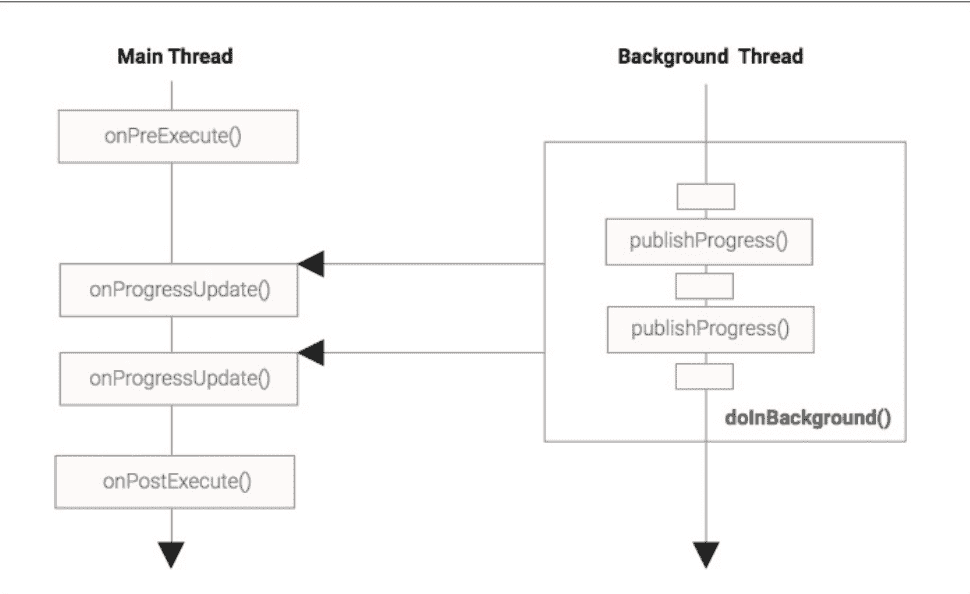
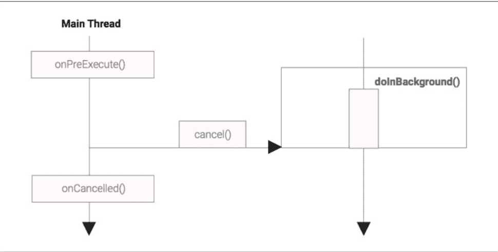
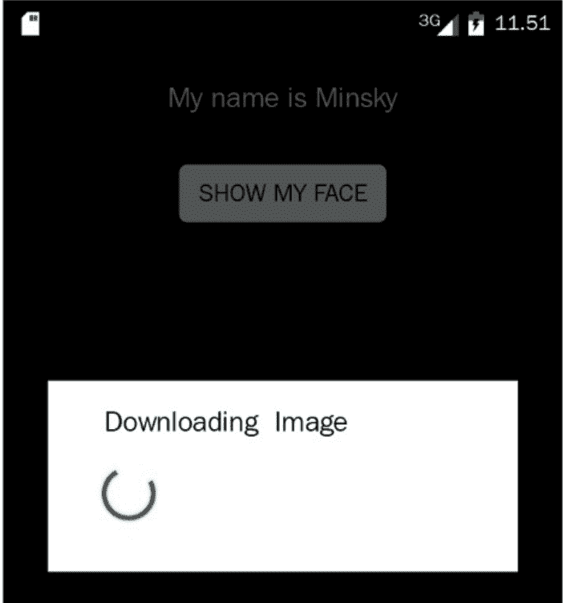
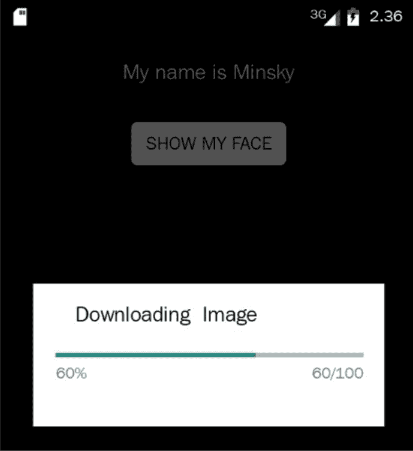
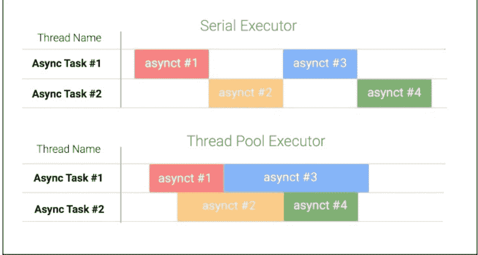

## 第 3 章 探索 AsyncTask

在第 2 章"使用 Looper、Handler 和 HandlerThread 执行工作"中，我们熟悉了 Android 平台上可用的最基本的异步和并发构造：Handler 和 Looper。这些构造支撑了主线程用于渲染 UI 和运行 Android 组件生命周期的大多数事件驱动和顺序处理。

在本章中，我们将探索 android.os.AsyncTask，这是一个更高级别的构造，它为我们提供了一个简洁精简的接口来执行后台工作并将结果发布回主线程，而无需管理线程创建和处理器操作。

本章将介绍以下主题：

- AsyncTask 简介
- 声明 AsyncTask 类型
- 执行 AsyncTask
- 提供不确定进度反馈
- 提供确定进度反馈
- 取消 AsyncTask
- 处理异常
- 控制并发级别
- 常见 AsyncTask 问题
- AsyncTask 的应用


## 介绍 AsyncTask

AsyncTask 是随 Android Cupcake（API 级别 3）引入到 Android 平台的，其明确目的是帮助开发者避免阻塞主线程。

这个类名称中的 Async 部分源自单词 asynchronous，其字面意思是阻塞任务并非在调用它的同时发生。

AsyncTask 在一个构造中封装了后台线程的创建、与主线程的同步以及执行进度的发布。

与 Handler 和 Looper 构造相比，AsyncTask 使开发者免于管理底层组件、线程创建和同步。

AsyncTask 是一个抽象类，因此必须通过子类化才能使用。至少，我们的子类必须为抽象 doInBackground 方法提供实现，该方法定义了我们希望在主线程之外完成的工作。

```
protected Result doInBackground(Params... params)
```

doInBackground 将在当前进程的一个并行线程中执行，该线程的优先级为 THREAD_PRIORITY_BACKGROUND（Nice 级别 10），名称采用以下形式：AsyncTask #<N>。

除了 doInBackground 方法之外，该构造还提供了不同的方法，开发者可以在子类中实现这些方法来设置任务、发布进度并将最终结果发布到主线程。

AsyncTask 中还有另外五个方法，我们可以选择重写：

```
protected void onPreExecute()
protected void onProgressUpdate(Progress... values)
protected void onPostExecute(Result result)
protected void onCancelled(Result result)
protected void onCancelled()
```

虽然我们可以重写这五个方法中的一个或多个，但我们不会在自己的代码中直接调用它们。这些是回调方法，意味着它们会在 AsyncTask 生命周期的适当时间为我们调用（回调）。

doInBackground() 与其他四种方法之间的关键区别在于它们执行所在的线程。

在任何后台工作开始之前，当我们调用 execute(Params...) 方法时，onPreExecute() 会被调用，并在主线程上同步运行至完成。

在 onPreExecute() 方法中，我们可以设置任务或 UI 上的任何进度对话框，以指示用户您的任务刚刚开始。

一旦 onPreExecute() 完成，doInBackground() 将被调度并开始在后台线程上工作。

在后台工作期间，开发者可以从 doInBackground() 发布进度更新，这会触发主线程使用我们提供的进度值执行 onProgressUpdate。在内部，AsyncTask 使用绑定到主线程 Looper 的 Handler 在主线程上发布结果，如第 2 章“使用 Looper、Handler 和 HandlerThread 执行工作”中所述。

通过在主线程上调用此方法，AsyncTask 使我们能够轻松更新用户界面以显示进度（请记住，我们只能从主线程更新用户界面）。

当后台工作成功完成时，doInBackground() 可以返回一个结果。此结果会传递给 onPostExecute()，它会在主线程上为我们调用。在 onPostExecute() 中接收到结果后，我们可以使用后台处理的结果更新用户界面：

### 注意

在一个线程和另一个线程之间传递数据的模式非常重要，因为它允许我们将密集且耗时的任务运行在关键主线程之外。该构造简化了主线程中的通信，并为在后台线程上执行异步工作提供了高级 API。

我们的 AsyncTask 可以操作封装 Activity 类的字段，但那样我们就必须采取预防措施，例如添加同步以防止竞争条件并确保更新的可见性。



图 3.1：AsyncTask 回调执行函数

前面的图显示了 AsyncTask 执行的一系列方法调用，说明哪些方法在主线程上运行，哪些在 AsyncTask 后台线程上运行。

### 注意

由于 onPreExecute()、onProgressUpdate()、onPostExecute() 和 onCancelled() 方法是在主线程上调用的，我们不得在这些方法中执行长时间运行/阻塞操作。

如果在 doInBackground() 完成之前通过 AsyncTask 引用调用 cancel 方法，则不会调用 onPostExecute()。取而代之的是，备选的 onCancelled() 回调方法会在 UI 线程上调用，以便我们可以针对成功完成与取消完成实现不同的行为：



图 3.2：AsyncTask 取消任务执行序列

前面的图显示了在 doInBackground() 完成之前取消任务时的方法调用序列。如我们在前面的图中所示，cancel() 可能由主线程或任何有权访问 AsyncTask 对象引用的其他线程调用。

## 声明 AsyncTask 类型

AsyncTask 是一个泛型类，公开了三个泛型类型参数：

```
abstract class AsyncTask<Params, Progress, Result>
```

为了使用泛型类型，必须为为泛型类型声明的每个类型参数提供一个类型实参。

### 注意

泛型类提供了一种为不同输入类型重用相同泛型算法的方式。泛型类可以具有一个或多个类型参数。

当我们声明 AsyncTask 子类时，将为 Params、Progress 和 Result 指定类型；例如，如果我们想将 String 参数传递给 doInBackground，将进度报告为 Float，并返回 Boolean 结果，我们将按如下方式声明我们的 AsyncTask 子类：

```
public class MyTask extends AsyncTask<String, Float, Boolean>
```

如果我们不需要传递任何参数，或者不想报告进度，那么对于这些参数，一个很好的类型是 java.lang.Void，它清楚地表明了我们的意图，因为 Void 是一个不可实例化的类，代表 void 关键字。

只有引用类型可以用作泛型类型的类型实参。这包括类、接口、枚举类型、嵌套类型和内部类型以及数组类型。不允许将原始类型用作类型实参。下一个声明在泛型类型类定义中被视为非法：

```
// Error
public class MyTask extends AsyncTask<String, float, boolean>
```

让我们来看看我们的第一个示例，在后台执行昂贵的图像下载并将结果报告到当前 UI：

```
public class DownloadImageTask extends AsyncTask<URL, Integer, Bitmap> {

// Weak reference to the UI View to update

private final WeakReference<ImageView> imageViewRef;

public DownloadImageTask(ImageView imageView) {
    this.imageViewRef = new WeakReference<ImageView>(imageView);
}

// Retrieves the image from a URL
private Bitmap downloadBitmap(URL url) {
    // elided for brevity ...
    ...
}

@Override
protected Bitmap doInBackground(URL... params) {
    URL url = params[0];
    // The IO operation invoked will take a significant amount
    // to complete
    return downloadBitmap(url);
}

...

@Override
protected void onPostExecute(Bitmap bitmap) {
    ImageView imageView = this.imageViewRef.get();
    if (imageView != null) {
        imageView.setImageBitmap(bitmap);
    }
}
}
```

在这里，DownloadImageTask 扩展 AsyncTask，将 Params 类型指定为 URL，以便我们可以根据其 url 检索图像，将 Progress 指定为 Integer，将 Result 类型指定为 Bitmap。

我们将 ImageView 传递给构造函数，以便 DownloadImageTask 对要在完成时更新的用户界面持有弱引用。

我们已实现 doInBackground 以在后台下载图像，其中 url 是带有图像资源位置的 URL 参数。

在 onPostExecute 中，当视图弱引用不为 null 时，我们只需将位图加载到构造函数中存储的视图中。

WeakReference 不会阻止视图被垃圾回收


当创建视图的 Activity 不再处于活动状态时。

## 执行 AsyncTasks

在实现了 doInBackground 和 onPostExecute 之后，我们希望让任务运行起来。为此我们有两种方法可用，每种方法对任务执行的并发程度提供不同级别的控制。先来看看两种方法中较简单的一种：

```
public final AsyncTask<Params, Progress, Result> execute(Params... params)
```

返回类型是我们的 AsyncTask 子类的类型，这只是为了方便，以便我们可以使用方法链在一行中实例化并启动任务，同时仍然记录对实例的引用：

```
class MyTask implements AsyncTask<String, Void, String>{ ... }
MyTask task = new MyTask().execute("hello");
```

Params... params 参数是我们在类声明中使用的相同的 Params 类型，因为我们提供给 execute 方法的值随后会作为其 Params... params 参数传递给我们的 doInBackground 方法。请注意，这是一个 varargs（可变数量参数）参数，这意味着我们可以传递任意数量的该类型参数（包括不传递任何参数）。

### 注意

AsyncTask 的每个实例都是一次性对象——一旦我们启动了一个 AsyncTask，它就再也无法启动了，即使我们取消了它或先等待它完成。

这是一个安全功能，旨在保护我们免受并发问题（例如竞态条件）的影响。

执行 DownloadImageTask 非常直接——我们需要 Activity，它构建一个要更新的视图的 DownloadImageTask 实例，然后我们使用合适的 URL 值调用 execute 方法：

```
public class ShowMyPuppyActivity extends Activity {
@Override
public void onCreate(Bundle savedInstanceState) {
super.onCreate(savedInstanceState);
setContentView(R.layout.show_my_puppy);

// Get the show button reference
Button showBut = (Button) findViewById(R.id.showImageBut);
showBut.setOnClickListener(new View.OnClickListener() {

@Override
public void onClick(View v) {
...
// My Puppy Image URL
URL url = new URL("http://img.allw.mn/" +
"content/www/2009/03/april1.jpg");

// Get the Reference to Photo UI Image View
ImageView iv = (ImageView) findViewById(R.id.photo);
// Download the Image in background and
// load the image on the view
new DownloadImageTask(iv).execute(url);
...
}});
}
```

一旦我们点击 UI 显示按钮，就会创建一个新的 DownloadImageTask 并将其附加到一个 imageView，然后我们调用 execute() 方法在后台启动异步任务。当我们在任务上调用 execute() 方法时，这将导致调用 onPreExecute() 方法，随后调用 doInBackground() 方法。

如前所述，一旦下载完成，将调用 onPostExecute() 来将下载的图像（Bitmap）加载到图像视图中。

### 提示

您可以从您在 http://www.packtpub.com 的帐户中下载已购买的所有 Packt Publishing 图书的示例代码文件。如果您在其他地方购买了此书，可以访问 http://www.packtpub.com/support 并注册，以便文件直接通过电子邮件发送给您。

## 提供不确定进度反馈

启动了已知可能是长时间运行的任务后，我们可能希望让用户知道有事情正在发生。做到这一点有很多方法，但一种常见的方法是显示一个显示相关消息的对话框。

呈现我们对话框的一个好地方是 AsyncTask 的 onPreExecute() 方法中，它在主线程上执行，因此允许与用户界面交互。

修改后的 DownloadImageTask 将需要一个对 Context 的引用，以便它可以准备一个 ProgressDialog，它将分别在 onPreExecute() 和 onPostExecute() 中显示和关闭它。由于 doInBackground() 没有更改，为了简洁起见，以下代码中未显示它：

```
public class DownloadImageTask
extends AsyncTask<URL, Integer, Bitmap> {
...
private final WeakReference<Context> ctx;
private ProgressDialog progress;
...
public DownloadImageTask(Context ctx, ImageView imageView) {
this.imageView = new WeakReference<ImageView>(imageView);
this.ctx = new WeakReference<Context>(ctx);
}

@Override
protected void onPreExecute() {
if ( ctx !=null && ctx.get()!= null ) {
progress = new ProgressDialog(ctx.get());
progress.setTitle(R.string.downloading_image);
progress.setIndeterminate(true);
progress.setCancelable(false);
progress.show();
}
}

// ... doInBackground elided for brevity ...

@Override
protected void onPostExecute(Bitmap bitmap) {
    ...
    if ( progress != null ) { progress.dismiss(); }
    ...
}
}
```

剩下要做的就是将一个 Context 传递给我们修改后的 DownloadImageTask 的构造函数。由于 Activity 是 Context 的子类，我们可以简单地传递对宿主 Activity 的引用：

```
showBut.setOnClickListener(new View.OnClickListener() {
    @Override
    public void onClick(View v) {
        ...
        // Pass in the Context and the image view to load
        // the image
        new DownloadImageTask(
        ShowMyPuppyActivity.this, iv).execute(url);
        ...
    }
});
```



### 图 3.3：不确定进度对话框

一旦异步任务启动，onPreExecute() 回调将创建一个不确定进度对话框并按图 3.3 所示显示它。不可取消的对话框将放置在带有定义标题的不透明层上，覆盖在 UI 屏幕上方。说不确定，是指事先我们无法估计还需要等待多久任务才能完成。

直到下载完成并且对话框在 onPostExecute() 中关闭之前，用户都无法与应用程序交互，对话框将保持在前台。

### 注意

当在您能够在应用程序 UI 中呈现内容之前需要进行任何长时间计算时，您必须在用户等待时显示后台有事情正在发生的指示。

## 提供确定进度反馈

知道有事情正在发生对用户来说是一种极大的解脱，但他们可能会变得不耐烦，想知道还需要等待多久。让我们通过向对话框添加进度条来向他们展示我们的进度。

请记住，我们不允许直接从 doInBackground() 更新用户界面，因为我们不在主线程上。那么，我们如何告诉主线程为我们进行这些更新呢？

AsyncTask 附带一个方便的回调方法用于此，我们在本章开头见过其签名：

```
protected void onProgressUpdate(Progress... values)
```

我们可以重写 onProgressUpdate() 以从主线程更新用户界面，但它何时被调用，它的 Progress... 值来自哪里？ doInBackground() 和 onProgressUpdate() 之间的胶水是 AsyncTask 的另一个方法：

```
protected final void publishProgress(Progress... values)
```

要使用我们的进度更新用户界面，我们只需通过在 doInBackground() 内部调用 publishProgress() 从后台线程发布进度更新。每次调用 publishProgress() 时，主线程都将被安排使用这些进度值为我们调用 onProgressUpdate()。

对运行中的示例进行修改以显示确定进度条相当简单。由于我们已经将 DownloadImageTask 的 Progress 类型定义为 Integer，现在我们必须更改进度值的设置范围从 0（setProgress）到 100（setMax），并设置进度条的样式和边界。我们可以通过对 onPreExecute() 进行以下添加来完成此操作：

```
@Override
protected void onPreExecute() {
...
// Sets the progress bar style
progress.setProgressStyle(
    ProgressDialog.STYLE_HORIZONTAL);
progress.setIndeterminate(false);
progress.setProgress(0);
progress.setMax(100);
progress.setCancelable(false);
progress.show();
}
```

我们还需要实现 onProgressUpdate 回调以从主线程更新进度条：

```
@Override
protected void onProgressUpdate(Integer... values) {
    progress.setProgress(values[0]);
}
```

最后的修改是在 for 循环的每次迭代中计算进度，并调用 publishProgress()，以便主线程知道回调 onProgressUpdate()：

```
private Bitmap downloadBitmap(URL url) {
    InputStream is = null;

    // Before Download starts
    publishProgress(0);
    downloadedBytes = 0;
    // Creates a Connection to the image URL
    HttpURLConnection conn = (HttpURLConnection) url.
        openConnection();

    ...

    // Retrieves the image total length
    totalBytes = conn.getContentLength();

    ...

    BufferedInputStream bif = new BufferedInputStream(is) {

    int progress = 0;

    public int read(byte[] buffer, int byteOffset,
            int byteCount) throws IOException {
        // The number of bytes read in each stream read
        int readBytes = super.read(buffer, byteOffset,
                byteCount);

        ...

        // Actual number of bytes read from the file
```


```
downloadedBytes += readBytes;
// Percent of work done
int percent = (int)((downloadedBytes * 100f) / totalBytes);
// Publish the progress to the main thread
if (percent > progress) {
    publishProgress(percent);
    progress = percent;
}
... 
}
```

重要的是要理解，调用 publishProgress() 并不会直接调用主线程，而是向主线程的队列添加一个任务，该任务将在不久的将来由主线程处理。

请注意，我们只在百分比实际发生变化时才发布进度，从而避免不必要的开销：

## Note

需要知道的是，每次在后台线程（在 downloadBitmap() 中）调用 publishProgress() 时，系统会自动在内部发送一个新的 Handler 消息，将进度推送到主线程。



图 3.4：显示任务进度的确定性进度对话框

如图 3.4 所示，在 onPreExecute() 中创建的确定性对话框会在 doInBackground() 中持续使用任务的当前进度进行更新。进度按比率计算，如下面的除法所示：

从发布进度到看到用户界面更新之间的延迟，对于本示例以及任何 UI 工作量不过大的应用来说都将非常短。进度条将平滑更新，遵循的黄金法则是：我们的任何代码都不阻塞主线程，因为我们仅在百分比发生变化时才分发进度更新。

## Canceling an AsyncTask

我们可以为用户提供的另一个友好易用性细节是：在任务完成之前取消任务的能力——例如，在开始执行后，用户不再关心操作结果。AsyncTask 通过 cancel 方法提供取消支持。

```
public final boolean cancel(boolean mayInterruptIfRunning)
```

mayInterruptIfRunning 参数允许我们指定处于可中断状态的 AsyncTask 线程是否可以实际被中断——例如，如果我们的 doInBackground 代码正在执行阻塞式可中断函数，如 Object.wait()。当我们将 mayInterruptIfRunning 设置为 false 时，AsyncTask 不会中断当前的阻塞式可中断操作，AsyncTask 后台处理只有在阻塞操作终止后才会结束。

## Note

在行为良好的可中断阻塞函数中，如 Thread.sleep()、Thread.join() 或 Object.wait()，当线程通过 Thread.interrupt() 被中断时，执行会立即停止并抛出 InterruptedException。应妥善处理 InterruptedException，只有在明知后台线程即将退出时才应吞掉它。

仅调用 cancel 并不足以使我们的任务提前结束。我们需要通过定期检查 isCancelled 返回的值，并在 doInBackground 中做出适当响应，来主动支持取消。

首先，让我们通过向 onPreExecute 添加几行代码，来设置我们的 ProgressDialog 以触发 AsyncTask 的 cancel 方法：

```
@Override
protected void onPreExecute() {
  ...
  progress.setCancelable(true);
  progress.setOnCancelListener(
      new DialogInterface.OnCancelListener() {
        public void onCancel(DialogInterface dialog) {
          DownloadImageTask.this.cancel(false);
}});
...
}
```

现在，我们可以通过在进度对话框可见时触摸对话框外部或按下设备的返回按钮来触发 cancel。

我们将使用 false 调用 cancel，因为我们不希望在网络读取期间立即挂起当前的 IO 操作或检查 Thread.interrupted() 函数的返回值。我们仍然需要在 doInBackground 中检查取消情况，因此将按如下方式修改它：

```
private Bitmap downloadBitmap(URL url) {
Bitmap bitmap = null;
BufferedInputStream bif = new BufferedInputStream(is) {
...
public int read(byte[] buffer, int byteOffset,
 int byteCount) throws IOException {
 // Read the bytes from the Connection
 int readBytes = super.read(buffer, byteOffset, byteCount);
 // Verify if the download was cancelled
 if (isCancelled()) {
 // Returning -1 means that there is
 // no more data and the stream has just ended
 return -1;
 }
 ...
 }
}
// If the download is cancelled the Bitmap is null
if (!isCancelled()) {
bitmap = BitmapFactory.decodeStream(bif);
}
return bitmap;
}
```

在上述代码中，在我们对 BufferedInputStream 的匿名子类中，我们能够拦截连接上发生的每次读取。一旦就绪，并且在取消 AsyncTask 后，我们能够通过将读取调用的结果仅返回 -1（流结束）来停止数据流。一旦 BitmapFactory.decodeStream 接收到流结束，它会立即返回，我们将 downloadBitmap 调用的结果返回为 null。

被取消的 AsyncTask 不会收到 onPostExecute 回调。相反，我们有机会通过实现 onCancelled 来为已取消的执行实现不同的行为。此回调方法有两个变体：

```
protected void onCancelled(Result result);
protected void onCancelled();
```

带参数的 onCancelled(Result result) 方法的默认实现，在完成后会委托给 onCancelled() 方法。

如果 AsyncTask 既不能提供部分结果（例如部分图像数据），也不能提供任何内容，那么我们可能希望重写无参数的 onCancelled() 方法。

另一方面，如果我们在 AsyncTask 中执行增量计算，当部分结果对应用程序有一定意义时，我们可以选择重写 onCancelled(Result result) 版本。

在这两种情况下，由于 onPostExecute() 在被取消的 AsyncTask 上不会被调用，我们需要确保我们的 onCancelled() 回调适当地更新用户界面——在我们的示例中，这包括关闭在 onPreExecute() 中打开的进度对话框，并使用应用程序包中作为 drawable 可用的默认图像更新图像视图。

在我们的示例中，当任务被取消时，doInBackground() 的结果是一个 null 对象，因此我们将重写无参数的 onCancelled() 函数以添加先前描述的行为：

```
@Override
protected void onCancelled() {
    if ( imageView !=null && imageView.get() != null &&
        ctx !=null && ctx.get() != null ) {

    // Load the Bitmap from the application resources
    Bitmap bitmap = BitmapFactory.decodeResource(
        ctx.get().getResources(),
        R.drawable.default_photo
    );
// Set the image bitmap on the image view
this.imageView.get().setImageBitmap(bitmap);
}
// Remove the dialog from the screen
progress.dismiss();
}
```

另一种需要注意的情况是，当我们取消尚未开始其 doInBackground() 方法的 AsyncTask 时。如果发生这种情况，doInBackground() 永远不会被调用，尽管 onCancelled() 仍将在主线程上被调用。

## AsyncTask Execution State

execute() 方法可能以取消状态或完成状态结束，但是，如果用户尝试第二次调用 execute()，任务将失败并抛出 IllegalStateException 异常，提示：

> _无法执行任务，任务只能执行一次/任务已经在运行_

手头有 AsyncTask 对象的引用后，我们可以通过 getStatus() 方法确定任务的状态，并根据状态结果做出反应。让我们看看下一段代码片段：

```
// Create a download task object
DownloadImageTask task = new DownloadImageTask(
					ShowMyPuppyActivity.this, iv);
	...
if ( task.getStatus() == AsyncTask.Status.PENDING ) {
	// DownloadImageTask has not started yet so
	// we can invoke execute()
} else if (task.getStatus() == AsyncTask.Status.RUNNING) {
	// DownloadImageTask is currently running in
	// doInBackground()
} else if (task.getStatus() == AsyncTask.Status.FINISHED
	& task.isCancelled()) {
	// DownloadImageTask is done OnCancelled was called
} else {
	// DownloadImageTask is done onPostExecute was called
}
```

使用 AsyncTask 提供的 getStatus() 实例方法，我们可以跟踪后台任务的执行情况，并确切了解后台工作的当前状态。

## Note

如果要重复后台任务，必须实例化一个新任务并再次调用 execute() 方法。


## 处理异常

AsyncTask 定义的回调方法规定我们不能抛出受检异常，因此必须使用 try/catch 块包装任何抛出受检异常的代码。从 AsyncTask 的方法中传播出的未检查异常会导致我们的应用程序崩溃，因此我们必须仔细测试并在必要时处理这些异常。

对于在主线程上运行的回调方法——onPreExecute()、onProgressUpdate()、onPostExecute() 和 onCancelled()——我们可以在方法中捕获异常，并直接更新用户界面以提醒用户。

当然，异常也可能在我们的 doInBackground() 方法中发生，因为这是 AsyncTask 完成大部分工作的地方，但不幸的是，我们无法从 doInBackground() 更新用户界面。一个简单的解决方案是让 doInBackground() 返回一个可能包含结果或异常的对象。首先，我们将创建一个泛型类来存储操作的结果，以及一个用于存储异常的成员：

```
public class Result<T> {
	public T result;
	public Throwable error;
}
```

下一步，我们将创建一个名为 SafeDownloadImageTask 的新下载 AsyncTask，它负责异常处理，并且结果类型为 Result<Bitmap> 而不是 Bitmap：

```
public class SafeDownloadImageTask extends AsyncTask<URL, Integer, Result<Bitmap>> {
	// Method executed on the Background Thread
	protected Result<Bitmap> doInBackground(URL... params) {
		Result<Bitmap> result = new Result<Bitmap>();
		try {
			// elided for brevity ...
			...
			result.result = bitmap;
		} catch (Throwable e) {
			result.error = e;
		} ...
		return result;
	} ...
}
```

现在，我们可以在 onPostExecute 中检查 Result 对象中是否存在异常。如果存在，我们可以处理它，例如提醒用户；否则，我们像往常一样使用实际结果，并从结果中使用位图：

```
@Override
protected final void onPostExecute(Result<Bitmap> result) {
    ...
    if ( result.error!= null ) {
    // ... alert the user ...
    ...
    Log.e("SafeDownloadImageTask",
    "Failed to download image ",result.exception);
    loadDefaultImage(imageView);
    } else {
    // ... success, continue as normal ...
    imageView.setImageBitmap(result.actual);
    }
}
```

像上面这样的安全实现可以确保，在后台线程抛出的任何错误都会被安全地转发到主线程，而不会影响 AsyncTask 的正常生命周期。让我们尝试检索一个不存在的图片，看看异常是否被正确处理：

```
URL url = new URL("http://img.allw.mn" +
    "contentwww/2009/03/notfound.jpg");
new SafeDownloadImageTask(ShowMyPuppyActivity.this, iv)
.execute(url);
```

正如预期的那样，错误被捕获，包装在 Result 对象中，并在 Android 日志中打印，堆栈跟踪指向 SafeDownloadImageTask.doInBackground 方法：

```
...downloadBitmap(SafeDownloadImageTask.java:85)
...doInBackground(SafeDownloadImageTask.java:60)
...
```

```
84: if (responseCode != HttpURLConnection.HTTP_OK){
85:         throw new Exception(...);
86: }
```

## 控制并发级别

到目前为止，我们一直小心避免过于具体地说明调用 AsyncTask execute 方法时到底会发生什么。我们知道 doInBackground() 将在主线程之外执行，但这究竟意味着什么？

AsyncTask 的最初目标是帮助开发者避免阻塞主线程。在 API 级别 3 的初始形式中，AsyncTask 在单个后台线程上被排队并串行执行（即一个接一个），保证它们将按照启动顺序完成。

在 API 级别 4，这发生了变化，改为使用最多 128 个线程的池来并发执行多个 AsyncTask——并发级别高达 128。乍一看，这似乎是一件好事，因为 AsyncTask 的常见用例是执行阻塞 I/O，其中线程大部分时间都在空闲等待数据。

然而，正如我们在第 1 章“Android 中的异步编程”中所见，并发编程中经常出现许多问题，事实上，Android 团队意识到，默认情况下并发执行 AsyncTask 会使开发者面临潜在的编程问题（例如，并发执行时，不能保证 AsyncTask 将以启动的相同顺序完成）。

因此，在 API 级别 11 又做了一项进一步的更改，切换回默认串行执行，并引入了一种将并发控制权交还给应用开发者的新方法：

```
public final AsyncTask<Params, Progress, Result>
executeOnExecutor(Executor exec, Params... params)
```

从 API 级别 11 开始，我们可以使用 executeOnExecutor 启动 AsyncTask，并通过提供一个 Executor 对象来自行选择并发级别。

Executor 是 JDK java.util.concurrent 包中的一个接口，如在第 1 章“Android 中的异步编程”中更详细地描述的那样。

它的目的是提供一种提交任务以供执行的方式，而无需明确说明执行将如何或何时进行。Executor 的实现可能使用单个线程顺序运行任务，使用有限的线程池来控制并发级别，甚至为每个任务直接创建一个新线程。

AsyncTask 类提供了两个 Executor 实例，允许您在本节前面描述的并发级别之间进行选择：

- SERIAL_EXECUTOR：此 Executor 将任务排队，并确保任务由 AsyncTask 线程池按提交顺序顺序执行。
- THREAD_POOL_EXECUTOR：此 Executor 使用线程池运行任务以提高效率（启动新线程会带来一些开销成本，可以通过池化和复用来避免）。THREAD_POOL_EXECUTOR 是 JDK 类 ThreadPoolExecutor 的一个实例，它使用一个根据需求增长和收缩的线程池。在 AsyncTask 的情况下，该池配置为至少维护五个线程，并扩展到最多 128 个线程。在 Android Lollipop 5.0（API 级别 21）中，线程的最大数量减少到 CPU 核心数 * 2 + 1，ThreadPool 全局排队容量增加。

要使用特定的执行器执行 AsyncTask，我们调用 executeOnExecutor 方法，提供我们要使用的执行器的引用，例如：

```
task.executeOnExecutor(AsyncTask.THREAD_POOL_EXECUTOR,
 params);
```

由于自 API 级别 11 起，execute 的默认行为是在单个后台线程上串行运行 AsyncTask，因此以下两条语句是等价的：

```
task.execute(params);
 task.executeOnExecutor(AsyncTask.SERIAL_EXECUTOR, params);
```

在下图中，我们将展示当串行执行器和线程池处理一组按顺序入队的 AsyncTask 时的区别：

```
new SleepAsyncTask(1).execute(1000);
```

```
new SleepAsyncTask(4).execute(1000);
```



如上图所示，串行执行器使用 AsyncTask 线程池中可用的线程，但它们只会在前一个 AsyncTask 完成后才处理下一个 AsyncTask。或者，ThreadPoolExecutor 会在有可用线程完成工作时立即开始处理下一个任务，而不保证它们将以启动顺序完成：

### 注意

需要注意的是，系统中所有的 AsyncTask 都将共享同一个静态执行器 AsyncTask.THREAD_POOL_EXECUTOR。对于 SerialExecutor 来说，情况更糟，因为如果一个 AsyncTask 长时间占用单个执行器，接下来的任务将在队列中等待处理。

除了 AsyncTask 提供的默认执行器和 java.util.concurrent 中可用的执行器之外，我们还可以选择创建自己的执行器。例如，我们可能希望通过操作一个小


线程池，并在所有线程都繁忙时允许将许多任务排队。

这可以通过将我们自己的 ThreadPoolExecutor 实例配置为我们自己类的静态成员来轻松实现——例如，我们的 Activity 类。以下是我们如何配置一个拥有四到八个线程且队列实际上无限的执行器：

```
private static final Queue<Runnable> QUEUE =
        new LinkedBlockingQueue<Runnable>();
public static final Executor MY_EXECUTOR =
        new ThreadPoolExecutor(4, 8, 1, TimeUnit.MINUTES, QUEUE);
```

构造函数的参数指示核心池大小（4）、最大池大小（8）、空闲额外线程在被移除前可以在池中存活的时间（1）、时间单位（分钟），以及当池线程繁忙时用于追加工作的队列。

然后使用我们自己的 Executor 就像按如下方式调用我们的 AsyncTask 一样简单：

```
task.executeOnExecutor(MY_EXECUTOR, params);
```

## AsyncTask 的常见问题

与任何强大的编程抽象一样，AsyncTask 并非完全没有问题和妥协。在接下来的章节中，我们将列出在我们想要在应用程序中使用此构造时可能会遇到的一些陷阱。

### 碎片化问题

在“控制并发级别”部分，我们了解到 AsyncTask 随着 Android 平台的新版本而演变，导致其行为随运行任务的设备平台而异，这是更广泛的碎片化问题的一部分。

简单的事实是，如果我们针对广泛的 API 级别，我们的 AsyncTasks 的执行特性——因此也是我们应用程序的行为——在不同设备上可能会有很大差异。那么，我们可以做些什么来降低因碎片化而遇到 AsyncTask 问题的可能性呢？

最明显的方法是有意地将目标设备设置为运行至少 Honeycomb 的设备，即在 Android 清单文件中设置 minSdkVersion 为 11。这巧妙地将我们归类为默认串行执行 AsyncTasks 的设备类别，因此行为也更加可预测。

以 2015 年 10 月撰写时为例，只有 4% 的 Android 设备运行的是 API 级别 4 到 10 之间的 Android 版本（危险区），因此将应用程序定位到级别 11 并不会显著减少市场覆盖范围。

当使用 ThreadPoolExecutor 作为执行器时，棒棒糖（API 级别 21）中引入的更改也可能导致与旧版本（API 级别 >10）相比的行为漂移。现代 AsyncTask 的 ThreadPoolExecutor 受限于设备 CPU 核心数 * 2 + 1 的并发线程，并额外提供一个可容纳 128 个任务的队列来排队工作。

第二个选择是仔细设计我们的代码，并在一系列设备上进行充分测试——当然，这些始终是值得称赞的做法，但正如我们所见，并发编程本身就已经足够困难，无需再增加碎片化的复杂性，而且微妙的错误几乎总是会留存。

Android 开发社区建议的第三种解决方案是在自己的项目包中重新实现 AsyncTask，然后扩展您自己的 AsyncTask 类，而不是使用 SDK 版本。这样一来，您就不再受制于用户的设备平台，可以重新掌控自己的 AsyncTasks。由于 AsyncTask 的源代码易于获取，因此这并不难做到。

### 内存泄漏

在我们保留对 Activity 或 View 的引用的情况下，当 Activity 销毁时，我们可能会阻止整个对象树被垃圾回收。开发者需要确保取消任务并移除对已销毁 Activity 或 View 的引用。

### Activity 生命周期问题

在有意地将任何长时间运行的任务移出主线程后，我们使应用程序运行良好且响应迅速——主线程可以快速响应任何用户交互。

不幸的是，这也为我们创造了一个潜在问题，因为主线程可能在后台任务完成之前结束 Activity。Activity 可能会因多种原因结束，包括用户旋转设备导致的配置更改（Activity 被销毁并在内存中以新地址重新创建）、用户将设备连接到扩展坞，或任何其他类型的上下文更改。

如果在 Activity 结束后继续处理后台任务，我们很可能是在做无用功，从而浪费 CPU 和其他资源（包括电池寿命），这些资源本可用于更好的用途。

在设备旋转后的某些场景中，AsyncTask 仍然有意义并且有有效内容可交付，但它引用的 Activity 或 View 已被销毁，因此不再能够更新 UI、完成工作并交付结果。

同样，AsyncTask 持有的任何对象引用都无法进行垃圾回收，直到任务显式将这些引用设置为 null，或者任务完成并自身有资格进行 GC（垃圾回收）。由于我们的 AsyncTask 可能引用 Activity 或 View 层次结构的一部分，我们很容易以这种方式泄漏大量内存。

AsyncTask 的常见用法是将其声明为宿主 Activity 的匿名内部类，这会创建对 Activity 的隐式引用，从而导致更大的内存泄漏。

防止这些资源浪费问题有两种方法。

### 通过提前取消来处理生命周期问题

首先也是最重要的是，我们可以通过在 Activity 结束时取消正在运行的任务，将 AsyncTask 的生命周期与 Activity 的生命周期同步。

当 Activity 结束时，其生命周期回调方法会在主线程上被调用。我们可以检查调用生命周期方法的原因，如果 Activity 正在结束，则取消后台任务。此目的最合适的 Activity 生命周期方法是 onPause，它保证会在 Activity 结束之前被调用：

```
protected void onPause() {
    super.onPause();
    if ((task != null) && (isFinishing()))
        task.cancel(false);
}
```

如果 Activity 没有结束——例如，因为它启动了另一个 Activity 并且仍在返回栈上——我们可以简单地允许后台任务继续运行至完成。

此解决方案简单直接且干净，但远非理想，因为您可能会重新启动后台工作而浪费宝贵资源，却未意识到您可能已经拥有有效结果，或者您的 AsyncTask 仍在运行。

除此之外，当您启动多个 AsyncTasks 并在设备旋转时重新启动它们时，浪费会大幅增加，因为我们必须取消并重新启动相同数量的任务。

### 通过保留的无界面 Fragment 处理生命周期问题

如果 Activity 因配置更改而结束，使用后台任务的结果并在重新启动的 Activity 中显示它们可能仍然有用。实现这一点的一种模式是使用保留的 Fragments。

Fragment 是在 API 级别 11 引入 Android 的，但可以通过支持库用于针对较早 API 级别的应用程序。所有可下载的示例都使用支持库，并针对 API 级别 7 到 23。要使用 Fragment，我们的 Activity 必须扩展 FragmentActivity 类。

Fragment 的生命周期与宿主 Activity 的生命周期紧密绑定，当 Activity 重启时，Fragment 通常会被销毁。但是，我们可以通过在 Fragment 上调用 setRetainInstance(true) 来明确防止这种情况，使其在 Activity 重启期间存活。

通常，Fragment 负责创建和管理 Activity 用户界面的至少一部分，但这并非强制性的。不管理自身视图的 Fragment 被称为无界面 Fragment。由于它们没有相关的 UI，因此例如在用户旋转设备时，它们不必被销毁并重新创建。

将我们的 AsyncTask 隔离在保留的无界面 Fragment 中，可以减少意外泄漏对 View 层次结构等对象引用的可能性，因为 AsyncTask 不再直接与用户界面交互。为演示这一点，我们将从定义 Activity 将实现的接口开始：

```
public interface AsyncListener {
    void onPreExecute();
    void onProgressUpdate(Integer... progress);
    void onPostExecute(Bitmap result);
    void onCancelled(Bitmap result);
}
```

接下来，我们将创建一个包装我们的 AsyncTask 的保留无界面 Fragment。为简洁起见，doInBackground 被省略，因为它与之前的示例保持不变——完整代码请参见可下载的示例。

```
public class DownloadImageHeadlessFragment extends Fragment {
    // Reference to the activity that receives the
    // async task callbacks
    private AsyncListener listener;
    private DownloadImageTask task;

    // Function to create new instances
    public static DownloadImageHeadlessFragment newInstance(String url) {
        DownloadImageHeadlessFragment myFragment = new DownloadImageHeadlessFragment();
        Bundle args = new Bundle();
        args.putString("url", url);
        myFragment.setArguments(args);
        return myFragment;
    }

    // Called to do initial creation of fragment
    public void onCreate(Bundle savedInstanceState) {
        super.onCreate(savedInstanceState);
        setRetainInstance(true);
    }
}


```java
task = new DownloadImageTask();
url = new URL(getArguments().getString("url"));
task.execute(url);
}
// Called when an activity is attached
public void onAttach(Activity activity) {
super.onAttach(activity);
listener = (AsyncListener)activity;
}
```

```java
public void onDetach() {
super.onDetach();
listener = null;
}
// Cancel the download
public void cancel() {
if (task != null) {
task.cancel(false);
}
}
```

```java
private class DownloadImageTask extends AsyncTask<URL, Integer,
Bitmap> {
// ... doInBackground elided for brevity ...               }
}
```

正如您所知道，Fragment 的生命周期与其所属的 Activity 绑定，因此回调会按照当前 Activity 的生命周期事件有序调用。例如，当 Activity 停止时，所有附加到它的 Fragment 都会被分离，并收到 Activity 状态变更的通知。

在我们的示例中，我们使用 Fragment 的生命周期方法（onAttach 和 onDetach）来保存或移除保留 Fragment 中的当前 Activity 引用。

当 Activity 附加到我们的 Fragment 时，会调用 onCreate 方法来创建私有的 DownloadImageTask 对象，随后调用 execute 方法在后台启动下载。

newInstance 静态方法用于初始化和设置新 Fragment，无需调用其构造函数和 URL Setter。一旦创建 Fragment 对象实例，我们就会使用 setArguments 函数将图片 URL 保存在 Fragment arguments 成员存储的 Bundle 对象中。如果 Android 系统恢复我们的 Fragment，它会调用无参数的默认构造函数，并且还可以使用旧的 Bundle 来重建 Fragment。

每当在配置更改期间 Activity 被销毁并重新创建时，setRetainInstance(true) 会强制 Fragment 在 Activity 回收过渡期间存活。正如您所察觉，当 Activity 因配置更改被销毁时，此技术在我们不希望重新创建开销大的对象或具有独立生命周期的对象的情况下可能非常有用。

## 注意

需要知道的是，retainInstance() 只能用于不在返回栈中的 Fragment。对于保留的 Fragment，当 Activity 重新附加到新 Activity 时，不会调用 onCreate() 和 onDestroy()。

接下来，我们的 Fragment 需要管理并执行 DownloadImageTask，该任务通过 AsyncListener 接口将进度更新和结果代理回 Activity：

```java
private class DownloadImageTask extends AsyncTask<URL, Integer,
Bitmap> {
...
protected void onPreExecute() {
if (listener != null)
listener.onPreExecute();
}
protected void onProgressUpdate(Integer... values) {
if (listener != null)
listener.onProgressUpdate(values);
}
protected void onPostExecute(Bitmap result) {
if (listener != null)
listener.onPostExecute(result);
}
protected void onCancelled(Bitmap result) {
if (listener != null)
listener.onCancelled(result);
}
}
```

如前所述，AsyncListener 是负责使用后台任务返回的结果更新 UI 的实体。

现在，我们需要的是一个实现 AsyncListener 并使用 DownloadImageHeadlessFragment 来执行长时间运行任务的宿主 Activity。完整源代码可从 Packt Publishing 网站下载，因此我们只需查看重点部分：

```java
public class ShowMyPuppyHeadlessActivity
    extends FragmentActivity implements
    DownloadImageHeadlessFragment.AsyncListener {

private static final String DOWNLOAD_PHOTO_FRAG =
        "download_photo_as_fragment";

...

@Override
protected void onCreate(Bundle savedInstanceState) {
    ...
    FragmentManager fm = getSupportFragmentManager();
    downloadFragment = (DownloadImageHeadlessFragment)
    fm.findFragmentByTag(DOWNLOAD_PHOTO_FRAG);

    // If the Fragment is non-null, then it is currently being
    // retained across a configuration change.
    if (downloadFragment == null) {
    downloadFragment = DownloadImageHeadlessFragment.
        newInstance("http://img.allw.mn/content" +
            "www2009/03/april1.jpg");
    fm.beginTransaction().add(downloadFragment,
        DOWNLOAD_PHOTO_FRAG).
        commit();
    }
}
```

首先，在 onCreate 回调中创建 Activity 时，我们会检查 Fragment 是否已存在于 FragmentManager 中，只有在缺失时才创建实例。

创建 Fragment 时，我们通过 newInstance 方法构建 Fragment 实例，然后将其推送到 FragmentManager，这是负责存储并执行切换的实体。

如果我们的 Activity 已重启，在接收到进度更新回调时需要重新显示进度对话框，因此我们会在更新进度条之前检查并在必要时显示它：

```java
@Override
public void onProgressUpdate(Integer... value) {
    if (progress == null)
        prepareProgressDialog();

    progress.setProgress(value[0]);
}
```

最后，Activity 需要实现 AsyncListener 定义的 onPostExecute 和 onCancelled 回调。onPostExecute 将如之前示例一样更新 resultView，两者都会执行一些清理工作——关闭对话框并移除 Fragment，因为其工作现已完成：

```java
@Override
public void onPostExecute(Bitmap result) {
    if (result != null) {
        ImageView iv = (ImageView) findViewById(
                R.id.downloadedImage);
        iv.setImageBitmap(result);
    }
    cleanUp();
}

// When the task is cancelled the dialog is dismissed
@Override
public void onCancelled(Bitmap result) {
    cleanUp();
}
```

```java
// Dismiss the progress dialog and remove the
// the fragment from the fragment manager
private void cleanUp() {
    if (progress != null) {
        progress.dismiss();
        progress = null;
    }

    FragmentManager fm = getSupportFragmentManager();
    Fragment frag = fm.findFragmentByTag(DOWNLOAD_PHOTO_FRAG);
    fm.beginTransaction().remove(frag).commit();
}
```

这种技术在 Android 开发社区中广为人知，称为无头 Fragment，它简单且一致，因为每次发生配置更改时，它都会将重新创建的 Activity 附加到无头 Fragment 上。在 Fragment 上维护一个 Activity 引用，并在 Fragment 附加（Activity 创建）和分离（Activity 销毁）时进行更新。

利用此模式，AsyncTask 无需关注配置更改不可预测的发生情况，也无需担心工作完成后的 UI 更新，因为它会将生命周期回调转发给当前 Activity。

## AsyncTask 的应用

现在我们已经了解了如何使用 AsyncTask，可能会问自己什么时候应该使用它。

AsyncTask 的良好候选应用通常是寿命较短的操作（最多一两秒），这些操作直接关联到特定的 Fragment 或 Activity，并且需要更新其用户界面。

AsyncTask 非常适合运行短暂的 CPU 密集型任务，例如数值计算或在大文本字符串中搜索单词，将其从主线程移开，以便主线程能够保持对输入的响应并维持高帧率。

阻塞式 I/O 操作（例如读写文本文件，或使用 BitmapFactory 从本地文件加载图像）也是 AsyncTask 的良好用例。

当然，也有 AsyncTask 不太适合的用例。对于任何需要超过一两秒的操作，我们应该权衡如果用户旋转设备、在应用或 Activity 之间切换，或发生其他我们无法控制的情况时，重复执行此操作的成本。

考虑到这些因素，以及当我们尝试处理它们时复杂性增加的速度（例如，保留的无头 Fragment！），AsyncTask 对于较长操作开始失去光彩。

AsyncTask 经常用于从远程 Web 服务器获取数据，但这可能会遇到我们之前研究过的 Activity 生命周期问题。最终用户可能正在使用不稳定的 3G 或 HSDPA 连接，网络延迟和带宽可能差异很大，完整的 HTTP 请求-响应周期很容易持续数秒。这在上传大量数据（例如图像）时尤为重要，因为可用带宽通常是非对称的。

虽然我们必须在主线程之外执行网络 I/O，但 AsyncTask 不一定是理想选择——如我们稍后所见，有更合适的构造可用于将此类工作从主线程卸载。


When we want to compose or chain background processing over AsyncTasks, we could end up in situation where it is extremely difficult to manage the callbacks and coordinate the work so AsyncTask will not help you here.

Other techniques will be introduced and detailed in the next chapters for handling these kinds of problems in a clear way.

## 摘要

In this chapter, we've taken a detailed look at AsyncTask and how to use it to write responsive applications that perform operations without blocking the main thread.

We saw how to keep users informed of the progress, and even allow them to cancel operations early. We also learned how to deal with issues that can arise when the Activity lifecycle conspires against our background tasks.

Finally, we considered when to use AsyncTask, and when it might not be appropriate.

In the next chapter, we will learn how to transfer data from and to the network using effective asynchronous libraries and protocols, without even draining the battery.
