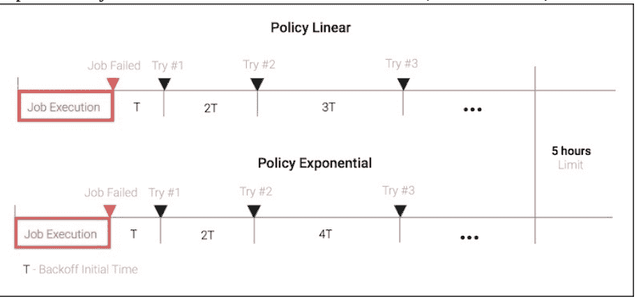

## 第 4 章 探索 JobScheduler API

In the previous chapter we familiarized ourselves with the simplest and high level, Android-specific, asynchronous construct; the android.os.AsyncTask. The AsyncTask is a lean construct used to create background work that offers a simple interface to publish results and send progress to the main thread.

In this chapter, we will learn how to work with JobScheduler to execute jobs in the background when several prerequisites are fulfilled and taking into account the energy consumption context of the device.

In this chapter, we will cover the following:

- JobScheduler 简介
- 设置 JobScheduler 运行条件
- 使用条件控制作业执行
- 如何使用 JobService 安排工作
- 使用 JobScheduler 执行重复任务
- 检索待处理的 JobScheduler 调度列表
- 如何在 JobScheduler 中取消任务

### JobScheduler 简介

The Android development team, under the project Volta umbrella, introduced in the API Level 21 Lollipop release some enhancements and features in order to improve the power usage on the Android platform. Apart from the tools introduced to monitor and follow the battery usage in the Android platform, a new API for scheduling background was officially released to help the developer. It saves extra power cycles when the jobs used to support the developer's application do not need a time of execution, and can be deferred until the device has better battery and network context.

The API was not created to completely replace AlarmManager; however, the JobScheduler API is able to perform a better battery management and supply extra behaviors.

The main features introduced with Scheduler API are as follows:

- **低功耗**: 作业任务可以推迟到设备连接充电器，或者分组定期批量运行
- **跨重启持久作业**: 我们能够安装跨设备重启持久任务的作业调度
- **更好的网络带宽管理**: 作业可以推迟到可用更高带宽网络时，例如 Wi-Fi 网络连接可用时
- **低侵扰执行**: 作业可以推迟到用户未与设备交互时

JobScheduler is a singleton system service that we can retrieve via a Context object instance, using a code similar to the following:

```
JobScheduler js = (JobScheduler)
getSystemService(Context.JOB_SCHEDULER_SERVICE);
```

The JobScheduler singleton service instance object helps us to manage our running jobs and provides us with member functions to schedule, cancel, and retrieve a list of deferred jobs.

Once we have a reference to the JobScheduler service, we can schedule a job by passing JobInfo to the JobScheduler.schedule function:

```
int schedule(JobInfo job);
```

JobInfo is the object used in this framework where we specify all the information about the job itself, all the conditions that should be fulfilled to initiate the job execution, and the unit of work called JobService that will be started to execute the work required.

To build a JobInfo object, a common factory pattern, known Software Engineering as Builder and materialized in the static inner-class JobInfo.Builder, is available to construct the JobInfo object passed to JobScheduler. The pattern provides us with a way to construct a multi-parameter JobInfo on a clean, step-by-step basis and by using the Builder setter functions to define the JobInfo parameters.

First, we will have to build a JobInfo.Builder object using the following constructor:

```
Builder(int jobId, ComponentName jobService)
```

jobId is an internal number used to identify your job in the JobScheduler service and the second argument is used to set the JobService derived class that will be invoked when the system verifies that all the prerequisites are met to execute the job.

Let's write some code to show this:

```
ComponentName jobSrcv= new ComponentName(ctx, MyJobService.class);
JobInfo.Builder jobIBuilder = new JobInfo.Builder(MY_JOB_ID,
jobSrcv);
```

### 设置运行条件

With the `Builder` object reference, we can start setting up the job parameters and the prerequisites using the member function available in the `Builder` object.

Let's consider a couple of examples. In our first example, the job should only start when there is a Wi-Fi network available, so to achieve that, we have to use the following code to set the network availability prerequisite:

```
jobIBuilder.setRequiredNetworkType(JobInfo.NETWORK_TYPE_UNMETERED);
```

An unmetered network connection means that you have a connection where you don't have a limited amount of data usage per month and you are not charged when you go over the usage limit. When a network type is not specified, as a condition, the default value is `NETWORK_TYPE_NONE`, meaning that the job will run in any network context and even without any network connection. Apart from the previous network type criteria, there is `NETWORK_TYPE_ANY`, which determines that the job could run when there is network connectivity available.

To specify a job to run only when the device is plugged in and charging:

```
jobIBuilder.setRequiresCharging(true);
```

When a job should only run when the device is in idle mode:

```
jobIBuilder.setRequiresDeviceIdle(true);
```

Idle mode means that the job should only run when the device is not in use and has not been used for some time. This could be the best time to execute heavier computations because the user will not notice that the device resources have been allocated to your job, thereby the computation does not interfere with the user interactions. By default, any job will not require idle mode to run.

Persist your job execution across device reboots as follows:

```
jobIBuilder.setPersisted(true);
```

Such as an `AlarmManager` job, the job schedule will only survive a reboot if your application holds the permissions to receive the completed boot. To achieve that, add the following line to the `Android Manifest` file:

```
<uses-permission
android:name="android.permission.RECEIVE_BOOT_COMPLETED" />
```

In those cases where you want to schedule a periodic task, you can set the interval in milliseconds between subsequent executions:

```
long interval = TimeUnit.HOURS.toMillis(5L);
jobBuilder.setPeriodic(interval);
```

This is an inexact interval since the Android system will try to group the jobs in batches in order to save some battery cycles.

When you want to define a maximum defer time to run your job, we can specify a time deadline where the job has to run, then it will run regardless of whether or not the other criteria are met:

```
long maxExecutionTime = TimeUnit.MINUTES.toMillis(5L);
jobBuilder.setOverrideDeadline(maxExecutionTime);
```

In the following code, we set one hour as the maximum time to defer this job, so, if the other prerequisites are not fulfilled, after one hour the job is going to run by the system independently of the other criteria:

```
jobBuilder.setOverrideDeadline(TimeUnit.HOURS.toMillis(1L));
```

On the other hand, we can also specify a minimum defer time to this job as a criterion:

```
jobBuilder.setMinimumLatency(TimeUnit.SECONDS.toMillis(120));
```

With the values used above, our job will never run on the next 120 seconds since we set a maximum latency time as a prerequisite to our job.

### 注意

setMinimumLatency and setOverrideDeadline are not applicable for periodic jobs criteria shall be avoided that it is in your recurrent jobs schedules. If any one of these criteria are used on recurrent jobs, an IllegalArgumentException exception will be thrown when the build is called.

When the job fails, in order to specify a retry policy, we have to specify the

backoff 初始值，用于确定重试之间的间隔和重试增加策略。JobScheduler API 提供两种策略，用于定义后续尝试之间重试时间的增加方式：

- BACKOFF_POLICY_LINEAR: 重试之间的间隔时间线性增加—initial_backoff_millis * num_retries
- BACKOFF_POLICY_EXPONENTIAL: 重试之间的间隔时间呈指数增长—initial_backoff_millis * 2 ^ (num_retries)



退避间隔将持续增加，直到达到五小时的退避时间（JobInfo.MAX_BACKOFF_DELAY_MILLIS），初始默认值为 30 秒（JobInfo.DEFAULT_INITIAL_BACKOFF_MILLIS）。

现在，在以下示例中，我们将展示如何为 jobInfo 对象创建线性退避策略和指数退避策略：

```
jobBuilder.setBackoffCriteria(TimeUnit.MINUTES.toMillis(10L),
JobInfo.BACKOFF_POLICY_LINEAR);
```

```
jobBuilder.setBackoffCriteria(TimeUnit.MINUTES.toMillis(3),
JobInfo.BACKOFF_POLICY_EXPONENTIAL);
```

构建器类还提供了一种方法来设置一些参数，以通过 PersistableBundle 对象转发作业：

```
PersistableBundle bundle = new PersistableBundle();
bundle.putInt(MY_JOB_ARG1, 2);
jobBuilder.setExtras(bundle);
```

## 注意

PersistableBundle 是一种特殊的 bundle，可以稍后保存和恢复。其主要目的是将参数传递给延迟作业执行。

一旦我们拥有调度所定义作业的所有条件，就可以构建 JobInfo 并使用它将作业执行纳入我们的应用程序中：

```
JobInfo.Builder jobBuilder = ...
// Set Criterias
JobInfo jobInfo = jobBuilder.setRequiresCharging(true)
        .setRequiresDeviceIdle(true)
        ...
        .build();
```

## 调度作业

在已定义条件和 JobInfo 对象的基础上，我们拥有设置应用程序作业所需的所有实体。那么现在让我们展示如何通过真实示例创建作业。

我们的示例将使用 Scheduler API 调度的作业，同步存储在设备文件中的用户账户信息与 HTTP Web 服务。用户界面将提供一个 UI，用于更新用户信息，一个按钮用于将信息保存到内部文件，以及一个按钮用于设置同步作业，该作业将把账户信息上传到 Web 服务。

首先，让我们定义作业的先决条件和参数：

- 我们的作业仅在设备充电时运行，以节省电池电量
- 我们的作业仅在有非按流量计费网络可用时运行，以节省移动网络带宽
- 我们的作业仅在设备空闲时运行，因为我们不想降低 UI 响应速度
- 我们的作业必须在调度后的八小时内至少运行一次
- 我们的作业应在设备重启后继续运行

JobInfo 对象需要一个 ID 来在所有 JobSchedule 方法中标识作业，因此为了确保一致性，使用公共静态 int 来标识它是个好主意：

```
static final int ACC_BACKUP_JOB_ID = "AccountBackJobService".hashCode();
```

后续取消或列出创建的作业的调用必须使用此处定义的相同 jobId。

由于我们使用文件在设备内部存储账户信息，因此用于检索账户信息的文件名需要作为参数传递给作业。同样的原则也适用于远程 Web 服务端点。

为了转发所需参数，我们需要构建 PersistableBundle，将文件名和端点路径作为 bundle 参数传递：

```
private static final String SYNC_FILE = "account.json";
private static final String SYNC_PATH = "account_sync";
private static final String SYNC_PATH_KEY = "path";
```

```
PersistableBundle bundle = new PersistableBundle();
// Forward filename where the account information is stored
bundle.putString(SyncTask.SYNC_FILE_KEY, SYNC_FILE);
// Forward the HTTP Path used to upload the account information
bundle.putString(SyncTask.SYNC_PATH_KEY, SYNC_PATH);
```

一旦条件确定并且我们拥有服务的标识符和类名，就可以使用 Builder 内部类创建 JobInfo，如下面的代码所示：

```
ComponentName serviceName = new ComponentName(this,
        AccountBackupJobService.class);
```

```
JobInfo jobInfo = new JobInfo.Builder(ACC_BACKUP_JOB_ID, serviceName)
        .setRequiresCharging(true)
        .setRequiredNetworkType(JobInfo.NETWORK_TYPE_UNMETERED)
        .setRequiresDeviceIdle(true)
        .setPersisted(true)
        .setOverrideDeadline(TimeUnit.HOURS.toMillis(8L))
        .setExtras(bundle)
        .build();
```

现在我们准备使用 JobScheduler 服务调度作业：

```
JobScheduler jobScheduler = (JobScheduler)
        getSystemService(JOB_SCHEDULER_SERVICE);
int result = jobScheduler.schedule(jobInfo);
```

```
if (result == JobScheduler.RESULT_FAILURE) {
    // Failed to setup the job
    Toast.makeText(AccountInfoActivity.this,
            "Failed to setup a sharedpref backup job",
            Toast.LENGTH_SHORT).show();
} else {
    // Schedule Success
    Toast.makeText(SharedPrefActivity.this,
            "SharedPrefBack job successfully scheduled",
            Toast.LENGTH_SHORT).show();
}
```

JobScheduler 的 schedule 方法在失败时会返回 RESULT_FAILURE，在成功时会返回我们在 JobInfo.Builder 构造函数中定义的作业标识符。

现在，既然我们刚刚调度了作业，是时候在 JobService 子类中编写备份行为了。在下一节中，我们将详细介绍如何实现一个与 JobScheduler 框架协同工作的 JobService。

## 实现 JobService

我们的 JobService 子类是负责执行繁重工作的实体，一旦 JobInfo 中指定的所有条件都满足，它就会接收回调。要实现自己的服务，我们需要继承 JobService 并覆盖启动和停止回调，如下面的代码所示：

```
public class AccountBackupJobService extends JobService {
    @Override
    public boolean onStartJob(JobParameters params) {
        // Start your job here
        return false;
    }

    @Override
    public boolean onStopJob(JobParameters params) {
        // Stop your job here
        return false;
    }
}
```

onStartJob 回调函数在主线程上运行，如果作业需要执行异步处理，则应返回 true 以表示它仍在后台线程上执行工作。回调函数还接收 JobInfo bundle 中指定的额外参数。

当系统需要取消作业执行时（因为 jobInfo 中指定的条件不再满足），onStopJob 会被系统自动调用。

例如，我们的作业要求在设备处于空闲状态时执行工作，因此，如果用户开始与设备交互导致设备退出空闲模式，onStopJob 会被调用以暂时放弃执行。

在此函数中，我们应该释放分配给作业的任何资源并停止任何正在进行的后台处理。此函数返回的布尔值将指示你是否希望根据作业创建时指定的相同条件重试此作业，或放弃作业执行。你应该使用 true 根据作业创建期间指定的重试条件重新调度此作业。

在添加服务业务逻辑之前，我们必须将服务类添加到 AndroidManifest.xml，并使用 android.permission.BIND_JOB_SERVICE 权限保护我们的服务：

```xml
<service
    android:name=".chapter7.AccountBackupJobService"
    android:exported="true"
    android:permission="android.permission.BIND_JOB_SERVICE" />
```

关于你的 JobService 实现，有两点需要牢记：

- 首先，onStartJob 和 onStopJob 回调将在主线程上运行，你有责任将服务的长时间运行任务交给独立线程，以防止主线程上的阻塞操作导致应用程序出现 ANR 对话框。
- 其次，Android 系统会在你的 JobService 回调运行期间为你获取并持有 WakeLock，或者直到你在 onStartJob 函数返回 true 的情况下显式调用 jobFinished 方法。如果你不这样做，系统就会认为你的作业执行尚未完成。WakeLock 会使设备保持唤醒状态并白白浪费设备电池电量。这可能会让用户生气，并成为卸载应用程序的理由，因为你的应用程序会浪费资源和电池并影响用户体验。

现在我们已经了解了 JobService 的理论知识，让我们编写代码，在后台处理线程中远离主线程执行与远程服务器的账户同步。

考虑到迄今为止学到的 Android 构造，我们将使用在第 3 章“探索 AsyncTask”中学到的 AsyncTask 构造，因其简单性，并创建一个 AsyncTask 子类，使用为此目的创建的内容上传账户信息：

```
public class Result<T> {
    public T result;
    public Exception exc;
}
```

```
public class SyncTask extends
    AsyncTask<JobParameters, Void, Result<JobParameters>> {

    // Parameter Keys for parameter arguments
    public static final String SYNC_FILE_KEY = "file";
```


```java
public static final String SYNC_FILE_KEY = "file";
public static final String SYNC_ENDPOINT_KEY = "http_endpoint";

// Variable used to store a reference to the service
private final JobService jobService;

// Constructor
public SyncTask(JobService jobService) {
    this.jobService = jobService;
}

...
```

作为起点，我们指定了泛型 AsyncTask 类的参数类型，将 JobParameters 设置为 doInBackground 的参数，将 Result 设置为从 doInBackground 返回并传递给 onPostExecute 函数的类型。

稍后，我们创建用于在 bundle 中传递信息的最终常量键。

Result 类型也会从之前的会话中恢复，以便在后台执行期间出现问题时返回错误。

不深入细节，我们将实现负责将数据上传到远程 Web 服务的 doInBackground 代码：

```java
@Override
protected Result<JobParameters> doInBackground(
        JobParameters... params) {

    Result<JobParameters> result = new Result<JobParameters>();
    HttpURLConnection urlConn = null;
    try {
        URL url;
        ...
        // Retrieve the file to upload from the parameters
        // passed in
        String file = params[0].getExtras().
                getString(SYNC_FILE_KEY);

        // Remote WebService Path
        String endpoint = params[0].getExtras().
                getString(SYNC_ENDPOINT_KEY);

        url = new URL("http://<webs_host>:<webs_port>/"
                + endpoint);

        ...
        // Load the account information stored internally
        String body = Util.loadJSONFromFile(jobService.file);
```

```java
...ing body, urlConn.getOutputStream().write(body);
// Write the information to the remote service
uploadJsonToServer(urlConn, body);
// Process Server Response
...
} catch (Exception e) {
    result.exc = e;
} finally {
    if (urlConn != null) {
        urlConn.disconnect();
    }
}
return result;
}
```

这里为简洁起见省略了一些实现细节，但我们已实现 doInBackground 函数以读取设备文件中内部存储的 JSON 数据，并通过 HttpURLConnection 上传它。显示表单的 Android Activity 会将保存和同步按钮提供给最终用户。**保存** 按钮一旦被按下，在点击 **保存** 按钮时会将账户信息存储在 account.json 本地文件中。

点击 **同步** 按钮后，将安排作业以与我们的远程 HTTP 服务器同步数据。当我们定义的作业条件满足时，将调用 doInBackground 在后台执行同步过程。

既然我们已拥有将数据上传到服务器的代码，让我们通过处理响应和服务器错误来完成它：

```java
try {
    ...
    int resultCode = urlConn.getResponseCode();
    if (resultCode != HttpURLConnection.HTTP_OK) {
        throw new Exception("Failed to sync with server :" + resultCode);
    }
    result.result = params[0];
    ...
}
```

当发生异常时，例如服务器宕机或服务器内部错误，异常会通过我们的 Result 对象传播到 onPostExecute 以供进一步处理。

请注意，我们正在小心处理错误情况，因此，为了向用户通知后台工作的结果，我们将编写一个在主线程上运行的 onPostExecute 函数，它将发布系统通知，告知用户任务是成功完成还是惨遭失败：

```java
@Override
protected void onPostExecute(Result<JobParameters> result) {
    NotificationCompat.Builder builder =
        new NotificationCompat.Builder(jobService);

    ...

    if (result.exc != null) {
        // Error handling
        jobService.jobFinished(result.result, true);
        builder.setContentTitle("Failed to sync account")
            .setContentText("Failed to sync account " + result.exc);
    } else {
        // Success handling
        builder.setContentTitle("Account Updated")
            .setContentText("Updated Account Successfully at " +
                new Date().toString());
        jobService.jobFinished(result.result, false);
    }
    nm.notify(NOTIFICATION_ID, builder.build());
}
```

任务完成后，我们调用 jobFinished(JobParameters params, boolean needsRescheduled) 以告知系统该任务已完成；但是，当发生异常时，我们会向系统报告任务未能成功完成，即在 jobFinished 的第二个参数中传递 true。

当已完成的作业失败并需要重新调度时，我们将 false 作为 jobService.jobFinished 的第二个参数传递，Scheduler API 将使用 JobInfo 对象中指定的回退时间重新调度我们的作业。但是，由于我们的作业仅在空闲模式下执行，失败的作业将被添加到调度程序队列中，并在未来的空闲维护窗口内重新执行，而不使用 JobInfo 中指定的回退时间。

始终调用 jobFinished 非常重要，以释放分配给作业的 WakeLock，并通知系统可以处理更多作业。

如果一切顺利，通知抽屉中应该会出现一条通知，显示成功消息以及上次同步成功的时间。

最后，我们可以更新 SyncJobService 代码以启动和停止 SyncTask 执行：

```java
public class SyncJobService extends JobService {
    private static final String TAG = "SyncJobService";
    SyncTask mJob = null;
    @Override
    public boolean onStartJob(JobParameters params) {
        Log.i(TAG, "on start job: " + params.getJobId());
        if (mJob != null) {
            mJob = new SyncTask(this);
            mJob.execute(params);
            return true;
        }
        return false;
    }

    @Override
    public boolean onStopJob(JobParameters params) {
        Log.i(TAG, "on stop job: " + params.getJobId());
        if (mJob != null) {
            mJob.cancel(true);
            mJob = null;
        }
        return true;
    }
}
```

## 列出待处理的作业

与 AlarmManager API 不同，Scheduler API 提供了列出应用程序所有待处理计划的功能。这个实用功能可以帮助我们识别将来要执行的作业，并根据该列表做出相应反应。检索到的列表可以帮助我们定位想要取消的待处理作业。

JobScheduler 服务类具有一个具有以下签名的实例方法：

```java
public List<JobInfo> getAllPendingJobs();
```

该方法将返回一个 JobInfo 对象列表，我们可以使用它在作业构建期间观察作业参数集：

- 每个作业的作业条件：
  - getNetworkType()
  - isRequireDeviceIdle()
  - isRequireCharging()
  - getMinLatencyMillis()
  - isPeriodic()
  - getIntervalMillis()
  - isPersisted()
  - getMaxExecutionDelayMillis()
- 由 JobScheduler 回调以执行作业的 JobService 子类—getService()
- 作业参数：getExtras()
- 重试策略：getInitialBackoffMillis() 和 getBackoffPolicy()

好了，现在我们准备创建一个 Activity 来打印应用程序的待处理作业列表：

```java
public class JobListActivity extends Activity {

    @Override
    protected void onCreate(Bundle savedInstanceState) {
        ...
        JobScheduler jobScheduler = (JobScheduler)
            getSystemService(JOB_SCHEDULER_SERVICE);

        // Get the list of scheduled jobs
        List<JobInfo> jobList = jobScheduler.getAllPendingJobs();
        // Initialize the adapter job list
        JobListRecyclerAdapter adapter =
            new JobListRecyclerAdapter(this, jobList);

        rv.setAdapter(adapter);
        // Set the Job Counter
        TextView jobCountTv = (TextView)findViewById(R.id.jobCount);
        jobCountTv.setText(Integer.toString(jobList.size()));
    }
}
```

为了在 UI 中列出待处理的作业，我们使用了支持库的 RecyclerView 类，它是 ListView 的更高级版本，简化了大量 View 的创建。

首先，我们将构建 ViewHolder 以持有行视图的引用，这些行视图将显示 jobId 和服务端点：

```java
public class JobListRecyclerAdapter extends
    RecyclerView.Adapter<JobListRecyclerAdapter.JobViewHolder> {
    ...

    public static class JobViewHolder extends
    RecyclerView.ViewHolder {
    // References to the Views
    CardView cv;
    TextView jobId;
    TextView serviceName;

    JobViewHolder(View itemView) {
        super(itemView);
        cv = (CardView)itemView.findViewById(R.id.cv);
        jobId = (TextView)itemView.findViewById(R.id.JobIdTv);
        serviceName = (TextView)
            itemView.findViewById(R.id.className);
    }
}
```

为了将 jobInfo 参数绑定到当前 ViewHolder，我们将编写 RecyclerView.onBindViewHolder 以根据当前 JobInfo 设置信息：

```java
@Override
```


@Override
public void onBindViewHolder(
 JobListRecyclerAdapter.JobViewHolder holder, int position) {
 // Retrieve the job for the current list row
 final JobInfo ji = mJobList.get(position);
 // Update the UI Views with the Job Info
 holder.jobId.setText(Integer.toString(ji.getId()));
 holder.serviceName.setText(ji.getService().getClassName());
}

是的，多亏了 getAllPendingJobs，我们拥有了一份作业列表，而且，我们可以对其进行程序化分析，以围绕当前的应用程序情况创建行为。

某些代码被故意省略；但是，完整源代码可在 Packt Publishing 网站上查看。请查看完整源代码，以了解 Recycler View 和 Card View 如何用于构建作业列表界面。

要随心所欲地操作作业，本章只需涵盖一项 CRUD（创建、读取、更新、删除）操作，即删除操作。删除作业操作由取消函数提供，并将在下一节中详细介绍。

## 取消作业

在某些情况下，当环境情况发生变化或不再有必要执行作业时，我们希望为用户提供取消作业的能力——例如，用户更改了作业所依赖的某项信息，该作业不再适用。JobScheduler 服务通过以下 cancel 和 cancelAll 方法为作业取消提供支持：

```
void cancel(int jobId);

void cancelAll();
```

第一个方法 cancel(jobId) 允许我们使用 schedule(JobInfo job) 函数返回的作业标识符，或 getAllPendingJobs 函数返回的 JobInfo 对象上可用的 jobId，来取消特定作业。

cancelAll() 方法允许我们取消当前应用已在 JobScheduler 中注册的计划作业。

借助前面示例中的 JobInfo，我们可以通过传递作业标识符来取消特定作业：

```
final JobInfo ji = ...;
JobScheduler jobScheduler = (JobScheduler)
mContext.getSystemService(mContext.JOB_SCHEDULER_SERVICE);
// Cancel a Specific Job based on the JobInfo->jobId
jobScheduler.cancel(ji.getId());
```

每当我们取消一个计划时，该作业将从 JobScheduler 的未来执行队列中移除，不再由 SyncJobService 或任何其他 JobService 执行。

### 调度周期性作业

到目前为止，我们已调度了一次性作业，但您知道是否有一个选项可以按固定间隔调度作业执行吗？这类作业非常适合用于执行重复备份或重复网络操作，例如应用程序用户数据备份。

让我们更新 AccountInfoActivity 以调度账户同步作业的周期性执行。

我们将首先为周期性作业定义一个新的作业标识符：

```
static final int SYNC_PER_JOB_ID = "SyncJobPerService".hashCode();
```

我们可以这样调度一个大约每 12 小时执行一次的周期性作业：

```
JobInfo.Builder builder = new JobInfo.Builder(SYNC_PER_JOB_ID,
serviceName);
builder.setRequiresDeviceIdle(true)
// Persist the schedule across the device reboots
.setPersisted(true)
.setPeriodic(TimeUnit.HOURS.toMillis(12L))
.setRequiredNetworkType(JobInfo.NETWORK_TYPE_UNMETERED)
.setRequiresDeviceIdle(true)
.setExtras(bundle);
```

```
// Schedule the repeating job
JobScheduler jobScheduler = (JobScheduler)
getSystemService(JOB_SCHEDULER_SERVICE);
jobScheduler.schedule(builder.build());
```

现在，我们可以在设备空闲且 Wi-Fi 网络可用时，在后台周期性运行同步作业。作业计划将由系统保留，并在设备启动后重新启用，直到我们显式取消作业或通过 cancelAll() 取消所有作业。

### JobScheduler 的应用

JobScheduler API 允许我们在某些条件下调度未来在无需用户干预的情况下异步运行的工作。该 API 还可以通过将作业执行推迟到设备充电或连接到无流量限制的网络（例如 Wi-Fi 网络）时，来降低能耗。

理想场景包括可推迟且无需精确定时执行的应用程序数据库备份、向网络定期上传用户数据以及下载配置参数。也就是说，通常是不必立即运行且数据无需立即供用户使用的作业。在不影响用户体验的前提下降低应用程序能耗，将延长设备电池续航时间，从而提升用户体验。

JobScheduler 可以覆盖 AlarmManager 的大多数用例，尽管它提供了优化设备资源获取的高级功能。作为一项额外功能，此 API 提供了一种创建可在设备关机和重启后仍然存在的计划的方法。

唯一的重大缺点是 JobScheduler 仅在 Android 5.0（Lollipop）中引入。因此，您需要将应用程序的目标 API 版本设置为 21 或更高版本，才能与此 API 交互。

撰写本文时（2016 年 7 月），45% 的 Android 设备运行支持 JobScheduler 的 Android 版本。如需获取按版本划分的 Android 市场份额的最新信息，请查看 Android 开发者信息中心。

## 摘要

在本章中，我们探索了 `JobScheduler` API，并将其用于调度在我们定义的一组条件满足时启动的后台工作。

我们详细了解了如何设置 API 支持的不同条件，以及如何基于 `JobInfo` 对象进行调度，该对象在设备充电且未在使用时启动作业。

同时，我们学习了如何实现异步 `JobService`，它能够在后台执行线程中运行，并通过释放所有已获取的资源（`WakeLock` 等）来正确完成作业执行。

后来，我们使用 `getAllPendingJobs` 创建示例代码，列出应用程序中所有待处理的 Scheduler API 作业。从示例中，我们学习了如何取消应用程序中的特定作业或所有待处理作业。

最后，我们使用 `JobScheduler` API 构建了一个持久且重复的计划，该计划每 12 小时唤醒设备并执行我们的作业。

在下一章中，我们将学习如何使用高效的异步库和协议进行网络数据传输，而无需过度消耗电池电量。
