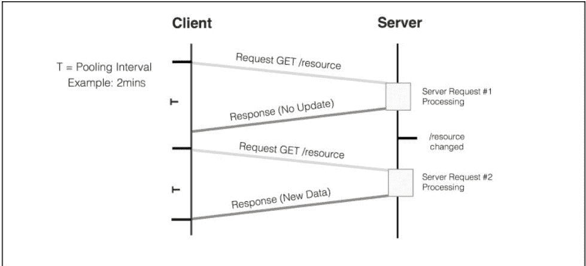
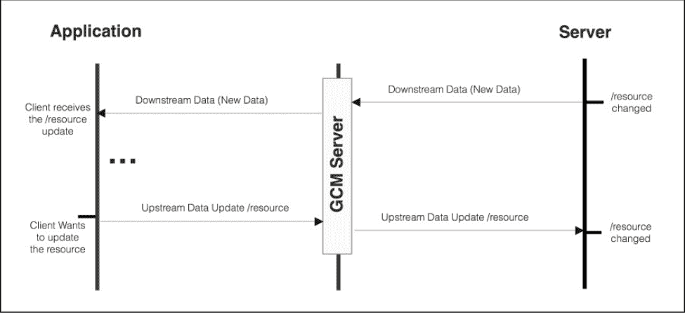
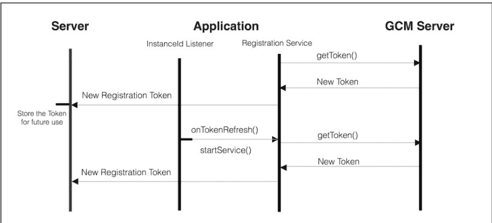

# 第 6 章。使用 GCM 进行网络交互

在之前的章节中，为了更新示例所需的任何类型的动态数据，我们显式发起到远程服务器的连接，唤醒执行网络操作所需的无线电和其他资源。应用程序可能会获取新鲜数据，或者如果自上次获取以来没有任何更改，则获取完全相同的数据。

虽然这种通信-获取模型对于大多数用例可能有效，但在数据不经常更改时，它可能会白白消耗电池资源和互联网带宽。

这种技术通常称为数据轮询，当大量客户端尝试获取或验证数据是否更改时，也可能增加服务器负载。

轮询技术的替代方案是数据推送。在这种技术中，服务器会在有新数据可用或数据更改时通知应用程序。当数据消费者（应用程序）收到通知时，它将与服务器发起新的交互以检索新鲜数据。

由于所需的同步更少，这将导致更少的网络交互，从而消耗更少的电池资源。

在本章中，我们将向您介绍 Google Cloud Messaging (GCM)，这是一项由 Google Play Services 提供的服务，可帮助您构建需要数据推送或拉取消息服务的应用程序。GCM 提供了一个框架，以电池高效的方式将推送消息发送到多台设备或一组设备。

在本章中，我们将涵盖以下主题：

- 轮询与推送消息
- 为您的应用程序设置和配置 GCM
- 使用 GCM 从服务器接收下行消息
- 从 GCM 主题流接收下行消息
- 使用 GCM 向您的服务器发送上行消息
- 使用 GcmNetworkManager 注册一次性和定期网络任务

## GCM 简介

由于与服务器的每次网络交互都可能唤醒无线电接口，在资源有限的设备上，尽量减少应用程序尝试连接网络以同步数据的次数至关重要。

对于需要定期更新和最新数据的应用程序（例如消息应用程序），在后台每隔 x 分钟设置一个闹钟进行轮询，然后唤醒无线电并下载数据，可能会在几个小时内耗尽电池。



图 1 - 从远程服务器轮询数据

GCM 为我们提供了一个平台，可以在有新数据需要消费或同步时，高效地传递小于 4096 字节的通知。这种交互模型减少了网络交互，无需不断轮询服务器来发现数据变化。




除了能够从服务器（使用 HTTP 或 XMPP 协议消息）向 Android 应用程序发送下行消息的能力之外，GCM 框架还提供了一个省电的通信通道，用于从您的应用程序向由您管理的 XMPP 服务器发送上行消息。

运行在 Android 设备上的 GCM 客户端在您的 GCM 服务器与设备之间提供了可靠且省电的连接。所维护的连接经过了高度优化，以尽量减少带宽和电池消耗。因此，强烈建议对需要高频网络数据更新的应用程序（例如实时消息传送）使用 GCM。

除此之外，当设备处于脱机状态且无法联系 GCM 服务时，平台能够在队列中保留消息，最多保留 20 条排队消息，并在设备重新上线后立即确保消息送达。

## 为您的应用程序设置和配置 GCM

要在您的应用程序上设置 Google Cloud Messaging，您需要注册 GCM，并在 Google 开发者控制台 (https://developers.google.com/mobile/add) 上设置 Google API 项目：

- 1. 首先选择 **Android App Platform**
- 2. 指定您的应用程序名称
  示例：Asynchronous Android
- 3. 提供您的应用程序包名
  示例：com.packpublishing.asynchronousandroid
- 4. 选择 **Cloud Messaging Services** 并 **启用 Google Cloud Messaging**
- 5. 生成配置文件，并将 JSON 配置文件 google-services.json 下载到您的计算机上。
- 6. 保存您的凭据（Server APIKey、SenderId）以对 GCM 平台进行身份验证。

一旦您已将应用程序注册到 GCM，获取 google-services.json 配置文件，并将该文件复制到 Android Studio 项目的 app/ 或 mobile/ 目录中。

接下来，将 Google Play Services SDK 添加到项目级和应用级 `<PROJECT_DIRECTORY>/build.gradle` 文件中，并重建您的 Android Studio 项目：

```
buildscript {
    repositories {
        jcenter()
    }
    dependencies {
        classpath 'com.android.tools.build:gradle:1.5.0'
        classpath 'com.google.gms:google-services:1.5.0-beta2'
    }
}
..
```

更新应用模块构建 `<PROJECT_DIRECTORY>/app/build.gradle`：

```
apply plugin: 'com.android.application'

android {
    compileSdkVersion 23
    buildToolsVersion "21.1.1"
    defaultConfig {
        applicationId "com.packpublishing.asynchronousandroid"
        minSdkVersion 9
        targetSdkVersion 23
    }
}

dependencies {
    ...
    compile 'com.google.android.gms:play-services-gcm:8.3.0'
}
apply plugin: 'com.google.gms.google-services'
```

要在 Android 应用程序中使用 GCM，您需要一台安装了 Google Play 商店且 Android API 为 8 或更高版本的设备，或者一台 API 级别为 9 的设备（如果您想要使用由 Google Play Services 提供的新 GCM 功能）。

在我们的构建文件中声明 Google Services 库依赖项后，我们可以开始在应用程序中引导 GCM 基础架构。

要在您的应用程序中使用 GCM，您需要在应用程序的 AndroidManifest.xml 文件中注册以下权限：

```
<uses-permission android:name="android.permission.INTERNET" >
<!--- Required to wakeup the device and deliver messages --->
<uses-permission android:name="android.permission.WAKE_LOCK" >

<permission android:name="<Package>.permission.C2D_MESSAGE"
    android:protectionLevel="signature">
<uses-permission android:name="<Package>.permission.C2D_MESSAGE">
...
</manifest>
```

### 注意

请注意，您应将 `<Package>` 替换为您独特的应用程序包名，例如 com.packpublishing.asynchronousandroid。

## 注册 GCM 接收器

为了从 GCM 平台接收 Broadcast Intents，我们将 GCM GcmReceiver（GCM 库提供的 WakefulBroadcastReceiver 子类）添加到 AndroidManifest.xml 的应用程序元素中：

```xml
<receiver
    android:name="com.google.android.gms.gcm.GcmReceiver"
    android:exported="true"
    android:permission="com.google.android.c2dm.permission.SEND" >
    <intent-filter>
        <action android:name="com.google.android.c2dm.intent.RECEIVE">
        <category android:name="<Package>">
    </intent-filter>
</receiver>
```

当来自 GCM 服务器的新下行消息到达时，此 BroadcastReceiver 会接收一个 Intent，因此需要订阅操作 com.google.android.c2dm.intent.RECEIVE 的 Intents。

## 设置注册服务

为了从 GCM 平台接收下行消息，Android 应用程序需要一个注册令牌。注册令牌是由 GCM 服务器颁发的秘密 ID，必须获取它以在服务上标识设备。

要获取注册令牌，我们将定义一个 IntentService，该服务将使用 Instance ID API 检索注册令牌。让我们首先在 AndroidManifest.xml 上定义它：

```
<service android:name=".chapter10.RegistrationIntentService"
 android:exported="false">
</service>
```

我们的 IntentService 子类将使用 GCM 注册返回的 SenderId 在后台检索新的注册令牌。一旦收到新的注册令牌，它将被发送到我们的服务器以安全存储。该令牌是访问 GCM 服务的通行密钥，因此，为了提交通知，服务器必须出示此令牌。在设备上，注册将由 GCM 框架隐式安全存储。

```
public class RegistrationIntentService extends IntentService {
@Override
protected void onHandleIntent(Intent intent) {
SharedPreferences sharedPreferences = PreferenceManager.
getDefaultSharedPreferences(this);
try {
// Get the InstanceID Singleton
InstanceID instanceID = InstanceID.getInstance(this);
Log.i(TAG, "\n---------------------------------\n" +
" GCM App instance UUID: " + instanceID.getId() +
"\n---------------------------------\n"
);
// Retrieve the Sender Id from GCM Registration
String senderId = getString(R.string.gcm_defaultSenderId);
// Retrieve a token with a sender ID
String token = instanceID.getToken(senderId,
GoogleCloudMessaging.INSTANCE_ID_SCOPE, null);
// Save the Registration to the server
sendRegistrationToServer(token);

sharedPreferences.edit().
putBoolean(MyChatActivity.SENT_TOKEN_TO_SERVER, true).
apply();

} catch (Exception e) {
Log.d(TAG, "Failed to get registration token", e);
sharedPreferences.edit().
putBoolean(MyChatActivity.SENT_TOKEN_TO_SERVER, false).
apply();
}
}
}
```

一旦成功接收到注册令牌，我们将更新默认应用程序共享首选项文件，将 SENT_TOKEN_TO_SERVER 设置为 true。该属性指示生成的令牌是否已发送到您的服务器。如果该属性为 false，我们将向您的服务器发送令牌。否则，您的服务器应该已经收到了令牌。

如果在获取新令牌或在 sendRegistrationToServer 调用期间更新我们在服务器上的注册令牌时发生异常，我们将 SENT_TOKEN_TO_SERVER 设置为 false，以确保稍后将执行新的尝试。

虽然您可能希望将注册信息持久化到后端服务器，但目前我们将把注册令牌打印到日志输出中。您可以使用 logcat 选取该值，以便在我们的示例中日后使用。

```
private void sendRegistrationToServer(String token) {
Log.i(TAG, " GCM Registration Token: " + token );
}
```

## InstanceID 监听器

第一次通过 InstanceID.getInstance 获取 InstanceID 时，会生成一个 UUID 应用程序标识符，用于在 GCM 平台上标识应用程序。

在以下情况下，Instance ID 可能会失效：

- 应用程序显式删除 Instance ID (InstanceID.deleteToken)
- 设备恢复出厂设置
- 应用程序被卸载
- 用户清除应用程序数据

为了在注册令牌需要刷新时每次都能接收通知，我们将创建一个扩展 InstanceIDListenerService、注册到 com.google.android.gms.iid.InstanceID intent 的服务，并将其包含在 AndroidManifest.xml 中：

```
<service
 android:name=".chapter10.MyInstanceIDListenerService"
 android:exported="false">
 <intent-filter>
 <action android:name="com.google.android.gms.iid.InstanceID" >
 </intent-filter>
 </service>
```

```
public class MyInstanceIDListenerService
extends InstanceIDListenerService {
 @Override
 public void onTokenRefresh() {
 // Starts the Registration Service to obtain a new token
 Intent intent = new Intent(this,
 RegistrationIntentService.class);
 startService(intent);
 sharedPreferences.edit().
 putBoolean(MessagingActivity.SENT_TOKEN_TO_SERVER, false).
 apply();
 }
}
```

当注册令牌需要刷新时，将调用 onTokenRefresh 回调。如果先前令牌的安全性 has been


受到威胁，例如出现可疑的令牌使用情况。此过程通常由 instanceID 提供者发起。

Instance ID API 用于管理安全令牌，这些令牌授权您的应用程序或服务器与 GCM 服务进行交互。



除了创建新令牌之外，InstanceID 单例实例还可以删除令牌，甚至使 InstanceID 失效。

```
void deleteInstanceID()
void deleteToken(String authorizedEntity, String scope)
```

## 接收下游消息

在已具备设置 GCM 客户端所需的基本模块的情况下，在我们的第一个 GCM 示例中，我们将通过 GCM 平台发送一条简单的下游消息，并将其作为通知在 Android 通知抽屉中打印。

为了处理 GCM 消息，我们需要实现一个从 GcmListenerService 扩展的服务，并重写 onMessageReceived(String,Bundle) 方法。由于 GcmReceiver 扩展自 WakefulBroadcastReceiver，因此可以保证 CPU 会一直处于唤醒状态，直到服务完成消息投递。

我们的 GcmListenerService 子类将在接收到 GCM 消息后立即创建 Android 通知。

```
public class NotificationGCMHandler extends GcmListenerService {
public static final int NOTIFICATION_ID ="GCMNotification".
hashCode();

@Override
public void onMessageReceived(String from, Bundle data) {

String msgType = data.getString("type");

// Notification Message received from GCM.
if ( msgType.startsWith("my_notifications") ) {
createNotification(data.getString("title"),
data.getString("body"));
}
}
private void createNotification(String title, String body) {
// Elided for brevity...
}
}
```

我们还需要在 AndroidManifest.xml 中注册我们的 GcmListenerService 服务类，以注册服务以接收 com.google.android.c2dm.intent.RECEIVE 操作：

```
<service android:name=".chapter10.NotificationGCMHandler"
android:exported="false" >
<intent-filter>
    <action
    android:name="com.google.android.c2dm.intent.RECEIVE">
</intent-filter>
</service>
```

为启动与 GCM 的初始注册，我们将创建一个 Activity 来启动 RegistrationService 的 IntentService 以获取所需的令牌。但是，在尝试获取令牌之前，我们需要检查设备上是否安装了 Google Play 服务，以及该设备上安装的版本不低于此客户端所需的版本。

让我们从实现 Activity.onCreate 方法开始，以触发与 GCM 平台的交互：

```
public class MyChatActivity extends Activity {
    public static final String SENT_TOKEN_TO_SERVER = "sent2Server";
    private final static int PLAY_SERVICES_RESOLUTION_REQUEST = 9000;
    @Override
    protected void onCreate(Bundle savedInstanceState) {
    super.onCreate(savedInstanceState);
    if (checkPlayServices()) {
    Log.i(LOG_TAG, "Registering to GCM");
    SharedPreferences sharedPref = PreferenceManager.
    getDefaultSharedPreferences(this);
    // Registering is started when there is no available token
    boolean sentToken = sharedPref.
    getBoolean(SENT_TOKEN_TO_SERVER, false);
    if (!sentToken) {
    //....Print an error
    }
    Intent int = new Intent(this, RegistrationIntentService.class);
    startService(int);
    }
    }
}
```

在启动注册服务之前，checkPlayServices 将验证设备上是否安装了 Google Play 服务。如果该服务不可用，将向用户显示一个对话框，允许用户从 Play Store 下载它或在设备系统设置中启用它：

```
private boolean checkPlayServices() {
// Returns the singleton instance of GoogleApiAvailability.
GoogleApiAvailability apiAvailability = GoogleApiAvailability.
        getInstance();
// Verify if the Google Play Service installed is
// installed and compatible with GCM Library used
int rc = apiAvailability.isGooglePlayServicesAvailable(this);
if ( rc != ConnectionResult.SUCCESS ) {

    // The error can be resolved with a user action
    if (apiAvailability.isUserResolvableError(rc)) {
        // Shows a user action dialog to resolve the issue
        apiAvailability.getErrorDialog(this,
                rc, PLAY_SERVICES_RESOLUTION_REQUEST).show();
    } else {
        Log.i(TAG, "This device is not supported.");
        // Finishing the Activity
        finish();
    }
    return false;
}
return true;
}
```

当 isGooglePlayServicesAvailable 返回成功时，我们从函数中返回 true 并启动注册服务。

当函数返回用户可解决的错误（例如 SERVICE_VERSION_UPDATE_REQUIRED）时，将向用户显示本地化对话框以更正问题。如果 Google Play 服务已过时或缺失，该对话框可能会将用户重定向到 Play Store；如果设备上禁用了 Google Play 服务，则会重定向到系统设置。

如果返回的错误无法通过用户操作解决，我们只需完成当前 Activity 并打印一条日志消息，因为设备将无法在 GCM 中注册并接收下游消息。

是的！我们完成了应用程序 GCM 引导，一旦我们启动 Activity 并与 GCM 注册，设备即可接收来自 GCM 的下游消息。

请记住，我们的注册服务会将注册令牌打印到日志输出中，所以在首次运行 MyChatActivity 时不要忘记记录它。

+   I ....: GCM 应用程序实例标识符：<InstanceId>
+   I ....: GCM 注册令牌：<Registration Token>

要与 GCM 交互，您可以设置一个使用服务器凭据连接到 GCM 服务的 HTTP 或 XMPP 后端服务器。为简化和测试，我们将直接构建和提交 HTTP 消息。

要向我们的设备发送下游消息，我们需要发送带有负载中 JSON 对象的 HTTP POST 消息，将 `to` 字段设置为我们记下的注册令牌，并设置包含我们自定义通知属性（title、body 和 type）的 data 对象字段。

以下是一条 JSON 格式的消息，NotificationGCMHandler 从 GCM 接收到该消息后将立即生成 Android 通知：

```
{
  "data": {
    "title": "Hello from GCM",
    "body": "Hello from your fake server",
    "type": "my_notifications"
  },
  "to": "<DeviceRegistrationToken>"
}
```

要向 GCM 平台提交 HTTP 消息，您可以使用 curl 命令，也可以使用 Chrome 网页应用程序 Postman（http://www.getpostman.com/）。以下是将前一条消息提交到 GCM 的 curl 命令：

```
$ curl --request POST \
--url https://gcm-http.googleapis.com/gcm/send \
--header 'authorization: key=<Server API Key>' \
--header 'Content-Type: application/json' \
--data '{"data":{"title":"Hello from GCM","body":"Hello from your fake server","type":"notification"},"to":"<DeviceRegistrationToken>"}'
```

不要忘记将 <Server API Key> 替换为在 Google Cloud Console 注册中生成的 API 密钥，并将 <DeviceRegistrationToken> 替换为为您的设备生成的令牌。请注意，下游数据消息的最大负载为 4KB。

如果您的 GCM 设置一切顺利，您的 data 对象属性将传递给 data bundle 对象中的 onMessageReceived() 方法，GCM 服务将返回一个 HTTP 响应（200），消息体如下所示：

```
{
"multicast_id": 6425212369847183592,
"success": 1,
"failure": 0,
"canonical_ids": 0,
"results": [{
"message_id": "0:1456441876781708%69ee9872f9fd7ecd"
}]
}
```

## 接收来自主题的消息

下游消息允许我们发送简短（4KB）的消息，以提醒用户有新的更新、新内容，甚至是提醒。

下游消息是一个单向通信渠道，用户可以接收消息，但无法直接响应它们或采取任何即时操作。

要构建交互式体验（例如聊天系统），我们需要支持双向通信，用户既可以接收下游消息，也可以向其他设备或设备组发送上游消息。

在我们的下一个示例中，我们将基于 GCM 上游消息和主题消息功能构建一个简单的组消息系统。该组消息系统将允许多个设备向共享消息频道发布文本消息。

GCM 主题消息允许您的后端服务器向订阅了特定主题的设备发送消息。一旦 GCM 收到发往特定主题的消息，它将使用 GCM 平台上管理的已订阅设备列表，透明地将消息路由并发送到已订阅的设备。

主题由遵循以下正则表达式的名称标识：

```
topics[a-zA-Z0-9_-.~%]+
```

要开始接收与特定主题名称相关的消息，GCM 注册的客户端应用程序需要使用其自己的注册令牌和所需的主题流在 GCM 中进行订阅。

首先，我们将更新我们的 RegistrationIntentService，使用接收到的注册令牌将我们的应用程序订阅到 "topicsforum" 消息流：

```
public class RegistrationIntentService extends IntentService {
    private static final String TOPIC_NAME = "forum";
}
```


@Override
protected void onHandleIntent(Intent intent) {
    ...
    // Retrieve the token
    String token = instanceID.getToken(senderId,
            GoogleCloudMessaging.INSTANCE_ID_SCOPE,null);
    ...
    // Subscribe to Topics
    subscribeTopics(token);
}

private void subscribeTopics(String token) {
    GcmPubSub pubSub = GcmPubSub.getInstance(this);
    try {
        pubSub.subscribe(token, "topics " + TOPIC_NAME, null);
    } catch (Exception e) {
        Log.e(TAG, "Failed to subscribe to " + TOPIC_NAME, e);
    }
    ...
}

要从 GCM "forum" 主题取消设备订阅，可以使用注册令牌和主题名调用 GcmPubSub 的 unsubscribe() 方法。

主题消息的传递方式与我们之前示例中推送通知 GCM 消息的传递方式相同，都会送达我们的 GcmListenerService (NotificationGCMHandler)。主题消息会送达我们的应用，其中 from 字段存储主题名 topicsforum。

我将向您展示我们主题的典型主题消息可能是什么样子：

```
{
    "to": "topicsforum",
    "data": {
        "username": "heldervasc",
        "text": "I need to learn more about Android Development"
    }
}
```

data 对象字段是消息中我们可用于向应用传递自定义属性的字段。在我们的示例中，它承载了用户编写的用户名和文本信息。

接下来，考虑到 NotificationGCMHandler 将接收从 GCM 发送的主题消息，我们将对其进行更新以处理接收到的主题消息，并将每条主题消息广播给任何本地 BroadcastReceiver。

我们的 NotificationGCMHandler 只需将主题消息封装在 Intent 中，并将其分发到进程内的本地 Activity。这种异步通信技术已在前面章节中解释过，速度更快且更安全，因为您的消息不会离开应用：

```
public class NotificationGCMHandler extends GcmListenerService {

    public static final String FORUM_TOPIC = "topicsforum";
    public static final String USERNAME_KEY = "username";
    public static final String TEXT_KEY = "text";
    public static final String MSG_DELIVERY = "asyncforum";

    @Override
    public void onMessageReceived(String from, Bundle data) {

        // Verify if it is a forum message
        if (from.equals(FORUM_TOPIC)) {

            // Build an intent from the forum topic message.
            Intent intent = new Intent(MSG_DELIVERY);
            intent.putExtra(USERNAME_KEY, data.getString(USERNAME_KEY));
            intent.putExtra(TEXT_KEY, data.getString(TEXT_KEY));

            // Broadcast the intent to local interested objects
            LocalBroadcastManager.
                    getInstance(this).sendBroadcast(intent);
        } else ... {
            ...
        }
    }}

```

在我们的 GcmListenerService 转发从消息主题接收的消息后，是时候构建用于显示接收到的消息，并使用 GCM 上游消息向群聊发布消息的 Activity 了。

从前一章的工作基础出发，我们将创建一个 MessagingActivity，它还会验证 Google Play Services 是否可用，并在没有注册令牌时启动 RegistrationIntentService：

```
public class MessagingActivity extends Activity {

    @Override
    protected void onCreate(Bundle savedInstanceState) {
        super.onCreate(savedInstanceState);
        setContentView(R.layout.chat_layout);
        if (checkPlayServices()) {
            ...
        }
    }
}
```

为了在 Activity 中接收和显示主题消息，我们将创建一个匿名 BroadcastReceiver 子类，用于动态注册和注销动作为 MSG_DELIVERY 的本地 Intent 接收。

由于我们只希望在 Activity 处于前台时接收主题消息，因此我们将在 onResume 和 onPause 回调中注册和注销本地广播：

```
public class MessagingActivity extends Activity {
    ...
    @Override
    protected void onResume() {
        super.onResume();
        // Create an intent filter to receive forum Intents
        IntentFilter filter = new IntentFilter(
                NotificationGCMHandler.MSG_DELIVERY);
        // Register the local Receive to receive the Intents
        LocalBroadcastManager.getInstance(this).
                registerReceiver(onMessageReceiver, filter);
    }

    @Override
    protected void onPause() {
        super.onPause();
        // Unregister the Local Receiver
        LocalBroadcastManager.getInstance(this).
                unregisterReceiver(onMessageReceiver);
    }
}
```

剩下的就是在 UI 上显示我们的群聊消息，并实现接收广播 Intent 并使用消息用户名和文本更新 UI 的 BroadcastReceiver。

为了处理广播 Intent，我们必须重写 BroadcastReceiver 的 onReceive 方法，以便接收本地 Intent：

```
BroadcastReceiver onMessageReceiver = new BroadcastReceiver(){

@Override
public void onReceive(Context context, Intent intent) {

    TextView chatText = (TextView)findViewById(R.id.chatWindow);
    String username = intent.getStringExtra("username");
    String bodyText = intent.getStringExtra("text");
    String line = String.format("%s : %s%n", username, bodyText);
    // Prepend the message
    chatText.setText(line + chatText.getText().toString());
}

};
```

现在，如果使用以下 curl 命令向 GCM 提交主题消息，您将看到一条新消息弹出在 UI TextView 上：

```
curl --request POST \
--url "https://gcm-http.googleapis.com/gcm/send" \
--header 'authorization: <SERVER_API_KEY>' \
--header 'Content-Type: application/json' \
--data '{
    "data": {
        "username": "heldervasc",
        "text": "Welcome to Asynchronous Android group chat"
    },
    "to": "/topicsforum"
}'
```

## 发送上游消息

虽然我们能够接收聊天群组消息，但无法从应用与消息流进行交互。此外，要使用 GCM 平台发送和处理上游消息，需要一个实现 XMPP 连接服务器协议的应用服务器来连接 GCM 服务器并接收上游 XMPP 消息。

为了处理我们的群组消息，我们构建了一个非常基础的 XMPP 服务器，用于处理来自设备的上游消息并将消息转发到主题消息。

基础 XMPP 服务器源代码可在 Packt Publishing 网站上获取。从 Packt 网站下载它，并在运行之前，使用您的 SenderID 和 ServerKey 更新 GCMServer.java 类文件中的静态字段。

```
private static final String SENDER_ID = "<YOUR_SENDER_ID>";
private static final String SERVER_KEY = "<SERVER_KEY>";
```

服务器将连接到 GCM 平台，启动一个 XMPP 会话，并处理所有发送到 <SENDER_ID>@gcm.googleapis.com 的消息。

要生成上游消息，我们在 UI 上创建了一个 EditText，并创建了一个按钮，触发后将发送上游消息。要在 GCM 平台上发送上游消息，应用需要提供以下字段：

- 我们在 GCM 平台上的服务器地址：
  <SENDER_ID>@gcm.googleapis.com。
- 唯一消息标识符 (message_id)
- 带有自定义键/值对的消息负载

现在，让我们更新 MessagingActivity 以基于 EditText 输入字段发送上游消息。由于上游分发需要网络访问，而且正如您所知，我们不能在主线程上执行网络操作，因此必须使用 AsyncTask 子类在主线程之外执行。在 Activity 类中，我们实现了一个名为 AsyncJob 的基本异步构造，以便在后台执行网络操作，捕获任何异常


发生在上游请求期间。这个特殊目的类可用于不产生任何结果的后台任务：

```java
public abstract class AsyncJob
extends AsyncTask<Void, Void, Result<Void>> {
	@Override
	protected Result<Void> doInBackground(Void ...args) {
		Result<Void> result = new Result<Void>();
		try { runOnBackground(); }
		catch (Throwable e) { result.error = e; }
		return result;
	}
	@Override
	protected void onPostExecute(Result<Void> result) {
		if (result.error != null) { onFailure(result.error); }
		else { onSuccess(); }
	}
	// Backgroung Execution Task
	abstract void runOnBackground() throws Exception;
	// Error Callback
	abstract void onFailure(Throwable e);
	// Success Function
	abstract void onSuccess();
}
```

使用 AsyncJob，我们声明了三个抽象方法，任何 AsyncJob 子类都应提供实现。runOnBackground 应实现后台任务，onFailure 应用于处理执行异常，而 onSuccess 回调用于通知开发者作业已成功完成。

现在我们准备好实现 OnClickListener 了，它将构建一条上游消息并在后台将其分发到我们的 XMPP 服务器：

```java
OnClickListener sendListener = new OnClickListener() {
	@Override
	public void onClick(View v) {
		TextView msgText = (TextView) findViewById(R.id.msg);
		final String msgToSend = msgText.getText().toString();
		msgText.setText("");
		
		new AsyncJob() {
			// ...
			@Override
			void runOnBackground() throws Exception {
			    // Build the data Bundle wit our key/value pairs
			    Bundle data = new Bundle();
			    data.putString(USERNAME_KEY, "Helder");
			    data.putString(EXT_KEY, msgToSend);
			    data.putString("topic", NotificationGCMHandler.FORUM_TOPIC);

			    // Generate a random message Id
			    String id = Integer.toString(new Random().nextInt());

			    // Get the GCMMessaging instance
			    GoogleCloudMessaging gcm = GoogleCloudMessaging.
			            getInstance(MessagingActivity.this);

			    // Sends the Message to the GCM platform
			    gcm.send(getString(R.string.gcm_SenderId) +
			            "@gcm.googleapis.com", id, data);
			}
			@Override
			void onFailure(Throwable e) {
			    //... Handle the exception
			    Log.e(TAG,"Failed to send upstream message to forum",e);
			}
			@Override
			void onSuccess() {
			    //.. No Exception thrown
			}
		}.execute();
	}
};
```

在我们的示例中，我们创建了一个 Bundle 对象，其中包含要分发的所有有效载荷数据。除此之外，我们还使用 java.util.Random.nextInt 实例方法创建了一个唯一的消息 ID。

此方法的参数包括遵循 <SENDER_ID>@gcm.googleapis.com 格式的地址、从随机整数生成的唯一消息 ID 字符串，以及包含有效载荷的 bundle。

一旦我们调用 GoogleCloudMessaging.send，如果可用活动连接，新的上游消息将立即发送，否则消息将被排队。一旦连接重新建立，排队的消息将被分发到 GCM 服务器。

## 注意

如果客户端在达到 20 条消息限制后尝试发送更多消息，它将返回一个错误。

GoogleCloudMessaging API 将以高效的方式重用和管理到 GCM 平台的连接，对我们来说透明地最大化设备电池寿命。

一旦消息被我们的 XMPP 服务器接收，消息将被分发到 topics/forum，因此，它将使用我们输入的消息更新 UI 消息流。

## GcmListenerService 传递回调

在某些情况下，当由于缺乏网络连接而无法与 GCM 服务器建立连接时，消息可能会在本地队列中保留很长一段时间。因此，为了丢弃在指定时间内未发送到 GCM 服务且仍留在队列中的消息，GoogleCloudMessaging API 提供了一个额外的 send 方法，该方法可以接收一个 TTL（Time to Live，生存时间）来设置消息的过期时间：

```java
void send (String to, String msgId, long timeToLive, Bundle data)
```

当你只有在消息在特定时间内到达时才相关时，这非常有效。当生存时间为 0 时，如果未连接，我们将尝试发送并立即返回错误。此情况不适用于我们的示例，因此我们将保留原始代码，使用不丢弃旧未发送消息的 send 方法。

重要的是要了解，当长时间无法连接到 GCM 平台时，应用程序 GCM 客户端只能排队最多 20 条消息。

除了上游过期功能之外，GcmListenerService 还允许我们通过重写 onMessageSent 和 onSendError 回调来接收上游消息的分发状态：

```java
void onMessageSent(String msgId)
void onSendError(String msgId, String error)
```

当消息被传递到 GCM 时调用 onMessageSent 回调，而在将消息分发到 GCM 连接服务器时出现错误时调用 onSendError。请注意，这两个回调都以消息标识符作为参数调用，因此您应该使用此标识符来定位已发送或发送失败的消息。

出于效率考虑，GCM 消息投递报告是成批传递的，因此不要指望在上传单条消息后立即收到回调执行。

为了在我们的聊天示例中接收上游消息的分发状态，我们将更新 NotificationGCMHandler 并重写 onMessageSent 和 onSendError：

```java
public class NotificationGCMHandler extends GcmListenerService {
    ...

    @Override
    public void onMessageSent(String msgId) {
        super.onMessageSent(msgId);
        Log.i(TAG, "Message w/ id="+msgId+" send to GCM Server ");
    }

    @Override
    public void onSendError(String msgId, String error) {
        super.onSendError(msgId, error);
        Log.e(TAG, "Message w/ id=" + msgId +
            " send failed with error "+error);
    }
}
```

在我们的 GcmListenerService 中定义的回调方法会将已发送或失败的消息打印到应用程序日志输出中。如果达到消息过期时间或上游排队消息数量达到最大值，消息分发可能会失败。

太好了！我们已完成基于 GCM 平台的群聊。在我们的旅程中，我们学习了如何使用一种电池高效的 API 来发送主题消息的上行和下行，该 API 可与 Google 服务器保持网络连接。该 API 允许我们在服务器与设备之间，或在一组设备之间创建双向通信通道。

## 使用 GCM Network Manager 执行任务

除了消息传递框架之外，GCM 库还附带 gcmNetworkManager，这是一个 API，允许我们在所有运行 API 级别 9（Android 2.1）及更高版本的设备上高效调度重复或周期性任务。对于运行 API 级别 21（Lollipop）及更高版本的设备，GCM Network Manager 内部使用原生 JobScheduler API，该 API 在第 4 章“探索 JobScheduler API”中详细介绍。与 JobScheduler API 类似，它将尝试批处理作业并减少从空闲状态唤醒的次数，以改善用户设备的电池寿命。

此外，使用 GCM Network Manager，我们还可以设置启动作业执行应满足的条件，例如设备处于充电状态或可用无计费 WiFi 连接。虽然 GCM API 为我们提供了与 JobScheduler API 相同的条件，但它可以在安装了 Google Play 服务的旧设备和新设备上使用。

因此，在尝试使用它之前，您需要使用 GoogleApiAvailability 类确保设备上可用 Google Play 服务版本，就像我们在 GCM 示例中所做的那样。

要了解更完整的解决方案，请查看我们之前示例中的 checkPlayServices() 函数。当需要用户操作来更新或安装 Google Play 服务时，前一个函数会显示对话框。

我们可以在 GCM Network Manager 上调度任务执行，在某些条件下运行，例如：

- 当某些网络连接可用时（任何网络可用，无计费网络连接）
- 当设备插入充电器时
- 在未来的预定义时间窗口内运行的任务
- 指定任务在重启后仍运行

虽然支持的条件与先前介绍的 Scheduler API 相同，并且适用于运行 Android Lollipop 的设备，但此 API

在 GCM 网络上注册服务任务执行需要指定一些额外的强制性条件。

要构建和创建 GCM 任务，可用的有两个 Builder 类：OneoffTask.Builder 用于创建单次任务，PeriodicTask.Builder 用于注册按固定间隔周期性运行的任务。

## 构建单次任务

OneoffTask 是一个将在未来指定时间窗口内执行一次的任务。可通过 OneoffTask.Builder 配置 OneoffTask 的选项如下：

- 执行窗口范围（强制性）
- 标识符标签（强制性）
- 运行我们任务的 GcmTaskService 子类（强制性）
- 额外参数（可选）
- 作业持久性（可选）
- 所需网络（可选）
- 所需充电（可选）
- 更新当前任务（可选）

在下一个示例中，我们将使用 GCM Network Manager 来调度账户设置的备份。账户设置在更新时会被存储到本地文件中，一旦备份运行，账户详情将通过上游消息推送到我们的 XMPP 服务器。为了保存账户设置，我们将创建一个 Activity，用于显示一个填写个人详细信息的表单。

该表单将包含一个按钮，一旦点击，就会将我们的账户详情保存到本地文件，并注册一个 GCM 网络任务执行，以将详情推送到我们的网络 XMPP 服务器。

为了延长电池寿命并减少按量计费的移动互联网使用，我们将注册备份任务，仅在 WIFI 网络可用且设备正在充电时运行，且最晚在调度后 4 小时内运行。

在 GCM Network Manager 上注册我们的任务之前，我们将将 GcmTaskService 添加到应用清单中：

```
<service
 android:name=".chapter10.MyBackupService"
 android:exported="true"
 android:permission="com.google.android.gms.permission.BIND_NETWORK_TASK_SERVICE">
 <intent-filter>
 <action
 android:name="com.google.android.gms.gcm.ACTION_TASK_READY">
<intent-filter>
</service>
```

在 Android 清单中，我们添加了接收 GCM 启动广播所需的 Intent 过滤器，并且为了保护我们的服务免受非 Google Play Services 程序的启动，我们添加了 com.google.android.gms.permission.BIND_NETWORK_TASK_SERVICE 权限。

接下来，我们已准备好注册一个单次任务，用于备份本地存储在应用默认共享偏好设置文件中的账户详情。每当用户更新账户详情并在 UI 上点击保存按钮时，账户详情将被本地存储，并且会构建并注册一个 OneoffTask 任务到 GCM NM，以在我们的网络服务器上发布更改。

让我们看看保存按钮的 OnClickListener 是什么样的：

```
public class AccountSettingsActivity extends Activity {

public static final String TASK_BACKUP = "backup";

public static long FOUR_HOUR = 3600*4L;

// Executed when the user taps on save button
OnClickListener listener = new OnClickListener() {

@Override
public void onClick(View v) {
// Store the details on the default shared preferences file
... // Obtain a GCM NM Instance
GcmNetworkManager gcmNM = GcmNetworkManager.
getInstance(AccountSettingsActivity.this);
OneoffTask task = new OneoffTask.Builder()
// Sets the Service to start
.setService(MyBackupService.class)
// Task Identifier
.setTag(TASK_BACKUP)
// Will run in the next 4 hours
.setExecutionWindow(0L, FOUR_HOUR)
// Requires WIFI Network
.setRequiredNetwork(Task.NETWORK_STATE_UNMETERED)
// Requires Charging
.setRequiresCharging(true)
.build();
gcmNM.schedule(task);
}
} };
}
```

要从 Activity 注册任务，我们使用 Activity 上下文获取了 GcmNetworkManager 的实例。接下来，我们创建了一个 OneoffTask.Builder 对象，并设置任务启动 MyBackupService 服务来完成任务，并在调度后至少 4 小时运行该任务。

请注意，一旦满足所有条件，框架就会启动您的作业，并考虑其他已计划运行的作业。如前所述，GCM NM 会延迟作业执行并批处理作业，以减少从空闲状态唤醒 CPU 的次数。

现在，我们将创建一个扩展自 GcmTaskService 并实现以下方法的 MyBackupService：

```
int onRunTask(TaskParams args);
```

我们的 onRunTask 方法将把账户详情更新发布到我们的 XMPP 服务器：

```
public class MyBackupService extends GcmTaskService {
    @Override
    public int onRunTask(TaskParams taskParams) {
        Log.i(TAG, "Backing up the account settings");
        try {
            // Obtain the default Shared preference object
            SharedPreferences sp = PreferenceManager.
            getDefaultSharedPreferences(this);

            // Builds the upstream data bundle
            Bundle data = new Bundle();
            data.putString(FIRST_NAME, sp.getString(FIRST_NAME, ""));
            data.putString(LAST_NAME, sp.getString(LAST_NAME, ""));
            data.putString(AGE, sp.getString(AGE, ""));

            // Specify the resource to update (Optional)
            data.putString("resource","/account");
            data.putString("operation","update");
            String msgId = Integer.toString(new Random().nextInt());
            GoogleCloudMessaging gcm = GoogleCloudMessaging.
            getInstance(MyBackupService.this);
            gcm.send( SENDER_ID + "@gcm.googleapis.com", msgId, data);
        } catch (IOException e) {
            Log.e(TAG, "Failed to backup account", e);
            return GcmNetworkManager.RESULT_RESCHEDULE;
        }
        return GcmNetworkManager.RESULT_SUCCESS;
    }
}
```

要执行 onRunTask 方法，由 GCM NM 启动的 GcmTaskService 将生成一个带有 THREAD_PRIORITY_BACKGROUND 优先级的后台线程，并通过持有 CPU wakelock 保持设备唤醒最多 3 分钟。执行 3 分钟后，如果您的任务尚未返回，GCM NM 将认为您的任务已超时，并将释放 CPU wakelock。

## 注意

如果您的服务一次接收多个请求，您应该使用同步块序列化作业执行，以避免线程安全问题。

onRunTask 返回的结果代码将确定任务执行的成功（RESULT_SUCCESS）、失败（RESULT_FAILURE）或失败并重新调度（RESULT_RESCHEDULE）。在我们的特定示例中，如果在上游消息提交期间抛出异常，返回的结果代码 RESULT_RESCHEDULE 将强制任务在退避周期（指数）后再次重新执行。

## 总结

在本章中，我们学习了如何使用 GCM 平台提供的电池高效通信渠道发送和接收数据。

首先，我们学习了轮询与 push/pull 通信技术之间的区别，以便与网络服务器进行交互。GCM 使用的 push 和 pull 消息传递可以通过避免冗余服务器查询来保持用户数据的最新状态，从而降低您应用程序的电池效率。

与此同时，我们学习了如何在应用程序上设置和配置 GCM 库。为了与 Google Services 交互，我们的设备获取了 instanceID 和注册令牌，以在 GCM 服务上对设备进行身份验证和识别。

接下来，我们学习了如何在应用程序中处理通知消息和主题消息，并使用 GCM 上游消息与自定义 XMPP 服务器进行交互。与此同时，我们构建了一个群聊系统，能够将不同用户的消息聚合到屏幕上显示的统一消息流中。

最后，我们学习了如何使用 GCM Network Manager 调度网络任务，这些任务在设备上满足某些条件时运行，例如设备连接到 WIFI 网络。

在下一章中，我们将向读者介绍 RxJava，这是一个用于在 Java 中使用可观察数据流来组合异步和基于事件的任务的库。
