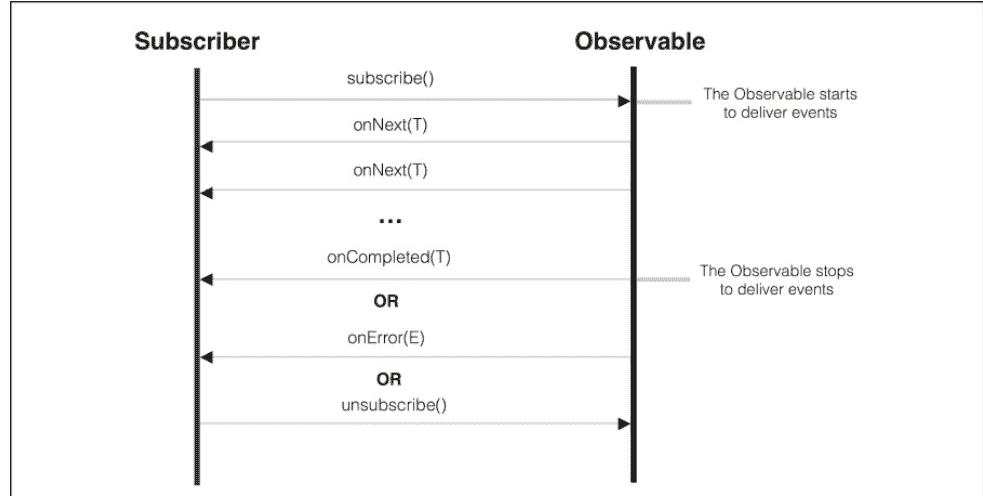
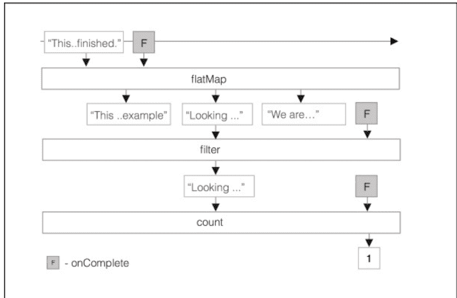

## 第 7 章. 使用 RxJava 进行异步编程

为了简化可组合异步工作的开发，我们将向您介绍 RxJava，这是一个函数式框架，允许我们观察、转换、过滤并响应事件流（点击、触摸、网络、I/O 事件等），以便组合能够响应错误并链式异步计算的复杂执行流程。

在本章中，我们将涵盖以下主题：

- RxJava 简介
- 创建 Observables
- 转换 Observables
- 了解 Schedulers
- 使用 Schedulers 执行异步 IO
- 使用 RxJava 组合任务
- 使用 RxJava 观察 UI 事件
- 使用 RxJava 合并任务
- 使用 Subjects


## RxJava 简介

RxJava 是 JVM 上 Reactive Extensions（ReactiveX）的一种实现，由 Netflix 开发，用于组合对可观察事件源做出反应的异步事件处理。

该框架通过允许我们创建事件流来扩展观察者模式，该事件流可以被算子（输入/输出）函数拦截，以修改原始事件流，并将结果或错误传递给最终观察者。该框架抽象了关于低级线程、同步、线程安全、并发数据结构和非阻塞 I/O 等问题的关注点。

在 RxJava 处理中，有三个主要的基本构建块相互交互：Observable、Observer 和 Subscriber。

Observable 是一个实体，它在任意时间点发出泛型类型 T（例如 String 或任何 Java 类型）的事件序列（零个或多个事件），或在事件处理过程中发生失败时发出 Throwable。除此之外，它还提供用于订阅其事件流和管理观察者订阅的方法。

Single 是一种特殊的 Observable，只能发出单个成功事件值或错误事件。

Observer 在注册为订阅者后，会消费 Observable<T> 生成的类型 T 的事件。Observer 必须实现 Observer<T>：

```java
public interface Observer<T> {
    void onCompleted();
    void onError(Throwable e);
    void onNext(T t);
}
```

任何 Observer 都会在其订阅的 Observable 发出新事件时收到对 onNext 的回调，直到它收到 onCompleted 或 onError 以关闭事件流。

Subscriber 是一个辅助抽象类，如果需要订阅支持，可以将其用作 Observer 的基类。Subscriber 类提供用于取消 Observable 订阅的方法：

```java
abstract class Subscriber<T>
implements Observer<T>, Subscription
```

```java
public interface Subscription {
	void unsubscribe();
	boolean isUnsubscribed();
}
```

unsubscribe 是用于取消观察者订阅的函数。因此，一旦观察者订阅终止，Subscriber 将不再接收 Observable 生成的事件。

下面是一个显示 observable 与 Subscriber 之间常见交互的简单图表：



当 Observable 发出新项目时，会调用 Observer 的 onNext(T) 回调。

当发现错误条件且流将终止时，会调用 Observer 的 onError(Throwable) 回调以发出通知。

当流已成功完成且所有事件都成功传递时，会调用 Observer 的 onCompleted() 回调以指示此状态。

### 冷 Observable 与 热 Observable

Observable 根据开始发出事件的时间可分为热或冷两种。冷 Observable 仅在 Observer 订阅它时才开始向观察者发出事件。在这种情况下，预期 Observer 将从头开始接收事件流。

热 Observable 一旦创建就会开始发出事件，因此 Observer 只会接收订阅创建后发出的事件。在订阅之前发出的事件不会被 Observer 接收。

### RxJava 设置

在深入之前，先将所需库添加到你的项目中。如果你使用的是 Android Studio，只需将以下依赖项添加到模块的 build.gradle 脚本中：

```java
dependencies {
  ...
  compile 'io.reactivex:rxandroid:1.1.0'
  compile 'io.reactivex:rxjava:1.1.0'}
```

rxjava 是一个在 Java 上实现 Reactive Extensions（http://reactivex.io/）的库，而 rxandroid 是一个添加类以帮助在 Android 应用程序中使用 RxJava 编写响应式组件的库。

### 创建 Observable

创建 Observable 时，我们可以使用 create 函数并显式调用 Observer 方法从头开始创建一个 Observable，也可以使用将常见数据类型转换为 Observable 流的内置 Observable 创建方法。

让我们从一个简单的示例开始，使用创建 Observable.from 算子创建一个发出 String 的 observable：

```java
Observable<String> myObservable = Observable.from(Arrays.asList("Hello from RxJava",
 "Welcome...",
 "Goodbye"));
```

Observable.from 静态函数从数组创建 Observable，该数组将同步地将 String 项目发送给任何 Observer。创建的 Observable 将是一个 cold Observable，并且仅在 Observer 订阅它后才开始发出事件。

现在，让我们创建一个 Subscriber 来消费数据，并在 Observable 调用 onCompleted 回调之前将每个 String 打印到 Android 日志中：

```java
Subscriber<String> mySubscriber = new Subscriber<String>() {

    @Override
    public void onCompleted() {
        Log.i(TAG, "RxJava events completed");
    }

    @Override
    public void onError(Throwable e) {
        Log.e(TAG, "Error found processing stream", e);
    }

    @Override
    public void onNext(String s) {
        Log.i(TAG, "New event -" + s);
    }
};
```

接下来，使用刚刚定义的 Observable 和 subscriber 类，一旦我们将 Subscriber 类订阅到 Observable 上，onNext() 函数将被调用三次，每次传递之前定义的数组中的每个 String。

随后，在 Subscriber 消费完所有字符串后，将调用 onCompleted 函数以关闭流：

```java
myObservable.subscribe(mySubscriber);
```

Observable 实例负责管理所有订阅，通知其所有 Subscriber，并且在我们订阅之前不会开始发出项目。

除了使用 Observable.from 或其他创建算子外，我们还可以通过调用 create 方法并实现 Observable.OnSubscribe<T> 来创建 Observable，该实现会显式调用 onNext、onError 和 onCompleted。

让我们使用 create 函数创建一个发出整数的自定义 Observable：

```java
Observable<Integer> myObservable = Observable.create(
new Observable.OnSubscribe<Integer>() {
@Override
public void call(Subscriber<? super Integer> sub) {
// Emitting Numbers
sub.onNext(10);
sub.onNext(3);
sub.onNext(9);
// Stream completed with success
sub.onCompleted();
}
}
);
```

请记住，一个行为良好的 Observable 必须在通过调用 subscriber 的 onNext 函数发出所有项目后，尝试恰好调用一次 observer 的 onCompleted 或 onError。

请注意，前面的 Observable 也被归类为 cold Observable，因为它只有在 Subscriber 实体订阅它时才会开始发出。

或者，我们可以使用 Action 函数订阅 observable，在不同的分离函数中处理分发的项目。你需要做的就是传递一个用于事件处理的 Action1<T> 函数、一个用于错误发出的 Action1<Throwable> 以及一个用于接收流完成通知的 Action0。

让我们编写对我们的 Observable<String> 发出的事件做出反应所需的 action 函数：

```java
Action1<Integer> onNextAction = new Action1<Integer>() {
    @Override
    public void call(Integer s) { Log.i(TAG, "New number :" + s); }
};
Action1<Throwable> onError = new Action1<Throwable>() {
    @Override
    public void call(Throwable t) {
        Log.e(TAG, "Error: " + t.getMessage(), t);
    }
};
Action0 onComplete = new Action0() {
    @Override
    public void call() { Log.i(TAG, "Rx number stream completed")}
};
```

```java
myObservable.subscribe(onNextAction, onError, onComplete);
```

除了 from 算子和 create 算子函数之外，还有其他可用于构建 observable 的简单 observable 函数：

- Observable.just: 从少量对象（最多 10 个对象）创建 Observable：

```java
Observable<Integer>.just(1, 2, 3)
```

- Observable.range: 发出一组数字：

```java
Observable.range(1, 10);
```


## 转换 Observables

除了能够广泛实现 Observable-Subscribe 软件模式之外，RxJava 框架还允许我们通过使用 observable 操作符来转换、过滤、变换、聚合、操作和处理由 observable 发射的项流。这些实体能够在事件传递给最终 Subscriber 之前完全转换事件流。

RxJava 自带一组实用的操作符，能够转换事件的内容并控制事件的传递时间。

让我们来描述 RxJava 中可用的最常见操作符：

- map: 对每个发射的项应用一个函数，并将函数的结果作为新项发射。
- flatMap: 对源 Observable 发射的每个项应用一个函数，该函数返回一个 Observable，该 Observable 可能发射不同数量的项或不同类型的事件。
- filter: 一个转换操作符，它使用一个函数来验证源 Observable 发射的每个项是否满足条件。如果条件通过该项，则将其转发给后续的 Subscriber。
- first: 仅发射源 Observable 发射的第一个项。
- count: 发射从原始 Observable 接收到的项数。
- zip: 使用一个函数合并两个 Observables 的发射，该函数接收每个原始 Observable 的第 n 个项作为参数。
- contains: 发射一个布尔事件，指示源 Observable 是否包含指定的对象。
- merge: 将多个观察者的事件合并为一个事件流。
- delay: 按指定的时间量延迟项的发射。

有关 RxJava 支持的操作符更完整、更详细、更及时的列表，请查看 GitHub 上的 RxJava Wiki（https://github.com/ReactiveX/RxJava/wiki/Alphabetical-List-of-Observable-Operators）。

RxJava 操作符通常处理一个 Observable 并返回一个 Observable。这一设计特性允许我们链式调用操作符，并创建一个转换事件流的操作符组合序列。最后一个操作符负责将项传递给 Subscriber，或在出错时传递错误。

现在，让我们创建第一个操作符示例，它将源 Observable 发射的多行文本进行转换，并传递一个新的 Integer，包含含有单词 RxJava 的行数：

```
String content = "This is an example \n " +
    "Looking for lines with the word RxJava\n" +
    "We are finished.";
Observable
    .just(content)
    .flatMap(new Func1<String, Observable<String>>() {
    @Override
    public Observable<String> call(final String content) {
    return Observable.from(content.split("\n"));
    }})
    .filter(new Func1<String, Boolean>() {
    @Override
    public Boolean call(final String line) {
    return line.contains("RxJava");
    }})
    .count()
    .subscribe(new Subscriber<Integer>() {
    ...
    @Override
    public void onNext(Integer s) {
    Log.i(TAG, "Number of Lines " + s);
    }
    });
```

首先，我们使用 Observable.just 创建操作符并将文本源作为唯一对象传递，从原始文本创建一个 Observable。

接下来，为了将原始文本拆分为行，我们使用 flatMap 操作符，它接收第一个 observable 发射的原始文本，并返回一个从切片行数组创建的新 observable。

来自 flatMap 操作符的新 Observable 将针对原始内容中的每行发射一个单独的 String，因此，为了统计含有 RxJava 单词的行数，我们将使用 filter 操作符丢弃不含该单词的行。

最后，我们将统计发射的事件数量，并将结果发布到一个期望整数作为结果的 Subscriber。

以下是前面功能管道的图形展示：



是的。丰富的转换操作符集允许我们创建复杂的功能处理链，能够在传输过程中转换数据，并以可读且功能性的方式将结果传递给任何 Subscriber 对象。

## 理解 Schedulers

存在一个错误的误解和信念，即 RxJava 处理默认是多线程的。observable 以及指定操作符应用的转换列表发生在进行订阅的同一线程上。

因此，在 Android 上，如果订阅在主线程上进行，操作符链处理将在主线程上运行，直到工作完成才会阻塞 UI。

虽然这种行为可能适用于轻量级处理任务，但当操作需要 IO 交互或 CPU 密集型计算时，任务执行可能会阻塞主线程，并导致应用程序因 ANR 崩溃。

为了简化异步和并发执行，RxJava 框架允许我们定义一个 Scheduler 实体，用于定义执行工作单元的线程。

subscribeOn(Scheduler) 操作符允许我们设置 Scheduler，以定义进行订阅的线程以及 Observable 开始运行的线程。

当未指定 Scheduler 时，Observable 和操作将在调用 subscribe 函数的线程上运行。

在 Android 上，subscribe 函数通常从运行在主线程上的 Android Activity 或 Fragment 调用，然后如果任何操作花费大量时间才能完成，它将阻塞 UI 线程并降低 UI 响应能力。

通过控制进行订阅的线程，我们控制了 Observable 及其操作符将要执行的线程，甚至包括 subscriber 接收回调的线程。

observeOn(Scheduler) 允许我们设置 Scheduler，以定义 Observer 回调（onNext、onError、onCompleted）被调用的线程。

在 Observable 和操作符链过程中，我们可以多次使用 observeOn 来更改计算运行的线程。

为了简化 Scheduler 的使用，RxJava 和 RxAndroid 库整理了一组预定义的 Schedulers 列表，可直接用于创建多线程异步链：

- Schedulers.immediate(): 默认 Scheduler，返回一个在当前线程立即执行工作的 Scheduler。
- Schedulers.trampoline(): 返回一个 Scheduler，将工作排队在当前线程中，在当前工作完成后执行。
- Schedulers.newThread(): 返回一个 Scheduler，生成一个新线程并在新线程上执行工作。
- Schedulers.computation(): 返回一个用于计算密集型工作的 Scheduler。可用于事件循环、处理回调和其他计算工作。不要在此 Scheduler 上执行阻塞 IO 工作。此 Scheduler 使用固定线程池大小，其大小取决于 CPU，以优化 CPU 使用率并最小化 CPU 切换。
- Schedulers.io(): 创建并返回一个 Scheduler，它执行缓存线程池的工作，该线程池会根据需要增长和收缩，重用已创建的空闲线程来执行所需工作。此 Scheduler 用于异步执行阻塞 IO 任务，例如网络或文件系统读写。
- Scheduler.from(Executor): 创建一个 Scheduler，它将在作为参数传递的 java.util.concurrent.Executor 上执行工作单元。
- AndroidSchedulers.mainThread(): 创建一个 Scheduler，在 Android 应用程序主线程上执行所需工作。此由 RxAndroid 库提供的 Android Scheduler 基于串行运行工作单元的 HandlerThread。
- HandlerScheduler.from(Handler): 创建一个 Scheduler，在指定的 Handler 上执行工作。AndroidSchedulers.mainThread() 是此 Scheduler 的一种专用形式，它在附加到 Android UI 线程的 Handler 上运行。

### 注意

默认情况下，RxJava 使用 Schedulers.immediate()，它在当前线程上订阅 Observer 并在当前线程传递事件。


RxJava允许我们定义自己的调度器（Scheduler），但就本书范围而言，我们将只使用内置的Schedulers来满足并发需求。

## 使用Schedulers执行IO操作

在下一个示例中，我们将使用Schedulers来模仿AsyncTask的行为，并在后台线程上从网络检索文本。随后，结果将发布到在主线程上运行的Subscriber。

首先，我们将创建一个函数，该函数创建一个Observable，用于发布从网络检索到的String：

```
Observable<String> getTextFromNetwork(final String url) {
return Observable.create(
new Observable.OnSubscribe<String>() {
@Override
public void call(Subscriber<? super String> sub) {
try {
String text = downloadText(url);
sub.onNext(text);
sub.onCompleted();
} catch (Throwable t) {
sub.onError(t);
}
}
}
);
}
```

在指定用于运行异步调用的Scheduler之前，我们需要陈述两个假设：

- 由于在Observable上运行的代码执行网络操作，我们必须在后台线程上运行Observable
- 为了发布结果并更新UI，我们必须在主线程上执行Subscriber回调

现在，让我们根据前面的假设并使用前面描述的Scheduler实体，构建异步RxJava执行流程，以检索文本并更新UI：

```
class MySubscriber extends Subscriber<String> {
    @Override
    public void onCompleted() {}

    @Override
    public void onError(Throwable e) {
        // Shows a Toast on Error
        Toast.makeText(RxSchedulerActivity.this,
            e.getMessage(),
            Toast.LENGTH_LONG).show();
        Log.e(TAG, "Error retrieving ", e);
    }

    @Override
    public void onNext(String text) {
        // Updates the UI on Success
        EditText textFrame = (EditText)findViewById(R.id.text);
        textFrame.setText(text);
    }
};
```

...

```
getTextFromNetwork("http://demo1472539.mockable.io/mytext")
    .subscribeOn(Schedulers.io())
    .observeOn(AndroidSchedulers.mainThread())
    .subscribe(new MySubscriber());
```

subscribeOn(Schedulers.io())将使getTextFromNetwork函数创建的Observable在Scheduler.io线程池上运行，该线程池用于阻塞IO操作。

一旦调用subscribe函数，downloadText将被排队在由Schedulers.io()创建的Scheduler管理的线程上运行，在onNext()函数中将结果作为String发布。

observeOn(AndroidSchedulers.mainThread())确保Subscriber回调onNext、onCompleted和onError将在Android主线程上运行。因此，如果网络操作成功完成，将调用onNext以更新EditText并显示获取的结果。

如果网络执行期间抛出任何异常，则将Throwable对象传递到Subscriber.onError回调，该回调在UI线程上执行，并且将显示错误的Toast在UI上显示。

此示例展示了在RxJava中异步调用可以多么简单和简洁。此外，它像AsyncTask一样将你从线程管理中抽象出来，并为你提供异常处理机制来处理异常错误。

## 取消订阅

当Activity或Fragment被销毁时，链可能会在后台继续运行，如果链持有对Activity或Fragment的引用，则会阻止Activity被释放。当你不再需要链的结果时，取消订阅并终止链的执行可能是合理的。

当我们调用Observable.subscribe()函数时，它将返回一个Subscription对象，可用于立即终止链：

```
Subscription subscription = getTextFromNetwork(
    "http://demo1472539.mockable.io/mytext"
    ...
    .subscribe(new MySubscriber());
```

同样，最适合此目的的Activity生命周期方法是onPause，它保证会在Activity结束之前被调用：

```
protected void onPause() {
    super.onPause();
    if ((subscription != null) && (isFinishing()))
    subscription.unsubscribe();
}
```

## 组合Observables

如前文所述，Observable接口的定义方式允许我们链式调用和组合不同的Observable，以函数式和声明式的方式创建复杂任务。

基于我们之前的工作，在下一个示例中，我们将利用RxJava的组合特性，执行第二个网络调用，该调用依赖于前一个Observable（该Observable将使用Web服务翻译下载的文本），然后再将翻译后的文本发布到Subscriber。

为了在网络上逻辑上分离地执行翻译，我们将创建一个新的Observable，它接收要翻译的文本，在网络上执行任务，并将翻译后的文本作为String发布到下一个Observable：

```
Observable<String> translateOnNetwork(final String url,
        final String toTranslate) {
    return Observable.create(
            new Observable.OnSubscribe<String>() {
            @Override
            public void call(Subscriber<? super String> ts){
            try {
            String text = translateText(
            "http://demo1472539.mockable.io/translate",
            toTranslate);

            sub.onNext(text);
            sub.onCompleted();
            } catch (Throwable t) {
            sub.onError(t);
            }
            }
            }
    );
}
```

接下来，我们准备链式调用网络执行，并使用之前使用的相同Subscriber在UI上显示结果：

```
getTextFromNetwork(RETRIEVE_TEXT_URL)
    .flatMap(new Func1<String, Observable<String>>() {
    @Override
    public Observable<String> call(String toTranslate) {
        return translateOnNetwork(TRANSLATE_URL, toTranslate);
    }
})
.subscribeOn(Schedulers.io())
.observeOn(AndroidSchedulers.mainThread())
.subscribe(new MySubscriber());
```

定义在translateOnNetwork上的网络IO操作（依赖于getTextFromNetwork）仅在前一操作成功完成时才会运行，并将getTextFromNetwork的结果作为参数。

translateOnNetwork Observable接收来自前一个网络操作的文本内容后，将其作为输入并对网络上的先前内容执行翻译，调用函数translateText(url, content)。

假设translateText()成功完成，则将翻译后的内容传递到下一个Observable。由于下一个Observable是Subscriber，结果将透明地在主线程上传递以更新UI。

此外，由于我们重写了Subscriber的onError函数，如果任一网络请求执行过程中出错，错误将传播到我们的回调中以便妥善处理。因此，只需几行代码，我们就能通知用户异步任务失败，并且无法将预期数据发送给他们。

太好了，只需几行代码，我们就创建了一个复杂任务，在后台执行一系列异步网络操作，将结果传递到主线程，或者在出错时传递错误。

## 监控事件流

虽然到目前为止我们一直使用Observable操作符来操纵流事件，但有一些操作符允许我们在不更改事件的情况下监控它们。这些操作符有时称为实用程序操作符，可以响应源Observable与最终Subscriber之间创建的Observable链上发出的事件或错误，而不会产生任何副作用。

让我们列举它们，并解释用于观察事件流的更常见的实用程序操作符：

- doOnSubscribe(Action0): 注册一个Action0函数，当Subscriber订阅Observable时调用该函数。
- doOnUnsubscribe(Action0): 注册一个Action0函数，当Subscriber取消订阅Observable时调用该函数。
- doOnNext(Action1): 注册一个Action1，当源Observable发出新事件时调用。Event <T>对象也作为参数传递给Action1函数。
- doOnCompleted(Action0): 注册一个Action0函数，当源Observable发出onComplete事件时调用该函数。
- doOnError(Action1): 注册一个Action1函数，当源Observable发出错误时调用该函数。在OnError中发出的Throwable也传递给Action1.call函数。
- doOnTerminate(Action0): 注册一个Action0函数，当源Observable发出错误或onComplete时调用该函数。此回调函数也意味着前一个Observable将不再发出任何项。

这些多用途操作符将允许我们观察和调试通常涉及多种转换的复杂链，创建进度对话框以显示进度，缓存结果，甚至生成处理分析。

在下一个示例中，我们将使用这些操作符在Android Log中记录我们之前多网络操作的进度，并在操作进行期间在屏幕上显示进度对话框：

```
Observable.just(RETRIEVE_TEXT_URL)
```


```java
.doOnNext(new Action1<String>() { // Running on the main Thread
@Override
public void call(String url) {
    progress = ProgressDialog.show(RxSchedulerActivity.this,
    "Loading",
    "Performing async operation", true);
    Log.i(TAG, "Network IO Operation will start " + tMark());
}
})
.observeOn(Schedulers.io()) // Running on a background Thread
.flatMap(new Func1<String, Observable<String>>() {
@Override
public Observable<String> call(String url) {
    return getTextFromNetwork(url);
}
})
.doOnNext(new Action1<String>() {
@Override
public void call(String text) {
    Log.i(TAG, "Text retrieved with success " + tMark());
    Log.i(TAG, "Translating the text " + tMark());
}
})
.flatMap(new Func1<String, Observable<String>>() {
@Override
public Observable<String> call(String toTranslate) {
    return translateOnNetwork(TRANSLATE_URL, toTranslate);
}
})
.doOnNext(new Action1<String>() {
@Override
public void call(String translatedText) {
    Log.i(TAG, "Translation finished " + tMark());
}
})
.observeOn(
    AndroidSchedulers.mainThread() // Executing on main Thread
)
.doOnTerminate(new Action0() {
@Override
public void call() {
    if (progress != null)
    progress.dismiss();
    Log.i(TAG, "Dismissing dialog " + tMark());
}
})
// Starts the execution on the main Thread
.subscribeOn(AndroidSchedulers.mainThread())
.subscribe(new MySubscriber());
```

众所周知，要对 Android 界面进行更改，必须在主线程上运行代码。因此，为了在主线程接收来自第一个 Observable 的 doOnNext，我们调用 subscribeOn() 并传入 AndroidSchedulers.mainThread()，强制第一个 Observable（即通过 just 操作符创建的那个）在主线程向 doOnNext 发送通知。

doOnNext() 一旦收到携带用于检索文本的 URL 的字符串通知，我们就在界面上显示 ProgressDialog，并在 Android 日志中记录一条消息。

接下来，由于我们希望在主线程之外执行网络操作，因此使用 observeOn 操作符，强制后续的 Observable 将通知发送到 IO 调度器管理的线程。这意味着，后续的操作符和 Observable 将在 IO 调度器的线程中执行并发送事件。

与此同时，在每次网络操作之间，我们拦截第二次网络操作的启动，在 getTextFromNetwork 和 translateOnNetwork Observable 之间使用 doOnNext 来在 Android 中打印消息。

当网络操作完成，并且在使用结果更新界面并关闭进度对话框之前，我们通过再次调用 observeOn() 操作符并传入主线程调度器，将执行切换回主线程。

在将结果显示在屏幕之前，我们使用 doOnTerminate 操作符注册一个 Action 函数，用于关闭之前启动的进度对话框。如前所述，无论链是以成功还是以错误结束，该函数都会被调用。

最后，将调用订阅者回调函数，使用返回的结果更新界面，或者显示错误消息。

如果网络操作成功终止，您应该在 Android 日志中看到类似的日志流：

```
...54.390 I Network IO Operation will start T[main]
...54.850 I Text retrieved with success T[RxCachedThreadScheduler-1]
...54.850 I Translating the text T[RxCachedThreadScheduler-1]
...55.160 I Translation finished T[RxCachedThreadScheduler-1]
...55.200 I Dismissing dialog on T[main]
```

出于调试目的，[<Thread_Name>] 显示记录消息的线程名称。

## 合并 Observable

在上一个示例中，我们使用两个 Observable 来创建一个简单的网络操作序列。第二个异步操作使用第一个操作的结果，而这两个串行执行的操作生成一个用于更新界面的字符串结果。

在下一个示例中，我们将并行运行两个任务，并使用 RxJava 的合并操作符结合两个操作的结果。每个操作将从网络异步检索一个 JSON 对象，并在 JSON 对象中结合两个结果，以生成传递给 UI 主线程的 JSON 字符串。

由于我们只希望从操作中发出一个事件或一个错误，我们将首次使用一种特殊的 Observer，即 Single。

虽然 Observable 可以调用 onNext、onError 和 onCompleted Observer 函数，但 Single 实体只会向 SingleSubscriber 调用 onSuccess 或 onError 中的一个：

```
// Success callback invoked on success
void onSuccess(T value);
```

```
// Callback to notify that an unrecoverable error has occurred
void onError(Throwable error);
```

当其中一个回调函数被调用后，Single 便结束，对其的订阅也随之终止。与普通的 Observable 类似，Single 对象发出的事件可以在到达最终 SingleSubscriber 之前，通过操作符进行处理。

现在，让我们定义从网络检索单个 JSON 对象的两个 Single 操作：

```
Single<JSONObject> postSingle = Single.create(
new Single.OnSubscribe<JSONObject>() {
@Override
public void call(SingleSubscriber<? super JSONObject> sub) {
try {
// Retrieve the Post content JSON Object
sub.onSuccess(
getJson("http://demo1472539.mockable.io/post"));
} catch (Throwable t) {
    sub.onError(t);
}
}
)
).subscribeOn(Schedulers.newThread());
```

```
Single<JSONObject> authorSingle = Single.create(
new Single.OnSubscribe<JSONObject>() {
@Override
public void call(SingleSubscriber<? super JSONObject> sub) {
try {
// Retrieve the Author content JSON Object
sub.onSuccess(
getJson("http://demo1472539.mockable.io/author"));
} catch (Throwable t) {
sub.onError(t);
}
}
}
).subscribeOn(Schedulers.newThread());
```

与之前对 Observable 的做法类似，我们使用了 Single.create 静态函数来构建一个自定义 Single 实体：当网络操作成功完成时，它会显式调用 SingleSubscriber.onSuccess 函数；当 getJson IO 操作中抛出错误时，则调用 SingleSubscriber.onError 函数。

getJson 函数基本上是通过连接到作为参数提供的 HTTP URL 来检索 JSON 对象，并返回一个 JSONObject。

通过强制 Single 在 newThread 调度器上 subscribeOn，我们允许每个自定义 Single 实体在新线程上并发执行其操作。

由于两个操作将并行运行，我们需要使用合并操作符将 Single 结果合并为一个 JSON 对象，并将生成的 JSON 字符串发送到最终的 SingleSubscriber。适用于我们示例的合并操作符是 zip，因为它能够等待两个或多个 Single/Observable 的结果，并对每个 Single 输出对象应用一个函数。

接收发出对象作为参数的函数可以生成相同类型或不同类型的结果。

这是用于将两个 Single 合并为 Single<R> 的 zip 操作符函数定义：

```
Single<R> zip(Single<T1> o1, // First Single
Single<T2> o2, // Second Single
final Func2<T1,T2,R> zipFunction)
```

在我们的示例中，R 是 String，T1 和 T2 是 JSONObject，zipFunction 接收 JSON 对象参数以生成字符串作为结果。

现在我们可以使用 zip 操作符，将每个独立异步操作的结果合并为一个字符串。生成的字符串将更新一个小部件，因此最终的 Subscriber 应该在主线程中被调用。

让我们编写功能代码，获取 JSON 对象部分并将生成的字符串分发到界面：

```
Single.zip(postSingle, authorSingle,
new Func2<JSONObject, JSONObject, String>() {
@Override
public String call(JSONObject post, JSONObject author) {
String result = null;
// Create the Root JSON Object
JSONObject rootObj = new JSONObject();
try {
// Add the post object to root JSON Object
rootObj.put("post", post);
// Add the author object to root JSON Object
rootObj.put("author", author);
// Save the JSON Object, Encode the JSON Object
// into a String
result = rootObj.toString(2);
} catch (Exception e) {
Exceptions.propagate(e);
}
return result;
}
})
.observeOn(AndroidSchedulers.mainThread())
.subscribe(subscriber);
```

使用 zip 操作符，我们合并了两个操作的结果，


postSingle 和 authorSingle，它们在 newThread Scheduler 创建的新线程上运行，作用于 Func2，该 Func2 接收两个 JSONObject 作为参数并生成一个 String。

由于我们订阅了 Single 在其自己的线程上工作，zip 函数将在最后定义的 Single（authorSingle）构建的线程上合并两个 Single 的结果，从而产生类似于以下输出的日志：

```
.040 I ....: Getting the Post Object on RxNewThreadScheduler-1
.050 I ....: Getting the Author Object on RxNewThreadScheduler-2
.660 I ....: Combining objects on RxNewThreadScheduler-2
```

合并对象后，Func2 生成的 String 将在主线程中传递给最终的 Subscriber。

剩下的就是实现更新 UI 的简单 SingleSubscriber：

```
SingleSubscriber<String> subscriber =
new SingleSubscriber<String>() {
...
@Override
public void onSuccess(String result) { // Updates the UI }
};
```

## 使用 RxJava 观察 UI 事件

到目前为止，我们一直在使用 RxJava 来处理和操纵数据流，这简化了需要 IO 阻塞操作（会让应用程序暂时挂起）的异步开发。

在本节中，我们想要解释如何使用 RxJava 和响应式流来简化处理 Android 小部件生成的 UI 事件。

在下一个示例中，我们将展示一个带有即时搜索结果输入框的足球队列表。当你在输入框中输入时，如果你输入的文本与列表中任何足球队名称的开头匹配，列表中可用的名称将被过滤。

为了达到所需的结果，我们将创建一个自定义 Observable，将 TextWatcher 附加到搜索输入框，监听 onTextChanged 事件，并在文本更改时发出 String 事件。

Observer 将提供一个响应式函数流，用于在 Recycler View 中过滤我们的团队列表。

首先，我们将编写一个自定义 Observable，当观察者订阅时将 TextWatcher 注册到 EditField，并在订阅结束时注销 TextWatcher：

```
public class TextChangeOnSubscribe
implements OnSubscribe<String> {
// Don't Prevent the GC from recycling the Activity
WeakReference<EditText> editText;

// Receive the EditText View to verify Changes
public TextChangeOnSubscribe(EditText editText) {
this.editText = new WeakReference<EditText>(editText);
}

@Override
public void call(final Subscriber<? super String> subscriber) {
final TextWatcher watcher = new TextWatcher() {
@Override
public void onTextChanged(
CharSequence s, int start, int before, int count) {
// Emit a new String when the text changes
if (!subscriber.isUnsubscribed()) {
subscriber.onNext(s.toString());
}
};
// Remove the Text change Watcher when the subscription ends
subscriber.add(new MainThreadSubscription() {
@Override
protected void onUnsubscribe() {
editText.get().removeTextChangedListener(watcher);
}
});
// Sets the Watcher on the EditField
editText.get().addTextChangedListener(watcher);
subscriber.onNext("");
};
```

```
EditText search = (EditText) findViewById(R.id.searchTv);
Observable<String> textChangeObs = Observable.
create(new TextChangeOnSubscribe(search))
.debounce(400,
TimeUnit.MILLISECONDS);
```

TextChangeOnSubscribe 类（实现 OnSubscribe<String> 并接收订阅回调）将在订阅者执行订阅后，在接收到的 EditField 中设置一个 TextWatcher。

当 TextWatcher.onTextChanged 被调用以通知 EditField 中的文本更改时，应在订阅者中发出带有新内容的新 String 事件。

要注销 EditField 中的 TextWatcher，我们将一个 MainThreadSubscription 匿名类添加到订阅者列表中，以移除 EditField 中的 TextChangeListener。

为了防止文本更改事件在 UI 中生成太多更新，我们使用了 debounce 操作符，只有在上次文本更改事件之后过去了 400 毫秒时才发出新的搜索词。

接下来，我们将使用由我们的 Observable 生成的搜索事件来过滤 RecyclerView 列表中可用的团队：

```java
List<String> soccerTeams = Arrays.asList(
    "Real Madrid","Barcelona","Sporting CP",...,"Chelsea");

subscription = Observable.combineLatest(
    // Observables
    Observable.just(soccerTeams), textChangeObs,
    // Combine Function
    new Func2<List<String>, String, List<String>>() {
    // Filter the list with the filter String and sort the list
    @Override
    public List<String> call(List<String> fullList,
                             String filter){
        List<String> result = new ArrayList<String>();
        for (String team : fullList) {
            if (team.startsWith(filter)) {
                result.add(team);
            }
        }
        // Sort the Collection
        Collections.sort(result);
        return result;
    }
})
.observeOn(AndroidSchedulers.mainThread())
.subscribe(new Action1<List<String>>() {
    @Override
    public void call(List<String> teams) {
        // Update the Recycler View with a filtered list of Teams
        mAdapter = new MyAdapter(teams);
        mRecyclerView.setAdapter(mAdapter);
    }
});
```

为了使用 textChangeEvent 发出的搜索词来过滤足球队列表，我们将 combineLatest 操作符应用于 textChangeObs Observable 和使用 just 操作符从足球队列表创建的 Observable。

combineLatest 将使用指定函数合并每个 Observable 发出的最新项目，并根据此函数调用的结果发出项目。

合并两个 `Observables` 的函数将简单地使用 `onTextChanged` 发出的最后一次文本内容过滤足球列表，并对结果列表进行排序。

最后，将使用结果 `List<String>` 创建一个新的 `RecyclerView.Adapter`，并向用户显示过滤后的团队列表。

请注意，为了用结果过滤列表更新我们的 `RecyclerView`，我们将 `observer` 显式设置为在主线程上运行，方法是将 Android 主线程调度器传递给 `observeOn` 操作符。

### 注意

不要忘记在 Activity 销毁前通过调用 `subscription.unsubscribe();` 终止订阅。

虽然出于教育目的，我们从 Android EditField 小部件的文本更改事件构建了自己的 Observables，但有一个名为 [RxBinding](https://github.com/JakeWharton/RxBinding) 的易于使用的开源库，它可以为 Android SDK 中大多数可用的 Android 小部件创建 Observables。

如果你不想实现自己的 Observables，或以传统方式处理 UI 事件，你可以利用它使用函数式 RxJava 响应式范式来处理 Android UI 事件。

## 使用 Subjects

到目前为止，我们一直在使用 Observables、Subscriber、Observer 和 Scheduler 实体来创建 RxJava 函数处理管道。在本节中，我们将向读者介绍 RxJava 框架中的一种新实体，即 Subject。Subject 是一种适配器或桥接实体，既充当 Observable 又充当 Observer：

```
public abstract class Subject<T,R>
extends Observable<R>
implements Observer<T>
```

由于它可以充当 Subscriber，因此它可以订阅一个或多个发出泛型 T 对象的 Observables，并且由于它充当 Observable，因此它可以发出泛型 R 事件并接收来自其他 Subscriber 的订阅。因此，它可以发出与接收到的相同类型的事件，也可以发出不同类型的事件。

例如，Subject<String, Integer> 将接收 String 类型的事件并发出 Integer 类型的事件。

Subject 可以从 observable 接收事件，并生成一个具有不同时间的新事件流，代理事件，转换为新类型的事件，排队事件，转换事件，甚至生成新事件。

Subject 始终被视为热 Observable，并且一旦创建就会立即开始发出事件。这是一个非常重要的 Subject 特性，当你想要处理完整的事件流序列时应该考虑这一点。

**RxJava** 附带了一些标准的 **Subject** 类，旨在用于独特的用例。下面的列表将枚举最常见的类：

- AsyncSubject: 只有在源 Observable 通过调用 onComplete() 完成流时，才会发出源 Observable 发出的最后一项的 Subject
- PublishSubject: Subject 仅将订阅后发出的事件传递给观察者
- ReplaySubject: 发出源 Observable 发出的所有事件，即使那些在订阅之前发出的事件


- BehaviorSubject：在订阅完成时，发出源 Observable 最后发射的项目，然后继续发送源 observable 发射的任何其他项目

在以下示例中，我们将向您展示如何使用 PublishSubject，并演示事件如何传播到最终观察者（该观察者订阅 Subject 并随后取消订阅）。此外，我们将在订阅之前和之后向 Subject 提交事件：

```
PublishSubject<Integer> pubSubject = PublishSubject.create();
pubSubject.onNext(1);
pubSubject.onNext(2);
Subscription subscription = pubSubject.doOnSubscribe(new Action0() {
    @Override
    public void call() {
        Log.i(TAG, "Observer subscribed to PublishSubject");
    }
}).doOnUnsubscribe(new Action0() {
    @Override
    public void call() {
        Log.i(TAG, "Observer unsubscribed to PublishSubject");
    }
}).subscribe(new Action1<Integer>() {
    @Override
    public void call(Integer integer) {
        Log.i(TAG, "New Event received from PublishSubject: " + integer);
    }
});
pubSubject.onNext(3);
pubSubject.onNext(4);
subscription.unsubscribe();
pubSubject.onNext(5);
pubSubject.onCompleted();
```

首先，我们通过调用 PublishSubject.create 静态函数创建了 PublishSubject，然后开始向其传递整数并调用 onNext 函数。

与此同时，我们使用 Action1 函数订阅了 Subject，以消耗事件。

为了打印订阅和取消订阅发生的确切时间，我们向 doOnUnsubscribe 和 doOnSubscribe 提供了一个 Action0 函数，该函数向 Android Log 打印一条消息。

因此，上述代码应输出以下内容：

```
... 43.230 I Observer subscribed to PublishSubject
... 43.230 I New Event received from PublishSubject: 3
... 43.230 I New Event received from PublishSubject: 4
... 43.230 I Observer unsubscribed to PublishSubject
```

如前所述，只有在最终观察者订阅期间派发的事件才会发送到 Action 回调。因此，订阅之前和取消订阅之后提交的事件不会被我们的 Subscriber 接收。

现在，为了进行比较，让我们尝试比较 ReplaySubject 发出的事件流与提交到 Subject 的精确事件序列。

同样，ReplaySubject 类是通过调用 create 静态函数构建的，因此您应该看到以下输出：

```
.600 I Observer subscribed to ReplaySubject
.600 I New Event received from ReplaySubject: 1
.600 I New Event received from ReplaySubject: 2
.600 I New Event received from ReplaySubject: 3
.600 I New Event received from ReplaySubject: 4
.600 I Observer unsubscribed to ReplaySubject
```

在 [http://reactivex.io/documentation/subject.html](http://reactivex.io/documentation/subject.html) 网站上，有图表可以帮助您直观地了解 Subjects、Subscribers 和源 Observables 之间的交互。

正如预期的那样，ReplaySubject 将接收提交到 Subject 的所有事件，即使是在订阅之前传递的事件也会被观察者接收。观察者取消订阅后，将停止接收来自 Subject 的事件。

作为练习，您可以尝试为 AsyncSubject 和 BehaviorSubject 创建相同的示例。

## 摘要

在本章最后，我们学习了如何使用 RxJava，这是一个开源库，可帮助使用函数式和反应式处理管道来处理我们 Android 应用程序的数据或事件流。

在第一部分中，我们详细学习了 RxJava 的一些基本构建块——observable、Observer 和 Subscriber。

接下来，我们介绍了 RxJava 中一些最常用的运算符，它们可以操作、转换和合并由 Observable 生成的事件流。

为了执行异步和并发操作，我们了解了 Scheduler，这是一个神奇的 RxJava 实体，可控制并发，并能够将 RxJava 工作单元安排在后台线程中运行，并将结果反馈到主 Android 线程。

接下来，使用自定义 Observable 和组合运算符，我们学习了如何关联和组合相互依赖的复杂阻塞或长时间计算操作，例如 REST API 网络操作。

与此同时，我们还学习了如何使用 RxJava 事件函数式管道来响应发出 Android 窗口部件 UI 事件的自定义 Observable。

最后，我们了解了 Subject RxJava 实体，它可以充当 Observer 和 Observable，并在我们的源 observable 和最终观察者之间充当代理。

在本书过程中，我们为自己配备了一系列强大的工具来构建响应式 Android 应用程序。我们发现，尽可能将工作从主线程移开至关重要，并探索了许多结构和异步技术，以为用户提供最流畅、最出色的体验。

请记住，为了保持应用程序响应并避免任何 UI 掉帧，运行在主 UI 线程上的 Android 回调（Service、Activity 等）应在 16 毫秒内终止。
