## 第 1 章。设置项目

在本章中，我们将描述在游戏中使用 Android SDK 意义所在的情况以及最好使用外部引擎的情况，并解释每种情况的优缺点。

我们将创建一个简单的项目，并在本书过程中不断改进，直到它成为一个完整的游戏。我们将要构建的特定游戏是一款太空射击游戏。

将做出并解释一些顶级决策，例如使用哪种方向以及我们将如何使用 activities 和 fragments。

我们将描述游戏引擎的顶层架构，研究它与典型应用的区别，解释为何存在 UpdateThread、它如何与用户输入交互，以及为何它与 DrawThread 分离；我们将把这些元素包含在我们的项目中。

游戏引擎完成后，我们将扩展项目以显示暂停对话框、正确处理 Android 返回键、与 Activity 生命周期保持一致，并使其全屏。

最后，我们将总结编写游戏代码的一些最佳实践。

本章将涵盖以下主题：

- 适合特定游戏的合适工具
- 使用 Android Studio 设置项目
- 游戏架构
- 警报对话框
- 处理返回键
- 处理全屏模式
- 游戏开发者的良好实践

### 适合特定游戏的合适工具

在深入探讨使用 Android SDK 开发游戏的细节之前，让我们先退后一步，思考我们为什么要这样做，以及在 Android 上开发游戏还有哪些其他替代方案。

人们倾向于频繁地“重复造轮子”，开发者尤其如此，尤其是在视频游戏方面。虽然从头开始创建一个完整的引擎是一种极好的学习经历，但也需要花费大量时间。因此，如果您只是想制作一款游戏，使用现有的引擎之一可能对您来说更具成本效益。

我们正处于视频游戏创建工具的黄金时代。不仅这类工具很多，而且其中大多数都是免费的。这使得选择合适的工具变得稍微复杂一些。

让我们来看看几个问题，帮助我们决定使用哪种工具来满足特定游戏的需求。既然您已经在阅读本书，我认为跨平台并非您优先考虑的事项，而重复利用您现有的 Java 和 Android 知识则是一个加分项。

我想制作一款游戏

您需要跨平台吗？

您使用 3D 模型吗？

使用简单的编辑器（例如 Corona、GameMaker）

使用带有编辑器的引擎（例如 Unity、Unreal）

您使用 3D 模型吗？

您想使用 Java 吗？

使用 3D 库/框架（例如 libGDX、JPCT-AE）

使用带有编辑器的 2D 引擎（例如 Corona、Unity）

您需要物理引擎吗？

您想使用 Java 吗？

使用包含 Box2D 的东西（例如 AndEngine）

使用 Android SDK


## 您想使用 3D 吗？

如果答案是肯定的，我肯定会推荐您使用一个已经存在的引擎。构建即使是最简单的 3D 引擎，也需要实现一些众所周知的任务，例如加载模型、加载并应用纹理、处理变换以及处理相机。除此之外，您还需要编写 OpenGL。所有这些都是大量工作。

编写 OpenGL 引擎正是重复造轮子的定义。如果您想了解 3D 引擎的内部原理，那么这样做没问题，但如果您走这条路，在开始游戏之前将花费几个月时间。如果您想直接开始制作游戏，最好还是从一个现有的 3D 引擎开始。

在这条路上的第二个问题是：您更喜欢使用代码，还是更习惯使用完整的编辑器？对于代码，您可以使用 jPCT-AE 和 libGDX，而在编辑器方面，最常见的替代方案是 Unity。

## 您想使用物理引擎吗？

对这个问题的肯定回答应该直接指向一个现有的引擎。

物理模拟是一个非常成熟的领域，有大量文档，您应该能够实现自己的物理引擎。同样，这是一个极佳的学习经验，但如果您想直接开始制作游戏，使用支持物理的现有引擎要方便得多。目前最常用的物理引擎是 Box2D，它是用 C++ 编写的，并已使用 NDK 移植到 Android。

虽然我们将在书中稍后讨论碰撞检测，但物理超出了本书的范围。比两个球体碰撞更复杂的任何事情都可能变得非常难以处理。

再次强调，这取决于您是更喜欢使用代码，还是想要一个完整的编辑器。对于代码，AndEngine 应该是您的首选。对于编辑器，Corona 和 Unity 是最流行的选择之一。

## 您想使用 Java 吗？

我们提到的大多数功能丰富的环境都有自己的环境，包括特定的 IDE。学习它们需要付出努力，其中一些使用不同的语言（例如 Unity 有自己的环境，并使用 JavaScript 或 C#）。

另一方面，框架更简单。您只需引入它们，仍然是在编写 Android 游戏。这是一个有趣的中间地带，您仍然可以重用 Android 和 Java 知识，并使用诸如物理或 3D 模型等功能。在本节中，我们可以提到 AndEngine 用于 2D 和物理，jPCT-AE 用于 3D 作为不错的选择。

## 使用 Android SDK 构建游戏的优点

使用 Android SDK 构建游戏有几个优势：

- 构建原型更快
- 您可以完全控制引擎
- 学习曲线更平缓（您已经了解 Android、Java 和 Android Studio）
- 大部分知识可以应用于应用程序
- 您可以原生使用 Google Play 服务和其他库

## 使用 Android SDK 构建游戏的缺点

当然，并非一切都很美好。有一些严重的缺点，其中大部分已经提到，例如：

- 代码不可移植到其他平台（特别是 iOS）。
- 性能可能是一个问题。如果游戏达到一定复杂度，您可能需要使用 OpenGL。
- 它缺乏物理引擎；您需要自己编写。
- OpenGL 支持仅限于基本图元；您需要构建所有内容（或使用库）。

## 我要 Android SDK！

您还在这里吗？恭喜，您选择了正确的书！

如果您想探索其他选项，有适用于 Unity、AndEngine 和 libGDX 的书籍，由 Packt 出版。

既然我们都已经达成共识，让我们开始正题吧。

## 项目 – YASS（又一个太空射击游戏）

在本书中，我们将构建一个游戏，作为我们在每章中将要学习的概念的演示。该游戏将是一款经典的太空射击街机游戏。我们将称其为 YASS——又一个太空射击游戏。

这意味着将为这类特定游戏做出一些决策，但本书旨在通用视频游戏开发，因此也会评论其他选项。

## Activity 和 Fragment

我们将创建一个只有一个 Activity 的项目，并在必要时添加 Fragment。

在 Android 5.0 Lollipop 之前的版本中，Activity 之间的过渡可以进行修改，但方式非常有限。用户甚至可以在设置中禁用它们。总而言之，这会使您的游戏在 Activity 之间切换时显得笨拙。您需要保存 Activity 的状态，以防它被销毁。由于每个 Activity 是一个独立的实例，如果需要，您需要负责它们之间的通信。

另一方面，使用 Fragment 时，您永远不会退出 Activity，并且可以完全控制过渡动画。除此之外，每个部分的代码和布局仍然是分离的，因此模块化和封装性没有受到影响。

最后，在处理应用内购买或 Google Play 服务等第三方库时，您只需进行一次初始化和配置，因为它们是在 Activity 级别关联的。

### 注意

对于游戏来说，只使用一个 Activity 配合多个 Fragment 更高效。

一个良好的做法是为我们的游戏创建一个基础 Fragment（YassBaseFragment），所有其他 Fragment 都将从中继承。这个 Fragment 的一个好用途是有一个替换 getActivity 的方法，它返回我们的特定 Activity，但在拥有一个通用基础 Fragment 很有用的其他情况下也是如此。

## 项目设置

我们将使用 Android Studio 作为 IDE。我们将创建一个 minSDK 15（冰淇淋三明治—ICS）的项目。作为最佳实践，除非我们使用之前不可用的某些功能，否则不想更改最低 SDK。通过保持低 minSDK，您可以使游戏尽可能多地适用于各种设备。

我们将从 ICS 使用的两个主要功能是 Fragment、ValueAnimator 和 ViewPropertyAnimator。这些功能在 Honeycomb 中已经可用，但 3.x 版本被认为几乎只是 ICS 的测试版；它不够成熟，并且已在几乎所有设备上被 ICS 取代。

在极不可能的情况下，如果您想支持 Gingerbread 等旧版本，可以使用兼容库和 NineOldAndroids 为我们使用的功能添加向后兼容性。

### 创建桩项目

让我们继续，导航到 File > New Project。我们将使用 YASS 作为应用程序名称，example.com 作为公司域。

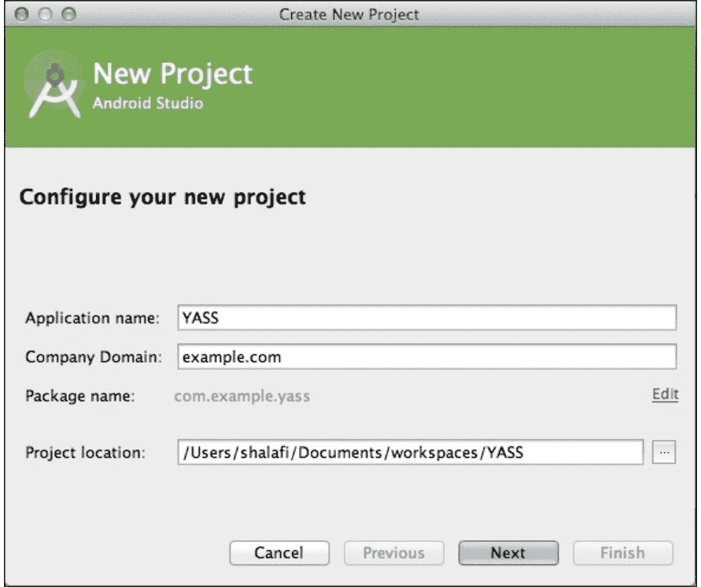

我们包含对 Android TV 的支持，因为我们希望能够在大屏幕上运行游戏。这将创建一个可编译的额外模块，但我们将在最后一章之前不触碰它。

如前所述，我们将对手机使用 **最低 SDK** 版本 15，对 Android TV 使用版本 21，因为这是其可用的版本。

对于应用程序的 **包名称**，我们将使用 `com.example.yass`。

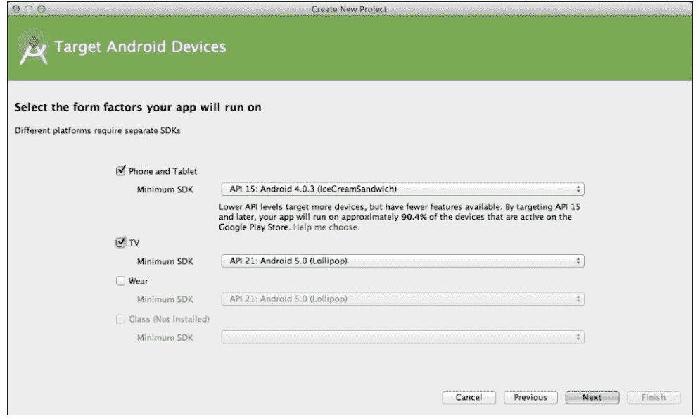

我们不会使用任何默认向导，因为它们都包含对应用很棒但对游戏无用的动作栏/工具栏。因此，我们将选择空项目选项：

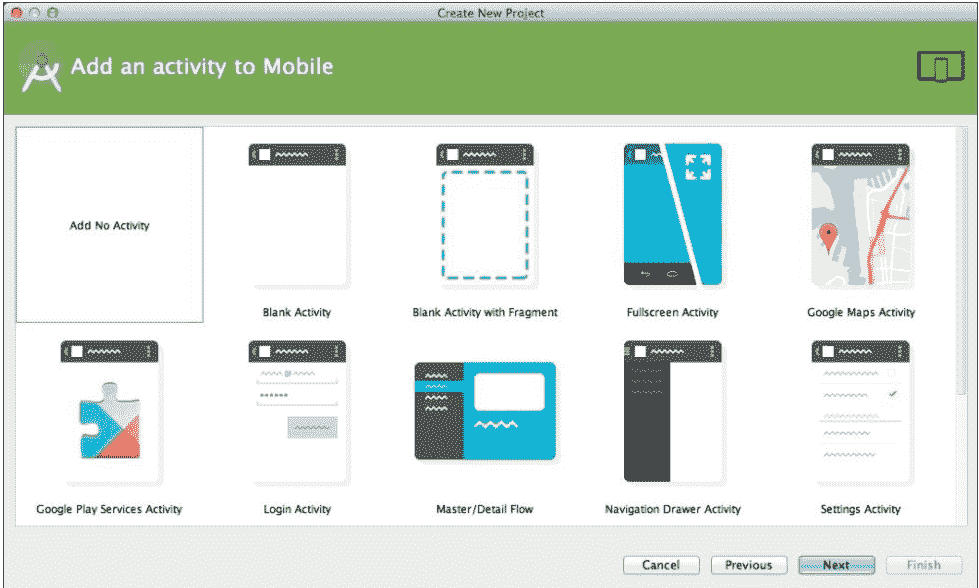

同样，我们不会为 TV 创建任何 Activity：

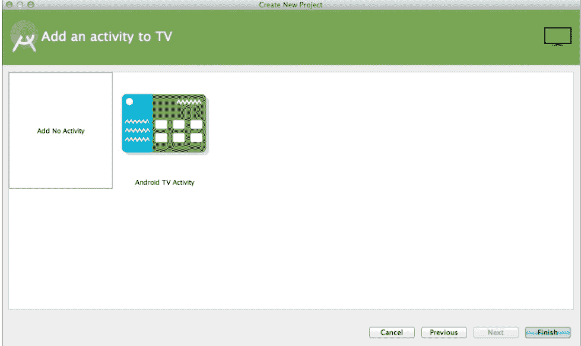

项目创建完成后，我们将创建一个带有一个 Fragment 的 Activity。这是通过菜单选项 **New > Activity > Blank Activity with Fragment** 完成的。

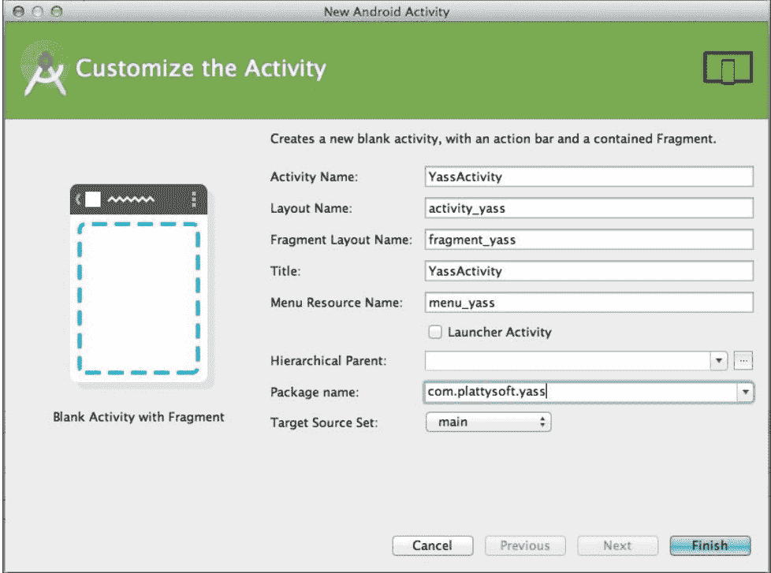

我们将通过以下方式填充对话框来自定义 Activity：

- **Activity 名称**: YassActivity
- **布局名称**: activity_yass（更改 Activity 名称后将成为默认值）
- **Fragment 布局名称**: fragment_yass（更改 Activity 名称后将成为默认值）
- **标题**: YassActivity

这将创建以下文件：

- YassActivity.java，包含 YassActivity 和 PlaceholderFragment 的代码
- activity_main.xml：带有 @+id/container 的 FrameLayout，将用于加载 Fragment


## 清理

- fragment_main.xml：一个占位符布局，包含文本 Hello World！

由于我们没有告诉 Android Studio 此 Activity 将作为启动 Activity，因此需要编辑 AndroidManifest.xml，通过添加适当的意图过滤器将其配置为启动 Activity：

```
<intent-filter>
<action android:name="android.intent.action.MAIN" >
<category android:name="android.intent.category.LAUNCHER" >
</intent-filter>
```

我们根本不会使用菜单，因此有一些方法和文件不需要，可以将它们删除。如果你愿意，可以保留所有这些方法，但拥有一个没有未用代码的干净环境更为理想。

因此，我们可以移除 resources 下的 menu 文件夹及其中的文件，这些文件本应是 YassActivity 的菜单。

处理菜单创建和菜单项选择的方法也是无用的，因此我们可以从 YassActivity 中移除以下方法：

- onCreateOptionsMenu：创建菜单时调用
- OnOptionsItemSelected：从菜单中选择选项时调用

## 选择方向

决定游戏的方向是一个非常重要的点。考虑到 Android 手机的多样性，分辨率和宽高比是我们必须处理的几件事。

传统上，游戏都以横向方向进行：计算机的显示器为横向模式，使用游戏机时电视屏幕也是如此。几乎所有掌机也都采用横向方向设计。不仅如此，大多数平板电脑也将横向视为默认方向。

### 注意

横向是游戏的传统方向。

YASS 将是一款横向游戏。这样做的关键原因是为了以后能够将游戏移植到 Android 游戏机上，包括 Android TV 和 OUYA。这并不意味着纵向模式不是游戏的有效方向，但对玩家来说较为陌生。

我们将使用 sensorLandscape 而不仅仅是 landscape，以便设备可以旋转 180 度来适应任何朝下的一侧。我们需要将 AndroidManifest.xml 更新为如下所示：

```
<application
    android:icon="@mipmap/ic_launcher"
    android:label="@string/app_name"
    android:theme="@style/AppTheme" >
<activity
    android:screenOrientation="sensorLandscape"
    android:name=".YassActivity"
    android:label="@string/title_activity_yass" >
<intent-filter>
    <action android:name="android.intent.action.MAIN" >
    <category android:name="android.intent.category.LAUNCHER" >
</intent-filter>
</activity>
</application>
```

如你所知，当 Android 上的 Activity 改变方向时，它会被销毁并重新创建，其中的所有 fragment 也是如此。这意味着，除非你显式保存和恢复信息，否则 fragment 不会记住之前的状态。

### 注意

sensorLandscape 和 sensorPortrait 模式在旋转时不会销毁活动。

好消息是：使用 sensorLandscape 时，旋转不会终止 Activity，因此不需要额外工作。这是因为布局完全相同，无需重新创建任何内容。

如果你计划制作一个可以旋转的游戏，在方向改变时必须格外注意保存和恢复游戏状态。这本身也是将游戏锁定到特定方向（无论是横向还是纵向）的另一个充分理由。

## 处理宽高比

Android 设备的宽高比多种多样，至少从 4:3 到 16:9 不等。这里尚未计算像素数量。

在为多种宽高比设计游戏时，基本上有两种方法。对于每种方法，我们都针对最极端的宽高比进行设计。我们将使用额外空间作为“智能信箱”，这意味着我们可以拥有更多的游戏视图。

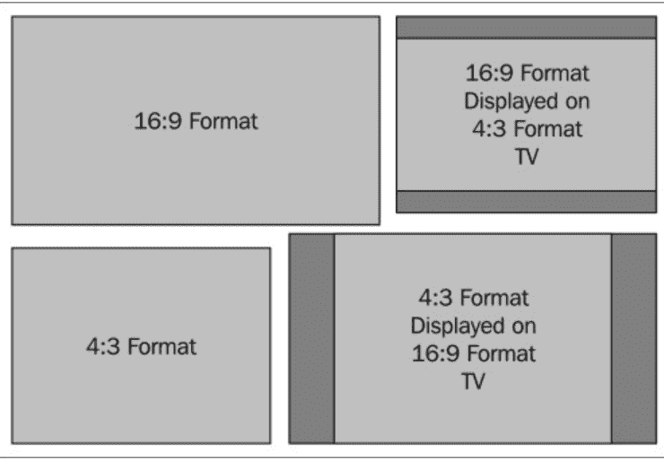

## 为不同宽高比设计的几种方法

最常见的选择是让相机居中并固定最小尺寸（横向方向的高度）。这样可以在两侧获得更多视图空间，同时确保最小屏幕有足够的显示空间。这相当于在 16:9 屏幕上查看 4:3 图像。

如果游戏设计合理，你也可以固定较大尺寸。如果屏幕是正方形，这会在顶部和底部增加额外空间。这相当于在 4:3 屏幕上查看 16:9 图像。

还有一种替代方法：简单地拥有“更多相机空间”。我们还可以将游戏视图设为某个特定大小，并使用额外空间来显示得分、关卡等其他控件。

如果将此方法推向极致，你可以将游戏区域设计成完全正方形，并在横向和纵向的“智能信箱”中放置额外信息。此方法的一个非常好的示例是 Candy Crush Saga。这是最灵活的方法，但也需要最多的工作量。

对于我们的游戏，我们将采用“更多相机空间”方法，配合固定大小的信箱来显示得分和生命值。

针对分辨率和像素密度的差异，我们将针对低密度屏幕进行设计。我们将以编程方式读取设备的分辨率并应用转换系数。这种方法的某些深入细节将在专门介绍低级绘制、菜单和对话框的章节中给出。

## 游戏架构

游戏与应用程序具有不同的架构和控制流程。两者似乎都能立即响应用户输入，但应用程序通过设置监听器并使用方法调用响应事件（最常见的是 onClick 方法调用 onClickListener），这种方法对于实时游戏无效（尽管对于非实时游戏有效）。

一旦游戏运行，它就必须尽可能快地评估和更新一切。这就是为什么它不能被用户事件中断的原因。这些事件或状态应当被记录下来，然后由游戏对象在其更新过程中读取。

游戏引擎应在运行游戏的 fragment 内部创建，因为只有在游戏时才需要游戏引擎运行。这样做的好处是，我们可以利用现有的 Android 知识来创建和处理游戏的其余屏幕。

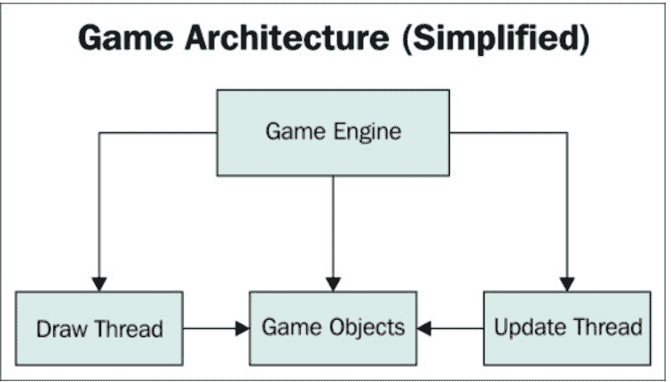

游戏引擎的简化架构

基本的 **游戏引擎** 架构由一个 **更新线程**、一个 **绘制线程** 以及一系列属于 **游戏引擎** 的 **游戏对象** 组成。

**游戏引擎** 是程序其余部分与游戏交互的组件。它的任务还包括封装更新线程和绘制线程的存在，以及处理游戏对象。

游戏由 **游戏对象** 组成，这些对象既被更新也被绘制。这些对象保存在 **游戏引擎** 内部。

**更新线程** 负责尽可能快地更新游戏对象的状态。它会遍历所有游戏对象并调用更新方法。

UI 也必须不断更新，并且独立于更新线程。它将通过对游戏对象调用绘制方法来绘制所有游戏对象。

让我们详细分析每个组件。

## GameEngine 和 GameObjects

游戏引擎包含已经提到的三个元素。

GameObject 是一个抽象类，游戏中所有游戏对象都必须从中继承。这个接口将它们与更新线程和绘制线程连接起来。

```
public abstract class GameObject {
    public abstract void startGame();
    public abstract void onUpdate(long elapsedMillis, GameEngine gameEngine);
    public abstract void onDraw();
    public final Runnable mOnAddedRunnable = new Runnable() {
        @Override
        public void run() {
            onAddedToGameUiThread();
        }
    };
};
public final Runnable mOnRemovedRunnable = new Runnable() {
    @Override
    public void run() {
        onRemovedFromGameUiThread();
    }
};
public void onRemovedFromGameUiThread(){
}
public void onAddedToGameUiThread(){}
}
```

- startGame 用于在游戏开始前初始化对象。
- onUpdate 由游戏引擎以尽可能快的速度调用，提供自上次调用以来经过的毫秒数以及对 GameEngine 本身的引用，以便将来使用（例如访问用户输入）。
- onDraw 使组件渲染自身。我们目前尚未使用任何参数，但稍后将传递一个 Canvas 以供绘制。
- onRemovedFromGameUiThread 包含在对象从游戏中移除时必须在 UI 线程上运行的代码。


- onAddedToGameUiThread 包含在对象添加到游戏时必须在 UIThread 上运行的代码。
- 这两个 Runnable 对象用于在 UIThread 内部调用 onRemovedFromGameUiThread 和 onAddedToGameUiThread。

GameEngine 将为我们提供启动、停止、暂停和恢复游戏的便捷方法，因此我们无需担心外部的线程或游戏对象。

游戏引擎由三个项目组成：游戏对象列表、UpdateThread 和 DrawThread。

```
private List<GameObject> mGameObjects = new ArrayList<GameObject>();
private UpdateThread mUpdateThread;
private DrawThread mDrawThread;
```

让我们来看看引擎用于处理游戏的不同方法。

## 启动游戏

从 GameEngine 启动游戏的代码如下：

```
public void startGame() {
// Stop a game if it is running
stopGame();

// Setup the game objects
int numGameObjects = mGameObjects.size();
for (int i=0; i<numGameObjects; i++) {
mGameObjects.get(i).startGame();
}

// Start the update thread
mUpdateThread = new UpdateThread(this);
mUpdateThread.start();

// Start the drawing thread
mDrawThread = new DrawThread(this);
mDrawThread.start();
}
```

首先，我们必须确保没有游戏正在运行，因此在开头调用 stopGame 以停止正在进行的游戏（如果有的话）。

其次，我们重置与引擎关联的所有游戏对象。在启动线程之前执行此操作非常重要，以便一切都从初始位置开始。

最后，我们创建并启动 UpdateThread 和 DrawThread。

## 停止游戏

停止游戏更加简单。我们只需在 Update 和 Draw 线程存在时停止它们：

```
public void stopGame() {
    if (mUpdateThread != null) {
    mUpdateThread.stopGame();
    }
    if (mDrawThread != null) {
    mDrawThread.stopGame();
    }
}
```

我们还有 pauseGame 和 resumeGame 方法，其功能与此等效。在这些方法中，操作的逻辑属于每个线程。此处不包含这些方法的代码，因为它们是多余的。

## 管理游戏对象

引擎必须管理游戏对象的添加和删除。我们不能直接处理列表，因为它将在 onUpdate 和 onDraw 期间被频繁使用。

```
public void addGameObject(final GameObject gameObject) {
    if (isRunning()){
    mObjectsToAdd.add(gameObject);
    }
    else {
    mGameObjects.add(gameObject);
    }
    mActivity.runOnUiThread(gameObject.mOnAddedRunnable);
}
```

```
public void removeGameObject(final GameObject gameObject) {
    mObjectsToRemove.add(gameObject);
    mActivity.runOnUiThread(gameObject.mOnRemovedRunnable);
}
```

我们使用 mObjectsToAdd 和 mObjectsToRemove 列表来跟踪必须添加或删除的对象。我们将在 onUpdate 方法的最后一步执行这两项操作，但当游戏引擎未运行时除外，在这种情况下可以直接安全地添加和删除它们。

我们还在 UIThread 上运行 GameObject 中的相应 Runnable 对象。

要从引擎更新游戏对象，我们只需对它们全部调用 onUpdate。一旦更新循环完成，我们就会处理必须从 mGameObjects 中移除或添加的对象。这部分使用同步块完成，这也对 onDraw 方法很重要。

```
public void onUpdate(long elapsedMillis) {
    int numGameObjects = mGameObjects.size();
    for (int i=0; i<numGameObjects; i++) {
        mGameObjects.get(i).onUpdate(elapsedMillis, this);
    }
    synchronized (mGameObjects) {
        while (!mObjectsToRemove.isEmpty()) {
            mGameObjects.remove(mObjectsToRemove.remove(0));
        }
        while (!mObjectsToAdd.isEmpty()) {
            mGameObjects.add(mObjectsToAdd.remove(0));
        }
    }
}
```

绘制也做同样的处理，只是绘制必须在 UIThread 上完成。因此，我们创建一个 Runnable 对象并将其传递给活动的 runOnUiThread 方法。

```
private Runnable mDrawRunnable = new Runnable() {
    @Override
    public void run() {
        synchronized (mGameObjects) {
            int numGameObjects = mGameObjects.size();
            for (int i = 0; i < numGameObjects; i++) {
                mGameObjects.get(i).onDraw();
            }
        }
    }
};
```

```
public void onDraw(Canvas canvas) {
    mActivity.runOnUiThread(mDrawRunnable);
}
```

请注意，我们使用 mGameObjects 对 run 方法进行同步。这样做是为了确保在遍历列表时，列表不会被修改。

同样重要的是，仅对 onUpdate 的最后一部分进行同步。如果没有对象被添加或移除，线程是独立的。如果我们对完整的 onUpdate 方法进行同步，将失去拥有分离的 Update 和 Draw 线程的所有优势。

## UpdateThread

UpdateThread 是一个在游戏引擎上连续运行更新的线程。对于每次对 onUpdate 的调用，它提供自上次执行以来的毫秒数。

更新线程的基本 run 方法如下：

```
@Override
public void run() {
    long previousTimeMillis;
    long currentTimeMillis;
    long elapsedMillis;
    previousTimeMillis = System.currentTimeMillis();

    while (mGameIsRunning) {
        currentTimeMillis = System.currentTimeMillis();
        elapsedMillis = currentTimeMillis - previousTimeMillis;
        mGameEngine.onUpdate(elapsedMillis);
        previousTimeMillis = currentTimeMillis;
    }
}
```

只要游戏正在运行，线程就会保持在循环中。在每次迭代中，它会获取当前时间，计算自上次运行以来的经过毫秒数，并在 GameEngine 对象上调用 onUpdate。

虽然这个第一个版本可用且非常易于遵循，但它只能启动和停止游戏。我们还希望能够暂停和恢复它。

要暂停和恢复游戏，我们需要一个在循环内读取的变量，以检查何时暂停执行。我们需要跟踪经过的毫秒数并扣除暂停所花费的时间。一种简单的做法如下：

```
while (mGameIsRunning) {
    currentTimeMillis = System.currentTimeMillis();
    elapsedMillis = currentTimeMillis - previousTimeMillis;
    if (mPauseGame) {
        while (mPauseGame) {
            try {
                Thread.sleep(20);
            } catch (InterruptedException e) {
                // We stay on the loop
            }
        }
    }
    currentTimeMillis = System.currentTimeMillis();
    mGameEngine.onUpdate(elapsedMillis);
    previousTimeMillis = currentTimeMillis;
}
```

pauseGame 和 resumeGame 方法的代码只是将变量 mPauseGame 设置为 true 或 false。

如果游戏已暂停，我们会进入一个 while 循环，并一直停留直到游戏恢复。为了避免持续运行的空循环，我们可以让线程休眠一小段时间（20 毫秒）。请注意，Thread.sleep 可能会触发 InterruptedException。如果发生这种情况，我们可以继续，因为它将在 20 毫秒后再次运行。此外，我们现在将对其进行改进。

这种方法有效，但仍有大量空闲处理在进行。对于线程，有更高效的暂停和恢复机制。我们将使用 wait/notify 来改进这一点。

代码可以更新为如下形式：

```
while (mGameIsRunning) {
    currentTimeMillis = System.currentTimeMillis();
    elapsedMillis = currentTimeMillis - previousTimeMillis;
    if (mPauseGame) {
        while (mPauseGame) {
            try {
                synchronized (mLock) {
                    mLock.wait();
                }
            } catch (InterruptedException e) {
                // We stay on the loop
            }
        }
    }
    currentTimeMillis = System.currentTimeMillis();
    mGameEngine.onUpdate(elapsedMillis);
    previousTimeMillis = currentTimeMillis;
}
```

pauseGame 方法与之前相同，但我们需要更新 resumeGame，使其位于通知和释放锁的位置：

```
public void resumeGame() {
    if (mPauseGame == true) {
        mPauseGame = false;
        synchronized (mLock) {
            mLock.notify();
        }
    }
}
```

使用 wait/notify，我们确保线程在空闲时不会执行任何工作，并且我们知道一旦通知它就会被唤醒。重要的是首先将 mPauseGame 设置为 false，然后唤醒线程，否则主循环可能会再次停止。

最后，要启动和停止游戏，我们只需更改变量的值：

```
public void start() {
    mGameIsRunning = true;
    mPauseGame = false;
    super.start();
}
```

```
public void stopGame() {
    mGameIsRunning = false;
    resumeGame();
}
```

游戏永远不会以暂停状态启动。要停止游戏，我们只需将 mGameIsRunning 设置为 false，run 方法内部的循环就会结束。

将 resumeGame 作为 stopGame 方法的一部分调用非常重要。如果在游戏暂停时调用 stop，线程将处于等待状态，因此除非恢复游戏，否则什么也不会发生。如果游戏未暂停，resumeGame 内部不执行任何操作，因此是否调用它都无关紧要。


## DrawThread

有几种方法可以实现 DrawThread。可以采用与 update thread 类似的方式，但我们将使用一种更简单的方法，该方法不使用 Thread。

我们将使用 Timer 和 TimerTask 类，以足够高的频率将 onDraw 回调发送到游戏引擎，以便每秒渲染 30 帧：

```
private static int EXPECTED_FPS = 30;
private static final long TIME_BETWEEN_DRAWS = 1000 / EXPECTED_FPS;

public void start() {
    stopGame();
    mTimer = new Timer();
    mTimer.schedule(new TimerTask() {
        @Override
        public void run() {
            mGameEngine.onDraw();
        }
    }, 0, TIME_BETWEEN_DRAWS);
}
```

此方法每 33 毫秒被调用一次。在简单实现中，该方法将在 GameView 中调用 invalidate，这将导致调用 View 的 onDraw 方法。

此实现依赖于 Android UI 的一个特性。为了重新显示视图，Android 内置了一个应急系统，以避免重复的 invalidate。如果在视图正在绘制时请求 invalidate，它将被排队。如果排队的 invalidate 超过一个，它们将被丢弃，因为它们不会产生任何效果。

因此，如果视图绘制时间超过 TIME_BETWEEN_DRAWS，系统将自动降至每秒更少的帧数。

本书稍后将重新讨论此线程以实现更复杂的方案，但目前，让我们保持简单。

停止、暂停和恢复 DrawThread 也很简单：

```
public void stopGame() {
    if (mTimer != null) {
        mTimer.cancel();
        mTimer.purge();
    }
}
```

```
public void pauseGame() {
    stopGame();
}
```

```
public void resumeGame() {
    start();
}
```

要停止游戏，我们只需取消并清除计时器。cancel 方法将取消计时器和所有计划任务，而 purge 将从队列中删除所有已取消的任务。

由于不需要跟踪任何状态，我们可以让 pauseGame 和 resumeGame 分别等同于 stopGame 和 start。

请注意，如果我们希望在 30fps 下获得流畅的游戏，屏幕上所有项目的绘制必须在 33 毫秒内完成。这意味着这些方法的代码通常需要优化。

## User input

如前所述，用户输入将由某个输入控制器处理，然后由需要时需要它的对象读取。我们将在下一章详细介绍这样的输入控制器。目前，我们只想检查游戏引擎是否按预期工作，并正确处理 start、stop、pause 和 resume 调用。

暂停、恢复和启动与其他用户输入不同，因为它们影响引擎和线程本身的状态，而不是修改游戏对象的状态。出于这个原因，我们将使用标准的事件导向编程来触发这些函数。

### Putting everything together

让我们先从骨架项目开始，添加构建可用游戏引擎所需的所有类，然后修改代码，以便我们可以启动、停止、暂停和恢复游戏引擎，并显示游戏启动以来的毫秒数。

我们将把 GameEngine、UpdateThread、DrawThread 和 GameObject 的当前实现放在 com.example.yass.engine 包中。

接下来，我们将创建另一个名为 com.example.yass.counter 的包，用于本示例的代码。

在 YassActivity 内部，我们有一个名为 PlaceholderFragment 的内部类。我们将把它重命名为 GameFragment，将其重构为单独的文件，并将其放在 com.example.yass.counter 包下。

我们将添加一个 TextView 来显示毫秒数，以及两个按钮：一个用于启动和停止游戏引擎，另一个用于暂停和恢复它。

我们将把它们添加到 fragment_yass_main.xml 的布局中，它将如下所示：

```
<LinearLayout
xmlns:android="http://schemas.android.com/apk/res/android"
xmlns:tools="http://schemas.android.com/tools"
android:layout_width="match_parent"
android:layout_height="match_parent"
android:orientation="vertical"
android:padding="@dimen/activity_horizontal_margin"
android:paddingLeft="@dimen/activity_horizontal_margin"
tools:context="com.example.yass.counter.PlaceholderFragment">

<TextView
android:id="@+id/txt_score"
android:layout_width="wrap_content"
android:layout_height="wrap_content"
android:text="@string/hello_world" >

<Button
android:id="@+id/btn_start_stop"
android:layout_width="wrap_content"
android:layout_height="wrap_content"
android:text="@string/start" >
<Button
android:id="@+id/btn_play_pause"
android:layout_width="wrap_content"
android:layout_height="wrap_content"
android:text="@string/pause" >
</LinearLayout>
```

对于游戏 fragment，我们需要在 onViewCreated 内部添加以下代码：

```
@Override
public void onViewCreated(View view, Bundle savedInstanceState) {
    super.onViewCreated(view, savedInstanceState);
    mGameEngine = new GameEngine(getActivity());
    mGameEngine.addGameObject(
    new ScoreGameObject(view, R.id.txt_score));
    view.findViewById(R.id.btn_start_stop)
    .setOnClickListener(this);
    view.findViewById(R.id.btn_play_pause)
    .setOnClickListener(this);
}
```

创建视图后，我们会创建游戏引擎并向其中添加一个新的 ScoreGameObject。然后，我们将当前 fragment 设置为我们添加的两个按钮的监听器。

onClick 的代码非常简单；只需为每个按钮决定调用哪个方法：

```
@Override
public void onClick(View v) {
    if (v.getId() == R.id.btn_play_pause) {
    playOrPause();
    }
    if (v.getId() == R.id.btn_start_stop) {
    startOrStop();
    }
}
```

决定是否应该暂停或恢复游戏，简单如下：

```
private void playOrPause() {
    Button button = (Button)
            getView().findViewById(R.id.btn_play_pause);
    if (mGameEngine.isPaused()) {
        mGameEngine.resumeGame();
        button.setText(R.string.pause);
    }
    else {
        mGameEngine.pauseGame();
        button.setText(R.string.resume);
    }
}
```

我们还会处理按钮上的名称更改，以确保 UI 一致。
在代码中，我们正在使用 GameEngine 的 isPaused 方法。该
方法仅在 UpdateThread 对象不为 null 时返回其状态：

```
public boolean isPaused() {
    return mUpdateThread != null && mUpdateThread.isGamePaused();
}
```

同样，为了开始/暂停游戏并保持按钮状态，我们将添加
此方法：

```
private void startOrStop() {
    Button button = (Button)
            getView().findViewById(R.id.btn_start_stop);
    Button playPauseButton = (Button)
            getView().findViewById(R.id.btn_play_pause);
    if (mGameEngine.isRunning()) {
        mGameEngine.stopGame();
        button.setText(R.string.start);
        playPauseButton.setEnabled(false);
    }
    else {
        mGameEngine.startGame();
        button.setText(R.string.stop);
        playPauseButton.setEnabled(true);
        playPauseButton.setText(R.string.pause);
    }
}
```

再次，我们需要在 GameEngine 中有一个方法来知道它是否正在运行。
就像我们对前一个方法所做的那样，我们只是反映 UpdateThread 的状态：

```
public boolean isRunning() {
    return mUpdateThread != null && mUpdateThread.isGameRunning();
}
```

完成基本连接后，我们可以进入真正有趣的部分：我们正在创建的游戏对象。这个对象说明了我们一直在讨论的 GameObject 类中每个方法的用法：

```
public class ScoreGameObject extends GameObject {
    private final TextView mText;
    private long mTotalMillis;

    public ScoreGameObject(View view, int viewResId) {
        mText = (TextView) view.findViewById(viewResId);
    }

    @Override
    public void onUpdate(long elapsedMillis, GameEngine gameEngine) {
        mTotalMillis += elapsedMillis;
    }

    @Override
    public void startGame() {
        mTotalMillis = 0;
    }

    @Override
    public void onDraw() {
        mText.setText(String.valueOf(mTotalMillis));
    }
}
```

onUpdate 方法只是不断将毫秒数添加到总计中。当新游戏开始时，总计会被重置，而 onDraw 在文本视图中设置总毫秒数的值。

如预期，onUpdate 的调用频率远高于 onDraw。另一方面，onDraw 在 UI 线程上执行，这是我们无法对 onUpdate 承担的。

我们现在可以编译并运行示例，检查当我们启动和停止游戏引擎时计时器是否启动和停止。我们还可以检查暂停和


resume work as expected.

## 接下来，我们继续以示例为例

现在我们将对示例做一些更改。我们将制作一个暂停对话框，从中可以恢复或停止游戏。当用户点击暂停按钮或按下返回键时，将显示此对话框。

最后，我们将添加一个片段，玩家可以从中启动游戏，并将游戏片段与菜单分开。

因此，我们将创建 MainMenuFragment.java 和 fragment_main_menu.xml。布局内容将非常简单：

```
<?xml version="1.0" encoding="utf-8"?>
<FrameLayout
xmlns:android="http://schemas.android.com/apk/res/android"
android:layout_width="match_parent"
android:layout_height="match_parent">

<TextView
android:layout_gravity="center_horizontal|top"
style="@android:style/TextAppearance.DeviceDefault.Large"
android:layout_marginTop="@dimen/activity_vertical_margin"
android:text="@string/game_title"
android:layout_width="wrap_content"
android:layout_height="wrap_content" >

<Button
android:id="@+id/btn_start"
android:layout_width="wrap_content"
android:layout_height="wrap_content"
android:layout_gravity="center"
android:text="@string/start" >

</FrameLayout>
```

这包括屏幕上的应用标题和一个开始游戏的按钮：

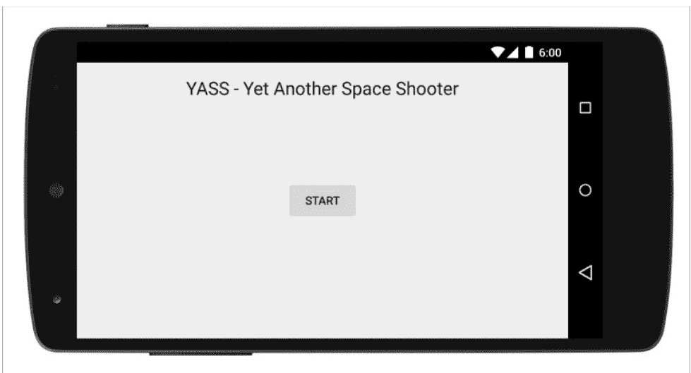

在此片段中，我们为开始按钮添加了一个监听器，并使其调用 startGame 方法。startGame 方法的代码也非常简单：

```
public void startGame() {
	getFragmentManager()
		.beginTransaction()
		.replace(R.id.container, new GameFragment(), TAG_FRAGMENT)
		.addToBackStack(null)
		.commit();
}
```

我们使用片段管理器从当前片段过渡到 GameFragment。

beginTransaction 方法创建过渡本身，我们可以通过链式方法对其进行配置。

我们将视图中 ID 为 R.id.container 的片段替换为 GameFragment。这将移除旧片段。如果使用 add，则两个片段都将显示。

然后，我们将片段添加到返回栈中，不带标记，因为我们不需要任何标记。这非常重要，因为它允许系统正确管理返回键。片段管理器返回栈上的所有内容在按下返回键时都会弹出。

如果不将片段添加到返回栈中，点击返回键时的默认行为将是关闭应用。将片段放在返回栈上后，我们可以依靠系统来正确处理片段导航。

最后，我们提交过渡以替换片段。

在我们已有的游戏片段中，我们将移除开始/停止对话框，并修改暂停按钮，以显示一个可以从中恢复或退出当前游戏的对话框。

我们希望游戏立即开始，因此 GameFragment 的 onViewCreated 方法现在将如下所示：

```
@Override
public void onViewCreated(View view, Bundle savedInstanceState) {
    super.onViewCreated(view, savedInstanceState);
    mGameEngine = new GameEngine(getActivity());
    mGameEngine.addGameObject(
        new ScoreGameObject(view, R.id.txt_score));
    view.findViewById(R.id.btn_play_pause)
        .setOnClickListener(this);
    mGameEngine.startGame();
}
```

我们还将修改 onClick 方法，删除启动或停止的旧代码，使其如下所示：

```
@Override
public void onClick(View v) {
    if (v.getId() == R.id.btn_play_pause) {
        pauseGameAndShowPauseDialog();
    }
}
```

这个更简单的版本只关心在点击暂停按钮时暂停游戏并显示对话框。

目前，我们将使用 AlertDialog 框架创建一个默认对话框：

```
private void pauseGameAndShowPauseDialog() {
mGameEngine.pauseGame();
new AlertDialog.Builder(getActivity())
.setTitle(R.string.pause_dialog_title)
.setMessage(R.string.pause_dialog_message)
.setPositiveButton(R.string.resume,
new DialogInterface.OnClickListener() {
@Override
public void onClick(DialogInterface dialog, int which) {
dialog.dismiss();
mGameEngine.resumeGame();
}
})
.setNegativeButton(R.string.stop,
new DialogInterface.OnClickListener() {
@Override
public void onClick(DialogInterface dialog, int which) {
dialog.dismiss();
mGameEngine.stopGame();
((MainActivity)getActivity()).navigateBack();
}
})
.create()
.show();
}
```

确定按钮将恢复游戏，因此它会在游戏引擎中调用 resumeGame。

取消按钮将退出游戏，因此它会在 GameEngine 中调用 stopGame，然后在父 Activity 中调用 navigateBack。

navigateBack 方法只不过是处理 Activity 中的返回键按下：

```
public void navigateBack() {
super.onBackPressed();
}
```

由于我们将片段放入了导航栈，MainMenuFragment 将重新加载，GameFragment 将被销毁。以下是暂停对话框的外观：

### 暂停

游戏已暂停，请随意。

- 停止
- 恢复

## 处理返回键

我们想做的一件事是正确处理返回键。当它在游戏中不按预期工作时，这会让 Android 用户感到沮丧，因此我们将对此给予特别关注。目前有两个地方不按预期工作。

### 注意

在 Android 上正确处理返回键非常重要。

- 如果使用返回键关闭 **暂停** 对话框，游戏将不会恢复。
- 在游戏片段中，返回键应暂停游戏。目前，返回键会返回到 GameFragment。

对于第一个问题，我们需要为对话框添加一个 onCancelListener。这与 OnDismissListener 不同，后者在每次关闭对话框时都会被调用。仅当对话框被取消时，才会调用取消方法。

另外，OnDismissListener 是在 API 级别 17 中引入的。由于我们不需要它，因此不必担心提高游戏的 minSDK。

我们使用以下代码更新 **暂停** 对话框的创建：

```
new AlertDialog.Builder(getActivity())
[...]
.setOnCancelListener(new DialogInterface.OnCancelListener() {
@Override
public void onCancel(DialogInterface dialog) {
mGameEngine.resumeGame();
}
})
.create()
.show();
```

剩下的任务是：在游戏期间按下返回键时暂停游戏。这需要在片段中处理。事实上，onBackPressed 是仅适用于 Activity 的方法。我们需要编写一种方式，将其扩展到当前片段。

我们将利用我们的 YassBaseFragment（游戏中所有片段的基类）来添加对 onBackPressed 的支持。我们将在此处创建一个 onBackPressed 方法：

```
public class YassBaseFragment extends Fragment {
    public boolean onBackPressed() {
        return false;
    }
}
```

在 Activity 中，我们更新 onBackPressed 以允许片段在需要时重写它：

```
@Override
public void onBackPressed() {
    final YassFragment fragment = (YassFragment)
    getFragmentManager().findFragmentByTag(TAG_FRAGMENT);
    if (!fragment.onBackPressed()) {
        super.onBackPressed();
    }
}
```

如果片段不处理返回键按下，它将返回 false。然后，我们只需调用 super 方法以允许默认行为。

TAG_FRAGMENT 非常重要；它允许我们获取正在添加的片段，并且在将片段添加到 FragmentTransition 时设置它。让我们查看由向导创建的 MainActivity 的 onCreate 方法，并将 TAG_FRAGMENT 添加到初始 FragmentTransition 中：

```
@Override
protected void onCreate(Bundle savedInstanceState) {
    super.onCreate(savedInstanceState);
    setContentView(R.layout.activity_yass);
    if (savedInstanceState == null) {
        getFragmentManager().beginTransaction()
        .add(R.id.container, new MainMenuFragment(), TAG_FRAGMENT)
        .commit();
    }
}
```

同样重要的是，应用程序中的所有片段都必须继承自 YassBaseFragment，否则此方法将抛出一个


类转换异常。

现在所有部件都已就绪，我们在 GameFragment 中重写 onBackPressed 方法，以显示 **暂停** 对话框：

```
@Override
public boolean onBackPressed() {
    if (mGameEngine.isRunning()) {
        pauseGameAndShowPauseDialog();
        return true;
    }
    return false;
}
```

有了这个，当我们在 GameFragment 中点击返回时，**暂停** 对话框会显示。请注意，只有在 GameEngine 运行时才会显示暂停对话框。当它未运行时，我们返回 false。Android 的默认行为将被触发，且正在显示的 **暂停** 对话框将被取消。

## 遵守生命周期

我们的游戏也应与 Activity 生命周期保持一致；特别是，当 Activity 暂停时，游戏也应暂停。这主要出于两个非常重要的原因：

- 如果游戏被置于后台，用户希望它在返回时处于暂停状态
- 只要游戏在运行，更新线程就会以最快速度更新，这会让手机感觉变慢

使用当前实现，这些都不会发生。你可以试试按下主页按钮，你会发现设备感觉不灵敏。另外，如果你使用最近应用按钮将游戏重新置于前台，你会看到计时器仍在计数。

### 注意

不遵守 Fragment 生命周期会导致性能问题和玩家不满。

解决这个问题非常简单，我们只需遵守 Fragment 生命周期，向 GameFragment 添加以下代码：

```
@Override
public void onPause() {
    super.onPause();
    if (mGameEngine.isRunning()){
    pauseGameAndShowPauseDialog();
    }
}
```

```
@Override
public void onDestroy() {
    super.onDestroy();
    mGameEngine.stopGame();
}
```

有了这个，每当 Fragment 暂停时，我们就会暂停游戏并显示对话框，以便玩家可以恢复。另外，每当 Fragment 销毁时，我们都会停止游戏引擎。

在暂停游戏引擎之前检查它是否正在运行很重要，因为退出游戏时也会调用 onPause。所以，如果我们忘记这样做，通过暂停对话框退出会导致应用崩溃。

## 尽可能多地使用屏幕

我们正在构建一个游戏。我们希望拥有设备的所有屏幕空间，没有任何干扰。有两样东西会从我们这里夺走它：

- **状态栏**：屏幕顶部显示时间、电池、WiFi、移动信号和通知的那一栏。
- **导航栏**：放置返回、主页和最近按钮的那一栏。它可能根据设备方向位于不同位置。

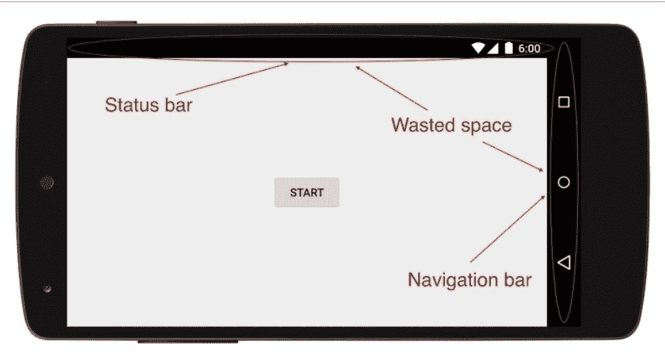

状态栏和导航栏占据了屏幕上相当大的空间

导航栏是在冰淇淋三明治中引入的，用来替代物理按钮。但是，即使在今天，一些制造商决定改用物理按钮，所以它可能存在也可能不存在。

我们可以做的第一件事是告诉系统我们想要全屏。有一个名为 SYSTEM_UI_FLAG_FULLSCREEN 的标志，这似乎正是我们所寻找的。

问题是，这个标志是在 Android 早期版本中引入的，那时还没有 **导航栏**。以前，它确实意味着全屏，但从冰淇淋三明治开始，它仅意味着“移除 **状态栏**”。

### **注意**

`SYSTEM_UI_FLAG_FULLSCREEN` 模式并非真正的全屏。

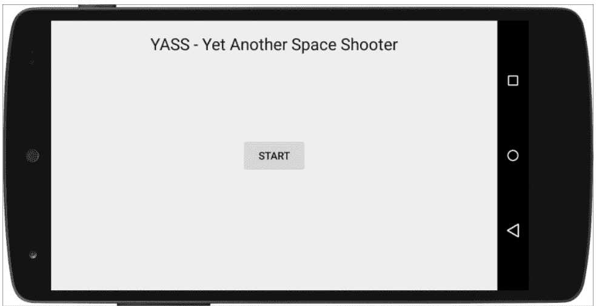

*全屏仅会让状态栏消失。*

随着 **导航栏** 的出现，增加了一些处理全屏的方法。这种方法在 KitKat 中被重新审视。所以，让我们看看我们的选项。

## Android 4.4 之前 – 几乎全屏

在 Android 4.0 中，随着 **导航栏** 的引入，除了现有的全屏标志外，还添加了两个用于处理 **导航栏** 的新标志：

- **SYSTEM_UI_FLAG_HIDE_NAVIGATION**：这告诉系统隐藏 **导航栏**
- **SYSTEM_UI_FLAG_LOW_PROFILE**：这会将设备置于“低调模式”，调暗 **导航栏** 上的图标，并将它们替换为仅显示的点

虽然“隐藏导航”标志确实会完全隐藏导航栏，但一旦你触摸屏幕上的任何位置，栏就会重新出现，因为此模式是为视频播放等非交互式活动设计的。所以，SYSTEM_UI_FLAG_HIDE_NAVIGATION 对我们没什么用。

使用低调模式来调暗导航栏是一个更合理的解决方案。虽然我们没有获得任何额外的屏幕空间，但栏上的图标缩小为小点这一事实让玩家能更专注于内容。这些图标在需要时会显示（基本上，当用户点击栏时），并在不再需要时立即再次变暗。

### 注意

隐藏导航栏仅对非交互式应用有效。一旦你触摸屏幕，导航栏就会重新出现。

总的来说，我们只能满足于调暗导航栏和移除状态栏。

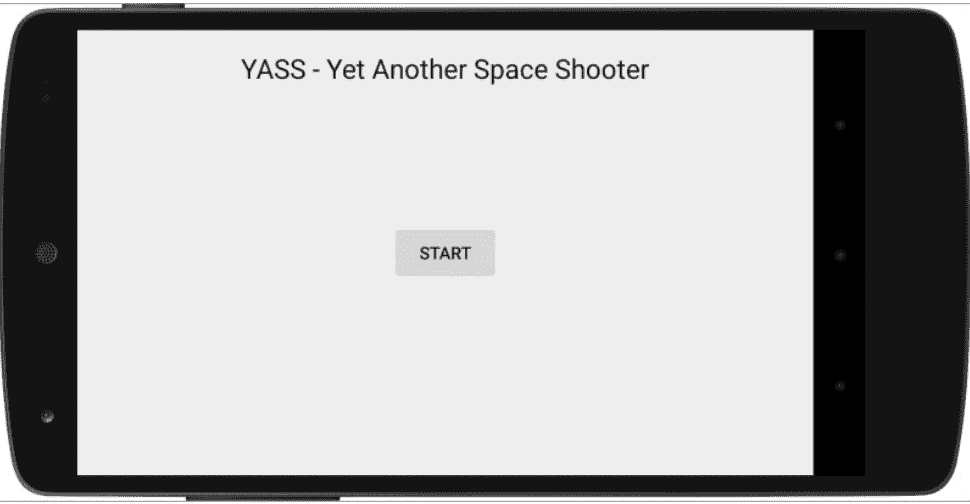

低调模式调暗导航栏，使其不那么显眼

这是我们需要添加到 MainActivity 的代码，用于移除状态栏并将设备置于低调模式：

```
@Override
public void onWindowFocusChanged(boolean hasFocus) {
    super.onWindowFocusChanged(hasFocus);
    if (hasFocus) {
        View decorView = getWindow().getDecorView();

decorView.setSystemUiVisibility(View.SYSTEM_UI_FLAG_LAYOUT_STABLE
        | View.SYSTEM_UI_FLAG_LAYOUT_FULLSCREEN
        | View.SYSTEM_UI_FLAG_FULLSCREEN
        | View.SYSTEM_UI_FLAG_LOW_PROFILE);
    }
}
```

我们在主 Activity 中重写 onWindowFocusChanged 方法。这是处理标志的推荐位置，因为每当窗口焦点发生变化时都会调用它。当应用重新获得焦点时，我们不知道栏处于什么状态。因此，确保事物如我们所愿的是一种良好做法。

还有我们尚未提及的两个标志。它们是在 API 级别 16 中引入的，旨在处理布局对元素出现和消失的反应。

SYSTEM_UI_FLAG_LAYOUT_STABLE 标志意味着布局将保持一致，与元素是否显示或隐藏无关。

SYSTEM_UI_FLAG_LAYOUT_FULLSCREEN 标志告诉系统，我们的稳定布局将是全屏模式下的布局——没有导航栏。

这意味着，如果/当状态栏显示时，布局不会改变，这是件好事，否则会看起来像是一个故障。这也意味着我们需要小心处理边距，以免重要内容被状态栏遮挡。

### 注意

稳定布局仅从果冻豆版本开始存在（API 级别 16 +）。

对于冰淇淋三明治，SYSTEM_UI_FLAG_LAYOUT_STABLE 不起作用。但是，使用此版本的设备很少，而且状态栏只在很少的情况下显示，所以这是可以接受的。

真正的全屏模式是在 KitKat 中引入的。

## Android 4.4 及以上版本 – 沉浸式模式

在 KitKat 中，引入了一种新模式：沉浸式模式。

沉浸式模式会完全隐藏状态栏和导航栏。正如名称所示，它是为完全沉浸式体验设计的，这主要是指游戏。即使导航栏重新出现，它也是半透明的而不是黑色的，并覆盖在游戏之上。

### 注意

粘性沉浸式模式几乎是专门为游戏设计的。

沉浸式模式有两种用法：普通和粘性。两者都是全屏，当应用首次进入此模式时，用户会看到一个提示，解释如何退出：

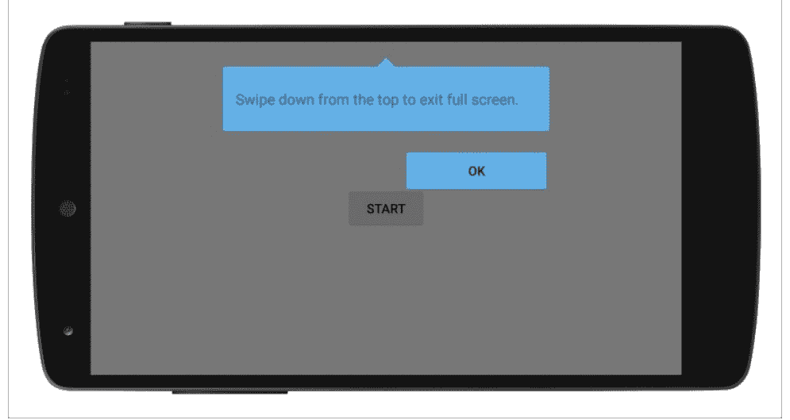

非粘性沉浸模式会保持状态栏和导航栏可见


一旦它们被显示，而沉浸式粘性模式会在几秒钟后隐藏它们，返回到真正的全屏。游戏推荐的模式是使用粘性沉浸。

将应用设置为全屏粘性沉浸模式的代码如下：

```java
@Override
public void onWindowFocusChanged(boolean hasFocus) {
    super.onWindowFocusChanged(hasFocus);
    if (hasFocus) {
        View decorView = getWindow().getDecorView();
        decorView.setSystemUiVisibility(View.SYSTEM_UI_FLAG_LAYOUT_STABLE
                | View.SYSTEM_UI_FLAG_LAYOUT_FULLSCREEN
                | View.SYSTEM_UI_FLAG_FULLSCREEN
                | View.SYSTEM_UI_FLAG_LAYOUT_HIDE_NAVIGATION
                | View.SYSTEM_UI_FLAG_HIDE_NAVIGATION
                | View.SYSTEM_UI_FLAG_IMMERSIVE_STICKY);
    }
}
```

在这种情况下，与前一个情况一样，我们正在请求使用稳定布局，并使其看起来像全屏一样。这一次，我们包含一个标志来使稳定布局没有导航栏（SYSTEM_UI_FLAG_LAYOUT_HIDE_NAVIGATION）。

我们还添加了隐藏状态栏（全屏）和导航栏（隐藏导航）的标志。最后，我们请求沉浸式粘性模式。结果是一个真正的全屏游戏：

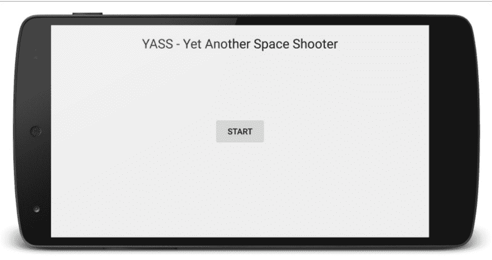

沉浸式模式让我们获得设备上的所有屏幕空间

使用此配置，即使用户执行手势显示状态栏和导航栏，它们也会以半透明方式覆盖在我们的界面上方显示：

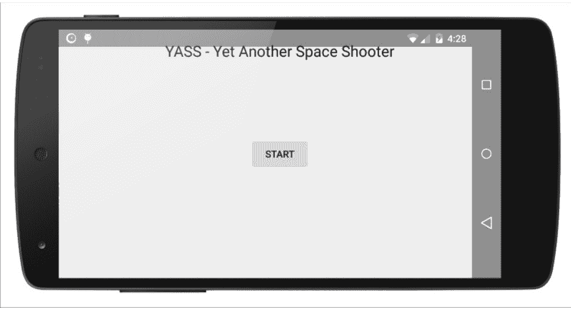

在粘性沉浸模式下显示栏时，它们会覆盖并半透明显示

不幸的是，粘性模式要求我们添加 SYSTEM_UI_FLAG_HIDE_NAVIGATION 标志来将导航栏置于粘性模式。这在 Android 的早期版本中有一个非常糟糕的副作用，即一旦触摸屏幕，导航栏就会不断出现和消失，因为没有沉浸模式的情况下，该标志的含义不同。

除此之外，在支持沉浸式模式的版本中，SYSTEM_UI_FLAG_LOW_PROFILE 标志没有任何效果。这很合理，因为它被视为对该标志的替代和改进。

## 合并全屏模式

由于我们有两种不同的请求全屏模式，一种是在 KitKat 之前（低配置文件），另一种是从 KitKat 开始（沉浸式模式），而且隐藏导航栏的标志不能很好地协同工作，因此我们需要根据设备运行的 Android 版本进行不同的配置：

```java
@Override
public void onWindowFocusChanged(boolean hasFocus) {
    super.onWindowFocusChanged(hasFocus);
    if (hasFocus) {
        View decorView = getWindow().getDecorView();
        if (Build.VERSION.SDK_INT < Build.VERSION_CODES.KITKAT) {
            decorView.setSystemUiVisibility(View.SYSTEM_UI_FLAG_LAYOUT_STABLE
                    | View.SYSTEM_UI_FLAG_LAYOUT_FULLSCREEN
                    | View.SYSTEM_UI_FLAG_FULLSCREEN
                    | View.SYSTEM_UI_FLAG_LOW_PROFILE);
        } else {
            decorView.setSystemUiVisibility(View.SYSTEM_UI_FLAG_LAYOUT_STABLE
                    | View.SYSTEM_UI_FLAG_LAYOUT_FULLSCREEN
                    | View.SYSTEM_UI_FLAG_FULLSCREEN
                    | View.SYSTEM_UI_FLAG_LAYOUT_HIDE_NAVIGATION
                    | View.SYSTEM_UI_FLAG_HIDE_NAVIGATION
                    | View.SYSTEM_UI_FLAG_IMMERSIVE_STICKY);
        }
    }
}
```

使用此代码，我们为每个 Android 版本提供预期的游戏体验；在 KitKat 之前的版本上是带有暗淡导航栏的低配置文件，在较新的设备上是完全沉浸式模式。

## 游戏开发者的良好实践

一般来说，应该避免过早优化。这意味着，除非有性能问题，否则不要优化你的代码。

然而，在游戏中，我们有两个方法（onUpdate 和 onDraw），其执行时间至关重要。因此，我们将提供一些技巧，这些技巧应该足以将性能控制在合理的阈值以下。

在其余情况下，你的代码可能已经足够好。如果发现性能问题，应该仔细测量以找出瓶颈所在，然后再优化它。大多数时候，问题并不在我们认为的地方。过早优化可能导致代码可读性降低，而没有显著改进。

### 对象池

对象的创建和销毁是一项昂贵的操作，应该加以限制。这是实时游戏比应用更敏感的一个领域。

每次创建对象时，垃圾回收器都有机会运行。在 Android 的旧版本中，这意味着一切都会停止 200 毫秒。虽然现在不再那么糟糕，但仍然可能被注意到。

### 注意

我们应该尽可能避免创建对象。

我们希望避免在 onUpdate 方法中执行任何昂贵的操作——该方法必须尽可能快地运行——因此我们将把对象的创建和销毁移出该方法。

解决此问题的方法是一个众所周知的软件模式，称为对象池。

在开始游戏之前，我们将预先创建需要的对象并将它们放入池中。池可以简单到像堆栈或列表一样。

与其创建一个对象，不如从池中获取一个并初始化它。如果池为空，意味着我们低估了对象数量。因此作为较小的恶，必须创建一个对象的新实例。

销毁对象时，我们将把它放回池中。

必须将对象返回到池中这一事实迫使我们弄清楚对象何时不再需要，而不是仅仅依赖垃圾回收器来为我们完成这项工作。虽然这需要一点努力，但这种思维练习将提高游戏性能和结构。如果你曾经使用过 C++，这对你来说应该是小菜一碟。

我们将在代码中为所有游戏对象使用对象池；基本上这意味着敌人和子弹。

### 避免在列表中使用增强循环语法

与对象创建相关，我们应该避免在列表中使用增强循环语法。虽然 for-each 语法更易于阅读，但它会即时创建一个迭代器，这使得执行变慢，并给垃圾回收器运行的机会。

在 GameEngine 的 onUpdate 方法中，我们本可以使用 for-each 语法像这样编写它：

```java
public void onUpdate(long elapsedMillis) {
   for (GameObject gameObject : mGameObjects) {
      gameObject.onUpdate(elapsedMillis, this);
   }
}
```

但这比使用标准 for 循环语法慢得多。这就是为什么它看起来像这样：

```java
public void onUpdate(long elapsedMillis) {
   int numGameObjects = mGameObjects.size();
   for (int i=0; i<numGameObjects; i++) {
      mGameObjects.get(i).onUpdate(elapsedMillis, this);
   }
}
```

在数组的特殊情况下，带有 **JIT（即时编译）** 编译器的设备上，增强语法与传统语法一样快——这应该是当今所有设备的情况——因此总是使用默认循环语法而不是增强语法没有任何缺点。

同样重要的是使用变量来存储大小，而不是在每次迭代时请求它，这引出了下一个技巧。

### 预创建对象

与在 onUpdate 循环中创建对象的低效率相关，我们应该始终预先创建要使用的对象。

这种做法的一个好例子是在 GameObject 内部创建的 Runnable 对象，用于在 onRemovedFromGameUiThread 和 onAddedToGameUiThread 上运行。

我们可以将它们作为 addGameObject 和 removeGameObject 的一部分，在游戏引擎中按需创建，但效率会低得多。

### 直接访问变量

尽可能，我们将使用直接的变量访问，而不是使用 getter 和 setter。这在一般情况下是一种良好的做法，因为访问器很昂贵，编译器不会将其内联。

在游戏中，将此做法扩展到其他类的变量也是合理的。如前面多次提到的，onUpdate 和 onDraw 的执行时间至关重要；仅相差几毫秒也很重要。这就是为什么，当游戏对象的变量被其他游戏对象访问时，我们将它们设为 public 并直接使用它们。

这对 Java 开发者来说有点反直觉，因为我们习惯于通过 getter 和 setter 封装一切。在这种情况下，效率比封装更重要。


### 小心浮点数

在进行计算时，整数运算大约比浮点运算快两倍。

当整数不够用时，float 和 double 在速度上没有实际差异。唯一的区别在于空间，double 占用空间是 float 的两倍。

此外，即使是整数，某些处理器也有硬件乘法，但缺乏硬件除法。在这种情况下，整数除法和取模操作是在软件中执行的。总之，这是过早优化可能会伤害你的一个案例。

### 性能迷思 – 避免使用接口

在较旧版本的 Android 中，在引入 JIT 编译器之前，
通过接口而不是确切类型来访问方法会略微更高效。在这些版本中，声明 ArrayList 类型的变量而不是通用 List 接口以直接访问类是有意义的。

然而，在现代版本的 Android 中，通过接口访问变量与直接访问没有区别。因此，为了通用性，我们将使用通用接口而不是类，如 GameEngine 中所示：

```
private List<GameObject> mGameObjects = new ArrayList<GameObject>();
```

## 摘要

在简要介绍了哪些工具最适合制作哪种类型的游戏之后，我们已经描述了使用原生 Android SDK 制作游戏的优缺点。

我们已经设置了一个项目并定义了主活动及其方向。我们已经创建了一个基本游戏引擎，将其包含在项目中，并检查了它是否按预期工作。

后来，我们通过第二个碎片和暂停对话框扩展了项目，正确管理了游戏的生命周期，并定义了一种针对不同 Android 版本获得合适全屏的方法。

最后，我们介绍了一些关于优化游戏关键部分代码的技巧。

我们准备开始处理用户输入。
