## 第 2 章. 管理用户输入

在本章中，我们将学习如何以通用的方式处理用户输入，稍后将其扩展为虚拟摇杆、传感器或外部控制器。

为了获得输入的可视反馈，我们将在屏幕上放置一艘飞船并将其移动。我们还将使它发射一些子弹。这也将帮助你理解游戏对象和游戏引擎之间的交互。

我们将扩展通用 InputController 类来制作最简单的键盘控制器，以了解该类如何融入现有架构以及输入如何在游戏对象中被处理和读取。

一旦基本键盘工作正常，我们将实现一个虚拟摇杆，这是一种处理用户输入的更好的方式。

管理物理控制器对于我们正在编写的游戏也很重要，因此我们将了解如何检测它们并处理不同选项。

最后，我们将简要谈谈将传感器作为控件的使用。它们不适合这种类型的游戏，但我们将介绍基础知识，如果你想进一步探索，我们还会提供一些链接。

### InputController 基类

无论我们想如何控制游戏，它都可以始终抽象为一个双轴摇杆和一个发射按钮。对于其他游戏可能不同，但你应该始终能够从用户那里提取基本操作并创建一个处理它们的 InputController。我们正在构建的 InputController 适用于任何使用方向控制的游戏。

### 注意

输入控制器对于每种类型的游戏都相当特定。

我们将把归一化的水平轴和垂直轴视为输入（范围从 -1 到 1）。在控制器没有范围的情况下，我们将把它设置为最大值。当输入类型允许时，这将允许我们精确处理用户输入，就像虚拟和真实摇杆以及传感器的情况一样。

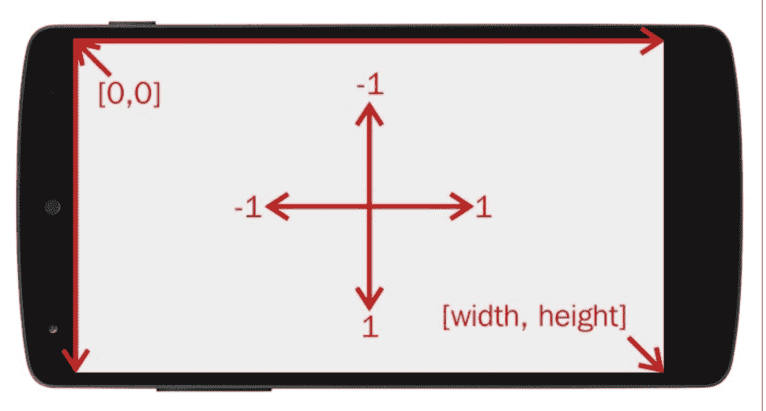

*手机屏幕的坐标系统*

提醒一下，计算机屏幕上的坐标在左上角为 [0,0]，向右和向下为正。右下角的坐标为 [width, height]。这与我们习惯的标准坐标系不同，但请务必记住这一点。

这就是为什么向左移动是 -1，向上移动也是 -1。

我们游戏中所有输入控制器的基类将如下所示：

```
public class InputController {
    public double mHorizontalFactor;
    public double mVerticalFactor;

    public boolean mIsFiring;

    public void onStart() {
    }

    public void onStop() {
    }

    public void onPause() {
    }

    public void onResume() {
    }
}
```

请注意，这是一个带有公共变量的类。这样做是为了避免通过方法读取值。我们在上一章中将其作为性能改进提及过。

这个类的每个实现都负责用更新后的值填充这些变量。游戏对象可以在 onUpdate 期间读取它们。通过这样做，我们将使用值的操作与读取用户输入分开。

### 注意

InputController 将输入的读取与通过游戏对象的使用隔离开来。

InputController 是 GameEngine 的一部分。我们只需在引擎中添加此类型的变量并创建一个方法来设置它：

```
public InputController mInputController;

public void setInputController(InputController controller) {
    mInputController = controller;
}
```

onStart、onStop、onPause 和 onResume 方法由 GameEngine 在游戏启动、停止、暂停或恢复时调用。某些输入控制器在这些情况下需要执行特殊操作。

最后，我们在 GameFragment 内部初始化引擎期间将输入控制器添加到 GameEngine 中：

```
mGameEngine = new GameEngine(getActivity());
mGameEngine.addGameObject(new ScoreGameObject(view,
R.id.txt_score));
view.findViewById(R.id.btn_play_pause).setOnClickListener(this);
mGameEngine.setInputController(new InputController());
mGameEngine.addGameObject(new Player(getView()));
mGameEngine.startGame();
```

目前，我们添加了一个不执行任何操作的输入控制器。我们还添加了一个 Player 游戏对象，我们将在深入研究不同的输入控制器之前先处理它。

请注意，我们不再使用之前示例中的 ScoreGameObject，不应将其添加到游戏引擎中。

### Player 对象

我们将构建的第一个版本的 Player 游戏对象将只在屏幕中间初始化其坐标。然后，它将根据输入控制器中的信息更新它们，最后，它将在布局中的 TextView 中以 [x, y] 形式显示值。

之后，我们将使它显示位于坐标处的飞船。但目前，我们将专注于 onUpdate 的实现方式。

Player 类第一个版本的 onUpdate 和 onDraw 的代码如下所示：

```
@Override
public void onUpdate(long elapsedMillis, GameEngine gameEngine) {
    InputController inputController = gameEngine.inputController;
    mPositionX += mSpeedFactor*inputController.mHorizontalFactor*elapsedMillis;
    if (mPositionX < 0) {
    mPositionX = 0;
    }
    if (mPositionX > mMaxX) {
    mPositionX = mMaxX;
    }
    mPositionY += mSpeedFactor*inputController.mVerticalFactor*elapsedMillis;
    if (mPositionY < 0) {
    mPositionY = 0;
    }
    if (mPositionY > mMaxY) {
    mPositionY = mMaxY;
    }
}

@Override
public void onDraw() {
    mTextView.setText("["+(int) (mPositionX)+","+(int) (mPositionY)+"]");
}
```

因此，在每次 onUpdate 运行中，我们将使用相应的系数（我们从输入控制器中读取）、速度系数和经过的毫秒数来增加 x 和 y 位置。这无非是经典的公式


distance = speed * time.

代码的其余部分确保 x 和 y 位置保持在屏幕边界内。

onDraw 方法与 ScoreGameObject 的方法等效，但它只是在 TextView 中设置文本。

现在代码中有几个值我们尚未初始化。它们如下：

- mSpeedFactor: 将速度转换为每毫秒像素。
- mMaxX: x 的最大值。它将是视图宽度减去内边距。
- mMaxY: y 的最大值。它是视图高度减去内边距。
- mTextView: 我们在其中设置当前坐标的视图。

所有这些元素都在接收父视图作为参数的 Player 对象的构造函数中初始化：

```java
public Player(final View view) {
    // We read the size of the view
    double pixelFactor = view.getHeight() / 400d;
    mSpeedFactor = pixelFactor * 100d / 1000d;
    mMaxX = view.getWidth() - view.getPaddingLeft() -
    view.getPaddingRight();
    mMaxY = view.getHeight() - view.getPaddingTop() -
    view.getPaddingBottom();
    mTextView = (TextView) view.findViewById(R.id.txt_score);
}
```

我们将以 400 个单位的高度作为参考来计算屏幕的像素因子。这是一个任意的数字，你可以使用任何对你有意义的数字。如果你认为自己正在使用一个 400 像素高的屏幕，然后让代码将其转换为实际的像素量，这会很有帮助。

这个概念与 dips 相似，但也不同。虽然 dips 旨在所有设备上都具有相同的物理尺寸，但单位使我们的游戏能够缩放。因此，无论设备的分辨率或大小如何，游戏中的所有项目都将占用相同的屏幕空间。

## 注意

我们将以“单位”定义游戏空间，因此所有设备都具有相同的屏幕高度。

我们希望飞船以每秒 100 个单位的速度移动，因此从屏幕底部移动到顶部需要 4 秒。由于我们需要以每毫秒像素为单位的速度，我们需要将所需速度乘以像素因子（像素/单位），然后除以 1,000（毫秒/秒）。

下一步是读取父视图的宽度和高度，并在减去内边距后将其作为最大宽度和高度使用。

最后，我们获得一个 TextView 的钩子，我们将用它来显示坐标。

完成初始化后，我们还有 startGame 方法。在这个方法中，我们将把玩家定位在屏幕中间。

```java
@Override
public void startGame() {
    mPositionX = mMaxX / 2;
    mPositionY = mMaxY / 2;
}
```

如果你现在尝试运行示例，你会发现位置停留在 [0,0]，这表明出了问题。

问题在于，我们在视图创建后立即读取其宽度和高度（在 GameFragment 的 onViewCreated 方法内）。此时，视图尚未被测量。

## 注意

你无法在构造函数中获取视图的宽度和/或高度，因为它尚未被测量。

解决此问题的方法是推迟 GameEngine 的初始化，直到视图被测量为止。做到这一点的最佳方法是使用 ViewTreeObserver。让我们转到 GameFragment 的 onViewCreated 并更新它：

```java
@Override
public void onViewCreated(View view, Bundle savedInstanceState) {
    super.onViewCreated(view, savedInstanceState);
    view.findViewById(R.id.btn_play_pause).setOnClickListener(this);
    final ViewTreeObserver obs = view.getViewTreeObserver();
    obs.addOnGlobalLayoutListener(new
    ViewTreeObserver.OnGlobalLayoutListener() {
        @Override
        public void onGlobalLayout() {
            if(Build.VERSION.SDK_INT < Build.VERSION_CODES.JELLY_BEAN)
            {
                obs.removeGlobalOnLayoutListener(this);
            }
            else {
                obs.removeOnGlobalLayoutListener(this);
            }
            mGameEngine = new GameEngine(getActivity());
            mGameEngine.setInputController(new
            BasicInputController(getView()));
            mGameEngine.addGameObject(new Player(getView()));
            mGameEngine.startGame();
        }
    });
}
```

我们获取刚为布局创建的视图的 ViewTreeObserver 并向其添加一个新的 OnGlobalLayoutListener。我们将监听器创建为匿名内部类。

每次执行全局布局时都会调用此监听器。为避免被多次调用并因此初始化多个引擎，我们需要在监听器被调用后立即将其删除。

不幸的是，在 Android 版本早于 Jelly Bean 时，用于删除监听器的方法名称存在拼写错误，因此我们必须在 Jelly Bean 之前使用一种方法名称，而在之后使用另一种方法名称。

方法中其余的代码是引擎初始化，之前是直接在 onViewCreated 内完成的。我们只是将其移到了 onGlobalLayout 内。

请注意，虽然视图尚未被测量，但它们已被创建并存在。因此，不需要将为暂停按钮设置 onClickListener 的代码移到布局观察器中。

如果我们继续运行这个版本，我们将看到坐标显示屏幕中心的像素值。

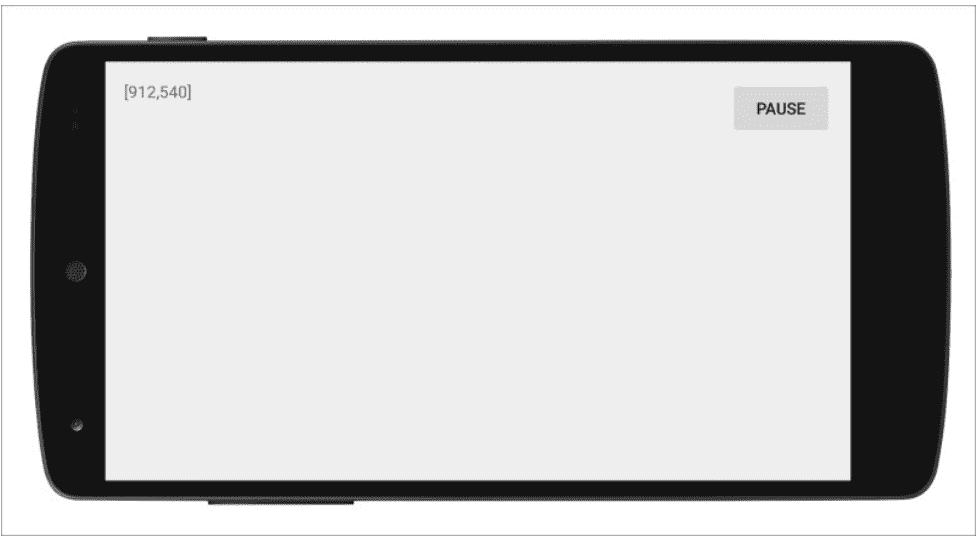

## 显示飞船

如果我们不至少显示一艘飞船，这一切都不会有趣，这样我们就能看到真的有事情在发生。

我们将从 OpenGameArt 网站（http://opengameart.org）获取游戏图形，该网站包含多个免费（如自由之意）的游戏图形，其中大多数都在 Creative Commons 许可下，这意味着你必须署名作者。

## 注意

OpenGameArt.org 网站是游戏图形的绝佳资源。

我们将展示的飞船是由 Eikesteer 创建的，我们将在整个游戏中使用它们。

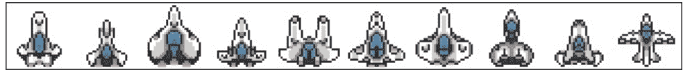

我们从 Open Game Art 中选取的由 Eikesteer 制作的飞船合集

从合集中，我们将使用从右数的第三个。我们可以使用像 GIMP 这样的简单编辑器将其提取到一个新图像中，并将其放置在 drawable-nodpi 目录下。

请注意，我们将缩放所有内容以与我们 400 个单位的屏幕高度保持一致，因此将图像放在带有密度限定符的 drawable 目录中没有意义。这就是我们将使用 drawable-nodpi 的原因。

## 注意

我们将把游戏对象图像放在 drawable-nodpi 文件夹中。

下一步是创建一个 ImageView 来显示我们的飞船。我们将在 Player 对象的构造函数中执行此操作：

```java
public Player(final View view) {
[...]
// We create an image view and add it to the view
mShip = new ImageView(view.getContext());
Drawable shipDrawable = view.getContext().getResources()
        .getDrawable(R.drawable.ship);
mShip.setLayoutParams(new ViewGroup.LayoutParams(
        (int) (shipDrawable.getIntrinsicWidth() * mPixelFactor),
        (int) (shipDrawable.getIntrinsicHeight() * mPixelFactor)));
mShip.setImageDrawable(shipDrawable);
mMaxX -= (shipDrawable.getIntrinsicWidth() * mPixelFactor);
mMaxY -= (shipDrawable.getIntrinsicHeight() * mPixelFactor);

((FrameLayout) view).addView(mShip);
}
```

构造函数的第一部分保持不变。然后我们添加代码来创建 ImageView 并将 Drawable 加载到其中。

首先，我们使用父视图的上下文创建一个 ImageView，并将其存储为类变量。

然后，我们从资源中加载飞船的 Drawable 并将其分配给 shipDrawable 局部变量。

然后，我们为 ImageView 创建一个 LayoutParams 对象并设置它。由于我们已经有了 drawable，因此可以为其指定确切的尺寸。为此，我们读取 shipDrawable 的固有宽度和高度，并将其乘以像素因子。

这意味着飞船的 ImageView 将被缩放为相当于 400 单位屏幕的像素。换句话说，飞船的大小与在 400 像素高的屏幕上显示时的大小完全相同。然后将 drawable 设置到 ImageView 中。

我们还需要通过减去飞船的大小来更新 x 和 y 的最大值。这样一来，它就被放置在中心，并且不会超出边界。

最后，ImageView 被添加到父视图中，父视图预期是一个 FrameLayout。这一新需求源于需要能够将图像定位到任何位置。

我们需要更新这一点，否则将会出现 classCastException。我们正在更新 fragment_game.xml 布局，使其顶层布局为 FrameLayout 类型。

既然我们正在修改布局，我们还将暂停按钮对齐到右上角，那是大多数游戏中暂停按钮的位置：


<FrameLayout
    xmlns:android="http://schemas.android.com/apk/res/android"
    xmlns:tools="http://schemas.android.com/tools"
    android:layout_width="match_parent"
    android:layout_height="match_parent"
    android:orientation="vertical"
    android:paddingTop="@dimen/activity_vertical_margin"
    android:paddingLeft="@dimen/activity_horizontal_margin"
    android:paddingRight="@dimen/activity_horizontal_margin"
    tools:context="com.plattysoft.yass.counter.GameFragment">
<TextView
    android:layout_gravity="top|left"
    android:id="@+id/txt_score"
    android:layout_width="wrap_content"
    android:layout_height="wrap_content"
    android:text="@string/hello_world">
<Button
    android:layout_gravity="top|right"
    android:id="@+id/btn_play_pause"
    android:layout_width="wrap_content"
    android:layout_height="wrap_content"
    android:text="@string/pause">
</FrameLayout>

最后，我们需要更新 onDraw 方法，使其将飞船显示在正确位置。为此，我们只需使用 translateX 和 translateY 将 ImageView 移动到屏幕上的预期位置。

这远非最佳方案，但我们将在下一章中处理绘制工作。目前，它足以将图像显示在正确位置：

```
@Override
public void onDraw() {
    mTextView.setText("(" + (int) mPositionX + "," + (int) mPositionY + ")");
    mShip.setTranslationX((int) mPositionX);
    mShip.setTranslationY((int) mPositionY);
}
```

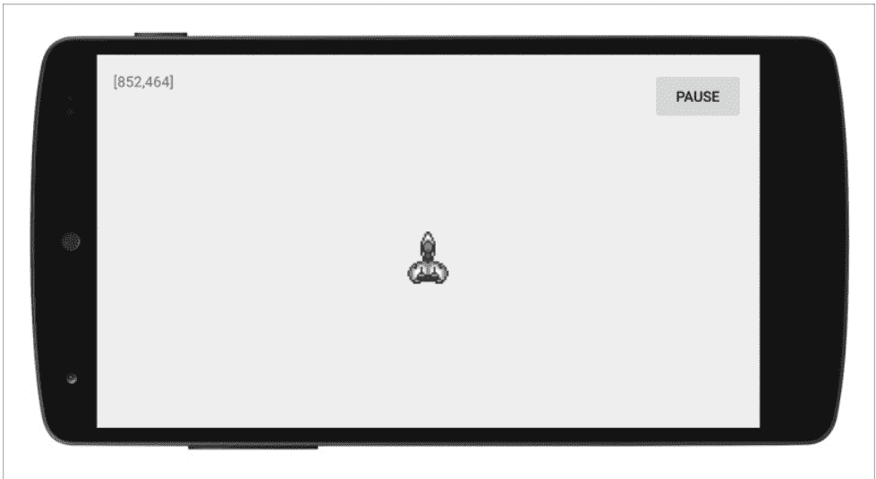

既然有了飞船，是时候添加一些子弹了。

## 发射子弹

飞船将发射向上移动的子弹，直到它们移出屏幕。

如前章“游戏开发者良好实践”部分所述，我们将在 Player 类中创建子弹时使用对象池：

```
List<Bullet> mBullets = new ArrayList<Bullet>();
```

```
private void initBulletPool() {
    for (int i = 0; i < INITIAL_BULLET_POOL_AMOUNT; i++) {
        mBullets.add(new Bullet(mPixelFactor));
    }
}
```

```
private Bullet getBullet() {
    if (mBullets.isEmpty()) {
        return null;
    }
    return mBullets.remove(0);
}
```

它初始化了我们希望在屏幕上同时拥有的子弹数量。当池中有项目时，请求子弹只会移除一个并返回它，但如果列表为空，它将返回 null。你可以将此数字作为限制来影响游戏性，也可以进行计算并使池足够大。

在我们的案例中，考虑到子弹的速度和射击间隔时间，我们不能发射超过 6 颗子弹。

回到对象池，要释放子弹，我们只需将其放回列表中。

现在，在玩家的 onUpdate 期间，我们检查是否应该发射子弹：

```
@Override
public void onUpdate(long elapsedMillis, GameEngine gameEngine) {
    updatePosition(elapsedMillis, gameEngine.mInputController);
    checkFiring(elapsedMillis, gameEngine);
}
```

```
private void checkFiring(long elapsedMillis, GameEngine gameEngine) {
    if (gameEngine.mInputController.mIsFiring && mTimeSinceLastFire > TIME_BETWEEN_BULLETS) {
        Bullet b = getBullet();
        if (b == null) {
            return;
        }
        b.init(mPositionX + mShip.getWidth() / 2, mPositionY);
        gameEngine.addGameObject(b);
        mTimeSinceLastFire = 0;
    } else {
        mTimeSinceLastFire += elapsedMillis;
    }
}
```

我们检查输入控制器是否按下了发射按钮以及冷却时间是否已过。如果我们想要且能够发射子弹，就从池中取出一颗。

如果没有可用子弹（对象 b 为 null），我们不做其他操作并返回。

从池中获取 Bullet 后，我们使用当前位置对其进行初始化，并将其放置在飞船中央。然后，我们将其添加到引擎中。最后，我们重置上次发射以来的时间。

如果我们不能或不想发射，只需将经过的毫秒数加到上次发射子弹以来的时间上。

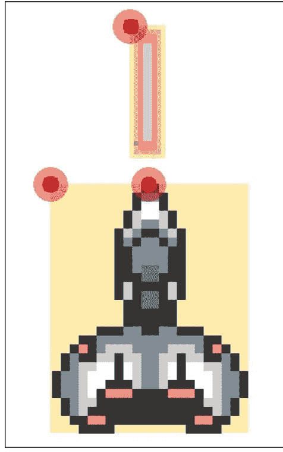

在前面的图像中，我们可以看到子弹与飞船的相对位置，以及为什么将飞船中心作为 x 坐标传递能给子弹提供正确信息。但我们仍需为其添加一些偏移量。

从现在起，所有关于子弹移动的逻辑都在 Bullet 对象内部完成。

## Bullet 游戏对象

Bullet 同样继承 GameObject。并且，就像飞船一样，它也会创建一个 ImageView 并在构造函数中将可绘制对象加载到其中：

```
public Bullet(View view, double pixelFactor) {
    Context c = view.getContext();

    mSpeedFactor = pixelFactor * 300d / 1000d;

    mImageView = new ImageView(c);
    Drawable bulletDrawable =
        c.getResources().getDrawable(R.drawable.bullet);

    mImageHeight = bulletDrawable.getIntrinsicHeight() * pixelFactor;
    mImageWidth = bulletDrawable.getIntrinsicWidth() * pixelFactor;

    mImageView.setLayoutParams(new ViewGroup.LayoutParams(
        (int) (mImageWidth),
        (int) (mImageHeight)));
    mImageView.setImageDrawable(bulletDrawable);

    mImageView.setVisibility(View.GONE);
    ((FrameLayout) view).addView(mImageView);
}
```

此构造函数与 Player 对象构造函数的唯一区别在于，我们将 ImageView 的可见性设置为 GONE，因为除非子弹正在发射，否则不应显示它们。Bullet 还具有用于绘制的 mPositionX 和 mPositionY。

这些相似之处源于这样一个事实：这两个游戏对象都是我们所说的精灵。精灵是关联了图像并在屏幕上呈现的 GameObject。

### 注意

精灵是游戏中显示的游戏对象（通常是 2D 图像），并作为单个实体进行操纵。

在下一章中，我们将提取精灵的通用概念并将其放入基类中。

在构造函数中，我们还将子弹速度设置为每秒 300 个单位。这比飞船快 3 倍。你可以调整速度和子弹之间时间的值，但请记住测试，确保在飞船向上移动时连续发射时它们不会重叠。

如果你修改子弹速度，可能还需要检查池的大小。最坏的情况是飞船位于屏幕底部时连续发射。

下一个有趣的点是初始化。这是使用接收飞船位置的 init 方法完成的：

```
public void init(Player parent, double positionX, double positionY) {
    mPositionX = positionX - mImageWidth / 2;
    mPositionY = positionY - mImageHeight / 2;
    mParent = parent;
}
```

值得提及的是，我们希望子弹位于飞船前方一点并正确居中。由于成员变量 mPositionX 和 mPositionY 指向图像的左上角，我们需要根据子弹的大小对初始参数应用偏移量。

我们在垂直轴上仅将子弹定位在飞船外半个位置（mImageHeight/2），以增强其从飞船发射的感觉。我们还将其在水平轴上居中显示，这就是为什么我们还要减去 mImageWidth/2。

上一节的图像也将帮助你可视化此偏移量。

由于子弹会从 GameEngine 中添加和移除，我们需要在添加和移除时更改视图的可见性。这需要在 UIThread 上完成。为此，我们使用在上一章中创建的回调：

```
@Override
public void onRemovedFromGameUiThread() {
    mImageView.setVisibility(View.GONE);
}
```

```
@Override
public void onAddedToGameUiThread() {
    mImageView.setVisibility(View.VISIBLE);
}
```

### 注意

对视图的所有更改都必须在 UIThread 上完成，否则将抛出异常。

由于这些子弹也是精灵，onDraw 方法几乎与玩家的相同。我们再次通过为视图设置动画并对其进行平移来实现：

```
@Override
public void onDraw() {
    mImageView.setTranslationX((int) mPositionX);
    mImageView.setTranslationY((int) mPositionY);
}
```

另一方面，onUpdate 方法略有不同，值得详细查看：

```
@Override
public void onUpdate(long elapsedMillis, GameEngine gameEngine) {
    mPositionY += mSpeedFactor * elapsedMillis;
    if (mPositionY < -mImageHeight) {
        gameEngine.removeGameObject(this);
        // And return it to the pool
        mParent.releaseBullet(this);
    }
}
```

与我们对玩家所做的类似，我们使用 distance = speed * time 公式。但是，在这种情况下，InputController 没有任何影响。子弹具有固定的垂直速度。

我们还检查子弹是否移出屏幕。由于我们在左上角绘制项目，我们需要它完全移出。这就是为什么我们将其与 mImageHeight 进行比较。

如果子弹移出，我们将其从 GameEngine 中移除，并通过调用 releaseBullet 将其返回到池中。

此游戏对象移除在 GameEngine 的 onUpdate 循环中完成。


如果我们此时修改列表，在 GameEngine 中执行 onUpdate 时会发生 ArrayIndexOutOfBoundsException。这就是为什么 removeGameObject 方法将对象放入单独的列表中，以便在 onUpdate 被调用后移除。

现在，除非我们能移动飞船并发射子弹，否则这一切都毫无用处。让我们构建最基本的 InputController。

## 最基本的虚拟键盘

最简单的做法是在屏幕左侧构建一个十字形的简单键盘，右侧是一个发射按钮。对于这种布局，我们将在 layout 文件夹下创建一个新文件，并将其命名为 view_keypad.xml：

```xml
<?xml version="1.0" encoding="utf-8"?>
<RelativeLayout
xmlns:android="http://schemas.android.com/apk/res/android"
android:layout_gravity="bottom"
android:padding="@dimen/keypad_size"
android:layout_width="match_parent"
android:layout_height="wrap_content">

<Button
android:id="@+id/keypad_up"
android:layout_alignParentTop="true"
android:layout_toRightOf="@+id/keypad_left"
android:layout_width="@dimen/keypad_size"
android:layout_height="@dimen/keypad_size" >

<Button
android:id="@+id/keypad_down"
android:layout_below="@+id/keypad_left"
android:layout_toRightOf="@+id/keypad_left"
android:layout_width="@dimen/keypad_size"
android:layout_height="@dimen/keypad_size" >

<Button
android:id="@+id/keypad_left"
android:layout_alignParentLeft="true"
android:layout_below="@+id/keypad_up"
android:layout_width="@dimen/keypad_size"
android:layout_height="@dimen/keypad_size" >

<Button
android:id="@+id/keypad_right"
android:layout_toRightOf="@+id/keypad_up"
android:layout_below="@+id/keypad_up"
android:layout_width="@dimen/keypad_size"
android:layout_height="@dimen/keypad_size" >

<Button
android:id="@+id/keypad_fire"
android:layout_alignParentRight="true"
android:layout_alignTop="@+id/keypad_left"
android:layout_width="@dimen/keypad_size"
android:layout_height="@dimen/keypad_size" >
</RelativeLayout>
```

我们有一个覆盖屏幕全宽的相对布局。它将 layout_gravity 设置为 bottom，因此我们可以确保它会被正确对齐。

我们将四个按钮排列在一个 RelativeLayout 中。左侧按钮对齐到布局的左侧，上方按钮对齐到布局的顶部。然后，顶部和底部按钮设置在左侧按钮的右侧。右侧按钮设置在上方按钮的下方和右侧。最后，左侧按钮设置在上方按钮的下方，而下方按钮就在左侧按钮下方。听起来有点复杂，但图像会清晰得多。

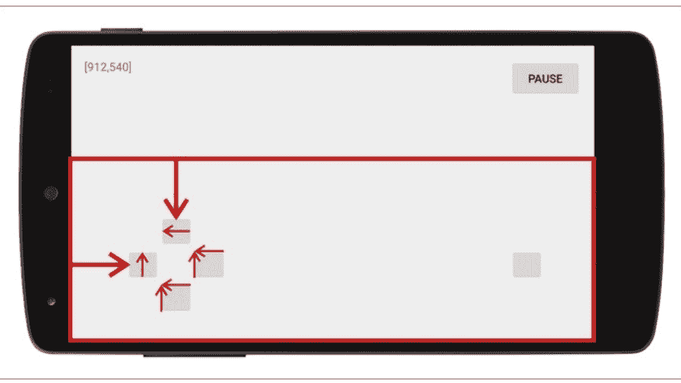

在屏幕的另一侧，对齐到父布局的右侧和左侧按钮的顶部，我们有一个发射按钮。

你可能已经注意到，所有按钮都使用一个名为 keypad_size 的特殊尺寸。这一点非常重要，不仅是为了让它们看起来一致，而且也是为了整体的可用性。我们将其设置为 42 dp，这是触摸目标的推荐最小尺寸。

## 注意

可触摸项应具有的最小尺寸是 42 dp。

随意调整按钮的大小，亲自观察一下，你会发现较小的按钮很难触摸。事实上，对于游戏，我们应该始终使用大尺寸的触摸目标，有时甚至比提供视觉反馈的区域还要大。控件的触摸区域越大越好。在这个示例中，发射按钮的触摸区域可以大到屏幕右半部分的大小。

我们将把这个布局包含在游戏片段中，这样就可以看到它是如何叠加的。由于我们已经将顶部布局更新为 FrameLayout，我们只需使用 include 标签即可。

```xml
<FrameLayout
    xmlns:android="http://schemas.android.com/apk/res/android"
    xmlns:tools="http://schemas.android.com/tools"
    android:layout_width="match_parent"
    android:layout_height="match_parent"
    android:paddingTop="@dimen/activity_vertical_margin"
    android:paddingLeft="@dimen/activity_horizontal_margin"
    android:paddingRight="@dimen/activity_horizontal_margin"
    tools:context="com.plattysoft.yass.counter.GameFragment">

<TextView
    android:layout_gravity="top|left"
    android:id="@+id/txt_score"
    android:layout_width="wrap_content"
    android:layout_height="wrap_content"
    android:text="@string/hello_world" >

<Button
    android:layout_gravity="top|right"
    android:id="@+id/btn_play_pause"
    android:layout_width="wrap_content"
    android:layout_height="wrap_content"
    android:text="@string/pause" />
<include layout="@layout/view_keypad" />
</FrameLayout>
```

如果我们直接运行它，就可以看到整体效果了。

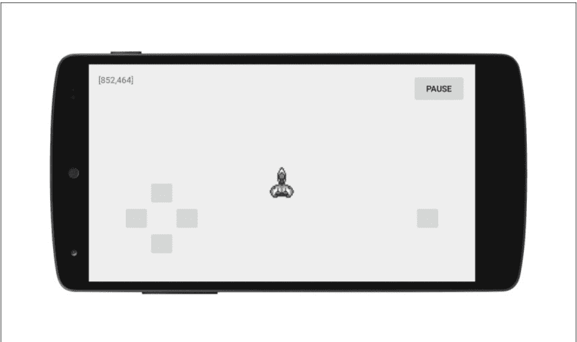

现在让我们为 BasicInputController 编写代码来处理按钮。从构造函数开始，代码如下：

```java
public BasicInputController(View view) {
    view.findViewById(R.id.keypad_up).setOnTouchListener(this);
    view.findViewById(R.id.keypad_down).setOnTouchListener(this);
    view.findViewById(R.id.keypad_left).setOnTouchListener(this);
    view.findViewById(R.id.keypad_right).setOnTouchListener(this);
    view.findViewById(R.id.keypad_fire).setOnTouchListener(this);
}
```

我们将游戏控制器设置为所有按钮（上、下、左、右和发射）的触摸监听器。重要的是要注意，我们必须使用 OnTouchListener 而不是 OnClickListener。

OnClickListener 回调仅在按钮被按下然后释放时才会触发。在我们的情况中，我们需要知道按钮何时被按下以及何时被释放。我们需要在按钮被按住时移动飞船。这就是为什么我们需要 OnTouchListener 提供的更详细的回调。

BasicInputController 中 OnTouchListener 方法的实现如下：

```java
@Override
public boolean onTouch(View v, MotionEvent event) {
    int action = event.getActionMasked();
    int id = v.getId();
    if (action == MotionEvent.ACTION_DOWN) {
        // User started pressing a key
        if (id == R.id.keypad_up) {
            mVerticalFactor -= 1;
        }
        else if (id == R.id.keypad_down) {
            mVerticalFactor += 1;
        }
        else if (id == R.id.keypad_left) {
            mHorizontalFactor -= 1;
        }
        else if (id == R.id.keypad_right) {
            mHorizontalFactor += 1;
        }
        else if (id == R.id.keypad_fire) {
            mIsFiring = false;
        }
    }
    else if (action == MotionEvent.ACTION_UP) {
        if (id == R.id.keypad_up) {
            mVerticalFactor += 1;
        }
        else if (id == R.id.keypad_down) {
            mVerticalFactor -= 1;
        }
        else if (id == R.id.keypad_left) {
            mHorizontalFactor += 1;
        }
        else if (id == R.id.keypad_right) {
            mHorizontalFactor -= 1;
        }
        else if (id == R.id.keypad_fire) {
            mIsFiring = false;
        }
    }
    return false;
}
```

重要的是要注意，我们调用的是 getActionMasked 而不是 getAction。在多点触控的情况下，getAction 包含指针信息，而当请求掩码动作时，该信息会被移除。这就是为什么处理多点触控的推荐方法是使用 getActionMasked 和 getActionPointer。否则，你需要使用 OR 操作来检查动作而不是等号，否则在读取第一个以上的指针时将无法工作。

## 注意

使用 getActionMasked 和 getPointerIndex 是处理多点触控的推荐方法。

我们有两种情况。当动作为 MotionEvent.ACTION_DOWN 时，表示用户已按下按钮，因此我们检查被触摸的视图的 ID 并相应地采取行动。

如果视图是上或下，我们对垂直因子减去或加上 1。同样，如果被触摸的按钮是左或右，我们对水平因子减去或加上 1。

第二部分是处理 MotionEvent.ACTION_UP 动作，它会对相应的因子进行相反的加法或减法。

对于多点触控，我们使用加法和减法，而不是将值设置为 1 或 -1。例如，如果你先点击右侧，然后点击左侧，飞船应该停止，因为你同时按下了两个按钮。一旦释放其中一个，运动就会恢复。

对于发射按钮，当按下时我们将 mIsFiring 设置为 true，当释放时设置为 false。很简单。

最后，我们返回 false。这一点很重要，因为它告诉系统事件未被我们的监听器消耗，因此监听器链可以继续。这个监听器链包括按钮自己的点击监听器，它负责将背景图像更改为与按钮状态一致的图像。如果我们返回 true，背景将不会更新。

## 注意


OnTouch 实现会返回该事件是否由此监听器消耗。

就这么简单——我们现在可以运行游戏了。我们会看到飞船在屏幕上移动，并且发射一些子弹。最终，YASS 开始看起来像个游戏。

## 限制和问题

这样一个简单键盘存在多种限制和问题。除了按钮相当小、难以操作之外，其余问题都源于用户移动触控指针时。

如果用户移出按钮范围，API 级别 17 之前的 Android 版本会触发 MotionEvent.ACTION_DOWN 类型的事件，但从该 API 级别开始则不会。如果你想正确处理这种情况，需要在每次移动或动作时检查并验证它是否超出了原始视图的矩形范围，以便执行手动取消。但这不是移动操作的唯一问题。如果你点按一个按钮并向相反方向的按钮移动，那么对另一个按钮的新点按将不会被检测到，因为它是 ACTION_MOVE 而不是 ACTION_DOWN。

解决办法是在每个事件中检查每个指针的位置，查看它是否位于某个按钮的矩形范围内，并相应地处理。

还存在无法处理对角线移动的问题。

我们可以尝试解决这个键盘的这些问题。但由于它本身并不是一个非常优雅的输入控制器，我们将直接继续，开发一个真正的虚拟摇杆 InputController，而不是继续使用这个键盘。

## 创建虚拟摇杆

我们将改进用户输入，方法是创建一个虚拟摇杆。

虚拟摇杆会测量触摸位置到其中心的距离，并利用此信息设置两个轴的值。它的表现类似于传统的模拟摇杆。

由于它是虚拟的，我们不必将其固定在屏幕的特定位置，因此可以将其放置在玩家触摸的任何位置。

然而，我们不能将整个屏幕都用于虚拟摇杆。还需要一个开火按钮。

我们经历过小触控目标带来的挫败感，因此我们将把开火按钮做得尽可能大。这意味着我们将使用一半屏幕作为虚拟摇杆，另一半屏幕作为开火按钮。

我们将使用的布局包含两个填满屏幕的视图，每个视图各覆盖一半宽度。我们将此布局命名为 view_vjoystick.xml：

```xml
<?xml version="1.0" encoding="utf-8"?>
<LinearLayout
xmlns:android="http://schemas.android.com/apk/res/android"
android:orientation="horizontal"
android:layout_width="match_parent"
android:layout_height="match_parent">
<View android:id="@+id/vjoystick_main"
android:layout_height="match_parent"
android:layout_width="match_parent"
android:layout_weight="1"
>
<View android:id="@+id/vjoystick_touch"
android:layout_height="match_parent"
android:layout_width="match_parent"
android:layout_weight="1"
>
</LinearLayout>
```

这个布局的关键之处在于使用 Android:layout_weight 将屏幕等分为两半。如果你想为虚拟摇杆或开火按钮留出更大空间，可以修改权重值以使一个视图比另一个更大。

我们将创建一个类来处理这个用户 InputController。我们将把它命名为 VirtualJoystickInputController，并且它显然将继承 InputController。

为了处理这个 InputController 的事件，我们将使用两个内部类。每个我们想监听事件的视图各一个：

```java
public VirtualJoystickInputController(View view) {
  view.findViewById(R.id.vjoystick_main)
    .setOnTouchListener(new VJoystickTouchListener());
  view.findViewById(R.id.vjoystick_touch)
    .setOnTouchListener(new VFireButtonTouchListener());

  double pixelFactor = view.getHeight() / 400d;
  mMaxDistance = 50*pixelFactor;
}
```

mMaxDistance 变量定义了我们认为用户已达到最大值时距离触摸点有多远。该值同样以屏幕单位表示。你可以把最大距离想象成虚拟游戏手柄的半径。这个距离越小，摇杆就越灵敏。

较小的最大距离可以实现快速反应，而较大的距离则可以提供更好的精度。请随意尝试其大小，使其按你想要的方式工作。

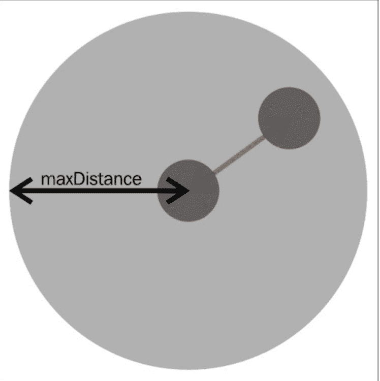

开火按钮比虚拟摇杆更容易处理。我们使用与之前示例相同的逻辑。当事件为按下动作时将 mIsFiring 设置为 true，当事件为抬起动作时将其设置为 false：

```java
private class VFireButtonTouchListener implements
View.OnTouchListener {
@Override
public boolean onTouch(View v, MotionEvent event) {
int action = event.getActionMasked();
if (action == MotionEvent.ACTION_DOWN) {
mIsFiring = true;
} else if (action == MotionEvent.ACTION_UP) {
mIsFiring = false;
}
return true;
}
}
```

```java
private class VJoystickTouchListener implements
View.OnTouchListener {
@Override
public boolean onTouch(View v, MotionEvent event) {
int action = event.getActionMasked();
if (action == MotionEvent.ACTION_DOWN) {
mStartingPositionX = event.getX(0);
mStartingPositionY = event.getY(0);
}
else if (action == MotionEvent.ACTION_UP) {
mHorizontalFactor = 0;
mVerticalFactor = 0;
}
else if (action == MotionEvent.ACTION_MOVE) {
// Get the proportion to the max
mHorizontalFactor = (event.getX(0) - mStartingPositionX) / mMaxDistance;
if (mHorizontalFactor > 1) {
mHorizontalFactor = 1;
}
else if (mHorizontalFactor < -1) {
mHorizontalFactor = -1;
}
mVerticalFactor = (event.getY(0) - mStartingPositionY) / mMaxDistance;
if (mVerticalFactor > 1) {
mVerticalFactor = 1;
}
else if (mVerticalFactor < -1) {
mVerticalFactor = -1;
}
}
return true;
}
}
```

请注意，我们希望将 mHorizontalFactor 和 mVerticalFactor 保持在 -1 到 1 之间；因此，当距离大于 mMaxDistance 时，我们不予考虑。

最后，是时候将这个新控制器连接到 GameEngine 了。这非常简单。我们只需更新 fragment_game.xml 的布局，用 view_vjoystick.xml 替换 view_keypad.xml，然后更新 GameEngine 的初始化：

```xml
<FrameLayout
xmlns:android="http://schemas.android.com/apk/res/android"
xmlns:tools="http://schemas.android.com/tools"
android:layout_width="match_parent"
android:layout_height="match_parent"
android:orientation="vertical"
android:paddingTop="@dimen/activity_vertical_margin"
android:paddingLeft="@dimen/activity_horizontal_margin"
android:paddingRight="@dimen/activity_horizontal_margin"
tools:context="com.plattysoft.yass.counter.GameFragment">

<TextView
android:layout_gravity="top|left"
android:id="@+id/txt_score"
android:layout_width="wrap_content"
android:layout_height="wrap_content"
android:text="@string/hello_world" >

<Button
android:layout_gravity="top|right"
android:id="@+id/btn_play_pause"
android:layout_width="wrap_content"
android:layout_height="wrap_content"
android:text="@string/pause" />

<include layout="@layout/view_vjoystick" />
</FrameLayout>
```

提醒一下，GameEngine 的初始化是在 GameFragment 的 onViewCreated 内完成的。我们只需创建一个适当 InputController 的实例：

```java
mGameEngine = new GameEngine(getActivity());
mGameEngine.setInputController(new
VirtualJoystickInputController(getView()));
mGameEngine.addGameObject(new Player(getView()));
mGameEngine.startGame();
```

是时候运行游戏并尝试这个控制器了。

## 一般注意事项和改进

这种输入方式比我们之前做的基础键盘有了巨大的改进。触控区域与屏幕一样大，玩家不需要看屏幕的这个区域来点按小按钮。它可以在任何位置工作。

该系统既处理对角线移动，也处理水平和垂直移动，以及介于两者之间的任何移动。

玩家不需要将手指从屏幕上移开即可改变方向。

缺乏视觉反馈，可以通过在玩家使用时将虚拟游戏手柄绘制成两个圆圈来解决。一个大圆会显示虚拟摇杆的范围，而一个较小的圆会显示当前的触控指针。另一方面，你可能不希望这样做，因为缺乏视觉杂乱会让屏幕更加简洁。


## 物理控制器

是时候进入硬核玩家喜爱的一种控制器类型了：物理控制器。

有一些设备将控制器作为硬件的一部分包含在内。一些著名的例子是 Xperia Play——最早带有滑动游戏手柄的手机之一——以及 Nvidia Shield，该类别中的最新设备。

Xperia Play 是最早配备集成游戏手柄的设备之一：

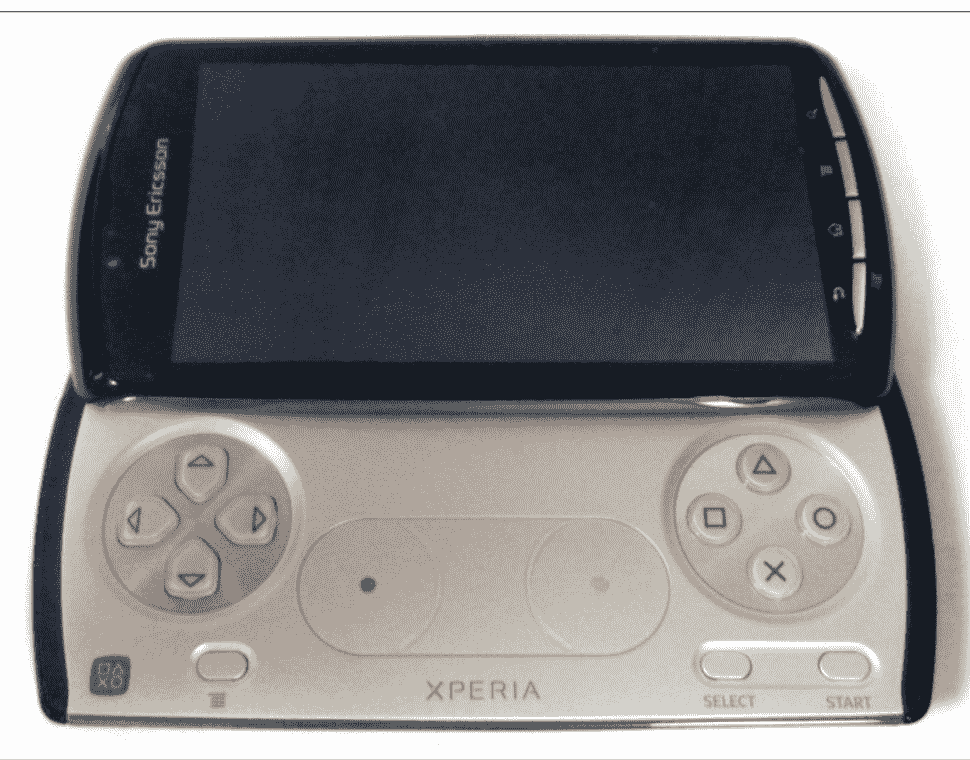

Nvidia Shield 是配备游戏手柄的最强大的 Android 设备之一：

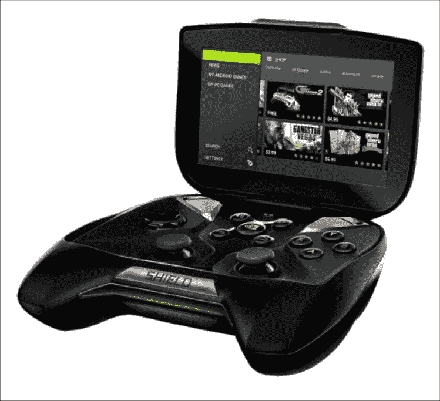

另一方面，许多品牌为智能手机制造游戏控制器，并在传统玩家中相当流行。它们都是可以连接到您手机或平板电脑的蓝牙控制器。其中一些设计为让手机插入其中，例如 Gametel（另一款先驱）和大多数 MOGA 型号。

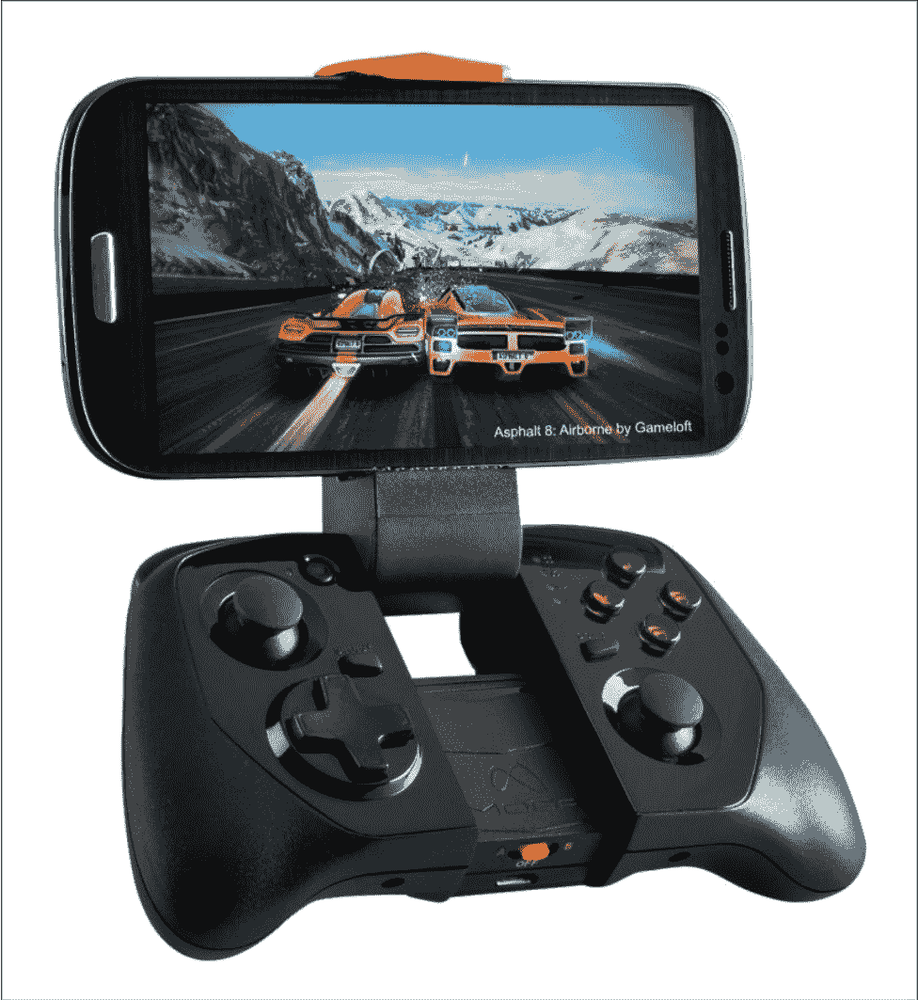

*带有可调节条带以固定手机的 MOGA 控制器*

还有少数 Android 驱动的设备将控制器作为主要输入源。这里我们说的是微型主机，例如 OUYA，或其他类似电视的设备，例如 Amazon FireTV 或 Android TV。

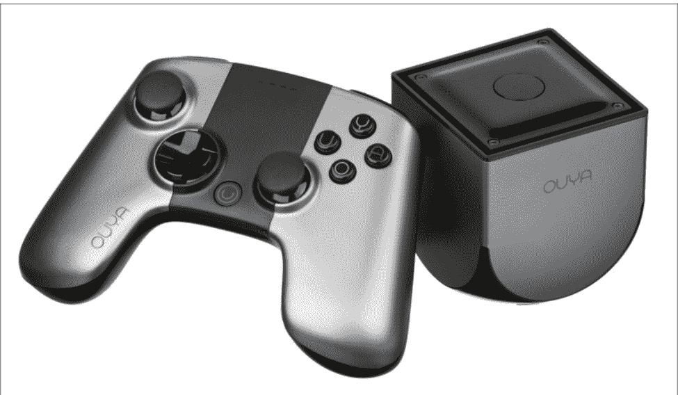

*OUYA 是第一款 Android 微型主机*

这些设备的工作方式与 HID 设备非常相似，无论是以键盘的形式，还是作为基于轴的方向控制（模拟摇杆）。我们要做的只是设置正确的监听器。

有些控制器确实有自己的专有库。我们不会涉及此内容，因为它们非常具体，并提供了有关如何集成它们的详细文档。MOGA Pocket 就是这种情况（更高级的 MOGA 控制器支持两种模式：专有和 HID）。

## 注意

大多数控制器都作为 HID 工作，这是标准。

我们可以在 Activity 级别或视图级别为控制器设置监听器。无论如何，我们都需要扩展该类。无法为这些方法添加监听器，必须重写它们。由于我们已经扩展了 Activity 类，我们将这样做。

## 注意

我们在 Activity 内部监听 KeyEvent 和 MotionEvent。

我们需要监听两种类型的事件。如下所示：

- KeyEvent：用于所有按钮按下，在某些游戏手柄中，也用于方向十字键
- MotionEvent：与沿轴移动相关的事件：摇杆

我们希望将输入控制器与 Activity 分离，因此将创建一个特殊的监听器来组合我们需要的两个事件，然后让 Activity 委托给它。

我们需要的接口非常简单，我们将其命名为 GamepadControllerListener：

```java
public interface GamepadControllerListener {
    boolean dispatchGenericMotionEvent(MotionEvent event);
    boolean dispatchKeyEvent(KeyEvent event);
}
```

在 Activity 内部，我们创建一个方法来设置 GamepadControllerListener 类型的监听器。由于我们一次只需要一个监听器，因此该方法是 set 而不是 add。要移除监听器，只需将其设置为 null：

```java
public void setGamepadControllerListener(GamepadControllerListener listener) {
    mGamepadControllerListener = listener;
}
```

最后，我们必须在 Activity 中重写 dispatchGenericMotionEvent 和 dispatchKeyEvent：

```java
@Override
public boolean dispatchGenericMotionEvent(MotionEvent event) {
    if (mGamepadControllerListener != null) {
        if (mGamepadControllerListener.dispatchGenericMotionEvent(event)) {
            return true;
        }
    }
    return super.dispatchGenericMotionEvent(event);
}

@Override
public boolean dispatchKeyEvent(KeyEvent event) {
    if (mGamepadControllerListener != null) {
        if (mGamepadControllerListener.dispatchKeyEvent(event)) {
            return true;
        }
    }
    return super.dispatchKeyEvent(event);
}
```

请注意，此方法使用约定：如果事件已使用则返回 true，如果未使用则返回 false。在我们的情况中，只有当事件由监听器使用时才会返回 true。在其他情况下，我们将返回结果以将事件委托给基类。

调用超类中的相应方法非常重要，因为 Activity 类内部有大量我们不希望意外丢弃的处理。

准备好这些组件后，我们可以继续创建 GamepadInputController，它将扩展 InputController 并实现 GamepadControllerListener：

```java
public class GamepadInputController
        extends InputController
        implements GamepadControllerListener {

    public GamepadInputController(YassActivity activity) {
        mActivity = activity;
    }

    @Override
    public void onStart() {
        mActivity.setGamepadControllerListener(this);
    }

    @Override
    public void onStop() {
        mActivity.setGamepadControllerListener(null);
    }
}
```

```
[...]
}
```

尽可能限制对 Activity 的键盘和运动事件的挂钩是我们想要做到的。这就是为什么我们重写 InputController 的 onStop 和 onStart 方法，以便仅在游戏运行时设置监听器。

有几种可能的控制器布局。通常，它们都有十字控制和/或模拟摇杆。有些有多个模拟摇杆，当然还有按钮。总的来说，关于事件以及不同游戏手柄的配置方式，有一些重要细节：

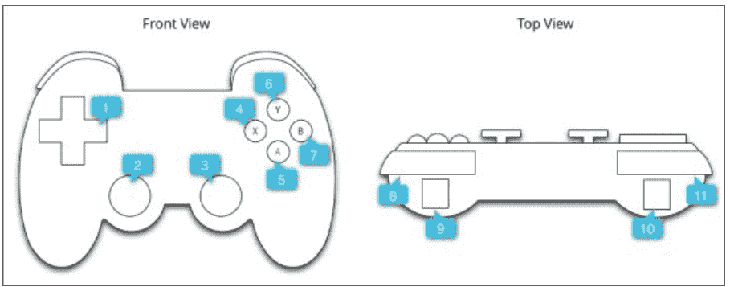

- 十字控制可以由按钮组成，也可以是另一个模拟摇杆。如果它有按钮，则将其作为与 D-Pad 相同常量的 KeyEvent 处理。如果它是模拟摇杆，则会使用 AXIS_HAT_X 和 AXIS_HAT_Y。

- 模拟摇杆通过 MotionEvent 处理，我们可以使用 MotionEvent 的 getAxisValue 方法读取它们。默认摇杆将使用 AXIS_X 和 AXIS_Y。

- 我们不会为这个游戏映射第二个模拟摇杆，但它映射在 AXIS_Z 和 AXIS_RZ 上。

- 按钮映射为带有每个按钮名称的 KeyEvent。

## 处理 MotionEvents

当我们收到 MotionEvent 时，首先需要验证该事件来自我们应该读取的来源。

来源是事件的一部分，它是标志的组合。我们感兴趣的有：

- SOURCE_GAMEPAD：表示设备具有游戏手柄按钮，例如 A、B、X 或 Y。
- SOURCE_DPAD：表示设备具有 D-Pad。
- SOURCE_JOYSTICK：表示设备具有模拟控制杆。

我们应该处理的唯一动作事件是源设置了摇杆标志的事件。游戏手柄和 D-Pad 源都将作为 KeyEvent 发送。

接收 MotionEvent 的处理方式如下：

```java
@Override
public boolean dispatchGenericMotionEvent(MotionEvent event) {
    int source = event.getSource();

    if ((source & InputDevice.SOURCE_JOYSTICK) != InputDevice.SOURCE_JOYSTICK) {
        return false;
    }
    mHorizontalFactor = event.getAxisValue(MotionEvent.AXIS_X);
    mVerticalFactor = event.getAxisValue(MotionEvent.AXIS_Y);

    InputDevice device = event.getDevice();
    MotionRange rangeX = device.getMotionRange(MotionEvent.AXIS_X, source);
    if (Math.abs(mHorizontalFactor) <= rangeX.getFlat()) {
        mHorizontalFactor = event.getAxisValue(MotionEvent.AXIS_HAT_X);
        MotionRange rangeHatX = device.getMotionRange(MotionEvent.AXIS_HAT_X, source);
        if (Math.abs(mHorizontalFactor) <= rangeHatX.getFlat()) {
            mHorizontalFactor = 0;
        }
    }
    MotionRange rangeY = device.getMotionRange(MotionEvent.AXIS_Y, source);
    if (Math.abs(mVerticalFactor) <= rangeY.getFlat()) {
        mVerticalFactor = event.getAxisValue(MotionEvent.AXIS_HAT_Y);
        MotionRange rangeHatY =
                device.getMotionRange(MotionEvent.AXIS_HAT_Y, source);
        if (Math.abs(mVerticalFactor) <= rangeHatY.getFlat()) {
            mVerticalFactor = 0;
        }
    }
    return true;
}
```

首先，我们检查源。如果它不是来自摇杆，我们就直接返回 false，因为我们不会使用这个事件。

然后我们读取 `MotionEvent.AXIS_X` 和 `MotionEvent.AXIS_Y` 的轴值，并将它们赋值给我们的变量。这旨在读取默认摇杆。但我们还没结束。控制器可能有一个充当模拟摇杆的十字键。

为了决定是否读取次级摇杆，我们检查默认摇杆上是否有输入。如果没有，我们将次级摇杆的值赋给我们的变量。

需要注意的是，大多数模拟摇杆并没有完美地对齐到 0，因此将 `mHorizontalFactor` 和 `mVerticalFactor` 的值与 0 进行比较不是检测摇杆是否移动的有效方法。

## 注意

模拟摇杆并没有完美地居中于 0。

我们需要做的是读取设备运动范围的平坦值。这比听起来要简单得多，因为所有这些信息都是 `MotionEvent` 的一部分。

然后，如果默认轴上没有输入，我们将 `AXIS_HAT_X` 和 `AXIS_HAT_Y` 的值赋给我们的变量。我们还检查轴输入是否高于其平坦值，如果不是，则将其设置为 0。我们需要这样做，否则飞船在没有任何输入的情况下也会非常缓慢地移动。

最后，我们返回 true 以指示我们已使用该事件。


## 处理 KeyEvents

dispatchKeyEvent 的实现与我们为屏幕上带有按钮的基本控制器所做的实现非常相似：

```
@Override
public boolean dispatchKeyEvent(KeyEvent event) {
    int action = event.getAction();
    int keyCode = event.getKeyCode();
    if (action == MotionEvent.ACTION_DOWN) {
        if (keyCode == KeyEvent.KEYCODE_DPAD_UP) {
            mVerticalFactor -= 1;
            return true;
        } else if (keyCode == KeyEvent.KEYCODE_DPAD_DOWN) {
            mVerticalFactor += 1;
            return true;
        } else if (keyCode == KeyEvent.KEYCODE_DPAD_LEFT) {
            mHorizontalFactor -= 1;
            return true;
        } else if (keyCode == KeyEvent.KEYCODE_DPAD_RIGHT) {
            mHorizontalFactor += 1;
            return true;
        } else if (keyCode == KeyEvent.KEYCODE_BUTTON_A) {
            mIsFiring = true;
            return true;
        }
    } else if (action == MotionEvent.ACTION_UP) {
        if (keyCode == KeyEvent.KEYCODE_DPAD_UP) {
            mVerticalFactor += 1;
            return true;
        } else if (keyCode == KeyEvent.KEYCODE_DPAD_DOWN) {
            mVerticalFactor -= 1;
            return true;
        } else if (keyCode == KeyEvent.KEYCODE_DPAD_LEFT) {
            mHorizontalFactor += 1;
            return true;
        } else if (keyCode == KeyEvent.KEYCODE_DPAD_RIGHT) {
            mHorizontalFactor -= 1;
            return true;
        } else if (keyCode == KeyEvent.KEYCODE_BUTTON_A) {
            mIsFiring = false;
            return true;
        } else if (keyCode == KeyEvent.KEYCODE_BUTTON_B) {
            mActivity.onBackPressed();
            return true;
        }
    }
    return false;
}
```

唯一显著的区别是，我们将按键代码与 D-Pad 的常量进行比较，而不是视图 ID。除此之外，逻辑完全相同。

我们还需要将按钮 **B** 映射为返回键。虽然这在最新版本的 Android 上已经完成，但并非一直如此，因此我们需要处理它。为此，我们使用在 YassActivity 中已创建的 onBackPressed 回调。

另外，在 Android 4.2（API 级别 17）及更早版本中，系统默认将 BUTTON_A 视为 Android 返回键。这就是为什么我们应该始终将 BUTTON_A 用作主要游戏动作的原因。

## 检测游戏手柄

在启动游戏时检查控制器是否已连接是一种良好做法。这样我们可以在用户开始游戏前显示如何使用控制器的帮助屏幕。我们还应检查游戏运行过程中控制器是否断开连接，以便暂停游戏。

虽然可以通过 `InputDevice` 类检查控制器，但检查控制器的变化仅在 API 级别 16 中引入（我们使用 minSDK=15）。

### 注意

检测控制器连接或断开的变化仅在 Jelly Bean 中引入。

我们不会提供检测控制器连接和断开的向后兼容解决方案。如果您需要这样做，官方文档中的详细步骤位于 [官方文档](http://developer.android.com/training/game-controllers/compatibility.html)；这些步骤基本上使用输入设备上的轮询机制并检查列表中的变化。

我们将在 `MainMenuFragment` 的 `onResume` 期间检查游戏手柄。首次检测到控制器时，我们将显示一个 `AlertDialog`，展示如何使用游戏手柄：

```
@Override
public void onResume() {
    super.onResume();
    if (isGameControllerConnected() && shouldDisplayGamepadHelp()) {
        displayGamepadHelp();
        // Do not show the dialog again
        PreferenceManager.getDefaultSharedPreferences(getActivity())
            .edit()
            .putBoolean(PREF_SHOULD_DISPLAY_GAMEPAD_HELP, false)
            .commit();
    }
}

private boolean shouldDisplayGamepadHelp() {
    return PreferenceManager.getDefaultSharedPreferences(getActivity())
        .getBoolean(PREF_SHOULD_DISPLAY_GAMEPAD_HELP, true);
}
```

我们使用默认共享首选项来存储是否已显示对话框。一旦显示，我们将值设置为 false，因此不会再次显示。

检查是否连接了控制器的方法如下：

```
public boolean isGameControllerConnected() {
    int[] deviceIds = InputDevice.getDeviceIds();
    for (int deviceId : deviceIds) {
        InputDevice dev = InputDevice.getDevice(deviceId);
        int sources = dev.getSources();
        if (((sources & InputDevice.SOURCE_GAMEPAD) ==
                InputDevice.SOURCE_GAMEPAD) ||
            ((sources & InputDevice.SOURCE_JOYSTICK) ==
                InputDevice.SOURCE_JOYSTICK)) {
            return true;
        }
    }
    return false;
}
```

我们遍历输入设备，如果其中任何设备的源是游戏手柄或操纵杆，则返回 true。

如果未找到具有这些源的设备，则返回 false。

请注意，每个 InputDevice 也有一个名称。如果您想显示不同的帮助屏幕（例如针对 Nvidia Shield），这可能很有用。

为了检查控制器在游戏过程中是否断开连接，我们需要在 InputManager 上注册 InputDeviceListener 并处理事件。我们将使 GameFragment 实现 InputDeviceListener。

我们在创建 GameEngine 后立即进行注册，并在 onDestroy 中停止游戏后进行注销。您需要添加一些注释以防止 int 因方法在最低 SDK 上不可用而报错，或者将其包装在检查版本的 if 块中，就像我们之前做的那样。

然后，当设备断开连接时暂停游戏就这么简单：

```
@Override
public void onInputDeviceRemoved(int deviceId) {
    if (!mGameEngine.isRunning()) {
        pauseGameAndShowPauseDialog();
    }
}
```

请注意，这会在 *任何* 设备断开连接时暂停游戏。非控制器设备断开连接的情况不太可能，但我们可以通过检查源来确保它是控制器，就像我们为 isGameControllerConnected 所做的那样。

## 传感器和输入控制器

传感器是智能手机上控制游戏的常见方式。当游戏中的唯一控制是左右（例如赛车游戏）时，它们工作良好。如果您还计划上下移动，则需要要求玩家在游戏开始时进行校准以使其可用。请注意，当只使用一个轴时，不需要此类校准。

除此之外，上下运动倾向于干扰 sensorLandscape 方向。因此，对 YASS 来说，使用传感器不是一个很好的主意。

### 注意

传感器仅在某些情况下是良好的控制方式。

您还必须考虑，虽然传感器是方向的替代品，但您仍然需要在屏幕上放置动作按钮——在我们的情况中，就是射击按钮。

我们不会在 YASS 中使用传感器，但如果您想制作使用传感器的游戏，我们将介绍基础知识。

您需要为加速度计和磁场分别注册监听器。您应该仅在游戏运行时监听传感器，因此我们将重写生命周期方法以相应地注册和注销传感器：

```
private void registerListeners() {
    SensorManager sm = (SensorManager)
        mActivity.getSystemService(Activity.SENSOR_SERVICE);
    sm.registerListener(mAccelerometerChangesListener,
        sm.getDefaultSensor(Sensor.TYPE_ACCELEROMETER),
        SensorManager.SENSOR_DELAY_FASTEST);
    sm.registerListener(mMagneticChangesListener,
        sm.getDefaultSensor(Sensor.TYPE_MAGNETIC_FIELD),
        SensorManager.SENSOR_DELAY_FASTEST);
}

private void unregisterListeners() {
    SensorManager sm = (SensorManager)
        mActivity.getSystemService(Activity.SENSOR_SERVICE);
    sm.unregisterListener(mAccelerometerChangesListener);
    sm.unregisterListener(mMagneticChangesListener);
}

@Override
public void onStart() {
    registerListeners();
}

@Override
public void onStop() {
    unregisterListeners();
}

@Override
public void onResume() {
    registerListeners();
}

@Override
public void onPause() {
    unregisterListeners();
}
```

请注意，我们使用 SensorManager.SENSOR_DELAY_FASTEST，这意味着传感器会尽快且尽可能频繁地提供反馈。这对于实时游戏非常重要。

我们将对象设置为监听器。每个监听器只会将传感器值复制到我们稍后处理的本地数组中。例如，在加速度计的情况下，我们将执行：

```
@Override
public void onSensorChanged(SensorEvent event) {
    System.arraycopy(event.values, 0, mLastAccels, 0, 3);
}
```

为了获得最终值，我们需要进行一些计算。因此，我们将添加一个 onPreUpdate 方法，它将在 GameEngine 调用 onUpdate 之前由 GameEngine 调用。

需要注意的是，存在一些特殊情况。它们如下：

- 有些设备缺乏磁场传感器。在这种情况下，我们可以使用加速度计值的简化版本。Nvidia Shield 和特定版本的 Nook 就是这样的设备。


在任何情况下，传感器都与设备的默认方向相关，该方向可以是横向或纵向。在处理数值时，我们必须考虑到这一点。

总而言之，水平轴的转换可以这样实现：

```
private double getHorizontalAxis() {
if (SensorManager.getRotationMatrix(mRotationMatrix, null,
mLastAccels, mLastMagFields)) {
if (mRotation == Surface.ROTATION_0) {
SensorManager.remapCoordinateSystem(mRotationMatrix,
SensorManager.AXIS_Y, SensorManager.AXIS_MINUS_X, mRotationMatrix);
SensorManager.getOrientation(mRotationMatrix, mOrientation);
return mOrientation[1] * DEGREES_PER_RADIAN;
}
else {
SensorManager.getOrientation(mRotationMatrix, mOrientation);
return -mOrientation[1] * DEGREES_PER_RADIAN;
}
}
else {
// Case for devices which do NOT have magnetic sensors
if (mRotation == Surface.ROTATION_0) {
return -mLastAccels[0] * 5;
}
else {
return -mLastAccels[1] * -5;
}
}
}
```

getHorizontalAxis 代码执行以下步骤：

- 使用加速度计和磁传感器的最后数据计算旋转矩阵。
- 如果返回 true，则一切正常。根据设备的旋转，我们决定是否需要重新映射坐标系，然后返回转换为角度的方向。
- 如果无法计算（缺少磁场传感器），该方法返回 false。我们必须依赖使用加速度计数值的近似值。根据设备的旋转，我们应该使用其中一个轴或另一个轴。

设备的旋转可以在 InputController 的构造函数中用一行代码读取。

```
mRotation =
yassActivity.getWindowManager().getDefaultDisplay().getRotation();
```

最后是 onPreUpdate 方法：

```
@Override
public void onPreUpdate() {
    mHorizontalFactor = getHorizontalAxis() / MAX_ANGLE;
    if (mHorizontalFactor > 1) {
        mHorizontalFactor = 1;
    }
    else if (mHorizontalFactor < -1) {
        mHorizontalFactor = -1;
    }
    mVerticalFactor = 0;
}
```

此方法只是使用我们认为设备完全倾斜时的最大角度，将读数（以度为单位）转换为 [-1,1] 范围内的值。我建议你尝试这个常量，并从 30 度开始。

有关传感器处理的更多信息，可以查看官方文档

http://developer.android.com/guide/topics/sensors/sensors_overview.html.

## 选择控制模式

游戏通常会要求用户选择他们偏好的控制模式，但避免不必要的询问、尽可能减少摩擦也是一种良好做法。

YASS 仅使用虚拟摇杆和游戏手柄控件。无需询问用户想要哪一种。两种输入模式都是兼容的，尤其是因为虚拟摇杆在未使用时不会在屏幕上显示任何内容。我们需要做的唯一事情是修改 GameEngine 以支持多个 InputController。

**注意**

我们将同时支持两种输入模式。

同时支持两种输入模式的方法是创建一个 CompositeInputController，它使用组合模式同时拥有一个 VirtualJoystickInputController 和一个 GamepadInputController，并合并两者的输入。

为了同步两个输入控制器的读数，我们将使用 InputController 上的一个名为 onPreUpdate 的方法，该方法将在 onUpdate 之前立即调用。我们将使用它，用其他控制器读取的值来填充 mHorizontalFactor、mVerticalFactor 和 mIsFiring 的值。

```
public void onPreUpdate() {
    mIsFiring = mGamepadInputController.mIsFiring ||
    mVJoystickInputController.mIsFiring;
    mHorizontalFactor = mGamepadInputController.mHorizontalFactor +
    mVJoystickInputController.mHorizontalFactor;
    mVerticalFactor = mGamepadInputController.mVerticalFactor +
    mVJoystickInputController.mVerticalFactor;
}
```

现在我们有了一个可以使用虚拟摇杆或游戏手柄控制的游戏。

## 总结

我们已经学习了几种处理用户输入的方法，以及如何使其对 GameEngine 透明。

为了从控制器获得适当的视觉反馈，我们创建了一个 Player 游戏对象，根据 InputController 的值更新其位置。我们还学习了如何在游戏过程中向 GameEngine 添加和移除游戏对象。

我们创建了一个非常基本的键盘，后来演变成了虚拟摇杆。我们还学习了如何处理外部控制器。

此时，我们的游戏中有一艘沿屏幕移动并发射子弹的飞船。它可以独立地使用虚拟摇杆或游戏手柄进行控制。

当前实现偶尔会出现卡顿，而且我们刚刚开始在屏幕上绘制对象。是时候解决这个问题了。下一步：通过直接在视图上绘制而不是依赖于在屏幕上定位视图来改进渲染。
