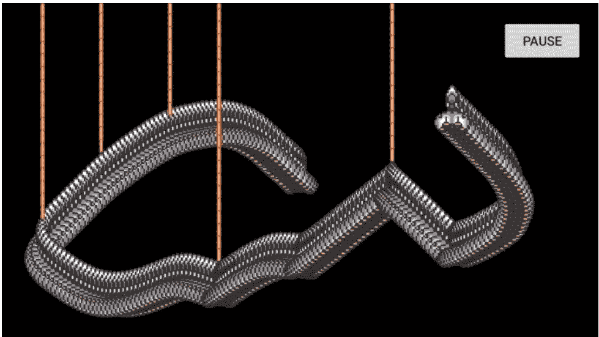
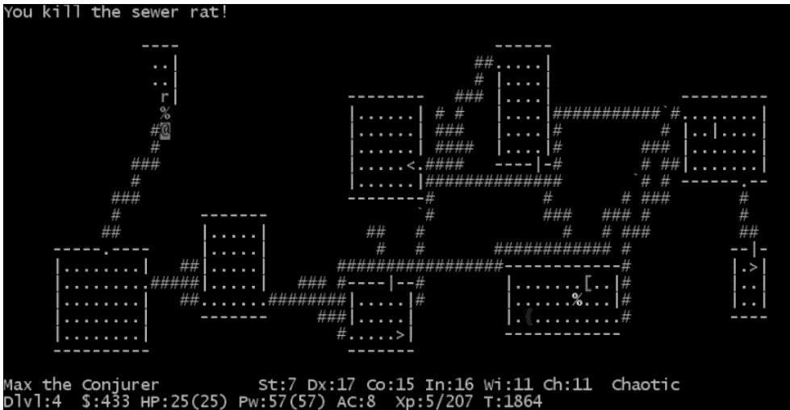
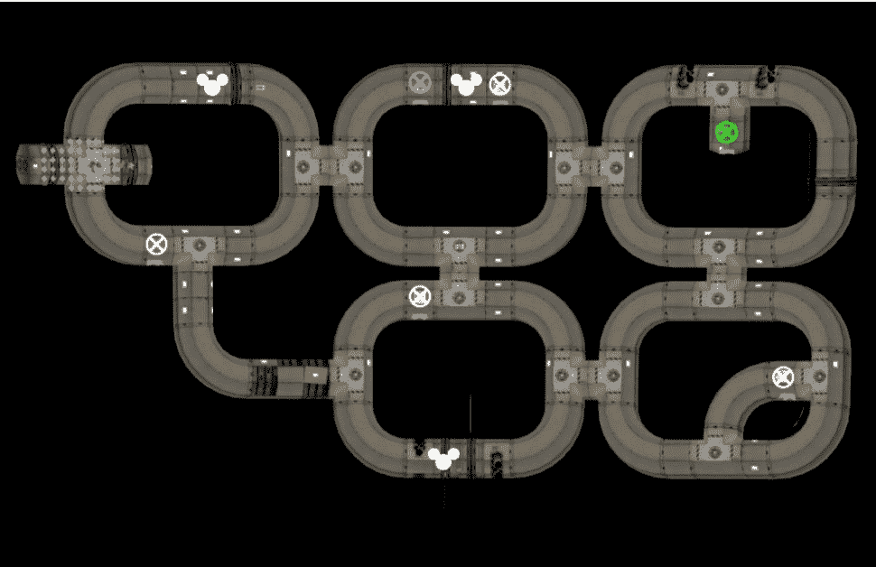
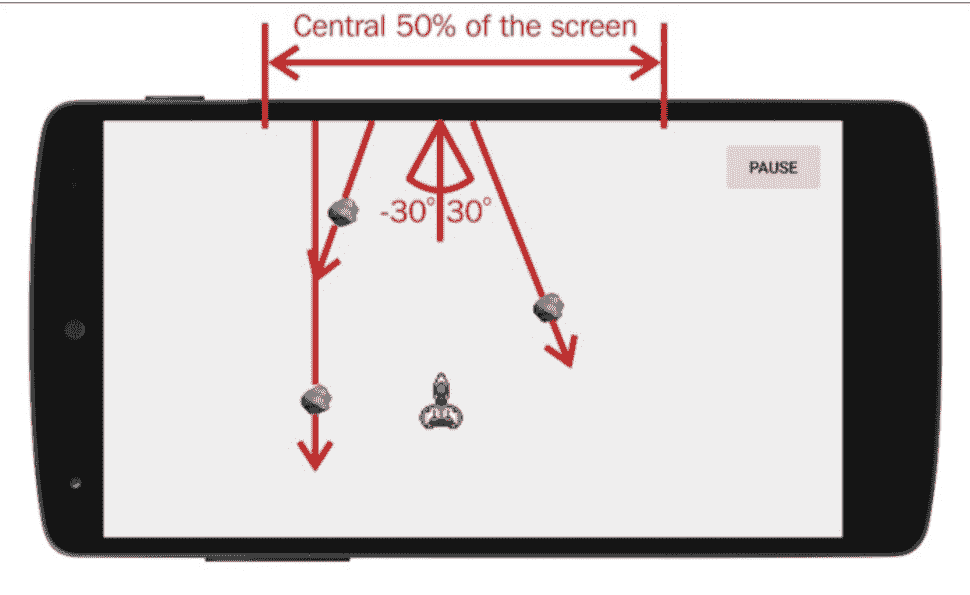
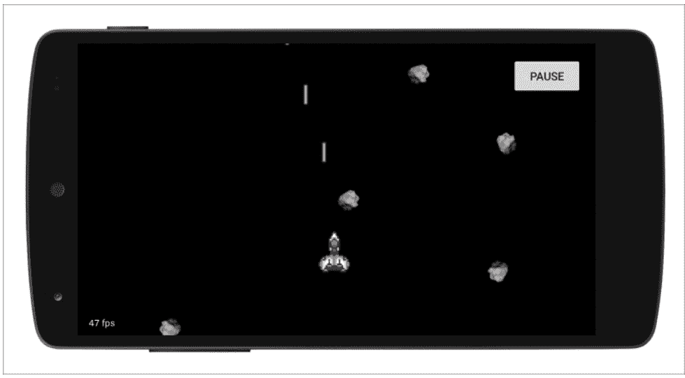
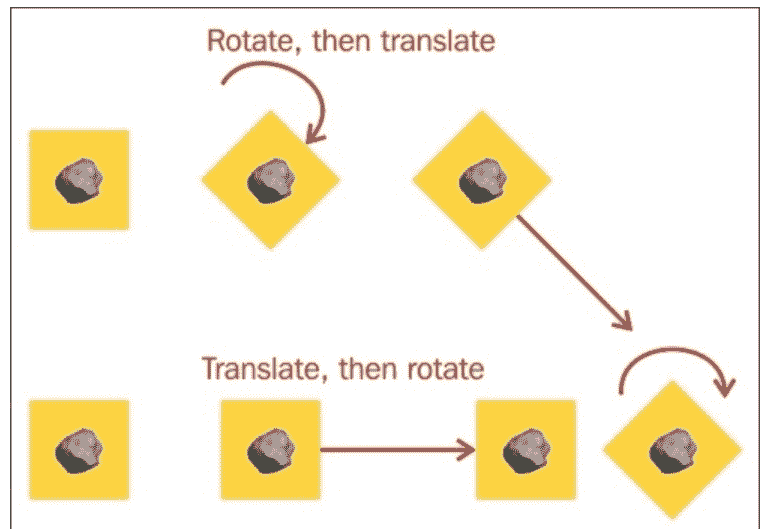
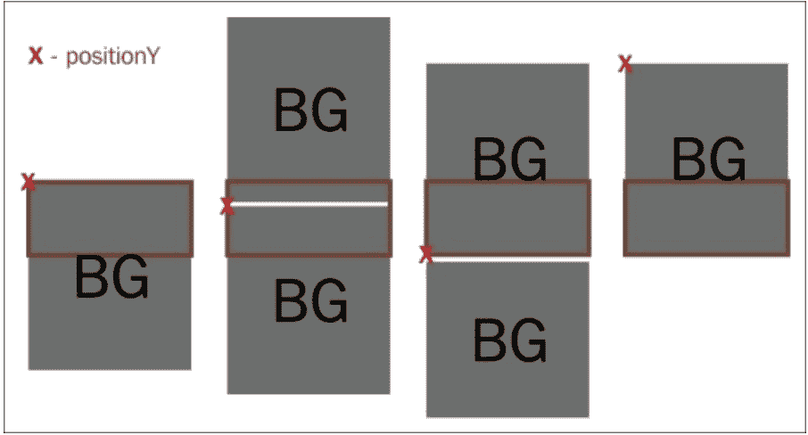
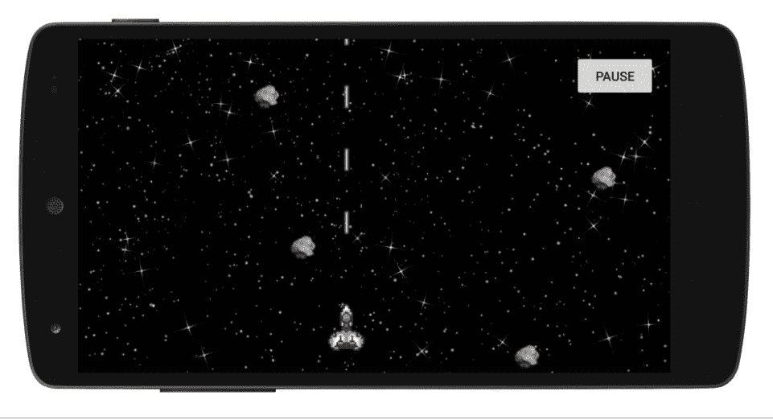
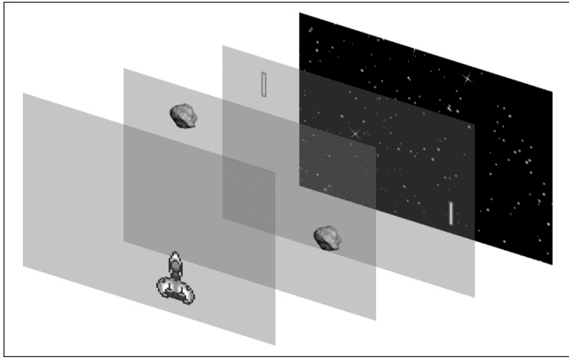

## 第 3 章. 进入绘制线程

在本章中，我们将改进游戏中精灵的渲染。为此，我们将使用一个自定义 GameView 来执行低级绘制。我们将制作两种不同的实现：一种扩展自 View，另一种扩展自 SurfaceView。我们将让 DrawThread 成为一个真正的线程，以便更好地与这个 GameView 配合工作。

我们将重构项目，创建一个 Sprite 类，它将用于游戏中绘制的所有项目。我们将在 Canvas 上绘制位图，并学习用于此目的的转换矩阵。

为了继续改进游戏，我们将添加敌人。它们将是一波朝我们的飞船移动的小行星。为此，我们将学习 GameController 的概念以及不同的实现方式，从静态到程序化关卡生成。

作为渲染技术的一部分，我们将学习遮挡剔除和视差背景，我们将使用它们使游戏看起来更好。

最后，我们将为引擎添加图层支持。

## 使用 GameView

到目前为止，我们一直在使用标准视图并对其进行转换来渲染游戏的不同元素。虽然这是在屏幕上绘制元素的一种简单方法，但远非高效。我们依赖系统布局来进行绘制。

虽然这种技术对于回合制游戏或任何非实时游戏来说没问题，但它无法为实时游戏渲染足够的帧率。

> **注意**
> 使用标准 Views 对于非实时游戏来说没问题。

我们将创建一个名为 GameView 的自定义视图。该视图将负责绘制精灵。

我们之前已经注意到代码重复，并在上一章中提到了精灵的概念。现在我们将向前迈进，创建一个 Sprite 类，它将负责在 GameView 内的特定坐标处绘制图像。

在 Android 上进行低级绘制有两种方式：

- 扩展 View 并重写 onDraw
- 扩展 SurfaceView 并使用 SurfaceHolder

在这两种情况下，我们都会得到一个 Canvas 并在上面绘制我们的游戏对象。主要区别在于 View 的 onDraw 方法在 UIThread 上执行，而 SurfaceView 和 SurfaceHolder 旨在在单独的线程上执行绘制。

> **注意**
> 在 Android 上，低级绘制始终使用画布进行。

根据官方文档，使用 SurfaceView 更高效。但是，自 Android 4.0 以来，视图渲染是硬件加速的（而 SurfaceView 不是）。对于拥有高分辨率屏幕和更快处理器的现代手机来说，情况不一定总是如此。

> **注意**
> SurfaceView 不是硬件加速的，性能可能比普通 View 差。

无论如何，你应该两者都了解，并能轻松切换它们，即使只是为了测试目的。我们将创建一个名为 GameView 的接口，由这两个类实现，以便可以轻松更改。我们将创建的类是：

- StandardGameView：将扩展自 View
- SurfaceGameView：将扩展自 SurfaceView


## GameView 接口

GameView 接口将包含 GameEngine 处理 View 所需的所有方法：

```java
public interface GameView {
    void draw();
    void setGameObjects(List<GameObject> gameObjects);
    // Generic methods from View
    int getWidth();
    int getHeight();
    int getPaddingLeft();
    int getPaddingRight();
    int getPaddingTop();
    int getPaddingBottom();
    Context getContext();
}
```

基本上我们需要两个方法：一个用于触发绘制，另一个用于将游戏对象列表传递给 GameView，以便在那里绘制它们：

- draw：这将在 GameView 上触发绘制
- setGameObjects：这将为 View 设置 GameObjects 列表

其余方法在 View 中实现。我们需要声明它们，因为我们要在 GameEngine 中使用它们。

让我们详细探讨每个实现。

## StandardGameView

StandardGameView 类扩展 View。我们只需为 View 提供基本构造函数，重写 onDraw 方法，然后实现 GameView 中的方法：

```java
public class StandardGameView extends View implements GameView {
    private List<GameObject> mGameObjects;

    public StandardGameView(Context context) {
        super(context);
    }

    public StandardGameView(Context context, AttributeSet attrs) {
        super(context, attrs);
    }

    public StandardGameView(Context context, AttributeSet attrs, int defStyleAttr) {
        super(context, attrs, defStyleAttr);
    }

    @Override
    protected void onDraw(Canvas canvas) {
        super.onDraw(canvas);
        synchronized (mGameObjects) {
            int numObjects = mGameObjects.size();
            for (int i = 0; i < numObjects; i++) {
                mGameObjects.get(i).onDraw(canvas);
            }
        }
    }

    @Override
    public void draw() {
        postInvalidate();
    }

    @Override
    public void setGameObjects(List<GameObject> gameObjects) {
        mGameObjects = gameObjects;
    }
}
```

基本上，`setGameObjects` 存储对游戏对象的引用。`GameObjects` 的添加和移除在 `GameEngine` 中完成。当我们绘制视图时，我们遍历游戏对象列表，对所有对象调用 `onDraw`，并传递我们正在绘制的 `Canvas` 对象。

请注意，该方法使用 `mGameObjects` 变量进行同步。这很重要，因为正如我们在 [第 1 章，设置项目] 中提到的，列表内容可能在 `onUpdate` 期间发生变化，我们不希望在遍历列表时发生这种情况。

另一个重要点是，`GameObjects` 列表是对 `GameEngine` 内部列表的引用，而不是副本，因此每当列表被修改时，两个位置都可以访问最新值。这也是为什么需要同步的原因。

### 注意

`GameObjects` 列表在 `GameEngine` 和 `GameView` 之间共享。

从性能角度来看，在每次执行 `onDraw` 时将列表中的所有元素复制到新列表中是没有意义的。

要触发绘制，我们只需调用 `postInvalidate`。请记住，使视图无效必须在 `UIThread` 上执行。这就是为什么我们需要调用 `postInvalidate` 的原因。该方法会将一个 `Runnable` 发布到 `UIThread` 上运行，然后使 `View` 无效。

正如我们在前面章节中提到的，一旦视图被使无效，Android 就会确保调用 `View` 的 `onDraw` 方法，然后更新 UI。这就是使视图无效与 `onDraw` 方法之间的联系，我们在其中绘制游戏对象。

`onDraw` 方法显然对时间非常敏感。我们应该避免所有不必要的操作。特别是，如果你在 `onDraw` 内部创建对象，lint 会显示警告。重申一下，这是游戏开发者的最佳实践：始终提前创建对象。

### 注意

切勿在 onDraw 内部进行对象创建。

还值得记住的是，Android 有一种回退机制，以避免绘制过载。如果视图已被使无效但尚未重绘，则 invalidate 调用将被忽略（视图已经将要重绘）。

## SurfaceGameView

要实现扩展 SurfaceView 的 GameView，我们需要为 SurfaceHolder（用于访问 SurfaceView 的类）定义一个 Callback，然后，每当我们想要绘制时，锁定画布，在其上绘制，然后再次解锁，以便 SurfaceView 可以呈现它。

让我们看看 SurfaceGameView 的代码：

```java
public class SurfaceGameView extends SurfaceView implements SurfaceHolder.Callback, GameView {
    private List<GameObject> mGameObjects;
    private boolean mReady;

    public SurfaceGameView(Context context) {
        super(context);
        getHolder().addCallback(this);
    }

    public SurfaceGameView(Context context, AttributeSet attrs) {
        super(context, attrs);
        getHolder().addCallback(this);
    }

    public SurfaceGameView(Context c, AttributeSet attrs, int defStyleAttr) {
        super(c, attrs, defStyleAttr);
        getHolder().addCallback(this);
    }

    @Override
    public void surfaceCreated(SurfaceHolder holder) {
        mReady = true;
    }

    @Override
    public void surfaceChanged(SurfaceHolder holder, int format, int width, int height) {
    }

    @Override
    public void surfaceDestroyed(SurfaceHolder holder) {
        mReady = false;
    }

    @Override
    public void setGameObjects(List<GameObject> gameObjects) {
        mGameObjects = gameObjects;
    }

    @Override
    public void draw() {
        if (!mReady) {
            return;
        }
        Canvas canvas = getHolder().lockCanvas();
        if (canvas == null) {
            return;
        }
        canvas.drawRGB(0, 0, 0);
        synchronized (mGameObjects) {
            int numObjects = mGameObjects.size();
            for (int i = 0; i < numObjects; i++) {
                mGameObjects.get(i).onDraw(canvas);
            }
        }
        getHolder().unlockCanvasAndPost(canvas);
    }
}
```

首先，我们有三个具有不同参数的构造函数，它们是 SurfaceView 固有的。请注意，它们都包含向 SurfaceHolder 设置 Callback 的调用，而 SurfaceGameView 也实现了该 Callback。此回调将告知我们 SurfaceView 是否已准备好或事物是否已更改。

接下来的方法是回调接口的实现。这些方法在 SurfaceView 被创建、修改或销毁时被调用。我们存储视图的状态以知道它是否已准备好，以便可以用于绘制。视图在创建后到销毁前的任何时候都处于就绪状态。

然后，我们进入实现 GameView 中的方法。

要设置 GameObjects，我们与 StandardGameView 做的完全一样，在处理引用方面也具有相同的含义。

draw 方法是事情有所不同的地方。我们必须检查视图是否已准备好。如果是，我们锁定画布以便在其上绘制。

一旦我们有了画布，我们需要在绘制每一帧之前清理它。画布上会有之前的图像。（如果我们不清理它，我们会得到如下截图所示的渲染伪影。）这种清理是通过使用 drawRGB 用纯色填充画布来完成的。



一旦我们清理了画布，我们就采用与 StandardGameView 相同的绘制方式，只需遍历游戏对象即可。

最后，我们解锁画布并将其发布。这是我们将画布传回给 SurfaceView 并发布到 UIThread 的时刻。请注意，所有绘制都在 UIThread 之外完成。只有在画布完全呈现后，才会将其传回进行绘制。

### 注意

SurfaceView 在 UIThread 之外的 Canvas 上执行绘制。

如前所述，SurfaceView 应该能提供更好的性能。但是，由于它仅经过软件加速，在现代手机上，带有硬件加速的标准 View 在某些情况下可能更高效。SurfaceView 性能受影响的特定情况是，如果我们在其上放置其他视图（如暂停按钮），因为每次表面更改时都会执行完整的 alpha 混合合成。


## 更新 GameEngine

从 GameEngine 的角度来看，使用 GameView 会带来一些影响。
这意味着它必须初始化 GameView，然后使用通用接口触发绘制。

GameView 将作为 GameEngine 构造函数的参数。它将通过传递游戏对象列表的引用来进行初始化。更新后的 GameEngine 构造函数如下：

```
public GameEngine (Activity a, GameView gameView) {
mActivity = a;
mGameView = gameView;
mGameView.setGameObjects(mGameObjects);

mWidth = gameView.getWidth()
- gameView.getPaddingRight() - gameView.getPaddingLeft();
mHeight = gameView.getHeight()
- gameView.getPaddingTop() - gameView.getPaddingBottom();

mPixelFactor = mHeight / 400d;
}
```

从现在起，我们还将在 GameEngine 内部计算 pixelFactor。我们将把它存储在一个公共变量中，以便游戏对象可以读取。这有几个好处，例如：

- 如果我们决定更改屏幕的单位数量，只需在一个地方进行更改
- 消除代码重复始终有利于维护

另一方面，GameEngine 的 onDraw 方法变得非常简单：

```
public void onDraw() {
mGameView.draw();
}
```

## 更新游戏布局

当然，我们必须修改 fragment_game.xml 布局以包含 GameView。我们将趁此机会对其进行其他修改，例如删除 TextView 并将布局的内边距改为暂停按钮的外边距。这样可以确保 GameView 占据全屏，同时保持按钮外边距不变。

重要的是要记住，在 FrameLayout 中，XML 中的顺序指定了项目的绘制顺序（z-index）。我们将把 GameView 放在布局的开头，以便暂停按钮绘制在其之上。

fragment_game.xml 的新版本如下：

```xml
<FrameLayout
xmlns:android="http://schemas.android.com/apk/res/android"
xmlns:tools="http://schemas.android.com/tools"
android:layout_width="match_parent"
android:layout_height="match_parent"
android:orientation="vertical"
tools:context="com.example.yass.counter.GameFragment">

<com.example.yass.engine.SurfaceGameView
android:id="@+id/gameView"
android:layout_width="match_parent"
android:layout_height="wrap_content" >

<Button
android:layout_gravity="top|right"
android:id="@+id/btn_play_pause"
android:layout_marginTop="@dimen/activity_vertical_margin"
android:layout_marginRight="@dimen/activity_vertical_margin"
android:layout_width="wrap_content"
android:layout_height="wrap_content"
android:text="@string/pause" >

<include layout="@layout/view_vjoystick" />

</FrameLayout>
```

请注意，这是我们决定使用哪个 GameView 变体的地方。其余代码将通过 GameView 接口访问方法，因此不需要更改其他内容。从现在起我们将使用 SurfaceGameView，但也欢迎尝试 StandardGameView。

### 注意

布局是我们设置将使用哪个 GameView 变体的地方。

最后，在 GameFragment 内部，我们通过添加 GameView 参数来更新 GameEngine 的创建：

```
GameView gameView = (GameView)
getView().findViewById(R.id.gameView);
mGameEngine = new GameEngine(getActivity(), gameView);
```

现在我们有一个依赖 GameView 进行渲染的 GameEngine。我们仍然需要更新 GameObject 类以使用它。

在介绍 GameObject 类之前，让我们也花点时间改进 DrawThread。

## 改进 DrawThread

为了触发绘制，我们一直在使用计划好的 `Timer` 和 `TimerTask` 以达到每秒 30 帧。虽然这样可行，但像 `UpdateThread` 那样操作性能更好：尽可能多地调用 `onDraw`。

这种方法对 `SurfaceView` 非常有效，因为绘制是在同一线程上完成的。但使用 `StandardGameView` 时可能会出现消息溢出问题，因为它只是调用 `postInvalidate`。为了防止溢出，我们将确保两次 `onDraw` 调用之间的时间间隔永远不短于 20 毫秒，这足以支持每秒 50 帧。

新 `DrawThread` 的代码与 `UpdateThread` 完全相同，除了 run 方法中处理溢出的部分。它如下所示：

```
@Override
public void run() {
long elapsedMillis;
long currentTimeMillis;
long previousTimeMillis = System.currentTimeMillis();

while (mGameIsRunning) {
currentTimeMillis = System.currentTimeMillis();
elapsedMillis = currentTimeMillis - previousTimeMillis;
if (mPauseGame) {
while (mPauseGame) {
try {
synchronized (mLock) {
mLock.wait();
}
} catch (InterruptedException e) {
// We stay on the loop
}
}
}
currentTimeMillis = System.currentTimeMillis();
}
if (elapsedMillis < 20) { // This is 50 fps
try {
Thread.sleep(20-elapsedMillis);
} catch (InterruptedException e) {
// We just continue.
}
}
mGameEngine.onDraw();
previousTimeMillis = currentTimeMillis;
}
}
```

如果两次调用间隔太近，我们会让线程休眠剩余时间，最短为 20 毫秒。

如果发生 InterruptedException，我们其实没什么可处理的。因此，我们可以直接继续并调用 GameEngine 中的 onDraw。

## 精灵

我们已经提到过精灵的概念，精灵是在屏幕特定位置上绘制和处理的实体。本质上，游戏中我们看到的一切都是精灵。也有例外，例如游戏控制器（不绘制任何内容）和背景（以不同方式绘制），但我们将在本章后面讨论它们。

因此，这是继承自 GameObject 的 Sprite 类的代码：

```
public abstract class Sprite extends GameObject {
protected double mPositionX;
protected double mPositionY;
protected final double mPixelFactor;
private final Bitmap mBitmap;
protected final int mImageHeight;
protected final int mImageWidth;
private final Matrix mMatrix = new Matrix();
protected Sprite (GameEngine gameEngine, int drawableRes) {
Resources r = gameEngine.getContext().getResources();
Drawable spriteDrawable = r.getDrawable(drawableRes);
mPixelFactor = gameEngine.mPixelFactor;
mImageHeight = (int)
(spriteDrawable.getIntrinsicHeight()*mPixelFactor);
mImageWidth = (int)
(spriteDrawable.getIntrinsicWidth()*mPixelFactor);
mBitmap = ((BitmapDrawable) spriteDrawable).getBitmap();
}
@Override
public void onDraw(Canvas canvas) {
mMatrix.reset();
mMatrix.postScale((float) mPixelFactor, (float) mPixelFactor);
mMatrix.postTranslate((float) mPositionX, (float) mPositionY);
canvas.drawBitmap(mBitmap, mMatrix, null);
}
}
```

Sprite 是一个抽象类，根本没有实现 onUpdate。精灵关心的是在屏幕上显示一个项目，而不是该项目如何移动。

该类有一系列成员变量。让我们逐一介绍：

- mPositionX, mPositionY：Sprite 在屏幕上的位置。与我们用于 Player 和 Bullet 对象的概念相同。此位置位于图像的左上角。
- mPixelFactor：与之前相同的概念。将屏幕单位转换为像素的因子。
- mBitmap：我们要绘制的位图。
- mImageWidth, mImageHeight：位图在屏幕上绘制时的大小。此处设置是为了方便。我们始终可以使用位图和像素因子来计算它，但直接存储它以供子类将来使用更快。
- mMatrix：此对象是一个变换矩阵。它在将位图渲染到画布之前用于缩放、移动和旋转位图。出于优化目的，它在 onDraw 执行之间重复使用，而不是为每次运行创建。

下面是构造函数。我们传递 GameEngine 的引用和一个可绘制资源。在上一章中，我们传递父 View，以便可以将新创建的 ImageView 添加到其中。现在不再需要这样做了。我们只需要上下文和像素因子，可以从 GameEngine 获取。

构造函数中的代码与我们之前见过的非常相似。它执行多个操作：

- 通过上下文从资源加载 Drawable
- 获取可绘制对象的固有大小，并将其乘以像素因子，以存储精灵在特定设备上将使用的宽度和高度（像素）
- 从 Drawable 获取 Bitmap 并将其存储在类变量中，以便在 onDraw 期间使用

最后，我们有接收 Canvas 的 onDraw 方法。此方法现在由 GameView 调用。Canvas 的获取方式与从 a


`StandardGameView` 和 `SurfaceGameView`，但在两种情况下，在其上绘制的逻辑是相同的。

画布作为将图形绘制其上的实际表面的绘图接口。它为我们提供了一组用于绘制的原语，包括位图、文本、线条、矩形、椭圆等等。使用画布时，绘制实际上是在底层位图上执行，然后将其放置在窗口中。

## 注意

画布充当提供原语的绘图接口。

要绘制精灵，我们使用 `canvas` 类的 `drawBitmap` 方法。此方法将变换矩阵作为参数。让我们看看可以使用 `Matrix` 做什么：

- `reset`: 我们从上一次运行的值重置变换矩阵。这是重用上一次运行的 `Matrix` 对象所必需的。
- `postScale`: 我们在变换列表末尾添加一个缩放变换。缩放与 `mPixelFactor` 相同。
- `postTranslate`: 这在变换列表末尾添加一个平移变换。这意味着该变换将在缩放后执行。我们将项目平移到位置 (`mPositionX`, `mPositionY`)。

目前，我们对变换矩阵的操作就这些。本章后面我们将添加旋转。

## 注意

变换矩阵中操作的顺序非常重要。结果会受到变换顺序的影响。

变换矩阵是转换位图的非常强大的工具。创建矩阵时的关键点是牢记顺序非常重要。当我们只使用平移和缩放时，顺序无关紧要。但使用旋转时，结果会受到变换顺序的影响。

## 更新飞船和子弹

既然我们有了 Sprite 基类，就需要更新现有的 Player 和 Bullet 类，使其继承自它。

Player 对象的大部分成员变量现在是 Sprite 的一部分。我们还可以删除旧的 onDraw 实现，改用 Sprite 中的实现。

最后，我们有了只接收 GameEngine 的新更简单的构造函数。Player 类的构造函数如下：

```
public Player(GameEngine gameEngine) {
    super(gameEngine, R.drawable.ship);
    mSpeedFactor = mPixelFactor * 100d / 1000d;

    mMaxX = gameEngine.mWidth - mImageWidth;
    mMaxY = gameEngine.mHeight - mImageHeight;

    initBulletPool(gameEngine);
}
```

Bullet 对象的构造函数如下：

```
public Bullet(GameEngine gameEngine) {
    super(gameEngine, R.drawable.bullet);
    mSpeedFactor = gameEngine.mPixelFactor * -300d / 1000d;
}
```

总而言之，我们已经将大量代码推送到 Sprite 类，这将使新游戏元素的加入更加容易。

在此之前，让我们还向 GameView 添加一个每秒帧数计数器，查看其性能表现，以便能够比较 StandardGameView 和 SurfaceGameView。

## 添加每秒帧数（fps）计数器

我们已将 DrawThread 更新为以任意帧率运行，根据渲染所需时间自适应，而不是固定 30 fps，并且我们正在使用精灵。现在是添加每秒帧数计数器的绝佳时机。这是一个非常简单的工具，对于检查性能也很有用。

我们本可以使用 TextView，但直接在画布上绘制它有充分的理由：

- 当我们在 SurfaceView 上叠加其他视图时，其性能会受到影响
- 这是在 Canvas 上绘制的其他方法的一个有趣示例
- 我们可以在不触及布局的情况下添加或删除它

我们将创建一个名为 FPSCounter 的类，它继承自 GameObject，如下所示：

```
public class FPSCounter extends GameObject {
private final double mPixelFactor;
private final float mTextWidth;
private final float mTextHeight;

private Paint mPaint;
private long mTotalMillis;
private int mDraws;
private float mFps;

private String mFpsText = "";

public FPSCounter(GameEngine gameEngine) {
mPaint = new Paint();
mPaint.setTextAlign(Paint.Align.CENTER);
mTextHeight = (float) (25*gameEngine.mPixelFactor);
mTextWidth = (float) (50*gameEngine.mPixelFactor);
mPaint.setTextSize(mTextHeight/2);
}

@Override
public void startGame() {
mTotalMillis = 0;
}

@Override
public void onUpdate(long elapsedMillis, GameEngine gameEngine) {
    mTotalMillis += elapsedMillis;
    if (mTotalMillis > 1000) {
        mFps = mDraws*1000 / mTotalMillis;
        mFpsText = mFps+ " fps";
        mTotalMillis = 0;
        mDraws = 0;
    }
}

@Override
public void onDraw(Canvas canvas) {
    mPaint.setColor(Color.BLACK);
    canvas.drawRect(0, (int)(canvas.getHeight()-mTextHeight),
                    mTextWidth, canvas.getHeight(), mPaint);
    mPaint.setColor(Color.WHITE);
    canvas.drawText(mFpsText, mTextWidth / 2, (int)
                    (canvas.getHeight()-mTextHeight/2), mPaint);
    mDraws++;
}
```

逻辑非常简单；我们统计 onDraw 和 onUpdate 的调用次数。每当运行时间超过 1000 毫秒时，我们执行计算，存储结果，并重置两个变量。

onDraw 方法绘制一个黑色方形，然后在其中居中渲染文本。我们将方形大小设置为 50×25 个单位，文本大小设置为方形高度的一半，以便留有边距。为此，我们还需要使用 Paint 对象。

Paint 类具有设置颜色、对齐方式、描边宽度和类型等方法。由于我们主要在绘制位图，因此不再赘述。

请注意，Paint 对象只创建一次并复用，就像我们在 Sprite 中处理 Matrix 时所做的那样，其前提（再次强调）是不应在 onDraw 内进行任何对象分配。

## 生成敌人 – GameController

现在我们准备生成一些敌人。为此，我们将引入一个新概念：GameController。

GameController 是一种特殊的 GameObject，没有可视化表示（它不是精灵），其任务是使用对 onUpdate 的调用来控制游戏的演进。

GameController 最典型的任务之一是管理环境。这包括在需要时以正确的参数生成敌人。

游戏控制器分为两大类：

- 程序化/随机
- 确定性/静态

### 程序化/随机

这是一种基于包含某种随机输入的一组参数（或函数）来生成关卡或敌人的 GameController 类型。

程序化生成的主要优点是您不必详细创建所有关卡，只需提供参数和算法即可。要正确调整它很复杂，但一旦调整得当，每次游玩时都可能呈现不同的设置。这提高了可重玩性。

使用程序化游戏控制器的游戏包括 Chalk Ball（生存模式）、Fruit Ninja 和 Eufloria。程序化关卡生成最经典的示例是 Roguelike 游戏，其中地下城中的每个关卡在进入时生成。



Nethack，最早使用程序化关卡生成的游戏之一。

### 确定性/静态

当关卡固定且始终相同时，使用确定性关卡生成。

这需要大量的细节关注，允许对关卡难度进行微调。显然，这也需要花费大量时间。

大多数益智游戏和塔防游戏都是这方面的示例：Angry Birds、Cut the Rope、Anomaly、SpaceCat，以及许多其他游戏。

经验法则是，在使用确定性 GameController 时，希望将关卡定义存储在一些可以在不触及代码的情况下修改的文件中。这允许您独立于代码调整关卡或添加新的关卡集。您甚至可以创建外部编辑器来管理关卡。

这些文件的格式完全由您决定。我个人建议使用 XML 或 JSON 等结构化语言。




关卡编辑器中显示的 SpaceCat 关卡

## 混合方法

游戏关卡设计并非非黑即白。有许多方法可以定义一个 GameController，它介于过程式控制器和确定性控制器之间。

例如，糖果粉碎传奇在关卡布局固定后采用混合关卡生成方式，但每次游戏时掉落的糖果都不同。

这兼得了两者之利。它允许你微调关卡设计，同时每次游戏时关卡都不同。这也花费大量时间，因为你需要同时调整静态设计和算法。

### 我们的方法

为 YASS 配备确定性 GameController 没有意义，因此我们将采用过程式生成。

我们将让小行星从屏幕顶部下落，角度在 [-30,30] 度范围内变化。我们将限制它们在 x 轴上的位置位于屏幕中央 50% 的区域内。

速度将保持不变，并且它们将以固定的间隔生成，该间隔也是一个常量。

用于处理小行星生成的 GameController 代码如下：

```
@Override
public void onUpdate(long elapsedMillis, GameEngine gameEngine) {
    mCurrentMillis += elapsedMillis;
    long waveTimestamp = mEnemiesSpawned * TIME_BETWEEN_ENEMIES;
    if (mCurrentMillis > waveTimestamp) {
        // Spawn a new enemy
        Asteroid a = mAsteroidPool.remove(0);
        a.init(gameEngine);
        gameEngine.addGameObject(a);
        mEnemiesSpawned++;
    }
}
```

我们统计游戏运行的时间，然后计算下一个敌人生成的时间。这等于已创建的敌人数量乘以敌人生成之间的时间间隔。

如果游戏当前时间大于下一个敌人应出现的时间，则我们生成一个敌人并将其添加到 GameEngine 中。

为此，我们从对象池中获取一个 Asteroid，就像处理子弹一样。我们对其进行初始化并将其添加到 GameEngine 中。然后，将已生成的敌人数量加一。

代码会生成一个新敌人，两者之间相隔 TIME_BETWEEN_ENEMIES 指定的毫秒数。我们将其设置为 500 毫秒。

我们用于小行星的对象池本质上与子弹的对象池相同。我就不再赘述相同的细节了。

过程式生成的其余部分位于 Asteroid 的 init 方法中，如下所示：

```
public void init(GameEngine gameEngine) {
    // They initialize in a [-30, 30] degrees angle
    double angle = gameEngine.mRandom.nextDouble() * Math.PI / 3d - Math.PI / 6d;
    mSpeedX = mSpeed * Math.sin(angle);
    mSpeedY = mSpeed * Math.cos(angle);
    // Asteroids initialize in the central 50% of the screen
    mPositionX = gameEngine.mRandom.nextInt(gameEngine.mWidth / 2) + gameEngine.mWidth / 4;
    // They initialize outside of the screen vertically
    mPositionY = -mImageHeight;
}
```

cos 和 sin 方法要求参数为弧度，因此我们使用 Random.getDouble 获取 [0,1] 之间的双精度浮点数，将其乘以 PI/3，然后减去 PI/6。这样一来，我们就能得到 [-PI/6,PI/6] 之间的随机值。

我们使用随机角度，利用 sin 和 cos 获取 x 和 Y 轴上的速度分量。

对于起始位置，我们使用同样的技巧。我们获取 [0,width/2] 范围内的随机整数，然后加上 width/4，因此最终值在 [width/4,width*3/4] 范围内。



### 小行星

最后，我们需要 Asteroid 类，它将是一个精灵。就像处理其他图形一样，我们从 OpenGameArt 网站下载了美术资源。这次我们获取了几个形状和颜色各异的小行星。

小行星的实现与子弹类似，但这次当对象从屏幕底部移出时会从 GameEngine 中移除，并且它在两个轴上都有速度分量。

Asteroid 的代码如下：

```
public class Asteroid extends Sprite {
    private final GameController mController;

    private final double mSpeed;
    private double mSpeedX;
    private double mSpeedY;

    public Asteroid(GameController gameController, GameEngine gameEngine) {
        super(gameEngine.getContext(), R.drawable.a10000,
                gameEngine.mPixelFactor);
        mSpeed = 200d * mPixelFactor / 1000d;
        mController = gameController;
    }

    @Override
    public void onUpdate(long elapsedMillis, GameEngine gameEngine) {
        mPositionX += mSpeedX * elapsedMillis;
        mPositionY += mSpeedY * elapsedMillis;
        // Check if the sprite goes out of the screen
        if (mPositionY > gameEngine.mHeight) {
            // Return to the pool
            gameEngine.removeGameObject(this);
            mController.returnToPool(this);
        }
    }

    public void init(GameEngine gameEngine) {
        // We already saw that
    }
}
```

得益于 `Sprite` 基类，这个实现非常简单。我们只需在构造函数中设置速度，然后使用速度和 `elapsedMillis` 更新两个轴上的位置。

最后，我们检查对象是否超出边界，如果是，则从引擎中将其移除并返回到对象池。

现在我们可以编译并运行，看到小行星朝我们的飞船飞来。



## 关于变换矩阵的更多内容

你可能已经注意到小行星看起来相当静态。这是因为图像始终相同。我们可以用一个简单的技巧来改进这一点：为它们添加旋转。

我们需要做的第一件事是更新 `Sprite` 类，使其将旋转作为变换矩阵配置的一部分来处理：

```
@Override
public void onDraw(Canvas canvas) {
    mMatrix.reset();
    mMatrix.postScale((float) mPixelFactor, (float) mPixelFactor);
    mMatrix.postTranslate((float) mPositionX, (float) mPositionY);
    mMatrix.postRotate((float) mRotation,
            (float) (mPositionX + mImageWidth / 2),
            (float) (mPositionY + mImageHeight / 2));
    canvas.drawBitmap(mBitmap, mMatrix, null);
}
```

变换的顺序至关重要。变换按顺序应用，而旋转确实会改变参考轴。因此，如果我们先旋转 45 度，然后向右平移 40 个单位，由于初始旋转改变了坐标的参考，最终位置将向下和向左。另一方面，如果我们先平移再旋转，坐标系统仅在末尾受到影响。



起初这可能违反直觉，但它是描述非线性运动的一个非常强大的工具。

对于精灵，我们先执行平移，然后执行旋转，以最终位置的精灵中心作为旋转中心。

### 注意

旋转还会影响对象的参考坐标系统。

一旦精灵知道如何处理旋转，我们只需要将小行星的旋转初始化为一个合理且对每个小行星都不同的值。

首先，我们将旋转初始化为随机角度，因此每个小行星都有不同的值。我们将这一行添加到 Asteroid 的 init 方法中：

```
mRotation = gameEngine.mRandom.nextInt(360);
```

然后我们将旋转速度设置为与线性速度的角度成正比，因此每个小行星都有一个基于轨迹倾斜度的旋转速度。这也放在 init 方法中：

```
mRotationSpeed = angle * (180d / Math.PI) * 250d;
```

我们让小行星每秒执行相当于倾斜角度的旋转。

一旦这些值被初始化，我们需要在 onUpdate 调用期间更新它们。我们将以下代码添加到 onUpdate 中：

```
mRotation += mRotationSpeed * elapsedMillis;
if (mRotation > 360) {
    mRotation = 0;
} else if (mRotation < 0) {
    mRotation = 360;
}
```

我们更新旋转，并确保其在有效范围 [0-360] 内。

### 注意

变换矩阵的旋转以度为单位提供。

请注意，变换矩阵使用的是角度而不是弧度，而我们用于速度的数学运算期望的是弧度。请务必始终核对角度所需的单位。


## Occlusion culling

Occlusion culling is a technique that is broadly used in games, especially 3D ones. Since drawing is very expensive and has to be done many times, every optimization counts. The obvious optimization is to not draw the parts that are not going to be seen (for example hidden by something else). If we can draw each pixel on the screen only once, we are saving a lot of processing time.

The fact of drawing each pixel more than once is called overdraw. Having a high overdraw is one of the factors that impact performance the most.

In the case of 3D, drawing is especially expensive, and occlusion culling is something that most engines do automatically to a certain extent.

### Note

Occlusion culling optimizes the drawing time by not drawing what is not shown.

In our case, we may be drawing some pixels twice, but since we are only doing 2D, the cost of drawing is not that high and it is something we don't need to do.

There is one special case, however: drawing sprites that are outside the GameView.

Until now, we have been spawning the sprites as we needed them and removing them once they are out of the GameView. We could instead put them into place in the initialization of the level and just rely on the calls to onupdate to make them appear on the screen. This is quite common for elements that are a part of the scenery or static enemies. In the case of a rogue-like game, we would be generating each dungeon level in the beginning and then spawning all the sprites and putting them into place.

Obviously, drawing things that are out of the player's view is a waste. So, we will make sure that the Sprite class performs this simple occlusion culling-like optimization:

```java
@Override
public void onDraw(Canvas canvas) {
    if (mPositionX > canvas.getWidth()
            || mPositionY > canvas.getHeight()
            || mPositionX < -mImageWidth
            || mPositionY < -mImageHeight) {
        return;
    }
    mMatrix.reset();
    mMatrix.postScale((float) mPixelFactor, (float) mPixelFactor);
    mMatrix.postRotate((float) mRotation,
            (float) mImageWidth / 2, (float) mImageHeight / 2);
    mMatrix.postTranslate((float) mPositionX, (float) mPositionY);
    canvas.drawBitmap(mBitmap, mMatrix, null);
}
```

We just have to check if the positions on the x and y axes and see if the sprite is inside the drawing area. Remember that we use the points at the top-left corner of the image. This is why we have to check against the width and height in negative.

This will not make any difference in our game, but it may be crucial for other types of games, especially those with static content.

## Parallax backgrounds

Another typical feature of 2D games that is deeply related to the DrawThread is parallax backgrounds.

The idea of a parallax background is to have an image that moves slower than the elements in the foreground, giving the impression of depth.

### Note

Parallax backgrounds are used to create an illusion of depth in 2D games.

To make this effect better, we can use multiple background images at different speeds. This is commonly used in 2D scrollers. For example with trees in the near plane and mountains and clouds at the very back.

For YASS, we will use a star field that moves down slowly as a background.

We are going to use the same convention of units as we used for the sprites. The image we use for the background should be designed to be tiled, vertically in our case. This means that the end of the image fits with its beginning, so they are placed one after another and have continuity.

It should also be designed in a way that it is larger than the biggest screen. We can consider the tallest screens the ones with a 16:9 aspect ratio. So for a height of 400 pixels, this image should be at least 720 pixels wide (400 * 16 / 9 = 711.11).

A background is quite different from a sprite, mainly because of the size of the image and the fact that we may need to draw two of them to cover the screen in some cases.

We will create a new ParallaxBackground class for this:

```java
public ParallaxBackground(GameEngine gameEngine, int speed, int drawableResId) {
    Drawable spriteDrawable = gameEngine.getContext().getResources()
            .getDrawable(drawableResId);
    mBitmap = ((BitmapDrawable) spriteDrawable).getBitmap();

    mPixelFactor = gameEngine.mPixelFactor;
    mSpeedY = speed * mPixelFactor / 1000d;

    mImageHeight = spriteDrawable.getIntrinsicHeight() * mPixelFactor;
    mImageWidth = spriteDrawable.getIntrinsicWidth() * mPixelFactor;

    mScreenHeight = gameEngine.mHeight;
    mScreenWidth = gameEngine.mWidth;

    mTargetWidth = Math.min(mImageWidth, mScreenWidth);
}
```

The constructor is similar to the one for Sprite. We load a bitmap, calculate the speed, and store the height and width of both the screen and image at its display size.

We have a new concept: the target width. This is used for optimization in case the image is larger than the screen, so we do not draw what is not going to be seen.

To begin with, we will do a simple implementation using the same transformation matrix concept that we used on the sprites:

```java
@Override
public void onUpdate(long elapsedMillis, GameEngine gameEngine) {
    mPositionY += mSpeedY * elapsedMillis;
}

@Override
public void onDraw(Canvas canvas) {
    if (mPositionY > 0) {
        mMatrix.reset();
        mMatrix.postScale((float) (mPixelFactor), (float)
                (mPixelFactor));
        mMatrix.postTranslate(0, (float) (mPositionY - mImageHeight));
        canvas.drawBitmap(mBitmap, mMatrix, null);
    }
    mMatrix.reset();
    mMatrix.postScale((float) (mPixelFactor), (float)
            (mPixelFactor));
    mMatrix.postTranslate(0, (float) mPositionY);
    canvas.drawBitmap(mBitmap, mMatrix, null);

    if (mPositionY > mScreenHeight) {
        mPositionY -= mImageHeight;
    }
}
```

We are drawing the image at the y coordinate. When this coordinate is greater than 0, there will be space on the top of the view that needs to be filled with another image. This is what the first part of the code does; it draws the image one more time, but translates all the height of the image, so they tile.

In any case, we have to draw the background at mPositionY, which is what the second block does. Note that, when the position is smaller than 0, we only need to draw one image. The logic of the class ensures that the value of mPositionY is never smaller than mImageHeight - mScreenHeight.

Once the mPositionY position gets out of the screen, the second part of the drawing is no longer needed, so we subtract the image's height. With this, the image keeps the same position and scrolls smoothly, because the second part of the draw is now equivalent to the first one, which is not entered.



The different states of the background drawable.

While this code works, it is quite inefficient, because it does a lot of drawing that is not visible.

We can implement the drawing on ParallaxBackground using another variant of drawBitmap that receives the rectangle of the image we want to draw and the rectangle on the screen when it should be drawn.

The math for this case looks a bit complicated. Let's first look at the code:

```java
private void efficientDraw(Canvas canvas) {
    if (mPositionY < 0) {
        mSrcRect.set(0,
                (int) (-mPositionY / mPixelFactor),
                (int) (mTargetWidth / mPixelFactor),
                (int) ((mScreenHeight - mPositionY) / mPixelFactor));
        mDstRect.set(0,
                0,
                (int) mTargetWidth,
                (int) mScreenHeight);
        canvas.drawBitmap(mBitmap, mSrcRect, mDstRect, null);
    } else {
        mSrcRect.set(0,
                0,
                (int) (mTargetWidth / mPixelFactor),
                (int) ((mScreenHeight - mPositionY) / mPixelFactor));
        mDstRect.set(0,
                (int) mPositionY,
                (int) mTargetWidth,
                (int) mScreenHeight);
        canvas.drawBitmap(mBitmap, mSrcRect, mDstRect, null);
        // We need to draw the previous block
        mSrcRect.set(0,
                (int) ((mImageHeight - mPositionY) / mPixelFactor),
                (int) (mTargetWidth / mPixelFactor),
                (int) (mImageHeight / mPixelFactor));
        mDstRect.set(0,
                0,
                (int) mTargetWidth,
                (int) mPositionY);
        canvas.drawBitmap(mBitmap, mSrcRect, mDstRect, null);
    }
    if (mPositionY > mScreenHeight) {
        mPositionY -= mImageHeight;
    }
}
```

The handling is conceptually the same as for the previous algorithm, but now


你必须牢记，源矩形保持图像的原始比例，而目标矩形保持 GameView 的比例。除此之外，各种情况及其工作方式是相同的。

在“按需绘制”标准下，这种绘制方式更高效，但在某些情况下并不那么高效。

当我们使用带两个矩形的 drawBitmap 时，会创建并使用一个新位图。这个位图随后被丢弃，并在下一次调用 onDraw 时创建另一个。使用另一种实现方式时，位图不会被修改，因此可以保持加载在内存中，节省一些处理时间。

总之，性能取决于位图的大小、你使用的是 SurfaceView 还是普通 View，以及设备硬件的性能。

### 注意

虽然高效，但这种绘制方式未必更快。位图操作和内存分配也很耗时。

要向 GameEngine 添加背景，我们需要记住，GameView 中的绘制顺序即为 GameObjects 添加到 Game Engine 的顺序，因此必须确保在添加其余游戏对象之前，先在开头添加背景。

现在 GameFragment 内 Game Engine 的初始化应该如下所示：

```
mGameEngine = new GameEngine(getActivity(), (GameView) getView().findViewById(R.id.gameView));
mGameEngine.setInputController(
new CompositeInputController(getView(), getYassActivity()));
mGameEngine.addGameObject(
new ParallaxBackground(mGameEngine, 20,
R.drawable.seamless_space_0));
mGameEngine.addGameObject(new GameController(mGameEngine));
mGameEngine.addGameObject(new Player(mGameEngine));
mGameEngine.startGame();
```

我们的游戏开始看起来非常棒了。



## 多个背景

向游戏中添加另一个 `ParallaxBackground` 并配置一组不同速度的星星相当容易，两者结合能更好地营造深度感。只需添加另一个具有不同速度和带透明度的可绘制对象的 `ParallaxBackground` 对象即可。

如果这样做，性能将大幅下降。

这个性能问题是由像素过度绘制的数量引起的。有了第二个背景，屏幕上的每个点至少会被绘制两次（每个背景各一次），当涉及精灵时，某些点甚至会被绘制三次。透明像素也算作过度绘制。

### 注意

使用两个重叠的视差背景会强制每个像素每帧至少被绘制两次。

总之，性能涉及许多参数。在大多数情况下，`SurfaceGameView` 配合高效的背景绘制会给出最佳效果。但只要在 `GameView` 上叠加另一个 `View`，性能就会骤降。在这种情况下，`StandardGameView` 的性能下降得较慢。

当只使用一个背景时，两种 `GameView` 实现或背景渲染方法之间的性能差异不大。但同样，这取决于用于背景的位图大小。我建议你亲自实验，看看其中的差异。

虽然两个视差背景的效果不错，我们的 `GameView` 也能以不错的刷新率处理它，但在 YASS 中我们将只使用一个背景。考虑到这种程度的过度绘制，我们已经触及了在不使用 OpenGL 的情况下，标准 Android SDK 能够实现的性能极限。

如果你想要更复杂的背景，可能需要转而使用 OpenGL 引擎，例如 AndEngine，它使用的概念与我们在此处使用的相同。

## 图层

目前为止，GameObjects 的绘制序列即为它们被添加到 Game Engine 的顺序。这至少可以说是不方便的。我们应该加以改进。

与大多数其他绘图系统一样，我们的引擎应该使用图层。

每当我们向 Game Engine 添加一个 GameObject 时，都会传递一个整数来指示希望它被添加到的图层。我们将把 0 视为添加背景的图层。可以把图层看作游戏对象的 z-index。

我们将使用四个图层。从前景到背景，我们将显示：

- Player 对象：飞船
- 小行星
- 子弹
- 背景



要添加图层支持，我们需要修改 Game Engine、StandardGameView 和 SurfaceGameView 类。为方便起见，我们还会更新 GameObject 以使其知道自己所属的图层。

在顶层，我们将把图层处理为游戏对象的列表的列表。这是我们将在 Game Engine 中存储并传递给 Game View 实现的数据结构。我们将保留旧的 mGameObject 列表，作为遍历所有 Game Objects 的一种简单方式。

我们将在 Game Engine 的构造函数中初始化图层。我们会向构造函数添加一个参数，指示预期的图层数量，以便它们可以预先创建：

```
private List<List<GameObject>> mLayers = new ArrayList<List<GameObject>>();

public GameEngine (Activity a, GameView gameView, int numLayers) {
[...]
for (int i=0; i<numLayers; i++) {
mLayers.add(new ArrayList<GameObject>());
}
}
```

主要变化在 onUpdate 内部：

```
public void onUpdate(long elapsedMillis) {
mInputController.onPreUpdate();
int numObjects = mGameObjects.size();
for (int i=0; i<numObjects; i++) {
mGameObjects.get(i).onUpdate(elapsedMillis, this);
}
synchronized (mLayers) {
while (!mObjectsToRemove.isEmpty()) {
GameObject objectToRemove = mObjectsToRemove.remove(0);
mGameObjects.remove(objectToRemove);
mLayers.get(objectToRemove.mLayer).remove(objectToRemove);
}
while (!mObjectsToAdd.isEmpty()) {
GameObject gameObject = mObjectsToAdd.remove(0);
addToLayerNow(gameObject);
}
}
```

第一部分与之前相同。它遍历所有 Game Objects，调用 onUpdate。

在移除对象时，Game Object 知道自己所属的图层很重要。因此，从图层列表中移除对象只需再添加一行代码。

在添加 Game Objects 时，知道图层也很重要，尤其是当这种添加被推迟到 onUpdate 结束时。

有一个名为 addToLayerNow 的新方法。在游戏开始前添加对象时也会使用它。我们可以在 Game Engine 的 addGameObject 方法中看到它的用法：

```
public void addGameObject(final GameObject gameObject, int layer) {
  gameObject.mLayer = layer;
  if (isRunning()) {
    mObjectsToAdd.add(gameObject);
  } else {
    addToLayerNow(gameObject);
  }
  mActivity.runOnUiThread(gameObject.mOnAddedRunnable);
}
```

请注意，添加新 Game Object 时，我们首先要做的是设置它要添加到的图层。

addToLayerNow 方法处理了我们想要将 Game Object 添加到未定义图层的情况。如果我们定义了正确数量的预创建图层，这种情况不应该发生。但作为一种安全措施，拥有它是个好主意，尤其是当你不确定会使用多少个图层时：

```
private void addToLayerNow (GameObject object) {
  int layer = object.mLayer;
  while (mLayers.size() <= layer) {
    mLayers.add(new ArrayList<GameObject>());
  }
  mLayers.get(layer).add(object);
  mGameObjects.add(object);
}
```

由于 Game Object 知道它需要被添加到的图层，我们可以用一行代码将其添加到正确的图层。请注意，我们还将 Game Object 添加到所有游戏对象的列表中。

最后，需要更改两种 Game View 实现中将游戏对象绘制到画布的代码。这是使用图层顺序来提供绘制顺序的地方：

```
int numLayers = mLayers.size();
for (int i = 0; i < numLayers; i++) {
    List<GameObject> currentLayer = mLayers.get(i);
    int numObjects = currentLayer.size();
    for (int j=0; j<numObjects; j++) {
        currentLayer.get(j).onDraw(canvas);
    }
}
```

请注意，在每个图层内部，绘制顺序仍然是添加顺序。既然我们现在可以将同一类型的项目隔离到同一图层，这不再是需要担心的问题。

另外，请注意，现在同步是使用 mLayers 进行的，Game Views 和 Game Engine 中的同步对象是相同的。


## Summary

我们已经学习了如何使用标准视图和 SurfaceView 进行底层绘制。我们创建了一个精灵类来复用屏幕上显示的项目的代码。

DrawThread 已更新为更高效的版本，我们还添加了一个每秒帧数计数器来检查每种配置的效率。

在此过程中，我们了解了游戏控制器以及创建关卡的不同方式。我们还决定使用程序生成生成 YASS 小行星，并将其付诸实践。

我们还为引擎添加了视差背景和层的支持。

总的来说，YASS 开始看起来不错，但我们明显缺少了一些东西：子弹击中小行星时无动于衷，我们的飞船也是如此。

是时候实现碰撞检测了。
