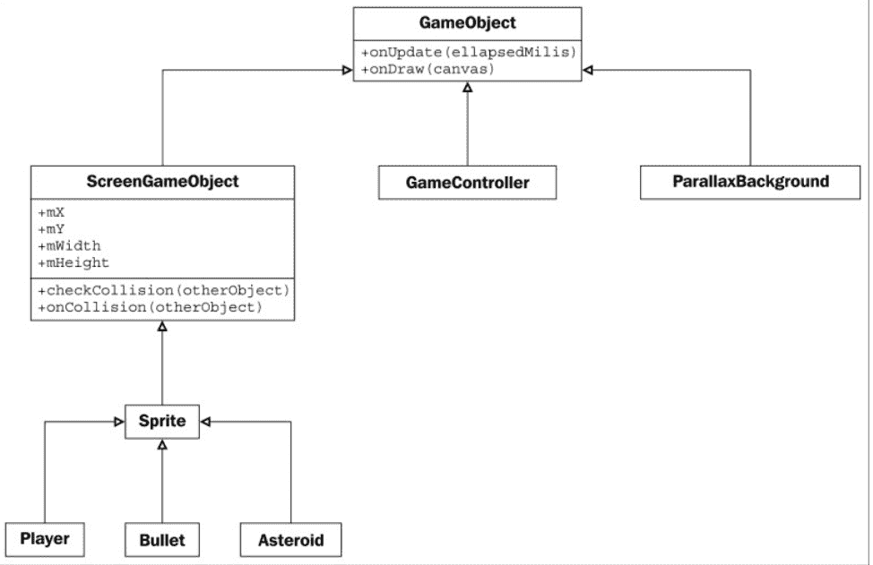
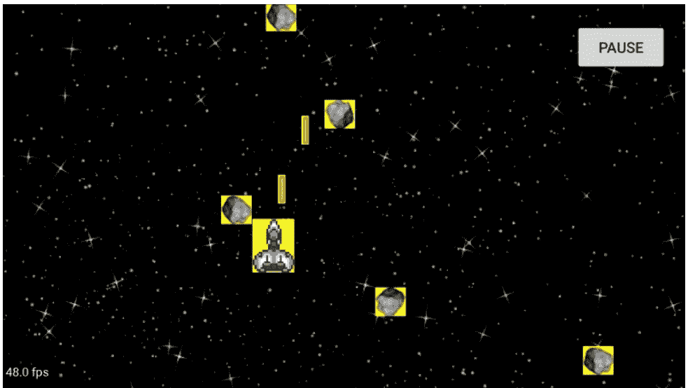
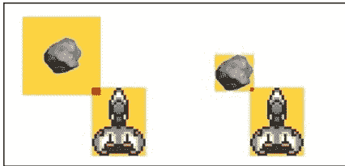
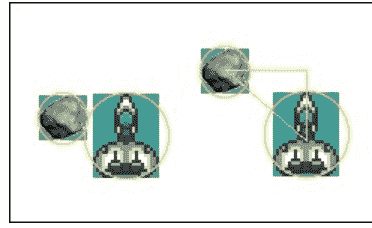
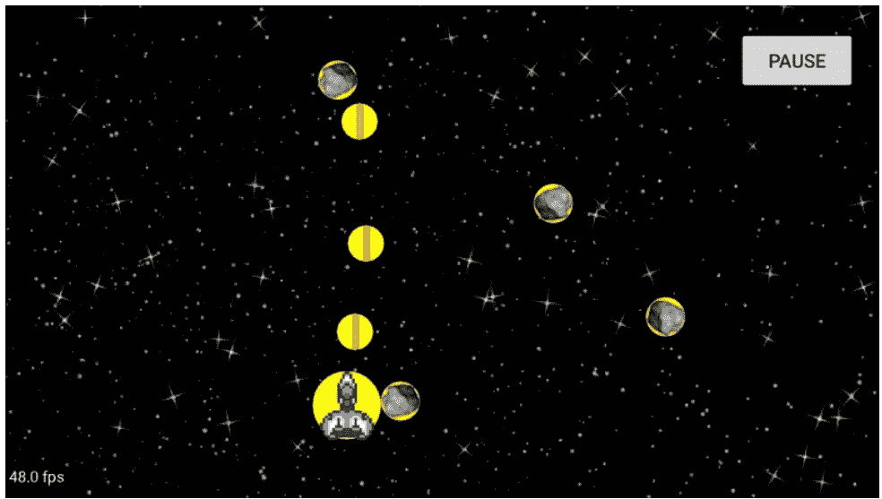
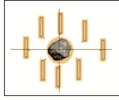
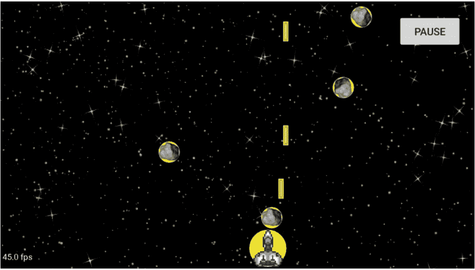
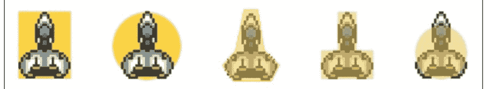
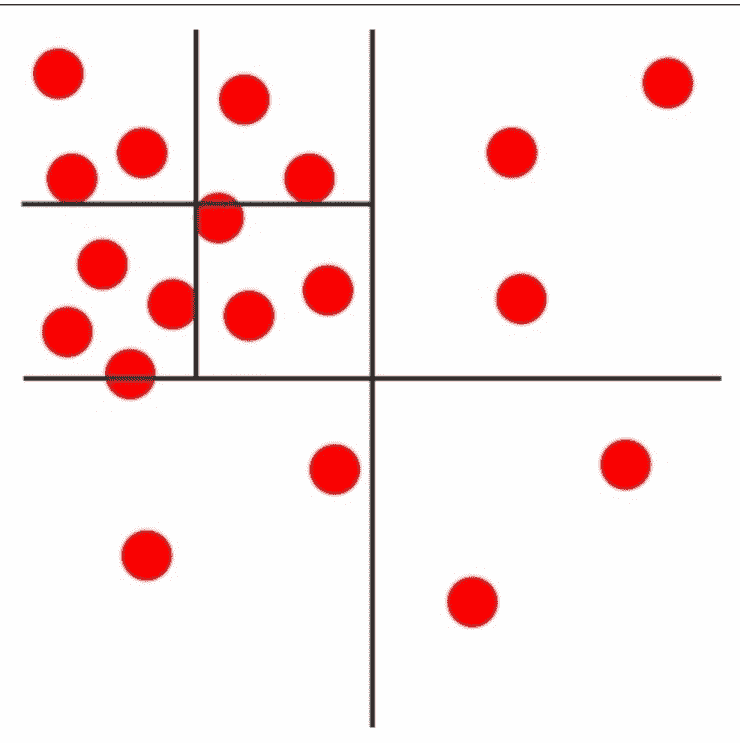
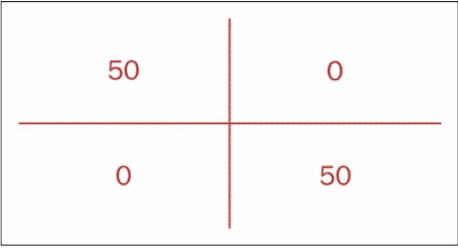

## 第 4 章 碰撞检测

在大多数游戏中，我们需要检测对象何时相互相交以触发动作；这称为碰撞检测。我们将使用它来检测子弹何时击中小行星（以销毁它）以及玩家何时被小行星击中（以结束游戏）。这种检测可以是离散的或连续的，并且可以涉及不同类型的形状。我们将使用矩形和圆形形状的离散检测。

如第 1 章 Setting Up the Project 中所述，我们不会进行任何物理模拟。那是一个完全独立的主题，足够长，足以单独成书。

我们还将讨论优化技术，并实现一种称为空间分区的方法，它根据对象密度将区域分割成更小的区域。

顺便提一下，本章中的所有概念都可以轻松推广到 3D 碰撞中。

### 检测碰撞

检测碰撞主要有两种方法：

- 离散，或 a posteriori
- 连续，或 a priori

对于离散方法，我们先推进游戏项目的状态，然后检查它们是否有相互相交。它是离散模拟，因为我们只在每个步骤结束时进行评估。它被称为 a posteriori，因为它是在对象移动后进行的。它是反应式的。大多数时候我们缺乏精确的接触点；我们只知道在模拟步骤结束时对象正在碰撞。

另一方面，连续方法基于每个对象的参数，在应用移动之前预测碰撞。它在执行移动之前计算。这就是为什么它被称为 a priori。这种方法提供精确的接触点，当我们需要精度时非常有用——例如，用于物理模拟。

离散方法通常比连续方法少一个维度。这使得它更容易理解和实现。它用速度换取精度。

### 注意

离散碰撞检测速度更快但精度较低。

由于我们不会使用物理引擎，而且我们并不真正关心精确的接触点，我们将使用离散方法。

### 谁可以发生碰撞？

要能够计算 GameObject 碰撞，我们需要将形状（或体）关联到 GameObject。这种关联需要屏幕上对象的一些信息，例如 x 轴和 y 轴上的位置，以及宽度和高度。

我们将创建一个名为 screenGameObject 的类，它继承自 GameObject 并将包含这些信息。在我们的游戏中，Sprite 是唯一将继承自 screenGameObject 的类，但如果您想要在屏幕上放置非视觉项目并在玩家穿过它们时触发某些事情（这是游戏中的常见技术），这可能会很有用。



*GameObject 类层次结构*

要与其他对象碰撞，您需要屏幕上的位置和大小。ScreenGameObject 将提供这些。

所有碰撞计算逻辑都将放在 ScreenGameObject 类中。该类的桩代码如下：

```
public abstract class ScreenGameObject extends GameObject {

    protected double mX;
    protected double mY;

    protected int mHeight;
    protected int mWidth;

    public Rect mBoundingRect = new Rect(-1, -1, -1, -1);

    public boolean checkCollision(ScreenGameObject otherObject) {
        return false;
    }

    public void onCollision(GameEngine gameEngine, ScreenGameObject sgo) {
    }
}
```

我们借此机会将 width、height、x 和 y 变量重构为更短、更通用的名称。我们将在整个章节中继续使用这个类。

方法 checkCollision 是事情发生的地方。该方法将根据我们用来计算碰撞的形状而有不同的实现。

最后，onCollision 用于在发生碰撞时触发动作。

### 更新 GameEngine

为了运行离散碰撞检测，我们将在 GameEngine 上的 onUpdate 执行期间使用名为 checkCollisions 的方法，因此每次更新游戏对象时都会运行它。我们将在游戏对象更新之后、删除对象的代码之前放置此方法调用。碰撞是对象被删除的典型原因。

由于只有 ScreenGameObject 可以发生碰撞，我们将创建一个包含它们的特殊列表。

```
private List<ScreenGameObject> mCollisionableObjects;
```

并且我们将在对象添加到 GameEngine 或从其中移除时保持其更新，就像我们在上一章中为单独的图层所做的那样。

检查碰撞并通知涉及的游戏对象的代码如下。

```
private void checkCollisions() {
    int numObjects = mCollisionableObjects.size();
    for (int i = 0; i < numObjects; i++) {
        ScreenGameObject objectA = mCollisionableObjects.get(i);
        for (int j = i + 1; j < numObjects; j++) {
            ScreenGameObject objectB = mCollisionableObjects.get(j);
            if (objectA.checkCollision(objectB)) {
                objectA.onCollision(gameEngine, objectB);
                objectB.onCollision(gameEngine, objectA);
            }
        }
    }
}
```

代码就像一个嵌套的 for 循环，将每个 ScreenGameObject 与所有其他对象进行检查。如果检测到碰撞，我们将对涉及的两个屏幕游戏对象执行 onCollision 方法，并将它们碰撞的对象作为参数传递。

请记住，此方法的复杂度是二次的，而 onUpdate 中涉及的所有其他方法的复杂度都是线性的。运行碰撞检测是昂贵的。

### 注意

检查碰撞具有二次复杂度 O(n²)。

### 处理碰撞

无论我们使用哪种方法来计算碰撞，对于玩家和子弹我们要采取的操作是相同的。让我们为它们重写 onCollision 方法。

对于子弹，我们需要检查它碰撞的对象是否是小行星，如果是，我们将两个对象都从 GameEngine 中移除。

```
public void onCollision(GameEngine gameEngine, ScreenGameObject otherObject) {
if (otherObject instanceof Asteroid) {
// Remove both from the game (and return them to their pools)
removeObject(gameEngine);
Asteroid a = (Asteroid) otherObject;
a.removeObject(gameEngine);
}
}
```

请注意，我们正在调用对象本身上的 removeObject 方法。该方法负责从 GameEngine 中移除 GameObject，并将其返回到对象池。

玩家的代码几乎与子弹的代码相同：在发生小行星碰撞时，我们只需移除两个碰撞对象。

值得注意的是，由于我们生成子弹的方式，当子弹添加到场景时它们确实会与 Player 对象碰撞，因为我们希望它们看起来像是从飞船出现。我们必须丢弃该碰撞。始终检查对象正在与什么碰撞是一种良好的做法。

如果我们想制作一个拥有多条命的游戏，我们应该在该点向 GameEngine 发出信号以停止生成波次，移除一条命，生成一个新的 Player 对象，然后继续游戏。

让我们看看碰撞是如何实际计算的。


## 矩形物体

我们将要实现检测的第一种方式是通过矩形的相交，这也是最简单的方法。

我们将使用ScreenGameObject的边界矩形，并检查它是否与另一个ScreenGameObject的边界矩形相交。

每次更新精灵位置时，边界矩形都会发生变化，而且由于我们可能需要与许多其他对象进行检查，因此最好在onUpdate之后重新计算它。我们将添加一个名为onPostUpdate的新方法，并在其中执行该操作。

我们需要向ScreenGameObject添加一个新方法。

```
public void onPostUpdate(GameEngine gameEngine) {
    mBoundingRect.set(
        (int) mX,
        (int) mY,
        (int) mX + mWidth,
        (int) mY + mHeight);
}
```

如果需要在其他对象中重写onPostUpdate，请记住始终调用超类方法，否则碰撞将表现异常。

然后，在检查碰撞时，我们对矩形碰撞进行检查：

```
@Override
public boolean checkCollision(ScreenGameObject otherObject) {
    return checkRectangularCollision(otherObject);
}
```

最后，虽然计算矩形相交是一项非常简单的操作，但由于Rect类已经为我们提供了一个实用方法来完成此操作，我们将使用它。

```
private boolean checkRectangularCollision(ScreenGameObject other) {
    return Rect.intersects(mBoundingRect, other.mBoundingRect);
}
```

### 添加视觉反馈

在处理碰撞时，真正有帮助的一件事是获得关于正在发生情况的视觉反馈。为此，我们将以黄色绘制边界矩形作为精灵的背景：

```
@Override
public void onDraw(Canvas canvas) {
    if (mX > canvas.getWidth() || mY > canvas.getHeight()
        || mX < -mWidth || mY < -mHeight) {
        return;
    }
    mPaint.setColor(Color.YELLOW);
    canvas.drawRect(mBoundingRect, mPaint);
    mMatrix.reset();
    [...]
    canvas.drawBitmap(mBitmap, mMatrix, null);
}
```



是时候试用我们新鲜出炉的碰撞检测方法，看看它的表现了。剧透：效果不太好。

### 优点和缺点

这种碰撞检测有一些优点：

- 易于实现
- 评估速度快

但它也有一些重要缺点：

- 如果精灵有填充，碰撞区域会太大且不现实。
- 当Sprite旋转时，我们不会旋转矩形。
- 碰撞非常严格。系统会在只有透明像素的位置检测到碰撞。这在角落接触时尤其糟糕。

我们可以通过裁剪精灵或在ScreenGameObject上添加设置边距的可能性来解决第一个问题。

第二个问题可以用一些简单的数学来解决，但这会使代码复杂化，并且结果不如圆形碰撞体更好。这超出了本书的范围，留给读者作为练习。



矩形物体不要求图像有填充，但仍可能产生误报

不幸的是，最后一个问题是这种方法固有的，除非我们使用边界多边形或矩形组合，否则无法解决。

## 圆形物体

我们可以用来检测碰撞的下一种物体类型是圆。为此，我们将圆的直径视为精灵尺寸中最大的那个。我们需要向ScreenGameObject添加一个名为mRadius的成员变量，并将此代码添加到精灵的构造函数中：

```
mRadius = Math.max(mHeight, mWidth)/2;
```

请注意，继承自ScreenGameObject的其他元素可能希望以不同的方式初始化半径。

圆形碰撞的计算相当简单：我们只需测量两个圆心之间的距离，并检查它是否小于半径之和。



*使用圆形物体时，碰撞可能发生在精灵矩形之外*

由于计算平方根比乘法耗时得多，我们将使用根据勾股定理定义的距离平方：*距离*<sup>2</sup> = \(\Delta x^2 + \Delta y^2\)。

检查圆形碰撞的代码如下：

```
private boolean checkCircularCollision(ScreenGameObject other) {
    double distanceX = (mX + mWidth / 2) - (other.mX + other.mWidth / 2);
    double distanceY = (mY + mHeight / 2) - (other.mY + other.mHeight / 2);
    double squareDistance = distanceX * distanceX +
        distanceY * distanceY;
    double collisionDistance = (mRadius + other.mRadius);
    return squareDistance <= collisionDistance * collisionDistance;
}
```

我们计算每个轴上的距离，然后得到平方距离作为平方和。碰撞距离是半径之和，然后我们将其与碰撞距离的平方进行比较。

### 添加视觉反馈

与矩形碰撞检测一样，我们将为精灵添加一些视觉反馈，以便在游戏过程中显示碰撞区域。在这种情况下，我们只需要绘制一个圆：

```
canvas.drawCircle(
    (int) (mX + mWidth / 2),
    (int) (mY + mHeight / 2),
    (int) mRadius,
    mPaint);
```

就这么简单，我们就可以在游戏中看到精灵的碰撞区域了。



圆形物体非常适合小行星，但对子弹来说很糟糕

### 优点和缺点

这种方法也不完美，但它有一些优点：

- 对大多数精灵来说，它比矩形效果更好
- 易于实现
- 不涉及复杂计算

但它也存在一些问题——最显著的是，当图像主要是矩形时，碰撞区域太大。在子弹的情况下我们可以清楚地看到这一点。

因此，有些精灵使用矩形效果更好，而其他精灵使用圆形效果更好。我们可以为每个ScreenGameObject设置不同的物体类型，并相应地计算碰撞。

## 混合碰撞检测

我们已经看到，单一形状不适用于所有情况，因此我们将更新游戏，以允许我们定义每个ScreenGameObject用于碰撞的物体形状。为此，我们将创建一个物体类型的枚举，并在ScreenGameObject中有一个变量来存储该信息。

枚举BodyType如下：

```
public enum BodyType {
None,
Circular,
Rectangular
}
```

对于精灵，我们将向构造函数添加一个指定物体类型的参数。请注意，我们有一个名为None的特殊类型。这用于不与其他对象碰撞的精灵。虽然我们的游戏中目前没有这类精灵，但其他类型的游戏可以有它们——例如，地牢爬行游戏中的地板砖块。

### 注意

我们可能希望有一些不触发碰撞的精灵。这是通过BodyType.None来完成的。

我们将对小行星和玩家使用圆形物体，对子弹使用矩形物体。

由于我们有一个可碰撞物体列表，如果ScreenGameObject的BodyType为None，我们不会将其添加到列表中；因此，我们不需要检查其碰撞。这段代码放在GameEngine的addToLayerNow方法内。

```
if (object instanceof ScreenGameObject) {
ScreenGameObject sgo = (ScreenGameObject) object;
if (sgo.mBodyType != BodyType.None) {
mCollisionableObjects.add(sgo);
}
}
```

然后，我们需要更新ScreenGameObject的checkCollision方法，以检查两个对象的物体类型，以及应该应用哪种方法：

```
@Override
public boolean checkCollision(ScreenGameObject otherObject) {
    if (mBodyType == BodyType.Circular
        && otherObject.mBodyType == BodyType.Circular) {
        return checkCircularCollision(otherObject);
    }
    else if (mBodyType == BodyType.Rectangular
        && otherObject.mBodyType == BodyType.Rectangular) {
        return checkRectangularCollision(otherObject);
    }
    else {
        return checkMixedCollision(otherObject);
    }
}
```

请注意，在执行到这一点时，我们知道该对象是ScreenGameObject，并且它的BodyType不是None。

如果两个涉及对象都有矩形物体，我们使用矩形碰撞检测方法。如果两者都有圆形物体，我们使用圆形碰撞检测方法。在任何其他情况下，一个是圆形，另一个是矩形，因此我们为此情况添加了一个新方法：checkMixedCollision。

要计算矩形和圆是否碰撞，我们需要检查矩形中离圆最近的点是否在圆内（到圆心的距离小于半径）。

如果我们将问题隔离到每个坐标上，就可以轻松计算出矩形中离圆最近的点。



圆和矩形的可能相对位置及其最近点


我们将讨论垂直轴（由于垂直轴上的标记更高，因此更容易区分）。水平轴遵循等效逻辑：

- 我们绘制一条穿过圆心的水平线。
- 如果该线与矩形相交，则交点即为最近点。由于我们只考虑垂直轴，该值即为圆心的 y 坐标。
- 如果矩形在线条下方，则圆形最近点的 y 坐标为矩形的顶部位置（即 y 坐标）。
- 如果矩形在线条上方，则圆形最近点的 y 坐标为矩形的底部位置（y + height）。

请记住，在计算机图形学中，[0,0] 点位于屏幕左上角，且 y 轴正方向向下。

算法现在已清晰，让我们来看看代码：

```
private boolean checkMixedCollision(ScreenGameObject other) {
ScreenGameObject circularSprite;
ScreenGameObject rectangularSprite;
if (mBodyType == BodyType.Rectangular) {
circularSprite = this;
rectangularSprite = other;
}
else {
circularSprite = other;
rectangularSprite = this;
}

double circleCenterX = circularSprite.mX + circularSprite.mWidth / 2;
double positionXToCheck = circleCenterX;
if (circleCenterX < rectangularSprite.mX) {
positionXToCheck = rectangularSprite.mX;
}
else if (circleCenterX > rectangularSprite.mX +
rectangularSprite.mWidth) {
positionXToCheck = rectangularSprite.mX +
rectangularSprite.mWidth;
}
double distanceX = circleCenterX - positionXToCheck;

double circleCenterY = circularSprite.mY + circularSprite.mHeight / 2;
double positionYToCheck = circleCenterY;
if (circleCenterY < rectangularSprite.mY) {
    positionYToCheck = rectangularSprite.mY;
}
else if (circleCenterY > rectangularSprite.mY +
    rectangularSprite.mHeight) {
    positionYToCheck = rectangularSprite.mY +
    rectangularSprite.mHeight;
}
double distanceY = circleCenterY - positionYToCheck;

double squareDistance = distanceX*distanceX +
    distanceY*distanceY;
if (squareDistance <=
    circularSprite.mRadius*circularSprite.mRadius) {
    // They are overlapping
    return true;
}
return false;
}
```

首先，我们确定哪个对象具有圆形主体，哪个对象具有矩形主体，并将它们设置为局部变量。

然后，我们按照已经描述过的逻辑计算最近点的 x 和 y 坐标。这种组合给出了九种可能的相对位置，如图所示。

最后，我们计算该点到圆心的平方距离，并检查它是否小于半径的平方。

## 添加视觉反馈

添加视觉反馈同样非常简单。我们只需根据精灵的主体类型，运行绘制矩形的代码或绘制圆形的代码即可。

```
mPaint.setColor(Color.YELLOW);
if (mBodyType == BodyType.Circular) {
    canvas.drawCircle(
            (int) (mX + mWidth / 2),
            (int) (mY + mHeight / 2),
            (int) mRadius,
            mPaint);
}
else if (mBodyType == BodyType.Rectangular) {
    canvas.drawRect(mBoundingRect, mPaint);
}
```



## 其他形状选项

至此，我们已介绍完使用简单形状进行碰撞检测的基本选项。为了获得良好的游戏手感，你需要特别关注每个精灵的形状，看看哪种形状最适合它，可能需要进行诸如减小半径之类的修改。为此，我建议你保持视觉反馈开启，以检查近似效果。

还可以使用多边形作为形状，或使用多个矩形。这些是改进碰撞检测的相当简便的方法，实现起来也不太困难。我们留给读者深入探究这一主题，因为它需要精细调整。

对于飞船来说，最佳形状是 2 个矩形的组合，但由于我们对圆形主体感到满意，因此将保持原样。



飞船的不同形状选项

## 优化

碰撞检测是一个具有二次复杂度的算法。如果待检查对象的数量增长，它可能会迅速成为瓶颈。

一种选择是记录对象之间比较的先前状态，然后如果两个对象自上次检查以来都未更改，则返回旧值；或者使用旧状态作为计算新状态的参数。这对 3D 游戏特别有用，因为 3D 游戏的碰撞检测需要更复杂的算法。

还有一种称为空间分区的优化，它利用对象之间的接近性。这种技术基于这样一个想法：对象只能与屏幕上靠近它们的其他元素发生碰撞。很明显，对吧？

要实现空间分区，我们将使用一种称为 QuadTree 的数据结构。

## 空间分区和 QuadTree

quadTree 类似于二叉树，区别在于每个非叶节点有四个子节点，而不是两个。

这旨在表示将空间划分为四个扇区，每个扇区由一个子节点表示。每个子节点可以再拥有四个节点，或者只是一个叶节点。这种设计使得在需要时可以递归地应用分区。



*高密度区域的递归分区示例。*

只有当空间中对象数量过大时，我们才需要对其进行分区。这意味着对象密度高的某些区域可能会被分区多次，而其他区域则不会。

将此概念应用于 3D 游戏时，该数据结构称为 OctTree，因为在三维空间中，空间被分为八个部分。

填充 QuadTree 的算法非常简单：

- 我们检查空间中有多少个对象，如果数量不算太大（为此我们使用常量 MAX_OBJECTS_TO_CHECK），则将像以前一样运行碰撞检测，逐个检查每个对象与其他每个对象
- 否则，将空间划分为四个象限或区域
- 对于每个象限，检查哪些对象在内部（一个对象可能位于多个象限中）
- 对于每个象限，递归应用此相同的算法

每个 QuadTree 都有一个表示其区域的 Rect 成员和一个待检查对象列表。

在 GameEngine 内部，我们将用 QuadTree 的根节点替换用于碰撞检测的对象列表。随着对象添加到或从 GameEngine 中移除，我们将向该节点添加或移除对象，并将碰撞检测委托给 QuadTree。

在 GameEngine 的构造函数中，我们将设置根节点的区域：

```
mQuadTreeRoot.setArea(new Rect(0, 0, mWidth, mHeight));
```

GameEngine 上检查碰撞的代码将简化为一行：

```
private void checkCollisions() {
    mQuadTreeRoot.checkCollisions(this);
}
```

然后，在 QuadTree 内部，检查碰撞的代码如下：

```
public void checkCollisions(GameEngine gameEngine) {
    int numObjects = mGameObjects.size();
    if (numObjects > MAX_OBJECTS_TO_CHECK && sQuadTreePool.size() >= 4) {
        splitAndCheck(gameEngine);
    } else {
        for (int i = 0; i < numObjects; i++) {
            ScreenGameObject objectA = mGameObjects.get(i);
            for (int j = i + 1; j < numObjects; j++) {
                ScreenGameObject objectB = mGameObjects.get(j);
                if (objectA.checkCollision(objectB)) {
                    objectA.onCollision(gameEngine, objectB);
                    objectB.onCollision(gameEngine, objectA);
                }
            }
        }
    }
}
```

有两种可能性。如果对象太多且池中有超过四个 QuadTree 对象，我们将拆分空间并在子节点上检查碰撞。如果不是这种情况，我们就像以前一样运行碰撞检测方法，遍历列表中的所有对象。

方法 splitAndCheck 如下所示：

```
private void splitAndCheck(GameEngine gameEngine) {
for (int i=0 ; i<4; i++) {
mChildren[i] = sQuadTreePool.remove(0);
}
for (int i=0 ; i<4; i++) {
mChildren[i].setArea(getArea(i));
mChildren[i].checkObjects(mGameObjects);
mChildren[i].checkCollisions(gameEngine);
// Clear and return to the pool
mChildren[i].mGameObjects.clear();
sQuadTreePool.add(mChildren[i]);
}
}
```

我们从池中获取四个 QuadTree 对象，并将它们分配给子节点数组的元素。考虑到算法的递归性质，在开始时执行此操作非常重要。

对于每个子节点，我们定义其区域，这意味着将当前区域划分为四个相等的矩形，检查哪些对象在区域内，然后检查碰撞，即再次调用递归函数。完成后，我们清除子节点并将其返回到池中。


最后要说明的是——getArea 只是复用一个 Rect 对象，将其设置为四个象限的值。

```java
private Rect getArea(int area) {
    int startX = mArea.left;
    int startY = mArea.top;
    int width = mArea.width();
    int height = mArea.height();
    switch (area) {
    case 0:
        mTmpRect.set(startX, startY,
                startX + width / 2, startY + height / 2);
        break;
    case 1:
        mTmpRect.set(startX + width / 2, startY,
                startX + width, startY + height / 2);
        break;
    case 2:
        mTmpRect.set(startX, startY + height / 2,
                startX + width / 2, startY + height);
        break;
    case 3:
        mTmpRect.set(startX + width / 2, startY + height / 2,
                startX + width, startY + height);
        break;
    }
    return mTmpRect;
}
```

为了了解四叉树的优化程度，让我们假设屏幕上有 100 个对象，并且它们仅分布在两个象限中。这是该算法提供最佳优化的情况之一。



如果不使用四叉树技术，需要评估的碰撞数量为 50,000。对列表进行两次迭代会产生 n²/2 次碰撞检查。

当我们将空间分为四个部分时，第一和第四象限中检查的碰撞数量为 1,250（50²/2），其他象限中为零。我们需要额外增加 400 次操作，用于确定每个对象所在的区域（四个象限中有 100 个对象）。

对我们来说，检查对象所在的象限与检查碰撞的复杂度相近，但对于 3D 碰撞，碰撞检查的代价要高得多。

### 重复碰撞

使用空间分区时，有一个特殊情况需要注意：某些碰撞可能会被检测到两次。

当两个位于两个象限交点上的对象之间发生碰撞时，这两个对象都同时在这两个象限中；当算法检查碰撞时，它会在每个象限中被检测到。最坏的情况下，当对象位于四个象限的交点上时，它会被检测到四次。

为解决此问题，我们将保存已检测到的碰撞列表，并且仅在碰撞未被之前检测到时才处理它。

Collision 类非常简单。它只包含两个 ScreenGameObject 实例、一个 equals 方法，以及几个用于处理其对象池的静态方法：

```java
public class Collision {
    private static List<Collision> sCollisionPool = new ArrayList<Collision>();

    public static Collision init(ScreenGameObject objectA,
    ScreenGameObject objectB) {
        if (sCollisionPool.isEmpty()) {
            return new Collision(objectA, objectB);
        }
        Collision c = sCollisionPool.remove(0);
        c.mObjectA = objectA;
        c.mObjectB = objectB;
        return c;
    }

    public static void release(Collision c) {
        c.mObjectA = null;
        c.mObjectB = null;
        sCollisionPool.add(c);
    }

    public ScreenGameObject mObjectA;
    public ScreenGameObject mObjectB;

    public Collision(ScreenGameObject objectA, ScreenGameObject
    objectB) {
        mObjectA = objectA;
        mObjectB = objectB;
    }

    public boolean equals (Collision c) {
        return (mObjectA == c.mObjectA && mObjectB == c.mObjectB)
            || (mObjectA == c.mObjectB && mObjectB == c.mObjectA);
    }
}
```

我们将已检测碰撞的列表作为参数添加到 checkCollisions 方法中，并在 GameEngine 上再次检查之前确保将其清理。GameEngine 上更新后的 checkCollisions 如下：

```java
private List<Collision> mDetectedCollisions = new ArrayList<Collision>();
```

```java
private void checkCollisions() {
    // Release the collisions from the previous step
    while (!mDetectedCollisions.isEmpty()) {
        Collision.release(mDetectedCollisions.remove(0));
    }
    mQuadTreeRoot.checkCollisions(this, mDetectedCollisions);
}
```

请注意，由于我们使用了对象池，不能简单地清空列表；需要逐个释放每个元素。

最后，我们通过在四叉树中检查来验证该碰撞之前未被检测到。

```java
public void checkCollisions(GameEngine gameEngine, List<Collision>
detectedCollisions) {
    int numObjects = mGameObjects.size();
    if (numObjects > MAX_OBJECTS_TO_CHECK && sQuadTreePool.size() >=
4) {
        // Split this area in 4
        splitAndCheck(gameEngine, detectedCollisions);
    }
    else {
        for (int i = 0; i < numObjects; i++) {
            ScreenGameObject objectA = mGameObjects.get(i);
            for (int j = i + 1; j < numObjects; j++) {
                ScreenGameObject objectB = mGameObjects.get(j);
                if (objectA.checkCollision(objectB)) {
                    Collision c = Collision.init(objectA,
objectB);
                    if (!hasBeenDetected(detectedCollisions, c)) {
                        detectedCollisions.add(c);
                        objectA.onCollision(gameEngine, objectB);
                        objectB.onCollision(gameEngine, objectA);
                    }
                }
            }
        }
    }
}
```

请注意，整个过程中都需要碰撞列表，并且它必须作为计算状态的一部分传递给递归方法。

## 总结

现在我们的游戏真的可以玩了，可以检测子弹何时接触小行星并将其销毁；此外，我们必须小心，因为我们的飞船也可能被它们摧毁。

我们学习了如何使用矩形和圆形物体进行简单的碰撞检测，为每个特定精灵调整物体。

我们还学习了一些碰撞检测优化技术，并实现了一种利用空间分区的技术。

我们路线图中的下一步是为游戏增加一些“多汁感”（juiciness）。你难道没有注意到小行星缺少一些爆炸效果吗？在下一章中，我们将讨论如何为特效创建粒子系统。
