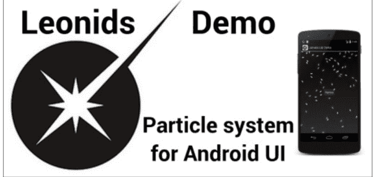
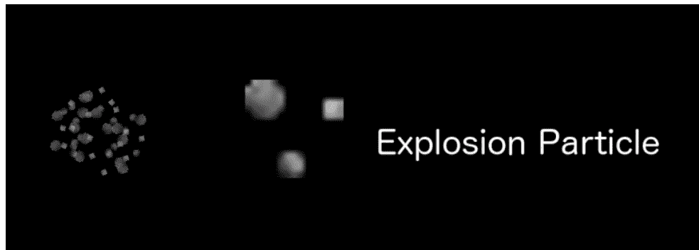
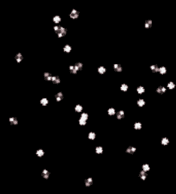
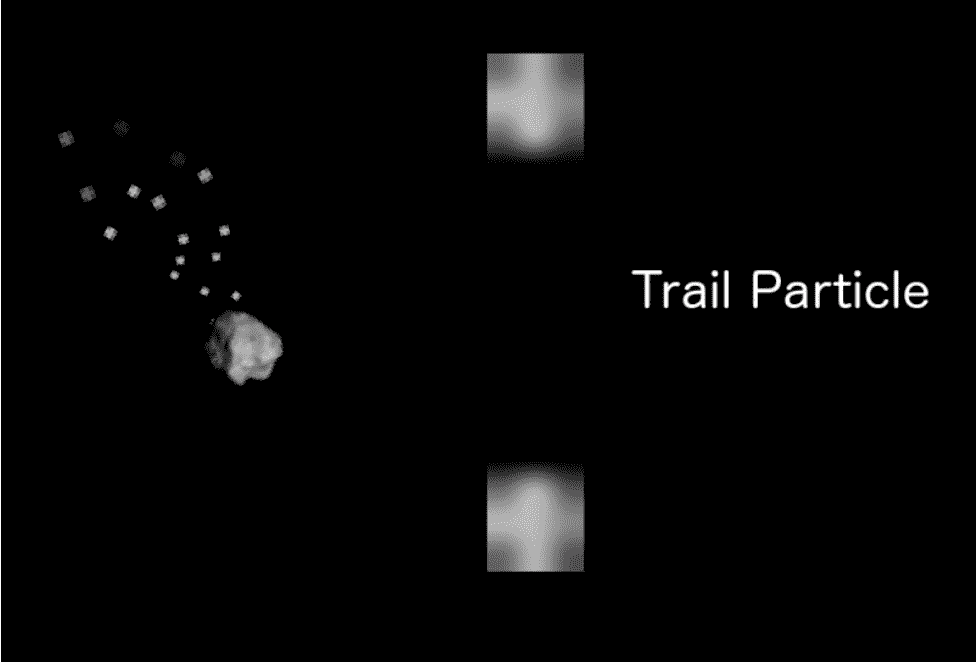
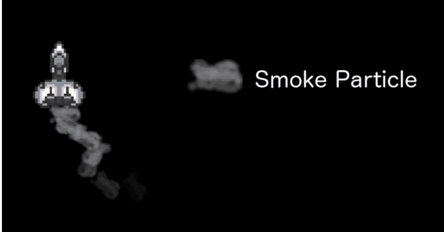

## 第 5 章 粒子系统

粒子系统是视频游戏中广泛使用的一种技术，用于模拟用其他方法难以渲染的现象。其典型用途包括爆炸、烟花、烟雾、火焰、水等。它们通常是高度混乱的系统。

它们的基础是使用大量称为粒子的小型精灵。它们的行为是参数化的，因此每个粒子都有一组不同的伪随机值。这使得粒子系统的每次使用都不同，但看起来仍然相似。

大多数游戏引擎都包含实现粒子系统的方法。我们的引擎也将包含粒子系统。

我们的代码将基于免费软件项目 Leonids，这是一个用于在标准 Android 界面中显示粒子系统的库。我们将对其进行调整，以供我们的引擎使用。

在解释粒子系统的基础知识后，我们将实现几个一次性粒子系统示例来模拟爆炸，以及一些连续发射器来模拟小行星的拖尾和飞船引擎的烟雾。

### 一般概念

我们将以一种模仿 Leonids 粒子系统库（http://plattysoft.github.io/Leonids/）的方式来制作我们的粒子系统。这个项目是我为在标准 Android 界面中使用粒子系统而制作的免费软件库。



Leonids 库的演示版可在 Google Play 上获取。

因此，Leonids 实现了自己的更新和绘制线程，以及一个简化的 GameView。我们已经拥有所有这些，因此将调整代码以满足我们的需求。

本章将使用的概念如下：

- **粒子**：被渲染的每个精灵
- **粒子系统**：负责生成、更新和跟踪粒子的实体
- **初始化器**：根据某些参数为粒子设置值的类（在激活之前）
- **修改器**：根据经过时间更新粒子值的类（在激活期间）

在我们的游戏中，我们将只使用少量几个初始化器和修改器。如果需要扩展粒子系统的功能，可以访问 Leonids 的 GitHub 页面以获取灵感。


让我们深入探讨相关概念。

## 粒子

粒子是 Sprite 的子类。每个粒子都是一张带有多个特性的小图像：

- 粒子没有碰撞体
- 其运动基于线速度和角速度
- 它们有有限的生存时间

虽然在理论上，你可以拥有一个粒子可以碰撞的粒子系统——这在模拟瀑布等效果时很有用——但事实是，除非你同时拥有物理系统，否则这将无法正常工作。为了简单起见，我们将把粒子的 BodyType 定义为 None。

粒子确实具有线速度和角速度，其 onUpdate 方法基于这些变量。每个粒子的这些值都由粒子系统初始化。

粒子通常会修改 sprite 的几个属性，即 alpha 和 scale。我们目前还没有在 sprite 上使用它们，因此将修改 Sprite 的 onDraw 方法：

```
float scaleFactor = (float) (mPixelFactor*mScale);
mMatrix.reset();
mMatrix.postScale(scaleFactor, scaleFactor);
mMatrix.postTranslate((float) mX, (float) mY);
mMatrix.postRotate((float) mRotation,
	(float) (mX + mWidth*mScale / 2),
	(float) (mY + mHeight*mScale / 2));
mPaint.setAlpha(mAlpha);
canvas.drawBitmap(mBitmap, mMatrix, mPaint);
```

实际上，我们一直将 scale 作为变换矩阵的一部分，根据像素因子来缩放 sprite。现在，我们还将其乘以感知缩放，就完成了。

请注意，我们还需要将宽度和高度乘以 scale，以将旋转中心放在缩放后的 sprite 中心。

另外，请注意，我们在一开始就进行缩放。如果在平移之后进行缩放，运动也会被缩放，这不是我们想要的。再说一次，变换的顺序会影响结果。

虽然 scale 是变换矩阵的一部分，但 alpha 是 Paint 的一个参数。其值范围从 0（透明）到 255（不透明）。重要的是要记住将其初始化为 255，否则所有 sprite 都会是透明的。

### 注意

Alpha 值范围从 0（透明）到 255（不透明）。

关于生存时间，我们只需在 onUpdate 期间检查粒子处于活动状态的总时间，在其过期时将其从 GameEngine 移除并返回到粒子系统。

Particle 是扩展 Sprite 的一个类，带有一个激活它的方法。它根据线速度和角速度的值运行其更新：

```java
public class Particle extends Sprite {
    private long mTimeToLive;
    private long mTotalMillis;

    public double mSpeedX;
    public double mSpeedY;

    public double mRotationSpeed;

    protected Particle(
        ParticleSystem particleSystem,
        GameEngine gameEngine,
        int drawableRes) {
        super(gameEngine, drawableRes, BodyType.None);
        mParent = particleSystem;
    }

    @Override
    public void removeFromGameEngine(GameEngine gameEngine) {
        super.removeFromGameEngine(gameEngine);
        mParent.returnToPool(this);
    }

    public void activate(
        GameEngine gameEngine,
        long timeToLive,
        double v,
        double x,
        double y,
        ArrayList<ParticleModifier> modifiers,
        int layer) {
        mTimeToLive = timeToLive;
        mX = x-mWidth/2;
        mY = y-mHeight/2;
        addToGameEngine(gameEngine, layer);
        mModifiers = modifiers;
        mTotalMillis = 0;
    }

    @Override
    public void onUpdate(long elapsedMillis, GameEngine gameEngine) {
        mTotalMillis += elapsedMillis;
        if (mTotalMillis > mTimeToLive) {
            removeFromGameEngine(gameEngine);
        }
        else {
            mX += mSpeedX*elapsedMillis;
            mY += mSpeedY*elapsedMillis;
            mRotation += mRotationSpeed*elapsedMillis/1000d;
            for (int i=0; i<mModifiers.size(); i++) {
                mModifiers.get(i).apply(this, mTotalMillis);
            }
        }
    }
}
```

在构造函数中，我们传递一个指向父 ParticleSystem 的引用，当粒子从游戏引擎移除时将使用它将粒子返回。我们还将 BodyType.None 传递给基类构造函数，因此粒子不参与碰撞检测。

当我们激活粒子时，会执行多个操作：

- 设置生存时间
- 初始化 x 和 y 轴上的位置，并根据图像的宽度和高度进行调整
- 将其添加到 GameEngine 的特定层
- 存储 onUpdate 期间使用的修饰符列表的引用
- 将总毫秒数设置为 0，以指示该粒子刚刚被激活

值得注意的是，我们保留了对修饰符列表的引用。该列表在系统中的所有粒子之间共享，并由 ParticleSystem 类管理。

在 onUpdate 期间，我们将经过的毫秒数添加到总时间，并检查 Particle 是否已超过其生存时间。如果是这种情况，我们将其从 GameEngine 移除。否则，我们根据速度（线速度和角速度）更新位置和旋转，然后应用所有修饰符。

你可能已经意识到，我们正在使用线速度和角速度值，但到目前为止，我们尚未设置它们。这是通过 ParticleSystem 的初始化程序完成的。这就是为什么这些变量是公共的。

让我们看看处理粒子的系统。

## 粒子系统

ParticleSystem 本身控制粒子的发射。在某些方面，它与 GameController 类相似。ParticleSystem 负责粒子的初始化、激活和生成。

ParticleSystem 的职责之一是管理 Particle 对象池。鉴于粒子系统有大量过期并被重用的粒子，这是使用对象池最重要的情况之一。

### 注意

ParticleSystem 拥有一个 Particle 对象池。

对象池在 ParticleSystem 的构造函数中填充：

```
public ParticleSystem(
        GameEngine gameEngine,
        int maxParticles,
        int drawableResId,
        long timeToLive) {
    mRandom = new Random();

    mModifiers = new ArrayList<ParticleModifier>();
    mInitializers = new ArrayList<ParticleInitializer>();

    mTimeToLive = timeToLive;
    mPixelFactor = gameEngine.mPixelFactor;
    for (int i=0; i<maxParticles; i++) {
        mParticlePool.add(new Particle(this, gameEngine,
                drawableResId));
    }
}
```

构造函数接收将同时使用的最大粒子数。这将是我们用于对象池大小的值。

关于我们的粒子系统，另一个重要点是所有粒子都有相同的图像。在构造时将此图像传递给 ParticleSystem。如果你想要不同的图像，应该为每个图像使用一个 ParticleSystem，就像我们在示例中将要做的那样。

### 注意

ParticleSystem 中的所有粒子都有相同的图像。

在构造函数中，我们还创建了 ParticleInitializer 和 ParticleModifiers 列表。初始化程序将在激活每个粒子时使用。修饰符列表将传递给每个粒子，并在 Particle 的 onUpdate 方法内部使用，正如我们已经看到的那样。

以下是在粒子激活期间使用初始化程序的方式：

```
private void activateParticle(GameEngine gameEngine) {
    Particle p = mParticlePool.remove(0);
    for (int i=0; i<mInitializers.size(); i++) {
        mInitializers.get(i).initParticle(p, mRandom);
    }
    p.activate(gameEngine, mTimeToLive, mX, mY, mModifiers, mLayer);
    mActivatedParticles++;
}
```

ParticleSystem 中的一个重要设计概念是，它通过实用方法抽象初始化程序和修饰符，并且每个实用方法都返回 ParticleSystem 对象，因此初始化可以链式调用，使代码更简洁、更易读。

让我们详细了解 ParticleInitializers 和 ParticleModifiers。

### 初始化程序

初始化程序由 ParticleSystem 使用，根据参数为粒子设置值。为此，我们将 ParticleInitializer 定义为一个非常简单的接口：

```
public interface ParticleInitializer {
 void initParticle(Particle p, Random r);
}
```

作为示例，我们将查看 ParticleSystem 的实用方法，用于设置粒子的初始旋转：

```
public ParticleSystem setInitialRotationRange (int minAngle, int maxAngle) {
 mInitializers.add(new RotationInitializer(minAngle, maxAngle));
 return this;
}
```

当我们为 Particle 设置初始旋转范围时，我们会将 RotationInitializer 类型的初始化程序添加到 ParticleSystem。然后返回 this，以便方法可以链式调用。

我们可以用来配置粒子初始化的其他方法有：

- setRotationSpeedRange(double minRotationSpeed, double maxRotationSpeed)
- setSpeedRange(double speedMin, double speedMax)
- setSpeedModuleAndAngleRange(double speedMin, double speedMax, int minAngle, int maxAngle)
- setRotationSpeedRange(double minRotationSpeed, double maxRotationSpeed)

我们不打算包括我们将使用的所有初始化程序的代码，因为它们都遵循相同的模式：

- 接收一组参数并定义范围
- 从范围中生成随机值
- 将值设置为 Particle 的相应变量（这可能涉及多个字段）


## 注意

初始化器从一个范围获取随机值，并将其设置为 Particle 的变量。

作为 ParticleInitializer 实现的示例，让我们来看看 RotationInitializer 的代码：

```java
public class RotationInitializer implements ParticleInitializer {

private int mMinAngle;
private int mMaxAngle;

public RotationInitializer(int minAngle, int maxAngle) {
mMinAngle = minAngle;
mMaxAngle = maxAngle;
}

@Override
public void initParticle(Particle p, Random r) {
int value = r.nextInt(mMaxAngle-mMinAngle)+mMinAngle;
p.mRotation = value;
}
}
```

简单直接；初始化器将角度的最小值和最大值存储在成员变量（mMinAngle, mMaxAngle）中。当它初始化粒子时，会在范围内生成一个随机值，并将其设置为粒子的旋转变量。

所有初始化器的工作方式相同；有些比其他的稍微复杂一些。例如，SpeedModuleAndRangeInitializer 使用三角函数将速度从角度和模值转换为坐标：

```java
public class SpeedModuleAndRangeInitializer implements
ParticleInitializer {

private double mSpeedMin;
private double mSpeedMax;
private int mMinAngle;
private int mMaxAngle;

public SpeedModuleAndRangeInitializer(
double speedMin, double speedMax,
int minAngle, int maxAngle) {
mSpeedMin = speedMin;
mSpeedMax = speedMax;
mMinAngle = minAngle;
mMaxAngle = maxAngle;
}

@Override
public void initParticle(Particle p, Random r) {
double speed = r.nextDouble()*(mSpeedMax-mSpeedMin) +
mSpeedMin;
int angle;
if (mMaxAngle == mMinAngle) {
angle = mMinAngle;
}
else {
angle = r.nextInt(mMaxAngle - mMinAngle) + mMinAngle;
}
double angleInRads = angle*Math.PI/180d;
p.mSpeedX = speed * Math.cos(angleInRads)/1000d;
p.mSpeedY = speed * Math.sin(angleInRads)/1000d;
}
```

在这种情况下，我们有两个范围，一个用于速度模值，另一个用于角度。当我们初始化粒子时，会从各自的范围中获取每个值，但随后需要使用 sin 和 cos 将它们转换为可用于 Particle 的值，即 mSpeedX 和 mSpeedY。

在这种情况下，我们正在初始化 Particle 的两个变量。请再次注意，Particle 类的这些字段是公共的，因此我们可以从这个类轻松修改它们。

## 修改器

修改器是一种与初始化器相似的概念，但它们在粒子活动时应用。

与初始化器一样，我们定义了一个接口，允许它们与 Particle 类进行交互：

```java
public interface ParticleModifier {
    void apply(Particle particle, long milliseconds);
}
```

对于我们来说，修改器对所有粒子都有相同的参数，而初始化器会为每个粒子生成一个值。这就是为什么线速度和角速度不由修改器处理，而是每个粒子的变量，它们可以——并且很可能会——为每个粒子拥有不同的值。

ParticleModifier 实例也通过 ParticleSystem 的实用方法进行管理，例如设置淡出的方法：

```java
public ParticleSystem setFadeOut(long millisecondsBeforeEnd) {
    mModifiers.add(
        new AlphaModifier(255, 0, mTimeToLive-millisecondsBeforeEnd,
            mTimeToLive));
    return this;
}
```

此方法创建一个 AlphaModifier 来设置淡出效果（从 Alpha 值 255 到 0），基于粒子在系统中的生存时间。

通常，我们可以创建自己的 ParticleModifier 实例，并通过调用 addModifier 将它们添加到 ParticleSystem 中：

```java
public ParticleSystem addModifier(ParticleModifier modifier) {
    mModifiers.add(modifier);
    return this;
}
```

我们将只使用两个修改器：用于淡出的 AlphaModifier 和 ScaleModifier。

让我们来看看 AlphaModifier 的代码：

```java
public class AlphaModifier implements ParticleModifier {
    private int mInitialValue;
    private int mFinalValue;
    private long mStartTime;
    private long mEndTime;
    private float mDuration;
    private float mValueIncrement;

    public AlphaModifier(int initialValue, int finalValue, long
    startMilis, long endMilis) {
        mInitialValue = initialValue;
        mFinalValue = finalValue;
        mStartTime = startMilis;
        mEndTime = endMilis;
        mDuration = mEndTime - mStartTime;
        mValueIncrement = mFinalValue-mInitialValue;
    }

    @Override
    public void apply(Particle particle, long milliseconds) {
        if (milliseconds < mStartTime) {
            particle.mAlpha = mInitialValue;
        }
        else if (milliseconds > mEndTime) {
            particle.mAlpha = mFinalValue;
        }
        else {
            double percentageValue = (milliseconds-
            mStartTime)*1d/mDuration;
            int newAlphaValue = (int) (mInitialValue +
            mValueIncrement*percentageValue);
            particle.mAlpha = newAlphaValue;
        }
    }
}
```

请注意，我们有一个初始值和一个最终值；如果时间小于起始时间，我们将 Alpha 设置为初始值；当时间大于结束时间时，将其设置为最终值。

这使我们可以使用同一个类实现淡入和淡出两种效果。

对于修改器，重要的是要强调 apply 方法接收的是花费的总毫秒数。之所以需要这样做，是因为修改器对 Particle 一无所知。它没有任何状态，因此所有信息都必须作为参数传递给 apply 方法。

## 注意

修改器对所有粒子都相同，并且不会保存任何状态。

修改器有开始时间和结束时间。当时间在区间之外时，我们将其设置为初始值或最终值。当时间在这些边界之间时，它将返回初始值和最终值之间增量的线性插值。

修改这段代码以使用其他类型的插值器非常简单。如果你对此感兴趣，可以查看 GitHub 上 Leonids 的代码，它支持插值器。

ScaleModifier 与此几乎相同，区别在于该值设置为 mScale 而不是 mAlpha。

## 复合游戏对象和游戏引擎

到目前为止，我们使用的游戏对象是单个实体。从现在开始，我们还将拥有包含其他游戏对象的游戏对象。特别是，每个对象使用的粒子系统将由它们拥有。

这意味着向游戏引擎添加和移除游戏对象的方式必须更新。对象将拥有两个方法，用于将自身添加到游戏引擎中并从中移除，当我们使用复合对象来处理它们时，可以覆盖此方法。

我们的更改是停止使用游戏引擎的 addGameObject 和 removeGameObject 方法，而是开始在游戏对象上使用新的等效方法，如 addToGameEngine 和 removeFromGameEngine。

这意味着我们应该检查项目的代码并替换所有出现的情况。这在 GameController（生成小行星的地方）以及 GameFragment 内部初始化游戏引擎时（当我们添加 Player 对象时）尤为重要：

```java
mGameEngine = new GameEngine(getActivity(), gameView, 4);
mGameEngine.setInputController(
    new CompositeInputController(getView(), getYassActivity()));
new ParallaxBackground(mGameEngine, 20,
    R.drawable.seamless_space_0)
    .addToGameEngine(mGameEngine, 0);
new GameController(mGameEngine).addToGameEngine(mGameEngine, 2);
new Player(mGameEngine).addToGameEngine(mGameEngine, 3);
new FPSCounter(mGameEngine).addToGameEngine(mGameEngine, 2);
```

尽管在非复合对象上使用旧方法会产生相同的结果，但最好以相同的方式将所有游戏对象添加到游戏引擎中，以保持代码一致性。

对于非复合游戏对象，addToGameEngine 和 removeFromGameEngine 的默认实现实际上非常简单：

```java
public void addToGameEngine (GameEngine gameEngine, int layer) {
    gameEngine.addGameObject(this, layer);
}
```

```java
public void removeFromGameEngine (GameEngine gameEngine) {


public void removeFromGameEngine (GameEngine gameEngine) {
   gameEngine.removeGameObject(this);
}

当我们在复合项上覆盖这些方法时，必须记住调用父类方法来添加和删除对象。

## 制作良好的粒子系统

顺便说一句，粒子系统非常强大，但对它们进行微调和设计并非易事。

粒子系统的实现细节很简单，如我们所见。但要制作一个看起来真实且良好的粒子系统则是完全不同的事情。

微调它们的关键在于反复调整参数并查看效果，一次又一次，直到我们对结果满意为止。

为了揭示微调粒子系统这门晦涩艺术的一些奥秘，我们将举几个例子。你可以自己尝试粒子和参数，看看微小的变化能带来多大的不同。

使用粒子系统有两种方式：一次性发射和连续发射器。让我们分别举几个例子。

## 一次性发射

使用一次性发射时，我们让 ParticleSystem 一次性发射所有粒子。

在这种情况下，我们不需要将 ParticleSystem 添加到或从 GameEngine 中移除，因为 ParticleSystem 的 onUpdate 方法不需要被调用（它仅用于发射新粒子）。

使用一次性发射时，用与我们计划发射的粒子数量相同的粒子数来初始化粒子池是合理的。

ParticleSystem 类的 oneShot 方法如下：

```
public void oneShot(GameEngine gameEngine, double x, double y,
    int numParticles) {
    mX = x;
    mY = y;
    mIsEmitting = false;
    for (int i=0; !mParticlePool.isEmpty() && i<numParticles; i++) {
        activateParticle(gameEngine);
    }
}
```

我们设置发射的 x 和 y 坐标，然后将 isEmitting 设置为 false。虽然只有在将 ParticleSystem 添加到 GameEngine 时才需要更新 isEmitting，但我们还是这样做以保险起见。在这种情况下，将 isEmitting 设置为 false 会使 onUpdate 什么也不做。

参数设置完成后，我们从池中获取粒子并激活它们。请记住，我们在解释 ParticleSystem 类时已经了解过 activate 方法。作为激活的一部分，粒子会被添加到 GameEngine 中。

我们将使用这种粒子系统来制作小行星和玩家的爆炸效果。

## 小行星爆炸

对于小行星爆炸，我们将使用带有三个小岩石碎片的粒子，这样看起来就像小行星破碎成多个碎片。为了增强这种效果，我们将让粒子向任何方向旋转和移动，但不会飞太远。

我们将 ParticleSystem 的创建和配置作为 Asteroid 创建的一部分。这样可以确保每个小行星都有自己独立的粒子池：

```
public Asteroid(GameController gameController, GameEngine gameEngine) {
 super(gameEngine, R.drawable.a10000, BodyType.Circular);
 mSpeed = 200d*mPixelFactor/1000d;
 mController = gameController;
 mExplosionParticleSystem = new ParticleSystem(gameEngine,
 EXPLOSION_PARTICLES, R.drawable.particle_asteroid_1, 700)
 .setSpeedRange(15, 40)
 .setFadeOut(300)
 .setInitialRotationRange(0, 360)
 .setRotationSpeedRange(-180, 180);
}
```

```
public void explode(GameEngine gameEngine) {
 mExplosionParticleSystem.oneShot(gameEngine, mX + mWidth / 2, mY + mHeight / 2, EXPLOSION_PARTICLES);
}
```

粒子系统的配置如下：

- 粒子将存活 700 毫秒。
- 它们会向各个方向生成，速度在每秒 15 到 40 个单位之间变化。
- 在最后 300 毫秒，它们会有一个 alpha 修改器以平滑淡出。
- 粒子将具有任意的初始旋转。请注意，粒子不是对称的；这一点非常重要，可以防止粒子看起来是静止的。
- 最后，每个粒子的角旋转速度将在每秒 -180 到 180 度之间。
- EXPLOSION_PARTICLES 是小行星的一个常量。我们将其设置为 15。

explode 方法会从小行星中心触发 oneShot，使所有粒子运动起来。

最后的连接点是触发 explode 方法。这发生在子弹与小行星碰撞或玩家与小行星碰撞时。Bullet 类中的实现如下：

```
@Override
public void onCollision(GameEngine gameEngine, ScreenGameObject otherObject) {
    if (otherObject instanceof Asteroid) {
        removeFromGameEngine(gameEngine);
        Asteroid a = (Asteroid) otherObject;
        a.explode(gameEngine);
        a.removeFromGameEngine(gameEngine);
    }
}
```

就这么简单。是不是很简单？由于 ParticleSystem 使用的是 oneShot，因此不需要将其添加到或从 GameEngine 中移除。



爆炸粒子和粒子系统细节。

## 飞船爆炸

对于玩家爆炸，我们将采用不同的方法。我们希望它看起来更具戏剧性。速度值将比小行星更大，以给人一种更具侵略性且范围更广的爆炸印象。我们还将使用两种不同颜色的粒子，而不是一种带有多个碎片的粒子。

由于每个 ParticleSystem 都设计为只持有一种类型的粒子（一张图像），我们将在 Player 类中拥有两个 ParticleSystem 实例，并在构造函数中初始化：

```
mExplosionParticleSystem1 = new ParticleSystem(gameEngine,
EXPLOSION_PARTICLES, R.drawable.particle_ship_explosion_1, 600)
    .setSpeedRange(30, 150)
    .setInitialRotationRange(0, 360)
    .setFadeOut(200);
mExplosionParticleSystem2 = new ParticleSystem(gameEngine,
EXPLOSION_PARTICLES, R.drawable.particle_ship_explosion_2, 600)
    .setSpeedRange(30, 150)
    .setInitialRotationRange(0, 360)
    .setFadeOut(200);
```

在这种情况下，每个粒子都很小且对称，因此不需要旋转速度。由于它们比之前快得多，存活时间也短一些，淡出也更快速。

在这种情况下，EXPLOSION_PARTICLES 设置为 20，因此总共有 40 个粒子。

当 Player 对象爆炸时（作为 onCollision 的一部分），我们会在两个 ParticleSystem 实例上触发 oneShot：

```
mExplosionParticleSystem1.oneShot(gameEngine, mX + mWidth / 2,
mY + mWidth / 2, EXPLOSION_PARTICLES);
mExplosionParticleSystem2.oneShot(gameEngine, mX+mWidth/2,
mY+mWidth/2, EXPLOSION_PARTICLES);
```

如你所见，如果现在运行，爆炸的感觉与小行星的爆炸完全不同：

- 粒子 1
- 粒子 2



## 发射器

使用粒子系统的另一种方式是将它们配置为发射器。这意味着你的系统在活跃时每秒会发射一定数量的粒子。

计算合适的池大小非常简单。这只是一个基于粒子存活时间和你希望每秒发射粒子数量的公式。例如，使用每秒 20 个粒子和 500 毫秒的存活时间，你只需要一个 10 个粒子的池，因为粒子死亡后会被返回到池中。

重要的是要记住，作为发射器工作的 ParticleSystem 需要添加到或从 GameEngine 中移除，因为需要 onUpdate 方法来检查更多粒子的生成。ParticleSystem 的 onUpdate 方法如下：

```
@Override
public void onUpdate(long elapsedMillis, GameEngine gameEngine) {
    if (!mIsEmitting){
        return;
    }

    mTotalMillis += elapsedMillis;
    // We have to make sure that we have to keep emitting
    while ( !mParticlePool.isEmpty() && // We have particles in the
pool
        mActivatedParticles < mParticlesPerMillisecond*mTotalMillis) {
    // and we are under the number of particles that should be
launched
        // Activate a new particle
        activateParticle(gameEngine);
    }
}
```

代码非常简单。首先我们检查系统是否正在发射。如果系统不在发射，则不需要更新任何内容，因此可以直接返回。

如果系统正在发射，我们会检查是否需要激活一个粒子。为此，我们将已激活的粒子数量与应该已激活的粒子数量（particlesPerMillisecond*totalMilliseconds）进行比较。我们还需要确保我们


可以从池中获取一个粒子（池非空）。

一旦我们知道需要生成一个粒子并且有可用粒子，我们就进入激活阶段。activateParticle 方法的最后一行会增加已激活粒子的计数器。

需要注意的是，已激活粒子的数量是发射器已激活的粒子总数，而不是当前活跃粒子的数量。

ParticleSystem 的 emit 方法如下：

```
public void emit (int particlesPerSecond) {
	mActivatedParticles = 0;
	mTotalMillis = 0;
	mParticlesPerMillisecond = particlesPerSecond/1000d;
	mIsEmitting = true;
}
```

很简单；它重置已激活粒子数量和时间计数器。它还计算每毫秒的粒子速率（参数以每秒粒子数传递），然后将 mIsEmitting 设置为 true，这样 onUpdate 方法就可以工作了。

最后，要停止发射，只需将 mIsEmitting 设置为 false：

```
public void stopEmitting() {
	mIsEmitting = false;
}
```

让我们看一些发射器的示例。

## 小行星拖尾

如果小行星身后留下拖尾，看起来会酷很多。在 Asteroid 类的构造函数中，我们会在与爆炸 ParticleSystem 相同的位置创建一个用于拖尾的 ParticleSystem：

```
mTrailParticleSystem = new ParticleSystem(gameEngine, 50,
R.drawable.particle_dust, 600)
.addModifier(new ScaleModifier(1, 2, 200, 600))
.setFadeOut(200);
```

对于这个拖尾，我们使用由两个小块组成的粒子。为了更好的拖尾效果，我们添加了一个 ScaleModifier，并与淡出效果一起使用。

我们希望初始化取决于小行星的值。为此，我们将在调用小行星的 init 时设置所有初始化器：

```
public void init(GameEngine gameEngine) {
[...] // 标准初始化
mTrailParticleSystem.clearInitializers()
.setInitialRotationRange(0, 360)
.setRotationSpeed(mRotationSpeed * 1000);
.setSpeedByComponentsRange(
-mSpeedY * 100, mSpeedY * 100,
mSpeedX * 100, mSpeedX * 100);
}
```

首先，我们清除所有初始化器，然后设置其具有任意旋转。旋转速度将与小行星的旋转速度相同。然后，线速度将与小行星的组件成正比并互换。这将使拖尾垂直于小行星移动。

需要在每次运行小行星上的 onUpdate 时更新 ParticleSystem 的发射点，以便从正确位置继续发射：

```
mTrailParticleSystem.setPosition(mX + mWidth / 2, mY + mHeight / 2);
```

由于它是一个发射器，它需要与 Asteroid 一起添加到和从 GameEngine 中移除。为此，我们已经定义了 addToGameEngine 和 removeFromGameEngine 方法。我们现在将覆盖它们：

```
@Override
public void addToGameEngine (GameEngine gameEngine, int layer) {
	super.addToGameEngine(gameEngine, layer);
	mTrailParticleSystem.addToGameEngine(gameEngine, mLayer-1);
	mTrailParticleSystem.emit(15);
}
```

```
@Override
public void removeFromGameEngine(GameEngine gameEngine) {
	super.removeFromGameEngine(gameEngine);
	mTrailParticleSystem.stopEmitting();
	mTrailParticleSystem.removeFromGameEngine(gameEngine);
}
```

需要注意的是，我们将其添加到比小行星低一层的 GameEngine 中，这样粒子系统总是位于小行星后面，而不是反过来。

有了这些，我们已经准备好所有部件，现在可以看到我们的小行星看起来多么漂亮了：



## 飞船引擎

为了最后一个效果，我们将给飞船添加一些烟雾。由于它是一个发射器，它需要通过将其与玩家对象一起添加到和从 GameEngine 中移除来遵守 GameObject 生命周期，就像我们为小行星拖尾所做的那样：

```
@Override
public void removeFromGameEngine(GameEngine gameEngine) {
    super.removeFromGameEngine(gameEngine);
    mEngineFireParticle.removeFromGameEngine(gameEngine);
}
```

```
@Override
public void addToGameEngine(GameEngine gameEngine, int layer) {
    super.addToGameEngine(gameEngine, layer);
    mEngineFireParticle.addToGameEngine(gameEngine, mLayer - 1);
    mEngineFireParticle.emit(12);
}
```

在 onUpdate 方法中，我们需要将玩家位置与 ParticleSystem 的发射器同步，就像我们对小行星所做的那样：

```
mEngineFireParticle.setPosition(mX+mWidth/2, mY+mHeight);
```

需要注意的是，我们将发射器设置在飞船底部而不是中心。这使得烟雾出现在正确的位置。

最后，我们将在 Player 对象的构造函数中创建 ParticleSystem，位置与我们已经为爆炸创建的另外两个相同：

```
mEngineFireParticle = new ParticleSystem(gameEngine, 50,
R.drawable.particle_smoke, 600)
.setInitialRotationRange(0, 360)
.setRotationSpeedRange(-30, 30)
.setSpeedModuleAndAngleRange(50, 80, 60, 120)
.setFadeOut(400);
```

到现在为止，这些配置方法我们都非常熟悉了。

我们拥有完整的初始旋转范围 [0-360] 和从 -30 到 30 度/秒的旋转速度。我们还为其他系统设置了更长的淡出时间，以便平滑溶解。

我们还使用 setSpeedModuleAndAngleRange，它以角度和模块的形式设置速度。我们希望烟雾以 [60-120] 度的范围（即指向飞船底部的 60 度弧度）从飞船喷出，并且速度变化不大。

现在你可以运行它并看看效果：



观察静态图片时，你可以看到每个粒子，但当它们运动时，感觉非常好。

可选地，如果在 onUpdate 期间有用户输入，你可以启动这个粒子系统，否则停止它，这样会给出更动态的外观和感觉，因为烟雾只会在飞船移动时出现。

## 总结

我们已经了解粒子系统的工作原理以及如何将其集成到我们的游戏中。我们将 `ParticleSystem` 和粒子本身包含在我们的 `GameEngine` 中。我们还了解了初始化器和修改器，以及如何创建新的初始化器和修改器以扩展系统（如果需要）。

然后我们了解了如何组合一个包含其他 `GameObject` 实例的 `GameObject`。特别是，粒子系统通常属于另一个 `GameObject`。为此，`ParticleSystem` 挂钩到 `GameObject` 的生命周期。我们更新了 `GameEngine` 以使添加组合的 `GameObjects` 更加容易。

最后，我们研究了两个一次性示例和两个发射器示例，涵盖了各种不同的参数。

总的来说，这四个 `ParticleSystem` 实例让游戏感觉更加生动。在接下来的章节中，我们将专注于 Android 提供的用于使 UI 更漂亮、更吸引人的工具，从而总体上改善游戏的外观和感觉。
