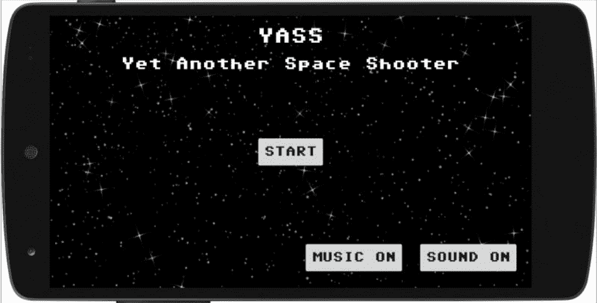
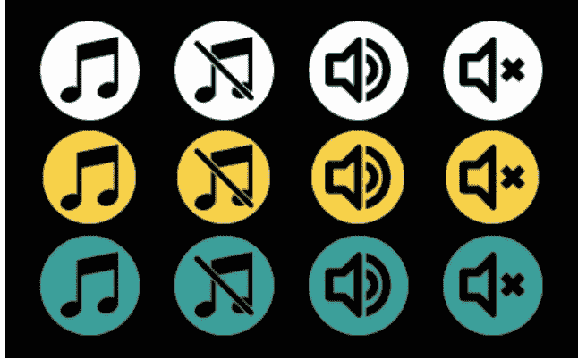
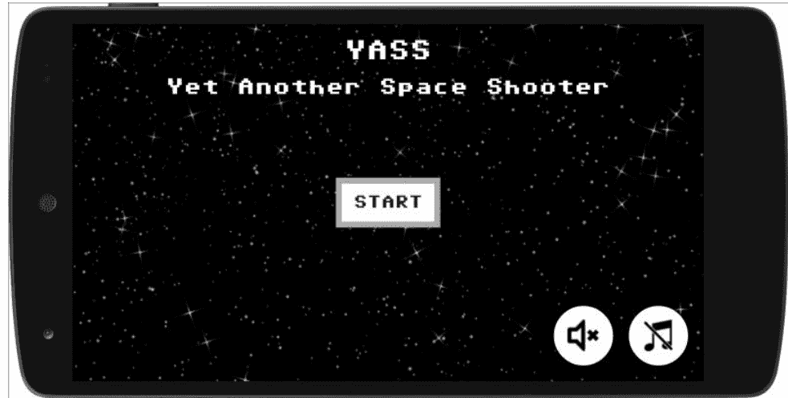
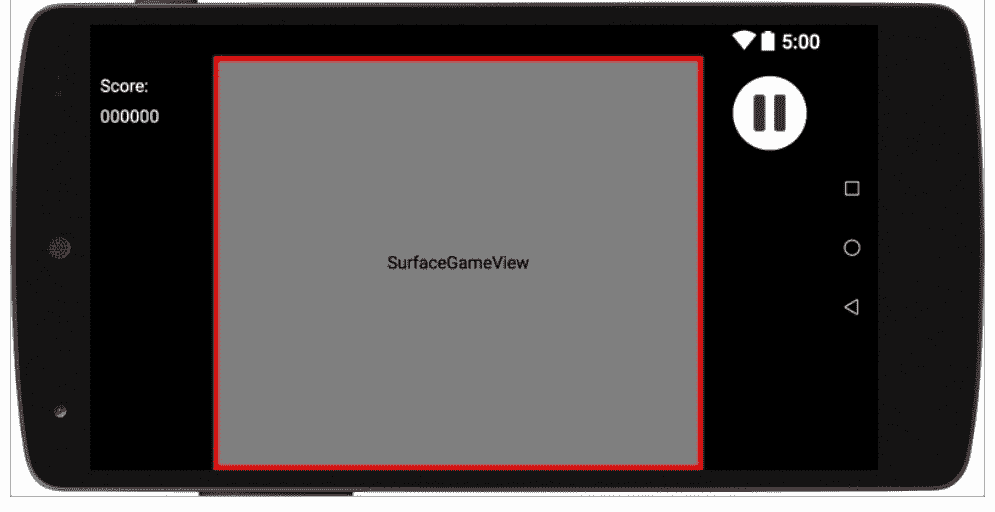
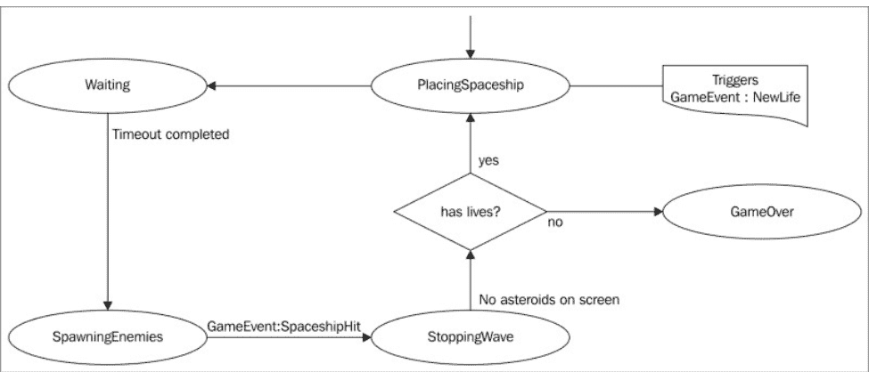
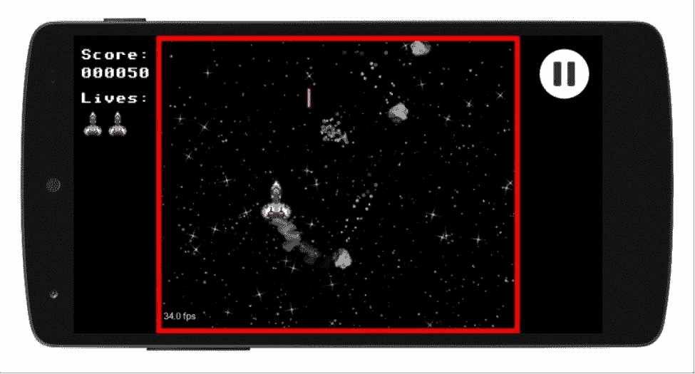
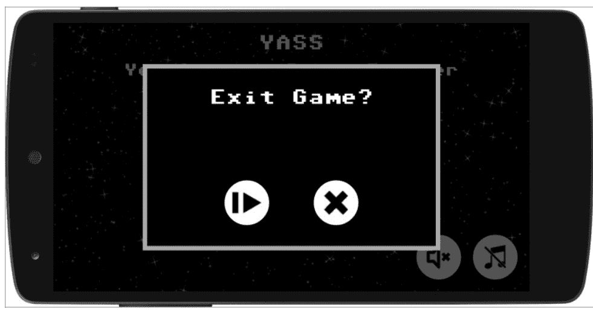
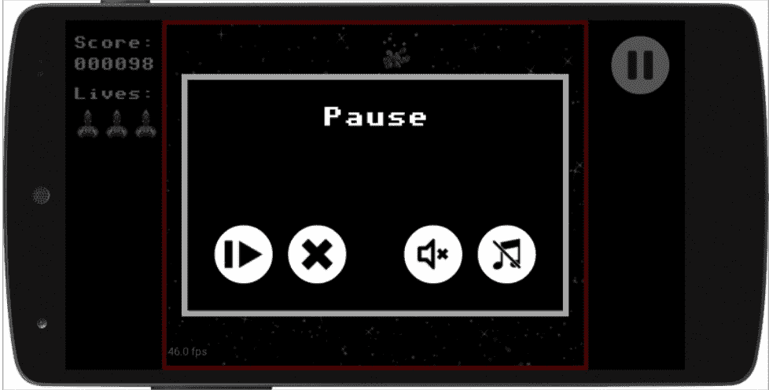
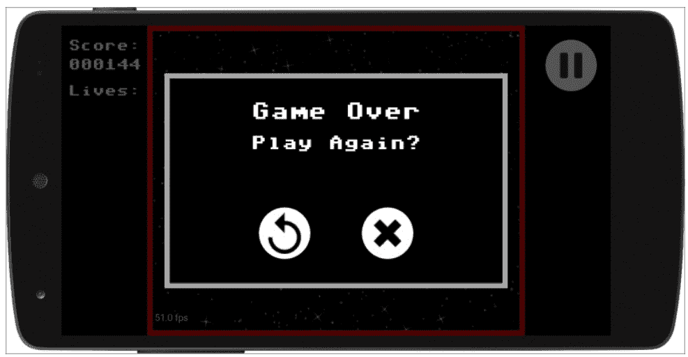
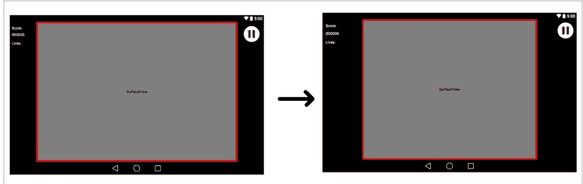

## 第 6 章。菜单和对话框

既然游戏已经可以运行，是时候调整其余的 UI 了。开发应用时，最佳实践是使用所有标准 UI 组件。游戏不同，它们应该有个性。为此，我们将了解如何使用自定义字体、按钮和对话框。

我们将先让游戏的所有片段都使用自定义字体。然后我们将调整主菜单，通过添加背景和自定义声音与音乐按钮，使其看起来更漂亮；我们还将使用在 XML 中可定义的特殊可绘制类型来自定义启动游戏的按钮。

对于 GameFragment，我们将腾出空间显示得分和生命，并更新暂停按钮。我们将让游戏负责得分和玩家死亡。为此，我们还将了解如何使用 GameEvents，不仅用于播放声音，还用于扩展功能和添加一些事件。

我们还将通过使用状态机，让 GameController 对游戏局势承担更多责任。这种技术可以应用于新关卡等其他情况。

最后，由于 Android 对话框框架相当有限，我们将了解如何为退出游戏、暂停和游戏结束创建自定义对话框。


## 自定义字体

对于应用开发者，Google 一直强制使用系统默认字体，特别是自 Roboto 推出以来。这就是为什么系统中没有其他字体的原因。但是，TextView 可以使用 True Type (.ttf) 或 Open Type (.otf) 格式的自定义字体。

在选择字体时，你有很多选择。有一些网站列出了许多可免费使用的字体。因为 YASS 旨在成为一款复古风格射击游戏，我选择了一款名为 Adore64 的像素艺术风格字体。

我们将把字体文件存放在 assets 下的一个名为 ttf 的文件夹中，与处理声音的方式相同。

为了以 TextView 可使用的格式加载字体，我们使用 Typeface 类。加载字体的过程代价高昂，因此我们只执行一次（在 onCreate 内部），并将 Typeface 变量作为 Activity 的成员保留。

### 注意

加载 Typeface 的代价高昂；我们应该将其保留在内存中（Activity 级别）。

我们需要添加到 YassActivity 中以加载字体的代码非常简单：

```java
private Typeface mCustomTypeface;

@Override
protected void onCreate(Bundle savedInstanceState) {
    super.onCreate(savedInstanceState);
    [...]
    mCustomTypeface = Typeface.createFromAsset(getAssets(),
            "ttf/Adore64.ttf");
}
```

加载字体后，我们只需将其应用于层次结构中的所有文本视图。这可以通过递归轻松完成：

```java
public void applyTypeface(View view) {
    if (view instanceof ViewGroup) {
        // Apply recursively to all the children
        ViewGroup viewGroup = (ViewGroup) view;
        for (int i = 0; i < viewGroup.getChildCount(); i++) {
            applyTypeface(viewGroup.getChildAt(i));
        }
    } else if (view instanceof TextView) {
        TextView tv = (TextView) view;
        tv.setTypeface(mCustomTypeface);
    }
}
```

该方法接收一个 View。如果它是 ViewGroup 的实例，则意味着它有（或可能有）更多视图作为子项，因此我们使用同一方法递归地遍历所有子项。

如果该视图是 TextView 的实例，我们只需调用仅存在于 TextView 上的 setTypeface 方法，然后继续即可。

对于任何其他类型的视图，我们不执行任何操作。

### 注意

使用递归算法将字体应用到所有视图非常容易实现。

请注意，instanceof 检查对象是否符合给定的类。这意味着，从该类继承的类的对象将返回 true。这对于该算法正常工作至关重要，因为所有 Layout 类都是 ViewGroup 的子类，而所有持有文本（即 Button）的视图都继承自 TextView。

缺失的环节是，在哪里调用此方法以及使用什么参数？我们将使用 YassBaseFragment 的 onViewCreated 方法来完成此操作。

```java
@Override
public void onViewCreated(View view, Bundle savedInstanceState) {
    super.onViewCreated(view, savedInstanceState);
    getYassActivity().applyTypeface(view);
}
```

由于所有片段都将从此类继承，它们都将自动设置 Typeface。

如果我们想在游戏中使用多种字体，代码就会开始变得复杂，最好使用库来处理。为此，我建议使用 Calligraphy (https://github.com/chrisjenx/Calligraphy)，它会挂钩到 `ContextWrapper` 以在视图扩充时加载字体，而不是稍后遍历层次结构，还支持 XML 属性来为特定视图设置特定字体。

### 注意

如果你想在 Android 项目中使用多种字体，Calligraphy 是一个很棒的库。

## 使用背景

让游戏看起来不美观的一点是，我们当前使用的纯白背景。虽然可以为活动设置背景，但这不是最佳解决方案，因为背景图片设置为缩放以适应，且无法更改。当使用背景图片时，它会扩展以覆盖整个视图。

### 注意

android:background 属性会拉伸图片以使其适应视图。

我们不希望背景图片在一个维度上被拉伸。我们希望它在两个轴上均匀缩放。

可以通过使用 9-patch 作为背景图片来改进这一点，但在我们的情况中，我们将使用一个覆盖整个布局的 ImageView，并将 scaleType 设置为 centerCrop。该参数确实会均匀缩放图片（保持图片的宽高比），以便图片的两个维度（宽度和高度）等于或大于视图相应维度的大小。

我们将在 fragment_main_menu.xml 的开头添加一个带有所需 scaleType 的 ImageView：

```xml
<?xml version="1.0" encoding="utf-8"?>
<RelativeLayout
    xmlns:android="http://schemas.android.com/apk/res/android"
    android:layout_width="match_parent"
    android:layout_height="match_parent" >
    <ImageView
        android:layout_width="match_parent"
        android:layout_height="match_parent"
        android:scaleType="centerCrop"
        android:src="@drawable/seamless_space_0" />
    [...]
</RelativeLayout>
```

仅凭字体和背景，主菜单看起来就好多了！



我们可以使用 *游戏视图* 而不是 *图像视图* 来实现视差背景，我将其留给有兴趣进一步调整背景的读者作为练习。

## XML 可绘制对象的威力

到目前为止，我们使用的可绘制对象都是图片，但 Android 提供了一个非常完善的框架，允许我们使用其他类型的资源。可绘制资源是可绘制到屏幕上的图形的通用概念。你可以在 XML 中定义多种类型的可绘制对象。

我们将描述状态列表和形状可绘制对象，但还有几种更多类型。特别是，如果你不熟悉 9-patches，也应该去了解一下。

### 注意

你可以在官方文档中了解所有可绘制资源：http://developer.android.com/guide/topics/resources/drawable-resource.html。

## 状态列表可绘制对象

StateListDrawable 是在 XML 中定义的可绘制对象，它使用多个其他可绘制对象，根据对象的状态来表示相同的图形。
框架定义了许多状态，但我们只会使用 pressed、focused 和 default（无状态）。还有一个名为 selected 的状态，不应与 focused 混淆。事实上，selected 几乎从未被使用。

状态列表在一个以 <selector> 为根标记的 XML 文件中描述。
每个图形由一个 <item> 元素表示，该元素可以使用各种属性来描述其应作为可绘制对象图形使用的状态。

当状态发生变化时，列表会按顺序检查，并使用与当前状态匹配的第一个项。请记住，这种状态选择不是基于最佳匹配，而是基于首个匹配。定义状态列表的最佳做法是将最严格的状态放在开头，并将默认状态作为最后一项。

### 注意

状态的顺序非常重要。列表中的首个匹配项将被使用。

我们将为音乐和声音按钮使用状态列表可绘制对象。我们将拥有四个状态列表可绘制对象——音乐开启、音乐关闭、声音开启和声音关闭——并且每个对象都将有三个状态：pressed、focused 和 normal。

这些视图不再是按钮，而是 ImageView。要进行此更改，需要对代码进行一些微调，基本上在 updateSoundAndMusicButtons 中，现在应使用可绘制对象而不是文本。

就外观和触感而言，我们将制作一个表示状态的颜色圆圈，然后为所有状态使用相同的图标，只更改颜色。我们还会通过向图片添加边距，使 pressed 状态稍微小一些，以营造被按下的感觉。

我们为 normal 状态使用白色，为 pressed 状态使用黄色，为 focused 状态使用蓝色。



声音和音乐状态的所有组合可绘制对象

状态可绘制文件应放置在 res/drawable 目录中，因为它们只是引用列表，因此与密度无关。另一方面，我们应该为作为状态引用的可绘制对象提供特定于密度的版本。

现在，与其提供 12 个图标，不如由于它们都使用相同的背景，我们可以使用 4 个图标、3 个背景状态和 1 个将作为所有图标背景的状态可绘制对象来配置。这还允许我们为其他按钮重用背景。

这是我们将用于背景的状态列表可绘制对象的代码：

```xml
<?xml version="1.0" encoding="utf-8"?>
<selector
    xmlns:android="http://schemas.android.com/apk/res/android">
    <item
        android:drawable="@drawable/icon_button_bg_pressed"
        android:state_pressed="true" />
    <item
        android:drawable="@drawable/icon_button_bg_selected"
        android:state_focused="true" />
    <item
        android:drawable="@drawable/icon_button_bg_normal" />
</selector>


如前所述，顺序非常重要。我们希望在按下时显示按下状态；我们不关心它是否获得焦点，所以这是第一种情况。然后我们希望显示是否获得焦点。最后我们有一个无参数的默认情况，用于覆盖“其他所有情况”。

背景是使用 GIMP 创建的，基础图标是免费的，我们通过图标搜索网站（如 IconFinder (https://www.iconfinder.com)）找到它们。有许多图标搜索网站。试用几个，看看你最喜欢哪个。

请注意，命名约定是为状态列表使用一个名称，然后为每个状态使用相同的名称后跟 pressed、selected 或 normal。

## 状态列表颜色

我们可以使用选择器来定义颜色以及图像。这可用于按钮中的文本或视图的背景。它的工作方式与可绘制对象相同，但使用 color 关键字而不是 drawable。定义颜色的文件必须放在 res/colors 目录下。

我们稍后将引用的一个颜色状态列表示例是 btn_background.xml。

```xml
<?xml version="1.0" encoding="utf-8"?>
<selector xmlns:android="http://schemas.android.com/apk/res/android">
    <item
        android:color="@color/btn_pressed"
        android:state_pressed="true">
    <item
        android:color="@color/btn_focused"
        android:state_selected="true">
    <item
        android:color="@color/btn_normal">
</selector>
```

当然，我们还需要定义这些颜色。请注意，这些颜色不是状态列表，因此应定义在 res/values 目录下的文件中。我们通常按约定将此文件命名为 colors.xml，但任何名称都可以。

```xml
<?xml version="1.0" encoding="utf-8"?>
<resources>
    <color name="btn_selected">#39a29c</color>
    <color name="btn_normal">#ffffff</color>
    <color name="btn_pressed">#fdd33f</color>
</resources>
```

### 注意

颜色状态列表 XML 文件放在 res/color 下，但普通颜色定义为 res/values 目录下文件中的值。

作为良好实践，您应始终将布局的所有变量外部化。这适用于颜色、尺寸和字符串。

## 形状可绘制对象

形状可绘制对象正如其名称所暗示的那样：一种在 XML 中定义通用形状的方法。我们将使用它们来制作所有按钮背景。

形状可绘制对象的语法定义如下：

```xml
<?xml version="1.0" encoding="utf-8"?>
<shape
    xmlns:android="http://schemas.android.com/apk/res/android"
    android:shape=["rectangle" | "oval" | "line" | "ring"] >
    <corners
        android:radius="integer"
        android:topLeftRadius="integer"
        android:topRightRadius="integer"
        android:bottomLeftRadius="integer"
        android:bottomRightRadius="integer" >
    <gradient
        android:angle="integer"
        android:centerX="integer"
        android:centerY="integer"
        android:centerColor="integer"
        android:endColor="color"
        android:gradientRadius="integer"
        android:startColor="color"
        android:type=["linear" | "radial" | "sweep"]
        android:useLevel=["true" | "false"] >
    <padding
        android:left="integer"
        android:top="integer"
        android:right="integer"
        android:bottom="integer" >
    <size
        android:width="integer"
        android:height="integer" >
    <solid
        android:color="color" />
    <stroke
        android:width="integer"
        android:color="color"
        android:dashWidth="integer"
        android:dashGap="integer" >
</shape>
```

形状可绘制对象的顶级标签是 <shape>，它还有一个名为 shape 的属性来定义其类型。可能的值为：

- rectangle：一个填充包含视图的矩形。如果未指定，这是默认形状。
- oval：一个适应包含视图尺寸的椭圆形状。
- line：一条跨越包含视图宽度的水平线。此形状需要 `<stroke>` 元素来定义线条宽度。
- ring：一个环形。此形状允许正确定义一些其他属性，例如 innerRadius/innerRadiusRatio、thickness/thicknessRatio 和 useLevel。

形状的内容可以是纯色或渐变。为此，我们使用 `<solid>` 或 `<gradient>` 标签。

`<solid>` 标签具有 color 参数，可以作为十六进制值或颜色资源提供。此颜色资源也可以是状态列表。

`<gradient>` 标签可以代替 `<solid>` 使用，其参数不言自明。我们不会在游戏中使用它们。

我们可以使用 `<padding>` 标签定义包含视图元素的填充。它有四个不同的属性——left、top、right 和 bottom——可以作为尺寸值或尺寸资源提供。

形状的大小是可选的，可以使用 `<size>` 标签定义，该标签具有 height 和 width 属性，可以是尺寸值或资源。

### 注意

默认情况下，形状按此处定义的尺寸比例缩放到容器视图的大小。在 ImageView 中使用形状时，可以通过将 android:scaleType 设置为 "center" 来限制缩放。

形状的边框或轮廓使用 `<stroke>` 标签定义。它接受以下属性：

- **宽度**：线条粗细，作为尺寸值或尺寸资源。
- **颜色**：线条颜色，作为十六进制值或颜色资源。
- DashGap/DashWidth：线条虚线之间的距离和每个虚线的大小，两者均为尺寸值和尺寸资源。它们需要一起设置。

使用矩形形状时，可以通过使用 <corners> 标签指定圆角；为此，我们可以只使用 radius，也可以为每个角指定一个尺寸：topLeftRadius、topRightRadius、bottomLeftRadius 和 bottomRightRadius。

### 注意

系统要求 XML 文件中每个角半径都初始化为大于 1 的值。否则不会有任何圆角。为解决这个问题，您可以以编程方式重写角半径值。

现在我们已经详细了解了语法，让我们创建将在游戏中使用的形状。

我们将为圆形按钮创建一个椭圆形状，并使用也是颜色状态列表的颜色来替换当前具有多个形状的可绘制对象状态列表，因为这使代码更加紧凑且易于更新。

```xml
<?xml version="1.0" encoding="utf-8"?>
<shape xmlns:android="http://schemas.android.com/apk/res/android"
    android:shape="oval">
<solid
    android:color="@color/btn_background" >
<padding android:bottom="@dimen/round_button_padding"
    android:left="@dimen/round_button_padding"
    android:right="@dimen/round_button_padding"
    android:top="@dimen/round_button_padding">
</shape>
```

我们将形状定义为椭圆，然后设置为具有纯色，该颜色是我们在上一节中定义的状态列表颜色资源。最后，我们定义一些来自尺寸资源的填充。

接下来，我们将为方形按钮定义一个形状（目前它仅用于启动游戏的按钮）：

```xml
<?xml version="1.0" encoding="utf-8"?>
<shape xmlns:android="http://schemas.android.com/apk/res/android"
    android:shape="rectangle">
<solid
    android:color="@color/btn_background" >
<padding android:bottom="@dimen/square_button_padding"
    android:left="@dimen/square_button_padding"
    android:right="@dimen/square_button_padding"
    android:top="@dimen/square_button_padding">
<stroke android:color="@color/btn_border"
    android:width="@dimen/square_button_border" >
</shape>
```

此形状是带有边框的矩形。边框由 stroke 标签定义。

我们为此形状使用的所有尺寸都必须定义。我们将它们放在 res/values 下的 dimens.xml 文件中。

```xml
<dimen name="square_button_padding">18dp</dimen>
<dimen name="square_button_border">6dp</dimen>
<dimen name="round_button_padding">6dp</dimen>
<dimen name="btn_sound_size">60dp</dimen>
```

我们还在 colors.xml 中添加了几种用于按钮边框和文本颜色的颜色。

```xml
<color name="text_color">#FFFFFF</color>
<color name="btn_border">#AAAAAA</color>
```

最后，我们将使用样式来保持布局代码的整洁。Android 上的样式允许您定义多个 XML 属性并将它们与一个名称关联。然后您可以在任何布局中按名称引用样式，它将被应用。

样式的意图是在单个位置定义外观和感觉，以便可以轻松更改和/或更新。该概念类似于网页的 CSS。

### 注意

样式对于保持布局整洁以及在单个位置定义外观和感觉非常有用。

我们将为圆形按钮定义一个样式。这将放在 res/values 下的 styles.xml 文件中（同样，文件的任何名称都可以，但最好遵循约定）。


<resources>
    <style name="iconButton" >
        <item name="android:background">@drawable/icon_button_bg</item>
        <item name="android:layout_width">@dimen/btn_round_size</item>
        <item name="android:layout_height">@dimen/btn_round_size</item>
    </style>
</resources>

要完成本节，让我们来查看包含所有这些更改的 fragment_main_menu.xml 的更新版本：

```xml
<?xml version="1.0" encoding="utf-8"?>
<RelativeLayout
    xmlns:android="http://schemas.android.com/apk/res/android"
    android:layout_width="match_parent"
    android:layout_height="match_parent"
    >

<ImageView
    android:layout_width="match_parent"
    android:layout_height="match_parent"
    android:scaleType="centerCrop"
    android:src="@drawable/seamless_space_0">

<TextView
    android:textColor="@color/text_color"
    android:id="@+id/main_title"
    style="@android:style/TextAppearance.DeviceDefault.Large"
    android:layout_marginTop="@dimen/activity_vertical_margin"
    android:text="@string/game_title"
    android:layout_centerHorizontal="true"
    android:layout_width="wrap_content"
    android:layout_height="wrap_content" >

<TextView
    android:textColor="@color/text_color"
    android:layout_below="@+id/main_title"
    style="@android:style/TextAppearance.DeviceDefault.Medium"
    android:layout_marginTop="@dimen/activity_vertical_margin"
    android:text="@string/game_subtitle"
    android:layout_centerHorizontal="true"
    android:layout_width="wrap_content"
    android:layout_height="wrap_content" >

<Button
    android:id="@+id/btn_start"
    android:layout_centerInParent="true"
    android:layout_width="wrap_content"
    android:layout_height="wrap_content"
    android:background="@drawable/button_square_bg"
    android:text="@string/start" >

<ImageView
    android:background="@drawable/button_round_bg"
    android:id="@+id/btn_sound"
    android:layout_margin="@dimen/activity_vertical_margin"
    android:layout_width="@dimen/btn_sound_size"
    android:layout_height="@dimen/btn_sound_size"
    android:src="@drawable/sounds_on_no_bg"
    android:layout_alignParentBottom="true"
    android:layout_alignParentRight="true">

<ImageView
    android:background="@drawable/button_round_bg"
    android:id="@+id/btn_music"
    android:layout_width="@dimen/btn_sound_size"
    android:layout_height="@dimen/btn_sound_size"
    android:layout_alignBottom="@+id/btn_sound"
    android:src="@drawable/music_on_no_bg"
    android:layout_toLeftOf="@+id/btn_sound">

<RelativeLayout>
```



## 游戏片段

既然我们已经调整好了主菜单，现在是时候处理 GameFragment 了。

还有两个基本的游戏功能我们尚未实现：得分和生命值。现在我们来弥补这一不足。首先需要在布局中为它们腾出空间，然后编写一些代码来实际处理这两个功能。

对于得分和生命值的 UI，我们将使用标准 Android 组件。我们已经在 GameEngine 中构建了许多功能，但我们不想重复造轮子。由于 Android 提供了定义布局和制作我们熟悉的 UI 的良好方式，不加以利用将是一种浪费。

## 注意

使用标准 Android 视图可以为您节省大量时间。

我们将通过在两侧各添加一列来缩小游戏区域。我们将把新的 UI 元素放在那里，并将它们与 GameObjects 关联，以便随着游戏进展更新它们。

虽然我们可以将控件叠加在 GameView 之上，而不是使用黑边，但请注意，我们使用的是 SurfaceView，当其他视图叠加在其上时，其性能会急剧下降。我们还认为，将游戏区域与控件分开看起来更美观。如果您想使用叠加层，应该将 GameView 更改为 StandardGameView。

既然我们正在使用 fragment_game.xml，现在也是更新暂停按钮的好时机，使用与我们为声音和音乐创建的相同样式。

fragment_game.xml 的新版本如下：

```xml
<FrameLayout
    xmlns:android="http://schemas.android.com/apk/res/android"
    xmlns:tools="http://schemas.android.com/tools"
    android:layout_width="match_parent"
    android:layout_height="match_parent"
    android:background="@color/background"
    tools:context="com.plattysoft.yass.counter.GameFragment">

    <RelativeLayout
        android:layout_width="@dimen/game_menu_width"
        android:layout_height="match_parent">
        <!-- Lives and score go here -->
    </RelativeLayout>

    <FrameLayout
        android:background="@color/game_view_frame"
        android:layout_weight="1"
        android:padding="4dp"
        android:layout_marginLeft="@dimen/game_menu_width"
        android:layout_marginRight="@dimen/game_menu_width"
        android:layout_width="match_parent"
        android:layout_height="match_parent">

        <com.plattysoft.yass.engine.SurfaceGameView
            android:id="@+id/gameView"
            android:layout_weight="1"
            android:layout_width="match_parent" >
            android:layout_height="match_parent" >
        </FrameLayout>

        <include layout="@layout/view_vjoystick" >

        <ImageView
            style="@style/iconButton"
            android:layout_gravity="top|right"
            android:id="@+id/btn_play_pause"
            android:layout_marginTop="@dimen/activity_vertical_margin"
            android:layout_marginRight="@dimen/activity_vertical_margin"
            android:src="@drawable/pause" >
        </FrameLayout>
```

GameView 现在位于一个居中的 FrameLayout 内，该布局的两侧带有列（R.dimen.game_menu_width）对应的边距。该 FrameLayout 用于在 GameView 周围显示一个红色边框，以清晰地将游戏区域与其余 UI 分开。

边框背景是一个矩形 shape 可绘制对象，与我们之前定义的类似：

```xml
<?xml version="1.0" encoding="utf-8"?>
<shape xmlns:android="http://schemas.android.com/apk/res/android"
    android:shape="rectangle">
    <solid
        android:color="@android:color/transparent" >
    <padding android:bottom="@dimen/game_frame_width"
        android:left="@dimen/game_frame_width"
        android:right="@dimen/game_frame_width"
        android:top="@dimen/game_frame_width"/>
    <stroke android:color="@color/game_view_frame"
        android:width="@dimen/game_frame_width" >
    </shape>
```

左侧有一个 RelativeLayout，我们将使用它来放置得分和生命值的控件。在此前面，我们有已经在使用的虚拟摇杆，它覆盖了整个屏幕。最后，我们有暂停按钮，它必须保持在前景，否则虚拟摇杆会捕获触摸事件。正如我们之前提到的，暂停按钮现在使用的外观与主菜单上的音乐和声音按钮相同。



既然我们已经有了空间，就开始在那里添加项目吧！我们将只显示得分和生命值，但您可以将该空间用于任何与游戏相关的内容，从最高得分到应用内购买按钮。

## 添加得分

让我们实现得分计数器。为此，我们还需要定义一种给玩家加分的方式。

我们将使用 TextView 在屏幕上显示得分。为了控制这个 TextView，我们将创建一个 ScoreGameObject，它在很多方面都与我们在第 1 章“设置项目”中使用的那个相似，用于显示玩家的坐标。

得分将在 ScoreGameObject 类中计算，并根据游戏事件进行更新。这也意味着 GameEngine 必须将事件传播给游戏对象（直到现在，它只将事件传播给了 SoundEngine）。

每当玩家击中一颗小行星时，我们将加 50 分；每当一颗小行星逃脱时，我们将扣 1 分。小行星逃脱是一个我们需要创建和触发的新 GameEvent。这两个得分修改值都将设置为常量，作为良好的可读性和易更改性的实践。

首先，让我们让 GameEngine 将 GameEvents 传播给当前活跃的所有 GameObjects。为此，我们修改 GameEngine 的 onGameEvent 方法。

```java
public void onGameEvent (GameEvent gameEvent) {
// We notify all the GameObjects
int numObjects = mGameObjects.size();
for (int i=0; i<numObjects; i++) {
mGameObjects.get(i).onGameEvent(gameEvent);
}
// Also the sound manager
mSoundManager.playSoundForGameEvent(gameEvent);
}
```

请注意，这意味着需要在 GameObject 中创建一个名为 onGameEvent 的方法，默认情况下它将为空。

我们需要将该值添加到 GameEvents 枚举中，并且还要从 onUpdate 方法中触发该事件。


小行星。

```java
@Override
public void onUpdate(long elapsedMillis, GameEngine gameEngine) {
    [...]
    if (myY > gameEngine.mHeight) {
        gameEngine.onGameEvent(GameEvent.AsteroidMissed);
        removeFromGameEngine(gameEngine);
    }
}
```

现在让我们将 TextView 添加到 fragment_game.xml 的左侧列中。我们将有两个新的文本视图：一个显示文本“分数：”（R.id.score_title），另一个显示分数本身（R.id.score_value）。

```xml
<RelativeLayout
    android:layout_width="@dimen/game_menu_width"
    android:layout_height="match_parent">
    <TextView
        android:layout_marginTop="@dimen/activity_vertical_margin"
        android:layout_marginLeft="@dimen/menu_margin"
        android:id="@+id/score_title"
        android:layout_width="wrap_content"
        android:layout_height="wrap_content"
        android:layout_alignParentTop="true"
        android:textColor="@color/text_color"
        android:text="@string/score" />
    <TextView
        android:id="@+id/score_value"
        android:layout_width="wrap_content"
        android:layout_height="wrap_content"
        android:layout_marginTop="@dimen/menu_margin"
        android:layout_below="@+id/score_title"
        android:layout_alignLeft="@+id/score_title"
        android:textColor="@color/text_color"
        android:text="000000" />
</RelativeLayout>
```

一切就绪，是时候通过 ScoreGameObject 类将它们关联起来了。这个类非常简单：

```java
public class ScoreGameObject extends GameObject {

    private final TextView mText;
    private int mPoints;
    private boolean mPointsHaveChanged;

    private static final int POINTS_LOSS_PER_ASTEROID_MISSED = 1;
    private static final int POINTS_GAINED_PER_ASTEROID_HIT = 50;

    public ScoreGameObject(View view, int viewResId) {
        mText = (TextView) view.findViewById(viewResId);
    }

    @Override
    public void onUpdate(long elapsedMillis, GameEngine gameEngine) {}

    @Override
    public void startGame() {
        mPoints = 0;
        mText.post(mUpdateTextRunnable);
    }

    @Override
    public void onGameEvent(GameEvent gameEvent) {
        if (gameEvent == GameEvent.AsteroidHit) {
            mPoints += POINTS_GAINED_PER_ASTEROID_HIT;
            mPointsHaveChanged = true;
        } else if (gameEvent == GameEvent.AsteroidMissed) {
            if (mPoints > 0) {
                mPoints -= POINTS_LOSS_PER_ASTEROID_MISSED;
            }
            mPointsHaveChanged = true;
        }
    }

    private Runnable mUpdateTextRunnable = new Runnable() {
        @Override
        public void run() {
            String text = String.format("%06d", mPoints);
            mText.setText(text);
        }
    };

    @Override
    public void onDraw(Canvas canvas) {
        if (mPointsHaveChanged) {
            mText.post(mUpdateTextRunnable);
            mPointsHaveChanged = false;
        }
    }
}
```

该类在游戏开始时将分数设置为 0，然后通过修改玩家的总分来响应 GameEvent。一旦分数值被修改，我们就会用一个布尔变量进行标记，以便在下一次调用 onDraw 时知道需要更新。这样做是为了防止 TextView 出现不必要的重绘。

请记住，使用 StandardGameView 时，onDraw 在 UIThread 上调用；但在 SurfaceGameView 的情况下，它是从 updateThread 调用的。由于视图只能在 UIThread 上更新，我们使用一个发布到 UIThread 的 Runnable，然后由该 Runnable 更新 TextView 的值，从而使其同时适用于 StandardGameView 和 SurfaceGameView。

### 注意

视图修改始终必须在 UIThread 上执行。

我们使用 String.format 来获取一个由 6 位数字组成的数值，如果整数位数不足，则在左侧用 0 填充。这只是为了让分数看起来更美观。

最后剩下的关联就是将这个 GameObject 添加到 GameFragment 中的 GameEngine 初始化里。

```java
new ScoreGameObject(getView(), R.id.score_value).addToGameEngine(mGameEngine, 0);
```

现在我们可以开始玩游戏，并最终获得一些分数了。

## 增加生命值

我们还将在左侧列添加一个生命值指示器。为此，我们需要对游戏进行相当多的更新，因为当前我们只有一条生命，而且角色死亡时游戏不会执行任何操作。

与处理分数时一样，我们将有一个 `LivesCounter` 对象来负责显示，但在此情况下，生命值计数将依赖于 `GameController`。`GameController` 与 `LivesCounter` 之间的同步将通过 `GameEvents` 进行。

还需要考虑的一点是，一旦玩家死亡，当前波次必须停止。只有当屏幕变为空时，我们才能生成一个新的 `Player` 对象，并在几秒钟后重新开始波次。

为了管理这一点，我们将使 `GameController` 成为一个状态机，并根据 `GameEvents` 在状态之间进行转换。这是游戏控制器中常见的一种技术。

### 注意

让 `GameController` 成为状态机是游戏中的常见技术。

我们将先对 `GameController` 进行修改，然后再处理 `LivesCounter`。

为了表示 `GameController` 的状态，我们将创建一个名为 `GameControllerState` 的枚举。

```java
public enum GameControllerState {
    StoppingWave,
    SpawningEnemies,
    PlacingSpaceship,
    Waiting,
    GameOver;
}
```

让我们逐一描述每个状态：

- StoppingWave：该状态基于时间。当 `GameController` 处于此状态时，不会生成小行星。结合超时机制，它可以有效地停止当前波次。从该状态，控制器将转换为 GameOver（如果没有剩余生命）或 PlacingSpaceship（如果还有生命）。

- SpawningEnemies：正常状态。这是之前无状态版本行为的等效版本。当飞船被摧毁时，它会转换为 StoppingWave。

- PlacingSpaceship：控制器会将一个 Player 对象投入游戏，并发送相关 GameEvent。这将自动转换为 Waiting。

- Waiting：与 StoppingWave 类似，该状态也是基于时间的，但它始终会转换为 SpawningEnemies。此状态的存在是为了让玩家在新飞船放置到屏幕上后有一些时间放松。



GameController 以 PlacingSpaceship 状态启动，该状态会获得一条生命并在屏幕上放置一艘飞船。GameController 将进入 Waiting，然后进入 SpawningEnemies。

当 SpaceshipHit 事件到达时，我们将进入 StoppingWave。一旦屏幕上不再有小行星，我们就检查剩余生命数量。如果为 0，则是 GameOver；否则，我们进入 PlacingSpaceship（这会触发 LifeLost 游戏事件），然后再次进入 Waiting，直到可以转换为 SpawningEnemies。

让我们看看启动游戏的代码：

```java
@Override
public void startGame(GameEngine gameEngine) {
    mCurrentMillis = 0;
    mEnemiesSpawned = 0;
    mWaitingTime = 0;
    for (int i = 0; i < INITIAL_LIVES; i++) {
        gameEngine.onGameEvent(GameEvent.LifeAdded);
    }
    mState = GameControllerState.PlacingSpaceship;
}
```

首先，我们重置所有计数器，并遍历初始生命数量，发送 LifeAdded 游戏事件。此事件在本类和 LivesCounter 中都会被处理。

以这种方式添加生命的主要好处是，我们可以处理通过启动游戏以外的方式获得的生命，即任何额外生命。我们还在单个位置保存初始生命值。

最后，我们如前所述转移到 PlacingSpaceship 状态。

重要提示：由于我们从 PlacingSpaceship 开始，现在不再需要手动将玩家对象添加到 GameEngine，因为我们是在这个类中完成的。我们必须从引擎初始化中删除相关代码。

### 注意

GameController 现在负责将 Player 添加到游戏中。我们不再需要在创建 GameEngine 时手动添加它。

我们也可以让 GameController 在 StoppingWave 状态下启动。这样在移除并重新添加生命之前，我们会有一段时间的缓冲。请尝试一下，决定你更喜欢哪种方式。

接下来，让我们来看看 GameController 的 onGameEvent 方法：

```java
@Override
public void onGameEvent(GameEvent gameEvent) {
    if (gameEvent == GameEvent.SpaceshipHit) {
        mState = GameControllerState.StoppingWave;
        mWaitingTime = 0;
    } else if (gameEvent == GameEvent.GameOver) {
        mState = GameControllerState.GameOver;
    }
}
```


.mState == GameControllerState.SpaceshipHit,
}
else if (gameEvent == GameEvent.LifeAdded) {
mNumLives++;
}
}

这段代码确实会响应 SpaceshipHit 事件，转移到 StoppingWave 状态，同时重置等待时间。该状态会检查是否还有剩余生命可用，并在需要时触发 GameOver 事件。我们将在查看 onUpdate 时看到这一点。

该方法通过进入 GameOver 状态来响应 GameOver 事件。目前该事件仅由 GameController 发送，但将来这样设计很好。也许我们会想要一个非常强大的敌人，能够一击结束游戏。

最后，当 LifeAdded 到达时，它会增加生命计数器。同样，该事件仅在构建此类时发送，但我们可以实现额外生命机制，并从其他位置触发它。

真正的精华在于 onUpdate 方法。

```
@Override
public void onUpdate(long elapsedMillis, GameEngine gameEngine) {
if (mState == GameControllerState.SpawningEnemies) {
mCurrentMillis += elapsedMillis;
long waveTimestamp = mEnemiesSpawned * TIME_BETWEEN_ENEMIES;
if (mCurrentMillis > waveTimestamp) {
// Spawn a new enemy
Asteroid a = mAsteroidPool.remove(0);
a.init(gameEngine);
a.addToGameEngine(gameEngine, mLayer);
mEnemiesSpawned++;
return;
}
}
}
else if (mState == GameControllerState.StoppingWave) {
mWaitingTime += elapsedMillis;
if (mWaitingTime > STOPPING_WAVE_WAITING_TIME) {
mState = GameControllerState.PlacingSpaceship;
}
}
else if (mState == GameControllerState.PlacingSpaceship) {
if (mNumLives == 0) {
gameEngine.onGameEvent(GameEvent.GameOver);
}
else {
    mNumLives--;
    gameEngine.onGameEvent(GameEvent.LifeLost);
    Player newLife = new Player(gameEngine);
    newLife.addToGameEngine(gameEngine, 2);
    newLife.startGame(gameEngine);
    // We wait to start spawning more enemies
    mState = GameControllerState.Waiting;
    mWaitingTime = 0;
}
}
else if (mState == GameControllerState.Waiting) {
    mWaitingTime += elapsedMillis;
    if (mWaitingTime > WAITING_TIME) {
    mState = GameControllerState.SpawningEnemies;
    }
}
}
```

你可以看到，之前的代码现在是 SpawningEnemies 状态的代码。关于生成小行星没有什么新内容。

要停止一波，我们只需等待几毫秒。由于没有新的小行星生成，这个超时只需要比小行星穿过屏幕所需的时间更长即可。我们也可以在小行星返回对象池时进行计数，但此方法始终等待相同的时间，对玩家来说感觉更好。

PlacingSpaceship 状态只持续一次迭代。它要么发送 GameOver 事件（这会将其移动到 GameOver 状态），要么使用一条生命，包括：

- 发送 LifeLost 事件
- 创建 Player 对象，初始化它并将其添加到 GameEngine
- 移动到等待状态并重置等待时间

目前，当发生 GameOver 事件时我们不做任何处理，但我们将在本章的第二部分处理它，方法是显示一个游戏结束对话框。

最后，在等待状态期间，我们像在 StoppingWave 中一样计算毫秒数，然后移动到 SpawningEnemies 状态。

这正是让 GameController 正确处理状态机所需的全部内容。是时候继续学习 LivesCounter 了。

要在屏幕上显示生命值，我们需要向布局添加一些视图，并实现处理它们的类。我们希望每条生命在左侧以飞船图标的形式显示，位于分数计数器下方。

我们需要将以下代码添加到 fragment_game.xml 布局的左侧列中：

```
<RelativeLayout>
[...]
<TextView
 android:layout_marginTop="@dimen/activity_vertical_margin"
 android:id="@+id/lives_title"
 android:layout_below="@+id/score_value"
 android:layout_alignLeft="@+id/score_value"
 android:layout_width="wrap_content"
 android:layout_height="wrap_content"
 android:textColor="@color/text_color"
 android:text="@string/lives" >
<LinearLayout
 android:orientation="horizontal"
 android:id="@+id/lives_value"
 android:layout_marginTop="@dimen/menu_margin"
 android:layout_below="@+id/lives_title"
 android:layout_alignLeft="@+id/lives_title"
 android:layout_width="@dimen/game_menu_width"
 android:layout_height="wrap_content" >
</RelativeLayout>
```

我们有一个显示文本 "生命" 的 TextView，以及一个水平 LinearLayout，在收到相应的 GameEvents 时，我们将在其中添加和移除 ImageViews。

LivesCounter 的代码就像这样简单：

```
public class LivesCounter extends GameObject {

 private final LinearLayout mLayout;

public LivesCounter(View view, int viewResId) {
    mLayout = (LinearLayout) view.findViewById(viewResId);
}

@Override
public void startGame(GameEngine gameEngine) {}

@Override
public void onUpdate(long elapsedMillis, GameEngine gameEngine)
{}

@Override
public void onDraw(Canvas canvas) {}

@Override
public void onGameEvent(GameEvent gameEvent) {
    if (gameEvent == GameEvent.LifeLost) {
        mLayout.post(mRemoveLifeRunnable);
    }
    else if (gameEvent == GameEvent.LifeAdded) {
        mLayout.post(mAddLifeRunnable);
    }
}

private Runnable mRemoveLifeRunnable = new Runnable() {
    @Override
    public void run() {
        // Remove one life from the layout
        mLayout.removeViewAt(mLayout.getChildCount()-1);
    }
};

private Runnable mAddLifeRunnable = new Runnable() {
    @Override
    public void run() {
        // Remove one life from the layout
        View spaceship = View.inflate(mLayout.getContext(),
                        R.layout.view_spaceship, mLayout);
    }
};
}
```

如你所见，这个类不考虑玩家拥有的生命数量。它只对 LifeAdded 和 LifeLost 事件做出反应，通过向 LinearLayout 添加或移除一个项目。

我们通过发布一个可运行对象来添加和移除视图，原因与 ScoreGameObject 相同：修改视图必须在 UI 线程中执行，而当我们使用 SurfaceGameView 时，onDraw 确实在 UpdateThread 中运行。

最后一部分是我们正在加载的布局 view_spaceship.xml，它只是一个 ImageView：

```
<?xml version="1.0" encoding="utf-8"?>
<ImageView
xmlns:android="http://schemas.android.com/apk/res/android"
android:src="@drawable/ship"
android:scaleType="fitCenter"
android:layout_width="@dimen/life_size"
android:layout_height="@dimen/life_size" />
```

尺寸 life_size 在 dimens.xml 文件中设置为 30dp，因此有足够的水平空间容纳三艘飞船。



## 自定义对话框

改善 UI 的下一步是停止使用标准 Android 对话框，而是创建我们自己的自定义对话框。再次强调，这对于应用程序来说完全是不被推荐的，但对于游戏来说非常合理。

自定义对话框系统对于游戏来说更好的原因有很多：

- 默认对话框在不同的 Android 版本上看起来不同。在应用中使用 `AlertDialog` 固然很好，因为它模仿了其他所有应用的对话框，但游戏不是这样。我们希望保持一致性。
- 默认对话框使用系统字体。
- 如果你尝试设置自定义背景或自定义内容视图，`AlertDialogs` 看起来很糟糕。同样，你在应用中绝不应该这样做，但在游戏中你肯定想要这样做。
- 标准对话框在显示时会显示通知和系统栏，从而破坏沉浸式体验。
- 很难用自定义动画替换 `AlertDialog` 的动画。

我们将构建一个在屏幕上显示对话框的系统，其后面有一个灰色半透明遮罩。这些对话框将带有由形状可绘制对象制成的自定义背景，并使用我们为游戏选择的自定义字体。

最后，对话框本身只是一个我们放在内容前面的布局。

值得注意的是，当我们正在显示一个对话框而有新的对话框试图在其上方显示时，我们需要定义一个处理策略。在我们的游戏中，旧对话框将保留，新对话框不会显示，但我们仍然会提供一个方法来关闭之前的对话框并显示新对话框，以防你希望在你的游戏中采用这种行为。

我们将先描述架构（包括对 `YassBaseFragment` 的修改），然后开始制作退出游戏的对话框，因为它是最简单的。之后，我们将替换当前的暂停对话框，最后制作一个新的游戏结束对话框。


## BaseCustomDialog

我们将要创建的自定义对话框框架由三个项目组成：

- BaseCustomDialog: 所有对话框的基类
- my_overlay_dialog: 所有对话框的父布局
- 基础片段类中的实用函数

大部分工作都在 BaseCustomDialog 类中完成，该类提供 setContentView、show 和 dismiss 等方法。

BaseCustomDialog 类的完整代码如下：

```java
public class BaseCustomDialog implements OnTouchListener {

    private boolean mIsShowing;

    protected final YassActivity mParent;
    private ViewGroup mRootLayout;
    private View mRootView;

    public BaseCustomDialog(YassActivity activity) {
        mParent = activity;
    }

    protected void onViewClicked() {
        // Ignore clicks on this view
    }

    protected void setContentView(int dialogResId) {
        ViewGroup activityRoot = (ViewGroup)
                mParent.findViewById(android.R.id.content);
        mRootView = LayoutInflater.from(mParent).inflate(dialogResId,
                activityRoot, false);
        mParent.applyTypeface(mRootView);
    }

    public void show() {
        if (mIsShowing) {
            return;
        }
        mIsShowing = true;

        ViewGroup activityRoot = (ViewGroup)
                mParent.findViewById(android.R.id.content);
        mRootLayout = (ViewGroup)
                LayoutInflater.from(mParent).inflate(R.layout.my_overlay_dialog,
                        activityRoot, false);
        activityRoot.addView(mRootLayout);
        mRootLayout.setOnTouchListener(this);
        mRootLayout.addView(mRootView);
    }

    public void dismiss() {
        if (!mIsShowing) {
            return;
        }
        mIsShowing = false;
        hideViews();
    }

    private void hideViews() {
        mRootLayout.removeView(mRootView);
        ViewGroup activityRoot = (ViewGroup)
                mParent.findViewById(android.R.id.content);
        activityRoot.removeView(mRootLayout);
    }

    protected View findViewById(int id) {
        return mRootView.findViewById(id);
    }

    @Override
    public boolean onTouch(View v, MotionEvent event) {
        // Ignoring touch events on the gray outside
        return true;
    }

    public boolean isShowing() {
        return mIsShowing;
    }
}
```

在构造过程中，我们将主活动的引用存储到成员变量 mParent 中，以便稍后使用。

该类中还有几个其他成员变量：

- mRootLayout: 这是我们为所有对话框通用并用作背景的布局。
- mRootView: 内容视图的根视图。这用于显示和隐藏对话框本身。
- mIsShowing: 用于确定对话框是否显示的变量。

在 setContentView 期间，我们会为对话框填充视图并将引用存储在 mRootView 中，但暂不将其添加到任何 ViewGroup。在填充时，我们使用应用内容视图的参数 (android.R.id.content)。inflate 方法的最后一个参数用于确定系统是否应将视图作为父项的子视图添加。我们传递 false，因此视图不会被添加到层次结构中。最后，我们会将自定义字体应用到该视图。

需要注意的是，setContentView 通常在构造期间调用，而不是在 show 期间调用；这就是为什么此时视图未被添加到层次结构中的原因。

要显示对话框，我们首先检查它是否已经显示；如果是，则返回且不执行任何操作。否则，我们将 mIsShowing 设置为 true 并继续。

为了正确显示对话框，我们填充根布局并将其添加到主内容中，然后将根视图添加到它。这会使对话框成为视图层次结构前景中的最前端项目。

我们还将类添加为 mRootLayout 上不执行任何操作的触摸监听器。其目的是过滤掉对话框后方项目中的所有触摸和点击事件。如果我们希望当用户点击对话框边界之外时关闭对话框，只需在此监听器中添加对 dismiss 的调用即可。

最后，dismiss 首先检查对话框是否显示，如果是，则从层次结构中移除视图。

我们还拥有 findViewById 和 isShowing 等实用方法。

mRootLayout 的布局只是一个灰色半透明遮罩层，其代码如下：

```xml
<?xml version="1.0" encoding="utf-8"?>
<FrameLayout
    xmlns:android="http://schemas.android.com/apk/res/android"
    android:background="#aa000000"
    android:layout_width="match_parent"
    android:layout_height="match_parent"/>
```

需要注意的是，这已经为显示和关闭对话框的过程添加动画做好了设计（将在下一章讨论）。这在拥有与内容视图独立的完全灰色背景时尤其适用。

在我们的对话框框架中，最后一个阶段是在基础片段中提供一些实用方法，以方便使用自定义对话框。

```java
BaseCustomDialog mCurrentDialog;

public void showDialog(BaseCustomDialog newDialog) {
    showDialog(newDialog, false);
}

public void showDialog(BaseCustomDialog newDialog, boolean dismissOtherDialog) {
    if (mCurrentDialog != null && mCurrentDialog.isShowing()) {
        if (dismissOtherDialog) {
            mCurrentDialog.dismiss();
        } else {
            return;
        }
    }
    mCurrentDialog = newDialog;
    mCurrentDialog.show();
}

public boolean onBackPressed() {
    if (mCurrentDialog != null && mCurrentDialog.isShowing()) {
        mCurrentDialog.dismiss();
        return true;
    }
    return false;
}
```

我们将通过在片段上调用 showDialog 方法来显示对话框。这将存储当前显示的对话框的引用，可用于确定是否有其他内容正在显示，并在需要时将其关闭。

默认情况下，如果屏幕上已有另一个对话框显示，我们将不再显示新对话框，但如果你想在游戏中这样做，还有一个版本的 showDialog 接收布尔参数，用于在存在其他对话框时将其关闭。

我们还处理了返回键按压事件，并在显示对话框时使用它们关闭对话框，并返回 true 以表示该事件已被片段消耗。

现在我们已经具备了所有基础，让我们为游戏制作一个退出对话框。

## Quit dialog

退出对话框必须在 MainMenuFragment 中按下返回键时出现。它将显示一些文本和两个按钮，用于退出或继续游戏。

这是一个简单的对话框，在开始创建更复杂的对话框之前，它将帮助我们理解所有组件如何融入架构中。

我们将在 layouts 文件夹下创建 dialog_game_over.xml 文件来定义它。我们使用一种命名约定，为所有对话框布局定义赋予以 dialog 开头的名称（类似于片段和活动的命名约定）。

布局如下：

```xml
<?xml version="1.0" encoding="utf-8"?>
<RelativeLayout
    xmlns:android="http://schemas.android.com/apk/res/android"
    android:layout_gravity="center"
    android:background="@drawable/dialog_bg"
    android:layout_width="@dimen/dialog_width"
    android:layout_height="@dimen/dialog_height">

    <TextView
        android:layout_width="wrap_content"
        android:layout_height="wrap_content"
        android:textColor="@color/text_color"
        android:layout_marginTop="@dimen/activity_vertical_margin"
        android:layout_centerHorizontal="true"
        style="@android:style/TextAppearance.Large"
        android:text="@string/exit_confirm" />

    <LinearLayout
        android:layout_alignParentBottom="true"
        android:layout_centerHorizontal="true"
        android:layout_marginBottom="@dimen/activity_vertical_margin"
        android:layout_width="wrap_content"
        android:layout_height="wrap_content">
        <ImageView
            style="@style/iconButton"
            android:layout_marginRight="@dimen/btn_sound_size"
            android:id="@+id/btn_resume"
            android:src="@drawable/resume" />
        <ImageView
            style="@style/iconButton"
            android:id="@+id/btn_exit"
            android:src="@drawable/exit" />
    </LinearLayout>
</RelativeLayout>
```

这相当简单，但我们仍有几点需要说明：

- 按钮的 ID 将为 btn_exit 和 btn_resume，它们使用从免费图标集获取的透明图像。
- 两个按钮都使用我们为主屏幕创建的 iconButton 样式，该样式设置了圆形状态列表背景图像。
- 为了使按钮居中，我们将它们放置在 LinearLayout 中，而该 LinearLayout 本身居中于 RelativeLayout。这是居中多个按钮的最简单方法。
- 我们使用 drawable dialog_bg 作为背景。它是一个 shape drawable，类似于方形按钮的背景，但颜色不同。
- 对话框的宽度和高度已作为尺寸提取。它们对所有对话框都相同。我们已将其设置为 400x250dp。

继承自 BaseCustomDialog 的类也相当简单：

```java
public class QuitDialog extends BaseCustomDialog implements View.OnClickListener {
    private QuitDialogListener mListener;

    public QuitDialog(YassActivity activity) {
        super(activity);
        setContentView(R.layout.dialog_quit);
        findViewById(R.id.btn_exit).setOnClickListener(this);
        findViewById(R.id.btn_resume).setOnClickListener(this);
    }

    public void setListener(QuitDialogListener listener) {
        mListener = listener;
    }

    @Override
    public void onClick(View v) {
        if (v.getId() == R.id.btn_exit) {
            dismiss();
            mListener.exit();
        }
    }
}
```


```
mListener.exit()),
    }
else if (v.getId() == R.id.btn_resume) {
    dismiss();
}
}
}

public interface QuitDialogListener {
    void exit();
}
}
```

我们在构造函数中为按钮设置监听器，然后在 onClick 内部，如果点击的是继续按钮，则仅关闭对话框；如果点击的是退出按钮，则关闭对话框并退出。

这凸显了我们将要使用的典型架构。对话框有一个关联的自定义监听器，监听器中为每个可从对话框触发的特定操作都提供了一个方法。

### 注意

每个对话框都会有一个监听器，其中包含针对对话框所呈现的每个特定选项的方法。

使用接口而不是调用对话框的 fragment 类，使我们能够解耦功能并从其他位置调用对话框。这本身也是一种良好的实践。

现在，MainFragment 负责显示此对话框，也是实现 QuitDialogListener 的类。让我们来看看 fragment 中需要修改的代码以处理对话框：

```
@Override
public boolean onBackPressed() {
    boolean consumed = super.onBackPressed();
    if (!consumed){
        QuitDialog quitDialog = new QuitDialog(getYassActivity());
        quitDialog.setListener(this);
        showDialog(quitDialog);
    }
    return true;
}
```

```
@Override
public void exit() {
    getYassActivity().finish();
}
```

这非常简单。在按下返回键时，我们首先检查父 fragment 是否处理了该事件（即是否正在显示对话框）。如果返回 false，则创建一个 QuitDialog，将此 fragment 设置为监听器，并使用基类的 showDialog 方法显示它。

无论哪种情况，该事件都会被此 fragment 消耗，因此 onBackPressed 始终返回 true。

由于 QuitDialogListener 接口而需要实现的方法是 exit，它就像获取父 Activity 并在其中调用 finish 一样简单。



## 暂停对话框

让我们做一点更复杂的事情。我们将用自定义对话框替换现有的暂停对话框，并且还将添加按钮来控制声音和音乐。

同样，我们有一些部分需要结合在一起：

- 对话框的布局
- 继承 BaseCustomDialog 以处理它的类
- 对话框中执行的操作的监听器接口
- GameFragment 中处理它的代码

让我们从布局开始。这个布局将有两组按钮，一组在左下角用于退出和继续，另一组在右下角用于声音和音乐设置。

布局是一个简单的 RelativeLayout：

```
<?xml version="1.0" encoding="utf-8"?>
<RelativeLayout
xmlns:android="http://schemas.android.com/apk/res/android"
android:layout_gravity="center"
android:background="@drawable/dialog_bg"
android:layout_width="@dimen/dialog_width"
android:layout_height="@dimen/dialog_height">

<TextView
android:layout_width="wrap_content"
android:layout_height="wrap_content"
android:textColor="@color/text_color"
android:layout_marginTop="@dimen/activity_vertical_margin"
android:layout_centerHorizontal="true"
style="@android:style/TextAppearance.Large"
android:text="@string/pause">

<ImageView
style="@style/iconButton"
android:id="@+id/btn_resume"
android:layout_margin="@dimen/activity_vertical_margin"
android:src="@drawable/resume"
android:layout_alignParentBottom="true"
android:layout_alignParentLeft="true">

<ImageView
    style="@style/iconButton"
    android:id="@+id/btn_exit"
    android:layout_alignBottom="@+id/btn_resume"
    android:src="@drawable/exit"
    android:layout_toRightOf="@+id/btn_resume">

<ImageView
    style="@style/iconButton"
    android:id="@+id/btn_sound"
    android:layout_margin="@dimen/activity_vertical_margin"
    android:src="@drawable/sounds_on_no_bg"
    android:layout_alignParentBottom="true"
    android:layout_alignParentRight="true">

<ImageView
    style="@style/iconButton"
    android:id="@+id/btn_music"
    android:layout_alignBottom="@+id/btn_sound"
    android:src="@drawable/music_on_no_bg"
    android:layout_toLeftOf="@+id/btn_sound">

</RelativeLayout>
```

每个按钮都与另一个按钮或对话框本身左对齐或右对齐。由于我们选择了对话框框架和按钮的尺寸，我们可以确保四个按钮在屏幕上完美适配。我们也确信此对话框在所有设备上看起来都相同。



**暂停** 对话框本身的代码比 QuitDialog 稍微复杂一些，主要是因为它有四种不同的操作；它还需要检查声音和音乐状态以决定使用哪个图片。

让我们深入研究代码：

```
public class PauseDialog extends BaseCustomDialog implements
View.OnClickListener {
private PauseDialogListener mListener;

public PauseDialog(YassActivity activity) {
super(activity);
setContentView(R.layout.dialog_pause);
findViewById(R.id.btn_music).setOnClickListener(this);
findViewById(R.id.btn_sound).setOnClickListener(this);
findViewById(R.id.btn_exit).setOnClickListener(this);
findViewById(R.id.btn_resume).setOnClickListener(this);
updateSoundAndMusicButtons();
}

public void setListener(PauseDialogListener listener) {
mListener = listener;
}

@Override
public void onClick(View v) {
    if (v.getId() == R.id.btn_sound) {
        mParent.getSoundManager().toggleSoundStatus();
        updateSoundAndMusicButtons();
    }
    else if (v.getId() == R.id.btn_music) {
        mParent.getSoundManager().toggleMusicStatus();
        updateSoundAndMusicButtons();
    }
    else if (v.getId() == R.id.btn_exit) {
        super.dismiss();
        mListener.exitGame();
    }
    else if (v.getId() == R.id.btn_resume) {
        dismiss();
    }
}

@Override
public void dismiss() {
    super.dismiss();
    mListener.resumeGame();
}

public void updateSoundAndMusicButtons() {
    [...]
}

public interface PauseDialogListener {
    void exitGame();
    void resumeGame();
}
```

结构与之前相同。我们将类设置为每个按钮的点击监听器，并在 onClick 内部相应地做出反应。我们隐藏了 updateSoundAndMusicButtons 的代码，因为它与 MainFragment 中的代码非常相似。

请注意，PauseDialogListener 只关心退出和恢复游戏。对声音状态的修改是直接通过 SoundManager 完成的，SoundManager 通过父 activity 访问。

最后部分是 GameFragment 中的修改；这基本上是用新类替换旧的 AlertDialog.Builder，因为其他功能已经存在：

```
@Override
public boolean onBackPressed() {
    if (mGameEngine.isRunning() && !mGameEngine.isPaused()) {
        pauseGameAndShowPauseDialog();
        return true;
    }

    return super.onBackPressed();
}

private void pauseGameAndShowPauseDialog() {
    if (mGameEngine.isPaused()) {
        return;
    }

    mGameEngine.pauseGame();
    PauseDialog dialog = new PauseDialog(getYassActivity());
    dialog.setListener(this);
    showDialog(dialog);
}

public void resumeGame() {
    mGameEngine.resumeGame();
}

public void exitGame() {
    mGameEngine.stopGame();
    getYassActivity().navigateBack();
}
```

## 游戏结束对话框

让我们再做一个对话框，即**游戏结束**对话框，它会要求我们在“再玩一次”和“退出到主菜单”之间做出选择。为了处理 GameOverDialog，我们需要向 GameFragment 添加一些代码来开始新游戏。我们将已有的用于此目的的代码提取为一个可从 fragment 调用的方法。

我们还需要从 GameEngine 内部的“某处”访问 fragment，以便在事件发生时能够显示对话框。我们将通过将 fragment 传递给 GameController 来实现这一点。

对话框本身与 PauseDialog 非常相似，因此我们不会在此处包含布局或代码，只包含我们为其定义的接口，即 GameOverDialogListener。

```
public interface GameOverDialogListener {
  void exitGame();

void startNewGame();
}
```




让我们从对 GameFragment 的修改开始。这个类将实现 GameOverDialogListener。

巧合的是，GameFragment 已经有一个名为 exitGame 的方法，我们之前从 PauseDialog 调用它，因此只需实现 startNewGame。

为此，我们将创建 GameEngine 的所有逻辑提取到一个方法中，然后从游戏可以开始的两个位置调用它：

- 片段创建并测量时的 onGlobalLayout 方法
- 当在 GameOver 对话框中点击“再玩一次？”按钮时的 startNewGame

代码如下：

```
@Override
public void startNewGame() {
// Exit the current game
mGameEngine.stopGame();
// Start a new one
prepareAndStartGame();
}

private void prepareAndStartGame() {
GameView gameView = (GameView)
getView().findViewById(R.id.gameView);
mGameEngine = new GameEngine(getActivity(), gameView, 4);
mGameEngine.setInputController(new
CompositeInputController(getView(), getYassActivity()));
mGameEngine.setSoundManager(getYassActivity().getSoundManager());
new ParallaxBackground(mGameEngine, 20,
R.drawable.seamless__space_0).addToGameEngine(mGameEngine, 0);
new GameController(mGameEngine,
GameFragment.this).addToGameEngine(mGameEngine, 2);
new FPSCounter(mGameEngine).addToGameEngine(mGameEngine, 2);
new ScoreGameObject(getView(),
R.id.score_value).addToGameEngine(mGameEngine, 0);
new LivesCounter(getView(),
R.id.lives_value).addToGameEngine(mGameEngine, 0);
mGameEngine.startGame();
if (Build.VERSION.SDK_INT >= Build.VERSION_CODES.JELLY_BEAN) {
InputManager inputManager = (InputManager)
getActivity().getSystemService(Context.INPUT_SERVICE);
inputManager.registerInputDeviceListener(GameFragment.this,
null);
}
}
```

当我们开始游戏时，首先必须停止之前的游戏。即使 GameOverDialog 在前面，GameEngine 也不会暂停或停止。事实上，我们可以看到视差背景在对话框后面移动。这是一个很好的效果，我们希望保持这样，但这意味着在开始新游戏之前需要停止当前游戏，否则会有两个引擎同时运行，这对性能和电池寿命都很糟糕。

请注意，初始化中没有创建 Player。这是我们在让 GameController 管理生命时移除的内容，但再次强调这一点很有价值。

另一方面，我们需要能够从 GameController 内部显示对话框，因为显示对话框的实用方法是在基片段上实现的。这就是为什么我们需要向构造函数传递一个参数并将其存储为成员变量。

```
public GameController(GameEngine gameEngine, GameFragment parent) {
 mParent = parent;
 [...]
}
```

```
@Override
public void onGameEvent(GameEvent gameEvent) {
 [...]
 else if (gameEvent == GameEvent.GameOver) {
 mState = GameControllerState.GameOver;
 showGameOverDialog();
 }
}
```

```
private void showGameOverDialog() {
 mParent.getActivity().runOnUiThread(new Runnable() {
 @Override
 public void run() {
 GameOverDialog quitDialog = new GameOverDialog(mParent);
 quitDialog.setListener(mParent);
 mParent.showDialog(quitDialog);
 }
 });
}
```

作为对 GameOver 事件处理的一部分，我们创建并显示 GameOverDialog。请注意，由于游戏事件在 UpdateThread 中到达，而对话框的创建和显示必须在 UIThread 上运行，因此我们需要使用 Runnable 对象。

## 其他对话框

游戏中还有两个我们尚未使用的对话框。这些对话框是：

- 控制器已连接的通知对话框
- 触摸控件信息对话框

两个对话框只是一张图片，点击它们应该会关闭它们，因此没有复杂的布局，也不需要自定义监听器。

不过，我们将在第 7 章《投射到大屏幕》中处理控制器已连接对话框，因为我们希望在不同情况下显示它：在电视上而不是手机上。

## 为多种屏幕尺寸设计

虽然我们通过使用适当的屏幕单位使 GameView 能够在所有屏幕尺寸和宽高比下均等缩放，但 Android 视图的工作方式并非如此；不过，我们可以为它们遵循标准的 Android 程序。

对于应用，建议根据屏幕尺寸调整布局。对于游戏，在所有屏幕尺寸下保持相同布局，仅更改某些项目的大小和边距更有意义。

### 注意

游戏应为所有屏幕尺寸保持相同布局。

作为经验法则，你应始终使用 RelativeLayout 来设计布局，其中屏幕上的每个项目都相对于其他某个项目定位。这允许布局平滑适应所有屏幕尺寸。这是响应式设计的核心概念。

为了在所有屏幕尺寸下获得正确的显示，我们将限定尺寸；这包含在 Android SDK 中，是推荐做法。

### 注意

限定尺寸是应用和游戏的最佳实践。

限定资源是通过根据屏幕尺寸选择不同的尺寸规范并动态应用它们来工作的。请注意，自 Android 3.2 以来，使用 normal、large 和 xlarge 关键字限定资源已被视为过时（尽管这是查看文档时首先发现的内容）。

有三种基于屏幕尺寸限定资源的方法：

- 最小宽度：无论设备是横向还是纵向，都取设备的最小宽度。当你需要保证任何尺寸的最小大小时很有用。屏幕旋转时不会改变。
- 可用屏幕宽度：当前屏幕宽度。请注意，方向改变时这会发生变化，其他资源（如布局）也可能随之改变。
- 可用屏幕高度：与前一种互补。

使用这些的方法是创建一个资源目录，并附加限定词，例如 values-sw720dp 或 values-w820dp。请注意，这些限定词以 dips 定义。

- 普通手机的值介于 320x480dp 和 480x800dp 之间，因为尺寸可从 3.2 英寸变化到超过 5 英寸。
- 7 英寸平板电脑大约从 600x960dp 开始。
- 10 英寸平板电脑通常至少有 720x1280dp。

我们将根据可用屏幕宽度限定一些尺寸，并将手机、小型平板电脑和大型平板电脑分开。我们将使用目录 values-w820dp（向导已创建）和 values-w1024dp。

让我们看看目前为游戏定义的尺寸：

```
<resources>
    <dimen name="square_button_padding">18dp</dimen>
    <dimen name="square_button_border">6dp</dimen>
    <dimen name="round_button_padding">6dp</dimen>
    <dimen name="btn_round_size">60dp</dimen>

    <dimen name="menu_margin">8dp</dimen>
    <dimen name="game_frame_width">6dp</dimen>
    <dimen name="game_menu_width">100dp</dimen>

    <dimen name="life_size">30dp</dimen>

    <dimen name="activity_horizontal_margin">16dp</dimen>
    <dimen name="activity_vertical_margin">16dp</dimen>

    <dimen name="dialog_width">400dp</dimen>
    <dimen name="dialog_height">250dp</dimen>
</resources>
```

请注意，由于我们的 TextViews 使用标准 Android 样式，我们没有文本大小的尺寸。如果你为文本使用自己的样式，限定文本大小也是可取的。

我们不会修改触摸目标的大小。因此，我们将为所有尺寸保持正方形和圆形按钮尺寸。

### 注意

触摸目标的大小不应随屏幕尺寸而改变。

边距是 Android Studio 在创建默认项目时为 w820dp 定义的，因此我们也不需要修改这些。

游戏的边距和对话框的大小是我们需要更新的尺寸。仅此一项就会让 7 英寸和 10 英寸平板电脑上的效果好得多。

手机的最坏情况是最窄的手机，当其宽度为 480 dp 时，因为这只留下 280 dp 的游戏区域。即便如此，这也超过了屏幕的 50%，看起来还可以。

另一方面，当游戏宽高比过宽时，布局开始看起来很差。因此，对于 w820dp，我们将改用 150 dp 作为边距，而对于 w1280dp，我们将使用 200 dp。你可以轻松在 Android Studio 的预览工具中调整这些值，直到你喜欢结果为止。生命大小也应该更大，因为在这些屏幕上三个生命的空间也更大。

我们也会在更大的屏幕上稍微增大对话框。

总的来说，values-w820dp 将有以下 dimens.xml：

```
<dimen name="activity_horizontal_margin">64dp</dimen>
<dimen name="menu_margin">12dp</dimen>

<dimen name="game_menu_width">150dp</dimen>
<dimen name="life_size">45dp</dimen>

<dimen name="dialog_width">500dp</dimen>
<dimen name="dialog_height">300dp</dimen>
```

而对于 values-w1080dp，我们将有这些：

```
<dimen name="menu_margin">16dp</dimen>
```


```
<dimen name="game_menu_width">200dp</dimen>
<dimen name="life_size">60dp</dimen>

<dimen name="dialog_width">600dp</dimen>
<dimen name="dialog_height">400dp</dimen>
```

这种技术可以让我们修改 UI 以适应更大的屏幕，而无需触碰布局。



针对 w820dp 限定符的布局前后对比

## 摘要

我们学习了如何使用 Android 提供的标准工具、可绘制对象和视图来自定义游戏的 UI。这包括自定义字体、状态列表可绘制对象、形状可绘制对象，尤其是自定义对话框，它们以符合游戏外观和手感的方式取代默认对话框。

我们还修改了游戏以包含得分和多条生命。我们修改了 GameFragment 的 UI 来同时显示这两者。为了实现该功能，我们扩展了游戏事件系统，使其作为所有 GameObjects 的事件总线。

虽然游戏开始看起来比较完整，但有时仍然感觉有点笨拙，这是因为我们没有使用任何动画。在下一章中，我们将学习 Android 提供的不同动画技术，并将它们应用到游戏中。
