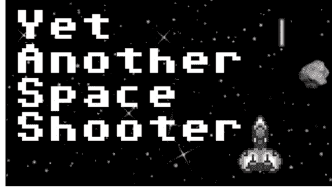
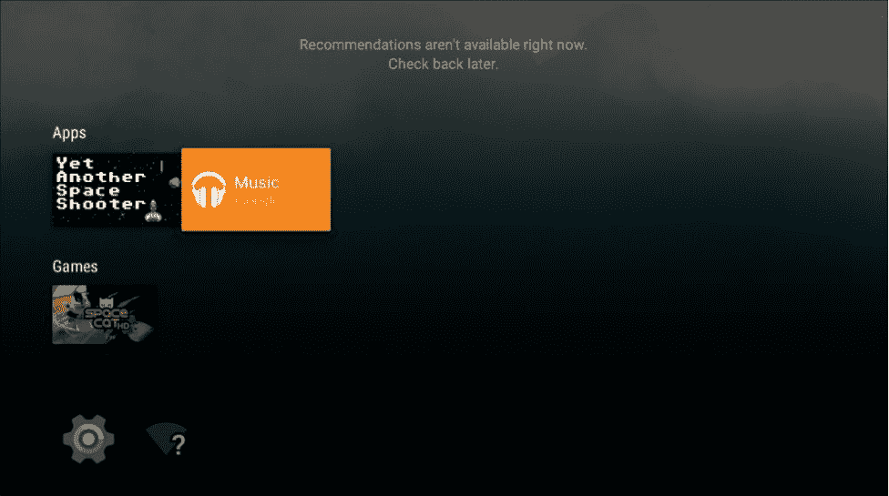
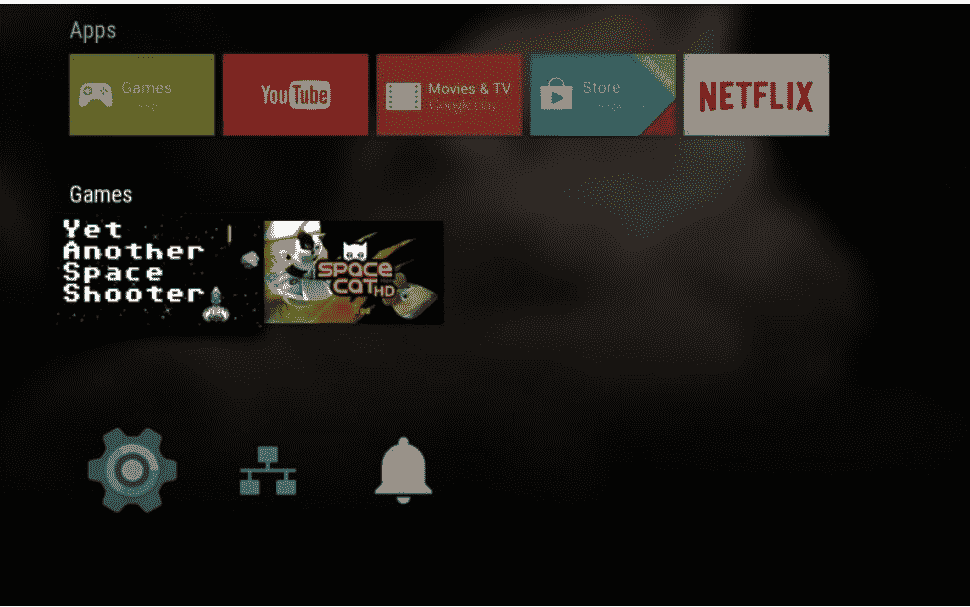
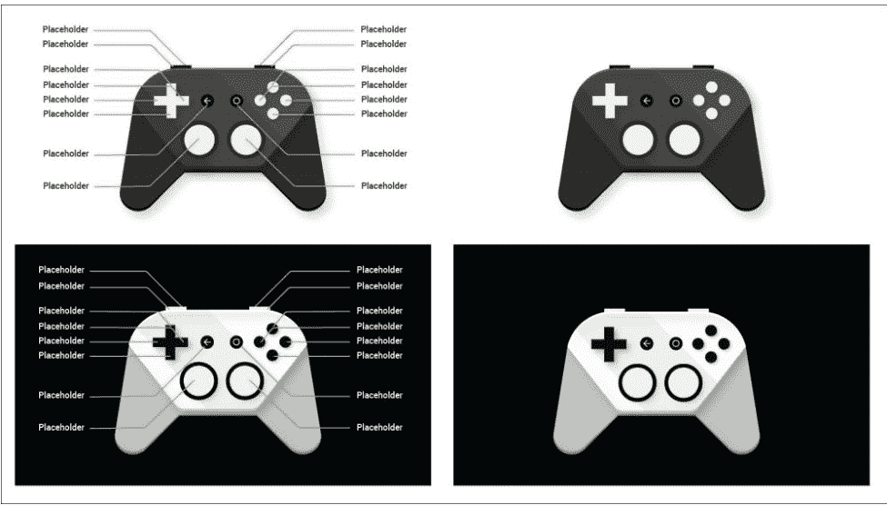
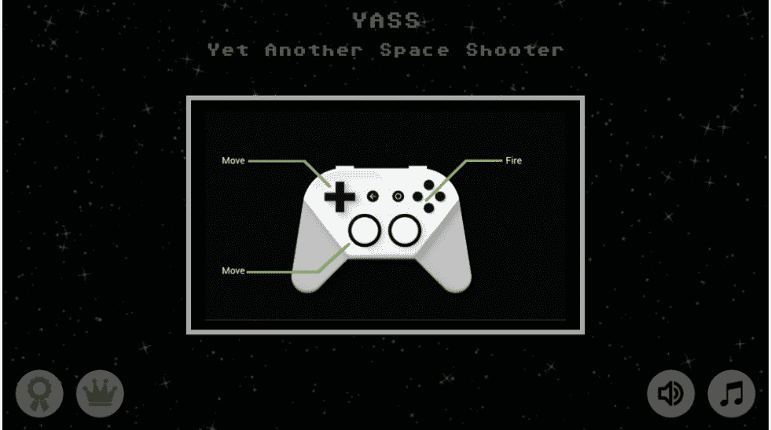
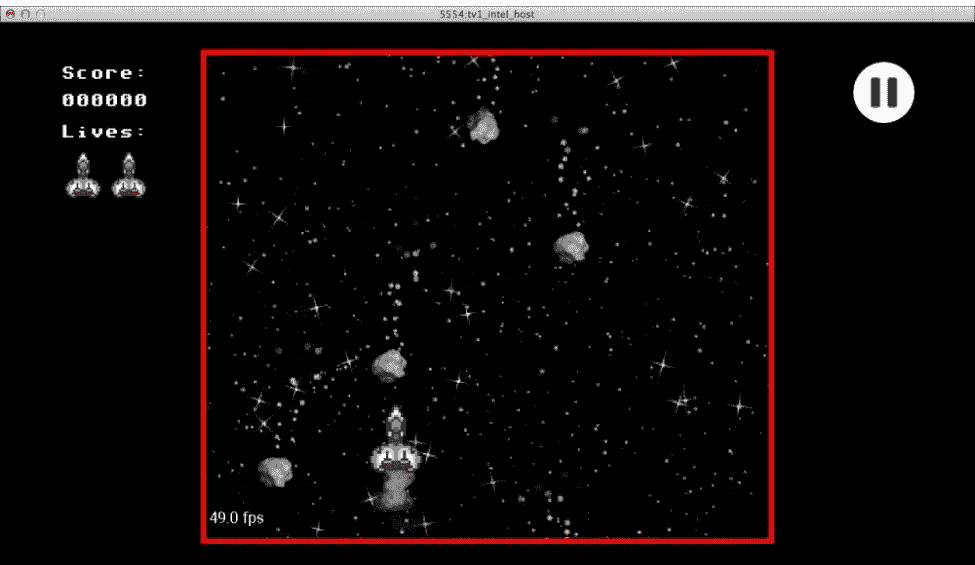
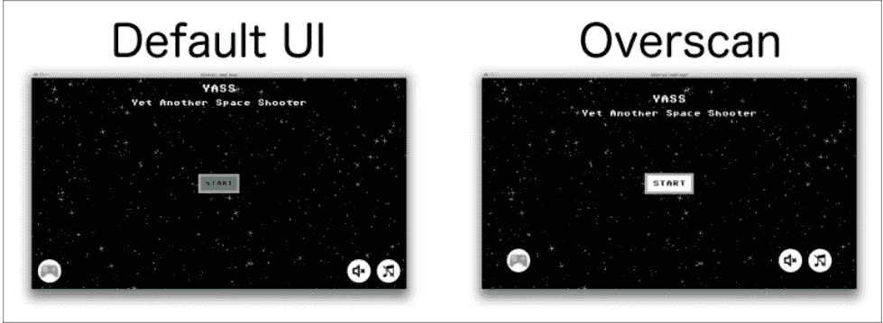

## 第 7 章。面向大屏幕

我们有一个在手机和平板电脑上运行正常的游戏。那么 Android TV 呢？

我相信 Android TV 有潜力在不久的将来成为一个重要的游戏平台。虽然其他系统也曾试图将 Android 游戏带到大屏幕上——具体来说是 OUYA、GameStick 和 Amazon FireTV——但存在一个主要区别：Android TV 并不是设计成插入电视的机顶盒，而是 SmartTV 中的操作系统。

这会产生很大的不同，因为人们默认就会拥有它。我最初对 OUYA 持怀疑态度，直到我尝试了它。这是一次很棒的体验，但如果我不是 Android 游戏开发者，我可能就不会尝试它。Android TV 可以打破这一障碍。

除此之外，为 Android TV 添加支持也相当简单，这可能会让你触达更多用户，所以为什么不试试呢？

电视与手机不同，它们更大，而且没有触摸屏。此外，人们通常从更远的距离观看电视。因此，Android TV 具有不同的 UI，并且对在其上运行的应用程序有一些额外要求。

将游戏移植到 Android TV 时的主要要求是支持横向屏幕方向，并且可以使用控制器操作。我们已经做到了这一点。如果你的游戏不支持横屏，或者不是为使用游戏手柄而设计的，那么移植到 Android TV 将需要大量工作，可能不是你时间的最佳投资；不过，如果你已经支持横屏和控制器，那就大胆去做吧！

### 项目配置

向项目添加 Android TV 支持有两种不同的方法。它们在概念上有所不同，但两种方法需要编写的代码几乎相同，只是位置不同。根据项目的特点，你可以偏好其中一种。这些选项包括：

- 为 Android TV 构建单独的 APK
- 对手机、平板电脑和电视使用相同的 APK

Android Studio 的默认选项是为 Android TV 创建构建变体。当我们使用向导设置项目并添加 TV 支持时，它就是这样做的。这就是为什么我们有 mobile 和 tv 目录的原因。主项目是 mobile，而 tv 被配置为构建变体或“产品风味”。

产品风味是从同一代码库构建不同 APK 的强大方式，允许我们修改部分内容，无论是代码还是资源。当你需要在不同市场发布同一款游戏时，这尤其有用。另一方面，如果你只有一个 APK，它必须能够自行适应不同的配置。

每种方法都有其优缺点。

你可能希望为 Android TV 拥有单独 APK 的一些原因包括：

- 为移动版本使用较低的目标 API（Android TV 要求 target SDK 21 – Lollipop）
- 为电视使用更高分辨率的资源，而无需将其包含在移动包中
- 为移动端/电视端分开特殊功能

另一方面，使用单个 APK 的主要优势包括：

- 发布更轻松（只需上传一个文件）
- 维护更轻松

鉴于我们不会为 Android TV 构建任何特殊功能，我们将采用单一 APK 方法。请注意，如果你想创建构建变体，修改几乎是相同的，但需要在 tv 目录中进行。

### 注意

在 Android TV 上发布需要 target SDK 21。

官方文档建议我们包含 *Leanback 库*，该库要求 *minSdk* 版本 17。由于我们构建的是游戏而不是应用，而且该库涉及 UI，因此我们可以忽略它，并将 *minSdk* 保持为 15。

### 针对 Android TV 进行测试

测试 Android TV 构建版本有多种方法。最明显且最简单的方法是使用模拟器。

Android TV 模拟器（与手机一样）是运行与真实设备完全相同操作系统版本的虚拟机。因此，它们非常可靠，但也相当慢。

当然，理想情况下，你应该能够在真实设备上测试游戏。在撰写本文时，已宣布几款搭载 Android TV 的智能电视，但最佳测试设备是 ADT-1（开发者套件）和 Nexus Player。

不过，ADT-1 货源紧张，难以获得。另一方面，Nexus Player 是一个相当便宜的设备。

但是，除非你需要测试游戏性，否则导航可以轻松使用模拟器进行测试。

### **注意**

除非你需要测试游戏性，否则模拟器应该足够用于测试游戏。

请注意，模拟器不包含 Google Play 服务，但真实设备会包含。

我还注意到，ADT-1 上的主题与模拟器上的略有不同，且开始按钮上的文字颜色也不同。这并非大问题，也很容易修复。

### 声明 TV Activity

Android TV 使用专为遥控器控制的大屏幕设计的 Leanback 界面。此 UI 显示应用和游戏的方式与手机不同。启动程序也不同。因此，应用和游戏需要声明带有特定 intent filter 的 Activity，以便 Leanback 启动程序能够找到它们并使用户可用。

此 intent filter 将声明该应用可在 Leanback 界面上启动。

最简单的方法是创建一个扩展自我们普通 Activity 的新 Activity，然后在必要时重写一些方法以适应 TV 界面。目前，我们将创建仅扩展 YassActivity 的 YassTvActivity：

```java
public class YassTvActivity extends YassActivity {
}
```

然后我们将在 AndroidManifest.xml 中使用适当的 intent filter 声明它：

```xml
<activity
    android:name=".YassTvActivity"
    android:label="@string/app_name"
    >
    <intent-filter>
        <action android:name="android.intent.action.MAIN" >
        <category
        android:name="android.intent.category.LEANBACK_LAUNCHER" >
    </intent-filter>
</activity>
```

正如你所见，此 intent filter 与普通启动 Activity 的 intent filter 几乎相同，只是类别名称不同（LEANBACK_LAUNCHER 而非 LAUNCHER）。

请注意，在 Android 中，你不能在清单中两次声明同一个 Activity，但可以为同一个 Activity 声明多个 intent filter。你可以同时为移动端和 TV 使用同一个 Activity，如下所示：

```xml
<activity
    android:screenOrientation="sensorLandscape"
    android:name=".YassActivity"
    android:hardwareAccelerated="false"
    android:label="@string/title_activity_main" >
    <intent-filter>
        <action android:name="android.intent.action.MAIN" >
        <category android:name="android.intent.category.LAUNCHER" >
    </intent-filter>
    <intent-filter>
        <action android:name="android.intent.action.MAIN" >
        <category
        android:name="android.intent.category.LEANBACK_LAUNCHER" >
    </intent-filter>
</activity>
```

我们将使用单独的 Activity 以允许在代码中进行微小调整，但请记住使用同一个 Activity 并配备两个 intent filter 的可能性，不过我建议只有在确定不需要重写任何内容时才使用它。

没有方法为 TV 定义限定符，Android 团队这样做是为了强制执行响应式布局设计。了解自己是否在 TV 上运行的唯一方法是以编程方式检查 Leanback 功能，或者为 TV 使用特定的 Activity 并在其中重写一些方法。


## 提供主屏幕横幅

Android TV 应用必须在清单中声明横幅。这是移动应用不存在的另一项要求。

横幅被 Leanback UI 用于在应用和游戏之间导航。它与图标的宽高比不同。具体来说，横幅是一张 320x180 px 的图片，我们需要将其放在 drawable-xhdpi 目录下。



*横幅是一张 320x180 px 的图片*

这张图片对 TV 来说与图标对移动设备同样重要，它是你在 TV 上的游戏入口。虽然我们作为开发者可以在不提供此横幅的情况下在 TV 上安装和运行应用，但如果不提供横幅，就无法从 Leanback UI 轻松启动应用。

要定义使用哪张图片作为横幅，我们需要将其作为 AndroidManifest.xml 中 `<application>` 标签的属性之一添加。

```xml
<application
[...]
android:banner="@drawable/banner_small" >
```

此属性是在 Lollipop 中引入的，这是我们需要以 target SDK 21 进行编译才能发布到 Android TV 的原因之一。



模拟器中 Leanback UI 里的我们的游戏

## 声明其为游戏

如前一张截图所示，Leanback UI 将应用与游戏分开，而我们的游戏被列在应用中。我们正在构建一个游戏，希望被归类为游戏。

这是 `<application>` 标签的另一个属性，同样是在 Lollipop 中为 Android TV 引入的；我们可以将应用声明为游戏。

```
<application
[...]
android:isGame="true">
```

这将把横幅显示在 **游戏** 类别中。



YASS 在 ADT-1 的游戏类别中列出

## 声明 Leanback 支持

为了让 Google Play 在从 Android TV 搜索时列出我们的游戏，我们需要专门声明我们支持 Leanback UI。为此，我们需要声明我们使用 Leanback 功能：

```
<uses-feature android:name="android.software.leanback"
    android:required="false" />
```

需要注意的是，我们声明使用它，但将其标记为非必需。这很重要，因为否则游戏将不会出现在没有 Leanback 功能的设备上。如果我们有两个单独的 APK，应该仅在 TV 构建变体上将此功能标记为必需。

声明 uses-feature 意味着你的应用使用它。将其标记为非必需意味着它可以在没有它的情况下运行，但如果存在，它将会使用它。

### 注意

声明 uses-feature 意味着你的应用使用它。将其标记为非必需意味着它可以在没有它的情况下运行。

如果你为移动设备和 TV 使用单独的 APK，应该仅在 TV 构建变体上声明 Leanback 的 uses-feature，而对移动设备不做任何操作。这样做，TV APK 将仅在具有 Leanback UI 的设备上出现，而移动 APK 将仅在不支持 Leanback 的设备上出现。

Leanback 功能的默认状态是非必需。

## 声明触摸屏功能为非必需

由于 uses-feature 系统的工作方式，我们需要修正请求的功能，以便让我们的游戏在 Android TV 上可用。基本上这意味着我们不能请求 TV 没有的功能，否则游戏不会显示为可用。

这看起来不像那么简单，因为有些功能在不做任何操作的情况下会被自动包含。

由于 Android 的特性，触摸屏功能默认是必需的，但如果我们不将其标记为非必需，游戏将不会在 Android TV 的 Google Play 上列出，因为该设备没有触摸屏。

### 注意

触摸屏功能在 Android 应用中默认是必需的。

这很容易修复，我们只需在 AndroidManifest.xml 上声明触摸屏功能为非必需。

```
<uses-feature android:name="android.hardware.touchscreen"
android:required="false" />
```

需要注意的是，这也意味着游戏在没有触摸屏的情况下应该完全可用。为此，我们在本章后面有一个关于使用控制器处理菜单的专门章节。

Android TV 上还有其他不可用的功能，如果你使用它们，必须确保将其标记为非必需（并在它们不可用时处理相应情况）。这些功能包括：

- 触摸屏：android.hardware.touchscreen
- 触摸屏模拟器：android.hardware.faketouch
- 电话：android.hardware.telephony
- 相机：android.hardware.camera
- 蓝牙：android.hardware.bluetooth
- 近场通信 (NFC)：android.hardware.nfc
- GPS：android.hardware.location.gps
- 麦克风：android.hardware.microphone
- 传感器：android.hardware.sensor

仅就游戏而言，触摸屏和传感器方面可能令人担忧，但有些游戏将位置和/或相机作为游戏不可或缺的一部分。在将游戏带到 TV 上时，这可能是一个决定性障碍。

### 注意

如果你的游戏依赖 GPS 或相机，它可能不太适合在 TV 上运行。

此外，某些 uses-permission 声明隐含了对硬件功能的要求。隐含要求功能的权限包括：

- RECORD_AUDIO 需要使用 android.hardware.microphone。
- CAMERA 需要：
  - android.hardware.camera
  - android.hardware.camera.autofocus
- ACCESS_COARSE_LOCATION 需要：
  - android.hardware.location
  - android.hardware.location.network
- ACCESS_FINE_LOCATION 需要：
  - android.hardware.location
  - android.hardware.location.gps

如果你使用任何这些权限，你应该确保将相应的功能标记为非必需，并在不存在时相应处理。

要在运行时检测某个功能是否存在以启用或禁用游戏的一部分，你可以使用 PackageManager 的 hasSystemFeature 方法。例如：

```
getPackageManager().hasSystemFeature("android.hardware.touchscreen"
)
```

需要注意的是，getPackageManager 在 Context 级别可用，因此你可以从 Activity 中访问它。

## 检查清单

一旦我们将 TV 的活动添加到 Leanback 启动器，确保 Leanback 和触摸屏功能被请求但非必需，配置了横幅，并将其标记为游戏，我们就完成了对 AndroidManifest.xml 的修改。

清单的更新版本如下：

```xml
<?xml version="1.0" encoding="utf-8"?>
<manifest
xmlns:android="http://schemas.android.com/apk/res/android"
package="com.plattysoft.yass" >
<application
android:icon="@mipmap/ic_launcher"
android:label="@string/app_name"
android:isGame="true"
android:banner="@drawable/banner_small"
android:theme="@style/AppTheme" >
<uses-feature android:name="android.software.leanback"
android:required="false" >
<uses-feature android:name="android.hardware.touchscreen"
android:required="false" >
<meta-data android:name="com.google.android.gms.games.APP_ID"
android:value="@string/app_id" >
<meta-data android:name="com.google.android.gms.version"
android:value="@integer/google_play_services_version">
<activity
android:screenOrientation="sensorLandscape"
android:name=".YassActivity"
android:hardwareAccelerated="false"
android:label="@string/title_activity_main" >
<intent-filter>
<action android:name="android.intent.action.MAIN" >
<category android:name="android.intent.category.LAUNCHER" >
</intent-filter>
</activity>
<activity
android:name=".YassTvActivity"
android:label="@string/app_name" >
<intent-filter>
    <action android:name="android.intent.action.MAIN" >
    <category
    android:name="android.intent.category.LEANBACK_LAUNCHER" >
    </intent-filter>
</activity>
</application>
</manifest>
```

## 显示控制器说明

要让应用获得 Android TV 批准的特殊要求之一是提供一个指示控制器映射方式的对话框。为此，Google 为我们提供了一个可用的模板，可在线查看：(http://developer.android.com/training/tv/games/index.html)。



控制器映射模板

我们已经有一个在连接控制器时显示的对话框，但我们从未将其从普通 AlertDialog 更新过。是时候将其改为自定义对话框了。

手机的逻辑是在主菜单首次加载且控制器连接时仅显示一次对话框。对于 Android TV，我们希望有不同的行为：每次打开游戏时都显示对话框。

为此，我们将覆盖 MainMenuFragment 上的 showControllerHelp 方法，以使用带有修改后的模板图片的自定义对话框。


包含我们游戏的控件。

至于我们已制作的其他自定义对话框，我们需要创建一个布局和一个类。布局非常简单，仅包含一张图片：

```xml
<?xml version="1.0" encoding="utf-8"?>
<RelativeLayout
    xmlns:android="http://schemas.android.com/apk/res/android"
    android:layout_gravity="center"
    android:background="@drawable/dialog_bg"
    android:layout_width="@dimen/dialog_width"
    android:layout_height="@dimen/dialog_height">
    <ImageView
        android:id="@+id/controller_help_image"
        android:layout_width="wrap_content"
        android:layout_height="wrap_content"
        android:layout_centerInParent="true"
        android:src="@drawable/controller_help" />
</RelativeLayout>
```

得益于 BaseCustomDialog，类也非常简单：

```java
public class ControllerHelpDialog extends BaseCustomDialog implements View.OnClickListener {
    public ControllerHelpDialog(YassActivity a) {
        super(a);
        setContentView(R.layout.dialog_controller_help);
        findViewById(R.id.controller_help_image).setOnClickListener(this);
    }

    @Override
    public void onClick(View v) {
        dismiss();
    }
}
```

我们设置布局，然后将图片点击处理为关闭。当使用控制器时，仅在按下 B 键或返回键时才会关闭对话框；我们将在本章后面处理对话框的正确按键处理，并使点击 A 按钮时也能关闭。

最后，我们需要对 MainMenuFragment 做一些更改，以显示新创建的对话框，并修改显示时机的逻辑：

```java
private void displayGamepadHelp() {
    showDialog(new ControllerHelpDialog(getYassActivity()));
}

private boolean shouldDisplayGamepadHelp() {
    PackageManager pm = getYassActivity().getPackageManager();
    boolean isLeanback = pm.hasSystemFeature("android.software.leanback");
    if (isLeanback) {
        boolean shownAlready = YassActivity.sGamepadHelpShown;
        YassActivity.sGamepadHelpShown = true;
        return !shownAlready;
    }
    if (isGameControllerConnected()) {
        return PreferenceManager.getDefaultSharedPreferences(getActivity()).getBoolean(PREF_SHOULD_DISPLAY_GAMEPAD_HELP, true);
    }
    return false;
}
```

在 shouldDisplayGamePadHelp 方法中，我们将检查是否使用 Leanback 功能，以判断当前是否在电视上。

如果不存在 Leanback 功能，我们使用与之前相同的代码：如果连接了控制器且之前未显示过对话框，则显示对话框。

如前所述，我们将保留手机端的逻辑，但对于电视，我们将始终显示对话框。

对于 Android TV，我们希望在打开应用时显示它。由于 shouldDisplayGamepadHelp 在 fragment 的 onResume 方法期间执行，我们会将是否已显示的事实存储在静态变量中，以便在游戏结束后返回 fragment 时不会再次显示对话框。如果对话框尚未显示，则返回 true。



如果您计划支持 MOGA、OUYA 或 Nvidia Shield 等其他控制器或游戏机，则应为每个控制器使用不同的图片，并通过设备描述符检测连接的是哪一个。对于 OUYA 这种不同的市场，您可以简单地使用带有特殊图形的另一个构建变体。

## 处理过扫描

由于电视标准的演变以及始终向观众呈现全屏画面的需求，电视布局有一些特殊要求。因此，电视设备可能会裁剪应用布局的外边缘，以确保填满整个显示区域。这种行为通常称为 **过扫描**。

为了避免因过扫描而导致屏幕元素被裁剪，建议在布局的四周添加 10% 的边距。在 dip 单位下，这相当于左右边缘各 48dp 的边距，上下边缘各 27dp 的边距。

虽然我们可以为所有设备的布局添加该内边距，但我们将为 Android TV 创建特殊布局，以此作为如何操作的实际示例。如前所述，没有针对电视的资源限定符；我们必须依赖是否存在 Leanback 功能。

我们已经有了在 Leanback 界面上启动的特殊活动。我们还将为电视创建特殊的 fragment，唯一的区别将是布局。为了将两者结合起来，我们将重写创建 fragment 的方法，并在电视活动中替换它们。

这意味着我们需要首先将 fragment 的创建提取到一个可重写的方法中。GameFragment 已经是这种情况，它在开始游戏时创建，但 MainMenuFragment 不是。该 fragment 仅在活动的 onCreate 期间创建，因此我们将重构代码，将 MainMenuFragment 的创建提取到一个新方法中。

```java
@Override
protected void onCreate(Bundle savedInstanceState) {
    super.onCreate(savedInstanceState);
    setContentView(R.layout.activity_yass);
    if (savedInstanceState == null) {
        getFragmentManager().beginTransaction()
                .add(R.id.container, createMenuFragment(), TAG_FRAGMENT)
                .commit();
    }
    [...]
}
```

```java
protected Fragment createMenuFragment() {
    return new MainMenuFragment();
}

public void startGame() {
    navigateToFragment(new GameFragment());
}
```

为了给游戏本身添加边距，我们将创建 fragment_game_tv.xml 文件作为 GameTVFragment 的布局，其声明如下：

```xml
<?xml version="1.0" encoding="utf-8"?>
<FrameLayout
    xmlns:android="http://schemas.android.com/apk/res/android"
    android:layout_width="match_parent"
    android:layout_gravity="center"
    android:paddingTop="27dp"
    android:paddingLeft="48dp"
    android:paddingRight="48dp"
    android:paddingBottom="27dp"
    android:background="@color/background"
    android:layout_height="match_parent">
    <include layout="@layout/fragment_game" />
</FrameLayout>
```

我们只是在顶层放置一个带有处理过扫描所需内边距的 FrameLayout，然后包含通常用于游戏的布局。

请注意，我们使用 padding 而不是 margin，因为我们希望背景作为 FrameLayout 的子元素，从而填充布局的其余部分。

在代码方面，GameTvFragment 的类也很简单：

```java
public class GameTvFragment extends GameFragment {
    @Override
    public View onCreateView(LayoutInflater inflater, ViewGroup container, Bundle savedInstanceState) {
        return inflater.inflate(R.layout.fragment_game_tv, container, false);
    }
}
```

我们扩展 GameFragment 并重写 onCreateView 方法以使用刚才创建的替代布局。由于导入了常规布局，所有视图都保留它们的 ID，GameTvFragment 正常工作无需其他操作。



GameFragment 带有额外内边距，用于处理电视上的过扫描

主菜单的情况要复杂一些，因为背景图片是布局内的 ImageView。我们有两种可能的解决方案：

- 像之前一样导入布局，并将背景图片的可见性设置为 GONE
- 将所有共同布局提取到一个新文件，并在移动端和电视布局中导入它

最后一种方案更易于阅读和维护，因此我们将采用该方式。

我们将所有布局信息移动到名为 fragment_main_menu_common.xml 的新文件中，该文件本质上是除背景图片以外的所有布局，背景图片将放置在其他每个布局中。

然后我们为不同布局创建两个文件；移动端的文件如下：

```xml
<?xml version="1.0" encoding="utf-8"?>
<FrameLayout
    xmlns:android="http://schemas.android.com/apk/res/android"
    android:layout_width="match_parent"
    android:layout_height="match_parent">
    <ImageView
        android:id="@+id/main_menu_bg"
        android:layout_width="match_parent"
        android:layout_height="match_parent"
        android:scaleType="centerCrop"
        android:src="@drawable/seamless_space_0" />
    <include layout="@layout/fragment_main_menu_common" />
</FrameLayout>
```

很简单——我们将顶层视图替换为 FrameLayout，添加了背景，并包含了公共元素。

Android TV 的布局基本相同，但我们向导入的布局添加了边距：

```xml
<?xml version="1.0" encoding="utf-8"?>
<FrameLayout
    xmlns:android="http://schemas.android.com/apk/res/android"
    android:layout_width="match_parent"
    android:layout_gravity="center"
    android:layout_height="match_parent">
    <ImageView
        android:layout_width="match_parent"
        android:layout_height="match_parent"
        android:scaleType="centerCrop"
        android:src="@drawable/seamless_space_0" />
    <include layout="@layout/fragment_main_menu_common"
        android:layout_width="match_parent"
        android:layout_height="match_parent"
        android:layout_marginTop="27dp"
        android:layout_marginLeft="48dp"
        android:layout_marginRight="48dp"
        android:layout_marginBottom="27dp" />
</FrameLayout>


请注意，为了让 include 标签的边距生效，你还需要设置宽度和高度，但幸运的是，Android Studio 会对此发出警告。

深入代码，我们将在 TV fragment 中实现一种不同的布局替换方式。我们将布局资源 ID 提取到可在扩展类中重写的方法中。我们将在 MainMenuFragment 中这样做。当 fragment 在 onCreateView 期间执行一些工作时，此技术特别有用。

MainMenuFragment 上的代码将被略微修改，以将布局资源提取到一个方法中：

```
@Override
public final View onCreateView(LayoutInflater inflater, ViewGroup container,
 Bundle savedInstanceState) {
  return inflater.inflate(getLayoutResId(), container, false);
}

protected int getLayoutResId() {
 return R.layout.fragment_main_menu;
}
```

由于我们提取布局是因为不想重写 onCreateView，因此我们还将其声明为 final。

现在 MainMenuTvFragment 类就像这样：

```
public class MainMenuTvFragment extends MainMenuFragment {
 @Override
 protected int getLayoutResId() {
   return R.layout.fragment_main_menu_tv;
 }
}
```



*应用超扫描边距前后的主菜单*

最后，我们必须重写 YassTvActivity 中创建 fragment 的特定方法。最后向该类添加了一些代码：

```java
public class YassTvActivity extends YassActivity {

    public void startGame() {
        // Navigate to the game fragment, which makes the start automatically
        navigateToFragment(new GameTvFragment());
    }

    protected Fragment createMenuFragment() {
        return new MainMenuTvFragment();
    }
}
```

现在我们已经说明了几种不同的解决超扫描问题的方法，让我们继续了解最后一个方面：使用控制器导航游戏。

## 基于控制器的导航

Android TV 最复杂的要求是游戏的所有选项都必须可以使用控制器访问。如果你计划在主机上发布，应该提前考虑这一点，不要做过于复杂的菜单或对话框。

## 注意

对于 Android TV，游戏中的所有选项都必须可以使用手柄访问。

这时使用原生 Android UI 就很有帮助了。Android 框架会自动处理布局元素之间的方向导航，因此原则上你不需要额外努力。但是，你仍然应该使用控制器测试导航，看看是否存在任何导航问题。

用户还可以使用键盘上的箭头键导航你的应用（其行为与使用十字键或轨迹球导航时相同）。Android 会根据屏幕上视图的布局，尽力猜测在给定方向上哪个视图应获得焦点。但是，有时 Android 可能会猜错。

如果导航时系统未将焦点传递到我们想要的视图，可以通过指定哪个视图应接收焦点来覆盖它，使用以下属性：

- android:nextFocusUp
- android:nextFocusDown
- android:nextFocusLeft
- android:nextFocusRight

一般而言，A 按钮应始终提供肯定操作，B 按钮应提供返回操作。某些控制器（例如 ADT-1 上的控制器）提供专用的返回和主页按钮，这些按钮也应按此方式工作。所有这些都已经由 Android 为你处理。

## 注意

A 按钮应始终是肯定操作，B 按钮应作为取消/返回操作。

在我们的情况中，YASS 存在一些必须解决的问题，以便提供完整的导航。这些问题很有趣，因为它们也是常见的陷阱。

如果现在运行游戏，可以看到主菜单上唯一可聚焦的控件是开始按钮。无法导航到任何其他视图。这是 Android 框架的一个不明显的特性：ImageView 默认不可聚焦。

## 注意

ImageView 默认不可聚焦。

幸运的是，我们为圆形按钮定义了一个样式。我们可以在样式上将 focusable 设置为 true，它将应用于应用程序中的所有圆形按钮：

```
<style name="iconButton">
    <item name="android:background">@drawable/icon_button_bg</item>
    <item name="android:layout_width">@dimen/btn_round_size</item>
    <item name="android:layout_height">@dimen/btn_round_size</item>
    <item name="android:padding">@dimen/round_button_padding</item>
    <item name="android:focusable">true</item>
</style>
```

我们也可以使用 ImageButton 而不是 ImageView，ImageButton 默认可聚焦，但我认为让 ImageView 可聚焦更清晰。

现在我们可以使用控制器在菜单中导航，并看到 Android 提供的默认导航很好。下一步是检查对话框。

当我们与对话框交互时，会出现一些副作用。由于它们不是标准的 Android 对话框，焦点可能会移出对话框。此外，GameFragment 使用一个游戏输入控制器来处理所有事件。我们需要进行一些修复。

## 对话框和控制器

我们将逐一解决这些问题。第一个问题是焦点可能会转到对话框外部的视图。

这可以通过打开游戏并在控制器帮助对话框存在时将焦点移到背景上的按钮来轻松复制。退出对话框也存在相同问题。在这两种情况下，我们都可以在对话框置顶时启动游戏，这是错误的。

对于触摸，我们通过充当点击屏幕的背景视图来解决这个问题，该视图获取所有点击且不允许事件传递到后面的其他视图。但是，对于控制器导航，我们需要别的东西。

修复此问题有几种方法。一种是在布局上重写导航；另一种是在显示对话框时忽略 fragment 上的 onClick 事件。我们采用了另一种方法：将按键事件传递给对话框并在其中过滤。

这种方法还解决了第二个问题：在游戏过程中，输入控制器会收集并消耗控制器按键。

由于所有 KeyEvent 和 MotionEvent 处理都在 activity 级别完成，我们将进行一点重构，并将显示对话框的逻辑从 fragment 移动到 activity。

我们将把 showDialog 方法和 mCurrentDialog 变量从 YassBaseFragment 移动到 YassActivity。

在基础 fragment 中，我们只需将 showDialog 方法的代码替换为以下内容：

```
public void showDialog(BaseCustomDialog newDialog, boolean dismissOtherDialog) {
    getYassActivity().showDialog(newDialog, dismissOtherDialog);
}
```

下一步是重构 YassActivity 的 dispatchKeyEvent 和 dispatchGenericMotionEvent 方法，使对话框优先于输入控制器。

dispatchKeyEvent 的更新版本如下：

```
@Override
public boolean dispatchKeyEvent(KeyEvent event) {
    if (mCurrentDialog != null && mCurrentDialog.isShowing()) {
        if (mCurrentDialog.dispatchKeyEvent(event)) {
            return true;
        }
    }
    else if (mGamepadControllerListener != null) {
        if (mGamepadControllerListener.dispatchKeyEvent(event)) {
            return true;
        }
    }
    return super.dispatchKeyEvent(event);
}
```

如果当前对话框不为空且正在显示，则在其上调用一个同样名为 dispatchKeyEvent 的方法。如果按键事件已被消耗（方法返回 true），则我们返回 true。

同样，如果没有显示对话框，我们也会继续处理游戏控制器监听器。如果事件已被游戏控制器消耗，我们也返回 true。

最后，如果事件尚未被消耗，我们将调用 super 方法，它将正常处理该事件。这包括在视图之间移动焦点。

同样，我们将修改 dispatchGenericMotionEvent。尽管我们不会在对话框中重写任何这些事件，但如果你计划使用方向键自定义导航，还需要处理模拟摇杆，并且会需要这个方法：

```
@Override
public boolean dispatchGenericMotionEvent(MotionEvent event) {
    if (mCurrentDialog != null && mCurrentDialog.isShowing()) {
        if (mCurrentDialog.dispatchGenericMotionEvent(event)) {
            return true;
        }
    }
else if (mGamepadControllerListener != null) {
```


else if (mGamepadControllerListener != null) {
    if (mGamepadControllerListener.dispatchGenericMotionEvent(event)) {
        return true;
    }
}
return super.dispatchGenericMotionEvent(event);
}

最后，我们需要更新返回键的处理：

@Override
public void onBackPressed() {
if (mCurrentDialog != null && mCurrentDialog.isShowing()) {
mCurrentDialog.dismiss();
return;
}
final YassBaseFragment fragment = (YassBaseFragment)
getFragmentManager().findFragmentByTag(TAG_FRAGMENT);
if (fragment == null || !fragment.onBackPressed()) {
super.onBackPressed();
}
}

如果正在显示对话框，我们直接将其关闭。否则，我们保留之前的代码：让当前片段处理返回键按压，如果事件未被消耗，则将其传递给父类。

请注意，将返回键事件传递给当前片段非常重要。在我们的游戏中，在 GameFragment 中按下返回键意味着我们想要暂停游戏。

为了完成此操作，我们需要让对话框处理按键。BaseCustomDialog 上的默认实现只是返回 false，这意味着事件未被消耗：

public boolean dispatchKeyEvent(KeyEvent event) {
return false;
}
public boolean dispatchGenericMotionEvent(MotionEvent event) {
return false;
}

我们将进行非常简单的处理，只有在对话框上的某个按钮被选中时才处理 OK 点击，但你也可以通过更复杂的处理来防止焦点移动到对话框外部的视图。

对于 ControllerHelpDialog，无论哪个视图获得焦点，只要按下 **确定** 我们就将其关闭：

public boolean dispatchKeyEvent(KeyEvent event) {
    if (event.getKeyCode() == KeyEvent.KEYCODE_BUTTON_A ||
    event.getKeyCode() == KeyEvent.KEYCODE_ENTER ||
    event.getKeyCode() == KeyEvent.KEYCODE_DPAD_CENTER) {
    dismiss();
    return true;
    }
    return false;
}

请注意，从控制器的角度来看，**A** 按钮是 **确定** 按钮，但某些控制器也有 D-Pad 中心按钮，有时还有 *Enter* 键，因此我们将这些按键事件中的任何一个都视为 **确定**。

对于 Quit 对话框，代码略有不同：

public boolean dispatchKeyEvent(KeyEvent event) {
    if (event.getKeyCode() == KeyEvent.KEYCODE_BUTTON_A ||
    event.getKeyCode() == KeyEvent.KEYCODE_ENTER ||
    event.getKeyCode() == KeyEvent.KEYCODE_DPAD_CENTER) {
    if (findViewById(R.id.btn_resume).isFocused() ||
    findViewById(R.id.btn_exit).isFocused()) {
    // Return false, so a proper click is sent
    return false;
    }
    return true;
    }
    return false;
}

在这个对话框中，每当收到 OK 事件时，我们会检查是否有按钮获得焦点。如果是这种情况，我们返回 false，这意味着我们让上层处理它。这将把事件传递给 Activity，在 Activity 中它会被处理并作为点击事件发送回来。

如果我们的操作没有一个获得焦点，我们返回 true，这意味着我们正在消耗该事件，不应该再对它做任何处理。

消耗该事件并对其进行处理应该一起完成。

在任何其他情况下，我们返回 false（同样，不消耗该事件）以让 Activity 正常处理按键事件。

最后，对于在 GameFragment 中显示的暂停和游戏结束对话框，我们不需要做任何事情，因为该 UI 上唯一可聚焦的项目是暂停按钮。

我们将要做的是将暂停按钮设置为不可聚焦，然后让系统处理按键：

<ImageView
 style="@style/iconButton"
 android:focusable="false"
 android:layout_gravity="top|right"
 android:id="@+id/btn_play_pause"
 android:layout_marginTop="@dimen/menu_margin"
 android:layout_marginRight="@dimen/menu_margin"
 android:src="@drawable/pause" />

请注意，虽然 ImageView 默认不可聚焦，但我们已在样式级别设置了该属性，并且可以始终在布局定义中覆盖样式的值。

有了这些更改，我们游戏的所有 UI 都可以使用游戏手柄操作，我们终于准备好在 Android TV 上发布了。

## 超越本书

我们做到了！我们使用 Android SDK 从零开始构建了一个游戏。我们构建了一个具有独立 UpdateThread 和 DrawThread 的游戏引擎，我们有可以移动的精灵，我们处理了触摸和游戏手柄控制器，并添加了碰撞检测、声音，甚至粒子效果。

我们还使用了 Android 框架的组件来构建菜单和对话框，并利用动画工具使其更加动态。

YASS 还使用 Google Play 游戏服务提供了成就和排行榜，现在它也可以在 Android TV 上玩了。

此时，有几件事可以做来改进游戏，如果你愿意，这些可以作为很好的练习来帮助你继续前进。一些想法是：

- 生成难度递增的多波敌人
- 包括更大的小行星，被击中时会分裂成更小的部分
- 添加飞船选择：提供具有不同特性（速度、射速等）的多种飞船
- 实现类似护盾或改进激光的增强道具

虽然本书专注于游戏开发，但制作游戏还有其他被忽视但也非常重要的方面。其中最相关的是游戏设计和变现。

### 注意

游戏设计和变现是制作游戏的关键方面。

**游戏设计** 是一门独立于平台和代码的学科，它需要对游戏本身进行高层次的思考。游戏设计是关于制作一款有趣且能吸引用户的游戏。有许多书籍专门致力于这一概念，且超出了本书的范围。

**变现** 当今也是一个大话题。如果你只为好玩而计划发布游戏，则不需要担心它，但如果你打算从中赚钱，则需要对此进行评估。

变现游戏的主要选项有：

- **付费**：将其设为付费游戏
- **广告**：通过向用户展示广告（横幅或插页广告）来变现游戏
- **应用内购买**：为用户提供在游戏内购买物品的机会

制作付费游戏的优势是构建起来要简单得多，并且会让你少操很多心。

在移动端表现良好的付费游戏示例包括 Monument Valley、Threes 和 The Room（1 和 2）。

免费游戏（无论是带广告还是应用内购买）的优势在于安装门槛最低。如果有人对游戏感兴趣，安装它是免费的。为游戏付费需要做出有意识的决定，许多人会选择退出，无论价格如何。

如果你打算走免费游戏（Free2Play）之路，请准备好担心玩家的留存和转化。你将熟悉 DAU、MAU、ARPU 和 ARPPU 等术语，举几个例子。

采用不同变现方案的成功免费游戏示例包括 Candy Crush Saga、Clash of Clans 和 Angry Birds。

大多数研究会告诉你，人们通过应用内购买赚的钱比付费应用更多。虽然这是真的，但创建一个变现良好的 Free2Play 游戏需要时间和精力来进行正确的调整；设计有吸引力的应用内购买也是如此。

在我的经验中，为 Free2Play 游戏制作良好的变现设计所花费的时间大约与制作游戏本身一样多。如果你不仔细设计，可能会得到非常低的转化率，这会转化为微乎其微或没有任何收入。

作为经验法则，不要在感觉不合适的游戏中强行推行变现模式，而应将精力投入到让游戏变得有趣上。

## 总结

我们的游戏已准备好在 Android TV 上运行。我们更新了清单文件，以便从 Leanback 界面启动一个 Activity 并在 UI 上显示横幅，并将其标记为游戏。我们还审查了权限，以确保游戏可在适用于 Android TV 的 Google Play 上提供，主要是将触摸屏功能和 Leanback 标记为请求但非必需。

从代码角度来看，在 TV 上运行时，我们为所有屏幕添加了一些额外的内边距，以确保重要内容永远不会因为超扫描（overscan）而被截断，并且我们调整了对话框的代码，使其与控制器配合良好。

最后，我们提到了一些关于如何进一步改进游戏的建议，并简要讨论了游戏设计和变现。

是时候开始制作你自己的游戏了。祝你好运，玩得开心！


