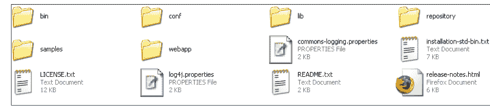
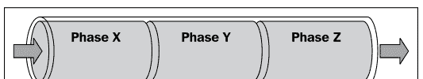
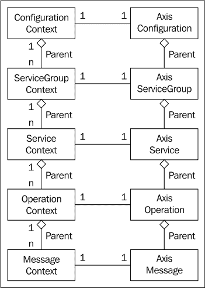

# 前言

第一条 为进一步提高我市城乡居民基本医疗保险待遇水平，减轻参保居民门诊慢特病医疗费用负担，规范门诊慢特病管理，根据《商洛市城乡居民基本医疗保险市级统筹实施办法（试行）》（商政发〔2020〕17号）等文件精神，结合我市实际，制定本办法。


第8章，编写Axis2模块——了解如何通过一个自包含的包扩展Axis2核心功能。

第9章，客户端API——了解如何使用Axis2调用其他服务、可用的API以及如何使用它们。

第10章，会话管理——超越单次调用，学习如何使用Axis2特性提供更好、更高效的有状态服务。

第11章，开发JAX-WS Web服务——学习开发基于JAX-WS的Web服务的基础知识，这是Java开发人员最常用的Web服务开发技术。

第12章，Axis2集群——了解Apache Axis2的集群，这将允许你在大规模生产环境中部署Axis2。

第13章，企业集成模式——了解一些利用底层Axis2集群基础设施的企业SOA部署模式。

第14章，Axis2高级特性与用法——超越简单特性，了解REST、MTOM以及其他几个高级特性。

第15章，构建安全可靠的Web服务——学习如何使用Axis2及相关组件使你的服务更加安全可靠。

## 本书所需准备

- Java 5或更高版本（Axis2仅支持JDK 1.5及以上版本）
- 最新版本的Axis2（Axis2 1.5.4）

## 本书读者对象

本书面向有兴趣使用Apache Axis2构建Web服务的Java开发人员。假定读者熟悉SOAP、WSDL和XML解析等Web标准。

## 惯例

在本书中，你会发现多种不同的文本样式，用以区分不同类型的信息。以下是这些样式的一些示例，以及对其含义的说明。

## 问题

如果你在本书的任何方面遇到问题，可以通过questions@packtpub.com联系我们，我们将尽力解决。

## 面向服务的架构（SOA）

孤立计算机的时代已经结束。如今，“连接则立，孤立则亡”正成为计算领域的格言。网络和通信设施以前所未有的方式连接了世界。世界上已有能够支持连接数千台计算机系统的硬件，这些系统有能力发挥曾经只能梦想的力量。

然而，计算机科学缺乏利用已建立的通信网络的技术和抽象。分布式计算的目标就是提供这样的抽象。RPC、RMI、IIOP和CORBA是一些为开发人员提供网络抽象的方案，可供其在此基础上构建。

这些方案未能考虑问题的关键本质。系统是由众多异构子系统组成的，但这些方案要求所有参与者共享一种或少数几种编程语言。**面向服务的架构（SOA）** 通过定义一组概念和模式来集成同质和异构组件，从而给出了答案。SOA提供了一种更好的方式来实现松散耦合的系统，因此具有更强的可扩展性和灵活性。此外，与面向对象编程（OOP）类似，SOA实现了高度的可重用性。人们可以通过三种主要方式在其系统和应用中启用SOA能力：

- 现有消息系统：例如IBM MQSeries、Tibco、JMS等
- 普通XML（POX）：例如XML/HTTP、REST等
- Web服务：例如SOAP、WSDL、WS-*

在常用的消息系统中，**Java消息服务（JMS）** 在行业中扮演着重要角色，并已成为消息系统的通用API。我们可以找到多种JMS消息类型，例如文本、字节、名值对、流和对象。这类消息系统的主要缺点之一是它们没有统一的线路格式（序列化格式）。因此，互操作性是一个大问题：如果两个应用程序使用JMS进行通信，那么它们必须使用相同的实现。Sonic、Tibco和IBM是商业市场的领导者，JBoss、Manta和ActiveMQ是常用的开源实现。

普通XML（POX）是在系统中暴露功能并启用SOA的另一种方式。随着Web的广泛使用，POX方法变得更加流行。大多数Web应用暴露XML API，我们可以开发组件并与它们通信。Google Maps、自动完成和Amazon服务是大量使用XML API暴露功能的几个应用示例。在大多数情况下，POX与REST（表述性状态转移）结合使用。**REST** 是Web底层架构的一种模型，它基于每个URL标识资源的理念。GET、PUT、POST和DELETE是REST架构中使用的动词。REST常常与理论观点相关联，因此，REST通常不用于复杂的交互。

在三种常用的SOA实现方法中，Web服务可以被认为是最标准和最灵活的方式。Web服务扩展了POX的思想，并增加了额外的标准，使通信更加有条理和标准化。Web服务成为最流行的支持SOA的机制，其原因如下：

- Web服务使用WSDL描述，WSDL可以捕获任何复杂的应用以及所需的服务质量。
- Web服务使用SOAP作为消息传输机制，因为SOAP是一种特殊的XML。它从XML获得了所有可扩展性特性。
- 有许多标准机构负责创建和执行Web服务标准。
- 有多种开源和商业Web服务实现。通过使用标准和流程，Web服务提供了与应用程序和编程语言无关的集成和通信机制。不同的编程语言可能为Web服务定义不同的实现，但它们可以互操作，因为它们对共享信息的格式达成一致。

WS-I的主要功能是提供标准和规范，以确保互操作性、可组合性和概要描述。换句话说，即创建标准和流程，以在各类Web服务框架之间强制执行所需的互操作性水平。OASIS的主要目标是提高Web服务的服务质量，包括安全性、可靠性、事务和资源管理。W3C是Web服务标准机构之一，它将Web服务定义为一种软件系统，旨在通过网络支持可互操作的机器对机器交互。它的接口以一种既可由机器处理又可由人阅读的格式描述。这种格式被称为**Web服务描述语言（WSDL）**。其他应用程序按照其描述所规定的方式，使用**简单对象访问协议（SOAP）** 消息与Web服务通信，通常通过HTTP结合XML序列化以及其他Web相关标准来传输。

Web服务是众所周知的开源技术标准，它提供了以下许多好处：

- 提高互操作性，从而降低维护成本
- 提高可重用性和可组合性（例如，使用公开可用的服务并重用或集成它们以提供新服务）
- 增加供应商之间的竞争，从而降低产品价格
- 易于从一个产品切换到另一个产品，从而降低培训成本
- 更高的采用率和标准寿命，供应商和用户的大量使用导致更高的接受度

可以说，Web服务概念是从面向对象系统到服务系统的逻辑演变。与面向对象系统一样，Web服务中的一些基本概念是封装、消息传递和动态绑定。然而，基于服务的概念已扩展到方法签名之外，因为与服务功能、位置、调用方式、服务质量以及安全策略相关的信息也可以发布在服务接口（WSDL）中。

### 组织如何转向Web服务？

组织可能用来转向Web服务的方式主要有三种，如下所示：

- 从零开始创建新的Web服务。开发人员创建服务的功能以及描述。


消息传递标准旨在为分布式环境中的信息交换提供框架。这些标准必须可靠，以确保消息只发送一次，并且只有预期的接收者才能收到。这是当前研究的主要领域之一，因为一切都依赖于消息传递能力。

接下来，我们将详细讨论其中一些标准。首先，我们从 XML-RPC 开始，它后来发展为 SOAP。

## XML-RPC

**XML-RPC** 标准由 Dave Winer 于 1998 年与微软共同创建。现有的 RPC 系统非常庞大。因此，为了创建一个轻量级系统，开发者通过仅规定必要的部分并只定义少量的数据类型和命令来简化它。该协议使用 XML 对调用进行编码，并以 HTTP 作为传输机制。消息以 POST 请求发送，其中请求正文为 XML 格式。服务器上执行一个过程，其返回值也被格式化为 XML。参数可以是标量、数字、字符串、日期，以及复杂的记录和列表结构。

随着新功能的引入，XML-RPC 演变为现在所称的 SOAP，接下来将对此进行讨论。不过，仍有一些人更喜欢使用 XML-RPC，因为它简单、极简且易于使用。

## SOAP

最初，SOAP 被定义为简单对象访问协议（Simple Object Access Protocol）。然而，最新版本（SOAP 1.2）已经超越了其最初的定义。SOAP 标准最初由四位开发者在微软的支持下设计，作为一种对象访问协议。该协议规定了基于 XML 的消息在计算机网络中的传输方式，且与传输机制无关。开发者选择 XML 作为标准消息格式，是因为主要组织和开源计划广泛使用它。此外，还有各种各样免费可用的工具，可以轻松过渡到基于 SOAP 的实现。

**SOAP** 的概念是一种无状态、单向的消息交换。然而，应用程序可以通过将这种单向交换与底层协议提供的功能以及特定于应用程序的信息相结合，创建更复杂的交互模式——例如请求-响应、请求-多响应等。SOAP 对其所传递的任何特定于应用程序的数据的语义保持沉默，就如同对 SOAP 消息的路由、可靠数据传输、防火墙穿越等问题一样。但是，SOAP 提供了一种框架，通过该框架，特定于应用程序的信息可以以可扩展的方式进行传递。

## Web 服务寻址（WS-Addressing）

如果在 Web 服务网络中，有一种标准方式来表达消息应被传递到何处，那将会非常有用。这可以减轻开发者的工作量，因为他们能够简化 Web 服务的通信和开发，并避免需要临时开发成本高昂且通常难以跨平台互操作的解决方案。在与人类应用程序交互时，我们在浏览器中输入地址（或 URL），然后导航到该页面。我们点击内部链接，它就会带我们到一个新页面。当涉及到应用程序到应用程序的通信（如 Web 服务）时，应该有一种指定这些地址的标准方式。因此，WS-Addressing 通过定义一种标准机制来识别和交换多个端点之间的 Web 服务消息，使组织能够构建可靠且可互操作的 Web 服务应用程序。

该标准提供了与传输无关的机制来寻址消息和识别 Web 服务，对应于 Web 服务架构中描述的*地址*和*消息关联*概念。该标准定义了 XML 元素，用于识别 Web 服务端点并确保消息中端到端的端点标识安全。这使得消息传递系统能够通过包含处理节点（如端点管理器、防火墙和网关）的网络以传输中立的方式支持消息传输。

## 服务描述

当我们购买产品时，我们可以找到它的操作手册；当我们购买软件应用程序时，我们应该有使用它的手册或文档。对于面向对象编程，我们有描述公共操作的接口，同样，Java 文档提供有关可用方法及其使用方式的信息。因此，重要的是要注意，Web 服务的描述对于分类、发现和使用服务至关重要。描述应该既能被人类理解，也能被应用程序理解。他们还提到，Web 服务描述需要在语义和语法两个层面上提供。语义信息必须包含关于服务提供者、服务功能以及可靠性、安全性和消息排序等特征的详细信息。语义信息使服务请求者能够决定服务是否满足其需求。此外，代理可以使用语义信息对服务进行分类。语法信息描述如何使用服务，也可能涉及非功能性需求，如可靠性、安全性和事务。最重要的是，服务描述成为外部文档，用于阅读和更多地了解服务。

## Axis2 的特性

- 传输框架：Axis2 有一个简洁明了的抽象，用于集成和使用传输（即，通过 SMTP、FTP、面向消息的中间件等各种协议进行 SOAP 的发送方和监听方），并且引擎核心完全与传输无关。
- WSDL 支持：Axis2 支持 Web 服务描述语言（1.1 和 2.0 版本），这使您可以轻松构建存根以访问远程服务，还可以自动从 Axis2 导出所部署服务的机器可读描述。
- 附加组件：已经整合了多个 Web 服务规范，包括用于安全的 WSS4J（Apache Rampart）、用于可靠消息传递的 Sandesha。Kandula 是 WS-Coordination、WS-AtomicTransaction 和 WS-BusinessActivity 的封装。
- 组合和可扩展性：模块和阶段提高了对可组合性和可扩展性的支持。模块支持可组合性，也可以以简单明了的方式支持新的 WS-* 规范。但是，它们不能热部署，因为它们会改变系统的整体行为。

## 下载并安装 Apache Axis2

Apache Axis2 1.0 版本于 2006 年发布，之后有许多版本发布。当前的稳定版本是 1.5。本书的上一版本《Quickstart Apache Axis》（Deepal Jayasinghe 著，Packt Publishing 出版）基于 Axis2 1.2 版本。本书基于 1.5 版本。从 1.2 到 1.5，Axis2 引入了一系列新特性以及 API 更改。其中一个关键变化是从 JDK 1.4 迁移到 1.5。当前版本的 Axis2 仅支持 JDK 1.5 及更高版本。尽管如此，大多数常用的 API 仍然保持不变。

有三种类型的软件：自由软件、开源软件和商业软件。自由软件的主要理念是您可以免费下载该软件；但是，您无法访问源代码或开发工作。另一方面，开源软件由开放社区设计和开发；任何人都可以参与讨论并为项目做出贡献，最后，一旦产品发布，用户既可以访问产品也可以访问源代码。用户可以修改源代码、修复问题、重新分发等等。由于 Axis2 也是一个开源项目，您可以下载 Axis2 并访问二进制代码和源代码。然而，在专有软件中，许可协议非常严格，通常用户看不到源代码；用户只能获得二进制代码。


你可以从 Axis2 官方网站或任何镜像站点下载最新版本（或 1.5）。下载链接如下所示：

```
http://ws.apache.org/axis2/download/1_5_1/download.cgi
```

进入下载页面后，你可以找到四种不同的发行版本（构件）：

- 二进制发行版
- WAR 发行版
- 源码发行版
- 文档发行版

此外，你还可以从 Axis2 官方网站下载 IDE 插件（IDE 工具包括 Eclipse 和 IntelliJ IDEA）。

## 二进制发行版

Axis2 二进制发行版包含所有相关的第三方库、一组示例以及 Axis2 运行时。安装二进制发行版只需将 ZIP 归档文件解压到你想放置的位置即可。下载并解压二进制发行版后，你将看到其中包含一组子目录（bin、lib、samples、repository、webapp 和 conf）。解压后的二进制发行版典型结构如下所示：



Axis2 二进制发行版是一个完整的软件包，你可以在其中部署服务，并使用 SimpleAxisServer 将其公开。SimpleAxisServer 是一个功能完备的服务器，可以用作公开 Web 服务的后端服务器。它支持 servlet 版本所支持的所有特性，包括会话管理、线程管理、自动 WSDL 生成等。

我们还可以使用 Axis2 二进制发行版来调用远程服务。为此，你需要将 Axis2 及其他相关库添加到类路径中，并使用 Axis2 客户端 API 来调用服务。一种常用的做法是将这些库添加到你的 IDE 以及基于该 IDE 开发的客户端应用程序中。

之后，它应该会显示你所下载的 Axis2 的版本字符串。一旦看到版本号，就说明我们已经成功地将 Axis2 部署到了 Tomcat 中。接下来，你可以向 Axis2 上传或部署新的服务。

```
<ns:getVersionResponse>
  <ns:return>Hi - the Axis2 version is SNAPSHOT</ns:return>
</ns:getVersionResponse>
```

在 Axis2 中，要添加新的 Web 服务，我们需要将相应的资源（服务归档文件）添加到 WAR 文件的解压位置。然而，大多数应用服务器不会解压 WAR 文件。在这种情况下，你需要遵循额外的步骤来配置你的 WAR 文件。为此，你需要解压 WAR 文件，对 web.xml 文件进行必要的修改，然后重新创建 WAR 文件并进行部署。如果你的应用服务器会解压 WAR 文件，我们可以将新的 Web 服务直接放入解压位置。这种方法仅用于快速测试——真正的开发和生产使用中，建议使用 Ant（或 Maven）来为特定部署生成 WAR 文件，也就是说，不要手动调整 WAR 文件的内容。我们将在本书后面详细学习 Axis2 Web 服务。届时，我们将能够理解添加新 Web 服务的含义。

安装 WAR 发行版包括以下几个步骤：

- 1. 安装应用服务器：如果你的机器上没有应用服务器，那么你需要下载并安装应用服务器。在可用的应用服务器中，Apache Tomcat 可以被认为是最好的应用服务器之一（它不支持 J2EE 的所有特性）。因此，让我们下载 Tomcat（5.x 或更高版本）并安装。
- 2. 根据应用服务器的不同，你可以找到需要部署 WAR 文件的位置。以 Tomcat 为例，你需要将 WAR 文件放入 webapps 目录。因此，让我们将 Axis2 WAR 发行版放入应用服务器的 webapps 目录中。
- 3. 最后一步，打开浏览器并输入 http://localhost:8080/axis2。我们可以看到 Axis2 Web 应用程序（如前面图示所示）的主页（此处的 URL 可能因应用服务器而异）。

## 源码发行版

顾名思义，源码发行版包含用于构建二进制发行版的源代码。由于 Apache Axis2 是在 Apache 许可证下发布的，我们可以对源代码做任何操作。其理念是用户可以使用 Axis2 并根据自己的需求进行修改。此外，如果他们认为某项修改对其他人也有用，可以提交补丁，并请求项目社区将这些更改合并到主源代码库中。

当我们开发真实应用程序时，除了文档之外，手边有源代码也总是有助于调试应用程序。同时，源码发行版包含 Maven 脚本（http://maven.apache.org），我们可以使用它们来创建二进制发行版、WAR 发行版，甚至 JAR 发行版。

## 文档发行版

文档发行版提供了理解项目中不同特性和功能所需的所有必要资源。它提供了 Java 文档和教程，解释如何使用不同的特性，

## JAR 发行版

Web 服务的关键步骤之一是开发服务和客户端。在该阶段，我们需要访问 Web 服务框架及其库。为了访问 API 和其他相关资源，常见的做法是将所需的库添加到集成开发环境（IDE）中。Axis2 JAR 发行版提供了一种便捷的方式来下载并将 Axis2 运行时嵌入到 IDE 中。你可以从以下链接单独下载 Axis2 库文件，或者从 Axis2 二进制发行版或 WAR 发行版中获取这些文件：

```
http://people.apache.org/repo/m2-ibiblio-archived/org/apache/axis2/
```

## XML 处理模型

正如*第 1 章“Apache Web 服务与 Axis2”*中所提到的，与 Axis 1.x 相比，Axis2 构建在全新的架构之上。引入 Axis2 的关键原因之一是拥有更好、更高效的 XML 处理模型。Axis 1.x 使用 DOM 作为其 XML 表示机制，这要求将完整的对象层次结构（对应于传入消息）保存在内存中。对于小规模消息来说，这不是问题。但当涉及大规模消息时，这就成了一个难题。为了克服这一问题，Axis2 引入了一种新的 XML 表示方式。

AXIOM（AXIS2 对象模型）构成了 Axis2 中每个基于 SOAP 的消息的 XML 表示基础。AXIOM 相对于其他 XML InfoSet 表示的优势在于它基于 pull 解析器技术，而大多数其他技术基于 PUSH 解析器技术。

pull 与 push 的主要区别在于，在 pull 技术中，调用方对解析器拥有完全的控制权，它可以请求下一个事件并对其做出响应；而在 PUSH 的情况下，解析器的控制能力有限，它将大部分功能委托给处理程序，这些处理程序响应文档处理过程中触发的事件。

由于 AXIOM 基于 pull 解析器技术，它具有“按需构建”的能力，即只有在需要时才构建对象模型。如果需要，可以直接从 AXIOM 访问底层的 pull 解析器，并使用它，而不是构建一个**对象模型（OM）**。

## SOAP 处理模型

发送、接收和处理 SOAP 消息是 SOAP 处理引擎的关键工作之一。Axis2 的架构提供了两个管道（或流）来执行两个基本操作。RPC 等旧式消息系统是围绕请求和响应构建的。而 Axis 则超越了这一点，引入了单向消息处理。这样，就可以有请求而不需要任何响应。

Axis2 的 AxisEngine（引擎或驱动程序）定义了 `send()` 和 `receive()` 两个方法来实现这两个管道。这两个管道分别命名为 **InFlow** 和 **OutFlow**。复杂的消息交换模式（MEPs）通过组合这两种类型的管道来构建。需要注意的是，除了这两个管道之外，还有另外两个管道，它们用于帮助处理传入和发送*故障*消息。


如前所述，SOAP 处理框架的关键任务就是处理 SOAP 消息。然而，仅仅处理消息还不够，还需要提供额外的功能，例如服务质量。因此，系统必须具有可扩展性。SOAP 处理模型的可扩展性是通过处理器来提供的。当 SOAP 消息被处理时，已注册的处理器将被执行。处理器可以在全局、服务或操作范围内注册，最终的处理链由所有范围内的处理器组合而成。

处理器充当拦截器，处理 SOAP 消息的各个部分，并提供*服务质量*特性（服务质量的一个典型例子是安全性或可靠性）。通常处理器处理 SOAP 标头，但也可能访问或修改 SOAP 正文。

流的概念很简单，它由一系列阶段组成，其中阶段指处理器的集合。对于给定的方法调用，相关的流数量可能根据 MEP（消息交换模式）的不同而变化。

### In-Only MEP（仅入站）

对于 In-Only MEP，相应的方法调用只有一个管道，即消息只会经过入站管道（inflow）。

### In-Out MEP（入站/出站）

另一方面，对于 In-Out MEP，消息将经过两个管道，即入站管道（inflow）和出站管道（outflow）。当 SOAP 消息被发送时，`OutFlow` 将启动。

### 故障流（Fault-Flow）

`OutFlow` 调用处理器，并以**传输发送器**结束，该发送器将 SOAP 消息发送到目标端点。在目标端点，SOAP 消息由该处的**传输接收器**接收，接收器读取 SOAP 消息并启动 `InFlow`。`InFlow` 由处理器组成，并以**消息接收器**结束，该接收器处理实际的业务逻辑调用。

阶段是一个或多个处理器的逻辑集合，有时阶段本身充当处理器。Axis2 引入阶段概念，作为扩展核心功能的简便方式。在 Axis 1.x 中，如果要将处理器添加到处理链中，我们需要更改全局配置文件。而 Axis2 通过阶段和阶段规则的概念简化了这一过程。阶段规则规定了特定阶段内给定处理器集合的排序方式。下图展示了一个流及其阶段：





我们将在*第 6 章“信息模型”*中更详细地讨论此图，届时将逐一讨论每个项目，并详细描述它们如何相互连接。

## 部署模型

Axis 的早期版本（Axis 1.x）满足了产品开发阶段所提出的需求。然而，随着 SOA 和 Web 服务变得流行，许多新需求应运而生。其中，易用性是最需要考虑的重要因素之一。

在 Axis 1.x 中，用户必须手动调用管理客户端并更新服务器 `classpath`。之后，用户需要重启服务器才能应用更改。这种繁琐的部署模型对初学者来说无疑是一道障碍。Axis2 的设计旨在克服这一缺点，并提供了灵活、用户友好且易于配置的部署模型。

- 传输级非阻塞调用，其中调用发生在两个传输中（可以是两个单通道传输，如 SMTP，也可以是两个双通道传输，如 HTTP）

Axis2 客户端 API 支持这两种非阻塞调用场景。

Axis2 引入了一个非常方便的客户端 API 来调用服务，该 API 包含两个类：`ServiceClient` 和 `OperationClient`。`ServiceClient` API 用于常规使用，即只需发送和接收 XML 时。另一方面，OperationClient 面向高级用法，当需要处理 SOAP 标头或执行其他高级任务时使用。使用 `ServiceClient`，你只能访问 SOAP 正文或有效负载。虽然我们可以添加 SOAP 标头，但无法通过 `ServiceClient` 检索 SOAP 标头。要实现此功能，我们需要使用 OperationClient。

`ServiceClient` 提供了以下用于调用服务的 API：

- **sendRobust**：此 API 的核心思想是向 Web 服务发送 XML 请求，而不关心其响应。但是，如果出现问题，你也会需要知道。因此，此 API 调用没有返回值但会抛出异常的服务。
- **fireAndForget**：此 API 仅用于发送 XML 请求，既不关心响应，也不关心异常。因此，它适用于调用 In-Only MEP。
- **sendReceive**：此 API 调用具有返回值的服务。这是最常用的 API 之一。因此，它用于调用 In-Out MEP。
- **sendReceiveNonBlocking**：此方法以非阻塞方式调用服务。当服务有返回值时可以使用此方法。要使用此方法，我们必须传递一个回调对象，该对象在调用完成后被调用。

如前所述，`OperationClient` 面向高级用户，使用 `OperationClient` 需要深入了解 Axis2。在使用 `ServiceClient` 时，你无需了解 SOAP 信封、消息上下文等任何内容。但使用 `OperationClient` 时，用户必须在调用服务之前自行创建这些内容。使用 `OperationClient` 创建和调用服务涉及以下步骤：

1. 创建一个 `ServiceClient`。
2. 然后，使用你创建的 `ServiceClient` 创建 `OperationClient`。
3. 创建一个 SOAP 信封。
4. 创建消息上下文。
5. 将 SOAP 信封添加到消息上下文。
6. 将 `MessageContext` 添加到 `OperationClient`。
7. 调用 `OperationClient`。
8. 如果有响应，从 `OperationClient` 获取响应消息上下文。

## 传输

在 Axis2 中，每个传输都由两部分组成，即传输发送器和传输接收器。你可以在 Axis2 全局配置中定义传输以及发送器和接收器。传输接收器是 `AxisEngine` 接收消息的途径，而传输发送器是发送消息的途径。Axis2 的一个重要方面是，其核心完全独立于传输发送器和接收器。

Axis2 旨在支持以下传输协议：

- HTTP/HTTPS：在 HTTP 传输中，传输监听器是一个 servlet 或 Axis2 提供的 `org.apache.axis2.transport.http.SimpleHTTPServer`。传输发送器使用公共 HTTP 客户端进行连接并发送 SOAP 消息。
- TCP：这是最简单的传输，需要 WS-Addressing 支持才能正常工作。
- SMTP：这需要一个电子邮件帐户。传输接收器是一个线程，按固定时间间隔检查电子邮件。
- JMS：这提供了一种使用 JMS 方式调用 Web 服务的方法。
- XMPP：这提供了一种与 Jabber 服务器通信并使用 XMPP 协议调用 Web 服务的标准方式。

## 其他模块

其他模块指的是可选模块，它们提供附加功能或实用工具：例如，需要生成 Axis2 服务和服务代理的模块。Axis2 在运行时不会使用这些模块，如前所述，它们仅用于提供附加功能。Axis2 将它们作为工具模块，用于生成服务端代码和客户端代码。

- 代码生成：Axis2 提供了一个代码生成工具，可生成服务端（骨架）和客户端（存根或代理）代码，以及描述符和测试用例。生成的代码将简化服务的部署和调用。这将提高 Axis2 的易用性。


## Axis2 的可扩展性

在 Axis2 中，有许多扩展功能的方式。在本书中，我们将讨论其中几种，列在这里：

- 模块的服务扩展
- 自定义部署器
- 消息接收器

### 服务扩展或模块

Axis1 和 Axis2 都有处理程序的概念。但与 Axis 1.x 相比，Axis2 指定和部署处理程序的方式有几处变化。在 Axis 1.x 中，如果你想添加一个处理程序，则需要更改全局配置文件然后重启系统。同时，它没有动态添加或更改处理程序的方式。

为了解决这个问题以及添加新功能，Axis2 引入了 Web 服务扩展或模块的概念，其中模块的主要目的是扩展核心功能。它类似于在 Axis1.x 中添加处理程序链。Axis2 模块相对于 Axis 1.x 处理程序链的优势在于，你可以在不更改任何全局配置文件的情况下添加新模块。

模块是一个自包含的包，其中包括处理程序、第三方库、模块相关资源和模块配置文件。

模块可以作为归档文件部署。Axis2 为模块设计了一种新的文件扩展名，称为 .mar。模块归档文件中最重要的文件是模块配置文件或 module.xml。如果没有 module.xml 文件，模块将无法运行。模块配置文件主要指定处理程序及其阶段规则。因此，一旦我们根据阶段规则启用模块，处理程序将被放置在不同的流中（inflow、outflow 等）。

模块的想法非常简单。为了在我们的服务中实现对 WS-Addressing 或 WS-Security 的支持，我们需要下载相应的模块并将其放入 Axis2 仓库的 modules 目录。我们可以在部署时通过向 axis2.xml（全局配置文件）中添加 `<module ref="module name"/>` 来启用模块。除此之外，如果我们想在运行时启用模块，我们可以通过多种方式做到，例如使用 Axis2 web 管理、处理程序等。
