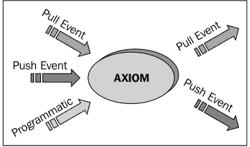

# 3 Axis2 XML 模型（AXIOM）

AXIOM 代表 Axis2 Object Model，指的是一种 XML InfoSet 模型，最初作为 Apache Axis2 的一部分开发，后来作为 WS commons 项目迁移，以便除 Axis2 之外的项目也能受益。XML InfoSet 指的是 XML 内部包含的信息，对于程序化操作，将此 XML InfoSet 以语言特定的方式表示是很方便的。对于面向对象的语言，显而易见的选择是由对象组成的模型。DOM 和 JDOM 就是两种这样的 XML 模型。AXIOM 在外部行为上概念上类似于此类 XML 模型，但其内部却大不相同。在本章结束时，你将了解 AXIOM 的基础知识以及使用 AXIOM 时应遵循的最佳实践。

本章将涵盖：

- AXIOM 架构
- Pull 解析
- 使用 AXIOM
- AXIOM 的高级操作

### AXIOM 及其特性的概述

Apache Axiom 的设计目的是提供快速且更好的 XML，这已成为任何给定 XML 处理系统的核心。Axiom 是一个轻量级实现，建立在延迟解析技术之上。更具体地说，它是 StAX（JSR 173）的实现，即标准流式 pull 解析器 API。其主要意图之一是提供标准操作 API。因此 AXIOM 对象模型可以像任何其他对象模型（例如 JDOM）一样灵活操作，但在底层，对象仅在绝对需要时才会被创建（即按需构建）。这导致编程更省内存。

使用 pull 解析，用户对解析器有完全控制权。用户可以要求处理下一个事件和下一个事件。换句话说，在 pull 解析中，解析器仅在用户命令下才继续。用户可以决定存储或丢弃从解析器生成的事件。这类似于水龙头，你打开水龙头，取水，然后关闭水龙头。当你再次需要水时，再次打开水龙头并继续过程。因此，用户对水流和过程有完全控制权。pull 解析也是如此，用户创建解析器并请求事件，然后它给出事件。用户处理事件并请求下一个事件，直到文件结束。

### 架构

当我们考虑 AXIOM 架构时，它并不像你想象的那么复杂。如前所述，许多 API 都非常类似于 JDOM API。值得注意的是，AXIOM 对二进制数据和 MTOM 有原生支持，这对于 Axis2 这样的 SOAP 处理框架很重要。AXIOM 还对 XML 处理提供完全支持，并对 SOAP 处理提供增强支持。

AXIOM 也被称为对象模型（OM），OM Builder 通过 StAX reader API 将原始 XML 字符流包装起来。因此，pull 事件流的复杂性对用户是透明的。

如前所述，延迟构建是 AXIOM 的主要特性之一。此外，缓存和非缓存也可以被视为另一个有用的特性。缓存的想法取决于对象模型是否存储在内存中。如果对象模型存储在内存中，则为缓存，否则为非缓存。之所以如此重要，是因为在某些情况下可以关闭缓存。如果发生这种情况，解析器将继续进行而不构建对象结构。用户可以从 AXIOM 中提取原始 pull 流并使用它代替 AXIOM。在这种情况下，有时关闭缓存是有益的。

### 使用 AXIOM

你可以下载 AXIOM 二进制文件，也可以从源分发版（或源仓库）构建二进制文件。如你所知，虽然 AXIOM 最初是作为 Axis2 的一部分启动的，但现在它有自己的发布周期。因此，你可以从 AXIOM 发布版下载 AXIOM 二进制文件，也可以在 Axis2 发布版中找到 AXIOM 二进制文件。

一旦你拥有 AXIOM 二进制文件，下一步是将二进制文件添加到你的类路径中（以及依赖的二进制文件）；只有这样你才能开始使用 AXIOM。如果你的应用程序有构建系统，例如 Maven，你可以添加依赖项，让它自动下载 AXIOM JAR。

### 创建 Axiom

你可以以三种方式创建 AXIOM（对象模型实例），如以下图所示。首先，你可以使用 pull 事件流创建 Axiom。其次，你可以使用 push 事件流创建 Axiom，或者你可以以编程方式创建 AXIOM。在本章中，你将学习如何使用 pull 事件流创建 Axiom，以及如何以编程方式创建，因为这两种是最常用的创建 Axiom 的方法。



首先，让我们看看如何使用 pull 事件流创建 Axiom（我们将交替使用 AXIOM 和 Axiom）。Axiom 提供了工厂和构建器的概念来创建对象。工厂有助于将代码保持在接口级别并将实现分开。Axiom 紧密绑定到 StAX API（pull 解析器 API），因此应首先使用所需输入流创建符合 StAX 的 reader。然后可以选择 AXIOM 中提供的众多构建器之一。在 Axiom 中，你可以找到不同类型的构建器，主要为用户方便。Axiom 有 OM 构建器（纯 XML 处理）以及 SOAP 构建器（针对 SOAP 优化的 SOAP 处理），因此你可以根据需要使用合适的构建器。StAXOMBuilder 将构建符合纯 XML InfoSet 的对象模型，而 SOAPModelBuilder 通过其构建器方法返回 SOAP 特定对象（例如 SOAPEnvelope，它是 OMElement 的子类）。

#### 从输入流创建 Axiom

以下代码片段显示了从文件输入流（输入流可以是文件流、套接字流或任何其他流）创建 Axiom 文档的正确方法：

```
//First, create the parser
XMLStreamReader parser = XMLInputFactory.newInstance().
createXMLStreamReader(new FileInputStream(file));
//create an OM builder, the most recommended approach is to use the
//factory, but here we simply create it
```


当遍历一个 Axiom 对象时，你可以使用常规的树遍历方式：获取一个节点，查找其子节点，然后对每个子节点重复相同操作。值得注意的是，在 Axiom 中你得到的不是列表，而是迭代器：其思想是通过迭代器来封装延迟构建。以下代码示例演示了如何访问子节点。子节点的类型为 `OMNode`，可以是 `OMText` 或 `OMElement` 类型。

```
Iterator childNodes = root.getChildren();
while(childNodes.hasNext()){
    OMNode node = (OMNode) childNodes.next();
}
```

此方法展示了如何使用迭代器访问子节点列表；除此之外，一旦处理了某个特定元素，你还可以获取它的兄弟节点。此外，你可以分别使用 `nextSibling()` 和 `previousSibling()` 方法访问下一个兄弟节点和上一个兄弟节点。

你还可以使用 `getChildrenWithName(QName)` 方法只过滤一组节点（例如，具有特定名称的元素），`getChildrenWithName(QName)` 方法返回一个迭代器，其中包含所有具有给定 QName 的子节点。

## 序列化

现在你已经对创建和遍历 Axiom 树有了很好的理解。因此，下一个最重要的部分是学习如何将 Axiom 对象模型序列化或写入到输出流中。

Axiom 既可以作为纯对象模型（例如一组 Java 对象）进行序列化，也可以作为拉式事件流（例如写入文件或任何其他输出流）进行序列化。序列化使用 `XMLStreamWriter` 对象来写出输出，因此可以使用相同的序列化机制来写入不同类型的输出（例如文本、二进制等）。虽然本书未讨论，当前版本的 Axis2 使用了这一机制，并提供了多种不同的消息格式（例如 REST、JSON 等）。

## 创建 SOAP 1.1 文档

如下面的代码所示，首先创建一个 `book` 元素作为 SOAP 消息的正文，然后创建一个默认的 SOAP 1.1 信封，并将创建的 `book` 元素添加为正文：

```
OMFactory factory = OMAbstractFactory.getOMFactory();
    OMNamespace axis2 = factory.createOMNamespace("axis2", "ns");
    OMElement root = factory.createOMElement("book", axis2);
    OMAttribute type = factory.createOMAttribute("type",null,"web-services");
    root.addAttribute(type);
    OMElement name = factory.createOMElement("name", axis2);
    OMElement isbn = factory.createOMElement("isbn", axis2);
    root.addChild(name);
    root.addChild(isbn);
    SOAPFactory soapFactory = OMAbstractFactory.getSOAP11Factory();
    //get the default envelope
    SOAPEnvelope env = soapFactory.getDefaultEnvelope();
    //add the created child
    env.getBody().addChild(root);
    System.out.println( env);
```

如你所见，首先创建 `book` 元素作为 SOAP 消息的正文，然后创建默认的 SOAP 1.1 信封，并将创建的 `book` 元素添加为正文。

## 创建 SOAP 1.2 文档

创建 SOAP 1.2 文档与前面的示例几乎相同，只是工厂不同；这里需要使用 1.2 工厂而不是 1.1 工厂：

```
OMFactory factory = OMAbstractFactory.getOMFactory();
    OMNamespace axis2 = factory.createOMNamespace("axis2", "ns");
    OMElement root = factory.createOMElement("book", axis2);
    OMAttribute type = factory.createOMAttribute("type",null,"web-services");
    root.addAttribute(type);
    OMElement name = factory.createOMElement("name", axis2);
    OMElement isbn = factory.createOMElement("isbn", axis2);
    root.addChild(name);
    root.addChild(isbn);
    SOAPFactory soapFactory = OMAbstractFactory.getSOAP12Factory();
    //get the default envelope
    SOAPEnvelope env = soapFactory.getDefaultEnvelope();
    //add the created child
    env.getBody().addChild(root);
    System.out.println( env);
```

## 小结

在本章中，我们讨论了 Axiom 的一点历史、为什么引入它，以及它所基于的标准规范。随后，我们讨论了它提供的一些功能，并通过代码示例进行了演示。虽然我们没有明确提及，但 Axiom 最初仅被设计用于处理 SOAP，后来经过改进以处理任何类型的 XML 消息。因此，目前 Axiom 是一个完整的 XML 处理框架，你可以在 Axis2 之外使用它。

在下一章中，我们将讨论 Axis2 的基本特性之一——执行框架。在那里，我们将讨论处理器链、处理器、阶段、阶段规则，以及这一切如何为 Axis2 提供可扩展的特性。
