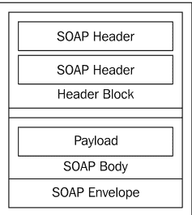
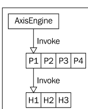
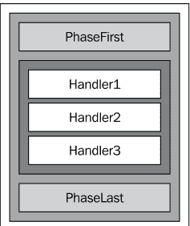
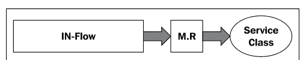

# 4 执行链

任何 Web 服务框架的关键功能都是处理传入消息并将其传递给目标应用程序（服务），一旦产生结果，再将其传递给客户端。如今，对于业务关键型应用程序，我们需要的远不止处理消息。因此，需要支持可靠性、安全性、事务和节流等功能。此外，框架还应该易于扩展，以支持新的客户需求和其他质量服务。为了提供这些特性，大多数 SOAP 处理框架都利用了管道（pipe）的概念，任何传入或传出的消息都会经过管道，而可扩展的管道被划分为多个小块。这样的一块被称为拦截器（interceptor）。可以添加新的拦截器、修改或删除它们，以满足需求。

在本章中，我们将更详细地讨论以下主题：

- 处理器
- 阶段
- 阶段规则
- 流的概念
- Axis2 发行版附带的一些默认处理器

## 处理器

处理器是 Axis1 项目引入的最重要、最有用的特性之一。事实上，处理器的思想在业界已经使用很久了。有些人将处理器称为消息拦截器。在任何消息传递系统中，拦截器在消息传递的语境中也有其实际含义，它会拦截消息流并执行分配给它的任何任务。实际上，拦截器是消息传递系统中最小的执行单元，因此，作为 Axis 中的拦截器，处理器也做同样的事情。

在 Axis 中，处理器是无状态的，这意味着它们不会在内存中保留过去的执行状态。处理器可以看作一个逻辑调用器，其逻辑评估的输入仅从 `MessageContext` 获取。处理器对 `MessageContext`（MC）和传入的 SOAP 消息具有读写访问权限。因此，处理器可以读取 SOAP 消息，从消息中删除元素（主要是消息头），添加新元素（消息头），或修改元素，以及添加、删除或修改 `MessageContext` 中的内容。

为了便于后续讨论，我们可以将 `MessageContext` 视为一个属性包，它保存传入或传出的消息，以及（可能两者都有）在消息通过执行链时所需的其他参数和属性。另一方面，通过 MC，我们可以访问整个系统，例如系统运行时、全局参数、属性服务以及操作。我们将在第 6 章“信息模型”中讨论更多与 MC 相关的操作。

在大多数情况下，处理器只处理 SOAP 消息的头块，即读取一个或多个消息头、添加消息头或移除消息头。然而，这并不意味着处理器不能处理 SOAP 正文。有时处理器也会处理正文；一个很好的例子是加密。在读取过程中，如果某个消息头面向某个处理器，而该处理器无法正确执行（消息可能有错误），则应抛出异常，下一个链驱动程序（在 Axis2 中是引擎）将采取必要的操作。带有一些消息头的典型 SOAP 消息如下图所示：






阶段（phase）旨在支持阶段规则。阶段规则告诉 Axis2 在执行链中应将处理器放在何处。稍后我们会看到，有诸如 phaseFirst 和 phaseLast 这样的规则。因此，在一个阶段中，有保留的插槽用于放置阶段第一个和阶段最后一个处理器。其余的处理器将保存在另一个列表中。一个阶段可以图形化表示如下：



一旦引擎调用阶段的 invoke 方法，它将按照以下顺序执行：

1. 首先检查前置条件是否满足。
   - 如果不满足，则抛出异常并停止处理消息。
2. 然后检查阶段第一个处理器是否存在。如果存在，则调用它。
3. 接下来，调用除阶段最后一个处理器之外的其余处理器。
4. 如果阶段最后一个处理器存在，则调用它。
5. 最后，检查后置条件是否满足以转发消息。
   - 如果不满足，则停止执行并抛出异常。

## 执行链

所有全局阶段从其名称中也具有语义含义：

- 传输阶段（Transport phase）：包含一个执行依赖于传输类型任务的处理器。
- 安全阶段（Security phase）：WS-security 实现会添加它们的处理器，但不限于此，任何其他模块或用户也可以添加处理器。
- 预分发（PreDispatch）：顾名思义，它包含一组执行分发所需任务的处理器。像 WS-addressing 这样的处理器将始终位于此阶段。
- 分发阶段（Dispatch phase）：该阶段通过为传入消息查找相应的服务和操作来执行分发。因此，分发阶段由分发处理器组成。我们也可以添加新的全局阶段，然后向其添加处理器，这需要修改 `axis2.xml` 文件。

请注意，如有必要，用户可以通过编辑 `axis2.xml` 轻松添加新阶段。

### 操作阶段

例如，假设我们有一个处理器，不需要为到达系统的每条消息运行它，但需要为选定的操作运行它。这就是操作阶段发挥作用的地方。操作阶段是位于分发阶段之后的阶段，用户可以添加任意数量的阶段。添加操作阶段不会改变其他操作在其链中的结构。

### 阶段规则

阶段规则的主要思想是正确定位处理器相对于阶段内另一个处理器的位置，可能是在部署时或运行时。Axis1 没有阶段或阶段规则的概念。它只有一个全局配置文件，在其中定义处理器。但这有很多局限性；尤其是，你会失去处理器链的动态特性。因此，阶段规则的一个方面是解决动态执行链构建能力的问题。

### 描述阶段规则的特征

阶段规则的特征可以基于以下一个或多个属性：

- 阶段名称（Phase name）：处理器必须被放置到的阶段的名称
- 第一阶段（`phaseFirst`）：阶段中的第一个处理器
- 最后阶段（`phaseLast`）：阶段中的最后一个处理器
- 之前（`before`）：将处理器定位在另一个处理器之前
- 之后（`after`）：将处理器定位在另一个处理器之后
- 之前和之后：将处理器放置在两个处理器之间

### 阶段名称

阶段是任何阶段规则的一个强制属性，该规则给出了处理器必须适配的阶段名称。为了使规则成为有效的阶段名称，该名称必须为系统所知，并且必须是全局阶段名称或操作特定的阶段。

### phaseFirst

顾名思义，如果你希望某个处理器在给定阶段中作为第一个处理器被调用，而不考虑该阶段中的其他处理器，则必须将 phaseFirst 属性设置为 true。一个其阶段规则仅包含 phaseFirst 和阶段名的处理器如下所示：

```
<handler name="simple_Handler" class="org.apache.axis.handlers.SimpleHandler">
    <order phase="userphase1" phaseFirst="true"/>
</handler>
```

### phaseLast

与 phaseFirst 类似，如果希望处理器在给定阶段中最后运行，而不考虑其他处理器，则必须将 phaseLast 设置为 true。因此，带有 phaseLast 的处理器如下所示：

```
<handler name="simple_Handler" class="org.apache.axis.handlers.SimpleHandler">
    <order phase="userphase1" phaseLast="true"/>
</handler>
```

如果某个阶段规则同时将 phaseFirst 和 phaseLast 设置为 true，那么该阶段不能再有任何其他处理器。换句话说，该阶段只有一个处理器。

### before

可能会存在这样的情况：一个处理器应该总是在某个其他处理器之前运行，无论其确切位置如何。一个实际用例可以是安全处理器需要在 RM 处理器之前运行。逻辑必须按如下方式编写，并且 before 属性的值是被引用的处理器名称：

- 如果某个处理器的阶段规则同时将 `phaseFirst` 和 `phaseLast` 设置为 `true`，那么该特定阶段不能有多个处理器。如果有人试图编写一个将其他处理器插入到同一阶段的阶段规则，则该第二个阶段规则无效。
- 一个阶段中不能有两个处理器的 `phaseFirst` 属性设置为 `true`。
- 一个阶段中不能有两个处理器的 `phaseLast` 属性设置为 `true`。
- 如果规则中的 `before` 属性被引用为 `phaseFirst` 处理器，则该规则无效。
- 如果规则中的 `after` 属性被引用为 `phaseLast` 处理器，则该规则无效。

```
<handler name="simple_HandlerError" class="org.apache.axis.handlers.SimpleHandlerError">
    <order phase="userphase1" before="simple_Handler" phaseFirst="true"/>
</handler>
```

阶段规则是为每个基本处理器定义的，系统中的任何处理器都必须归入系统中的某个阶段。

### 流程

流程只是阶段的一个集合，流程内阶段的顺序在 `axis2.xml` 中定义。由于阶段是一个逻辑集合，实际上是一个虚拟概念，流程可以被视为执行链（处理器的集合）。Axis2 中有四种类型的流程：

- `InFlow`：当消息进入时（请求消息），消息必须经过 `InFlow`。然后 `InFlow` 中的所有处理器都将被调用。`InFlow` 与 `OutFlow` 有些不同。一个流程由两部分组成。第一部分是从开始到分发器（直到并包括分发阶段）。第二部分仅在分发阶段结束时找到相应服务时才存在。因此，流程的第二部分是传入消息对应操作的 `InFlow`。所以 `InFlow` 由一个全局部分和一个操作部分组成。
- `InFaultFlow`：如果传入请求是错误请求（HTTP 状态码为 500 的请求），将调用此流程。
- `OutFlow`：当消息从服务器传出（比如响应）时，将调用此流程。因此，传出消息始终绑定到一个操作，并且在传出路径中没有类似分发的东西。

改变流程的唯一方法是将一个或多个处理器添加到流程中的某个阶段。因此，模块参与将动态地改变处理器链。模块可以动态（运行时）或静态（部署时）参与。如果你想静态地参与一个模块，你需要在描述文件中指定它。如果它是针对服务或操作的，则在 `services.xml` 中指定；如果是全局参与，则在 `axis2.xml` 中指定。

### 链中的特殊处理器

当你考虑执行链时，可以在执行链中发现四种类型的特殊处理器：

- 传输接收器
- 分发器
- 消息接收器
- 传输发送器

### 传输接收器

每当消息首先进入系统时，它会到达传输接收器。传输接收器可以被视为等待接受传入消息的东西（在应用服务器的情况下，传输接收器可以是 `Servlet`）。因此，执行链的 `InFlow` 总是从传输接收器开始。

### 分发器

正如我们之前讨论的，SOAP 处理框架的基本目标之一是将传入消息传递到目标应用程序。找到正确的目标应用程序的过程称为**分发**。在 Axis2 中，分发将在传入执行链的中间进行。因此，分发器是链中的处理器。在 Axis2 中，有几种方式可以执行分发：

- 使用传输头和传输层数据
- 使用 WS-Addressing 信息
- 使用传入的 SOAP 消息


为了满足提到的调度类型，Axis2 拥有一组默认调度器，你可以使用 `axis2.xml` 来更改它们的执行顺序。如果你查看 `InFlow` 元素，我们在 *Global phases* 部分讨论过，你可以在调度阶段找到可用调度器的集合。

- `RequestURIBasedDispatcher`: 尝试使用传输 URI 查找服务和操作
- `SOAPActionBasedDispatcher`: 尝试使用 SOAP 操作查找操作
- `AddressingBasedDispatcher`: 使用 WS-A 头中的寻址信息查找服务和操作
- `SOAPMessageBodyBasedDispatcher`: 使用并导航 SOAP 消息，特别是主体以查找操作。
- `HTTPLocationBasedDispatcher`: 这将用于调度 WSDL 2.0 相关 SOAP 消息

## Message receiver

消息接收器本身就是一个处理器，但唯一的区别是 Axis2 对此处理器的处理方式与其他处理器不同。如果消息在执行链中顺利通过（链中间没有发生异常），引擎将把消息交给消息接收器进行业务逻辑调用。下图显示了 `MessageReceiver` 在执行链中的位置：



另一方面，消息接收器是直接与实际服务实现类和 Axis Engine 交互的组件（服务本身也可能是消息接收器的情况）。Axis 1.x 具有 **pivot point** 的概念，即请求路径和响应路径汇合的地方，也是实际服务调用发生的地方。如前所述，消息接收器是 `InFlow` 的末端，与服务 `impl` 类交互。因此，Axis2 在将消息交给消息接收器后不再关心该消息。值得注意的是，是否发送响应消息以及如何处理消息完全由消息接收器决定。
