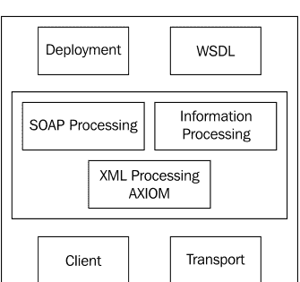
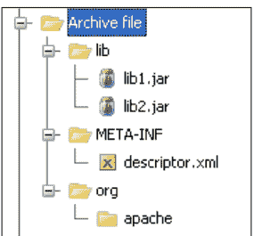
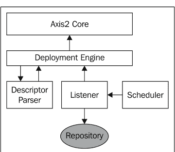
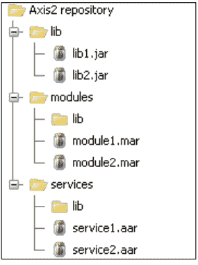
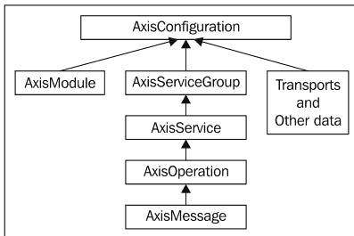
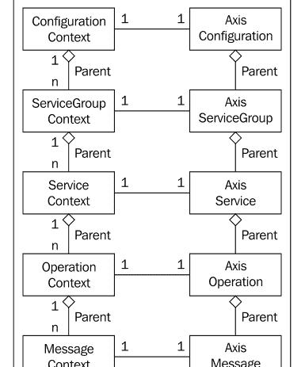

# 5 部署 Axis2
Deployment Model

现在趋势不仅仅是拥有功能，而是以非常用户友好的方式拥有它们。时间是他们唯一关心的东西，没有人喜欢花几天时间做一件小事。在 Apache Axis 的早期版本中，用户友好性并不是首要考虑因素，因为它们主要用于验证 Web 服务概念。因此，在 Axis 1.x 中，用户必须手动调用管理客户端，更新服务器 `classpath`，然后重启服务器以应用更改。这种繁琐的部署模型对初学者来说无疑是障碍。因此，Axis2 被设计用来克服这一缺点，并提供灵活、用户友好且易于配置的部署模型。

在本章中，我们将讨论：

- Axis2 部署模型，特别是基于归档的部署模型
- 热部署和热更新
- 仓库的概念
- 不同的部署描述符
- 几个动手示例

## What is new in Axis2 deployment?

如第一章 Apache Web Services and Axis2 中所述，Axis2 设计的主要目标之一是提供更强的用户友好性；同时为系统提供更好的可扩展性和灵活性。谈到用户友好性，服务部署是用户需要更少工作的领域之一。因此，与 Apache Axis1 相比，Axis2 支持一种非常方便的部署模型，并具有许多新功能。其中一些常用且有用的功能集如下所示：

- J2EE-like 部署机制（基于归档）
- 热部署和热更新
- 仓库的概念
- 部署处理器（模块）方式的改变
- 部署描述符
- 部署选项

下图显示了 J2EE-like 部署机制：



在任何 J2EE 应用服务器中，你都可以将应用程序作为自包含包部署，其中你可以将所有资源、配置文件和二进制文件捆绑到一个文件中并部署它。

这不是很容易而且有用吗？嗯，显而易见的答案是肯定的，它是有用的。

这就是为什么 Axis2 也引入了相同的机制以非常方便的方式部署服务（和模块）。

让我们考虑一个场景：你有一个服务，包含多个第三方依赖项和多个属性文件。进一步假设你没有 J2EE-like 部署机制。那么你需要做的就是将所有依赖的 JAR 文件和属性文件放入应用程序类路径中。如果有一台或两台服务器，这项工作就会翻倍，但如果你处于拥有数百个副本的集群环境中会怎样？在这种情况下，不可能去为每个副本都添加依赖的 JAR 文件和其他资源到类路径中。因此，当你拥有 J2EE-like 部署机制时，你无需担心此类问题。你只需将自包含包——在这种情况下是服务归档文件——放入副本中即可。这肯定减少了你的工作量，也避免了常见的人为错误。

Axis2 自包含包（或归档文件）的内部结构如图所示。Axis2 服务归档和模块归档具有非常相似的结构，只有细微差异。

对于 Axis 服务归档，`descriptor.xml` 文件变为 `services.xml`，而在另一种情况下，它变为 `module.xml`。

Axis2 服务归档的文件扩展名为 .aar，模块为 .mar（服务归档或模块归档只是文件扩展名更改为 .aar 或 .mar 的 ZIP 文件）。



如前所述，对于服务，`descriptor.xml` 文件将是 `services.xml`。因此，在服务归档文件中，你可以在 `META-INF` 目录下找到一个名为 `services.xml` 的文件。另一方面，对于模块归档，`META-INF` 将包含一个名为 `module.xml` 的文件。

- 对于服务归档：`descriptor.xml ---> services.xml`
- 对于模块归档：`descriptor.xml ---> module.xml`

## Hot deployment and hot update

可用性是企业级应用程序的一个大问题，在这种情况下，即使是一小段时间也非常宝贵。因此，重启服务器不是现实的选择，需要的是在不关闭系统的情况下更新和更改系统。这就是热部署和热更新发挥作用的地方。当你的应用程序具有这些功能时，你无需关闭系统即可更新系统。

尽管热部署和热更新的概念对技术范式来说并不是新术语，但它们是 Apache Web 服务栈 Axis 中的新功能。

在 Axis2 中，热部署和热更新通过定时器不断监控仓库中的更改来工作。更具体地说，当用户更改给定文件的最后修改日期时，它会将其视为热更新。相比之下，当它发现新文件时则视为热部署。热部署的架构如下一节图所示。

## Hot deployment

**Hot deployment** 是在系统运行时部署新服务的能力。例如，假设你有 *service1* 和 *service2* 正在运行，并且你在不关闭系统的情况下部署了一个名为 *service3* 的新服务。系统随后也会使 *service3* 成为运行中的服务。这种特定场景称为热部署。



作为系统管理员，如果你不喜欢服务的热部署，可以通过更改 Axis2 全局配置文件 `axis2.xml` 轻松关闭它。更改全局配置只是更改一个参数，如下所示：

```
<parameter name="hotdeployment">false</parameter>
```

## Hot update

热更新是在不关闭系统的情况下对现有 Web 服务进行更改的能力。这是一个重要功能，在测试环境中是必需的。然而，不建议在实时系统中<|message|>使用热更新，因为热更新可能导致系统进入未知状态。此外，存在丢失该服务现有服务数据的可能性。为了防止这种情况，Axis2 默认将热更新参数设置为 FALSE，如果你想要此功能，可以通过更改配置参数来实现，如下所示：

```
<parameter name="hotupdate">true</parameter>
```

## Repository

Axis2 仓库只是在文件系统中的一个具有特定结构的目录。另一方面，仓库可以位于本地或远程机器上。仓库的想法是为了以非常方便的方式支持基于归档的部署和热部署功能而引入的。


仓库目录由两个主要子目录组成，名为 `services` 和 `modules`。此外，你可能还有一个可选的子目录名为 `lib`。如果你想部署一个服务，你需要将服务归档文件放入 `services` 目录。类似地，如果你想部署一个模块，那么你需要将模块归档文件放入 `modules` 目录。`lib` 目录的想法是存储将要在服务和模块之间共享的第三方库。参考下一张截图以查看目录结构：



如果 `modules` 目录中的一个或多个模块需要共享某些资源，那么它们可以将这些资源添加到 `modules` 目录内的 `lib` 目录中。类似地，如果 `services` 目录中的服务想要共享一些通用资源，适当的位置是 `services` 目录内的 `lib` 目录。

## 处理程序（模块）部署方式的变更

**服务扩展**的概念是 Apache Axis 范式中的一个新功能，但开发者在 Axis 1.x 中通过艰难的工作实现了相同的目标。因此，想法是扩展系统的核心功能或提供服务质量。在 Axis 1.x 的情况下，如果你需要扩展其核心功能，你需要编写一个处理程序（执行链中的最小单元），更改全局配置文件以添加处理程序，最后重启系统。

## 全局描述符或 axis2.xml

如前所述，Axis2 中的配置可以使用 XML 描述符指定。这为扩展和更改 Axis2 提供了更大的灵活性。无需去更改代码以获得不同的配置。即使对于核心功能也是如此。如果你考虑 Axis2 的全局配置文件——axis2.xml——它包含了运行 Axis2 所需的所有最小配置。Axis2 的最小配置包括：

- 配置参数
- 传输发送器
- 传输监听器
- 执行链和阶段
- 默认调度器
- 默认消息接收器
- 默认客户端侧配置
- 全局模块
- WS-Policy（全局级别策略）

其中一些给定的术语对你来说可能不熟悉，但你现在无需担心。我们将在后续章节中讨论这些术语。Axis2 附带默认的 axis2.xml，它具有启动 Axis2 所需的最小配置。然而，你可以根据自己的意愿更改它，并使用自己的 axis2.xml 启动 Axis2。这里需要记住的关键点是，如果你对 axis2.xml 做了任何更改，你必须重启系统才能使这些更改生效。

## 服务描述符（services.xml）

正如我们在上一节讨论的，axis2.xml 指定了影响整个系统的配置。然而，services.xml 用于配置特定服务或服务组。在下一节中，我们将查看在 Axis2 中部署服务的可用方式。基于归档的部署和基于目录的部署可以被认为是两种最常用的技术。在这两种情况下，对于一个服务要成为有效服务，需要有一个 services.xml 文件。服务描述符用于指定以下类型的配置（其中一些是可选的）：

- 服务名称
- 服务的目标名称空间
- 会话作用域
- 暴露传输
- 服务级别和操作级别参数
- 消息接收器
- 服务级别模块
- 操作 – 暴露操作以及非暴露操作
- Bean 映射
- 对象提供者
- 服务和操作级别策略

我们将在第 7 章《编写 Axis2 服务》中更深入地学习 services.xml 以及如何编写和创建服务。

## 模块描述符或 module.xml

现在显而易见，module.xml 用于配置 Axis2 模块；因此它也有不同类型的配置：

- 处理程序及其阶段规则
- 模块参数
- 端点
- WS-Policy

在第 8 章《编写 Axis2 模块》中，我们将更深入地学习 Axis2 模块以及如何编写它们。

## 可用的部署选项

在 Axis2 的初始阶段，它仅具有基于归档的部署。然而，后来它引入了许多便捷的部署选项。这使得服务作者的工作变得更容易。全部加起来，Axis2 具有以下服务部署选项：

- 基于归档的部署
- 基于目录的部署
- 使用归档文件以编程方式部署
- 以编程方式将 Java 类制作成 Web 服务
- 纯 Java 对象（POJO）部署支持以及注解
- 一行代码部署并启动 Axis2

## 基于归档的部署

在 Axis2 中部署服务的**基于归档的部署**是最常见且推荐的方法。在这里，你可以获得许多配置选项，与其他类型相比更灵活。在本章中，我们将通过示例讨论更多关于基于归档的部署。

## 基于目录的部署

**基于目录的部署**几乎与基于归档的部署相同；唯一的区别是，与创建归档文件相比，你可以作为目录部署服务。目录的结构与归档文件相同。

## 以编程方式部署服务

以归档文件以编程方式部署服务并不是真正用户的需求；而是模块作者的需求，其中某些模块需要在运行时部署 Web 服务以提供该特定模块的完整功能。

要以编程方式创建服务（`ServiceGroup`），你需要有表示服务归档文件的 file 对象以及指向 Axis2 运行时或 `ConfigurationContext` 的指针。一旦你拥有这两个，我们就可以创建 Web 服务，如以下代码片段所示。这种方法的优点是你不需要将服务归档文件复制到仓库中，它仅在你的服务运行时可见。

```
//Need to have a reference to ConfigurationContext
ConfigurationContext configContext = getConfigurationContext();
File serviceArchiveFile = new File("Location of the file");
//Now let's create AxisServiceGroup which contains the service we want to have
AxisServiceGroup serviceGroup = DeploymentEngine.loadServiceGroup(
    serviceArchiveFile,
    configContext);
```

一旦你创建了服务，下一步就是将服务添加到系统中。你可以按如下方式操作：

```
//Getting a pointer to AxisConfiguration
AxisConfiguration axiConfiguration = configContext.
getAxisConfiguration();
//Adding the created service
axiConfiguration.addServiceGroup(serviceGroup);
```

现在，如果你尝试使用以下 URL 访问 add 方法，你应该得到与之前相同的结果：

```
http://localhost:6060/axis2/services/MyService/add?a=10&b=15
<ns:addResponse>
    <return>25</return>
</ns:addResponse>
```

## 总结

在本章中，我们讨论了 Axis2 部署的工作方式、可用部署描述符的类型及其结构。此外，我们还讨论了 Axis2 中可用的不同类型的配置文件。在本章末尾，我们学习了最重要的内容，即 Axis2 中可用的部署选项。我们也通过示例测试了这些选项。下一步将是创建更多服务并看看会发生什么。

在下一章中，我们将讨论更多关于 Axis2 信息模型的内容。在那里，我们将讨论静态和动态数据层次结构、层次结构中的不同实体、它们是如何创建的，以及哪些描述符负责不同的实体。


以下图表展示了 Axis2 中各种类型描述或元数据之间的关系：



如我们所见，层级结构中最顶层的组件是 AxisConfiguration，它负责跟踪所有配置数据，无论是直接还是间接的。图中显示了三种主要类型的对象。首先，AxisModule 源自名为 module.xml 的描述文件，因此当我们在 Axis2 中部署一个模块时，将会有一个新的 AxisModule 对象来跟踪该特定模块的配置数据。其次，中间的对象层级是在我们在 Axis2 中部署服务时创建的。最后，还有从 axis2.xml 直接读取的传输和其他数据。

## AxisConfiguration

AxisConfiguration 是静态数据层级中最顶层的组件。尽管如此，需要注意的是，虽然我们称 AxisConfiguration 为静态层级，但这并不意味着它是不可变的。在某些情况下其内容会发生变化，但这些变化非常少见。整个 AxisConfiguration 对象实际上是从 axis2.xml、一组 module.xml 文件和一组 services.xml 文件中收集的数据。创建 AxisConfiguration 的方式也有很多种。可以利用本地文件系统、远程仓库，甚至数据库来创建 AxisConfiguration。我们将在第 15 章《构建安全可靠的 Web 服务》中讨论这些选项。在本章中，重点将放在使用本地文件系统的默认 axis2.xml 文件创建 AxisConfiguration。以下图表展示了一个典型的 axis2.xml，其中包含启动 Axis2 服务器所需的最小配置数据（图表后会给出元素结构的详细解释）：

```
class="o.a.a.t.h.SimpleHTTPServer"
<parameter name="port">6060</parameter>
</transportReceiver>
</axisconfig>
```

参数有一个作用域。与 axis2.xml 中的直接子元素一起定义的参数可以被系统中的任何描述符访问。如果参数是在 axis2.xml 的第一级子元素内部定义（例如 transportSender），那么该参数只能在该特定子元素内部访问，在本例中即该特定的 transportSender。

在访问参数时，Axis2 首先检查参数是否在当前描述中定义。如果没有，它会检查直接父级中是否存在该参数。如果找到，则返回该参数；否则，将检查父级的父级，以此类推。以这种方式，当请求参数时，它会在层级中进行搜索。

## MessageReceiver

在第 4 章《执行链》中，我们更详细地讨论了 MessageReceiver 及其用法。我们将为服务使用的所有消息接收器都应指定在 axis2.xml 中。你可以根据需要在 services.xml 中使用任意数量的消息接收器并使用合适的接收器。在 axis2.xml 中指定消息接收器的方式如下所示：

```
<messageReceivers>
<messageReceiver mep="MEP"
class="o.a.a.r.RawXMLINOnlyMessageReceiver"/>
</messageReceivers>
```

注意：在前面的 XML 元素中，MEP 代表 MessageReceiver 可以处理的 Message Exchange Patterns。Class 属性用于指定 MR 的实际实现类。你可以注册任意数量的消息接收器并附带唯一的 MEP。例如，WSDL 2.0 允许 8 种类型的 MEP。

### MessageFormatters and MessageBuilders

在 HTTP 中，我们使用 content-type 头来指定消息体中的数据类型。此外，根据内容类型，消息的线格式也会有所不同，例如 XML、JSON、base64 等。Axis2 也支持多种不同的消息类型，因此需要将消息序列化并反序列化为正确的格式。为此，Axis2 引入了 `MessageFormatters` 和 `MessageBuilders`；前者用于将消息序列化为线格式，后者用于从传入的消息流构建 SOAP 消息。我们已经知道，Axis2 中任何类型的消息都使用 Axiom 表示，而在序列化消息时，需要根据内容类型进行格式化。`MessageFormatters` 就是为我们完成这项工作。我们可以在 axis2.xml 中与内容类型一起指定 `MessageFormatters`。另一方面，进入 Axis2 的消息可能是也可能不是 XML。然而，为了让它通过 Axis2，需要创建 Axiom 元素。因此，`MessageBuilders` 被用来根据内容类型构建消息。

这两种类型的描述可以被视为复杂类型，并且用户不太可能更改它们，因此用户可以很满意地使用默认的 axis2.xml，因为它已经配置了所有常用的内容类型以及对应的构建器和格式化器。axis2.xml 中 XML 元素的结构如下所示：

```xml
<messageFormatters>
    <messageFormatter contentType="application/x-www-form-urlencoded"
    class="o.a.a.t.h.XFormURLEncodedFormatter"/>
</messageFormatters>

<messageBuilders>
    <messageBuilder contentType="application/xml"
    class="o.a.a.b.ApplicationXMLBuilder"/>
</messageBuilders>
```

如图所示，你可以使用内容类型和实现类来指定消息构建器和格式化器。在运行时，Axis2 会选择合适的组件来序列化和反序列化消息。

### TransportReceiver and TransportSender

Axis2 与传输无关，因此可以使用多种传输与 Axis2 通信。例如，Axis2 内置支持 HTTP、TCP、SMTP 和 JMS。所有这些都可以通过 axis2.xml 进行配置。

```
</phaseOrder>
<phaseOrder type="OutFlow">
    <phase name="OperationOutPhase"/>
    ........................................................
</phaseOrder>
<phaseOrder type="InFaultFlow">
    <phase name="PreDispatch"/>
    ........................................................
</phaseOrder>
<phaseOrder type="OutFaultFlow">
    <phase name="OperationOutFaultPhase"/>
    ........................................................
</phaseOrder>
```

到目前为止，我们已经讨论了来自 axis2.xml 的不同类型的配置数据。现在让我们来看其他类型的描述。

## AxisModule

简单来说，AxisModule 是 module.xml 的运行时表示。因此，module.xml 中找到的所有配置数据都存在于 AxisModule 中。一个典型的模块配置文件或 module.xml 包含以下数据：

- 模块名称
- 模块描述
- 处理器和阶段规则
- 端点和操作
- WS-Policy
- 参数

在部署时，AxisModule 使用 module.xml 中的数据进行填充。在运行时，可以通过同一个 AxisModule 检索此数据的任何部分。一旦数据填充完成且模块完成，AxisModule 的父描述符就成为 AxisConfiguration。

## AxisMessage

AxisMessage 是服务层级的叶子元素，且 AxisMessage 的直接父级是 AxisOperation。如我们所讨论的，AxisService 可以有任意数量的 AxisOperation。然而，AxisOperation 不能有任意数量的 AxisMessage 元素。操作中 AxisMessages 的数量由消息交换模式决定。例如，如果操作是 in-out，则其中将只有两个 AxisMessage 元素，一个表示入消息配置，另一个表示出消息配置。AxisMessage 具有以下数据集合：

- 参数
- WS-Policy
- 消息标签
- 对应模式元素的 Element QName（可选）

> 注意：消息元素是可选元素，因此我们可以有零个消息元素的操作元素。只有在要覆盖消息时，例如添加新策略，才需要添加消息元素。

现在，我们对 Axis2 静态数据及其更改方式有了良好的理解，因此下一步是学习动态数据层级以及静态数据与运行时数据之间的关系。以下图表展示了描述层级与上下文或运行时数据层级之间的关系。

## Axis2 contexts

Axis2 上下文层级是 Axis2 的运行时数据表示。运行时数据只有在 Axis2 接收到消息时才会出现（与描述不同）。运行时数据用于在多次调用之间或一次调用中的多个处理器之间共享数据。当我们讨论描述层级时，我们谈到参数如何作为主要配置机制。在上下文中，主要的配置或数据共享机制是使用 Properties。与参数不同，我们不需要在任何地方定义属性，因为我们可以即时创建并使用它们。属性以名称-值对的形式存储在上下文层级中。因此，如果我们向上下文添加一个属性，则该属性可以被其任何子上下文访问和覆盖。

以下图表展示了 Axis2 中静态数据与运行时数据之间的关系：




如你在左侧所见，层级结构中最顶层的组件是 ConfigurationContext。ConfigurationContext 与其他上下文相比，唯一的区别在于，它是系统中在接收消息之前就已存在的唯一上下文。ConfigurationContext 持有对 AxisConfiguration 的引用，要创建 ConfigurationContext，必须有一个可用的 AxisConfiguration。

### ConfigurationContext

ConfigurationContext 是整个系统的运行时表示。要启动 Axis2，你需要有一个配置上下文。配置上下文的生命周期就是系统的生命周期，因此如果我们存储一个状态（一个属性），它将永远保留在那里（也就是说，直到系统关闭）。ConfigurationContext 不仅是所有其他上下文的父级，还可以被视为整个 Axis2 系统的发起者元素。

### ServiceGroupContext

当 Axis2 收到消息时，会创建一个 ServiceGroupContext 来存储和共享数据。要创建 ServiceGroupContext，需要有一个可用的 AxisServiceGroup 对象。一个 AxisServiceGroup 可能有一个或多个 ServiceGroupContext。不过，与该上下文关联的 AxisServiceGroup 只有一个。ServiceGroupContext 的生命周期取决于服务作用域（例如，应用、传输、SOAP 会话和请求）。如果服务作用域是应用，那么其生命周期将与系统生命周期相同。然而，如果服务作用域是“请求”，那么每次调用都会创建一个 ServiceGroupContext。如果我们希望在运行时在同一个服务组中的多个服务之间共享数据，那么 ServiceGroupContext 提供了实现这一目标的手段。

### ServiceContext

ServiceContext 表示给定服务的运行时数据。要创建 ServiceContext，我们需要有可用的 ServiceGroupContext 对象和 AxisService 对象。ServiceContext 的生命周期取决于服务作用域。如果我们希望在同一个服务的多次调用之间共享数据，那么可以使用 ServiceContext 作为存储这些数据的占位符。

例如，假设我们有一个包含三个操作的服务——login、doSomething 和 logout。同时，假设我们需要在这三个操作之间共享数据。这里，可以使用 ServiceContext 来实现这些目标。一个 ServiceGroupContext 中 ServiceContext 的数量取决于对应 AxisServiceGroup 中 AxisService 的数量。

### OperationContext

OperationContext 表示一个消息交换模式（MEP）的生命周期。通常情况下，操作上下文的生命周期比服务上下文的生命周期短。我们可以使用 OperationContext 在 MEP 的消息之间共享数据。例如，如果我们希望在请求和响应之间共享数据，那么可以使用 OperationContext 来实现。ServiceContext 中 OperationContext 上下文的数目与 AxisService 中 AxisOperation 操作的数目无关；它只取决于调用次数，例如，每次调用对应一个 OperationContext。
