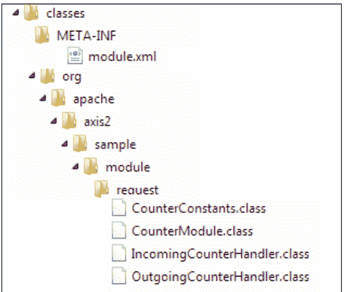
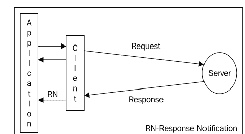
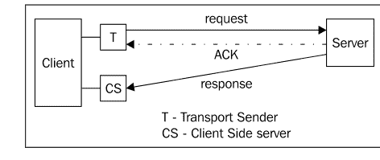
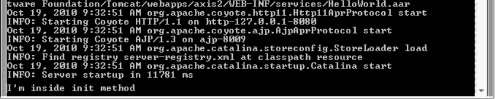

# 8 编写 Axis2 模块

## 编写 Axis2 模块

Web 服务在行业中越来越受欢迎，并已成为应用程序集成的主要推动力之一。此外，由于使用 Web 服务的灵活性和优势，每个人都在尝试为其应用程序提供 Web 服务支持。因此，Web 服务框架需要支持新的、更加定制化的需求。正如我们在前面章节中已经讨论过的，Web 服务框架的主要目标之一是将传入的消息交付给目标服务。然而，仅仅将消息传递给服务是不够的；当今的应用程序还需要可靠性、安全性、事务性以及其他服务质量。

由于 Web 服务的普及，标准机构正在制定新的 Web 服务标准，而如果 Web 服务框架不够灵活，就很难支持这些新标准。从 Axis2 诞生之初，灵活性和可扩展性就是两个主要的设计考虑因素。Axis2 模块的理念是在不修改核心系统的情况下扩展系统的核心功能。例如，Axis2 将可靠性和安全性作为两个独立的模块来支持，而核心引擎完全独立于这两个服务质量模块。

在本章中，我们将讨论 Axis2 模块的强大功能，以及如何使用它们扩展 Axis2 以支持你自己的需求。具体来说，我们将讨论以下内容：

- Axis2 模块的简要历史
- 介绍模块概念
- 模块的结构
- 模块配置文件（`module.xml`）
- 可选的模块实现类
- 编写 `module.xml` 文件的步骤
- 部署和启用模块
- WS-Policy 及其在模块中使用的简要概述


## 处理器与阶段规则

正如我们讨论过的，模块是处理器的集合，因此一个模块可以包含一个或多个处理器。无论模块中有多少个处理器，`module.xml` 都提供了一种便捷的方式来指定它们。最重要的是，`module.xml` 可用于提供足够的配置选项，将处理器添加到系统中，并指定模块作者希望处理器在何处运行。在第4章“执行链”中，我们了解了阶段规则（phase rules）作为一种机制，可以让 Axis2 将处理器放入执行链中的特定位置，因此现在是时候通过一个示例来深入了解它们了。

在编写阶段规则以及在 `module.xml` 中指定处理器之前，让我们先看看如何编写处理器。在 Axis2 中有两种编写处理器的方式：

- 实现 `org.apache.axis2.engine.Handler` 接口
- 继承 `org.apache.axis2.handlers.AbstractHandler` 抽象类

在本章中，我们将编写一个简单的应用程序，以便更好地理解模块。此外，为了让示例应用程序更简单，我们将忽略 Handler API 的一些复杂性。我们将采用继承 `AbstractHandler` 的方式。当我们继承这个抽象类时，只需要实现一个名为 `invoke` 的方法即可。下面的示例代码将演示如何实现 `invoke` 方法：

```
public class IncomingCounterHandler extends AbstractHandler implements CounterConstants {
public InvocationResponse invoke(MessageContext messageContext) throws AxisFault {
    //get the counter property from the configuration context
    ConfigurationContext configurationContext = messageContext.getConfigurationContext();
    Integer count = (Integer) configurationContext.getProperty(INCOMING_MESSAGE_COUNT_KEY);
    //increment the counter
    count = Integer.valueOf(count.intValue() + 1);
    //set the new count back to the configuration context
    configurationContext.setProperty(INCOMING_MESSAGE_COUNT_KEY, count);
    //print it out
    System.out.println("The incoming message count is now " + count);
    return InvocationResponse.CONTINUE;
}
}
```

```
AxisModule axisModule) throws AxisFault {
    //initialize our counters
    System.out.println("inside the init : module");
    initCounter(configurationContext, INCOMING_MESSAGE_COUNT_KEY);
    initCounter(configurationContext, OUTGOING_MESSAGE_COUNT_KEY);
}

private void initCounter(ConfigurationContext configurationContext,
                         String key) {
    Integer count = (Integer) configurationContext.getProperty(key);
    if (count == null) {
        configurationContext.setProperty(key, Integer.valueOf("0"));
    }
}

public void engageNotify(AxisDescription axisDescription) throws AxisFault {
    System.out.println("inside the engageNotify " + axisDescription);
}

public boolean canSupportAssertion(Assertion assertion) {
    //returns whether policy assertions can be supported
    return false;
}

public void applyPolicy(Policy policy,
                         AxisDescription axisDescription) throws AxisFault {
    // Configuure using the passed in policy!
}

public void shutdown(ConfigurationContext configurationContext) throws AxisFault {
    //do cleanup - in this case we'll write the values of the counters to a file
    try {
        SimpleDateFormat format = new SimpleDateFormat(TIMESTAMP_FORMAT);
        File countFile = new File(COUNT_FILE_NAME_PREFIX + format.format(new Date()) + FILE_SUFFIX);
        if (!countFile.exists()) {
            countFile.createNewFile();
        }
```

```java
Properties props = new Properties();
props.setProperty(INCOMING_MESSAGE_COUNT_KEY,
                  configurationContext.getProperty(INCOMING_MESSAGE_COUNT_KEY).toString());
props.setProperty(OUTGOING_MESSAGE_COUNT_KEY,
                  configurationContext.getProperty(OUTGOING_MESSAGE_COUNT_KEY).toString());
//write to a file
props.store(new FileOutputStream(countFile), COUNTS_COMMENT);
} catch (IOException e) {
    //if we have exceptions we'll just print a message and let
it go
    System.out.println("Saving counts failed! Error is " +
e.getMessage());
}
}
}
}
```

如我们所见，前面的模块实现类中有许多方法。但值得注意的是，并非所有方法都在模块接口中。模块接口只有以下方法，而这里我们还有一些其他方法用于支持与计数器模块相关的内容：

- `init`
- `engageNotify`
- `applyPolicy`
- `shutdown`

在系统启动时，`init` 方法会被调用，此时模块可以执行各种初始化任务。在我们的示例模块中，我们初始化了入向计数器和出向计数器。

当我们将这个特定模块应用到整个系统、某个服务或某个操作时，`engageNotify` 方法会被调用。此时，模块可以决定是否允许这种应用。举例来说，如果我们尝试将安全模块应用到某个服务，而此时模块发现加密算法存在冲突，那么在这种情况下，模块将无法接入，模块会抛出异常，Axis2 也不会接入该模块。在我们的示例中，`engageNotify` 方法内部不做任何操作。

你可能已经知道，WS-Policy 是关键标准之一，在 Web 服务配置中扮演着重要角色。当你将某个模块应用到某个服务时，模块策略应当应用于该服务，并且在查看该服务的 WSDL 时应可见。因此，`applyPolicy` 方法会在我们应用模块时，将模块策略设置到相应的服务或操作上。在这个特定示例中，我们没有任何与模块关联的策略，因此同样无需担心这个方法。

正如我们在 `init` 方法中讨论的，当系统需要关闭时，`shutdown` 方法会被调用。因此，如果我们希望在该时刻执行任何类型的处理，可以将相关逻辑添加到那个特定方法中。在我们的示例中，为了演示目的，我们添加了将计数器值存储到文件中的代码。

## 编写 module.xml 文件

到目前为止，我们已经编写了两个处理器和模块实现类。现在，唯一剩下的事情就是编写模块描述文件。在编写 `module.xml` 时，我们必须使用阶段规则来指定处理器的位置，之前我们已经讨论过阶段规则（是时候复习一下阶段规则了）。我们模块的最简单的 `module.xml` 文件如下所示：

```
<module name="counterModule" class="org.apache.axis2.sample.module.request.CounterModule">
    <Description>
        Counts the incoming and outgoing messages
    </Description>
    <InFlow>
        <handler name="IncomingMessageCountHandler" class="org.apache.axis2.sample.module.request.IncomingCounterHandler">
            <order phase="Transport" after="RequestURIBasedDispatcher" before="SOAPActionBasedDispatcher"/>
        </handler>
    </InFlow>
    <OutFlow>
        <handler name="OutgoingMessageCountHandler" class="org.apache.axis2.sample.module.request.OutgoingCounterHandler">
            <order phase="MessageOut"/>
        </handler>
    </OutFlow>
</module>
```

在 `module.xml` 文件中，我们将模块的描述指定为“Counts the incoming and outgoing messages”（统计流入和流出的消息）；同时，它还通过阶段规则指定了我们之前实现的两个处理器。

如你所见，我们尝试将入站消息计数器放入传输阶段，具体位置是在 `RequestURIBasedDispatcher` 之后、`SOAPActionBasedDispatcher` 之前。如果你查看默认的 `axis2.xml` 文件，就会在 `inFlow` 中看到这两个处理器。同时，在出站消息中，计数器被添加到消息输出阶段，这里没有指定确切位置。

如果你仔细查看根元素，会发现一个名为“class”的属性，它指定了模块接口类。我们需要记住，这个属性是可选的，某些模块可能有也可能没有这个属性。

> 在某些情况下，模块作者需要为模块使用新的阶段。在这种情况下，可以编辑 `axis2.xml` 并指定所需的新阶段。一旦指定，就可以在 `module.xml` 中使用这些阶段。

在 `module.xml` 文件中，我们还没有讨论如何添加错误处理器。众所周知，错误处理有两个流：`InFaultFlow` 和 `OutFaultFlow`。当收到入站错误时，执行 `InFaultFlow`；同样，当有出站消息时，执行 `OutFaultFlow`。如果你想向这些阶段中的任何一个添加处理器，可以像操作另外两个流一样进行。

## 部署并应用模块

现在我们已经编写了有效模块所需的一切，剩下的唯一事情就是创建模块归档文件并将其部署到存储库中。首先编译源代码，然后，如我们所知，会生成 `.class` 文件。

假设 `org.apache.axis2.sample.module.request` 是我们源文件的包名，我们可以在 `classes/org/apache/axis2/sample/module/request` 下找到所有 `.class` 文件。


现在，在 `classes` 目录下创建一个名为 `META-INF` 的目录，并将 `module.xml` 文件复制到其中。然后，我们的 `classes` 目录应该如下面的截图所示：



现在，从 `classes` 目录创建一个 ZIP 文件，并将该 ZIP 文件重命名为 `counter-module.mar`。

部署模块非常简单，只需将文件放入 `TOMCAT_HOME/webapps/axis2/WEB-INF/modules` 或 `repository/modules` 目录即可。在这里，我们将重点讨论在 Tomcat 或你喜欢的 Web 应用服务器中部署模块。众所周知，Axis2 不支持模块的热部署，因此仅仅放入模块不会对运行时系统产生任何更改。要部署我们的模块并将必要的更改应用到运行时，我们需要重启 Axis2；换句话说，我们需要重启应用服务器。

需要注意的是，仅仅部署模块并不会将其处理器（handler）添加到处理器链中；要将处理器添加到系统中，必须启用（engage）该模块。现在，让我们看看如何在 Axis2 中启用模块。为此，我们可以使用 Axis2 Web 管理控制台。此外，为了简单起见，让我们尝试使用 Web 管理控制台将该模块启用到系统中的所有服务（我们也可以使用管理控制台仅启用单个服务）。我们可以通过以下步骤将模块启用到系统中：

- 1. 访问 http://localhost:8080/axis2/。
- 2. 点击“Administration”选项卡。这将打开一个新页面，并要求输入用户名和密码。

> 还有其他启用模块的方式，例如，要全局启用模块，用户可以编辑 axis2.xml 并添加 `<module ref="modulename" />` 元素。此外，如果用户想要将其启用到特定服务，可以通过编辑 services.xml 并添加上面提到的相同标签来实现。

## 高级 module.xml

这里，我们看到了一个非常简单的 module.xml，但对于非常复杂的应用程序，我们需要在 module.xml 文件中进行更多配置。我们可能需要参数、WS-Policy 和端点。现在让我们逐一简要了解它们。

### 参数

在此处添加参数与在 services.xml 或 axis2.xml 中添加参数相同。我们只需要将以下标签添加到 module.xml 中，Axis2 就会为我们处理正确的事情：

```
<parameter name="foo">bar</parameter>
```

我们可以在 module.xml 中拥有任意数量的参数，当我们需要访问该参数时，可以按照以下步骤操作：

- - 首先，我们需要获取 AxisModule。我们可以通过使用 init 方法（Axis2 传递 AxisModule）来做到这一点，或者我们需要从 ConfigurationContext（在 Module 实现类中）或从 messageContext（在处理器中）获取相应的 AxisModule。
- - 之后，我们可以从 AxisModule 中请求参数。

### WS-Policy

在 module.xml 中指定 WS-Policy 元素是配置模块的一种方式。我们可以在 module.xml 中添加 WS-Policy 元素。如果我们考虑 Sandesha2（可靠消息实现）模块，我们可以找到以下策略元素：

```
<wsp:Policy xmlns:wsp="http://schemas.xmlsoap.org/ws/2004/09/policy" xmlns:wsu="http://docs.oasis-open.org/wss/2004/01/oasis-200401-wss-wssecurity-utility-1.0.xsd" xmlns:sandesha2="http://ws.apache.org/sandesha2/policy" wsu:Id="RMPolicy">
    <sandesha2:RMAssertion>
        [REST OF THE FILE]
    </sandesha2:RMAssertion>
</wsp:Policy>
```

### 端点

在 Axis2 中，端点是 Web 服务的一个操作。因此，添加端点与添加操作相同。关键问题是——为什么我们需要向模块添加端点？为了理解这一点，假设我们有一个模块，并且该模块具有一组控制操作。最合适的例子是可靠消息传递，因为它有许多控制消息（例如，创建序列、最后消息、终止序列）。假设我们需要以可靠的方式调用一个服务。它首先需要与该服务建立序列。为此，它将向我们需要访问的服务发送名为 `createSequence` 的控制消息。但该服务没有该方法，因此如果我们尝试在不添加该方法的情况下发送 `createSequence` 消息，Axis2 将抛出一个异常，提示**无法分发**。因此，添加端点将解决该问题。因此，当我们启用 Sandesha 时，它会在我们启用模块时（或者如果我们将其启用到整个系统，则为所有服务）向服务添加一个名为 `createSequence` 的方法。当请求到来时，Axis2 将毫无问题地进行分发。此操作或端点具有自己的消息接收器来处理相应的事情。

因此，很明显，当模块需要交换控制操作时，需要添加端点来表示这些操作。添加端点非常简单。我们需要做的是添加一个或多个操作元素，以及一个消息接收器和一组操作映射。为了对此有所了解，让我们以 Sandesha 模块作为参考。它的 `module.xml` 具有以下操作标签来添加控制操作。请记住，当我们在 `module.xml` 中有操作标签时，Axis2 将完成所有处理，包括创建 `AxisOperation` 并添加它。作为模块作者，我们只需要在 `module.xml` 文件中指定它们：

```
<operation name="Sandesha2OperationInOut" mep="http://www.w3.org/2006/01/wsdl/in-out">
    <messageReceiver class="org.apache.sandesha2.msgreceivers.RMMessageReceiver"/>
    <!-- namespaces for the 2005-02 spec -->
    <actionMapping>http://schemas.xmlsoap.org/ws/2005/02/rm/CreateSequence</actionMapping>
    <actionMapping>http://schemas.xmlsoap.org/ws/2005/02/rm/AckRequested</actionMapping>
    ..................
</operation>
```

### 编写 Axis2 模块

如果我们查看 Sandesha 的 module.xml，我们将能够学习和了解更多关于编写 module.xml 文件的内容。

### 总结

在本章中，你了解了 Axis2 模块的重要性。我们还了解到，Axis2 模块提供了扩展 Axis2 核心功能的一种非常灵活的方式，并提供了高质量的服务。此外，我们通过编写一个示例模块并演示大多数常用配置设置来讨论模块及相关概念。在我们的示例应用程序中，我们讨论了如何编写处理器、如何编写模块实现类，以及最后如何将所有内容组合在一起并部署模块。在本章末尾，我们学习了如何将模块启用到 Axis2。

在本章中，我们讨论了如何编写和部署服务，以及如何编写和部署模块。在下一章中，我们将讨论如何调用远程服务。在那里，我们将讨论如何将 Axis2 用作客户端并以多种方式调用服务。

## 客户端 API

Web 服务是应用程序集成（组合）中常用的方法之一；在集成应用程序时，一个应用程序既可以充当消费者（客户端），也可以充当生产者（服务器）。一个 Web 服务框架应该能够部署服务，也能够访问服务。到目前为止，我们已经讨论了它的部署方面。因此，在本章中，我们将重点关注客户端，以及如何使用 Axis2 访问远程服务。在高层次上，Axis2 运行时并不区分客户端和服务器端。此外，它在服务器端和客户端使用相同的执行框架。正如我们已经讨论过的，在服务器端，我们有服务。因此，为了在客户端也保持对称性，Axis2 在我们使用客户端 API 时会创建一个虚拟服务。在本章中，我们将通过示例用例来探讨客户端 API 的各个方面。

在本章中，我们将讨论 Axis2 客户端最常用的 API，并解释如何通过示例代码使用它们。首先，我们将讨论创建 Axis2 客户端实例的各种方法。然后，我们将讨论可用的 API，最后，我们将讨论 Axis2 客户端 API 的更高级用法。具体来说，我们将详细涵盖以下内容：

- - Web 服务客户端的概念
- - 同步和异步服务调用
- - Axis2 客户端 API，即 `ServiceClient` 和 `OperationClient`
- - 通过示例演示 `ServiceClient` API
- - 通过示例演示 `OperationClient` API


在异步类型调用的情况下，用户应用程序（例如 GUI）不会被阻塞，因此用户可以继续工作。Axis2 在异步中使用服务的方式如下图所示：



上图展示了典型的异步消息的工作方式，其中应用程序使用 Axis2 客户端并请求发送消息。调用 Axis2 客户端时，应用程序会创建一个回调对象并将其传递给调用。Axis2 使用该回调并将控制权返回给客户端。因此，客户端不会被阻塞。当回复到来时，Axis2 客户端使用回调进行通知，通过这种方式，应用程序也会得知消息到达并据此采取行动。

## 深入了解 Axis2 客户端 API

在当今世界，人们不喜欢也不愿意浪费时间去完成一件简单的事情。因此，用户友好性是任何产品的关键考虑因素之一。在 Axis2 中，Axis2 客户端 API 的关键设计之一是提供异步 Web 服务调用支持。同时，Axis2 也非常注重用户友好性，将两者结合起来后，新的客户端 API 非常方便使用。为了让 Web 消费者或最终用户的工作更轻松，Axis2 客户端 API 由两个子 API 组成，分别称为 ServiceClient 和 OperationClient，一个面向普通用户，另一个面向高级用户。

## ServiceClient API

如前所述，ServiceClient 主要面向普通用户或刚进入 Web 服务领域的用户。尽管如此，它具有与服务交互的概念，并提供调用任何复杂类型 Web 服务所需的所有支持。让我们假设计算器是一个 Web 服务的示例，并进一步假设该服务具有诸如“add”、“deduct”、“multiply”和“divide”等操作。因此，服务客户端的想法是提供一个 API，以非常方便的方式调用这些操作中的任何一个。

## 创建 ServiceClient 的可用选项

创建 ServiceClient 实例有多种方式，当然我们可以选择最适合我们的构造函数。不管我们如何创建 ServiceClient，都需要有一个 Axis2 运行时（ConfigurationContext）来调用服务。配置上下文的实例要么由用户显式提供，要么由 Axis2 内部创建。

前面我们讨论了 ConfigurationContext 以及如何创建它。因此，我们可以在创建 ServiceClient 时使用这些技术来创建 ConfigurationContext，或者正如我们将看到的，我们可以创建 ServiceClient 时将 ConfigurationContext 设为 null，让 Axis2 为我们创建 ConfigurationContext。

### 类型 1：使用默认构造函数创建 ServiceClient

创建 ServiceClient 的最简单方法是使用其默认构造函数，如下所示。在这种情况下，它会使用 Axis2 默认配置文件创建一个 ConfigurationContext，该文件位于 Axis2 JAR 文件中。同时，它会创建一个匿名（虚拟服务）服务，其中包含三个操作（三个操作用于支持 WSDL 2.0 MEP）。即使我们以这种方式创建服务客户端，我们也可以使用创建的客户端来访问任何 Web 服务。

```
ServiceClient serviceClient = new ServiceClient();
```

当我们在 Axis2 系统内部尝试创建 serviceClient 时（例如，处理程序尝试创建 ServiceClient 来调用服务，或服务尝试调用其他服务），则它会使用服务器的 ConfigurationContext 创建。在这种情况下，服务器中的所有属性、传输和模块都可供 ServiceClient 使用，这种场景称为在服务器内部运行的客户端。

### 类型 2：使用自己的 ConfigurationContext 创建 ServiceClient

当我们想要使用自己的配置数据创建 ServiceClient 时，可以使用以下构造函数。如今我们已知，创建 ConfigurationContext 有多种方式。同时，在许多情况下，我们希望使用自己的 AxisService 创建 ServiceClient，该服务可能已配置了自定义 QoS（服务质量）、参数、WS-Policy 等。

```
ServiceClient serviceClient =
    new ServiceClient (configContext, axisService);
```

在这种情况下，任一（或两者）参数都可以为 null。如果两者都为 null，则显然等同于 ServiceClient 的默认构造函数情况。如果 ConfigurationContext 为 null，则根据您尝试创建 ServiceClient 的位置，将使用 Axis2 默认配置创建一个新的，或使用服务器的 ConfigurationContext。类似地，如果 AxisService 为 null，则会创建一个匿名服务。

### 类型 3：创建动态客户端（即时客户端）

动态客户端背后的想法是在运行时即时创建 ServiceClient，或为给定的 WSDL 创建客户端并使用创建的 ServiceClient 调用相应的服务。当我们以这种方式创建 ServiceClient 时，对应的 AxisService 对象会根据 WSDL 文档进行配置。我们将在本章中段看到动态客户端的优势。创建动态客户端的构造函数如下所示：

```
ServiceClient dynamicClient =new ServiceClient(
configContext,wsdlURL, wsdlServiceName, portName);
```

- configContext：configurationContext 可以为 null；如果为 null，则将应用选项 2 中提到的逻辑。
- wsdlURL：此参数不应为 null，因为它指定了 WSDL 文件的 URL。
- wsdlServiceName：如你所知，WSDL 文档可能包含多个 service 元素。因此，如果你想选择特定的 service 元素，可以传递该 service 元素的 QName。此参数的值可以为 null。如果为 null，则服务元素列表中的第一个将被视为服务元素。
- portName ：如你所知，WSDL 文件中的 service 元素也可能包含多个端口。因此，如果你想选择特定的端口，可以将端口名称作为此参数的值传递。然后，如果该值为 null，则端口列表中的第一个将被选为端口。

下面是一个示例 WSDL，用于理解提到的 service 元素是什么（端口也显示在这里）：

```
<wsdl:service name="MyService">
    <wsdl:port name="ServicePort1" binding="axis2:ServiceBinding1">
    <soap:address location="http://127.0.0.1:8080/axis2/services/
                MyService"/>
    </wsdl:port>
    <wsdl:port name="ServicePort2" binding="axis2: ServiceBinding2 ">
```

```
<soap12:address location="http://127.0.0.1:8080/axis2/services/MyService"/>
</wsdl:port>
</wsdl:service>
```

## 带有工作示例的 ServiceClient

现在我们知道了创建服务客户端的可用方法，但没有代码来解释这些就毫无意义。因此，理解 ServiceClient API 的最佳方式是编写几个实际示例。但首先，我们需要启动 Axis2 服务器并在服务器中部署以下示例服务。只有在那之后，我们才能编写有用的客户端来调用该服务。我们可以通过以下步骤创建和部署服务：

- 1. 打开你喜欢的 IDE 并编写以下 Java 类或服务实现类。

```
public class MyService {
    //method which has a return value
    public String echo(String value) {
        return value;
    }
    // does not have a return value
    public void update(int value) {
        System.out.println("value is :" + value);
    }
}
```

示例服务实现类有两个方法——一个有返回值，另一个没有。

- 2. 为服务编写 services.xml 文件，你的 services.xml 将如下所示。参见参考部分了解 Axis2 部署。

```
<serviceGroup>
    <service name="MyService">
        <messageReceivers>
            <messageReceiver mep="http://www.w3.org/2004/08/wsdl/in-only" class="org.apache.axis2.rpc.receivers.RPCInOnlyMessageReceiver"/>
            <messageReceiver mep="http://www.w3.org/2004/08/wsdl/in-out" class="org.apache.axis2.rpc.receivers.RPCMessageReceiver"/>
        </messageReceivers>
        <parameter name="ServiceClass" locked="false">
            MyService
        </parameter>
    </service>
</serviceGroup>
```


- 3. 创建服务归档文件，并将服务部署到 Axis2 服务器中。

创建服务归档文件的第一步是编译源代码。接下来，进入编译目录并创建一个名为 META-INF 的目录，将生成的 services.xml 文件复制到其中。然后，使用任意归档工具创建一个 ZIP 归档文件（也可以使用 JAR 文件创建方式），并将其命名为 myservice.aar。

> Axis2 自带 IDE 工具和 Maven 插件，可帮助你创建服务归档文件。

一旦拥有了服务归档文件，你就可以使用我们在“部署”一节中讨论过的任一机制来部署它。

现在我们已经将服务部署到了服务器中，剩下的工作就是调用该服务。下面我们将通过几个场景来清晰地理解这一概念。

## 场景 1：以阻塞方式调用服务（sendReceive()）

最常用的服务调用模式是请求-响应调用模式（即 WSDL 2.0 术语中的 in-out MEP）。大多数服务的编写方式都是有一个或多个输入和一个输出。因此，我们需要使用请求-响应调用模式。在 Axis2 中，可以通过两种方式实现——阻塞方式或非阻塞方式。第一个示例演示了以阻塞方式调用服务：

- 1. 使用我们之前提到的任一构造函数创建 ServiceClient。

- 2. 为有效负载创建 OMElement（SOAP 正文的第一个子元素）。在 Axis2 中，XML 表示基于 AXIOM 构建，因此你需要创建 OMElement（请参阅参考资料部分以了解 AXIOM）。

我们可以使用以下代码片段来创建调用服务所需的有效负载。如果查看服务的 WSDL，就能理解如何创建请求元素。

```java
public OMElement createPayLoad() {
    OMFactory fac = OMAbstractFactory.getOMFactory();
    OMNamespace omNs = fac.createOMNamespace(
        "http://ws.apache.org/axis2", "ns1");
    OMElement method = fac.createOMElement("echo", omNs);
    OMElement value = fac.createOMElement("value", omNs);
    value.setText("Hello, my first service utilization");
    method.addChild(value);
```

```java
public void onError(Exception e) {
    e.printStackTrace();
}

public void onComplete() {
    complete = true;
}
};
//invoking the service
sc.sendReceiveNonBlocking(createPayLoad(), callback);
System.out.println("------Invoke the service-------");
int index = 0;
//wait till you get the response, in real applications you do not need
//to do this, since once the response arrive axis2 will notify
//callback,
// then you can implement callback to do whatever you want, may be to
//update GUI
while (!complete) {
    Thread.sleep(1000);
    index++;
    if (index > 10) {
        throw new AxisFault("Time out");
    }
}
```

场景 1 和场景 2 的主要区别如下：

- 必须创建 AxisCallback 对象
- sendReceiveNonBlocking 是一个 void 操作

运行上述代码示例后，你将获得以下输出：

```xml
------Invoke the service-------
<ns:echoResponse
    xmlns:ns="http://ws.apache.org/axis2/xsd">
<return>
    Hello, my first service utilization
</return>
</ns:echoResponse>
```

与场景 1 类似，如果我们使用自己的 AxisService 或作为动态客户端创建 ServiceClient，那么需要使用带有限定操作名称的以下方法。`sendReceiveNonBlocking`：

```java
(QName operation, OMElement elem, AxisCallback callback);
```

## 场景 3：通过两种传输方式使用服务



在这种情况下，请求通过一种传输发送，通过另一种传输接收。例如，请求可以通过 HTTP 发送，通过 TCP 接收；或者请求可以通过一个 HTTP 连接发送，并通过另一个 HTTP 连接接收。要以这种方式调用服务，我们需要 WS-Addressing 支持。因此，我们需要在客户端和服务器端都启用寻址模块。在场景 2 中，我们仅拥有应用级异步支持，而这里我们拥有传输级异步支持。

通过以下方式修改场景 2 中的步骤 3，我们可以通过两种传输方式调用服务。让我们通过 HTTP 发送请求，并尝试通过 TCP 获取响应：

```java
ServiceClient sc = new ServiceClient();
Options opts = new Options();
opts.setTo(new EndpointReference(
    "http://127.0.0.1:8080/axis2/services/MyService"));
//engaging addressing module
sc.engageModule(new QName("addressing"));
//I need to use separate listener for my response
opts.setUseSeparateListener(true);
// Need to receive via TCP
opts.setTransportInProtocol(Constants.TRANSPORT_TCP);
opts.setAction("urn:echo");
sc.setOptions(opts);
```

这里需要注意的是，我们也可以使用 HTTP 发送消息并通过 HTTP 接收消息。在这种情况下，Axis2 将启动一个新的 HTTP 监听器来接收传入的消息。

## 场景 4：使用 in-only MEP（fireAndForget）

如果我们想向服务器发送数据，但既不关心响应也不关心异常，那么可以使用这个 API。用 WSDL 2.0 的术语来说，这个 API 用于调用仅入 MEP（in-only MEP）。让我们尝试调用 MyService 中的 update 操作。

- 1. 创建 ServiceClient。
- 2. 创建有效负载 OMElement，由于此情况下方法名不同，你需要创建一个新的有效负载。
- 3. 当我们运行以下代码时，你会在服务器控制台中看到值为 10，即使服务器出现错误，我们也不会收到任何响应或异常：

```java
public OMElement createPayLoad() {
    OMFactory fac = OMAbstractFactory.getOMFactory();
    OMNamespace omNs = fac.createOMNamespace(
                    "http://ws.apache.org/axis2", "ns1");
    OMElement method = fac.createOMElement("update", omNs);
    OMElement value = fac.createOMElement("value", omNs);
    value.setText("10");
    method.addChild(value);
    return method;
}
```

```java
ServiceClient sc = new ServiceClient();
Options opts = new Options();
opts.setTo(new EndpointReference(
        "http://127.0.0.1:8080/axis2/services/MyService"));
opts.setAction("urn:update");
sc.setOptions(opts);
sc.fireAndForget(createPayLoad());
```

将 setTo 替换为无效地址，看看是否会收到异常；显然，你什么也不会收到。

## 场景 5：使用 in-only MEP（sendRobust）

这个 API 也用于调用单向操作，但与场景 4 的唯一区别是，如果服务器出现问题，客户端会被告知该问题。我们可以使用场景 4 的代码稍作修改来以健壮的方式调用服务，步骤 1 和步骤 2 保持不变；但步骤 3 需要按以下方式修改：

```java
ServiceClient sc = new ServiceClient();
Options opts = new Options();
opts.setTo(new EndpointReference(
    "http://127.0.0.1:8080/axis2/services/MyService"));
opts.setAction("urn:update");
sc.setOptions(opts);
sc.sendRobust(createPayLoad());
```

将 setTo 替换为无效地址，看看是否会收到异常。

## 使用 OperationClient

正如我们已知的，使用 ServiceClient 时，我们在发送端和接收端都只能访问有效负载。但如果我们尝试实现企业级 Web 应用程序，这还不够。在这种情况下，我们需要更多的控制。在这些情况下，我们可能希望向传出 SOAP 消息添加自定义标头，同时需要直接访问传入 SOAP 流程，或者需要访问传入和传出的消息上下文。使用 ServiceClient，我们无法做到其中任何一点（不过，一旦我们调用服务，就可以获取当前的 OperationContext，并从中访问请求和响应的 MessageContext）。解决办法是使用操作客户端来处理这些场景。让我们使用操作客户端调用 echo 操作来理解这个 API：

- 1. 创建一个 ServiceClient 实例。

```java
ServiceClient sc = new ServiceClient();
```

- 2. 创建一个 OperationClient（要创建操作客户端，我们需要传递完整限定的操作名称，就像动态客户端情况一样）

```java
OperationClient opClient = sc.createClient(
    ServiceClient.ANON_OUT_IN_OP);
```

当我们使用默认构造函数创建服务客户端时，它会创建包含三个操作的匿名服务，而常量 ServiceClient.ANON_OUT_IN_OP 就是其中之一。

- 3. 创建一个消息上下文，并将属性设置到其 Option 对象中：

```java
//creating message context
MessageContext outMsgCtx = new MessageContext();
//assigning message context's option object into instance variable
Options opts = outMsgCtx.getOptions();
//setting properties into option
opts.setTo(new EndpointReference(
    "http://127.0.0.1:8000/axis2/services/MyService"));
opts.setAction("urn:echo");
```


# 9 客户端 API

+   4. 创建 SOAPEnvelope，并将其添加到消息上下文中（不是我们在前面案例中添加的方式）。这里，你需要创建一个完整的 SOAP 信封。
+   
+   `outMsgCtx.setEnvelope(createSOAPEnvelop());`

createSOAPEnvelop 方法的代码片段如下：

```
public SOAPEnvelope createSOAPEnvelop() {
    SOAPFactory fac = OMAbstractFactory.getSOAP11Factory();
    SOAPEnvelope envelope = fac.getDefaultEnvelope();
    OMNamespace omNs = fac.createOMNamespace(
            "http://ws.apache.org/axis2", "ns1");
    OMElement method = fac.createOMElement("echo", omNs);
    OMElement value = fac.createOMElement("echo", omNs);
    value.setText("Hello");
    method.addChild(value);
    envelope.getBody().addChild(method);

    return envelope;
}
```

在这个示例中，我们使用的是带有示例负载的默认 SOAPEnvelope，但我们可以根据需求创建复杂的 SOAPEnvelope。

+   5. 将一个消息上下文添加到操作客户端：
+   
+   `opClient.addMessageContext(outMsgCtx);`

+   6. 要发送消息，我们需要调用操作客户端中的 execute 方法：
+   
+   `opClient.execute(true);`

该布尔方法参数用于指明我们是希望以阻塞方式还是非阻塞方式调用它。如果值为 true，则调用将是阻塞式的。

+   7. 要访问响应消息上下文和响应 SOAPEnvelope：
+   
   ```java
   //pass message label as method argument
   MessageContext inMsgCtx = opClient.getMessageContext("In");
   
   SOAPEnvelope response = inMsgCtx.getEnvelope();
   System.out.println(response);
   ```

在本示例中，当我们调用 in-out MEP（消息交换模式）时，请求的消息标签是 Out，响应的值是 In；这就是为什么我们必须传入 In 作为消息标签值，以获取响应消息上下文。

一旦我们有了消息上下文，就可以使用它来访问 SOAPEnvelope、属性、传输头等。当我们运行这个代码示例时，应该在控制台输出中得到以下内容：

```
<?xml version='1.0' encoding='utf-8'?>
<soapenv:Envelope
    xmlns:soapenv="http://schemas.xmlsoap.org/soap/envelope/">
    <soapenv:Header />
    <soapenv:Body>
        <ns:echoResponse
            xmlns:ns="http://ws.apache.org/axis2/xsd">
            <return>
                Hello
            </return>
        </ns:echoResponse>
    </soapenv:Body>
</soapenv:Envelope>
```

这里，我们讨论了 OperationClient 作为访问传入和传出 MessageContext 的手段。访问传出 MessageContext 或 SOAPEnvelope 的最有用的用例之一是添加消息头。然而，ServiceClient API 也可以用来添加 SOAP 头，如下所示：

```
sc.addHeader(SOAPHeaderBlock);
```

或者我们也可以添加消息头，如下所示：

```
sc.addStringHeader(new QName("http://sample.org/header","MyHeader"), "headervalue");
```

如果我们使用 TCP 监视器或类似的机制拦截消息，就可以在 SOAP 消息中看到 SOAP 头：

```
<soapenv:Header>
    <axis2ns1:MyHeader xmlns:axis2ns1=
        "http://sample.org/header">headervalue</axis2ns1:MyHeader>
</soapenv:Header>
```

同时，我们可以使用 ServiceClient 访问最后一个 OperationContext，如下所示：

```
OperationContext operationContext = sc.getLastOperationContext();
```

从 operationContext 中，我们可以获得 In 或 Out 的 MessageContext。

## 总结

在本章中，我们讨论了 Axis2 的关键组件之一，即 Axis2 客户端 API。我们讨论了如何以多种方式创建 Axis2 客户端实例，以及配置它们的各种方式。

接下来，我们讨论了最常用的 API，并使用代码示例更好地解释了这些场景。Axis2 客户端 API 非常方便，它有许多很棒的特性，比如异步 Web 服务调用、多传输选择等等。运行示例后，我们可以很容易地理解 Axis2 客户端 API 的基础；要理解其余 API，则需要我们编写更复杂的示例。

如前所述，按照设计，Web 服务被认为是无状态的。然而，如果没有会话管理支持，很难实现复杂的应用程序。为了理解会话支持的必要性，让我们考虑一个典型的银行应用程序。如果考虑与典型银行应用程序相关的事件序列，我们就会明白为什么需要会话：

- 首先，用户登录其账户（调用 `login` 方法）
- 取款（对其账户调用某个操作）
- 退出登录（完成交易）

我们很容易理解，前面提到的三个操作是相互关联的，并且同一个用户完成了所有这些调用。这意味着，在调用这些方法的过程中，需要有某种机制来跟踪用户和用户数据。这明确表明了以 Web 服务方式实现银行应用程序需要会话管理。当然，实现同一应用程序还有其他替代方法；但这样就需要有某种其他机制来识别和认证用户。

## Axis2 的无状态特性

到目前为止，我们知道 Axis2 架构将逻辑和数据分开。同时，Axis2 有两种类型的数据模型——**静态数据**和**运行时数据**。我们已经详细讨论过这些。在本章中，我们将进一步讨论 Axis2 动态数据层次结构，因为会话管理完全依赖于运行时数据。本章中的示例将帮助您更多地了解运行时数据和静态数据，最重要的是，在什么地方使用什么。

在 Axis2 框架中，每个单独的组件都被认为是**无状态**的。换句话说，服务实现类或处理器不应尝试存储任何局部变量。无状态实例能更好地支持减少并发控制问题，这主要是由竞态条件导致的。在 Axis2 处理器中，`MessageReceivers`、`TransportSenders`、`TransportReceivers`，甚至 `AxisEngine` 都被认为是无状态的，因此它们不会在这些类中保留任何状态。正因为如此，我们不必担心同一个处理器是只有一个实例还是多个实例。由于 Axis2 要求处理器保持无状态，在编写处理器时，你需要确保它内部不保留任何状态。例如，我们不能认为下面的处理器实现是一个好方法。如我们所见，它有一个类变量来存储 `messageContext`。因此，当我们把 Axis2 部署到并发环境中时，肯定会出现问题。所以，作为最佳实践，我们需要记住不要在代码中使用任何类变量。

```
public class InvalidHandler extends AbstractHandler {
    //Class variable to keep current MC
    private MessageContext currentMessageContext;
    public InvocationResponse invoke(MessageContext msgContext) throws AxisFault {
        currentMessageContext = msgContext;
        //We need to write whatever the log we need to have here
        return InvocationResponse.CONTINUE;
    }
}
```

上述代码示例展示了一个保留类变量 currentMessageContext 的处理器。在处理多个并发请求时，这会产生严重问题。因此，正确的方法是不使用类变量。你可以通过使用方法变量，或者将其存储在其他上下文中来解决这个问题；我们将在本章后面讨论这一点。下面的代码示例演示了处理变量的正确方式：

```
public InvocationResponse invoke(MessageContext msgContext) throws AxisFault {
    MessageContext currentMessageContext = msgContext;
    //We need to write whatever the log we need to have here
    return InvocationResponse.CONTINUE;
}
```

这并不意味着我们不能在 Axis2 中维护状态；它只是告诉我们，在实现类中保存状态不是正确的方法。最推荐的方式是使用上下文层次结构来存储必要的数据并管理会话。

## Axis2 中可用的会话类型

如前所述，如果没有适当的会话管理支持，使用 Web 服务实现企业级应用程序是非常困难的。另一方面，在 Web 服务框架中提供会话管理支持并不是强制要求。我们可能会有根本不需要会话管理的服务。


- `ServiceContext`：此上下文表示一个服务的运行时，其生命周期与会话的生命周期一致。系统中可以有一个或多个服务上下文，具体取决于相应服务的会话范围。
- `OperationContext`：此上下文用于表示 MEP（消息交换模式）的生命周期。操作上下文的生命周期通常短于`ServiceContext`的生命周期。
- `MessageContext`：传入消息的生命周期由消息上下文表示。如果给定执行链中的两个处理器想要共享数据，最好的方法是将数据存储在消息上下文中。一个`OperationContext`可能有一个或多个`MessageContext`。

## 会话初始化和会话失效

谈到会话管理，首先想到的就是会话的生命周期。大多数Web应用（如电子商务、银行、酒店预订等）都有预定义的生命周期。如果你在该时间内没有活动，系统会自动终止你的会话并提示你重新登录。因此，会话有特定的开始时间和结束时间。所以，任何编写会话感知服务的人可能都需要知道会话何时开始、何时结束。为了便于实现这一点，Axis2使用Java反射和可选接口来通知服务实现类。实际上，无论会话范围如何，服务作者在会话开始和结束时都会通过两种方式收到通知。

## Java反射

在这种情况下，如果服务作者希望收到会话开始和结束的通知，他/她必须在服务实现类中实现以下两个方法。在运行时，当会话开始时，Axis2会检查服务实现类中是否存在以下方法；如果存在，则调用相应的方法：

```
//此方法将在会话开始时被调用
public void init(ServiceContext serviceContext) {
    // 我们的代码写在这里
}
//此方法将在会话结束时被调用
public void destroy(ServiceContext serviceContext) {
    // 我们的代码写在这里
}
```

## 使用可选接口

当我们使用Java反射时，方法名称和参数出现错误的可能性非常小，因此最好使用接口。这样可以引导你以正确的方式使用方法并避免错误。Axis2提供的对应接口称为org.apache.axis2.service.Lifecycle，其中包含我们之前讨论的同样两个方法。如果你想在会话开始时收到通知，应该编写服务实现类来实现该特定接口；然后Axis2会自动调用正确的方法。因此，我们可以如下编写服务实现类：

```
public class MyService implements Lifecycle {
    public void init(ServiceContext context) throws AxisFault {
    }
    public void destroy(ServiceContext context) {
    }
}
```

## 访问MessageContext

在本章的第一部分，我们讨论了在Axis2中将类变量保留在任何位置都不是好习惯（例如，服务实现类、处理器类）。在那里，我们还提到保留局部变量也会导致并发环境中的问题。因此，将变量保留在服务实现类内部并不是一个好主意。在管理会话时，正确的方法是将数据存储在某个上下文中，并在需要时访问它们。尽管Axis2在会话开始时传递ServiceContext，但将其存储在服务实现中（作为类变量存储）并不是正确的方法。因此，我们需要一种机制来访问这些上下文。如前所述，如果你可以访问MessageContext，那么就可以通过它访问整个上下文层次结构。因此，如果我们能够访问当前的MessageContext，就可以考虑访问整个上下文层次结构。那么下一个问题是，如何在服务类内部获取当前的MessageContext？这非常简单；Axis2将MessageContext设置到ThreadLocal中，因此我们可以从中访问MessageContext。假设我们想在名为foo的方法内访问MessageContext，可以按如下方式操作：

```
public void foo(){
    MessageContext messageContext = MessageContext.getCurrentMessageContext();
}
```

这可以用来访问当前的MessageContext，无论我们使用什么会话范围。

在讨论了会话管理的所有必要部分之后，现在该讨论Axis2中可用的不同类型的会话了。如上所述，有四种不同类型的会话。我们将在这里详细讨论它们全部。

## 请求会话范围

请求会话范围是Axis2中的默认会话范围。当我们在不了解任何会话管理的情况下部署服务时，我们的服务将在请求会话范围内部署。此会话的生命周期仅限于方法调用生命周期或请求处理时间。当我们在请求范围内部署服务时，这仅仅意味着我们完全不担心会话管理。因此，这就像没有会话管理一样。

一旦我们在请求会话范围内部署服务，每次调用都会创建一个新的服务实现类。假设我们必须在请求范围内部署一个名为Foo的服务；如果客户端调用该服务十次，则会创建十个服务类实例。

如果我们想显式指定范围，仍然可以通过在services.xml的服务元素中添加scope属性来实现，如下所示。然而，如前所述，在请求范围内部署服务不需要任何修改（以下内容是可选的）：

```
<service name="Foo" scope=" request">
</service>
```

为了理解请求范围，请使用以下服务类创建一个服务，部署它并调用它：

```
public class MyService implements Lifecycle {
    public void init(ServiceContext context) throws AxisFault {
        System.out.println("I'm inside init method ");
    }
    public void destroy(ServiceContext context) {
        System.out.println("I'm inside destroy method");
    }
    public String foo(String foo) {
        return foo;
    }
}
```

要调用服务，我们只需在浏览器中键入以下内容：

```
http://localhost:8080/axis2/services/MyService/foo?foo=foo
```

我们将在服务器控制台中看到以下内容：



如果我们继续这样做，我们会看到它每次调用服务时都会打印。

这里应该注意，即使我们在请求范围内部署服务，也有很多方法可以使我们的服务成为有状态服务。一种方法是将状态存储在Axis2全局运行时（ConfigurationContext）中，并在必要时检索。值得注意的是，这会给系统增加更多开销，因为只有一个ConfigurationContext，如果所有内容都试图访问它，它将成为瓶颈。

## SOAP会话范围

SOAP会话的思想是拥有一种与传输无关的方式，在两个SOAP节点之间（显然是在客户端和服务器之间）管理会话。这里，Axis2使用SOAP头来管理会话。在SOAP会话范围中，其生命周期比请求会话范围稍长，并且在SOAP会话中部署服务也需要修改services.xml。管理SOAP会话要求客户端和服务都感知会话，也就是说，如果客户端想要访问同一会话，必须发送与会话相关的数据，而服务必须使用与会话相关的数据来验证用户。

> 基于SOAP的会话管理不具备互操作性；部分原因是没有就管理会话的标准规范达成一致。有一个名为WS-Context的标准规范，但常用的Web服务框架中没有一个实现它。


为了管理一个 SOAP 会话，客户端需要在 SOAP 头部发送一个额外的引用参数，命名为 serviceGroupId（当客户端第一次调用部署在 SOAP 会话中的服务时，该参数会发送给客户端）。与此同时，SOAP 会话必须提供一种方式来跨不仅单个服务调用，而且服务组中的多个服务来管理会话。只要我们处于同一个 SOAP 会话中，我们就可以在 ServiceContext 中管理与服务相关的数据，如果我们想在组中的其他服务之间共享数据，那么我们就可以使用 ServiceGroupContext 来存储会话相关的数据。

当我们在 SOAP 会话中部署一个服务并且客户端第一次尝试访问该服务时，Axis2 会生成 serviceGroupId 并将其作为引用参数发送给客户端，位于 wsa:ReplyTo 中，如下所示。然而，我们在这里应该提到的是，要使 SOAP 会话得到支持，客户端和服务器都必须具有 WS-addressing 支持。

```xml
<wsa:ReplyTo>
    <wsa:Address>http://www.w3.org/2005/08/addressing/anonymous</wsa:Address>
    <wsa:ReferenceParameters>
<axis2:ServiceGroupId xmlns:axis2="http://ws.apache.org/namespaces/axis2">urn:uuid:65E9C56F702A398A8B11513011677354</axis2:ServiceGroupId>
    </wsa:ReferenceParameters>
</wsa:ReplyTo>
```

因此，如果客户端想保持在同一个会话中，那么他/她必须复制该引用参数，并在第二次调用服务时将其发送回服务器。只要客户端发送有效的 ServiceGroupId，他/她就可以使用同一个会话，并且服务可以维护会话相关的数据。与请求会话作用域不同，SOAP 会话有一个默认的超时时间，如果客户端在 30 秒的时间段内未访问服务，则会话将过期，如果客户端发送旧的 serviceGroupId，他/她将收到一个 AxisFault。我们可以通过按如下方式更改服务器的 axis2.xml 文件来更改默认超时时间：

```xml
<parameter name="ConfigContextTimeoutInterval">30000</parameter>
```

通过更改参数值，我们可以获得我们想要的超时间隔。

如前所述，将服务部署在 SOAP 会话中需要我们按如下方式更改 services.xml：

```xml
<service name="MyService" scope="soapsession">
</service>
```

createPayLoad 方法如下所示：

```java
public static OMElement createPayLoad(int intValue) {
    OMFactory fac = OMAbstractFactory.getOMFactory();
    OMNamespace omNs = fac.createOMNamespace(
        "http://ws.apache.org/axis2"
```

一旦我们运行代码，我们将在客户端看到以下输出：

```text
10
10
```

这意味着尽管我们调用了服务两次，但我们得到了相同的输出。这仅仅意味着没有会话发生，所以现在让我们稍微更改一下客户端代码，看看我们得到什么。只需添加以下代码行并再次运行客户端：

```java
opts.setManageSession(true);
sc.setOptions(opts);
```

现在你应该在客户端看到以下输出：

```text
10
20
```

这就简单地告诉我们，我们已以会话感知的方式调用了服务。

### Option 2: Using the service client

当我们使用服务客户端时，一旦我们将会话管理标志设置为 true，它也会发送回传输 cookie。因此，如果我们运行以下代码，我们将看到以下结果：

```java
ServiceClient sc = new ServiceClient();
Options opts = new Options();
opts.setTo(new EndpointReference(
"http://127.0.0.1:8000/axis2/services/MyService"));
opts.setAction("urn:add");
opts.setManageSession(true);
sc.setOptions(opts);
OMElement ele = sc.sendReceive(createPayLoad(10));
System.out.println(ele.getFirstElement().getText());
ele = sc.sendReceive(createPayLoad(10));
System.out.println(ele.getFirstElement().getText());
```


它简单地告诉我们，我们必须以会话感知的方式调用部署在传输会话中的服务。在这种情况下，我们不需要地址模块。

### Application scope

与所有其他作用域相比，Application 作用域具有最长的使用寿命，并且应用程序会话的生命周期等于系统的生命周期。如果我们在应用程序作用域中部署一个服务，那么该服务只有一个实例，显然该服务也只有一个 ServiceContext。在 Axis2 的世界中，如果我们考虑内存占用并且不想管理会话，那么一个好主意是将服务部署在应用程序作用域中。

当我们在应用程序作用域中部署服务时，客户端不需要发送任何额外数据来使用同一个会话。

要将服务部署在应用程序作用域中，我们需要更改 axis2.xml，如下所示：

```xml
<service name="foo" scope="application">
</service>
```

> 部署在应用程序会话作用域中的服务不能保证是线程安全的。

### Managing sessions using ServiceClient

正如我们现在所知，在客户端管理会话涉及一些工作。如前所述，在 SOAP 会话和传输会话中，客户端必须发送会话相关数据，如果他/她想保持在同一个会话中。也许他可以为 SOAP 会话通过复制所需的引用参数来做到这一点。然而，对于传输会话，用户如何访问传输以复制和发送 cookie？

为了让生活更轻松，Axis2 具有内置的能力，通过设置一个标志来在客户端会话中管理会话，我们已经使用了它。然后，根据服务端的会话，只要我们使用同一个服务客户端，它就会发送相应的数据。因此，主要要求是如果你想保持在同一个会话中，使用同一个服务客户端来调用服务。

如果我们想保持在同一个会话中，我们可以创建如下所示的服务客户端，并重用创建的服务客户端对象来调用服务：

```java
Options options = new Options();
options.setManageSession(true);
ServiceClient sender = new ServiceClient();
sender.setOptions(options);
```

一旦我们创建了 ServiceClient，如上所示，如果服务部署在 SOAP 会话中，它将复制 serviceGroupId 并从第二次调用开始发送该 ID。如果服务器发送会话 ID，例如 HTTP cookie，它将将其复制到 ServiceContext（在客户端）并在客户端第二次调用服务时将其发送回服务器。

### Summary

无状态特性是 Web 服务的主要特征之一。然而，这对于高级 Web 服务开发人员来说是一个限制。开发企业级应用程序使用 Web 服务并不容易，除非我们有一个会话管理层。Axis2 具有四级会话来解决企业级 Web 服务开发问题。在本章中，我们讨论了 Axis2 中可用的不同类型的会话。之后，我们使用示例服务和示例客户端来演示不同的会话以及它们的工作方式。

在下一章中，我们将重点关注另一个非常好的 Web 服务规范，称为 JAXWS。在那里，我们将介绍 JAXWS 注释、部署以及一些示例来说明如何使用它。
