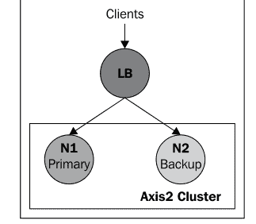
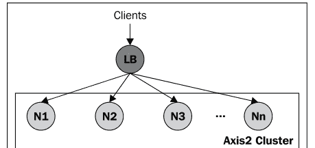
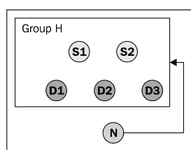
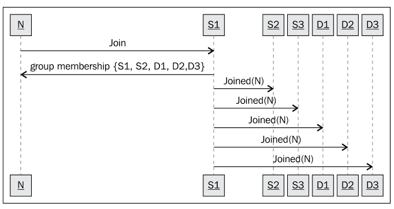
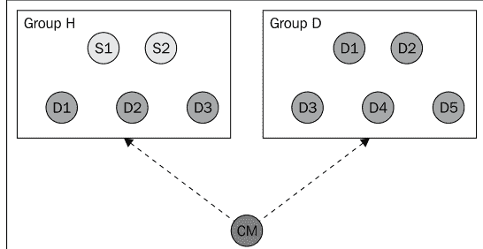
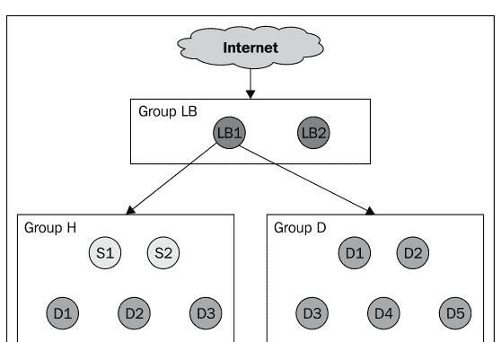
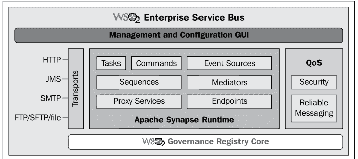
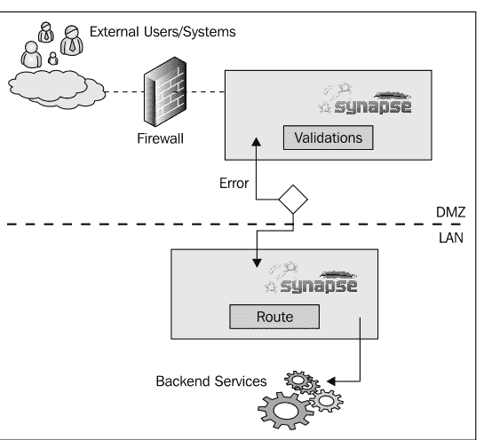
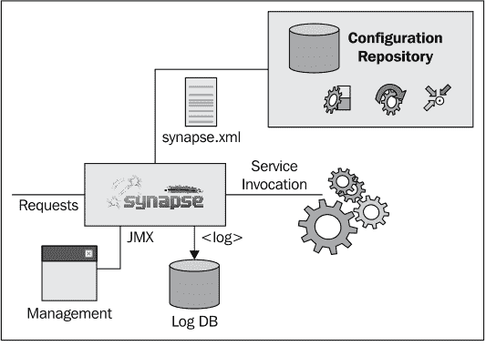
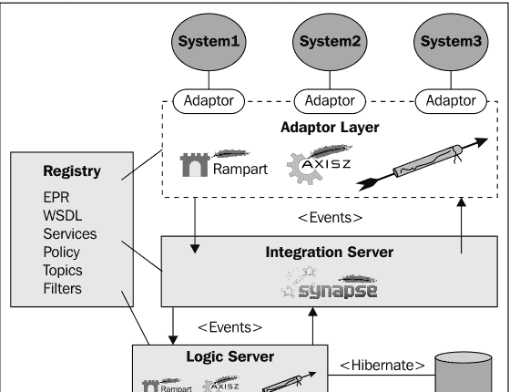

# 11 Developing JAX-WS Web Services

Java API for XML-based web services 是一个流行的标准，面向编写 Web 服务和 Web 服务客户端的 Java 开发人员。传统的 **contract first** 方法，即在 WSDL 中定义 Web 服务契约，然后从这些 WSDL 生成适当代码，并不是 Java 开发人员最自然的编程方式。JAX-WS 规范允许你编写常规的 Java 代码并适当地注释代码，以便将其制作成 Web 服务。因此，JAX-WS 是在 Java 中开发 Web 服务和客户端的 **code first** 方法。开发的简便性是通过将所有内容作为 Java 类编写来实现的，而无需编写任何特定的部署描述符文件，例如 Axis2 AAR 服务使用的 `services.xml` 文件。旧的 Java Web 服务规范如 JAX-RPC 要求 Web 服务类实现特定的接口。使用 JAX-WS，没有此类限制，常规 POJOs 可以通过最少的更改制作成 Web 服务。JAX-WS 也允许 contract first 开发。你将在本章后面看到如何使用 wsimport 工具从 WSDL 开始生成 JAX-WS 注释的 Web 服务。截至撰写本文时，Axis2 仅支持 JAX-WS 2.0 规范。

在本章中，我们将介绍：

- JAX-WS Annotations
- Server-side JAX-WS
- Client-side JAX-WS

到本章结束时，你将对 JAX-WS 注释有很好的理解，并且了解如何在 Apache Axis2 中开发 JAX-WS 服务和客户端。


## javax.jws.WebService

### targetNamespace

此属性定义 WSDL 的 XML 命名空间，以及带有 WebService 注解的 Java 类或接口所生成的部分 XML 元素的命名空间。默认值是从此 Web 服务的包名派生的命名空间。例如，如果该 Web 服务属于 org.apache.axis2.sample 包，则默认命名空间将为 http://sample.axis2.apache.org。

### serviceName

此属性定义 WSDL 1.1 文档中 wsdl:service 的名称。默认值是所注解 Java 类或接口的非限定名称，并追加字符串 "service" 作为后缀。

### endpointInterface

此属性定义服务端点接口（SEI）的限定名称。该注解允许将接口契约与实现分离。端点实现类不要求实现 endpointInterface。

> 如果指定了 endpointInterface 属性，则所有其他 WebService 属性以及所有其他 JSR 181 注解都将被忽略。只有服务端点接口上的注解才会被考虑。

### portName

此属性定义 WSDL 1.1 文档中的 wsdl:portName。此属性的默认值是 WebService.name 后追加字符串 "port"。

### wsdlLocation

此属性是一个指向现有 WSDL 1.1 文档的 WSDL URL。此属性仅在使用现有 WSDL 时才会用到。在纯代码优先的方法中，不会使用此属性。

让我们看一个简单示例，该示例将 WebService 注解与其部分属性结合使用。以下代码将声明 CalculatorImpl 为一个名为 Calculator 的 Web 服务，且该 Web 服务的 targetNamespace 将为 http://axis.apache.org：

```
@WebService(name = "Calculator", targetNamespace = "http://axis.apache.org")

public class CalculatorImpl {
    public int add(int a, int b) {
        return a + b;
    }
}
```

如果你希望将接口与实现类分离，可以像下面这样使用 endpointInterface 属性。在这里，endpointInterface 被声明为 org.apache.axis2.jaxws.sample.ICalculator。

```
@WebService(endpointInterface = "org.apache.axis2.jaxws.sample.ICalculator")
public class CalculatorImpl {
    public int add(int a, int b) {
        return a + b;
    }
}
```

ICalculator 接口被声明为一个名为 Calculator 的 Web 服务，其 targetNamespace 为 http://axis.apache.org：

```
@WebService(name="Calculator", targetNamespace = "http://axis.apache.org")
public interface ICalculator{
    int add(int a, int b);
}
```

## javax.jws.WebMethod

此注解可用于自定义作为 Web 服务操作暴露的方法。该注解定义如下：

```
@Retention(value=RetentionPolicy.RUNTIME)
@Target({METHOD})
public @interface WebMethod {
    String operationName() default "";
    String action() default "";
    boolean exclude() default false;
}
```

让我们看一下 WebMethod 注解的属性。

### operationName

此属性定义与此方法对应的 WSDL 1.1 中 wsdl:operation 的名称。该名称的命名空间取自 WebService.targetNamespace 的值或其默认值。此属性的默认值是所注解 Java 方法的名称。

### action

此属性定义此方法的 Web 服务操作的 action。其默认值为 ""（空字符串）。

### exclude

此属性用于从 Web 服务中排除某些方法。此类方法将不会作为 Web 服务操作出现。默认值为 false。

让我们看一个将 WebMethod 注解与其部分属性结合使用的示例。在此示例中，add 方法将作为名为 addInt 的 Web 服务操作暴露，action 将设置为 urn:addInt。print 方法将不会作为 Web 服务暴露，因为 WebMethod 注解的 exclude 属性已设置为 true。

```
@WebService
public class CalculatorImpl {
    @WebMethod(operationName="addInt", action="urn:addInt")
    public int add(int a, int b) {
        print(a, b);
        return a + b;
    }

    @WebMethod(exclude=true)
    public void print(int a, int b) {
        System.out.println("a=" + a + ", b=" + b);
    }
}
```

## javax.jws.OneWay

此注解用于将方法标记为单向方法。相应的 Web 服务操作将是仅入站操作。此注解没有属性，定义如下：

```
@Retention(value=RetentionPolicy.RUNTIME)
@Target({METHOD})
public @interface OneWay {
}
```

让我们看一个演示 OneWay 注解用法的简单示例。在这里，process 操作已通过 OneWay 属性被声明为仅入站操作。

```
@WebService
public class Processor {
    @WebMethod(operationName="process", action="urn:process")
    @OneWay
    public void process(String id) {
        System.out.println("Processing " + id);
    }
}
```

## javax.jws.WebParam

你可以使用此注解来自定义单个参数到 WSDL 消息部件或 XML 元素的映射。该注解定义如下：

```
@Retention(value=RetentionPolicy.RUNTIME)
@Target({PARAMETER})
public @interface WebParam {
    public enum Mode {
        IN,
        OUT,
        INOUT
    };
    String name() default "";
    String targetNamespace() default "";
    Mode mode() default Mode.IN;
    boolean header() default false;
    String partName() default "";
}
```

让我们看一下 WebParam 注解的属性。

### name

对于 RPC 绑定，这是表示该参数的 wsdl:part 的名称。对于 document/literal wrapped 绑定，这是表示该参数的 XML 元素的本地名称。此属性不用于 document/literal bare 绑定。

### targetNamespace

这是此操作参数的命名空间。它仅用于 document/literal wrapped 绑定。此属性的默认值是 Web 服务的 targetNamespace。

### mode

此属性表示此方法的参数流向。可能的值有 IN、INOUT 和 OUT。

### header

此属性定义所注解的参数是否应放在 SOAP 头中。默认值为 false。

### partName

此属性为带有 RPC 或 document/bare 操作的所注解参数定义 wsdl:part。默认值为 WebParam.name。

以下示例演示了 WebParam 注解的实际用法。add 操作被声明为具有两个名为 intA 和 intB 的 Web 服务参数：

```
@WebService(name = "Calculator", targetNamespace = "http://axis.apache.org")
public class CalculatorImpl {
    @WebMethod(operationName="addInt", action="urn:addInt")
    public int add(@WebParam(name="intA") int a,
        @WebParam(name="intB") int b) {
        return a + b;
    }
}
```

## javax.jws.WebResult

如果你希望自定义 Web 服务方法的返回值到 wsdl:part 或 XML 元素的映射，则应使用 WebResult 注解。该注解定义如下：

```
@Retention(value=RetentionPolicy.RUNTIME)
@Target({METHOD})
public @interface WebResult {
    String name() default "return";
    String targetNamespace() default "";
    boolean header() default false;
    String partName() default "";
}
```

让我们看一下 WebResult 注解的属性。

### name

此属性定义返回值在 WSDL 中的名称。对于 RPC 绑定，这是响应消息中返回值的部件名称。对于 document 绑定，这是表示返回值的 XML 元素的本地名称。

### targetNamespace

这是返回值的 XML 命名空间，默认与 Web 服务的 targetNamespace 相同。

### header

此属性指定返回值是否需要放在 SOAP 头中，默认值为 false。

### partName

此属性指定返回值的 wsdl:part。其默认为 WebResult.name。

以下示例演示了此注解的用法。WebResult 注解声明返回类型的名称应为 return：

```
@WebService(name = "Calculator", targetNamespace = "http://axis.apache.org")
public class CalculatorImpl {
    @WebMethod(operationName="addInt", action="urn:addInt")
    @WebResult(name="return")
    public int add(@WebParam(name="intA") int a,
                   @WebParam(name="intB") int b) {
        return a + b;
    }
}
```


```
@SOAPBinding(style=SOAPBinding.Style.RPC, use=SOAPBinding.Use.LITERAL)
public class CalculatorImpl {
    public int add(int a, int b) {
        return a + b;
    }
}
```

## JSR 224（JAX-WS）注解

本节将介绍 JSR 224（JAX-WS）规范中引入的一些有用注解。这些注解用于补充 JSR-181 注解。我们将介绍以下注解：

- javax.xml.ws.BindingType
- javax.xml.ws.RequestWrapper
- javax.xml.ws.ResponseWrapper
- javax.xml.ws.ServiceMode
- javax.xml.ws.WebEndpoint
- javax.xml.ws.WebFault
- javax.xml.ws.WebServiceClient
- javax.xml.ws.WebServiceProvider
- javax.xml.ws.WebServiceRef

### javax.xml.ws.BindingType

BindingType 注解用于指定 Web 服务端点实现类所使用的绑定。它只有一个属性 `value`，该属性是绑定 URI，默认值为 SOAP 1.1 / HTTP。下面来看一个简单示例：

```
@WebService
@BindingType(value="http://www.w3.org/2003/05/soap/bindings/HTTP/")
public class AddNumbers {
    public int add(int a, int b) {
        ...
    }
}
```

如 BindingType 注解的 `value` 属性所示，部署后的端点将使用基于 HTTP 的 SOAP1.2 绑定。

### javax.xml.ws.RequestWrapper 和 javax.xml.ws.ResponseWrapper

javax.xml.ws.RequestWrapper 注解用于为 SEI 中的方法指定运行时使用的请求包装器 Bean。javax.xml.ws.ResponseWrapper 注解用于为 SEI 中的方法指定运行时使用的响应包装器 Bean。这些注解包含三个属性，即 `localName`、`targetNamespace` 和 `className`。

#### localName

此属性定义表示请求/响应包装器的 XML Schema 元素的本地名称，默认值为由 javax.jws.WebMethod 定义的 `operationName`。

#### targetNamespace

此属性定义请求/响应包装器元素的命名空间，默认值为 SEI 的 `targetNamespace`。

#### className

此属性定义表示请求/响应包装器的类名称。

请看以下示例：

```
public interface AddNumbersImpl {
    @WebMethod
    @WebResult(targetNamespace = "")
    @RequestWrapper(localName = "addNumbers",
        targetNamespace = "http://axis.apache.org/axis2/jaxws",
        className = "org.apache.axis2.jaxws.sample.AddNumbers")
    @ResponseWrapper(localName = "addNumbersResponse",
        targetNamespace = "http://server.fromjava/",
        className = "org.apache.axis2.jaxws.sample.AddNumbersResponse")
    public int addNumbers(
        @WebParam(name = "arg0", targetNamespace = "")
        int arg0,
        @WebParam(name = "arg1", targetNamespace = "")
        int arg1);
}
```

### javax.xml.ws.ServiceMode

Web 服务端点可以通过实现 Provider 接口，在 XML 消息级别进行工作。具体来说，可以实现 `Provider<Source>`、`Provider<SOAPMessage>` 或 `Provider<DataSource>`。端点通过这种低级别的通用 API 访问消息或消息负载。所有 Provider 端点都必须具有 `@WebServiceProvider` 注解。

`@ServiceMode` 注解用于说明端点希望访问消息（Service.Mode.MESSAGE）还是消息负载（Service.Mode.PAYLOAD）。如果端点上没有 `@ServiceMode` 注解，则默认值为消息负载。此注解包含一个 `value` 属性，用于指示 Provider 端点是要访问完整消息（MESSAGE）还是仅访问消息负载（PAYLOAD），默认值为 PAYLOAD。下面的示例演示了此注解的使用方式：

```
@ServiceMode(value=Service.Mode.PAYLOAD)
public class AddNumbersImpl implements Provider<Source> {
    public Source invoke(Source source) throws RemoteException {
    }
}
```

### javax.xml.ws.WebEndpoint

此注解用于标注生成的服务接口中的 `getPortName()` 方法。此注解中指定的信息足以唯一标识 WSDL 中 `wsdl:service` 内的 `wsdl:port` 元素。它只有一个 `name` 属性，用于定义 WSDL 中表示相应端口的 XML 元素的本地名称，默认值为 `""`（空字符串）。下面的示例演示了此注解：

```
@WebServiceClient(name = "AddNumbersImplService",
targetNamespace = "http://axis.apache.org/axis2/jaxws", wsdlLocation = "http://localhost:8080/services/addnumbers?wsdl")
public class NumberAdder {
    ...
    @WebEndpoint(name = "AddNumbersImplPort")
    public AddNumbersImpl getAddNumbersImplPort() {
        ...
    }
}
```

### javax.xml.ws.WebFault

JAX-WS 工具会在根据 WSDL 生成的、特定于服务的异常类中生成此注解，用于自定义故障元素的本地名称和命名空间名称，以及故障 Bean 的名称，并将特定于服务的异常标记为由 WSDL 生成。它包含三个属性：`name`、`targetNamespace` 和 `faultBean`。

#### name

此属性定义 WSDL 中表示相应故障的 XML 元素的本地名称，默认值为 `""`（空字符串）。

#### targetNamespace

此属性定义 WSDL 中表示相应故障的 XML 元素的命名空间，默认值为 `""`（空字符串）。

#### faultBean

此属性定义表示故障消息详细信息的 Java 类的限定名称，默认值为空字符串 `""`。

下面的示例展示了此注解的使用方式：

```
@javax.xml.ws.WebFault(name="AddNumbersException",
                targetNamespace="http://axis.apache.org/axis2/jaxws")
public class AddNumbersException_Exception extends Exception {
    private org.apache.axis2.jaxws.AddNumbersException fault;
}
```

### javax.xml.ws.WebServiceClient

此注解中指定的信息足以唯一标识 WSDL 文档中的 `wsdl:service` 元素。此 `wsdl:service` 元素表示由生成的服务接口提供客户端视图的 Web 服务。此注解可以包含三个属性：`name`、`targetNamespace` 和 `wsdlLocation`。

#### name

此属性定义 WSDL 中 `wsdl:serviceName` 的本地名称，默认值为 `""`。

#### name

这是表示带注解 JavaBean 属性的 XML 元素的本地名称，默认值为带注解 Java 属性的名称。

#### namespace

这是表示带注解 JavaBean 属性的 XML 元素的命名空间，默认值为包含该 Java 属性的类的命名空间。

## JSR 250（通用注解）

本节将介绍 JSR 250（通用注解）规范中引入的一些有用注解。我们将介绍以下注解：

- `javax.annotation.Resource`
- `javax.annotation.PostConstruct`
- `javax.annotation.PreDestroy`

### javax.annotation.Resource

此注解用于标记 Web 服务所需的 WebServiceContext 资源。对于 JAX-WS 端点，它可以应用于字段或方法。容器在端点实现初始化时，会将 WebServiceContext 资源的实例注入端点。下面的示例展示了此注解：

```
@WebService
public class HelloImpl {
    @Resource
    private WebServiceContext context;

    public String echo(String name) {
        ...
    }
}
```

```
temp = student.getMarks()[i];
    if (temp > highest) {
        highest = temp;
    }
}
    return highest;
}
```

Student 类是一个简单的 JavaBean，包含相应学生的姓名、年龄和成绩。其声明如下：

```
// Student.java
package org.apache.jaxws.sample;

public class Student {
    private String name;
    private int age;
    private int[] marks;

    public String getName() {
        return name;
    }

    public void setName(String name) {
        this.name = name;
    }

    public int getAge() {
        return age;
    }

    public void setAge(int age) {
        this.age = age;
    }

    public int[] getMarks() {
        return marks;
    }

    public void setMarks(int[] marks) {
        this.marks = marks;
    }
}
```

编译给定的类，根据编译后的代码创建 JAR 文件，然后将其部署到 Axis2 的 `repository/servicejars` 目录中。启动 Axis2，并访问 URL http://localhost:8080/axis2/services/StudentMarksService?wsdl 查看 WSDL。


``` 
wsimport -d generated http://example.org/stock?wsdl
```

如第二个示例所示，如果你想基于此创建一个服务，`wsimport` 也会生成 .java 文件。其中包含你 Web 服务的已生成接口。只需实现该接口，它就将成为你的 Web 服务类。然后在顶部添加 @WebService 注解，如下所示。

我们将为以下 WSDL 1.1 文档生成服务：StudentsMarksService.wsdl：

```xml
<definitions xmlns="http://schemas.xmlsoap.org/wsdl/"
    xmlns:xs="http://www.w3.org/2001/XMLSchema"
    xmlns:soap="http://schemas.xmlsoap.org/wsdl/soap/"
    xmlns:tns="http://apache.org/jaxws/sample1"
    name="StudentMarksService"
    targetNamespace="http://apache.org/jaxws/sample1">

<types>...</types>
<message>...</message>
<portType>...</portType>
<binding>

    <service name="StudentMarksService">
        <port name="StudentMarksPort" binding="tns:StudentMarksPortBinding">
            <soap:address location="https://localhost/services/StudentMarksService.StudentMarksPort/"/>
        </port>
    </service>
</definitions>
```

该 WSDL 的 XML Schema 类型定义如下所示：

```xml
<types>
    <xs:schema xmlns:xs="http://www.w3.org/2001/XMLSchema"
        xmlns:tns="http://apache.org/jaxws/sample1"
        attributeFormDefault="unqualified"
        elementFormDefault="unqualified"
        targetNamespace="http://apache.org/jaxws/sample1">

        <xs:element name="computeAverage" type="tns:computeAverage"/>
        <xs:element name="computeAverageResponse" type="tns:computeAverageResponse"/>
        <xs:element name="computeHighestMarks"
            type="tns:computeHighestMarks"/>
        <xs:element name="computeHighestMarksResponse"
            type="tns:computeHighestMarksResponse"/>
        <xs:complexType name="computeAverage">
            <xs:sequence>
                <xs:element form="qualified" minOccurs="0"
                    name="student"
                    type="tns:student"/>
            </xs:sequence>
        </xs:complexType>
        <xs:complexType name="student">
            <xs:sequence>
                <xs:element name="age" type="xs:int"/>
                <xs:element maxOccurs="unbounded" minOccurs="0"
                    name="marks"
                    nillable="true"
                    type="xs:int"/>
                <xs:element minOccurs="0" name="name"
                    type="xs:string"/>
            </xs:sequence>
        </xs:complexType>
        <xs:complexType name="computeAverageResponse">
            <xs:sequence>
                <xs:element form="qualified" name="average"
                    type="xs:double"/>
            </xs:sequence>
        </xs:complexType>
        <xs:complexType name="computeHighestMarks">
            <xs:sequence>
                <xs:element form="qualified" minOccurs="0"
                    name="student"
                    type="tns:student"/>
            </xs:sequence>
        </xs:complexType>
        <xs:complexType name="computeHighestMarksResponse">
            <xs:sequence>
                <xs:element form="qualified" name="highest"
                    type="xs:int"/>
            </xs:sequence>
        </xs:complexType>
    </xs:schema>
</types>
```

该 WSDL 的消息定义如下所示：

```xml
<message name="computeHighestMarks">
    <part name="parameters" element="tns:computeHighestMarks">
    </part>
</message>
<message name="computeAverage">
    <part name="parameters" element="tns:computeAverage">
    </part>
</message>
<message name="computeHighestMarksResponse">
    <part name="parameters" element="tns:computeHighestMarksResponse">
    </part>
</message>
<message name="computeAverageResponse">
    <part name="parameters" element="tns:computeAverageResponse">
    </part>
</message>
```

该服务在 WSDL 中的 portType 定义如下所示：

```xml
<portType name="StudentMarks">
    <operation name="computeAverage">
        <input message="tns:computeAverage">
        </input>
        <output message="tns:computeAverageResponse">
        </output>
    </operation>
    <operation name="computeHighestMarks">
        <input message="tns:computeHighestMarks">
        </input>
        <output message="tns:computeHighestMarksResponse">
        </output>
    </operation>
</portType>
```

该 WSDL 中的绑定定义如下：

```xml
<binding name="StudentMarksPortBinding" type="tns:StudentMarks">
    <soap:binding style="document"
        transport="http://schemas.xmlsoap.org/soap/http"/>
    <operation name="computeAverage">
        <soap:operation soapAction="urn:getAverage"/>
        <input>
            <soap:body use="literal"/>
        </input>
        <output>
            <soap:body use="literal"/>
        </output>
    </operation>
    <operation name="computeHighestMarks">
        <soap:operation soapAction="urn:getHighestMarks"/>
        <input>
            <soap:body use="literal"/>
        </input>
        <output>
            <soap:body use="literal"/>
        </output>
    </operation>
</binding>
```

让我们使用 wsimport 工具为此 WSDL 生成代码，如下所示：

```
wsimport -s wsdl2java StudentsMarksService.wsdl
```

这将生成 org.apache.jaxws.sample1.StudentMarksPort 和 org.apache.jaxws.sample1.Student 类。现在我们将使用这些已生成的类编写一个示例 Web 服务：

```java
package org.apache.jaxws.sample1.service;

import org.apache.jaxws.sample1.StudentMarksPort;
import org.apache.jaxws.sample1.Student;

import javax.jws.WebService;

@WebService(
    serviceName = "StudentMarksService",
    portName = "StudentMarksPort",
    targetNamespace = "http://apache.org/jaxws/sample1",
    endpointInterface = "org.apache.jaxws.sample1.StudentMarksPort",
    wsdlLocation = "StudentMarksService.wsdl"
)
public class StudentMarksImpl implements StudentMarksPort {

    public double computeAverage(Student student) {
        double totalMarks = 0;
```

## Dispatch 客户端

当你想在 XML 消息级别工作或在 JAX-WS 级别工作而无需任何已生成的工件时，你将使用此客户端。Dispatch 客户端 API 要求应用程序客户端以 XML 的形式构造消息或有效负载，这需要对消息或消息有效负载有详细的了解。Dispatch 客户端支持以下类型的对象：

- `javax.xml.transform.Source`：你将使用 Source 对象使客户端能够直接使用 XML API。你可以在 SOAP 或 HTTP 绑定中使用 Source 对象。
- **JAXB 对象**：你将使用 JAXB 对象，以便客户端可以使用从 XML 模式生成的 JAXB 对象来创建和操作 JAX-WS 应用程序中的 XML。JAXB 对象只能与 SOAP 或 HTTP 绑定一起使用。
- `javax.xml.soap.SOAPMessage`：你将使用 SOAPMessage 对象，以便客户端可以处理 SOAP 消息。你只能将 SOAPMessage 对象与 SOAP 绑定一起使用。
- `javax.activation.DataSource`：你将使用 DataSource 对象，以便客户端可以处理多用途互联网邮件扩展 MIME 消息。DataSource 只能与 HTTP 绑定一起使用。

以下示例演示了如何使用 JAX-WS Dispatch 客户端 API。此客户端与 HelloService 通信，其中包含单个操作，即 greet。该选项接收单个字符串参数。请特别注意突出显示的代码。正如你所见，由于使用了 Message 服务模式，客户端必须构造 SOAP 信封、头、主体和主体内容：

```java
package org.apache.jaxwsclient;

import javax.xml.namespace.QName;
import javax.xml.soap.*;
import javax.xml.ws.Dispatch;
import javax.xml.ws.Service;
import javax.xml.ws.soap.SOAPBinding;
public class DispatchClient {
    public static void main(String[] args) {
        try {
            String endpointUrl = "http://localhost:8080/axis2/services/HelloService";
            QName serviceName = new QName("http://apache.org/types", "HelloService");
            QName portName = new QName("http://apache.org/types", "HelloServiceHttpSoap11Endpoint");

            /** Create a service and add at least one port to it. **/
            Service service = Service.create(serviceName);
            service.addPort(portName, SOAPBinding.SOAP11HTTP_BINDING, endpointUrl);

            /** Create a Dispatch instance from a service.**/
            Dispatch<SOAPMessage> dispatch = service.createDispatch(portName, SOAPMessage.class, Service.Mode.MESSAGE);

            /** Create SOAPMessage request. **/
            // compose a request message
            MessageFactory mf = MessageFactory.newInstance(SOAPConstants.SOAP_1_1_PROTOCOL);

            // Create a message. This example works with the SOAPPART.
            SOAPMessage request = mf.createMessage();
            SOAPPart part = request.getSOAPPart();

            // Obtain the SOAPEnvelope and header and body elements.
            SOAPEnvelope env = part.getEnvelope();
            SOAPHeader header = env.getHeader();
            SOAPBody body = env.getBody();

            // Construct the message payload.
            SOAPElement operation = body.addChildElement("greet", "ns2", "http://apache.org/types");
            SOAPElement age = operation.addChildElement("name");
            age.addTextNode("Packt");
            request.saveChanges();

            /** Invoke the service endpoint. **/
            SOAPMessage response = dispatch.invoke(request);
            System.out.println(response.getSOAPBody().getFirstChild().toString());
        } catch (Exception e) {
            e.printStackTrace();
        }
    }
}
```

你需要 JDK 1.5 或更高版本来编译上述类。


## 动态代理客户端

JAX-WS 的静态客户端编程模型称为动态代理客户端。动态代理客户端基于提供的服务端点接口调用 Web 服务。在创建代理后，客户端应用程序可以像标准实现一样在代理上调用方法。对于使用动态代理编程模型的 JAX-WS Web 服务客户端，请使用 JAX-WS 工具 wsimport 处理 WSDL 文件并生成用于创建 Web 服务客户端的可移植 Java 工件。

在下面的示例中，org.apache.types.HelloService 和 org.apache.types.HelloServicePortType 类是由随 JDK 一起提供的 wsimport 工具生成的。该示例展示了如何在 ProxyClient 类中使用生成的类。正如你所见，与 DispatchClient 不同，代码行数要少得多，但你对底层操作的控制也更少：

```
package org.apache.jaxwsclient;

import org.apache.types.HelloService;
import org.apache.types.HelloServicePortType;

public class ProxyClient {
    public static void main(String[] args) {
        HelloService service = new HelloService();
        HelloServicePortType portType = service.getHelloServiceHttpSoap11Endpoint();
        System.out.println(portType.greet("Packt"));
    }
}
```

## 使用 JAX-WS 服务的 MTOM

消息传输优化机制（MTOM）是一种高效地向 Web 服务发送和接收二进制数据的方法。要在 JAX-WS 服务中使用 MTOM，首先必须使用 BindingType 注解将绑定类型设置为 SOAP11 MTOM。你将使用 javax.activation.DataHandler 在参数或返回类型中表示二进制数据。让我们看一个启用了 MTOM 的 JAX-WS 服务示例。uploadFile Web 服务操作展示了如何将二进制数据用作操作的输入参数。下面的 getBinaryTestData 操作说明了如何将二进制数据用作操作的输出：

高亮字段显示 BindingType 被设置为 SOAP11HTTP_MTOM_BINDING 和 DataHandler。Java bean 类型类也可以包含 DataHandler。你需要 JDK 1.5 或更高版本来编译上述类。

## JAX-WS 服务的异步调用

JAX-WS 支持从客户端异步调用服务。JAX-WS 在异步调用 Web 服务时为回调模型和轮询模型提供支持。回调模型和轮询模型均由 Dispatch 客户端和代理客户端支持。

Web 服务的异步调用会向服务端点发送请求，然后立即将控制权返回给客户端，而无需等待响应从服务返回。JAX-WS 异步 Web 服务客户端使用回调方法或轮询方法使用 Web 服务。

### 轮询模型

在轮询模型中，客户端可以发出请求并接收响应对象，通过轮询来确定服务器是否已响应。当服务器响应时，会检索实际响应。响应对象在调用 get 方法时会返回响应内容。客户端从 invokeAsync 方法接收到 javax.xml.ws.Response 类型的对象。该 Response 对象用于监控向服务器的请求状态，确定操作是否已完成，并检索响应结果。

### 回调模型

在回调模型中，客户端提供回调处理程序来接收和处理入站响应对象。当结果可用时，处理程序的 handleResponse 方法会被调用。为了实现使用回调模型的异步调用，客户端提供 AsyncHandler 实例来接收和处理入站响应对象。客户端回调处理程序实现 javax.xml.ws.AsyncHandler 接口，该接口包含在从服务器接收到异步响应时执行的应用程序代码。javax.xml.ws.AsyncHandler 接口包含 handleResponse(javax.xml.ws.Response) 方法，该方法在运行时接收并处理来自服务器的异步响应后被调用。响应以 javax.xml.ws.Response 对象的形式传递给回调处理程序。响应对象在调用 get() 方法时会返回响应内容。

## 编写高可用可集群的 Web 服务

通常，你无需做任何额外工作即可使 Web 服务可集群。一般来说，任何常规 Web 服务都是可集群的。对于有状态的 Web 服务，你需要将 Java 可序列化可复制属性存储在 Axis2 ConfigurationContext、ServiceGroupContext 或 ServiceContext 中。请注意，你在其他地方维护的有状态变量将不会被复制。如果正确配置了 Axis2 集群以进行状态复制，则 Axis2 基础设施将为你复制这些属性。在下一节中，你将能够查看为状态复制配置集群的详细信息。让我们看一个部署在 soapsession 范围内的简单有状态 Axis2 Web 服务：

```
public class ClusterableService {
    private static final String VALUE = "value";

    public void setValue(String value) {
        ServiceContext serviceContext = MessageContext.getCurrentMessageContext().getServiceContext();
        serviceContext.setProperty(VALUE, value);
    }

    public String getValue() {
        ServiceContext serviceContext = MessageContext.getCurrentMessageContext().getServiceContext();
        return (String) serviceContext.getProperty(VALUE);
    }
}
```

你可以在集群中的两个 Axis2 节点上部署此服务。你可以编写一个客户端，在第一个节点上调用 setValue 操作，然后在第二个节点上调用 getValue 操作。你将能够看到你在第一个节点上设置的值可以从第二个节点检索到。发生的情况是，当你在第一个节点上调用 setValue 操作时，值会被设置在相应的 ServiceContext 中，并复制到第二个节点。因此，当你在第二个节点上调用 getValue 时，复制的值已正确设置在相应的 ServiceContext 中。正如你可能已经注意到的那样，你无需做任何额外工作即可使 Web 服务可集群。Axis2 会透明地进行状态复制。然而，如果你需要控制状态复制，Axis2 也提供了该选项。让我们重写同一个 Web 服务，同时控制状态复制：

```
public class ClusterableService {
    private static final String VALUE = "value";
    public void setValue(String value) {
```



## 增加水平可扩展性

如图所示，为了实现水平可扩展性，Axis2 集群将由负载均衡器前端（下图中用 LB 表示）。负载均衡器将根据某种负载均衡算法在 Axis2 集群中分配负载。轮询负载均衡算法就是这样一种流行且简单的算法，当所有节点上的硬件和软件都相同的情况下效果很好。通常，水平可扩展的集群将保持其响应时间，并在负载增加时不会降低性能。在这种设置下吞吐量也会随着负载的增加而增加。通常，集群中的节点数量是预期最大峰值负载的函数。在这种集群中，所有节点都是活动的。



### AvoidInitiation

此参数指示在构建 `AxisConfiguration` 时集群是否需要自动初始化。如果设置为 true，则不会在该阶段进行初始化，而必须由其他方显式初始化集群。在 Axis2 被第三方嵌入的情况下，他们可能需要控制集群初始化过程。因此提供了此参数。例如，我们可以将此参数设置为 true，以便在服务器完全启动并且相关传输已初始化后初始化集群。

### membershipScheme

在此设置中使用成员关系方案。目前支持的唯一值是 multicast 和 WKA。

- **multicast:** 基于多播的成员管理。成员关系使用多播自动发现。为了使其工作，多播必须在网络中允许，并且集群中的所有成员必须使用相同的多播地址（由 `mcastAddress` 参数定义）和确切的多播端口（由 `mcastPort` 参数定义）。
- **众所周知地址 (WKA)：** 基于众所周知地址的成员管理。成员关系在运行在众所周知地址的一个或多个节点的帮助下发现。加入集群的新成员将首先连接到众所周知节点，向众所周知节点注册，并从其获取成员列表。当新成员加入时，众所周知节点中的一个将通知组中的其他节点。当成员离开集群或被认为已离开集群时，它将通过 **Group Membership Service (GMS)** 使用 TCP ping 机制检测到。当多播成员发现不可行时，需要基于 WKA 的成员关系。例如，在 Amazon EC2 上，不允许多播，并且无法控制分配给 EC2 实例的 IP 地址。因此，在这种情况下，往往会使用基于 WKA 的成员发现。

### domain

集群域/组：请注意，“domain”和“group”一词可互换使用。不同组中的节点之间不会有任何干扰。从组外成员接收的消息通常会被忽略。然而，特殊消息，例如来自组外成员的集群管理消息或成员关系消息将被允许。


## synchronizeAll

当收到并处理一个Web服务请求时，是否应该在响应发送给客户端之前，更新集群中所有成员的状态？如果此参数的值设置为true，则只有在所有成员都更新完毕之后，才会向客户端发送响应。显然，这可能会很耗时。在某些情况下，如果这种开销不可接受，则应将此参数的值设置为false。这种做法的风险在于，当响应发送给客户端时，所有成员不会处于相同的状态。这种情况必须由用户处理。总而言之，此参数定义了我们是否应该在向客户端发送响应之前同步组内所有成员的状态。

## maxRetries

此参数定义在放弃并向特定成员发送消息并认为该节点故障之前，我们需要重试的最大次数。达到maxRetries次重试后，我们便放弃。

## mcastAddress

这是要使用的多播地址。仅当membershipScheme设置为multicast时，才会考虑此参数。

## mcastPort

这是要使用的多播端口。仅当membershipScheme设置为multicast时，才会考虑此参数。

## mcastFrequency

此参数定义发送成员关系多播消息的频率。该值应以毫秒为单位指定。仅当membershipScheme设置为multicast时，才会考虑此参数。

## memberDropTime

此参数定义了一个时间间隔，如果某个成员在此时间间隔内没有响应，则视为该成员已离开组。该值应以毫秒为单位指定。

## mcastBindAddress

此参数定义了多播必须绑定到的网络接口的IP地址。多播将使用此接口进行。仅当`membershipScheme`设置为`multicast`时，才会考虑此参数。请注意，此地址可以与`localMemberHost`参数不同。因此，我们可以在`localMemberHost`网络接口上监听点对点消息，同时在绑定到`mcastBindAddress`的网络接口上监听多播消息。

## localMemberHost

此参数定义该成员的主机名或IP地址。这是该成员在加入组并发送消息时宣告的IP地址。应将其设置为除localhost或127.0.0.1以外的有效值。在大多数情况下，将其设置为用于与组内成员通信的网络接口所绑定的IP地址即可。

## localMemberPort

此参数定义该成员使用的TCP端口。其他成员将通过此端口与该成员联系。此端口的默认值为4000。

## preserveMessageOrder

此参数指示应保持消息顺序。这将按照发送方的顺序进行。此参数的默认值为true。

## atmostOnceMessageSemantics

此参数指示需要保持“至多一次”的消息处理语义。它保证给定的集群消息将至多传递一次到目标进程或节点。此参数的默认值为true。

## properties

有一些特定于该成员的属性。这些属性就是简单的名-值对。当成员加入组时，这些属性会绑定到该成员上，以便组内的其他成员能够检测到这些属性。在需要进行集中式集群管理的情况下，可以使用这些属性。

例如：假设有一个可由独立服务器管理的Axis2集群。每个Axis2成员将提供两个成员属性，即backendServerURL和mgtConsoleURL。backendServerURL属性用于连接成员的后端管理Web服务。类似地，如果该成员希望公开自己的管理控制台，则可以通过提供“mgtConsoleURL”属性来实现。backendServerURL属性使用<property name="backendServerURL" value="https://${hostName}:${httpsPort}/services/"/>条目来指定。这里，${hostName}表示hostName成员属性，${httpsPort}表示httpsPort成员属性。hostName和httpsPort是两个隐式成员属性。httpPort是另一个隐式成员属性。先前已声明的属性可以在后续的属性定义中使用。例如，我们可以按如下方式定义一个新属性：<property name="foo" value="${backendServerURL}/foo"/>。

## 状态管理

如果需要在集群组的成员之间同步状态，则需要启用stateManager元素。需要提供org.apache.axis2.clustering.state.StateManager的实现作为class属性的值。在默认的基于Apache Tribes的实现中，我们提供了org.apache.axis2.clustering.state.DefaultStateManager类。用户可以选择不复制某些属性。这可以通过提供属性名模式来实现。让我们看下面的例子：

```
<stateManager class="org.apache.axis2.clustering.state.DefaultStateManager" enable="true">
  <replication>
    <defaults>
      <exclude name="local_*"/>
      <exclude name="LOCAL_*"/>
    </defaults>
    <context class="org.apache.axis2.context.ConfigurationContext">
      <exclude name="UseAsyncOperations"/>
      <exclude name="SequencePropertyBeanMap"/>
    </context>
    <context class="org.apache.axis2.context.ServiceGroupContext">
      <exclude name="my.sandesha.*"/>
    </context>
  </replication>
</stateManager>
```



静态成员在每个成员的axis2.xml文件中指定如下：

```
<members>
    <member>
        <hostName>S1</hostName>
        <port>4000</port>
    </member>
    <member>
        <hostName>S2</hostName>
        <port>4000</port>
    </member>
</members>
```

如上图所示，属于域Group H并且至少知道组内一个静态成员的新成员N，可以加入该组。这个新成员将首先联系其中一个静态成员，并了解组成员信息。静态成员将告知N组成员信息{S1, S2, D1, D2, D3}，然后通知组内每个成员N已加入组，如下面的时序图所示：





为了管理如上图所示的两个组Group H和Group D，集群管理器需要有以下配置：

```
<groupManagement enable="true">
    <applicationDomain name="GroupH"
        description="This is the first group" agent="org.apache.
axis2.clustering.management.DefaultGroupManagementAgent"/>

    <applicationDomain name="GroupD"
        description="This is the second group" agent="org.apache.
axis2.clustering.management.DefaultGroupManagementAgent"/>
</groupManagement>
```

## 高可用负载均衡

为了避免单点故障，工作Axis2集群——**Group H**和**Group D**——可以由负载均衡器集群**Group LB**作为前端，如下图所示。**Group LB**中的一个负载均衡器将作为主负载均衡器。Apache Synapse负载均衡器可以以这种方式部署，并使用底层的Axis2集群机制。Web服务客户端将与主负载均衡器中的端点通信，而不会感知到后端工作节点Axis2集群。



## Axis2集群管理API

Axis2集群的设计方式是，所有功能都通过一组接口进行抽象。通过实现这些接口并在集群配置部分提供实现类，可以插入任何不同的集群实现。Axis2中的默认集群实现基于Apache Tribes（Apache Tribes n.d.），这是Apache Tomcat（Apache Tomcat n.d.）使用的流行的组管理框架。有时可能需要使用自己选择的组管理框架，在这种情况下，可以实现这些接口，然后通过`axis2.xml`文件中的集群配置部分将它们插入。我们将在本章后面讨论这些接口的用法。


There can also be several `parameter` elements, which are children of the `clustering` element in the `axis2.xml` file. Generally, these parameters will be specific to the `ClusteringAgent` implementation. In the default Apache Tribes-based implementation, there are several parameters that are required to initialize the Tribes Channel properly.

## org.apache.axis2.clustering.state.StateManager

This interface is responsible for handling state replication. This is an optional interface and if state replication is not required, then this interface can be omitted. The word 'state' here means the serializable values stored in the Axis2 context hierarchy which need to be kept in sync across all the members of a cluster group. Property changes (state changes) in the Axis2 context hierarchy in the node that runs this `StateManager` will be propagated to all other nodes in its group. In the default Axis2 clustering implementation, we have only enabled replication of serializable objects stored in the Apache Axis2 `ConfigurationContext`, `ServiceGroupContext`, and `ServiceContext`. Hence, if a user requires state replication, it is this user's responsibility to store these values in the proper Axis2 contexts. Generally, web services authors do not have to handle state replication, as it is handled by the clustering implementation just before request completion. This is done at the Axis2 `MessageReceivers`. However, if the developer writes his own `MessageReceiver`, he will need to call the `org.apache.axis2.clustering.state.Replicator#replicate()` method. Also, note that at any point, `org.apache.axis2.clustering.state.Replicator#replicate()` can be called, if the developer wishes to force state replication.

It is not mandatory to have a `StateManager` in a node. If we are not interested in high availability, we may disable state replication. In such a scenario, in general, the purpose of a clustered deployment is to achieve scalability. In addition, one may also enable clustering without state replication simply to utilize the group communication capabilities of the underlying **Group Communication Framework (GCF)**. In such a case, the purpose of a clustered deployment may also be management of the cluster using the underlying GCF. The implementation of this interface is set by reading the `stateManager` element in the `axis2.xml` clustering section.

## WSO2 ESB

**WSO2 ESB** is an open source Enterprise Service Bus (ESB) released by the open source middleware company, WSO2 Inc. It is shipped under the Apache Software License v2.0. The runtime of WSO2 ESB has been designed to be completely asynchronous, non-blocking, and streaming, based on the Apache Synapse mediation engine. This also means that WSO2 ESB has been built on top of Apache Axis2, as Apache Synapse is based on Apache Axis2. This ESB allows system administrators and SOA architects to simply and easily configure message routing, virtualization, intermediation, transformation, logging, task scheduling, load balancing, failover routing, event brokering, and many enterprise integration patterns.

WSO2 ESB supports many application layer protocols and messaging standards, collectively known as **transports**, including HTTP, HTTPS, e-mail, **Java Message Service (JMS)**, and **Virtual File System (VFS)**. It also supports a range of domain-specific protocols such as **Financial Information eXchange (FIX)**, **Advanced Message Queuing Protocol (AMQP)**, and **Health Level 7 (HL7)**. New transports can be easily plugged into the server due to the extensibility offered by the Axis2 transports framework. The following figure illustrates how the different transports can be plugged into the ESB and how the Apache Synapse runtime fits into the WSO2 ESB:



## OpenESB

**OpenESB** is an open source **Java Business Integration (JBI)** standard-centric Enterprise Service Bus, originally from Sun Microsystems, now Oracle Inc. JBI is built on a web services model and provides a pluggable architecture for a container that hosts service producer and consumer components. Services connect to the container via binding components or can be hosted inside the container as part of a service engine. The services model used is Web Services Description Language (WSDL) 2.0. OpenESB consists of a runtime, a design time, and a management console. The runtime consists of a lightweight JBI core and several components. OpenESB comes with several components for data transformation, orchestration, and connectivity. There is support for HTTP and web services, JMS, databases, MQ Series, SAP, IMS, HL7, and others. Logic can be expressed in BPEL, EJBs, or POJOs.

In the rest of this chapter, we will be looking at the following SOA integration patterns. Please note that Apache Synapse has been shown as the ESB in the diagrams, but it can be replaced by any of the ESBs we have discussed in this chapter:

- Protocol bridging
- External authentication and authorization
- Dynamic routing combined with auditing
- **Event Driven Architecture (EDA)** with **Master Data Management (MDM)**
- Push and pull
- Fault tolerant autoscaling with dynamic load balancing

## Protocol bridging

**Protocol bridging** refers to the request coming on one transport protocol, and being sent in for processing on a different protocol. For example, the corporate policy may dictate that all incoming traffic should be on HTTPS. Some web services may exist that are exposed only via a transport such as JMX. In such a case, there should be a way of bridging from HTTPS to JMX. Furthermore, the backend web services, which may be deployed on Axis2, may be highly secured within a **High Security Zone (HSZ)**, and the policies may dictate that only certain calls from the **Demilitarized Zone (DMZ)** can be made to those web services. We may also implement message validation and request throttling outside the highly secured LAN. This scenario is shown in the following figure. External web service clients talk to the endpoints on the ESB in the DMZ. This ESB will run validations and other Quality of Service (QoS) functionality on these incoming messages, and if those messages meet the requirements, it will switch to a protocol that is compatible with the backend service deployment, and send the message into the LAN.

In the following figure, we have shown another optional ESB deployment, which can further deal with things such as transformations. However, that ESB can be omitted, if required, and the request can be directly routed to Axis2. Once Axis2 receives the request, it will dispatch it to the relevant web service and send the response back. The ESB in the DMZ will again perform a protocol transformation, and send the response back to the client that originated the request.



## External authentication and authorization

In medium to large scale enterprise deployments, authentication and authorization are handled by an external identity management server such as WSO2 Identity Server. The web service client or the server can participate in authentication and authorization.

In these two scenarios, authentication and authorization handling can be done within a pure Axis2 instance as well, but the reason for bringing in an ESB into the picture is to handle all authentication and authorization functionality in one central place. Otherwise, if there are multiple Axis2 instances in an enterprise deployment, each of those Axis2 instances would have to separately talk to the identity management server. In addition, additional mediation steps can be introduced in the ESB, when the system evolves over time.

## Dynamic routing combined with auditing

In some enterprise deployments, there is a requirement to route the request to different Axis2 service implementations or different Axis2 servers, depending on certain criteria or other parameters such as the time of the day. For example, during the peak hours, requests may be routed to a server having more resources in terms of memory and processing power. In some cases, the requests may need more processing power, depending on the input parameter values. Requests are dynamically routed in order to optimize resource usage and maintain throughput. Note that the service contracts will not change and only the service implementation or deployment location will change. Hence this is transparent to the client.

Dynamic routing may be combined with auditing. In this case, each of the requests, along with other relevant metadata, will be asynchronously logged into a file or database for future auditing purposes.

As shown in the following figure, the Synapse ESB is used as a dynamic router and the central point for auditing. The Synapse configuration is loaded from a configuration repository and this configuration can change over the course of the day so that requests are dynamically routed to different Axis2 service implementations or Axis2 servers. A log mediator is used for logging the incoming requests and outgoing responses to a database. In the case where the Synapse configuration is changed at preconfigured times of the day, the server is put into maintenance mode using the JMX management API.


在维护模式下，服务器将暂时停止接受新请求，但会继续处理已收到的请求。一旦所有现有请求处理完毕，将加载新配置，并使用新配置初始化 Synapse 服务器。配置的重新加载可以手动完成，也可以通过运行脚本的 Cron 作业或任务自动完成。



## 用于集成遗留系统的事件驱动架构（EDA）与主数据管理（MDM）

这种模式是事件驱动架构（EDA）和主数据管理（MDM）的结合。你将看到如何使用此模式使遗留系统启用 SOA 并实现集成。

### 事件驱动架构（EDA）

事件驱动架构（EDA）是一种软件架构模式，系统基于事件的创建、消费和反应来运行。事件化是解耦 SOA 系统的常用方式之一。实际上，事件驱动架构非常松耦合且分布良好。事件可以是任何事物；任何消息都可以被视为事件。

### 主数据管理（MDM）

**主数据** 指对业务运营至关重要的信息。这些信息可能包括客户、产品、员工、供应商等数据。主数据本质上是非事务性的，但可以支持事务流程和操作。主数据通常被多个职能组使用，并存储在整个组织的不同数据系统中，可能被集中引用，也可能不被集中引用。因此，存在重复和/或不准确主数据的可能性。MDM 包含一组一致地定义和管理主数据的流程和工具。MDM 的目标是提供在整个组织中收集、聚合、匹配、合并、质量保证、持久化和分发主数据的流程，以确保这些信息在持续维护和应用使用中的一致性和控制。

组织中的大多数遗留系统对相同主数据有不同的表示。这是集成这些遗留系统的主要挑战之一。我们将探讨如何使用 EDA 与 MDM 来集成此类遗留系统。



我们将使用前图所示的示例场景来演示 EDA 与 MDM。系统 1-3 是遗留系统，它们对组织的主数据有不同的表示。例如，Person 实体在系统 1 中以某种格式表示，而在系统 2 和 3 中以另一种格式表示。这些系统拥有各自的数据库来存储主数据。当某个系统中添加新主数据或更改现有主数据时，必须通知所有其他系统，以便它们相应地更新数据库。让我们详细了解每个子系统。

### 适配器层

我们使用基于 Axis2 Web 服务的适配器来集成这些系统。适配器扮演双重角色；它们与各自的后端遗留系统原生通信，并在相应遗留系统的主数据发生变化时发布事件。这些适配器也可以视为转换器，将**通用业务对象（GBO）**转换为**应用特定业务对象（ASBO）**。每个适配器只关心特定主数据类型的更改。因此，每个适配器都会订阅由不同主题空间表示的特定事件类型。这里使用基于 Axis2 Savan 模块的 WS-Eventing。当事件服务器发布针对这些特定主题的事件时，相关适配器会接收它们。类似地，当主数据变化时，每个适配器会向相关主题发布事件。适配器 Web 服务部署在同一个逻辑 Axis2 服务器上，物理上可以部署为集群。

### 集成服务器

**集成服务器** 是一个充当事件代理的 Synapse 服务器。该服务器负责管理 WS-Eventing 订阅。部署在适配器服务器上的适配器将是订阅者。当收到特定事件时，该服务器将咨询逻辑服务器，如果这是一个新事件，它会将其转换为 GBO 并发布到相关主题。

## 具有动态负载均衡的容错自动伸缩

容错性、高可用性和可伸缩性是任何企业应用部署的基本前提。企业应用架构师的主要关注点之一是避免单点故障。**自动伸缩** 是指系统在负载增加时扩展、负载减少时收缩的行为。这种方法对于按实际消耗计算能力收费的云部署（如 Amazon EC2）至关重要。理想情况下，从客户的角度来看，在自动伸缩系统中，响应时间应保持恒定，系统的整体吞吐量应增加。动态负载均衡是指负载均衡器本身使用组通信和组成员机制来发现负载分布域的一种机制。在传统设置中，单个负载均衡器位于一组应用节点之前。在这种情况下，负载均衡器可能成为单点故障。传统上，使用 Linux HA 等技术来克服这一问题。然而，这种传统方案有相当大的开销，并且要求备份系统与主系统非常接近。

如下图所示，客户端直接与主 Synapse ESB 通信。Synapse 可以配置为作为负载均衡器运行。该负载均衡器将根据预配置的负载均衡算法将请求路由到 Axis2 工作节点。负载均衡器本身部署在它自己的集群中。主负载均衡器和备份负载均衡器属于同一个 Axis2 集群域。请记住，Synapse 构建在 Axis2 之上，因此使用 Axis2 的内置集群机制。如果主负载均衡器发生故障，备份负载均衡器将接管，并成为主负载均衡器。它还会启动另一个备份负载均衡器。在云上，由于无法进行多播，因此使用基于知名地址的成员管理。主负载均衡器将是知名成员。主负载均衡器和备份负载均衡器也启用了组管理，因此它们可以检测 Axis2 工作节点集群中的成员变化。

在下一章中，我们将讨论 Apache Axis2 的一些高级特性，包括 Axis2 中的 REST（表述性状态转移）支持、MTOM（消息传输优化机制）、理解 Axis2 类加载器层次结构，以及在其他各种应用服务器上部署 Axis2。
