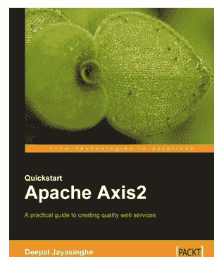
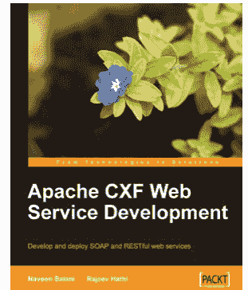
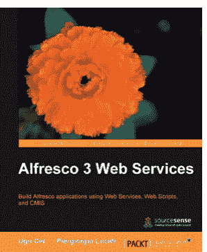
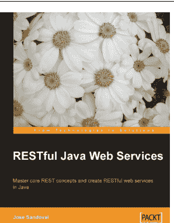

# 14 Axis2 高级特性和用法

在前面的章节中，我们讨论了如何安装 Axis2、编写简单的 Web 服务、编写简单的模块、调用 Web 服务以及许多其他内容。如果你认真跟随并完成了所有示例，现在你应该已经扎实掌握了 Axis2 的基础知识。因此，在本章中，可以这么说，我们将深入探讨 Axis2 的更高级特性。但不必恐慌！在前面的章节中，你已经在不知不觉中使用 Axis2 的大多数高级特性。现在是时候正确地学习它们，并将它们应用到你的应用程序中。当你想要开发复杂的 Web 服务应用程序时，Axis2 提供了许多你需要了解的有趣特性。

在本章中，我们将讨论 Axis2 的几个高级特性，当你需要超越基本的 Web 服务调用时，你就会用到它们。具体来说，我们将讨论以下内容：

- 表述性状态转移（REST）及其特性
- REST 在 Axis2 中的使用
- 消息传输优化机制（MTOM）
- 客户端对 MTOM 的支持
- 服务端对 MTOM 的支持
- 用于创建更定制化 Axis2 的 AxisConfigurators
- 以异步方式调用和处理 Web 服务

在本章中，我们将讨论几个不同的特性及其用法。但是，应该注意，每个单独的章节都有其自身的含义和应用。此外，当你想要进行复杂或更定制化的工作时，你将需要这些特性。


## Representational State Transfer (REST)

我们从本章开始介绍 Representational State Transfer（REST）及其特性。REST 是 Roy Fielding 在其博士论文中提出的一个术语，用来描述网络系统的架构风格。REST 的动机是为了捕捉使 Web 取得成功的特性。随后，这些特性被用来指导 Web 的演进。REST 并不是一个标准，而是一种架构风格，这就解释了为什么你在 W3C 中找不到任何规范。

### Features of REST

Web 由资源组成。简单来说，资源是任何具有某种兴趣的项目。例如，亚马逊在线商店可能会为其新款佳能相机（DSLR）定义一个资源，客户端可以使用以下 URL 访问该资源页面：http://www.amazon.com/canon/dslr。

点击链接后，会返回资源的表示（例如，canon_dslr.html）。该表示将客户端应用程序置于一种状态。客户端在 canon_dslr.html 中遍历超链接的结果是它访问另一个资源。新的表示将客户端应用程序置于另一种状态。因此，客户端应用程序随着每次访问的资源表示而改变（转移）状态，因此我们称之为 Representational State Transfer！

以下是 Roy Fielding 对 Representational State Transfer 含义的解释：

> "Representational State Transfer 旨在唤起这样一种图像：一个设计良好的 Web 应用程序的行为：一个 Web 页面网络（一个虚拟状态机），用户通过选择链接（状态转换）在应用程序中进展，从而将下一个页面（代表应用程序的下一个状态）传输给用户并为其使用进行渲染。"

Web 是一个 REST 系统！你多年来一直在使用的许多 Web 服务——图书订购服务、搜索服务、在线词典服务等等——都是基于 REST 的 Web 服务，这表明你一直在不知不觉中使用 REST 并构建 REST 服务。

### REST services in Axis2

Web Service Description Language（WSDL），尤其是 WSDL 2.0 HTTP Binding 定义了一种在 Web 服务中支持 REST API 的方法。Axis2 实现了 HTTP 绑定规范中定义的大部分内容。Axis2 的 REST 实现假设以下属性：

- REST Web 服务是同步的，并且具有请求-响应特性。
- 当通过 GET 访问 REST Web 服务时，服务和操作是基于 URL 识别的。参数被假定为 Web 服务的参数（HTTP GET 请求中的名称-值对 `name=Axis2&value=1.5`）。在这种情况下，基于 GET 的 REST Web 服务仅支持简单类型作为参数，并且应遵循 IRI 风格。
- 基于 POST 的 Web 服务不需要 SOAP 信封或 SOAP 主体。它只发送 XML 有效负载或 URL 参数，如 GET。

在 Axis2 中，默认情况下，任何给定的 Web 服务都同时作为 SOAP 和 REST 暴露。结果是，作为服务作者，你无需做额外的工作。然而，需要注意的是，对于一些使用 REST API 暴露的服务将无法工作。例如，如果应用程序接收一个复杂对象，很难使用 REST GET API 暴露它。因此，存在需要用户更改自动生成的 WSDL 文件以提供正确信息的情况。Axis2 为 WSDL 1.1 和 WSDL 2.0 生成 REST 绑定，更重要的是，使用 WSDL 2.0，用户可以获得更多自定义 REST 绑定的功能，因为 WSDL 2.0 比 WSDL 1.1 更专注于 REST。

### REST web service with GET and POST

部署在 Axis2 中的服务可以通过 HTTP POST 或 GET 请求访问。然而，在 GET 的情况下，你必须将请求作为 URL 参数发送（记住 IRI 风格）。IRI 风格在编码或序列化复杂对象时存在一些限制，因此，实际上你只能使用 REST GET 方法调用一组服务，但你几乎可以使用 REST POST 方法调用所有服务。例如，如果 Web 服务方法以复杂类型作为其方法参数，则你不能使用 HTTP GET 方法。因此，像以下这样的服务无法使用 HTTP GET 访问：

```java
public class Man {
    String name;
    int age;
    Address address;
}

public String getName(Man man) {
    //processing logic
}
```

> 如前面的代码段所示，Man 对象包含两个简单类型属性（name 和 age）和一个复杂类型属性（address）。因此 Man 类可以被视为一个复杂对象。

然而，像以下这样的服务可以很容易地使用 HTTP GET 方法访问：

```java
public String getName(String id, int age) {
}
```

要调用这样的服务，你可以按如下方式发送请求：

```
http://localhost:8080/axis2/services/ServiceName/getName?id=ID&age=10
```

使用 HTTP POST 方法，没有像 HTTP GET 那样的限制。你可以将其作为编码的 URL 或作为请求体发送（在 POX 消息中）。当使用 HTTP POST 将消息作为请求体发送时，你只发送 SOAP 主体。

你可以使用任何给定的 HTTP 客户端以 REST 方式调用托管在 Axis2 中的 Web 服务，使用 GET 或 POST 方法。然而，正如我们之前讨论的，你将不得不根据 Web 服务操作的方法签名来判断是否使用 GET 或 POST。你甚至可以使用 ServiceClient 以 REST 方式（使用 GET 或 POST）调用远程服务。以下代码演示了使用 POST 以 REST 方式调用服务：

```java
ServiceClient client = new ServiceClient();
Options opts = new Options();
opts.setTo(new EndpointReference("address of the service "));
opts.setAction("soap action ");
opts.setProperty(Constants.Configuration.ENABLE_REST, Boolean.TRUE);
client.setOptions(opts);
OMElement res = client.sendReceive(createPayLoad());
```

当你调用此代码时，如果你通过 TCP 监视器发送请求，你会看到它只发送请求有效负载（仅 SOAP 主体），并且你也只会得到响应的有效负载。

要将请求作为 GET 请求发送，你需要设置以下标志：

```java
opts.setProperty(Constants.Configuration.HTTP_METHOD_GET, Boolean.TRUE);
```

这将以 URL 编码格式发送请求（如果可以 URL 编码）。

### Message Transmission Optimization Mechanism (MTOM)

无论 XML 的灵活性、互操作性和全球接受度如何，都有时将数据序列化为 XML 毫无意义的时候。Web 服务用户可能希望将各种二进制附件，如图像、绘图、XML 文档等，与 SOAP 消息一起传输。这种数据通常最初以某种二进制格式可用。

处理在 XML 中发送二进制数据的两种传统方法如下。

#### By value

通过值发送二进制数据是通过将不透明数据（当然在进行某种形式的编码之后）嵌入为 XML 组件数据的元素或属性内容来实现的。这种技术的最大优点是它使应用程序能够仅基于数据的 XML 组件来处理和描述数据。XML 通过使用 base64 或十六进制文本编码来支持内容中的不透明数据。不幸的是，这两种技术都会使数据的大小膨胀。对于底层文本编码 UTF-8，base64 编码会使二进制数据的大小增加到原始大小的近 1.33 倍，而十六进制编码会使数据扩大约 2 倍。如果使用 UTF-16 文本编码，上述因子将被翻倍。另一个令人担忧的问题是这些格式的处理成本开销（实际和感知），尤其是在解码回原始二进制数据时。

#### By reference

通过引用发送二进制数据是通过将纯二进制数据作为 XML 文档外部未解析的通用实体附加，然后将引用这些实体的 URI 嵌入为 XML 中的元素或属性值来实现的。这可以防止数据不必要的膨胀和处理能力的浪费。使用这些未解析实体的主要障碍是它们对 DTD 的高度依赖，这阻碍了模块化以及 XML 命名空间的使用。在 Web 服务世界中引入了几种规范来处理使用“通过引用”技术解决此二进制附件问题；SOAP with Attachments（SWA）就是一个这样的例子。由于 SOAP 禁止消息中的文档类型声明（DTD），这导致了数据无法作为消息 infoset 的一部分表示的问题，从而创建了两个数据模型。这种情况类似于发送电子邮件附件。即使这些附件与消息内容相关，它们也不包含在消息中。这导致了


基于数据的 XML 组件来处理和描述数据的技术会发生故障。WS-Security 就是这样一个例子。

MTOM 是另一种专注于解决“附件”问题的规范。MTOM 试图通过尝试将上述两种技术合并来利用它们的优势。MTOM 显然是一种“按引用”方法。MTOM 优化消息的线格式与 SOAP with Attachments 消息相同，这使其与 SwA 端点向后兼容。MTOM 最显著的特征是使用 XOP: Include 元素，该元素在 XML Binary Optimized Packaging (XOP) 规范中定义，用于引用消息的二进制附件（外部未解析的通用实体）。使用此专用元素，附加的二进制内容在逻辑上会与 SOAP 文档内联（按值），即使它实际上是单独附加的。这通过使仅使用一个数据模型工作成为可能，从而将这两个领域合并。这允许应用程序仅通过查看 XML 部分来处理和描述数据，使对 DTD 的依赖变得过时。另请注意，MTOM 已标准化了 SwA 的引用机制。

AXIOM（参见第 3 章 Axis2 XML 模型（AXIOM）），用于 Axis2，是一种具有保存二进制数据能力的对象模型。它具有这种能力，因为 OMText 可以以 javax.activation.DataHandler 类的形式保存原始二进制内容。选择 OMText 用于此目的有两个原因。一个原因是 XOP（MTOM）只能优化以 XML Schema base64Binary 数据类型的规范词法形式存在的 base64 编码 Infoset 数据。另一个原因是保留发送方和接收方的 infoset（无论是否优化，都将二进制内容存储在同一种对象中）。MTOM 允许您选择性地编码消息的部分内容，这有助于将 base64 编码的数据以及由 'XOP' 元素引用的外部附加的原始二进制数据（优化内容）作为 SOAP 消息发送。您可以在构造该节点时或之后指定包含原始二进制数据或 base64 编码二进制数据的 OMText 节点是否符合优化条件。为了实现 MTOM 的最佳效率，建议用户使用 base64 编码（非优化）发送较小的二进制附件，并将较大的附件作为优化内容发送。

```java
OMElement imageElement = fac.createOMElement("image", omNs);

// Creating the Data Handler for the file. Any implementation of
// javax.activation.DataSource interface can fit here.
javax.activation.DataHandler dataHandler = new javax.activation.
DataHandler(new FileDataSource("SomeFile"));

//create an OMText node with the above DataHandler and set optimized to true
OMText textData = fac.createOMText(dataHandler, true);
imageElement.addChild(textData);
```

```java
//User can set optimized to false by using the following
//textData.doOptimize(false);
```

此外，用户可以使用 base64 编码的字符串创建可优化的二进制内容节点，该字符串包含编码的二进制内容，并附带实际二进制表示的 MIME 类型。

```java
String base64String = "some_base64_encoded_string";
OMText binaryNode = fac.createOMText(base64String,"image/jpg",true);
```

> Axis2 使用 javax.activation.DataHandler 来处理二进制数据。如果未启用 MTOM，所有优化的二进制内容节点都将序列化为 Base64 字符串。您还可以创建在任何情况下都不会被优化的二进制内容节点。它们将被序列化并作为 Base64 字符串发送。

```java
//create an OMText node with the above DataHandler and set "optimized" to false
//This data will be sent as Base64 encoded strings regardless of whether MTOM is enabled or not

javax.activation.DataHandler dataHandler = new javax.activation.DataHandler(new FileDataSource("SomeFile"));
OMText textData = fac.createOMText(dataHandler, false);
image.addChild(textData);
```

## MTOM on the client side

要在客户端启用 MTOM，您需要在发送消息时将 options 对象中的 enableMTOM 属性设置为 True。

```java
ServiceClient serviceClient = new ServiceClient();
Options options = new Options();
options.setTo(targetEPR);
options.setProperty(Constants.Configuration.ENABLE_MTOM, Boolean.TRUE);
serviceClient.setOptions(options);
```

当此属性设置为 True 时，任何 SOAP 信封，无论是否包含可优化内容，都将被序列化为 MTOM 优化的 MIME 消息。Axis2 将所有二进制内容节点序列化为 Base64 编码的字符串，无论它们是否符合优化条件。

以下代码演示了作为 Web 服务响应的获取二进制数据：

```java
ServiceClient sender = new ServiceClient();
Options options = new Options();
options.setTo(targetEPR);
// enabling MTOM
options.set(Constants.Configuration.ENABLE_MTOM, Boolean.TRUE);
OMElement result = sender.sendReceive(payload);
OMElement ele = result.getFirstElement();
OMText binaryNode = (OMText) ele.getFirstOMChild();

//Retrieving the DataHandler & then do whatever processing required to the data
DataHandler actualDH;
actualDH = binaryNode.getDataHandler();
```

> DataHandler 是在 Java 中访问和表示二进制数据的标准方法。用户可以通过提供文件位置来创建 DataHandler，然后 API 让我们可以读取和写入指定的文件。

## MTOM on the service side

Axis2 服务器根据 content-type 自动识别传入的 MTOM 优化消息并相应地反序列化它们。用户可以为传出消息在服务器端启用 MTOM。

要为所有服务全局启用 MTOM，用户可以在 axis2.xml 中将 enableMTOM 参数设置为 True。设置后，所有传出消息都将被序列化并作为 MTOM 优化的 MIME 消息发送。如果未设置，所有二进制内容节点中的二进制数据都将被序列化为 Base64 编码的字符串。此配置可以在 services.xml 中按服务和按操作覆盖。

```xml
<parameter name="enableMTOM">true</parameter>
```

请注意，设置此参数后必须重新启动服务器（如果您在 axis2.xml 中设置了该参数）。

您可以编写如下服务来执行二进制数据处理：

```java
public class MTOMService {
    public void uploadFileUsingMTOM(OMElement element) throws Exception
    {
        OMText binaryNode = (OMText) (element.getFirstElement()).
        getFirstOMChild();
```

```java
SimpleHTTPServer simpleServer = new SimpleHTTPServer(configCtx, 8070);
simpleServer.start();
```

使用 URL 仓库时需要记住的一件事是，services 目录必须有一个名为 services.list 的文件，列出所有服务归档文件。例如，如果您有名为 foo.aar 和 bar.aar 的服务，则 services.list 将如下所示：

```text
foo.aar
bar.aar
```

同样，modules 目录应包含一个名为 modules.list 的文件，列出所有模块。

## Deploying Axis2 in various application servers

正如我们在第 1 章 Apache Web Services and Axis2 中讨论的那样，Axis2 以多种发行版的形式提供。应用程序服务器发行版是其中之一。您可以从 Axis2 网站下载 Axis2 应用程序服务器发行版或 WAR 发行版，或从二进制发行版构建它们。一旦获得 WAR 发行版，部署它只是将 WAR 文件复制到应用程序服务器的 webapps 目录的问题。在 Apache Tomcat 的情况下，它是 webapps 文件夹，而在 Sun Glassfish 的情况下，它是 autodeploy 文件夹，等等。因此，根据应用程序服务器，您必须确定将 WAR 文件放置的正确位置。

有些应用程序服务器会在永久或临时位置帮助解包 WAR 发行版。例如，Apache Tomcat 会将 WAR 文件解包到永久位置。您可以在那里进行更改，并且当应用程序服务器重新启动时，所有这些更改都将可用。然而，有些应用程序服务器不会这样做。也有一些应用程序服务器根本不会解包 WAR 文件。即使在 Apache Tomcat 中，您也可以配置是否要解包。取决于应用程序服务器配置，热部署和热更新也会有所不同。例如，如果应用程序服务器不打算解包 WAR 文件，则根本没有热部署可用。


## 使用 Axis2 的异步 Web 服务

无论使用哪种应用服务器，都可以通过编辑 Axis2.war 分发版的 web.xml 文件，让 Axis2 从自定义仓库工作。完成此操作后，就无需担心应用服务器是否会解压 WAR，以及解压到何处等问题。甚至可以将基于应用服务器的 Axis2 配置为使用远程仓库启动。首先，让我们看看如何配置 Axis2.war 以使用本地文件系统。在此，你需要在 web.xml 文件的 servlet 部分添加以下初始化参数：

```
<servlet>
    <servlet-name>AxisServlet</servlet-name>
    <display-name>Apache-Axis Servlet</display-name>
    <servlet-class>org.apache.axis2.transport.http.AxisServlet</servlet-class>
    <init-param>
        <param-name>axis2.xml.path</param-name>
        <param-value>path to custom axis2.xml (you need this only if you want to override the default axis2.xml)</param-value>
    </init-param>
    <init-param>
        <param-name>axis2.repository.path</param-name>
        <param-value>full path to the custom repository</param-value>
    </init-param>
    <load-on-startup>1</load-on-startup>
</servlet>
```

如前所述，你可以将 web.xml 文件配置为从 URL 仓库启动 Axis2。在这种情况下，你需要添加以下两个参数：

```
<servlet>
    <servlet-name>AxisServlet</servlet-name>
    <display-name>Apache-Axis Servlet</display-name>
    <servlet-class>org.apache.axis2.transport.http.AxisServlet</servlet-class>
    <init-param>
        <param-name>axis2.xml.url</param-name>
        <param-value>http://localhost/myrepo/axis2.xml</param-value>
    </init-param>
    <init-param>
        <param-name>axis2.repository.url</param-name>
        <param-value>http://localhost/myrepo</param-value>
    </init-param>
    <load-on-startup>1</load-on-startup>
</servlet>
```

如图所示，我们添加了两个名为 axis2.xml.url 和 axis2.repository.url 的参数。你可以根据环境设置修改这些值。

异步 Web 服务的概念是一个非常重要的特性，用户可以调用一个 Web 服务并继续其工作，直到收到回复。在传统的同步模型中，客户端必须等待（或阻塞）直到收到响应。更重要的是，在 Axis2 中，你在客户端和服务器端都获得了异步支持。在客户端，我们可以以阻塞或非阻塞方式调用服务。选择调用方式非常简单。在服务器端，我们可以拥有处理时间很长的服务。在这种情况下，服务可以以非阻塞方式处理，一旦收到消息，就会发送确认，并在稍后发送响应。Axis2 在客户端支持两种不同的异步 Web 服务调用方式；其中一种需要 WS 地址支持，另一种不需要。我们将分别用代码示例讨论它们。

### 什么是同步 Web 服务？

如前所述，同步 Web 服务是阻塞式服务调用，应用程序在收到响应之前会被阻塞。通过这种类型的调用，用户必须等待直到收到想要的响应。如果这是一个 GUI 应用程序，那么在收到回复之前应用程序将变得无响应。

### 什么是异步 Web 服务？

在上一节中，我们讨论了同步 Web 服务。异步 Web 服务与之相反。异步 Web 服务是非阻塞调用，用户可以在不阻塞用户应用程序的情况下调用服务。

### 客户端异步

Axis2 的主要设计目标之一是提供非常好的异步 Web 服务支持，而异步支持对客户端更有用。因此，Axis2 对客户端的异步服务调用提供了非常好的支持。Axis2 在客户端支持两种类型的异步调用：

- **应用级异步支持**：在这种情况下，我们只有应用级异步支持。然而，在传输层（传输发送器），我们有阻塞行为。换句话说，当我们调用服务时，我们提供一个回调对象，然后 Axis2 将其注册到传输层。一旦传输层收到响应，它就会调用回调。为了实现这种类型的异步支持，它不需要 WS-Addressing 支持，因为我们在传输层没有异步行为。

```
public class MyCallBack implements AxisCallback {
    public void onMessage(MessageContext messageContext) {
        SOAPBody msg = messageContext.getEnvelope().getBody();
        System.out.println(msg);
    }

    public void onFault(MessageContext messageContext) {
        messageContext.getFailureReason().printStackTrace();
    }

    public void onError(Exception e) {
        System.err.println(e.getMessage());
    }

    public void onComplete() {
        System.out.println("Invocation is complete");
        //In real application you do not need to terminate the program
        System.exit(0);
    }
}
```

如我们所见，接口中有四个方法。现在让我们逐一查看：

- **onMessage**：如前所述，WSDL 2.0 定义了 MEP 或消息交换模式。其背后的思想是客户端和服务器之间的消息调用模式。客户端可以发送两条消息并得到一个响应（in-in-out），或客户端发送请求并得到响应（in-out），等等。onMessage 背后的思想是在收到消息时调用用户操作。在我们的实现中，我们需要打印消息，但根据需求，我们可以在方法内部实现我们的代码。
- **onFault**：有时我们可能会在服务调用中收到故障，用户可能对此感兴趣。因此此方法有助于实现它。
- **onError**：在调用服务时，如果客户端出现问题，它将使用此方法通知用户。
- **onComplete**：当 MEP 完成时，用户将通过此方法收到通知。在此示例中，当 Axis2 调用 onComplete 方法时，我们终止应用程序。然而，在实际应用程序中，我们可以在那里实现我们的用户操作。

```
("http://localhost:8080/axis2/services/EchoService");
opts.setAction("urn:echo");
client.engageModule("addressing");
opts.setUseSeparateListener(true);
client.setOptions(opts);
client.sendReceiveNonBlocking(createPayLoad(), new MyCallBack());
System.out.println("send the message");
while (true) {
    Thread.sleep(100);
}
}
```

第一个高亮行显示了我们如何启用 addressing 模块，第二个高亮行显示了如何通过在 Option 对象中设置 Option 值在客户端启用单独的监听器。

### 总结

在本章中，我们讨论了 Axis2 的许多高级特性，并附带示例。特别是 REST 和 MTOM 在 Web 服务的上下文中非常有用。你可以使用 REST 作为优化消息线格式的一种方式，你可以使用 MTOM 以高效的方式发送二进制数据。然后我们讨论了使用自定义仓库创建 Axis2，该仓库可能位于本地或远程。接下来，我们研究了在各种应用服务器中部署 Axis2。最后，我们讨论了如何使用 Axis2 以异步方式调用服务。

现在我们已经涵盖了 Axis2 的大部分必要概念和特性。我们讨论了如何将 Axis2 用作服务器和客户端。

在下一章（本书的最后一章）中，我们将讨论如何为你的 Web 服务添加服务质量。特别是，我们将讨论安全性和可靠性以及如何通过代码示例使用它们。


```
}
    public void ping{String in}{
        System.out.println("Received text:" + in);
    }
}
```

接下来，创建一个 `services.xml` 文件，使用 RPC 消息接收器，如下面的代码片段所示：

```
<service name="RMSampleService">
    <parameter name="ServiceClass">RMSampleService</parameter>
    <description>
        My Sample service for RM.
    </description>
    <module ref="sandesha2" />
    <module ref="addressing" />
    <messageReceivers>
        <messageReceiver mep="http://www.w3.org/2004/08/wsdl/in-out" class="org.apache.axis2.rpc.receivers.RPCMessageReceiver"/>
        <messageReceiver mep="http://www.w3.org/2004/08/wsdl/in-only" class="org.apache.axis2.rpc.receivers.RPCInOnlyMessageReceiver"/>
    </messageReceivers>
</service>
```

现在，创建服务归档文件并部署服务。正如你在 `services.xml` 文件中所看到的，我们已为这个服务启用了 Sandesha2 模块。打开 Web 控制台，尝试访问服务的 WSDL。如果你能访问到它，说明你已经成功部署了服务及 Sandesha2 模块。

> 在进入下一步之前，你还需要将 Sandesha2 和 addressing 模块部署到客户端类路径中。如果你有客户端的 Axis2 仓库，请将下载的 Sandesha2 模块复制到 `modules` 目录中。同时，记得将 RM 阶段添加到客户端侧的 `axis2.xml` 中。此外，还要将 Sandesha2 的 JAR 文件复制到客户端类路径中。

## 单向调用

单向调用的思想是：将消息可靠地发送到接收方，发送方不需要应用程序应答，但需要消息的可靠投递。这里我们使用以下客户端发送三条消息。

### 全局配置：

```
public class PingClient {
    private static final String tns = "http://ws.axis2.apache.org";
    private static String toEPR = "http://127.0.0.1:8070/axis2/services/RMSampleService";
    private static String CLIENT_REPO = "location to client repository";
    public static void main(String[] args) throws AxisFault {
    String axis2_xml = CLIENT_REPO + File.separator + "client_axis2.xml";
    ConfigurationContext configContext = ConfigurationContextFactory.createConfigurationContextFromFileSystem(CLIENT_REPO,axis2_xml);
```

### 创建并配置客户端：

```
Options clientOptions = new Options ();
clientOptions.setTo(new EndpointReference (toEPR));
ServiceClient serviceClient = new ServiceClient (configContext,null);
clientOptions.setAction("urn:wsm:Ping");
serviceClient.setOptions(clientOptions);
serviceClient.engageModule(new QName ("sandesha2"));
serviceClient.engageModule(new QName ("addressing"));
serviceClient.fireAndForget(createElement("ping1"));
serviceClient.fireAndForget(createElement("ping2"));
clientOptions.setProperty(SandeshaClientConstants.LAST_MESSAGE,
    "true");
serviceClient.fireAndForget(createElement("ping3"));
serviceClient.cleanup();
}
```

### 创建负载：

```
private static OMElement createElement(String text) {
    OMFactory fac = OMAbstractFactory.getOMFactory();
    OMNamespace namespace = fac.createOMNamespace(tns,"ns1");
    OMElement pingElem = fac.createOMElement("ping", namespace);
    OMElement textElem = fac.createOMElement("in", namespace);
    textElem.setText(text);
    pingElem.addChild(textElem);
    return pingElem;
}
}
```

当你使用 Sandesha2 时，它首先会创建一个序列（特定于可靠消息传递的会话）并发送消息；当客户端标记最后一条消息时，它会终止该序列。在上述代码示例中，`ping1` 和 `ping2` 消息位于 Sandesha2 会话中，而 `ping3` 不在会话中。Sandesha2 为 `ping1` 和 `ping2` 提供可靠投递，但不为 `ping3` 提供。

## 请求-应答调用

在这里，我们介绍如何使用 Sandesha2 进行请求-应答消息调用。与前面的示例一样，`echo1` 和 `echo2` 位于 Sandesha2 会话中，并获得可靠性支持。`echo3` 无法获得可靠性支持，因为在发送 `echo3` 之前，已经发送了最后一条消息。

```
public class EchoClient {
    private static final String tns = "http://ws.axis2.apache.org";
    private final static String echoString = "echoString";
    private static String toEPR = "http://127.0.0.1:8070/axis2/services/RMSampleService";
    private static String CLIENT_REPO = "Location of Client repository";
    public static void main(String[] args) throws Exception {
        String axis2_xml = CLIENT_REPO + File.separator +"client_axis2.xml";
        ConfigurationContext configContext = ConfigurationContextFactory.createConfigurationContextFromFileSystem(CLIENT_REPO,axis2_xml);
```

创建客户端：

```
ServiceClient serviceClient = new ServiceClient (configContext,null);
Options clientOptions = new Options ();
clientOptions.setTo(new EndpointReference (toEPR));
clientOptions.setUseSeparateListener(true);
serviceClient.setOptions(clientOptions);
serviceClient.engageModule(new QName ("sandesha2"));
serviceClient.engageModule(new QName ("addressing"));
Callback callback1 = new TestCallback ("Callback1");
```

调用服务（第一次）：

```
serviceClient.sendReceiveNonBlocking (createElement("echo1"),callback1);
Callback callback2 = new TestCallback ("Callback2");
```

### 调用服务（第二次）：

```
serviceClient.sendReceiveNonBlocking(createElement("echo2"),callback2);
```

### 发送最后一条消息：

```
clientOptions.setProperty(SandeshaClientConstants.LAST_MESSAGE,
"true");
Callback callback3 = new TestCallback ("Callback3");
```

### 调用服务（第三次）：

```
serviceClient.sendReceiveNonBlocking(createElement("echo3"),callback3);
while (!callback3.isComplete()) {
    Thread.sleep(1000);
}
Thread.sleep(2000);
}
```

### 创建负载：

```
private static OMElement createElement(String text) {
OMFactory fac = OMAbstractFactory.getOMFactory();
OMNamespace applicationNamespace = fac.createOMNamespace(tns,"ns1");
OMElement echoStringElement = fac.createOMElement(echoString,
applicationNamespace);
OMElement textElem = fac.createOMElement("in",applicationNamespace);

textElem.setText(text);
echoStringElement.addChild(textElem);

return echoStringElement;
}
```

### 实现 Callback 类：

```
static class TestCallback extends Callback {
String name = null;
public TestCallback (String name) {
this.name = name;
}

public void onComplete(AsyncResult result) {
SOAPBody body = result.getResponseEnvelope().getBody();
```

```
System.out.println("Callback '' + name + ''
got result:" + body);
}
public void onError (Exception e) {
System.out.println("Error reported for test call back");
    e.printStackTrace();
}
}
}
```

如果你运行上述代码并通过 TCP 监视器观察，你会看到只有前两条消息处于 RM 会话中，最后一条消息不是在 RM 会话内调用的。

## 管理序列

在上一节中，我们讨论了 Sandesha2 序列，并提到它会在内部创建序列并发送消息，直到用户指定最后一条消息。在这里，我们将讨论如何使用 Sandesha2 API 管理序列。Sandesha2 提供了一个名为 `SandeshaClient` 的工具类，它在内部使用 `ServiceClient` 实例。因此，创建 `SandeshaClient` 的实例需要 `ServiceClient` 的实例。

> 默认情况下，Sandesha2 会假定发往同一端点的消息应当属于同一个 RM 序列。只有当消息的 WS-Addressing To 地址不同时，消息才会被放入不同的 RM 序列。但如果需要，你也可以指示 Sandesha2 将具有相同 WS-Addressing To 地址的消息放入两个或多个序列中。为此，你需要设置一个名为 Sequence Key 的属性。

下面一行代码展示了如何使用序列 ID 来区分不同的序列：

```
clientOptions.setProperty(SandeshaClientConstants.SEQUENCE_KEY,<sequence id>);
```


## 创建序列而不发送消息

在某些应用程序中，您需要在不向服务器发送任何应用程序消息的情况下启动序列。在这种情况下，可以使用以下 API。当您提出此要求时，Sandesha2 将执行一次 Create Sequence 消息交换，并从服务器获取新的序列 ID。此方法将返回新建序列的 `sequenceKey` 值，可用于执行消息调用。此方法还有一个布尔参数，用于指示是否为响应端提供序列。

```
String sequenceKey = SandeshaClient.createSequence (serviceClient, booleanOffer);
```

## 终止序列

您可以使用以下代码终止序列；Sandesha2 将发送所需控制消息，并同时移除客户端和服务器端的会话：

```
SandeshaClient.terminateSequence (serviceClient);
```

> Sandesha2 还提供了许多其他功能，可用于配置并实现更好的定制；不过我们不在这里讨论。建议您参阅在线文档以更好地理解这些功能。

## 保护 Web 服务安全

在上一节中，我们讨论了如何为服务添加可靠性。在本节中，我们将讨论如何为服务提供安全性。在 Axis2 中，我们使用 Apache Rampart 来提供安全支持。

下载最新版本的 Apache Rampart 并解压。将 `rampart-version.mar` 文件复制到 `AXIS2_HOME` 目录的模块目录中。接下来，将解压后的其他 JAR 文件复制到 `lib` 目录（例如 `TOMCAT_HOME/axis2/WEB-INF/lib`）。然后，重启 Axis2，登录管理控制台并启用 Rampart 模块。几秒钟后，如果在已启用模块下看到 Rampart 模块，说明您已成功为 Web 服务框架添加了安全支持。

前面的代码片段包含我们将用于此示例的密码回调类。如您所见，我们已硬编码了密码；但在编写复杂的回调类时，您可以检索逻辑并设置正确的密码。

## 创建策略元素

Rampart 在服务器端和客户端均使用基于策略的配置。因此，要配置服务，我们需要提供所需的 WS-Policy 配置。这里我们不详细讨论 WS-Policy，只提供服务所需的策略配置，如下代码片段所示：

```
<wsp:Policy wsu:Id="UsernameTokenOverHTTPS"
    xmlns:wsu="http://docs.oasis-open.org/wss/2004/01/oasis-200401-wss-wsssecurity-utility-1.0.xsd"
    xmlns:wsp="http://schemas.xmlsoap.org/ws/2004/09/policy">
    <wsp:ExactlyOne>
        <wsp:All>
            <sp:TransportBinding
            xmlns:sp="http://schemas.xmlsoap.org/ws/2005/07/securitypolicy">
                <wsp:Policy>
                    <sp:TransportToken>
                        <wsp:Policy>
                            <sp:HttpsToken
                            </wsp:Policy>
                        </sp:TransportToken>
                        <sp:AlgorithmSuite>
                            <wsp:Policy>
                                <sp:Basic256/>
                            </wsp:Policy>
                        </sp:AlgorithmSuite>
                        <sp:Layout>
                            <wsp:Policy>
                                <sp:Lax/>
                            </wsp:Policy>
                        </sp:Layout>
                        <sp:IncludeTimestamp/>
                    </wsp:Policy>
                </sp:TransportBinding>
                <sp:SignedSupportingTokens xmlns:sp="http://schemas.xmlsoap.org/ws/2005/07/securitypolicy">
                    <wsp:Policy>
                        <sp:UsernameToken sp:IncludeToken="http://schemas.xmlsoap.org/ws/2005/07/securitypolicy/IncludeToken/AlwaysToRecipient" />
                    </wsp:Policy>
                </sp:SignedSupportingTokens>
```

```
<ramp:RampartConfig xmlns:ramp="http://ws.apache.org/rampart/policy">
    <ramp:passwordCallbackClass>PWCallbackHandler</ramp:passwordCallbackClass>
</ramp:RampartConfig>
</wsp:All>
</wsp:ExactlyOne>
</wsp:Policy>
```

如果您熟悉 WS-Security 和 WS-Policy，可以看出它包含两个主要安全断言：传输绑定断言和签名支持令牌断言。传输绑定断言定义了使用基于 HTTPS 传输令牌断言的 SSL 传输要求。签名支持令牌定义了对用户名令牌的要求，该令牌应在传输层受到完整性保护。

现在万事俱备。接下来，我们需要使用以下代码为示例服务创建 `services.xml` 文件：

```
<service>
    <module ref="rampart"/>
    <parameter name="ServiceClass">SecureService</parameter>
    <messageReceivers>
        <messageReceiver mep="http://www.w3.org/2004/08/wsdl/in-out" class="org.apache.axis2.rpc.receivers.RPCMessageReceiver"/>
        <messageReceiver mep="http://www.w3.org/2004/08/wsdl/in-only" class="org.apache.axis2.rpc.receivers.RPCInOnlyMessageReceiver"/>
    </messageReceivers>
    <wsp:Policy wsu:Id="UsernameTokenOverHTTPS" xmlns:wsu="http://docs.oasis-open.org/wss/2004/01/oasis-200401-wss-wssecurity-utility-1.0.xsd" xmlns:wsp="http://schemas.xmlsoap.org/ws/2004/09/policy">
    </wsp:Policy>
</service>
```

现在，编译服务类和回调对象，并使用上述 `services.xml` 文件创建服务归档文件。您可以登录 Web 管理控制台验证服务部署。如果正确遵循上述步骤，应该一切正常。

应用程序作用域 163
应用程序特定业务对象（ASBO） 236
applyPolicy 方法 128
基于归档的部署 80, 108
异步调用 137
异步调用，JAX-WS 服务
  简介 198
  回调模型 198-200
  轮询模型 198
客户端异步服务调用
  简介 254
  应用程序级异步支持 254, 257
  传输级异步支持 255, 258
异步 Web 服务
  简介 254
  客户端异步 254, 255
  onComplete 方法 256
  onError 方法 256
  onFault 方法 256
  onMessage 方法 256
atmostOnceMessageSemantics 参数 209
属性
  添加到 AXIOM 47, 48
身份验证与授权 231-233
自动伸缩 239
AvoidInitiation 参数 207
AXIOM
  简介 29, 30, 41, 141, 248, 249
  优势 30
  架构 43
  属性添加 47, 48
  遍历 Axiom 树 48, 49
  添加子节点 47
  创建 44
  特性 41-43
  必要性 41
  OM 命名空间 48
  序列化 49, 50
  使用 43
AXIOM 架构 43
AXIOM 的创建
  简介 44
  使用输入流 44
  以编程方式 46
  使用字符串 45
AXIOM 的特性
  缓存 43
  延迟构建 42
  轻量级 42
  基于拉取的操作 42
Axiom 树
  遍历 48, 49
Axis1 18
Axis2
  简介 7, 21
  高级特性 243
  架构 27
  异步 Web 服务 254
  集群管理 218
  配置文件 87
  上下文 96-99
  自定义部署器 39
  在各种应用服务器中的部署 252, 253
  部署描述符 77, 78
  部署模型 72
  部署选项 79
  下载 22
  动态数据 86
  端点 133
  增强功能 20, 21
  特性 20, 21
  历史 120
  行业规范 20, 21
  访问 MessageContext（MC） 156
  消息接收器 39
  模块 38, 120
  模块结构 121, 122
  必要性 19
  添加新 Web 服务 24
  org.apache.axis2.service.Lifecycle 接口 156
  插件模块 20
  存储库 75
  REST 服务 244, 245
  服务描述层次结构 94, 96
  服务扩展 38
  会话作用域 153, 154
  无状态特性 152, 153
  静态数据 86
Axis2 架构
  简介 27
  核心模块 28-34
  工作原理 27, 28
Axis2 客户端 API
  简介 137
  OperationClient 137, 147
  ServiceClient 137
Axis2 集群
  启用 202
Axis2 集群能力 202
Axis2 集群实现
  接口 221
Axis2 集群管理 API
  简介 220
  管理 221
  状态复制 221
生产系统中的 Axis2 集群
  配置 206
  设置 206
Axis2 配置器 251, 252
Axis2 数据绑定。参见 ADB
Axis2 的特性
  附加组件 21
  异步 Web 服务 20
  AXIOM 20
  面向组件的部署 20
  组合 21
  可扩展性 21
  灵活性 20
  热部署 20
  MEP 支持 20
  速度 20
  稳定性 20
  传输框架 21
  WSDL 支持 21
Axis2 的安装
  二进制发行版 22
  文档发行版 25
  JAR 发行版 25
  源码发行版 25
  WAR 发行版 23, 24
AXIs2 对象模型。参见 AXIOM
基于 Axis2 Savan 模块的 WS-Eventing
  简介 236
Axis2 工作节点集群 239
axis2.xml 60, 65, 67, 78
axis2.xml 文件 87
Axis 集群配置
  简介 212, 214
  集群代理 206
  集群代理参数 206
  组管理 211
  状态管理 210, 211
  静态成员 212
AxisConfiguration
  简介 88
  创建方式 88
AxisEngine
  简介 30, 39, 152
  方法 30
AxisEngine 的方法
  receive 30
  send 30
AxisMessage 96
AxisModule 93
AXIs 对象模型。参见 AXIOM
AxisOperation 95
AxisService 95
AxisServiceGroup 94
B
Axis2 二进制发行版 22
绑定定义
  用于 WSDL 191
阻塞调用。参见同步调用
C
Callback 类
  实现 267
回调机制 143
回调模型 198-200
子节点
  添加到 AXIOM 47
客户端 API 29, 34, 35
客户端 JAX-WS
  简介 193
  分发客户端 194, 195
  动态代理客户端 196
客户端存根
  生成 273


## C

- cloud computing 19
- ClusteringAgent 221
- clustering agent parameters
    - about 206
    - atMostOnceMessageSemantics 209
    - AvoidInitiation 207
    - domain 207
    - localMemberHost 209
    - localMemberPort 209
    - maxRetries 208
    - mcastAddress 208
    - mcastBindAddress 209
    - mcastFrequency 208
    - mcastPort 208
    - memberDropTime 208
    - membershipScheme 207
    - preserveMessageOrder 209
    - properties 210
    - synchronizeAll 208
- cluster management 218
- code first approach
    - about 102, 104, 165
    - message receivers, specifying ways 110
    - POJOs, with packages 106, 107
    - schemas 114, 115
    - service archive file, creating 110
    - service group 113
    - services, deploying 108
    - service WSDL 114, 115
    - single class POJO approach 104, 105
    - single service 113
    - third-party resources, adding 114
- code first service development
    - with JAX-WS 185-187
- codegen engine 37
- code generation 103
- code generation module 37
- commercial software 21
- configContext argument 139
- ConfigurationContext 97, 98
    - about 154, 203
    - ServiceClient, creating 139
- configuration files, Axis2
    - about 87
    - axis2.xml 87
    - module.xml 87
    - services.xml 87
- context hierarchy 32
- contexts, Axis2
    - about 96, 97
    - ConfigurationContext 97, 98
    - MessageContext 99
    - OperationContext 98
- contract first approach
    - about 102, 103, 116, 165
    - ant build file, running 117
    - code, generating 116
    - service skeleton class 117
- contract first development
    - client side JAX-WS 193
    - with JAX-WS 188-192
- CORBA 8
- core modules, Axis2 architecture
    - about 28
    - Client API 29, 34, 35
    - deployment model 29, 33, 34
    - information model 29, 32
    - SOAP processing model 29-32
    - transports 29, 36
    - XML processing model 29, 30
- createPayload method 161
- createSequence message 133
- Cron job 234
- custom deployers 39

## D

- data binding frameworks, Axis2
    - about 37
    - ADB 37
    - JAXB RI 37
    - JaxMe 37
    - JiBX 37
    - XMLBeans 37
- data bound classes 103
- default constructor
    - ServiceClient, creating 138
- Demilitarized Zone (DMZ) 230
- deployment descriptors, Axis2
    - about 77
    - axis2.xml 78
    - module.xml 79
    - services.xml 78

## J

- `javax.xml.ws.WebServiceClient annotation`
    - properties 178, 179
- `javax.xml.ws.WebServiceClient annotation, properties`
    - name 178
    - targetNamespace 179
    - wsdlLocation 179
- `javax.xml.ws.WebServiceProvider annotation`
    - about 179
    - properties 179
- `javax.xml.ws.WebServiceProvider annotation, properties`
    - portName 179
    - serviceName 179
    - targetNamespace 179
- `javax.xml.ws.WebServiceRef annotation`
    - about 180
    - properties 180
- `javax.xml.ws.WebServiceRef annotation, properties`
    - mappedName 180
    - name 180
    - type 180
    - value 180
    - wsdlLocation 180
- JAXB RI 37
- JaxMe 37
- JAX-WS services
    - asynchronous invocation 198
    - with MTOM 196, 198
- JAX-WS specifications
    - about 165
    - code first service development 185-187
    - contract first development 188-192
- JAX-WS specifications, annotations
    - about 166
    - JSR 181 (Web Service Metadata) 166, 167
    - JSR 222 (JAXB) 166
    - JSR 224 (JAX-WS) 166
    - JSR 250 (Common Annotations) 166
- JDOM 41
- JiBX 37
- JMS 8, 36
- JMX management API 233
- JSR 181 (Web Service Metadata), annotations
    - javax.jws.OneWay 170, 171
    - javax.jws.soap.SOAPBinding 174
    - javax.jws.WebMethod 169
    - javax.jws.WebParam 171
    - javax.jws.WebResult 172
    - javax.jws.WebService 167
- JSR 222 (JAXB) specifications, annotations
    - about 180
    - javax.xml.bind.annotation.XmlAccessorType 182
    - javax.xml.bind.annotation.XmlElement 182
    - javax.xml.bind.annotation.XmlRootElement 181
- JSR 224 (JAX-WS) specifications, annotations
    - about 175
    - javax.xml.ws.BindingType 175, 176
    - javax.xml.ws.RequestWrapper 176
    - javax.xml.ws.ResponseWrapper 176
    - javax.xml.ws.ServiceMode 177
    - javax.xml.ws.WebEndpoint 177
    - javax.xml.ws.WebFault 178
    - javax.xml.ws.WebServiceClient 178
    - javax.xml.ws.WebServiceProvider 179
    - javax.xml.ws.WebServiceRef 180
- JSR 250 (Common Annotations) annotations
    - about 183
    - javax.annotation.PostConstruct 184
    - javax.annotation.PreDestroy 184
    - javax.annotation.Resource 183

## L

- lib directory 76
- localMemberHost parameter 209
- localMemberPort parameter 209
- locked attribute 89
- logic server, EDA with MDM 237
- loose coupling 10

## M

- Master Data Management. See MDM
- maven scripts 25
- maxRetries parameter 208
- mcastAddress parameter 208
- mcastBindAddress parameter 209
- mcastFrequency parameter 208
- mcastPort parameter 208
- MDM 234, 235
- memberDropTime parameter 208
- members element 212
- membership scheme
    - about 214
    - dynamic membership 216
    - hybrid membership 216-218
    - static membership 214, 215
- membershipScheme parameter
    - about 207
    - multicast 207
    - Well-known address (WKA) 207
- memory-intensive programming 41
- MEP 29
- MessageBuilders 91
- MessageContext (MC) 56, 99
    - about 155
    - accessing 156
- message definitions
    - for WSDL 191
- Message Exchange Patterns. See MEP
- MessageFormatters 91
- message receiver
    - about 31, 39, 68, 90
    - RawXMLINOnlyMessageReceiver 69
    - RawXMLINOutMessageReceiver 69
    - RPCInOnlyMessageReceiver 69
    - RPCMessageReceiver 69
    - specifying 109
    - specifying, ways 110-112
    - working 68
- MessageReceivers 152
- Message Transmission Optimization Mechanism. See MTOM
- messaging system
    - disadvantages 8
    - examples 8
    - issues 8
    - JMS 8
- META-INF directory 122
- module
    - about 38, 77, 120
    - deploying 129-132
    - engaging 129-132
    - structure 121, 122
    - working 38
- module descriptor. See module.xml
- module engagement 67
- module implementation class
    - about 125
    - methods 127
- modules, Axis2 architecture
    - code generation 37
    - data binding frameworks 37
- modules directory 76
- module structure 121, 122
- module.xml 77, 79
- module.xml file 38
    - about 122
    - fault processing 129
    - handlers 123, 124
    - parameters, adding 132
    - phase rules 123, 124
    - writing 128, 129
- MTOM
    - about 247, 248
    - enabling, on client side 249, 250
    - enabling, on service side 250
    - features 248
    - SwA 248
    - with JAX-WS services 196, 198
    - XML Binary Optimized Packaging (XOP) specification 248

## N

- nextSibling() method 49
- node management 221
- nodeManager element 211
- non-blocking invocation. See asynchronous invocation

## O

- OASIS
    - functionality 11
- Object Model (OM) 30, 43
- OMAbstractFactory.getOMFactory() method 45
- one way invocation 264, 265
- OpenESB 230
- open source software 21
- OperationClient
    - about 137
    - working with 147-149
- OperationClient class 35
- OperationContext 98, 155
- OperationInPhases 61
- operation phase 62
- organizations
    - moving, into web services 11
- org.apache.axis2.clustering.ClusteringAgent 221
- org.apache.axis2.clustering.management.GroupManagementAgent 223
- org.apache.axis2.clustering.management.NodeManager 223
- org.apache.axis2.clustering.state.State Manager 222
- org.apache.axis2.service.Lifecycle interface
    - using 156
- OSGi bundles 228
- OutFlow pipe 30

## P

- parameters
    - about 89
    - adding, in module.xml file 132
    - benefits 89
    - locked attribute 89
- password callback
    - writing 270, 271
- pattern 225
- phase
    - about 31, 32, 58
    - rules 59
    - types 60
- phase rules
    - about 59, 62
    - characterizing 62, 64
    - invalidity 64, 65
- phase rules, characterizing
    - about 62
    - before 63, 64
    - phaseFirst 63
    - phaseLast 63
    - phase name 63
- phase, types
    - about 60
    - global 60
    - operation 62
- pivot point 68
- Plain Old Java Object. See POJO
- Plain Old Java Object deployment. See POJO deployment
- Plain Old XML. See POX
- plugin modules, Axis2 20
- POJO
    - about 102
    - with packages 106, 107
- POJO approach 103
- POJO deployment 81, 83
- policy element
    - creating 271, 272
- policy element, creating
    - about 271, 272
    - client stubs, generating 273
    - service, invoking without security 273
    - service, invoking with security 273
- polling mechanism 143
- polling model 198
- portName argument 139
- portType definition
    - for WSDL 191
- POX
    - about 9
    - examples 8
- PreDispatch 62
- preserveMessageOrder parameter 209
- previousSibling() method 49
- properties, clustering agent
    - about 210
    - backendServerURL 210
    - mgtConsoleURL 210
- protocol bridging 230
- pull parser
    - accessing 52
- PULL parser technique
    - versus PUSH parser technique 30
- pull parsing
    - about 19, 42
    - working 43
- push and pull integration pattern
    - about 238
    - demonstrating 238
- PUSH parser technique
    - versus PULL parser technique 30

## Q

- Qualities of Service (QoS) functionality 230

## R

- Rampart 271
- RawXMLINOnlyMessageReceiver 69
- RawXMLINOutMessageReceiver 69
- RawXML message receivers 108
- receive() method 30
- references, Enterprise Integration patterns 240
- registry 237
- registry, EDA with MDM 237
- Reliable Messaging (RM) 57
- reliable web services
    - about 262, 263
    - one way invocation 264, 265
    - request-reply invocation 266-268
    - sample service 263, 264
- Replicator.replicate() 204
- repository, Axis2
    - about 75
    - modules 76
    - services 76
- Representational State Transfer. See REST
- request-reply invocation 266-268
- Request Security Token (RST) message 232
- request session scope 157, 158
- RequestURIBasedDispatcher 68
- REST
    - about 9, 105, 244
    - features 244
- REST services, in Axis2 244, 245
- REST web service, with GET and POST 245, 246
- RMI 8
- RMPhase 262
- round-robin load balancing algorithm 205
- RPC 8
- RPCInOnlyMessageReceiver 69
- RPCMessageReceiver 69
- RPC message receivers 108
- runtime data 152

## S

- sample service
    - creating 263, 264
- Sandesha 77
- Sandesha2 262, 268
- SandeshaClient utility class 268
- scalability 201
- secure web services
    - about 269
    - password callback, writing 270, 271
    - sample service 270
- security phase 62
- send() method 30
- sendReceive API 35
- sendReceiveNonBlocking API 35
- sendRobust API 35
- Sequence Key property 268
- sequences
    - creating, without sending message 269
    - managing 268
    - terminating 269
- serialization
    - about 49
    - serializeAndConsume method 50
    - XMLStreamWriter object 49
- server-side code
    - generating 116
- service
    - deploying 83
    - deploying, programmatically 80
    - invoking, without security 273
    - invoking, with security 273
    - running 83
- service archive
    - message receiver, specifying 109
    - service implementation class 109
    - services, deploying 108
- service archive file
    - creating 110
- service broker 13
- service client
    - using 163


ServiceClient
约 137
创建，使用 ConfigurationContext 139
创建，使用默认构造函数 138
创建，方式 138, 139
会话，管理 164
带工作示例 140, 141
ServiceClient 类
关于 35
API 35
ServiceClient 类，API
fireAndForget 35
sendReceive 35
sendReceiveNonBlocking 35
sendRobust 35
ServiceContext 155, 203
服务描述层次结构，Axis2
关于 94
AxisMessage 96
AxisOperation 95
AxisService 95
AxisServiceGroup 94
服务描述符。参见 services.xml
服务端点接口（SEI）168
服务扩展 76
ServiceGroupContext 154, 203
面向服务架构（SOA）
关于 8, 85
应用程序 8
能力 8
启用，方法 9
服务提供者 12
服务请求者 13
服务目录 76
服务骨架类 117
services.xml 67, 78
services.xml 文件
关于 122, 165
编写 108
会话
初始化 155
使失效 155
管理，使用 ServiceClient 164
会话作用域，Axis2
关于 153, 154
应用程序 163
请求 157, 158
SOAP 158-161
传输 162, 163
setValue 操作 203
shutdown 方法 128
签名支持令牌 272
简单 Axis2 集群
设置 202
SimpleAxisServer 22
简单 JAX-WS Web 服务
编写 166
简单对象访问协议。参见 SOAP
单类 POJO 方法
关于 104
示例 105
SMTP 36
SOA 集成模式
关于 225
结合审计的动态路由 233
EDA 与 MDM 234
外部认证与授权 231, 233
带动态负载均衡的容错自动缩放 239, 240
协议桥接 230
推与拉 238
SOAP
关于 14
工作原理 14
SOAP 1.1 文档
创建 53
SOAP 1.2 文档
创建 53
SOAPActionBasedDispatcher 68
SOAPMessageBodyBasedDispatcher 68
SOAP 消息 56
SOAPModelBuilder 44
soapmonitorPhase 61
SOAP 处理框架 55
SOAP 处理模型 29-32
soap 会话作用域 203
SOAP 会话作用域 158-161
软件类型
商业软件 21
自由软件 21
开源软件 21
源码分发，Axis2 25

- **WS-Addressing**
  - 关于 15
  - 工作原理 15
- **WSDL**
  - 关于 16, 102, 165
  - 绑定定义 191
  - 消息定义 191
  - portType 定义 191
  - 标准 16
  - 工作原理 16
- **wsdlServiceName 参数 139**
- **WS-I**
  - 功能 11
- **wsimport 工具**
  - Java 构件，创建 188
- **wsldURL 参数 139**
- **WSO2 ESB**
  - 关于 227
  - 部署 228
  - 特性 227, 228
  - 任务 228
- **WS-Policy**
  - 指定 132
- **WS 可靠消息传递 120**
- **WS-Reliable 消息传递 263**
- **WS-Trust 232**

# X

- **XML**
  - 二进制数据，按引用发送 247
  - 二进制数据，按值发送 247
- **XMLBeans 37**
- **XML 二进制优化打包（XOP）**
  - 规范 248
- **XML InfoSet 模型 41**
- **XML 处理模型 29, 30**
- **XML-RPC 标准**
  - 关于 14
  - 工作原理 14
- **XMLStreamWriter 对象 49**
- **XMPP 36**
- **AXIOM 中的 Xpath 导航 51**
- **XSLT 中介者 226**


# 感谢购买
Apache Axis2 Web Services
第2版

# 关于 Packt Publishing

Packt，发音为 'packed'，于 2004 年 4 月出版了第一本书《Mastering phpMyAdmin for Effective MySQL Management》，此后继续专注于出版针对特定技术和解决方案的高度聚焦书籍。

我们的书籍和出版物分享了您的 IT 同行在适应当今系统、应用程序和框架方面的经验。我们基于解决方案的书籍为您提供知识和能力，以定制您正在使用的软件和技术来完成工作。Packt 的书籍比您过去看到的 IT 书籍更具体、更少泛泛而谈。我们独特的商业模式使我们能够为您带来更聚焦的信息，让您获得更多需要知道的内容，减少不需要的部分。

Packt 是一家现代而独特的出版公司，专注于为开发者、管理员和新手社区制作高质量的尖端书籍。欲了解更多信息，请访问我们的网站：www.packtpub.com。

# 关于 Packt Open Source

2010 年，Packt 推出了两个新品牌：Packt Open Source 和 Packt Enterprise，以继续其专注于专业化的方针。本书是 Packt Open Source 品牌的一部分，该品牌出版围绕开源许可证构建的软件相关书籍，并为从高级开发者到初出茅庐的网页设计师的任何人提供信息。Open Source 品牌还运营 Packt 的开源版税计划，Packt 向每个其软件被用于书籍销售的开源项目支付版税。

# 为 Packt 撰稿

我们欢迎所有对写作感兴趣的人士前来咨询。书籍提案应发送至 author@packtpub.com。如果您的书稿想法尚处于早期阶段，希望先进行讨论再撰写正式提案，请联系我们；我们的编辑主任将与您联系。

我们不仅仅寻找已出版过的作者；如果您有很强的技术技能但没有写作经验，我们经验丰富的编辑可以帮助您发展写作生涯，或简单地让您的专业知识获得额外回报。

[PACKT] PUBLISHING open source community experience distilled



# Apache Axis2 快速入门

ISBN：978-1-847192-86-8      平装本：180 页

创建高质量 Web 服务的实用指南

- 1. Apache Axis 2 完整实用指南
- 2. 使用 Apache Axis2 快速创建安全、可靠的 Web 服务
- 3. 编写 Axis2 模块以增强 Web 服务的安全性、可靠性、健壮性和事务支持



# Apache CXF Web 服务开发

ISBN：978-1-847195-40-1      平装本：336 页

开发和部署 SOAP 和 RESTful Web 服务

- 1. 使用契约优先和代码优先方法设计和开发 Web 服务
- 2. 使用各种 CXF 前端（如 JAX-WS 和 Simple 前端）发布 Web 服务
- 3. 通过配置 CXF 传输调用服务
- 4. 通过实现高级功能（如 CXF 拦截器、CXF 调用器和 CXF 特性）创建自定义拦截器

[PACKT] PUBLISHING open source community experience distilled



# Alfresco 3 Web 服务

ISBN：978-1-849511-52-0      平装本：436 页

使用 Web 服务、WebScripts 和 CMIS 构建 Alfresco 应用程序

- 1. 全面了解 Web 服务规范
- 2. 实现 Alfresco 特定的 Web 服务
- 3. 掌握 Alfresco WebScripts 和可扩展的 Alfresco RESTful API
- 4. 使用不同操作和 API 操作 Alfresco 中的内容



# RESTful Java Web 服务

ISBN：978-1-847196-46-0      平装本：256 页

掌握核心 REST 概念并用 Java 创建 RESTful Web 服务

- 1. 使用迄今为止最流行的 Java RESTful 框架（Restlet、基于 JAX-RS 的框架 Jersey 和 RESTEasy，以及 Struts 2）在 Java 中构建强大且灵活的 RESTful Web 服务
- 2. 掌握帮助您设计和实现 RESTful Web 服务的概念
- 3. 大量截图和清晰解释，便于学习

请查看 www.PacktPub.com 了解我们图书的信息

