# 前言

Apache Spark目前是大数据行业的热门词汇，尤其是随着对实时流处理和数据处理需求的不断增加。虽然Spark是基于Scala构建的，但Spark Java API为Java开发者公开了Scala版本中可用的所有Spark功能。本书将向您展示如何在不走出舒适区的情况下，使用Java实现Apache Spark框架的各种功能。

本书首先介绍Apache Spark 2.x生态系统，接着解释如何安装和配置Spark，并复习在使用Apache Spark API时会用到的Java概念。您将探索RDD及其相关的常见Action和Transformation Java API，搭建类生产环境的集群环境，并使用Spark SQL。随后，您将使用Spark Streaming进行近实时处理，使用Spark MLlib进行机器学习分析，使用GraphX进行图处理，所有这些都通过各种Java包来实现。

阅读完本书后，您将掌握使用Java实现Spark框架组件的扎实基础，从而构建快速、实时的应用程序。


## 本书内容

- 第 1 章，Spark 简介，介绍了大数据的历史、其维度以及 Hadoop 和 Spark 的基本概念。
- 第 2 章，重温 Java，回顾核心 Java 概念，并将重点放在开发 Spark 应用时将使用的 Java 8 新特性。
- 第 3 章，让我们开始 Spark，旨在提供一组说明，使读者熟悉在独立模式下安装 Apache Spark 及其依赖项。
- 第 4 章，理解 Spark 编程模型，通过使用 Java 解释 Apache Spark 中的单词计数问题，并同时设置 IDE，取得进展。
- 第 5 章，使用数据和存储，教你如何从不同存储系统向/从 Spark 读取/存储数据。
- 第 6 章，集群上的 Spark，详细讨论集群设置过程以及 Spark 提供的一些流行集群管理器。阅读本章后，您将能够在分布式模式下有效地执行 Spark 作业。
- 第 7 章，Spark 编程模型 – 高级，涵盖 RDD 中的分区概念以及 Spark 中的高级转换和操作。
- 第 8 章，使用 Spark SQL，讨论 Spark SQL 及其相关概念，例如 dataframe、dataset 和 UDF。我们还将讨论 SqlContext 和新引入的 SparkSession。
- 第 9 章，使用 Spark Streaming 进行近实时处理，涵盖 Spark Streaming 的内部原理，通过示例从各种数据源在 Spark 中读取数据流，以及 Spark 中称为结构化流的流处理较新扩展。
- 第 10 章，使用 Spark MLlib 进行机器学习分析，重点介绍机器学习概念，然后转向使用 Apache Spark MLlib 库进行实现。我们还使用 Spark MLlib 讨论一些现实世界的问题。
- 第 11 章，学习 Spark GraphX，深入探讨 Spark 的另一个模块 GraphX；我们将发现 GraphX RDD 的类型及其相关的各种操作。我们还将讨论 GraphX 实现的用例。

## 本书所需

如果您想在本地计算机上设置 Spark，可以遵循第 3 章“让我们开始 Spark”中提到的说明。

## 本书适用读者

如果您是一名有兴趣学习使用流行的 Apache Spark 框架的 Java 开发人员，本书就是您入门所需的资源。希望使用 Java 构建企业级应用的 Apache Spark 开发人员也会发现本书非常有用。

## 约定

在本书中，您将看到多种用于区分不同种类信息的文本样式。以下是这些样式的示例及其含义说明。文本中的代码词、数据库名、文件夹名、文件名、文件扩展名、路径名、虚拟 URL、用户输入和 Twitter 账号显示如下："The mode function was not implemented in the numpy package."。任何命令行输入或输出都写作如下：

```
>>> import numpy as np
>>> from scipy import stats
>>> data = np.array([4,5,1,2,7,2,6,9,3])
## Calculate Mean
>>> dt_mean = np.mean(data) ;
print ("Mean :",round(dt_mean,2))
```

**新术语**和**重要单词**以粗体显示。

> 警告或重要注释将以此形式显示。

> 技巧和窍门将以此形式显示。

## 读者反馈

读者反馈始终受欢迎。请告诉我们您对本书的看法——您喜欢什么或不喜欢什么。读者反馈对我们很重要，因为它能帮助我们开发出您真正能从中受益的书籍。要发送一般反馈，只需发送电子邮件至 feedback@packtpub.com，并在邮件主题中注明本书标题。如果您在某个主题方面有专长，并有兴趣编写或参与编写书籍，请参阅我们在 www.packtpub.com/authors 上的作者指南。

## 客户支持

既然您是 Packt 图书的自豪拥有者，我们有多种资源可帮助您充分利用购买。

## 下载示例代码

您可以从 http://www.packtpub.com 上的账户中下载本书的示例代码文件。如果您在其他地方购买了此书，可以访问 http://www.packtpub.com/support 并注册，以便文件直接发送到您的邮箱。
您可以按照以下步骤下载代码文件：

1. 使用您的电子邮件地址和密码登录或注册我们的网站。
2. 将鼠标指针悬停在顶部的“支持”选项卡上。
3. 单击“代码下载与勘误”。
4. 在搜索框中输入书名。
5. 选择要下载代码文件的书。
6. 从下拉菜单中选择购买本书的渠道。
7. 单击“代码下载”。

文件下载完成后，请确保使用最新版本解压或提取文件夹：

- 适用于 Windows 的 WinRAR / 7-Zip
- 适用于 Mac 的 Zipeg / iZip / UnRarX
- 适用于 Linux 的 7-Zip / PeaZip

本书的代码包也托管在 GitHub 上，网址为 https://github.com/PacktPublishing/Apache-Spark-2x-for-Java-Developers。我们还在 https://github.com/PacktPublishing/ 上提供丰富图书和视频目录中的其他代码包。请查看！

## 勘误

尽管我们已努力确保内容的准确性，但错误难免。如果您在我们的某本书中发现错误——也许是文本或代码中的错误——我们将不胜感激，如果您能将其报告给我们。这样做可以帮助其他读者避免沮丧，并帮助我们改进本书的后续版本。如果您发现任何勘误，请访问 http://www.packtpub.com/submit-errata，选择您的书，单击 Errata Submission Form 链接，并输入勘误的详细信息。一旦您的勘误得到验证，您的提交将被接受，勘误将上传到我们的网站，或添加到该标题下勘误部分的任何现有勘误列表中。要查看先前提交的勘误，请访问 https://www.packtpub.com/books/content/support 并在搜索字段中输入书名。所需信息将显示在勘误部分下。

## 盗版

互联网上受版权保护材料的盗版是所有媒体中持续存在的问题。在 Packt，我们非常重视版权和许可的保护。如果您在互联网上以任何形式发现我们作品的非法副本，请立即向我们提供位置地址或网站名称。请通过 copyright@packtpub.com 与我们联系，并提供涉嫌盗版材料的链接。我们感谢您在保护作者以及我们为您提供有价值内容方面提供的帮助。

## 问题

如果您对本书的任何方面有问题，可以通过 questions@packtpub.com 联系我们，我们将尽力解决。

## Spark 简介

> > "我们称之为大数据问题。"

可以说，在我们现在所知的语境中首次讨论大数据是在 1997 年 7 月。来自 NASA 的科学家/研究人员 Michael Cox 和 David Ellsworth 描述了他们当时使用传统计算机处理海量数据时所面临的问题。在 2000 年代初，Lexis Nexis 设计了一个专有系统，该系统后来成为**高性能计算集群 (HPCC)**，以满足集群上数据处理需求的不断增长。该系统后来于 2011 年开源。

那是互联网公司的时代，Google 通过爬取和索引整个互联网来挑战互联网的极限。随着互联网扩张速度的加快，Google 知道垂直扩展来处理如此规模的数据将会很困难，甚至不可能。分布式计算虽然当时仍处于起步阶段，但引起了 Google 的注意。他们不仅开发了分布式容错文件系统 **Google File System (GFS)**，还开发了名为 **MapReduce** 的分布式处理引擎/系统。正是在 2003-2004 年，Google 发布了由 Sanjay Ghemawat、Howard Gobioff 和 Shun-Tak Leung 撰写的名为 *谷歌文件系统* 的白皮书，随后不久又发布了由 Jeffrey Dean 和 Sanjay Ghemawat 撰写的名为 *MapReduce：大型集群上的简化数据处理* 的另一份白皮书。

同一时期，开源贡献者 Doug Cutting 也在寻找构建开源搜索引擎的方法，但和 Google 一样，他未能处理互联网规模的数据。到 1999 年，Doug Cutting 已经开发了 **Lucene**，这是一个具有文本/网页搜索等功能的 Java 库。由 Doug Cutting 和 *迈克·卡法雷拉* 构建的开源网络爬虫和数据索引器 **Nutch** 扩展性不佳。幸运的是，Google 的白皮书引起了 Doug Cutting 的注意。他开始研究类似的概念，并将其称为 **Nutch 分布式文件**


系统（NDFS）和 Nutch MapReduce。到 2005 年，他能够扩展 Nutch，利用分布式平台将索引从 1 亿页扩展到数十亿页。

然而，对 MapReduce 计算框架的开发感兴趣的不仅有 Doug Cutting，还有 Yahoo！，他们希望借此支撑自身的处理能力。正是在此阶段，Doug Cutting 重构了 Nutch 的分布式计算框架，并以他孩子的大象玩具命名，称为 Hadoop。到 2008 年，Yahoo！已在其生产集群中使用 Hadoop 来构建名为 web map 的搜索索引和元数据。尽管 Yahoo！是 Google 的直接竞争对手，但在共同开发 Hadoop 过程中，Yahoo！采取的一个明显战略差异在于项目的开发性质：他们将其开源了。其余的，如大家所知，已成为历史！

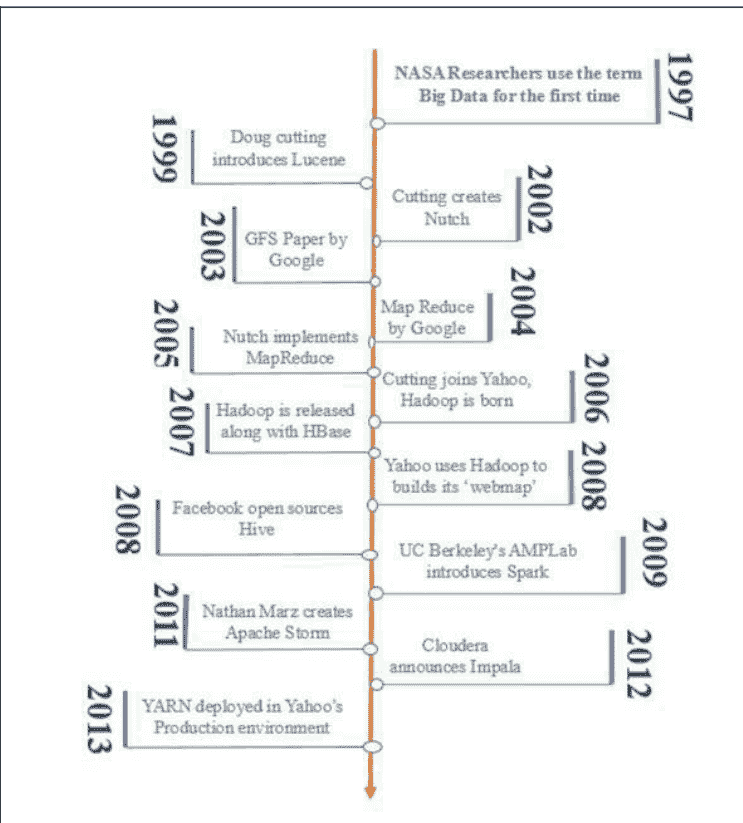

在本章中，我们将介绍以下主题：

- 什么是大数据？
- 为什么选择 Apache Spark？
- RDD 是 Spark 的头等公民
- Spark 生态系统 -- Spark SQL、Spark Streaming、MLlib、GraphX
- Spark 2.X 有哪些新功能？

## 大数据的维度

大数据最好通过其维度来描述。这些维度被称为大数据的 Vs。要将问题归类为大数据问题，它应属于一个或多个这些维度。

大数据世界始于三个维度或大数据的 3Vs，具体如下：

- 数据量
- 多样性
- 速度

现在让我们详细了解每一个：

- **数据量**：世界生成的数据量正以指数级速度增长。以 Facebook 或 Twitter 等社交社区网站为例，它们在全球拥有数十亿客户。因此，为分析产生的数据量，它们需要在现有的 RDBMS 世界之外寻找解决方案。不仅如此，银行、电信公司等其他组织也在处理海量客户。对如此庞大的数据进行分析是一个大数据问题。因此，根据这一维度，如果你正在处理传统数据库系统无法处理的高数据量，那么转向大数据领域是势在必行的。

- **多样性**：曾几何时，仅需处理结构化数据。但是，为了保持领先于竞争对手，你需要分析每种能够增加价值的数据。例如，门户网站上哪些产品更受欢迎？因此，你正在分析用户点击。现在，你用于保持领先的各种数据来源可以是结构化或非结构化的。它可以是 XML、JSON、CSV，甚至纯文本。因此，你可能需要处理的数据现在可能有不同种类。所以，如果你有这样的问题，请意识到这是一个大数据问题。

- **速度**：数据不仅在规模上增长，其到达的速度也在快速增加。以 Twitter 为例：数十亿用户同时在发推。Twitter 必须以近乎实时的方式处理如此高速的数据。你还可以想到 YouTube，每分钟都有大量视频从 YouTube 上传或流式传输。即使是新闻频道的在线门户网站，也会每秒或每分钟更新一次，以应对来自世界各地的新闻数据。因此，大数据的这一维度涉及高速数据，并有助于在近乎实时的方式下提供持久性或分析数据，从而产生真实价值。

随着时间的推移，我们的 3V 世界变成了 7V 世界，新增的维度如下：

- **真实性**：数据的真实性和完整性同样重要。以涉及基于其分析数据进行自动化决策的机器学习算法为例。如果数据不准确，该系统可能会造成灾难性后果。此类系统的一个示例可以是基于最终用户在线购物数据的预测分析。使用分析，你想向用户发送优惠。如果输入此类系统的数据不准确或不完整，分析将对系统毫无意义或无益。因此，根据这一维度，在处理/分析之前，应验证数据。处理高数据量或高速度数据只有在数据准确且完整时才有意义，因此在处理数据之前，也应对其进行验证。

- **可变性**：大数据的这一维度主要涉及自然语言处理或情感分析。在语言中，一个单词可能会根据用户的情绪具有多种用法。因此，为了分析情感，你应该能够理解确切含义。假设你最喜欢的足球队状态不佳，你发了一条讽刺的推文说“我们队今天表现太棒了!!”现在看这句话，似乎你喜欢球队的表现，但现实情况恰恰相反。因此，为了分析情感，系统应该输入大量其他信息，例如比赛统计数据等。另一个示例，句子"This is too good to be true"是负面的，但它由所有正面词汇组成。语义分析或自然语言处理只有在能理解数据背后的情感时才能准确。

- **价值**：进行大数据分析涉及大量成本：获取数据的成本、安排用于保存和分析这些数据的硬件的成本、员工和投入这些分析的时间的成本。只有当分析为组织提供价值时，所有这些成本才是合理的。想象一家医疗保健公司对电子商务数据进行分析。它们可能能够通过从互联网获取数据来进行分析，但这对它们没有价值。同样，对不准确或不完整的数据进行分析也没有任何价值。相反，这可能是有害的，因为所进行的分析具有误导性。因此，价值成为大数据的一个重要维度，因为有价值的分析可能很有用。

- **可视化**：可视化是分析的另一个重要方面。工作如果不能以恰当的方式进行可视化，就不会有用。假设你公司的工程师进行了非常准确的分析，但它们的输出存储在某些 JSON 文件甚至数据库中。你公司的业务分析师并非技术专家，无法彻底理解分析结果，因为结果没有以恰当的方式进行可视化。因此，尽管分析是正确的，但对你的组织来说价值不大。另一方面，如果你对结果创建了适当的图表或有效的可视化，则可以更容易地理解，并且可能非常有价值。因此，可视化是大数据分析的一个非常重要的方面，因为只有可见的事物才能被突出显示。

## 什么使 Hadoop 如此革命？

从经典意义上来说，如果我们谈论 Hadoop，它由两个组件组成：一个名为 HDFS 的存储层和一个名为 MapReduce 的处理层。在 Hadoop 2.X 之前，资源管理任务是使用 Hadoop 自身的 MapReduce 框架完成的。然而，随着 YARN 的引入，这一情况发生了改变。在 Hadoop 2.0 中，YARN 被引入作为 Hadoop 的第三个组件，用于管理 Hadoop 集群的资源并使其更加与 MapReduce 无关。

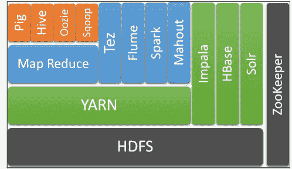

## 定义 HDFS

顾名思义，**Hadoop 分布式文件系统 (HDFS)** 是一种基于 Google 文件系统编写思路的 Java 分布式文件系统。在实际应用中，HDFS 与其他任何 UNIX 文件系统非常相似，支持 `ls`、`cp`、`rm`、`du`、`cat` 等常见文件操作。然而，尽管简单，HDFS 之所以脱颖而出，是因为它能够处理 Hadoop 集群中的节点故障，而无需有效改变访问存储文件的搜索时间。HDFS 集群由两个主要组件组成：**数据节点** 和 **名称节点**。

HDFS 在 HDFS 集群（廉价商用网络计算机）上存储数据的方式很独特。它将常规文件分割成称为块的较小块，然后根据该文件的复制因子制作此类块的精确副本数量。之后，它将这些块复制到集群的不同数据节点上。


## NameNode

NameNode 负责管理 HDFS 集群的元数据，例如集群中存在的文件和文件夹列表、每个文件被分割成的块数量，以及它们在不同 DataNode 上的复制和存储。它还维护和管理 HDFS 集群中所有文件的命名空间和文件权限。除了记账职责外，NameNode 还承担监督角色，监控所有文件的复制因子；如果某个块丢失，它会发出命令复制丢失的数据块。它还生成报告以确认集群健康状况。需要注意的是，监督任务的所有通信都是从 DataNode 到 NameNode；也就是说，DataNode 向 NameNode 发送报告（块报告），然后 NameNode 根据需要通过发出不同命令或指令来响应。

## HDFS I/O

客户端执行 HDFS 读取操作涉及以下步骤：

- 1. 客户端请求 NameNode 确定给定文件的实际数据块存储位置。
- 2. NameNode 提供块 ID 以及可找到数据的主机（DataNode）位置。
- 3. 客户端使用相应的块 ID 联系 DataNode 从 DataNode 获取数据，同时保持块文件的顺序。

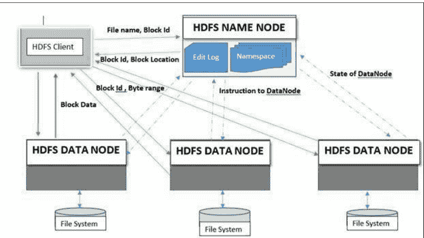

客户端执行 HDFS 写入操作涉及以下步骤：

- 1. 客户端联系 NameNode 以使用文件名更新命名空间并验证必要权限。
- 2. 如果文件已存在，则 NameNode 抛出错误；否则，它将指向数据队列的 `FSDataOutputStream` 返回给客户端。
- 3. 数据队列与 NameNode 协商，在合适的 DataNode 上分配新块。
- 4. 然后数据被复制到该 DataNode，并根据复制策略，数据进一步从该 DataNode 复制到其余的 DataNode。
- 5. 需要注意的是，数据从不通过 NameNode 传输，因为这会造成性能瓶颈。

## YARN

理解 YARN（Yet Another Resource Manager）最简单的方法是将其视为集群上的操作系统；负责资源配置、作业调度和节点维护。随着 Hadoop 2.x 的出台，用于处理数据和管理集群的 MapReduce 模型（Job Tracker/Task Tracker）被拆分了。虽然数据处理仍由 MapReduce 负责，但集群的资源分配（或调度）任务被分配给了一个名为 YARN 的新组件。YARN 实现的另一个目标是，它使 MapReduce 成为处理数据的技术之一，而不是 Hadoop 1.x 系统中处理 HDFS 上数据的唯一技术。这一范式转移为围绕 Hadoop 开发有趣的应用程序打开了闸门，除了经典的 MapReduce 处理系统之外，还发展出了一个新的生态系统。不久之后，Apache Spark 就打破了经典 MapReduce 的霸权，成为活跃开发和采用方面公认最流行的并行计算处理框架。

为了在 YARN 中实现多租户、容错和资源隔离，它开发了以下组件来无缝管理集群：

- ResourceManager：它为 Hadoop 集群上的不同计算程序协商资源，同时保证以下几点：资源隔离、数据本地性、容错、任务优先级和集群容量的有效利用。可配置的调度器允许 Resource Manager 根据要求调度和优先处理不同的应用程序。
- RM 在服务客户端时处理的任务：客户端或 API 用户可以提交或终止应用程序。用户还可以收集已提交应用程序的集群统计信息和队列信息。RM 还将 ADMIN 任务优先于任何其他任务，以执行集群上的清理或维护活动，例如刷新节点列表、队列配置等。
- **RM 在服务集群节点时处理的任务**：配置新节点和取消配置新节点是 RM 的重要任务。每个节点按配置的间隔发送心跳，默认间隔为 10 分钟。节点未能这样做会被视为死节点。作为清理活动，所有看似正在运行的进程（包括容器）也会被标记为死节点。
- **RM 在服务 Application Master 时处理的任务**：RM 注册新的 AM 并终止已成功执行的 AM。就像集群节点一样，如果在预配置的时间段内（默认值为 10 分钟）未收到 AM 的心跳，则 AM 会被标记为死节点，所有关联的容器也会被标记为死节点。但是，由于 YARN 在应用程序执行方面很可靠，新的 AM 会被重新调度在新容器上尝试另一次执行，直到达到可配置的默认重试次数四次。
- **RM 在服务调度和其他杂项任务**：RM 维护运行中、已提交和已执行的应用程序列表，以及执行时间、状态等统计信息。在每个应用程序生命周期中，用户的特权以及应用程序的特权都会被维护和比较，以便处理用户的各种请求。RM 调度器监督应用程序的资源分配，例如内存分配。YARN 中使用的两种常见调度算法是公平调度和容量调度算法。

### ResourceManager (RM)
- 跟踪 NodeManager 和资源
- 向 AM 和任务分配资源
- 监控 ApplicationMaster

### NodeManager (NM)
- 分配容器资源
- 监督容器中运行的进程

### ApplicationMaster (AM)
- 管理应用程序中的任务执行
- 协商资源

### Containers
- 运行不同的任务和 ApplicationMaster
- 容器大小根据 RAM、CPU 等资源而异

### Client
- 用于在 YARN 上提交应用程序

MR 客户端

Spark 客户端

资源管理器

### Node Manager
- MR 应用程序主控
- Spark 任务
- Map 任务

### Node Manager
- Map 任务
- Spark 任务
- Spark 应用程序主控

### Node Manager
- Map 任务
- Spark 任务
- Reduce 任务

- **NodeManager**：每个集群节点上都有一个 NM，其方式与主从架构中的从节点略有相似。当 NM 启动时，它会将信息发送到 RM，表明其可用于共享资源以用于即将到来的作业。然后，NM 会定期向 RM 发送信号（也称为心跳），告知其在集群中处于活跃状态。主要来说，NM 负责启动 AM 请求的、带有特定资源要求（如内存、磁盘等）的容器。一旦容器启动并运行，NM 会监控容器的资源利用率，而不是容器任务的状态，如果容器开始使用超过其分配量的资源，NM 会将其终止。除了管理容器的生命周期外，NM 还会让 RM 了解节点的健康状况。

- **ApplicationMaster**：每个提交的应用程序都会启动一个 AM，并管理提交应用程序的生命周期。但是，AM 执行的第一且最重要的任务是从 RM 协商资源，以便在不同节点上启动特定于任务的容器。一旦容器启动，AM 会跟踪所有容器的任务状态。如果任何节点宕机，或者容器因使用过多资源或其他原因被终止，在这种情况下，AM 会从 RM 重新协商资源并再次启动那些挂起的任务。AM 还会保持


将已提交应用程序的状态直接报告给用户，并将其他此类统计信息报告给 RM。ApplicationMaster 的实现是特定于框架的，正因如此，应用程序/框架特定的代码被转移到 AM，由 AM 进一步分发。这一重要特性也使 YARN 与技术无关，因为任何框架都可以实现其 ApplicationMaster，然后无缝利用 YARN 集群的资源。

- **容器**：从抽象意义上讲，容器是一组最小资源，例如 CPU、RAM、磁盘 I/O、磁盘空间等，这些资源用于在节点上独立运行任务。提交作业后的第一个容器由 RM 启动以托管 ApplicationMaster。随后是 AM 以容器形式从 RM 协商资源，这些容器随后分布在 Hadoop 集群的不同节点上托管。

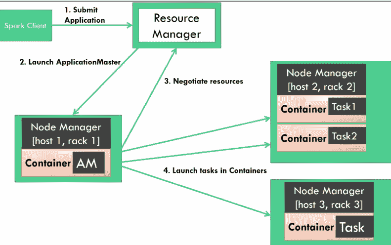

## 在 YARN 中处理应用程序提交流程

以下步骤展示了 YARN 中应用程序提交的流程：

- 1. 使用客户端或 API，用户提交应用程序；假设是一个 Spark 作业 jar。ResourceManager 的主要任务是收集并报告整个 Hadoop 集群上运行的所有应用程序以及相应 Hadoop 节点上的可用资源，根据提交作业用户的权限，接受新提交的任务。

- 2. 随后 RM 将任务委派给调度器，调度器随后搜索可托管应用程序特定 Application Master 的容器。尽管调度器在调度或启动 Application Master 之前确实会考虑资源可用性、任务优先级、数据本地性等参数，但它在监控或重启失败作业方面没有任何职责。RM 的职责是跟踪 AM，如果 AM 失败，则在新容器中重新启动它。

- 3. 一旦 ApplicationMaster 启动，AM 就有权监督与 RM 的资源协商以启动任务特定容器。与 RM 的协商通常涉及：
  - 当前任务的优先级。
  - 为完成任务而要启动的容器数量。
  - 执行任务所需的资源，例如 RAM 和 CPU（自 Hadoop 3.x 起）。
  - 可用节点，可在此类节点上使用所需资源启动作业容器。

根据优先级和资源可用性，RM 授予容器，该容器由容器 ID 和可启动该容器的节点的主机名表示。

- 4. 随后 AM 请求相应主机的 NM 启动具有特定 ID 和资源配置的容器。NM 随后启动容器，但会监控任务的资源使用情况。例如，如果容器开始使用的资源超过其已配置的资源，则该容器会被 NM 终止。这极大地提高了 YARN 提供的作业隔离性和资源公平共享保证，否则将影响其他容器的执行。但是，重要的是要注意，作业状态和整体应用程序状态由 AM 管理。AM 的职责是持续监控任何延迟或死掉的容器，同时与 RM 协商以启动新容器来重新分配死掉容器的任务。

- 5. 在不同节点上执行的容器在特定间隔内向 AM 发送应用程序特定的统计信息。

- 6. AM 还直接向提交特定应用程序的客户端报告应用程序状态，在我们的例子中是一个 Spark 作业。

- 7. NM 监控各节点上所有容器正在使用的资源，并持续向 RM 发送定期更新。

- 8. AM 向 RM 发送定期统计信息，例如应用程序状态、任务失败和日志信息。

## MapReduce 概述

在深入了解 Hadoop 中的 MapReduce 实现之前，让我们先了解 MapReduce 作为并行计算中的一个概念，以及为什么它是一种首选的计算方式。MapReduce 包含两个互斥但相互依赖的阶段，每个阶段都可以在两台不同的机器或节点上运行：

- **映射**：在映射阶段，数据转换发生。它通过基于关键字拆分数据，将数据拆分为键值对。

假设我们有一个文本文件，并且想要进行分析，例如统计单词总数，甚至统计单词在文本文件中出现的频率。这是 MapReduce 的经典单词计数问题。为解决这个问题，首先需要识别拆分关键字，以便数据可以被拆分并转换为键值对。

让我们从 *约翰·列侬* 的歌曲 *想象* 开始。

示例文本：

```
Imagine there's no heaven
It's easy if you try
No hell below us
Above us only sky
Imagine all the people living for today
```

在对采样文本运行 Map 阶段并按 <space> 拆分后，它将转换为如下所示的键值对：

```
<imagine, 1> <there's, 1> <no, 1> <heaven, 1> <it's, 1> <easy, 1> <if, 1> <you, 1> .
```

此处的键表示单词，值表示计数。还应注意，我们已将所有键转换为小写，以减少因匹配区分大小写的键而产生的任何进一步复杂性。

- **缩减**：缩减阶段处理 Map 阶段结果的聚合，因此所有键值对都按键进行聚合。

- 因此文本的 Map 输出将聚合如下：

```
[<imagine, 2> <there's, 1> <no, 2> <heaven, 1> <it's, 1> <easy, 1> .
```

可以看到，Map 和 Reduce 阶段都可以独立运行，因此可以使用集群中的独立节点来处理数据。将任务分解为称为 Map 和 Reduce 的较小单元的这种方法彻底改变了通用分布式/并行计算，我们现在将其称为 MapReduce。

Apache Hadoop 的 MapReduce 实现方式与上述讨论基本相同，只是在每个节点的 Map 阶段数据如何传输到其指定的 Reduce 阶段节点方面增加了额外功能。

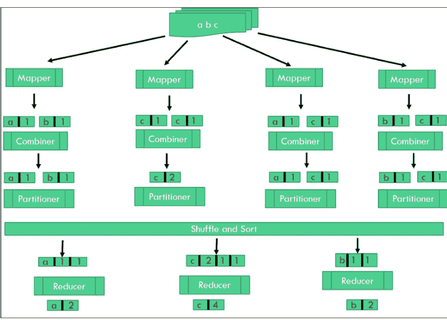

Hadoop 的 MapReduce 实现通过在中间添加几个更具体的步骤来丰富 Map 和 Reduce 阶段，以使其具有容错能力并真正分布式。我们可以将 YARN 上的 MR 作业描述为五个阶段：

- 1. 作业提交阶段：当客户端提交 MR 作业时，会发生以下情况：
  - 请求 RM 提供应用程序 ID
  - 检查输入数据位置，如果存在，则计算文件分割大小
  - 作业的输出位置也需要存在

如果满足所有三个条件，则 MR 作业 jar 及其输入分割的配置详细信息将复制到 HDFS 中以 RM 提供的应用程序 ID 命名的目录中。然后将作业提交给 RM 以启动作业特定的 Application Master，即 MRAppMaster。

### 2. MAP 阶段：

一旦 RM 收到客户端启动 MRAppMaster 的请求，就会向 YARN 调度器发出分配容器的调用。根据资源可用性，容器被授予，因此 MRAppMaster 在指定节点上使用预配置资源启动。此后，MRAppMaster 从客户端提交的 HDFS 路径获取输入分割信息，并根据分割计算将要启动的映射器任务数量。根据映射器数量，它还根据配置计算所需的归纳器数量。如果 MRAppMaster 发现映射器、归纳器和输入文件的大小足够小，可以在同一 JVM 中运行，那么它就会继续执行。此类任务称为 Uber 任务。但是，在其他场景中，MRAppMaster 从 RM 协商容器资源来运行这些任务，尽管映射器任务具有更高的顺序和优先级。这就是为什么映射器任务必须在排序阶段开始之前完成。

数据本地性是托管映射器的容器的另一个关注点，因为本地数据节点优先于机架本地节点，而远程节点托管的数据优先级最低。但是，在 Reduce 阶段，容器不存在此类数据本地性偏好。托管映射器的容器首先将 mapReduce JAR 和配置文件复制到本地，然后在 JVM 中启动一个名为 YarnChild 的类。映射器随后开始读取输入文件，通过生成键值对来处理它们，并


writes them in a circular buffer.

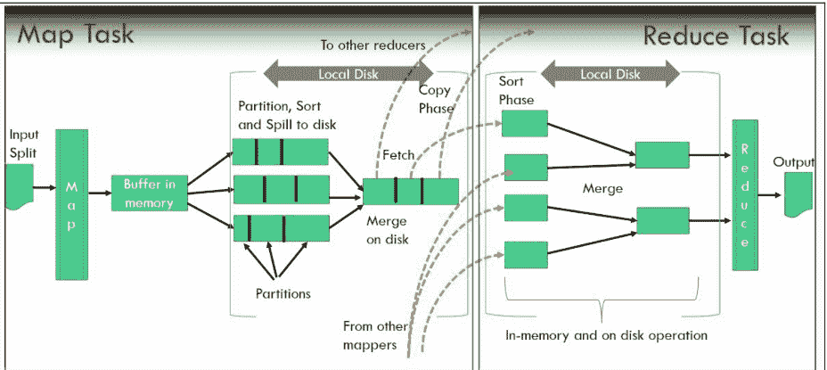

- 3. Shuffle 和 Sort 阶段：考虑到循环缓冲区有大小限制，达到一定百分比后，默认值为 80，会启动一个线程，将缓冲区中的数据溢写。但在将溢写数据复制到磁盘之前，数据首先会按其 reducer 进行分区，然后后台线程还会按键对分区后的数据进行排序，如果提及了 combiner，它还会合并这些数据。该过程会优化数据，一旦数据被复制到其各自的分区文件夹。该过程持续进行，直到循环缓冲区中的所有数据都写入磁盘。后台线程会再次检查每个分区中溢写文件的数量是否在可配置参数的范围内，否则会合并文件，并在其上运行 combiner，直到数量落在参数限制范围内。

Map 任务在其整个生命周期内都会向 ApplicationMaster 更新状态。只有当 Map 任务完成 5% 时，Reduce 任务才会启动。NodeManager 中为 Reduce 任务服务的辅助服务会启动一个 Netty Web 服务器，该服务器会向 MRAppMaster 发送请求，获取拥有特定 Mapper 分区文件的 Mapper 主机。所有与 Reducer 相关的分区文件会以类似方式复制到各自的节点上。由于来自各个节点的多个文件被复制，表示 Reduce 节点的数据被收集，后台线程会合并已排序的 Map 文件，并再次对其进行排序，如果配置了 combiner，还会合并结果。

- 4. Reduce 阶段：在此阶段需要注意的是，每个 reducer 的每个输入文件都应已按键排序。这是 reducer 开始处理这些记录并将键值对转换为聚合列表的前提。一旦 reducer 处理完数据，就会将其写入作业提交时提到的输出文件夹。

- 5. 清理阶段：每个 reducer 会定期向 MRAppMaster 发送关于任务完成情况的更新。一旦 Reduce 任务结束，ApplicationMaster 就开始清理活动。已提交作业的状态会从运行更改为成功，所有临时文件和文件夹以及中间文件和文件夹都会被删除。应用程序统计信息会被归档到作业历史服务器。

## 为什么选择 Apache Spark？

MapReduce 正在走向过时。“我们有 Spark 了，”Apache Hadoop 的幕后推手 Doug Cutting 说道。MapReduce 是一个非常流行的分布式框架，但也备受诟病。自诞生以来，MapReduce 就一直是为批处理模式下的作业构建的。虽然它支持流处理，但不太适合临时查询、机器学习等场景。Apache Spark 是一个分布式内存计算框架，试图以某种方式解决围绕 MapReduce 的一些主要问题：

- **性能**：MapReduce 作业中主要的瓶颈是磁盘 I/O，在 MR 的 shuffle 和 sort 阶段尤为明显，因为数据会写入磁盘。Spark 遵循的指导原则很简单：在集群间共享内存，并尽可能长时间地将所有数据保留在内存中。这极大地提升了 Spark 作业的性能，相比 MR 提升了约 100 倍（据其开发者声称）。

- **容错性**：MR 和 Spark 在处理容错性方面采用不同的方法。AM 在执行 MR 作业时会跟踪 mappers 和 reducers。当这些容器停止响应或预先失败时，AM 在请求 RM 之后，会启动一个单独的 JVM 来运行此类任务。虽然这种方法实现了容错性，但既耗时又消耗资源。Apache Spark 处理容错性的方法不同；它使用弹性分布式数据集（RDD），即只读的容错并行集合。RDD 维护血统图，因此当其分区丢失时，它会通过从前一阶段重新计算来恢复丢失的数据，从而使其更具弹性。

- **DAG**：MapReduce 作业的链式调用是一项艰巨的任务，同时还要面对在下一个作业开始执行之前将中间结果写入 HDFS 的负担。Spark 实际上是一个 **有向无环图（DAG）** 引擎，因此可以轻松实现任何数量作业的链式调用。所有中间结果都在内存中共享，避免了多次磁盘 I/O。此外，这些作业会被惰性求值，因此仅处理明确调用用于计算的那些路径。在 Spark 中，此类触发器称为 *操作*。

- **数据处理**：Spark（即 Spark Core）并非孤立的分布式计算框架。围绕 Spark Core 构建了大量 Spark 模块，使其更具通用性。RDD 形成了所有这些模块中的主要抽象。随着近期发展，dataframe 和 dataset 也已开发出来，它们通过为 RDD 提供模式和类型安全性来丰富 RDD。尽管如此，RDD 的通用性在 Spark 的所有模块中都无处不在，使其易于使用，并且可以轻松在不同模块中交叉引用。无论是流处理、查询功能、机器学习还是图处理，相同的数据都可以由 RDD 引用并可互换使用。这是 RDD 的独特吸引力，而 MR 缺乏这一点，因为在 **Apache Mahout** 中处理机器学习作业所需的概念与在 **Apache Giraph** 中所需的不同。

- **兼容性**：Spark 的开发并非只考虑 YARN 集群。它具有出色的兼容性，可以在 Hadoop、Mesos 甚至独立集群模式上运行。同样，Spark 并非围绕 HDFS 构建，在涉及不同文件系统方面具有广泛的可接受性。Apache Spark 提供的只是计算能力，而集群和文件系统的选择取决于正在处理的用例。

- **Spark API**：Spark API 在功能和编程语言方面覆盖广泛。Spark 的 API 与 Scala 集合有很大相似之处，Scala 是 Apache Spark 主要实现所使用的语言。正是函数式编程的这种丰富性，使得 Apache Spark 能够避免大量掩盖 MR 作业的样板代码。与处理低级编程的 MR 不同，Spark 在更高的抽象级别公开 API，并提供在需要时覆盖任何裸机代码的可能性。

## RDD —— Spark 的头等公民

*关于 RDD 弹性分布式数据集：内存集群计算的一种容错抽象的最早论文如下描述：*

**弹性分布式数据集（RDD）**，一种分布式内存抽象，允许程序员以容错方式在大型集群上执行内存计算。由于 Spark 采用函数式编程范式编写，函数式编程的关键概念之一是不可变对象。弹性分布式数据集也是一个不可变数据集。

从形式上讲，我们可以将 RDD 定义为不可变对象的分布式集合。它是 Spark 的主要数据类型。它利用集群内存，并在集群中进行分区。

以下是 RDD 的逻辑表示：

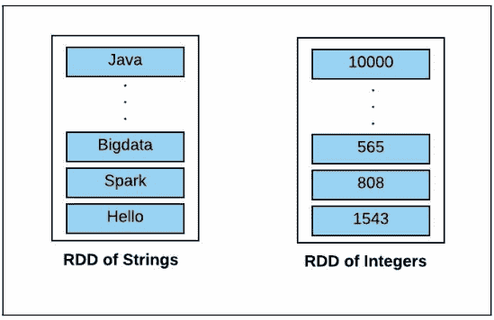

RDD 还可以由（键，值）对组成。以下是 RDD 对的逻辑表示：

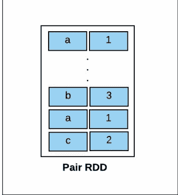

此外，如前所述，RDD 可以在集群中进行分区。因此，以下是集群中分区 RDD 的逻辑表示：

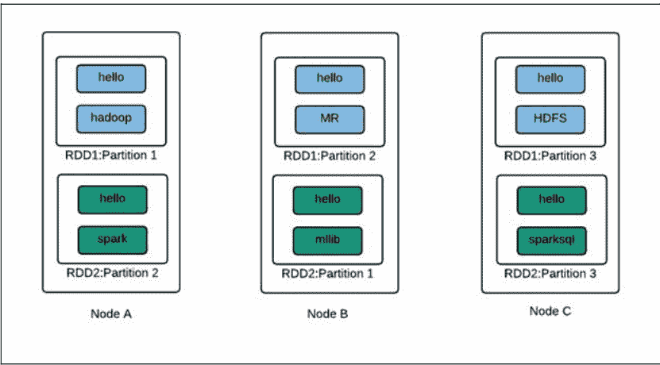

### RDD 上的操作

RDD 仅支持两种类型的操作。一种称为 转换，另一种称为 操作。以下是对这两种操作的说明：

- **转换**：如果对 RDD 的操作返回另一个 RDD，则该操作称为 转换。假设你有一个字符串 RDD，并想过滤掉所有以 H 开头的值，如下所示：

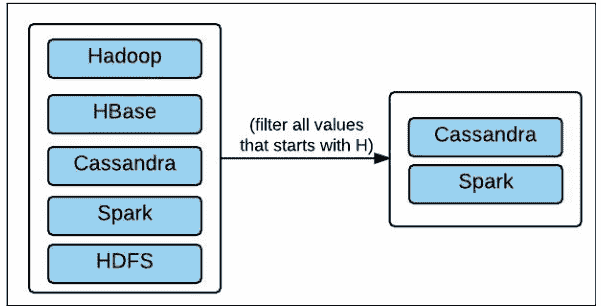

因此，对 RDD 执行 filter 操作将返回另一个 RDD，其中包含所有通过过滤条件的值。因此，filter 是 转换 的一个示例。

- **操作**：如果对 RDD 的操作返回的不是另一个 RDD，则称为 操作：例如，RDD 中所有值的总和、所有值的计数，或者以列表形式检索 RDD 的所有值，等等。以下是 RDD 上 sum 操作的逻辑表示：


所以，规则是：对 RDD 进行操作后，如果得到的仍是一个 RDD，则它是一个转换；否则，它是一个动作。我们将结合代码示例，在第 4 章《理解 Spark 编程模型》和第 7 章《Spark 编程模型 - 高级》中讨论可以对 RDD 执行的所有可用转换和动作。

## 延迟求值

关于 RDD 另一个重要的概念是 **延迟求值**。Spark 会为你对 RDD 执行的所有操作创建一个 DAG，也称为血缘图。只有在对 RDD 执行动作时，才会开始执行该图。让我们来看看 RDD 上 DAG 操作的示例：

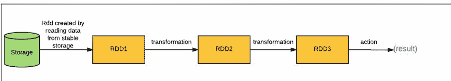

在这里，首先通过从稳定存储读取数据来计算一个 RDD，然后在该 RDD 上执行两个转换，最后执行一个动作来获取结果。

观察前面的图表；人们可能会推断，**RDD1** 会在 Spark 作业发现从数据库创建它的步骤后立即创建，然后它会发现转换步骤，因此会执行转换。接着它发现一个动作，因此会运行给定的动作来计算结果。但事实并非如此。

实际上，Spark 作业会开始创建 DAG 步骤，直到发现要求其对 RDD 执行动作的步骤。当作业发现此步骤时，它会从第一个顶点开始执行 DAG。

这种方法的优势如下：

- **容错能力**：对 RDD 的操作的血缘图使其具备容错能力。由于 Spark 非常清楚创建 RDD 需要执行哪些步骤，因此在前一步骤失败时，它可以重新计算 RDD 或其分区，而无需重复从数据库计算并执行两个转换的过程。在发生故障时，这能大幅节省时间和资源。

- 优化资源使用：由于 Spark 预先知道计算最终结果所需执行的所有步骤，它可以利用这些信息以最优化的方式使用集群资源。

## RDD 的优势

以下是 Spark RDD 模型相对于 Hadoop MapReduce 模型提供的一些优势：

- **迭代处理**：MapReduce 处理中最大的问题之一是涉及的 IO（输入/输出）。如果你在运行迭代操作（基本上会串联 MapReduce 作业以执行多次聚合），这会显著减慢 MapReduce 的过程。

假设要运行一个 MapReduce 作业，它从 HDFS 读取数据，执行某些聚合，然后将输出写回 HDFS。此时，mapper 作业会从 HDFS 读取数据并在完成后将输出写入本地文件系统，Reduce 会拉取这些数据并在其上运行 reduce 过程。随后，它将输出写入 HDFS（未考虑 mapper 和 reducer 的溢出机制）。

假设你想对输出数据执行另一次聚合，因此你会在输出数据上执行另一个 MapReduce 作业，它将经历类似的 I/O 过程。以下是 MapReduce 中迭代操作运行方式的逻辑表示。

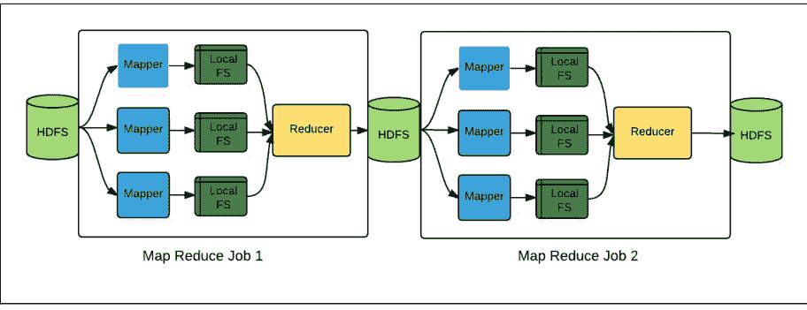

另一方面，对于之前描述的作业，Spark 在大多数情况下不会执行此类 I/O。数据将从 HDFS 读取一次，然后 Spark 会对每次迭代的 RDD 执行内存中的转换。每个步骤的输出（即另一个 RDD）将存储在分布式集群内存中。以下是 Spark 中相同作业的逻辑表示：

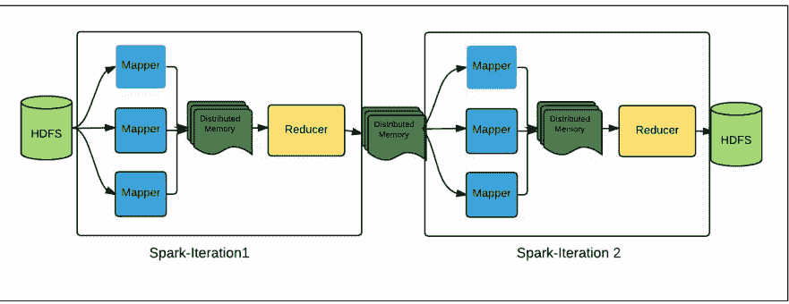

不过，这里有一个问题。如果中间结果的大小超过了分布式内存大小，会怎样？在这种情况下，Spark 会将该 RDD 溢出到磁盘。

- **交互式处理**：当用户想要在某些稳定存储上的数据上运行临时查询时，Spark 数据结构相对于 MapReduce 或 Hadoop 的另一个优势便显而易见。

假设你正在尝试在数据上运行一些 MapReduce 作业（或 Hive 查询）以进行分析。如果你在相同的输入数据上运行多个查询，MapReduce 每次运行查询时都会从存储（例如 HDFS）读取数据。其逻辑表示如下：

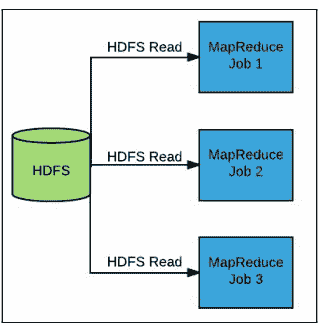

另一方面，Spark 提供了一种将 RDD 持久化到内存中的机制（持久化 RDD 的不同机制将在稍后的第 4 章《理解 Spark 编程模型》中讨论）。因此，你可以执行一个作业并将 RDD 保存在内存中。然后，其他分析可以在同一个 RDD 上执行，而无需再次从 HDFS 读取数据。其逻辑表示如下：

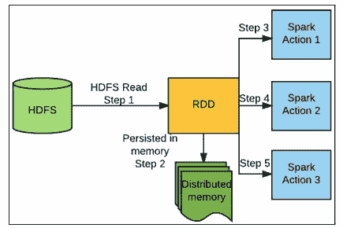

当 Spark 作业遇到 Spark Action 1 时，它会执行 DAG 并计算 RDD。然后 RDD 将被持久化到内存中，并在 RDD 上执行 Spark Action 1。之后，Spark Action 2 和 Spark Action 3 将在同一个 RDD 上执行。因此，这种模式有助于在交互式处理中大幅减少从稳定存储的 I/O。

# 探索 Spark 生态系统

Apache Spark 被视为大数据世界中的通用系统。它包含许多库，可帮助你对数据执行各种分析。它提供内置库来执行批处理分析、执行实时分析、在数据上应用机器学习算法，以及更多功能。

以下是 Spark 中可用的各种内置库：

- Spark Core：正如其名称所示，Spark Core 库包含 Spark 的所有核心模块。它包含 Spark 模型的基础知识，包括 RDD 以及可以与之执行的各种转换和动作。基本上，所有可以使用 Spark 编程模型和 MapReduce 范式执行的批处理分析都是该库的一部分。它还有助于分析不同种类的数据。

- Spark Streaming：Spark Streaming 库包含帮助用户对传入数据运行近实时流处理的模块。它有助于处理大数据领域的速度方面。它包含许多模块，可帮助监听各种流式数据源，并对从这些源接收的数据进行近实时分析。

- Spark SQL：Spark SQL 库帮助使用非常流行的 SQL 查询分析结构化数据。它包含一个数据集库，可帮助以表格形式查看结构化数据，并提供在其之上运行 SQL 的功能。SQL 库包含 RDBMS SQL 中可用的许多函数。它还提供编写自定义函数（称为用户定义函数，UDF）的选项。

- MLlib：Spark MLlib 帮助利用 Spark 的分布式和可扩展能力，在数据上应用各种机器学习技术。它包含许多学习算法和实用程序，并提供分类、回归、聚类、分解、协同过滤等算法。

- **GraphX**：Spark GraphX 库提供用于图形计算的 API。借助此库，用户可以在基于图形的数据上执行并行计算。GraphX 是执行基于图形计算的最快方式之一。

- **Spark-R**：Spark R 库用于在 Spark 集群上运行 R 脚本或命令。这有助于为 R 脚本的执行提供分布式环境。Spark 自带一个名为 sparkR 的 shell，可用于在 Spark 集群上运行 R 脚本。那些更熟悉 R 的用户可以使用 RStudio 或 Rshell 等工具，并执行将在 Spark 集群上运行的 R 脚本。


## Spark 2.X 有哪些新功能？

- **统一的 DataFrame 和 Dataset**：Spark 2.X 版本统一了这两个 API。现在 DataFrame 只是 Dataset 中的一行，没有任何隐式附加的数据类型信息。

- **SparkSession**：在 Spark 2.X 之前，不同的 Spark 作业有不同的入口；也就是说，对于 Spark SQL 我们使用 `sqlContext`，如果还需要 Hive 功能，则 `HiveContext` 是入口。随着 Spark 2.X 的推出，这种歧义已被消除，现在我们有一个名为 `SparkSession` 的单一入口。不过需要注意的是，所有模块特定的入口仍然存在，尚未被弃用。

- **Catalog API**：Spark 2.X 引入了 Catalog API 用于访问 Spark SQL 中的元数据信息。它可以看作是 Hive 中 **Hcatalog** 的对应物。这是统一 Spark SQL 周围元数据结构的重要一步，以便将相同的元数据暴露给非 Spark SQL 应用程序。它还有助于调试 Spark SQL 会话中的临时注册表。现在 `sqlContext` 和 `HiveContext` 的元数据都可用，因为 Catalog API 可以通过 `SparkSession` 访问。

- **结构化流**：结构化流通过持续运行 Spark SQL 作业并在流式数据集上聚合更新后的结果，使 Spark SQL 可用于流式作业。DataFrame 和 Dataset 可用于结构化流中的操作，并配合窗口函数使用。

- **整阶段代码生成**：代码生成引擎已进行修改，以生成更注重性能的代码，避免虚函数调度、将中间操作数据传输到内存等等。

- **Accumulator API**：Spark 2.X 版本添加了一个新的、更简单且性能更好的 Accumulator API，旧 API 已被弃用。

- 当前 Spark 构建中引入了一个原生 SQL 解析器，支持 ANSI-SQL 和 Hive SQL。

- Spark SQL 支持的 SQL 函数列表中还添加了 Hive 风格的分桶支持。

- Spark SQL 中添加了子查询支持，并支持 NOT IN、IN、EXISTS 等子句的其他变体。

- 基于 Databricks 实现的原生 CSV 数据源已纳入 Spark。

- 引入了基于 DataFrame 的新 spark.ml 包，其目标是在新引入的包功能足够成熟可以替换旧包时弃用 spark.mllib。

- 机器学习管道和模型现在可以在 Spark 支持的所有语言中持久化。

## 参考文献

- http://www.evl.uic.edu/cavern/rg/20040525_renambot/Viz/parallel_volviz/paging_outofc_viz97.pdf
- http://static.googleusercontent.com/media/research.google.com/en//archive/gfs-sosp2003.pdf
- http://static.googleusercontent.com/media/research.google.com/en//archive/mapreduce-osdi04.pdf
- 《精通 Apache Solr：掌握 Apache Solr 实用指南》，作者：Mr. Mathieu Nayrolles [第 6 页]
- https://web.archive.org/web/200510209085121/http://weblogs.java.net/blog/tomwhite/archive/2005/09/mapreduce.html
- Nutch：一种灵活且可扩展的开源 Web 搜索引擎，http://citeseerx.ist.psu.edu/viewdoc/download?doi=10.1.1.105.5978&rep=rep1&type=pdf
- https://developer.yahoo.com/blogs/hadoop/yahoo-launches-world-largest-hadoop-production-application-398.html
- http://data-informed.com/doug-cutting-reflects-on-hadoops-impact-future/

## 总结

本章介绍了大数据的历史及其维度，以及 Hadoop 和 Spark 的基本概念。随后，你了解了 RDD，并学习了 Spark RDD 模型的基本概念。接着，你学习了 Spark 生态系统的各个组件以及 Spark 2.x 的新功能。

由于本书专注于使用 Java 实现 Spark 应用程序，下一章将回顾核心 Java 的概念，并重点介绍 Java 8 的新特性，这些特性将在开发 Spark 应用程序时发挥作用。

## 再探 Java

本章作为 Java 复习课程添加。本章将讨论在 Apache Spark 中创建应用程序时有用的一些 Java 概念。

本书假设读者已掌握 Java 基础。我们将讨论有用的 Java 概念，并主要关注 *Java 8 有哪些新特性？* 更重要的是，我们将涉及以下主题：

- 泛型
- 接口
- Lambda 表达式
- 流

## 为什么为 Spark 使用 Java？

随着多核 CPU 的兴起，Java 无法跟上其设计变化的步伐，以利用其可用的额外算力，原因在于并发性和不可变性周围的复杂性。我们将稍后详细讨论这一点。首先，让我们了解 Java 在 Hadoop 生态系统中的重要性和可用性。随着 MapReduce 越来越流行，Google 引入了一个名为 **Flume Java** 的框架，用于流水线处理多个 MapReduce 作业。Flume Java 由不可变的并行集合组成，能够执行惰性求值的优化链式操作。这听起来可能与 Apache Spark 所做的事惊人地相似，但在 Apache Spark 和 Java Flume 之前，就有 Cascading，它在 MapReduce 之上构建了一个抽象层，以简化 MapReduce 任务的开发、测试和运行方式。所有这些框架在很大程度上都是 Java 实现，旨在简化 MapReduce 流水线等其他方面。

事实上，这些抽象很简单，**Apache Crunch**（Apache 对 Flume Java 的实现）非常简洁，以至于单词计数问题可以用四五行 Java 代码编写。这非常了不起！

尽管如此，这些 Java 实现永远无法摆脱沉重的 I/O 密集型操作。而正是在这个时候，Apache Spark 庞然大物诞生了，主要使用 Scala 编写，它不仅解决了 MapReduce 的局限性，还解决了在不使用任何抽象框架的情况下开发 MapReduce 作业时 Java 的冗长问题。在他们的论文 *内存集群计算的容错弹性分布式数据集抽象* 中，作者指出：

> “我们选择 Scala 是因为它结合了简洁性（便于交互式使用）和效率（归功于静态类型）。然而，RDD 抽象本身并不要求使用函数式语言。”

最终，Java 社区意识到，随着时间的推移，他们将不得不支持函数式编程，以充分利用集群计算的能力，因为企业硬件的纵向扩展并不是为未来开发的应用程序提供的解决方案。Java 开始围绕并发性发布特性。Java 7 引入了 fork join 框架，以利用现代硬件的能力；它还引入了指令集 `invokedynamic`，使得可以在运行时进行方法调用。这一单一指令集的变化使得动态类型语言可以在 JVM 上运行。Java 8 精妙地利用了 `invokedynamic` 中的晚期绑定概念，并围绕它开发了完整的 Lambda 表达式。它还发布了 Stream API，可以将其视为 Java 中函数式编程的集合框架，而无需实际存储元素。Java 8 中其他值得注意的变更包括：

- 函数式接口
- 接口中的默认方法和静态方法
- 新的日期和时间 API
- 脚本支持

Apache Spark 已添加对 Java 8 的支持，因此在每个版本中，使用 Scala 和 Java 编写代码之间的差异正在模糊。学习曲线也与其潜力相匹配，因为只需学习 Apache Spark API 而无需学习 Scala。Apache Spark 的另一个亮点是 Spark-SQL，如果需要交互式和动态编码，它会非常有用。

## 泛型

泛型是在 Java 1.5 中引入的。泛型帮助用户创建其定义中具有抽象类型的通用代码。该抽象类型可以在实现中替换为任何具体类型。

例如，List 接口或其实现（如 ArrayList、LinkedList 等）都是使用泛型定义的。用户在实现 List 时可以提供 Integer、Long 或 String 等具体类型：

```
List<Integer> list1 = new ArrayList<Integer>();
List<String> list2 = new ArrayList<String>();
```

在这里，list1 是整数列表，list2 是字符串列表。使用 Java 7 时，编译器可以推断类型。因此，前面的代码也可以写成如下形式：

```
List<Integer> list1 = new ArrayList<>();
List<String> list2 = new ArrayList<>();
```

泛型的另一个巨大好处是它带来了编译时类型安全。让我们创建一个不使用泛型的列表：

```
List list = new ArrayList<>();
list.add(1);
list.add(2);
list.add("hello");
list.add("there");
```

在这里，你可以看到列表同时包含整数和字符串。如果从中检索一个元素，默认情况下它将是对象类型：

```
Object object = list.get(0);
```

因此，用户必须将其专门强制转换为正确的类型：

```
Integer object = (Integer)list.get(0);
```

这会使代码容易出错。因为如果强制转换不正确，将在运行时抛出 ClassCastException。让我们使用泛型创建相同的列表：


## 泛型

```
List<Integer> listGeneric = new ArrayList<>();
listGeneric.add(1);
listGeneric.add(2);
listGeneric.add("hello"); // won't compile
```

listGeneric 变成整数列表。如果你尝试向其中添加字符串，编译器将不允许。

因此，现在如果你从列表中检索一个元素，它将返回整数类型。不需要类型转换，这将避免我们在运行时遇到 ClassCastException。因此，它提供了编译时安全性：

```
Integer intObject = listGeneric.get(0);
```

## 创建你自己的泛型类型

在本节中，我们将创建一个带有泛型类型 T 的类。该类将包含类型 T 的变量，并且还会有一个返回类型 T 变量的通用方法：

```
public class MyGeneric<T> {
   T input;
   public MyGeneric(T input) {
       this.input = input;
   }
   public T getInput() {
       return input;
   }
}
```

如前所述，MyGeneric 是类。它包含类型 T 的变量 input、用于构建 MyGeneric 类对象并初始化变量 input 的构造函数，以及一个返回 T 值的方法。

现在，让我们实现它：

```
public class MyGenericsDemo {

   public static void main(String[] args) {
       MyGeneric<Integer> m1 = new MyGeneric<Integer>(1);
       System.out.println(m1.getInput());
       // It will print '1'
       MyGeneric<String> m2 = new MyGeneric<String>("hello");
       System.out.println(m2.getInput());
       // It will print 'hello'
   }
}
```

在这里，我们创建了 MyGeneric 类的两个对象，一个是整数类型，另一个是字符串类型。当我们在这两个对象上调用 getInput 方法时，它们将返回各自类型的值。

## 接口

接口是 Java 中的引用类型。它们在 Java 中用于定义类之间的契约。任何实现该接口的类都必须遵守接口定义的契约。

例如，我们有一个名为 car 的接口，如下所示，它包含三个抽象方法：

```
public interface Car {
void shape();
void price();
void color();
}
```

任何实现此接口的类都必须实现此接口的所有抽象方法，除非它是抽象类。接口只能由其他接口实现或扩展，不能被实例化。

在 Java 8 之前，接口只包含抽象方法和 final 变量。在 Java 8 中，接口还可以包含默认方法和静态方法。

### 接口中的静态方法

接口中的静态方法类似于类中的静态方法。用户不能重写它们。因此，即使一个类实现了接口，它也不能重写接口的静态方法。

与类的静态方法一样，接口中的静态方法是通过接口名或类类型引用来调用的，而不是使用实例变量：

```
public interface MyInterface {
static String hello() {
return "Inside static method in interface";
}
void absmethod();
}
```

这是一个包含抽象方法和静态方法的接口：

```
public class MyInterfaceImpl implements MyInterface {
@Override
public void absmethod() {
System.out.println("Abstract method implementation in class");
}
}
```

这是实现前面给出的接口的类，因此为了遵守契约，它必须提供抽象方法的实现，因为它不是抽象类。但是，它不需要实现静态方法。

现在，让我们尝试调用静态方法：

```
public class MyInterfaceDemo {
public static void main(String[] args) {
System.out.println(MyInterface.hello()); // it works
MyInterfaceImpl obj = new MyInterfaceImpl();
obj.hello(); // won't compile
}
}
```

因此，使用接口名引用调用静态方法是有效的，但使用实现了该接口的类的实例变量则无效。

### 接口中的默认方法

默认方法是 Java 8 提供的接口的另一种扩展。接口可以包含默认方法。实现该接口的类可以实现也可以不实现默认方法。默认方法对于扩展现有接口很有用。假设你有一个由许多类实现的接口。现在，你想扩展接口的功能。

你的第一个选择是在接口中添加一个新的抽象方法并强制每个类实现它，这将破坏现有实现并需要大量新代码。第二个选择是在接口中添加默认方法，如果某些类想要重写它们，它可以自由这样做。使用此选项，现有实现也不会破坏。可迭代接口中的 foreach 方法是使用默认方法扩展功能的经典示例。

默认方法可以使用 default 关键字创建。让我们将前面示例中的静态方法更改为默认方法：

```
public interface MyInterface {

default String hello() {
    return "Inside static method in interface";
}

void absmethod();
}
```

实现此接口的类不需要提供此方法的实现：

```
public class MyInterfaceImpl implements MyInterface {

@Override
public void absmethod() {
    System.out.println("Abstract method implementation in class");
}
}
```

现在，让我们尝试调用默认方法：

```
public class MyInterfaceDemo {
public static void main(String[] args) {
    System.out.println(MyInterface.hello()); // won't compile
    MyInterfaceImpl obj = new MyInterfaceImpl();
    obj.hello(); // works
}
}
```

请注意，默认方法是实例方法。它们可以使用实现该接口的类的实例来调用。

### 如果一个类实现了两个具有相同名称和签名的默认方法的接口会怎样？

Java 中的接口用于提供多重继承。类可以实现多个接口。由于 Java 8 中的接口可以包含默认方法，而类不一定需要实现它们。我们可以有两个具有相同名称和签名的默认方法的接口。

让我们创建两个具有相同默认方法的接口：

```
public interface Interface1 {
default void hello() {
System.out.println("Hello from Interface1");
}
}

public interface Interface2 {
default void hello() {
System.out.println("Hello from Interface2");
}
}
```

因此，我们有两个具有相同签名的默认方法 hello 的接口：

```
public class InterfaceImpl implements Interface1, Interface2 {
@Override
public void hello() {
Interface1.super.hello();
}
}
```

现在，一旦你创建了一个同时实现这两个接口的类，编译器将强制你重写 hello 方法。如果你愿意，可以使用前面给出的语法调用其中任何一个接口的 hello，也可以为它提供不同的实现。

## 匿名内部类

匿名内部类本质上是 Java 中的内部类。它们被称为匿名是因为它们没有名称。它们在声明的同时被实例化。

无论何时需要提供接口的实现或覆盖类的抽象方法，都会使用匿名内部类。如果接口或抽象类的实现只需要一次，它们很有用。

让我们以 FilenameFilter 接口为例来讨论它，该接口自 JDK1.0 起已包含在 Java 中。

假设你想打印目录中所有以 java 结尾的文件。

第一个方法是创建一个实现 FilenameFilter 接口的类，如下所示：

```
public class MyFileNameFilter implements FilenameFilter {
@Override
public boolean accept(File dir, String name) {
    return name.endsWith("java");
}
}
```

然后，在你的实现中使用这个类的对象，如下所示：

```
public class MyFilterImpl {
public static void main(String[] args) {
    File dir = new File("src/main/java");
    dir.list(new MyFileNameFilter());
}
}
```

但是，你可能只在代码中一次需要此接口的实现，因此，与其创建一个单独的类，不如如下匿名提供此接口的实现：


public class MyFilterImpl {
    public static void main(String[] args) {
        File dir = new File("src/main/java");
        dir.list(new FilenameFilter() {
            @Override
            public boolean accept(File dir, String name) {
                return name.endsWith(".java");
            }
        });
    }
}

这是匿名内部类的一个示例。代码乍看可能觉得奇怪，但如果只需实现一次，这是实现接口或抽象类的非常简洁的方式。

## Lambda 表达式

Lambda 表达式是 Java 的全新特性。Lambda 表达式在 Java 8 中引入，是朝着在 Java 中便于函数式编程迈出的一步。

Lambda 表达式帮助你在不声明方法的情况下定义方法。因此，你不需要为方法、返回类型等命名。Lambda 表达式（如同匿名内部类一样）提供了向函数传递行为的方式。不过，Lambda 是编写代码的一种更简洁的方式。

例如，前面的匿名内部类示例可以转换为如下的 Lambda：

```
public class MyFilterImpl {
    public static void main(String[] args) {
        File dir = new File("src/main/java");
        dir.list((dirname,name)->name.endsWith("java")); //Lambda Expression
    }
}
```

> Lambda 与匿名内部类之间巨大的差异之一在于 Lambda 的调用方式。Lambda 通过方法句柄（Method Handle，MH）调用动态调用，而匿名内部类则是在编译时为引用创建一个单独的内部类。

## 函数式接口

在 Java 8 中，所有单抽象方法接口（SAM 接口），例如 java.util.Comparator、java.io.FilenameFilter、java.lang.Comparable、java.lang.Runnable 等，都被赋予了一个新名称，称为函数式接口。

函数式接口是由单个抽象方法组成的接口。这些接口是 Lambda 表达式的目标。换言之，Lambda 表达式只能实现只有一个抽象方法的接口。这是 Lambda 与匿名内部类之间的另一个区别。

Java 8 中添加了一种新的注解类型 @FunctionalInterface。因此，如果接口被标注为 @FunctionalInterface，则不允许拥有多个抽象方法。

以下声明将正常工作：

```
@FunctionalInterface
public interface Interface1 {
    void method1();
}
```

如果尝试向此接口添加另一个抽象方法，编译器将抛出错误，指出 Interface1 不是函数式接口。

## Lambda 表达式的语法

Lambda 表达式由两部分组成：0 个或多个参数以及函数体：

```
argument -> function
(argument1,argument2,...argument) -> function
```

让我们通过示例来讨论。考虑以下整数列表：

```
List<Integer> list = Arrays.asList(1,2,3,4,5);
```

使用 Lambda 打印列表的每个元素：

```
list.forEach(n-> System.out.println(n));
```

将列表中的每个元素乘以 2：

```
list.stream().map(n -> n*2 );
```

stream 方法会将列表转换为数字流。我们将在另一节中详细讨论此问题。目前，只需考虑 stream 会将列表的所有元素转换为流即可。

这里，我们不需要指定 n 的类型。n 的类型在 Lambda 中会自动推断。此外，我们也没有指定任何返回语句。Lambda 中的返回语句是隐式的。如果需要，可以按照如下方式显式指定返回语句：

```
list.stream().map(n -> {
    return n*2;
});
```

若要显式指定返回类型，需要将函数体用花括号括起来，并在返回语句末尾加上分号 (;)。

## 词法作用域

词法作用域也称为**静态作用域**。根据词法作用域，变量只能在定义它的作用域内访问。这里，变量的作用域在编译时确定。

让我们考虑以下示例：

```
public class LexicalScoping {
    int a = 1;
    // a has class level scope. So It will be available to be accessed
    // throughout the class

    public void sumAndPrint() {
        int b = 1;
        int c = a + b;
        // b and c are local variables of method. These will be accessible
        // inside the method only
    }
    // b and c are no longer accessible
}
```

变量 a 将在整个类中可用（暂不考虑静态和非静态的区别）。但是，变量 b 和 c 仅在 `sumAndPrint` 方法内可用。

同样，Lambda 表达式中给出的变量只能在该 Lambda 中访问。例如：

```
list.stream().map(n -> n*2 );
```

这里 n 在词法上被限定为仅在 Lambda 表达式中使用，n 在 Lambda 表达式之外没有任何作用域。

## 方法引用

为了提高带有名称的函数的 Lambda 表达式的代码可读性，使用了方法引用。方法引用已被识别为四种不同的类别：

- **静态方法引用**：对于静态方法 isOdd，该方法可以直接作为 MethodReferenceExample::isOdd 引用：

```
public static boolean isOdd(Integer n) { return n % 2 != 0; }
public static void main(String[] args) {
IntStream.range(1, 8).filter(MethodReferenceExample::isOdd).forEach(x->System
```

- **实例方法引用**：引用实例方法时，可以使用双冒号 (::) 分隔来调用该方法的实例。这里 System.out 是 PrintStream 的一个实例，其方法 println 正在被调用：

```
IntStream.range(1, 8).filter(x-> x%2==0).forEach(System.out::println);
```

- **构造函数引用**：构造函数方法引用可以通过在 :: 后添加后缀 new 来调用：

```
TreeSet<String> hset= streamSupplier.get().collect(Collectors.toCollection(1
```

- **特定类型的任意对象的实例方法引用**：以下示例是特定类型的任意对象的实例方法引用：

```
System.out.println(" The sum of lengths are ::" + streamSupplier.get().map(
```

| 类型 | Lambda 形式 | 方法引用 | 注释 |
|---|---|---|---|
| 静态方法引用 | (a, b) -> Employee.data(a, b) | Employee::data | Employee 类有一个静态方法 data()。 |
| 实例方法引用 | (a, b) -> sb.get(a, b) | sb::get | 方法 get() 是使用实例对象 sb 获取的。 |
| 构造函数引用 | ()->{ return new Integer();} | Integer::new | 直接调用构造函数。 |
| 特定类型的任意对象的实例方法引用 | x->System.out.println(x) | System.out::println | 使用类名调用非静态方法。 |

## 理解闭包

根据 Mozilla 开发者网络（MDN）——“闭包是一种特殊的对象，它结合了两样东西：一个函数，以及创建该函数的环境。”

换句话说，闭包会记住创建它时所在环境中的变量。在 Java 中，可以使用 Lambda 实现闭包。让我们通过一个示例来讨论这一点。假设我们有一个名为 ClosureExample 的类，如下所示：

```java
public class ClosureExample {
    public static Function<Integer, Integer> closure() {
        int a=3;
        Function<Integer, Integer> function = t->{
            return t*a; // a is available to be accessed in this function
        };
        return function;
    }
}
```

这个类包含一个名为 closure() 的函数，它返回 java.util.function.Function 类型。在前面的示例中，变量 a 在函数 closure 的作用域内，因此可以在该函数内访问它。

接下来，我们有一个名为 function 的嵌套函数，类型为 java.util.function.Function。该函数接受一个整数，将其与 a 相乘并返回结果。最后，我们返回这个嵌套函数。

因此，根据作用域规则，a 的值应该在 closure() 调用结束后消失。但实际情况并非如此。让我们在另一个类中调用这个函数：

```java
public class ClosureDemo {
    public static void main(String[] args) {
        List<Integer> list = Arrays.asList(1, 2, 3, 4, 5);
        Function<Integer, Integer> closure = ClosureExample.closure();
        list.stream().map(closure).forEach(n -> System.out.print(n+ " "));
    }
}
```


如果运行它，它会将每个值乘以 3，并生成以下输出：

```
| 3 6 9 12 15
```

因此，函数 closure() 中的嵌套函数是一个示例，它记录了创建时所在环境的快照，然后可以访问创建时作用域内的变量 a。

不过，在 Java 中关于闭包有一点值得注意。它使用的、在其定义之外定义的任何变量，都被视为 final 或实际上 final 的。换句话说，在前面给出的示例中，如果你尝试更改嵌套函数内变量 a 的值，编译器将不允许：

```
int a=3;
Function<Integer, Integer> function = t->{
    // a++ // will not compile
    return t*a; // a is available to be accessed in this function
};
```

如果尝试更改值，编译器会抛出错误，指出：在封闭作用域中定义的局部变量 a 必须是 final 或实际上 final 的。

## 流

流表示一组元素，可对其执行惰性求值的聚合操作链。流经过优化，可同时适用于顺序计算和并行计算，充分考虑了 CPU 核心的硬件能力。Streams API 引入于 Java 8，旨在满足开发者的函数式编程需求。流不是基于 Java 的集合；不过，它们可以通过先将集合转换为流来操作集合。流的一些特性使其与 Java 集合 API 截然不同：

- 流不存储元素。它只传输从 I/O 通道、生成函数、数据结构（集合 API）等来源接收到的值，并对其执行一系列流水线计算。
- 流不会更改底层数据，只对其进行处理并生成新的结果数据集。当在流上调用 `distinct()` 或 `sorted()` 方法时，源数据不会改变，而是生成去重或排序后的结果。
- 一般来说，流是惰性求值的；这为代码优化留出了大量机会。惰性求值的经验法则是：如果一个操作返回流，则它是惰性的，否则是立即求值的。
- 与集合不同，流可以是无界的。这对处理流式数据尤其至关重要。无界流可以使用 `limit()`、`findFirst()` 等方法中断。
- 流是可消耗的，这意味着一旦在流上触发终端操作，就不能再重复使用。可以从迭代器中引出类似说法，迭代器遍历一次后需要重新生成。

## 生成流

创建流对象的方式有多种，不过生成流对象最常见的方式如下：

- 1. 使用用户/以编程方式指定的元素：可以使用 java.util.Stream 接口的方法生成流：

  ```
  //Creating Streams using user/programmatically specified elements
  Stream<String> Userstream = Stream.of("Creating", "Streams", "from", "Specified");
  //Creating Streams using array of objects
  Stream<String> ArrayStream = Stream.of(new String[]{"Stream", "from", "an", "array"});
  ```

- 2. 从数组：java.util.Arrays 类有一个 stream(array) 方法，可将数组作为参数来创建流：

  ```
  //Creating Streams from an array
  String[] StringArray = new String[]{"We", "can", "convert", "an", "array", "to", "a"};
  Stream<String> StringStream = Arrays.stream(StringArray);
  ```

- 3. 从集合：Java 类 java.util.Collection 也具有 stream() 和 parallelStream() 方法，分别用于构建串行流和并行流：

  ```
  //Creating Streams from Collection
  List<Double> myCollection = new ArrayList<>();
  for (int i = 0; i < 10; i++) {
      myCollection.add(Math.random());
  }
  //sequential stream
  Stream<Double> sequentialStream = myCollection.stream();
  //parallel stream
  Stream<Double> parallelStream = myCollection.parallelStream();
  ```

- 4. 从映射：由于哈希映射包含键和值，因此创建流的方式略有不同。流因此应用于 java.util.Map.entrySet().stream() 和 java.util.Map.values().stream()：

  ```
  //Stream from HashMap
  Map<String, Integer> mapData = new HashMap<>();
  mapData.put("This", 1900);
  mapData.put("is", 2000);
  mapData.put("HashMap", 2100);
  mapData.entrySet()
      .stream()
      .forEach(p -> System.out.println(p));
  mapData.keySet()
      .stream()
      .forEach(p -> System.out.println(p));
  ```

- 5. **基本类型流：** Stream API 还支持三种基本类型流 IntStream、LongStream 和 DoubleStream。从性能角度来看，这些流 API 更高效，因为元素不会发生装箱和拆箱，因此应尽可能优先使用。range() 方法生成的系列中，起始数字是包含的，而最后一个元素是不包含的。另一方面，rangeClosed() 方法生成的系列中，两端都是包含的：

  ```
  //primitive streams
  IntStream.range(1, 4)
      .forEach(p -> System.out.println(p));
  LongStream.rangeClosed(1, 4)
      .forEach(p -> System.out.println(p));
  DoubleStream.of(1.0, 2.0, 3.0, 4.0)
      .forEach(p -> System.out.println(p));
  ```

- 6. **无限流：** 与集合不同，流可以是无限长度的。流接口提供 generate() 和 iterate() 方法来生成无限流。generate() 方法传入一个函数，该函数始终获取序列的下一个元素：

  ```
  //Infinite Streams using generate()
  Stream<Double> sequentialDoubleStream = Stream.generate(Math::random);
  Stream<Integer> sequentialIntegerStream = Stream.generate(new AtomicInteger());
  ```

  在 iterate() 方法的情况下，会将一个初始元素种子传递给生成流的函数。在这样的无限流中，第一个元素始终是传递给 iterate 函数的种子值：

  ```
  //Infinite Streams using iterate()
  Stream<Integer> sequentialIntegerStream1 = Stream.iterate(Integer.MIN_VALUE);
  Stream<BigInteger> sequentialBigIntegerStream = Stream.iterate(BigInteger.ZERO);
  ```

- 7. **从文件创建流：** Java NIO 包还允许我们使用 lines() 方法从文件创建流。文件中的每一行都被视为流元素；解析文件时也可以定义解码字符集：

  ```
  //Streams from File
  Stream<String> streamOfStrings = Files.lines(Paths.get("Apology_by_Plato.txt"));
  Stream<String> streamWithCharset = Files.lines(Paths.get("Apology_by_Plato.txt"), StandardCharsets.UTF_8);
  ```

  流通常会流水线化，以执行一组操作，这些操作包括一个源（集合、IO 通道）、零个或多个中间操作以及一个终端操作。

## 中间操作

中间操作始终返回另一个流，并且仅在调用终端操作时才会惰性求值。惰性求值的特性在多个操作链式调用时优化了中间操作，因为求值仅在终端操作后进行。惰性求值另一个有用的场景是无限流或大流的用例，因为遍历整个流可能不是必需的，甚至是不可能的，例如 anyMatch、findFirst() 等。在这些场景中，会发生短路（下一节将讨论），终端操作在满足条件后立即退出流程，而不是遍历所有元素。

中间操作还可以进一步细分为有状态操作和无状态操作。有状态操作会保留上一次看到的值，例如 sorted()、limit()、sequential() 等方法，因为在处理当前记录时需要这些值。例如，limit() 方法需要跟踪该流中允许的最大元素数量，只有在掌握流中先前存储的记录数时才能实现。无状态操作没有管理流状态的义务，因此 peek()、map()、filter() 等操作不具备任何状态：


| 方法 | 中间操作 | 终止操作 | 短路操作 | 有状态 | 无状态 |
|---|---|---|---|---|---|
| Filter | Y | | | | Y |
| Map | Y | | | | Y |
| flatMap | Y | | | | Y |
| Distinct | Y | | | Y | |
| Sorted | Y | | | Y | |
| forEach | | Y | | | Y |
| Peek | Y | | | | Y |
| Limit | Y | | Y | Y | |
| toArray | | Y | | | Y |
| Reduce | | Y | | | Y |
| Collect | | Y | | | Y |
| Max | | Y | | | |
| Min | | Y | | | |
| anyMatch | | Y | Y | | |
| findFirst | | Y | Y | | |
| sequential | Y | | | | |
| parallel | Y | | | | |

## 使用中间操作

以下是一些常用的中间操作：

- 1. filter()：filter() 方法首先对流中的每个元素进行求值，找出符合给定断言条件的元素，从而创建一个新流：

```
//Filter Operation
IntStream.rangeClosed(1, 10)
.filter(s -> s>4)
.forEach(p -> System.out.println(p));
```

- 2. map()：map() 是一种中间操作，其输出值的数量与输入值的数量相等。它是一个一元运算符，只需转换元素，因此每次将元素传递给 map 函数时都会返回一个对象，从而输入值与转换后的输出值之间存在一对一映射。当我们希望转换流中的元素时，通常需要使用 Map，例如，我们希望创建一个整数流，对应输入流中每个字符串的长度。可以通过使用 map() 实现此类转换：

```
int sumOfLength=streamSupplier.get().map(x ->x.toString().length()).peek(x->
.mapToInt(x->x.intValue()).sum());
```

您可能注意到，我们还使用了特殊的 map() 函数，例如 mapToInt()，它们对应于 int、long 和 double 等原始数据类型。这些特殊 map() 函数的目的是提供一些额外的管道操作，例如 sum()。

- 3. flatMap()：flatMap() 是两种操作（map() 和 flat()）的组合。当数据传递给 `flatMap()` 时，它可能会返回多个值以扁平化结果。从以下表示中可以得出一个简单的推论：

| 输入数据流 | 操作 | 结果 |
|---|---|---|
| `Stream<String[]>` | `flatMap()` 操作 | `Stream<String>` |
| `Stream<Set<String>>` | `Stream<String>` | `......` |
| `Stream<List<String>>` | `Stream<String>` | `......` |
| `Stream<List<T>>` | `Stream<T>` | `......` |

因此，`flatMap()` 本质上接受一个输入元素并对其进行转换，可能会返回多个值，从而使最终输出采用 `Stream<T>` 的形式：

```
//flatMap Example
Stream<List<String>> streamList = Stream.of(
Arrays.asList("FirstList-FirstElement"),
Arrays.asList("SecondList-FirstElement", "SecondList-SecondElement"),
Arrays.asList("ThirdList-FirstElement"));
//The streamList is of the form List<String>
Stream<String> flatStream = streamList
.flatMap(strList ->strList.stream());
// But after applying flatMap operation it translates into Stream<String>
flatStream.forEach(System.out::println);
```

与 `map()` 操作类似，`flatMap()` 操作也有针对 int、long 和 double 数据类型的 `flatMap()` 函数的原始变体。

- 4. Sorted：可以使用 sorted() 方法以自然顺序对流中的元素进行排序。但是，流中的元素必须可比较，否则将抛出 ClassCastException：

```
//Natural Sorting
streamSupplier.get().sorted().forEach(System.out::println);
```

除了自然排序外，还可以对元素进行自定义排序，此时可以使用接受比较器的 sorted() 方法的重写方法。如果要将自然排序更改为逆序，可以通过以下方式实现：

```
//Comparing elements with reverse order
streamSupplier.get().sorted(Comparator.reverseOrder()).forEach(System.out::
```

对数据进行排序的另一种方法是将 Lambda 函数作为比较器的参数：

```
//Sorting the element in reverse order based on their length streamSupplier.
```

还可以对多个字段进行排序，因为可以链式调用排序算法以特定顺序对数据进行排序：

```
//Sorting on multiple fields
streamSupplier.get().sorted(Comparator.comparing(x ->x.toString().length())).
```

- 5. Distinct：distinct() 方法返回流中元素的唯一值。可以通过使用重写的 equals 方法来更改比较属性：

```
//Distinct filters all the multiple records having same length streamSupplier
```

- 6. Limit：在某些场景中（尤其是无限流的情况下），可以使用 limit() 方法并指定适当的 maxSize 值来截断流：

```
//Limiting the size of the stream streamSupplier.get().limit(2).forEach(Syst
```

## 终止操作

终止操作充当管道流操作中的触发点以触发执行。终止操作要么返回 void，要么返回非流类型对象，一旦管道操作在流上执行完毕，流就变得多余。执行管道流操作始终需要终止操作。

流操作还可以进一步分类为短路操作。当无限输入产生有限流时，中间操作被称为短路，例如 `limit()` 方法的情况。同样，在终止操作中，短路操作是指无限输入可能在有限时间内终止，例如 `anyMatch()`、`findAny()` 等方法。

流还支持并行性，但在有状态操作的情况下，由于每个并行操作都可以有自己的状态，并行有状态操作可能需要多次传递才能完成操作。例如，如果一次并行处理结果，`distinct()` 方法将不会产生正确的结果。但是，对于无状态操作不存在此类多次传递的限制。串行和并行执行的整个操作集保持不变，唯一的区别在于流本身。如果流是并行的，操作将并行发生；否则，操作将串行执行。流 API 提供了一个辅助方法 `isParallel()` 来检查流是串行还是并行。并行流操作与串行流操作匹配所需的唯一前提是传递给操作的值必须是非干扰的，非干扰是指在任何给定操作集下，其底层值不会更改的数据。

流中数据的顺序可能取决于源、中间操作或终止操作。

## 使用终止操作

以下是一些需要详细关注的终止操作：

- forEach()：函数式编程与命令式编程之间最重要的范式差异之一在于，它关注的是实现什么，而不是如何实现。这一点比 Java 8 中新引入的 forEach() 方法更能说明问题。之前的迭代实现，无论每种实现多么独特，都关注迭代将如何进行，并且每次对于列表、HashMap、数组、集合等都不同。这种遍历元素的方式也称为外部迭代，它本质上不仅串行处理数据，还遵循集合的存储和检索顺序。在某些情况下，这会对性能产生影响，因此 Stream API 引入了 forEach() 方法来克服其中一些限制。在流 API 中使用 forEach() 方法进行迭代是内部迭代，这意味着我们不定义如何迭代，而是定义在迭代期间做什么。这还提供了序列化和并行化迭代的机会，并由 API 本身处理：

```
Supplier<Stream<String>>streamSupplier =()->Stream.of( new String[]{"Stream"
//Sequential For each
streamSupplier.get().sequential().forEach(P->System.out.println("Sequential
```

我们还可以按照以下方式并行迭代相同的元素：

```
Supplier<Stream<String>>streamSupplier =()->Stream.of( new String[]
{"Stream","from","an","array","of","objects"} );
//Parallel For each
streamSupplier.get().parallel().forEach(P->System.out.println("Parallel
output :: "+P));
```

然而需要注意的是，输出顺序已更改，因为并行迭代不保证集合


运算顺序。

- **求和**：求和是最简单的归约终端操作符之一。归约操作符本质上做的是遍历整个流，并执行一种倾向于减小结果大小的操作，结果可能小至只有一个元素。求和函数正是如此，它遍历流中的元素集合并在迭代过程中对元素求和：

```
System.out.println("Number of alphabets present in the stream ::
streamSupplier
```

- **归约**：归约是指一种累积操作，流中的每个元素都会被操作以产生一个结果元素。归约操作的两个基本前提是它应有两个操作数：

- 已迭代元素的累积或派生集体值，其类型应与流中元素的类型相同。

- 流中随后的未迭代元素。

折叠操作会应用于这两个操作数，将操作结果作为下一个未迭代元素的第一个操作数。此操作将持续进行，直到流中不再留有未处理的元素。reduce() 方法是一种更通用的归约操作，结果为单个值。

Java 中 reduce() 方法的签名如下：

```
Optional<T> reduce(BinaryOperator<T> reducer)
```

这是可用的 reduce 方法中最简单的一个；参数 reducer 是一个结合函数，即累加器，用于合并两个元素。让我们举个例子，使用 reduce() 而不是之前使用的 sum 来对数字求和：

```
Stream<String> streamSupplier = ..... Optional<Integer> simpleSum= streamSupplier.map(x->x.length()).reduce((x, y) ->
```

还需要注意的是，如果输入流为空，则结果也为空，因此此类签名的返回类型为 Optional。如果流中只有一个元素，那么结果就是该值本身，在此情况下：

```
T reduce(T identity, BinaryOperator<T> reducer)
```

此签名的 reduce 方法需要两个参数：identity（充当第二个参数的初始值，第二个参数是一个结合函数，即累加器）。在这种情况下流可能为空，但结果不会为空，identity 值将被用作默认值。我们可以重构之前的单词长度求和示例，如下所示：

```
Stream<String> streamSupplier = ........
Integer defaultValSum= streamSupplier.map(x->x.length()).reduce(0, (x, y) -> x + y)
```

现在我们已经看到，两个 reduce() 方法执行相同的操作，那么应该何时选择哪一个呢？这个问题没有简单的答案，这取决于具体用例。让我们以板球比赛为例，应用 reduce 方法来计算得分。在此处，如果 identity 值设为 0，则意味着即使尚未击球的击球手得分也是零，就像已经击球过的击球手一样。这可能会产生误导，因此在这种情况下我们希望 reduce 方法没有默认值。所以 reduce 方法的选择取决于正在开发的用例：

```
<U> U reduce(U identity, BiFunction<U,? super T,U> reducer, BinaryOperator<U>
```

使此 reduce() 方法与众不同的是，它理想地设计用于并行工作，或者在至少出于性能原因需要累加器和合并器的用例中使用。在并行执行中，流被分割成多个段，在独立的线程中分别处理，每个线程都拥有 identity 元素的副本，并且累加器函数生成中间结果。然后将这些中间结果馈送给合并器以得出结果。沿用相同的求和示例，但使用三参数签名，reducer 函数将如下所示：

```
Stream<String> streamSupplier = .........
Integer valSum= streamSupplier.reduce(0, (x, y) -> x + y.length(), (acc1, acc2) ->
```

还需要注意的是，如果 reducer 的类型与 combiner 的类型相同，那么 reducer 和 combiner 本质上执行的是相同的操作。

- **收集**：收集是一种可变归约操作，与将数据归约为单个值或元素的 reduce() 方法不同，collect() 方法返回可变对象，例如列表、集合、数组、HashMap 等等。

Java 中 collect() 方法的签名如下：

```
<R> R collect(Supplier<R> resultFactory, BiConsumer<R,? super T> accumulator
```

collect() 方法接受三个参数，与 reduce() 方法类似，它也具有累加器和合并器。它与 reduce() 方法的不同之处在于 resultFactory，即空结果容器。因此，传递给 collect() 方法的参数之间的关系变为：创建结果容器、在容器中累积部分结果，最后合并部分容器。字符串连接可以用来说明这些函数关系：

```
StringBuilder concat = streamSupplier.collect(() -> new StringBuilder(), (sbuilder, str) -> sbuilder.append(str), (sbuilder1, sbuilder2 ->
```

在此示例中，第一个参数创建一个空的 StringBuilder 对象形式的结果容器，第二个参数将下一个流元素累积到 StringBuilder 对象中，最后，合并器将部分 StringBuilder 对象合并为一个：

```
<R> R collect(Collector<? super T,R> collector)
```

collect() 方法还有一个简化的方法签名，其中累加器、合并器和结果容器生成的角色可以被封装为一个名为 Collector 接口的单一抽象。Collectors 类是 Collector 接口的一个实现，拥有大量工厂方法来执行各种归约操作。

## 字符串收集器

字符串连接示例可以使用收集器编写如下：

```
// String Concatenation using non parameterized joining
String concatenatedString = streamSupplier.collect(Collectors.joining());
```

工厂方法 joining() 将流中的所有字符串元素连接成一个字符串。还有其他重载的 joining() 方法，其中一个接受分隔符以分隔连接字符串的每个元素。在生成诸如 CSV 之类的特定分隔符文本文件时，这非常有用：

```
// String Concatenation using joining with delimiter parameter
String delimitedString = streamSupplier.collect(Collectors.joining(", "));
```

joining() 函数还有一个带有三个参数的重载函数，分别是分隔符、前缀和后缀。该重载方法的设计方式使开发人员无需担心流中正在迭代的元素。该方法会在末尾智能地追加后缀，而不是分隔符：

```
// String Concatenation using joining with delimiter, prefix, and suffix
String concatString = streamSupplier.collect(Collectors.joining(",", "[", "]"));
```

joining() 方法不仅提供了连接字符串的最简单优化方式，而且性能也很高。如您所注意到，字符串也可以使用 reduce() 方法连接，但字符串是不可变的，因此连接字符串的累加器往往会每次复制字符串。虽然可以将 forEach() 方法与 Lambda 函数一起用于追加 StringBuffer 或 StringBuilder，但所有这些选项的性能都不如收集器的 joining() 方法。


## Collection collectors

Collectors 方法也提供了将流归约为可变数据结构（如列表和集合）的方式：

```
//Collection Collectors
List<String> listCollected = streamSupplier.get().collect(Collectors.toList());
System.out.println("The list collected value of Stream are :: " + listCollected);
Set<String> setCollected = streamSupplier.get().collect(Collectors.toSet());
System.out.println("The set collected value of Stream are :: " + setCollected);
```

默认情况下，toSet() 方法生成 HashSet，因此结果是无序的。如果我们希望结果有序，可以使用 toCollection() 方法指定一个有序集合，在本例中我们使用 Tree Set：

```
Set<String> orderedSetCollected = streamSupplier.get().collect(Collectors.toCollection
System.out.println("The ordered set collected value of Stream are :: " + orderedSetCo
```

## Map collectors

流也可以收集为映射；但是，为了创建映射，需要识别键值对：

```
```java
//Map Collectors
Map<String, Integer> mapCollected = orderedSetCollected.stream().collect(Collectors.t
System.out.println("The generated Map values are :: " + mapCollected);
```
```

在前面的实现中，假设键是唯一的；但是，情况不一定总是如此，我们可能会收到一个 IllegalStateException 异常，指出存在重复键。要处理此类情况，可以按如下方式使用 toMap() 的重载方法：

```
```java
//Map Collectors with duplicate key handling
Map<Object, List<Integer>> mapWithDupVals = streamSupplier.get().collect(Collectors.t
//KeyMapper
x -> { List<Integer> tmp = new ArrayList<>(); tmp.add(x.toString().length()); return
//ValueMapper
(L1, L2) -> { L1.addAll(L2); return L1; } // MergeFunction
));
System.out.println("The generated Map values with duplicate values:: " + mapWithDupV
```
```

这里 toMap() 方法接受三个参数：KeyMapper、ValueMapper 和 MergeFunction。KeyMapper 的作用是生成映射的键值，而 ValueMapper 的作用是在此处将值映射为列表。Merge 函数具有特殊的冲突避免作用，根据函数的逻辑，此处的逻辑是将两个元素添加到列表中。处理重复键的方式有多种；前面的情况只是众多方法中的一种。

## Groupings

流的元素也可以使用 Collectors 进行分组，返回一个映射，这样对于类型 τ 的键，Collector 生成一个 Map<T,List<Y>>：

```
```
//Grouping Collectors
Map<Integer, List<String>> groupExample = streamSupplier.get().collect(Collectors.group
System.out.println("Grouping stream elements on the basis of its length :: " + grou
```
```

## Partitioning

分区是分组的一种特殊情况，流的元素根据传递给 Collectors 的谓词函数的逻辑进行分区。基于布尔逻辑的谓词函数将流的每个元素评估为 true 或 false。partitioningBy() 方法的结果输出是一个映射，包含两个键 true 和 false，以及与每个布尔值关联的流值列表，具体取决于谓词函数的输出：

```
//Partition Collectors
Map<Boolean, List<String>> partitioningExample = streamSupplier.get().collect(Collectors.p
System.out.println("Partitioning of elements on the basis of its length :: " + partiti
```

## Matching

Streams API 提供了多种终端方法，用于将谓词与流的元素进行匹配：

- 所有元素都匹配谓词：要验证所有元素是否都匹配谓词，请使用 allMatch() 方法。只有当所有元素都匹配谓词时，结果才会是布尔值 true：

```
boolean matchesAll = streamSupplier.get().allMatch(x -> x.toString().length() > System.out.println("All the elements have length greater than 1 ::" + matches
```

- 没有元素匹配谓词：如果没有元素匹配谓词条件，noneMatch() 方法返回布尔值 true，否则返回 false：

```
boolean noneMatches = streamSupplier.get().noneMatch(x -> x.toString().length() System.out.println("None of the elements have length greater than 1 ::" + none
```

- 任意元素匹配谓词：这是一个特殊的匹配函数，因为它会短路结果，即一旦某个元素匹配谓词，anyMatch() 方法即返回 true 并退出操作：

```
boolean anyMatches = streamSupplier.get().peek(x -> System.out.println("Element System.out.println("The short circuit terminal operation finished with return
```

## Finding elements

在 Java 流中查找元素有以下变体：

- 查找流中的任意元素：findAny() 方法是一个短路终端操作，终端操作在退出操作前返回流中遇到的第一个值。在空流的情况下，返回一个空的 optional。它也是一个非确定性函数，因此并行执行时每次执行可能返回不同的值：

```
System.out.println("In a parallel stream from 5-100 finding any element :: "
```

- 查找流的第一个元素：这是一个确定性函数，返回流的第一个元素，或者在空流的情况下返回一个空的 optional：

```
System.out.println("In a parallel stream from 8-100 finding the first element"
```

- 计数：这会计算流中存在的元素数量，然后将其值作为 long 返回：

```
Long elementCount = streamSupplier.get().count();
System.out.println("The number of elements in the stream are: " + elementCount
```

## Summary

本章讨论了 Java 的各种概念，更具体地说是关于泛型和接口的主题。我们还讨论了 Java 8 中引入的新功能，例如 Lambda 表达式和流。Java 8 中默认方法的介绍也进行了详细介绍。

在下一章中，我们将讨论 Spark 和 Scala 的安装。我们还将讨论 Scala 的 REPL 和 Spark UI，以及 Spark 的 REST API 的暴露，用于处理 Spark 作业、Spark 组件和各种配置参数。

## Let Us Spark

本章旨在提供说明，使读者熟悉以独立模式安装 Apache Spark 及其依赖项的过程。然后我们将通过使用 Spark CLI（也称为 REPL）进行几个动手练习，开始我们与 Apache Spark 的第一次交互。

我们将继续讨论 Spark 组件和与 Spark 相关的常见术语，最后讨论集群环境中 Spark 作业的生命周期。我们还将以图形方式探索 Spark 作业的执行，从 DAG 的创建到通过 Spark Web UI 提供的实用程序执行最小任务单元。

最后，我们将通过讨论使用 Spark-Submit 工具和 Rest API 进行 Spark 作业配置和提交的不同方法来结束本章。

## Getting started with Spark

在本节中，我们将以本地模式或独立模式运行 Apache Spark。首先我们将设置 Scala，它是 Apache Spark 的先决条件。Scala 设置完成后，我们将设置并运行 Apache Spark。我们还将对其执行一些基本操作。那么，让我们开始吧。

由于 Apache Spark 是用 Scala 编写的，因此系统上需要设置 Scala。您可以从 http://www.scala-lang.org/download/ 下载 Scala（在以下示例中我们将设置 Scala 2.11.8）。

下载 Scala 后，可以按如下方式在 Linux 系统上设置它：

```
sparkuser@$ ls
examples.desktop scala-2.11.8.tgz
sparkuser@$ sudo mv scala-2.11.8.tgz /usr/local
sparkuser@$ cd /usr/local
sparkuser@/usr/local$ sudo tar -zxf scala-2.11.8.tgz
sparkuser@/usr/local$ ls
bin  etc  games  include  lib  man  sbin  scala-2.11.8  scala-2.11.8.tgz  share  src
sparkuser@/usr/local$ cd scala-2.11.8/
sparkuser@/usr/local/scala-2.11.8$ ls
bin  doc  lib  man
sparkuser@/usr/local/scala-2.11.8$ bin/scala
Welcome to Scala 2.11.8 (Java HotSpot(TM) 64-Bit Server VM, Java 1.8.0_101).
Type in expressions for evaluation. Or try :help.
scala>
```

此外，建议设置 SCALA_HOME 环境变量并将 Scala 二进制文件添加到 PATH 变量中。您可以按如下方式在 .bashrc 文件或 /etc/environment 文件中设置它：

```
export SCALA_HOME=/usr/local/scala-2.11.8
export PATH=$PATH:/usr/local/scala-2.11.8/bin
```

它也显示在以下截图中：


```
# Alias definitions.
# You may want to put all your additions into a separate file like
# ~/.bash_aliases, instead of adding them here directly.
# See /usr/share/doc/bash-doc/examples in the bash-doc package.

if [ -f ~/.bash_aliases ]; then
    . ~/.bash_aliases
fi

# enable programmable completion features (you don't need to enable
# this, if it's already enabled in /etc/bash.bashrc and /etc/profile
# sources /etc/bash.bashrc).
if ! shopt -oq posix; then
  if [ -f /usr/share/bash-completion/bash_completion ]; then
    . /usr/share/bash-completion/bash_completion
  elif [ -f /etc/bash_completion ]; then
    . /etc/bash_completion
  fi
fi

export SCALA_HOME=/usr/local/scala-2.11.8
export PATH=$PATH:/usr/local/scala-2.11.8/bin
```

现在，我们已成功搭建 Scala 环境。因此，是时候下载 Apache Spark 了。您可以从 http://spark.apache.org/downloads.html 下载它。


*Spark 版本可能因要求而异。*

下载 Apache Spark 后，运行以下命令进行设置：

```
tar -zxf spark-2.0.0-bin-hadoop2.7.tgz
sudo mv spark-2.0.0-bin-hadoop2.7 /usr/local/spark
```


*目录位置可能因用户要求而异。*

另外，您可以设置环境变量 SPARK_HOME。这不是强制性的；但是，它有助于用户找到 Spark 的安装目录。另外，您可以将 Spark 二进制文件的路径添加到 $PATH 变量中，以便无需指定其路径即可访问它们：

```
export SPARK_HOME=/usr/local/spark
export PATH=$PATH:/usr/local/scala-2.11.8/bin:$SPARK_HOME/bin
```

如下截图所示：

```
# enable programmable completion features (you don't need to enable
# this, if it's already enabled in /etc/bash.bashrc and /etc/profile
# sources /etc/bash.bashrc).
if ! shopt -oq posix; then
  if [ -f /usr/share/bash-completion/bash_completion ]; then
    . /usr/share/bash-completion/bash_completion
  elif [ -f /etc/bash_completion ]; then
    . /etc/bash_completion
  fi
fi

export SCALA_HOME=/usr/local/scala-2.11.8
export SPARK_HOME=/usr/local/spark
export PATH=$PATH:/usr/local/scala-2.11.8/bin:$SPARK_HOME/bin
```

现在，我们已准备好在独立模式下启动 Spark。让我们运行以下命令来启动它：

```
$SPARK_HOME/bin/spark-shell
```

另外，由于 Spark 二进制文件已添加到环境变量 PATH 中，我们可以直接执行 spark-shell 命令。

```
sparkuser@spark$
sparkuser@spark$
sparkuser@spark$
sparkuser@spark$
sparkuser@spark$ spark-shell
Using Spark's default log4j profile: org/apache/spark/log4j-defaults.properties
Setting default log level to "WARN".
To adjust logging level use sc.setLogLevel(newLevel). For SparkR, use setLogLevel(newLevel).
17/05/22 06:49:41 WARN NativeCodeLoader: Unable to load native-hadoop library for your platform... using builtin-java classes where applicable
17/05/22 06:49:45 WARN Utils: Your hostname, desa1001 resolves to a loopback address: 127.0.1.1; using 10.204.136.224 for deduplication instead
Spark context Web UI available at http://10.204.136.224:4040
Spark context available as 'sc' (master = local[*], app id = local-1495435781992).
Spark session available as 'spark'.
Welcome to
      ____              __
     / __/__  ___ _____/ /__
    _\ \/ _ \/ _ `/ __/  '_/
   /__ / .__/\_,_/_/ /_/_\_\   version 2.1.1
      /_/


Using Scala version 2.11.8 (Java HotSpot(TM) 64-Bit Server VM, Java 1.8.0_121)
Type in expressions to have them evaluated.
Type :help for more information.

scala>
```

另外，您可以在 http://localhost:4040 访问 Spark Driver 的 UI：

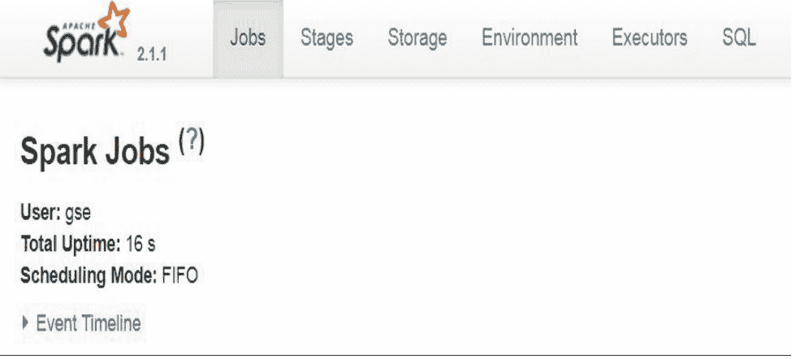

我们将在本章的 *Spark 驱动程序 Web UI* 节中详细讨论 Spark UI。

在本节中，我们已完成独立模式下的 Spark 设置。在下一节中，我们将使用 `spark-shell` 或 `spark-cli` 对 Apache Spark 进行一些实践操作。

## Spark REPL 又称 CLI

在第 1 章“Spark 简介”中，我们了解到，Apache Spark 相对于 MapReduce 框架的一个优势是交互式处理。Apache Spark 通过 Spark REPL 实现了这一点。

Spark REPL 或 Spark shell，也称为 Spark CLI，是探索 Spark 编程的一个非常有用的工具。REPL 是 Read-Evaluate-Print Loop 的缩写。它是程序员用来与框架交互的交互式 shell。Apache Spark 也附带 REPL，初学者可以使用它来了解 Spark 编程模型。

要启动 Spark REPL，我们将执行上一节中执行的命令：

```
$SPARK_HOME/bin/spark-shell
Using Spark's default log4j profile: org/apache/spark/log4j-defaults.properties
Setting default log level to "WARN".
To adjust logging level use sc.setLogLevel(newLevel).
16/11/01 16:38:43 WARN NativeCodeLoader: Unable to load native-hadoop library for y
16/11/01 16:38:43 WARN Utils: Your hostname, dlla1424 resolves to a loopback addres
16/11/01 16:38:43 WARN Utils: Set SPARK_LOCAL_IP if you need to bind to another add
16/11/01 16:38:45 WARN SparkContext: Use an existing SparkContext, some configurati
Spark context Web UI available at http://192.168.0.15:4040
Spark context available as 'sc' (master = local[*], app id = local-1477998525363).
Spark session available as 'spark'.
Welcome to
      ____              __
     / __/__  ___ _____/ /__
    _\ \/ _ \/ _ `/ __/  '_/
   /___ / .__/\_,_/_/ /_/\_\   version 2.1.1.
      /_/

Using Scala version 2.11.8 (Java HotSpot(TM) 64-Bit Server VM, Java 1.8.0_101)
Type in expressions to have them evaluated.
Type :help for more information.

scala>
```

## 使用 Spark shell 进行一些基本练习

请注意，Spark shell 仅适用于 Scala 语言。但是，我们已使示例易于 Java 开发人员理解。

## 检查 Spark 版本

使用 spark-shell 执行以下命令以检查 Spark 版本：

```
scala>sc.version
res0: String = 2.1.1
```

如下截图所示：

## 创建和过滤 RDD

首先，让我们创建一个字符串 RDD：

```scala
scala>val stringRdd=sc.parallelize(Array("Java", "Scala", "Python", "Ruby","JavaScript
stringRdd: org.apache.spark.rdd.RDD[String] = ParallelCollectionRDD[0] at paralleli
```

现在，我们将过滤此 RDD，只保留以字母 `J` 开头的字符串：

```scala
scala>val filteredRdd = stringRdd.filter(s => s.startsWith("J"))
filteredRdd: org.apache.spark.rdd.RDD[String] = MapPartitionsRDD[2] at filter at <c
```

在第一章中，我们了解到，如果对 RDD 的操作返回一个 RDD，则它是转换，否则它是动作。

先前命令的输出清楚地显示 filter 操作返回了一个 RDD，因此 filter 是一个转换。

现在，我们将在 `filteredRdd` 上运行一个动作来查看其元素。让我们在 `filteredRdd` 上运行 `collect`：

```scala
scala>val list = filteredRdd.collect
list: Array[String] = Array(Java, JavaScript, Java)
```

根据前一个命令的输出，`collect` 操作返回了一个字符串数组。因此，它是一个动作。

现在，让我们查看 `list` 变量的元素：

```scala
scala> list
res5: Array[String] = Array(Java, JavaScript, Java)
```

我们只剩下以 `J` 开头的元素，这正是我们期望的结果：

```
scala> val stringRdd=sc.parallelize(Array("Java","Scala","Python","Ruby","JavaScript","Java"))
stringRdd: org.apache.spark.rdd.RDD[String] = ParallelCollectionRDD[7] at parallelize at <console>:24

scala> val filteredRdd = stringRdd.filter(s => s.startsWith("J"))
filteredRdd: org.apache.spark.rdd.RDD[String] = MapPartitionsRDD[8] at filter at <console>:26

scala> val list = filteredRdd.collect
list: Array[String] = Array(Java, JavaScript, Java)

scala> list
res3: Array[String] = Array(Java, JavaScript, Java)

scala> 
```


## RDD 上的单词计数

让我们在 stringRDD 上运行一个单词计数问题。单词计数是大数据世界的 HelloWorld。单词计数意味着我们将统计 RDD 中每个单词的出现次数：

因此，首先我们将按如下方式创建 pairRDD：

```
scala> val pairRDD = stringRDD.map(s => (s, 1))
pairRDD: org.apache.spark.rdd.RDD[(String, Int)] = MapPartitionsRDD[6] at map at <console>
```

pairRDD 由单词和一（整数）的配对组成，其中单词代表 stringRDD 中的字符串。

现在，我们将在此 RDD 上运行 reduceByKey 操作以统计每个单词的出现次数，如下所示：

```
scala> val wordCountRDD = pairRDD.reduceByKey((x, y) => x + y)
wordCountRDD: org.apache.spark.rdd.RDD[(String, Int)] = ShuffledRDD[8] at reduceByKey at <console>
```

现在，让我们在它上运行 collect 以查看结果：

```
scala> val wordCountList = wordCountRDD.collect
wordCountList: Array[(String, Int)] = Array((Python, 1), (JavaScript, 1), (Java, 2), (
scala> wordCountList
res3: Array[(String, Int)] = Array((Python, 1), (JavaScript, 1), (Java, 2), (Scala, 1),
```

根据 wordCountList 的输出，stringRDD 中的每个字符串只出现一次，除了 Java 出现了两次。

如下截图所示：

```
scala> val pairRDD = stringRDD.map(s => (s, 1))
pairRDD: org.apache.spark.rdd.RDD[(String, Int)] = MapPartitionsRDD[9] at map at <console>:26

scala> val wordCountRDD = pairRDD.reduceByKey((x, y) => x + y)
wordCountRDD: org.apache.spark.rdd.RDD[(String, Int)] = ShuffledRDD[10] at reduceByKey at <console>:28

scala> val wordCountList = wordCountRDD.collect
wordCountList: Array[(String, Int)] = Array((Python, 1), (JavaScript, 1), (Java, 2), (Scala, 1), (Ruby, 1))

scala> wordCountList
res4: Array[(String, Int)] = Array((Python, 1), (JavaScript, 1), (Java, 2), (Scala, 1), (Ruby, 1))

scala> 
```

## 查找整数 RDD 中所有偶数的总和

首先，让我们按如下方式创建一个整数 RDD：

```
scala> val intRDD = sc.parallelize(Array(1, 4, 5, 6, 7, 10, 15))
intRDD: org.apache.spark.rdd.RDD[Int] = ParallelCollectionRDD[0] at parallelize at <console>
```

下一步是过滤此 RDD 中的所有偶数元素。因此，我们将在 RDD 上执行 filter 操作，如下所示：

```
scala> val evenNumbersRDD = intRDD.filter(i => (i % 2 == 0))
evenNumbersRDD: org.apache.spark.rdd.RDD[Int] = MapPartitionsRDD[3] at filter at <console>
```

上述操作将获取那些 2 是其因子的元素，即偶数元素。

现在，我们将按如下方式求和此 RDD 的所有元素：

```
scala> val sum = evenNumbersRDD.sum
sum: Double = 20.0
scala> sum
res5: Double = 20.0
```

如下截图所示：

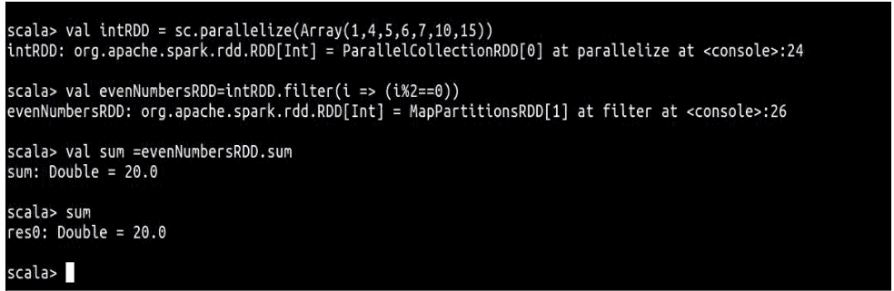

## 统计文件中的单词数

让我们读取位于 $SPARK_HOME/examples/src/main/resources 中的 people.txt 文件：

```
sparkuser@-~$ cd $SPARK_HOME/examples/src/main/resources
sparkuser@/usr/local/spark/examples/src/main/resources$ ls
full_user.avsc kv1.txt people.json people.txt user.avsc users.avro users.parquet
sparkuser@/usr/local/spark/examples/src/main/resources$ cat people.txt
Michael, 29
Andy, 30
Justin, 19
sparkuser@/usr/local/spark/examples/src/main/resources$
```

可以使用 textFile() 方法按如下方式读取文件：

```
scala> val file = sc.textFile("/usr/local/spark/examples/src/main/resources/people.txt")
file: org.apache.spark.rdd.RDD[String] = /usr/local/spark/examples/src/main/resources/people.txt MapPartitionsRDD[4] at textFile at <console>:24
```

下一步是扁平化文件的内容，即，我们将按 , 分割每一行并扁平化列表中的所有单词来创建一个 RDD，如下所示：

```
scala> val flattenFile = file.flatMap(s => s.split(", "))
flattenFile: org.apache.spark.rdd.RDD[String] = MapPartitionsRDD[5] at flatMap at <console>
```

flattenFile RDD 的内容如下所示：

```
scala> flattenFile.collect
res5: Array[String] = Array(Michael, 29, Andy, 30, Justin, 19)
```

现在，我们可以按如下方式统计此 RDD 中的所有单词：

```
scala> val count = flattenFile.count
count: Long = 6
scala> count
res2: Long = 6
```

如下截图所示：

```
scala> val file = sc.textFile("/usr/local/spark/examples/src/main/resources/people.txt")
file: org.apache.spark.rdd.RDD[String] = /usr/local/spark/examples/src/main/resources/people.txt MapPartitionsRDD[4] at textFile at <console>:24

scala> val flattenFile = file.flatMap(s => s.split(",", -1))
flattenFile: org.apache.spark.rdd.RDD[String] = MapPartitionsRDD[5] at flatMap at <console>:26

scala> flattenFile.collect
res1: Array[String] = Array(Michael, 29, Andy, 30, Justin, 19)

scala> val count = flattenFile.count
count: Long = 6

res2: Long = 6

scala> 
```

每当调用 count 等任何操作时，Spark 都会创建一个有向无环图 (DAG) 来描绘每个 RDD 的血缘依赖关系。Spark 提供了一个调试方法 toDebugString() 来显示 RDD 的此类血缘依赖关系：

```
scala> flattenFile.toDebugString
```

如下截图所示：

```
scala> val file = sc.textFile("/usr/local/spark/examples/src/main/resources/people.txt")
file: org.apache.spark.rdd.RDD[String] = /usr/local/spark/examples/src/main/resources/people.txt MapPartitionsRDD[5] at textFile at <console>:24

scala> val flattenFile = file.flatMap(s => s.split(",", -1))
flattenFile: org.apache.spark.rdd.RDD[String] = MapPartitionsRDD[6] at FlatMap at <console>:26

scala> flattenFile.toDebugString
res2: String =
(2) MapPartitionsRDD[6] at FlatMap at <console>:26 []
 |  /usr/local/spark/examples/src/main/resources/people.txt MapPartitionsRDD[5] at textFile at <console>:24 []
 |  /usr/local/spark/examples/src/main/resources/people.txt HadoopRDD[4] at textFile at <console>:24 []

scala> 
```

缩进表示 shuffle，而括号中的数字表示每个阶段的并行度。

在本节中，我们熟悉了一些 Spark CLI 概念。在下一节中，我们将讨论 Spark 作业的各种组件。

## Spark 组件

在深入之前，让我们首先了解与 Spark 相关的常见术语：

- **驱动程序**：这是监督 Spark 作业或程序端到端执行的主程序。它与集群的资源管理器协商资源，将程序委派并编排为尽可能小的数据本地并行编程单元。
- **执行器**：在任何 Spark 作业中，可以有一个或多个执行器，即由驱动程序委派执行较小任务的进程。执行器处理数据，最好是节点本地数据，并将结果存储在内存、磁盘或两者中。
- **主节点**：Apache Spark 已实现主从架构，因此主节点是指执行驱动程序的集群节点。
- **从节点**：在分布式集群模式中，从节点是指运行执行器的节点，因此集群中可以有（并且大多有）多个从节点。
- **作业**：这是对任何一组数据执行的一组操作。典型的单词计数作业涉及从任意源读取文本文件，然后拆分并聚合单词。
- **DAG**：在 Spark 引擎中，任何 Spark 作业都由操作的 DAG 表示。DAG 按顺序表示 Spark 操作的逻辑执行。在发生故障时，可以根据 DAG 导出血缘关系来重新计算 RDD。
- **任务**：作业可以拆分为较小的单元以供隔离操作，这些单元称为 **任务**。每个任务由执行器在数据分区上执行。
- **阶段**：Spark 作业可以逻辑上划分为阶段，每个阶段代表一组具有相同 shuffle 依赖关系的任务，即发生数据 shuffle 的位置。在 shuffle map 阶段中，任务结果作为下一阶段的输入；而在结果阶段中，任务计算启动 Spark 作业评估的操作，如 take()、foreach() 和 collect()。

下图显示了 Spark 应用程序不同组件如何交互的逻辑表示：

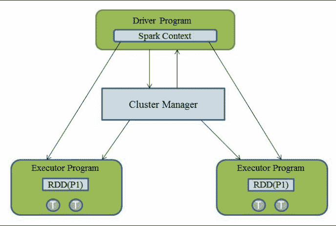

## Spark 作业如何执行：

- Spark 作业可以包含在一组数据上执行的一系列操作。无论 Spark 作业大小如何，执行任何此类作业都需要 sparkContext。在之前使用 REPL 的示例中，人们会注意到使用了一个名为 sc 的环境变量，这就是在 REPL 环境中访问 SparkContext 的方式。
- SparkContext 创建作业不同转换的算子图，但一旦在该转换上调用操作，图就会提交给 DAGScheduler。根据生成的 RDD 或结果的性质（窄转换或宽转换，即需要 shuffle 操作的转换），DAGScheduler 会生成阶段。
- DAGScheduler 以这种方式拆分 DAG，使每个阶段都包含具有共同 shuffle 边界的相同 shuffle 依赖。此外，阶段可以是 shuffle map 阶段，在这种情况下，其任务的结果

作为另一个阶段或结果阶段的输入，在此情况下，其任务直接计算启动作业的操作，例如 count()。

然后，阶段由 DAGScheduler 作为 TaskSet 提交给 TaskScheduler。TaskScheduler 通过集群管理器（YARN、Mesos 和 Spark 独立模式）调度 TaskSet 并监控其执行。如果任何任务失败，它将被重新运行，最终结果发送到 DAGScheduler。如果结果输出文件丢失，则 DAGScheduler 将此类阶段重新提交给 TaskScheduler 以再次运行。

然后，任务被调度到指定的执行器（在从节点上运行的 JVM）上，以满足资源和数据本地性约束。每个执行器也可以被分配多个任务。

下图展示了 Spark 作业执行的不同阶段的逻辑表示：

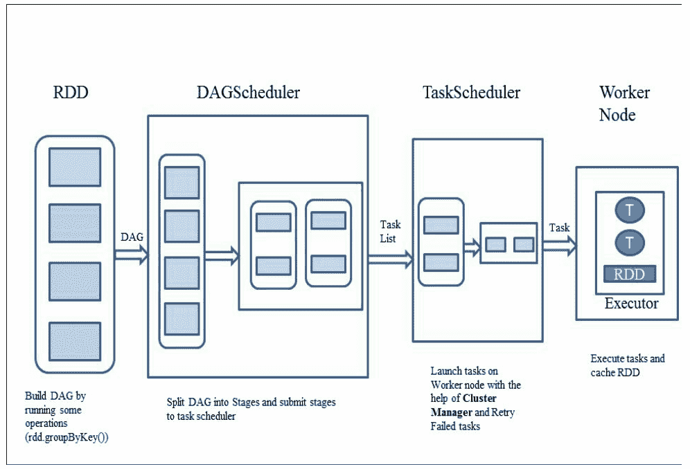

在本节中，我们了解了 Spark 作业的不同组件。在下一节中，我们将学习 Spark 驱动程序 UI 的功能。

## Spark 驱动程序 Web UI

本节将介绍 Spark 驱动程序 UI 的一些重要方面。我们将看到在 Spark UI 上使用 Spark shell 执行的作业的统计信息。

如*开始使用 Apache Spark*节中所述，Spark 驱动程序 UI 运行于 http://localhost:4040/（除非您更改了默认设置）。

当您启动 Spark shell 时，Spark 驱动程序 UI 将如下所示：

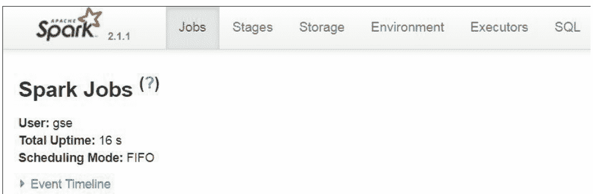

SparkContext 是每个 Spark 应用程序的入口点。每个 Spark 作业都与一个 SparkContext 一起启动，并且只能包含一个 SparkContext。

Spark shell 作为一个 Spark 应用程序，以 SparkContext 启动，每个 SparkContext 启动自己的 Web UI。默认端口是 4040。可以使用以下属性启用/禁用 Spark UI 或在单独的端口上启动它：

| 属性 | 默认值 |
| :--- | :--- |
| spark.ui.enabled | True |
| spark.ui.port | 4040 |

例如，带有在 5050 端口上运行的 Spark UI 的 Spark shell 应用程序可以这样启动：

```
spark-shell --conf spark.ui.port=5050
```

如果在同一系统上并行启动多个 Spark 应用程序而未提供上述任何 conf 参数，则这些应用程序的 Spark UI 将从 4040 开始在连续端口上启动（即 4040、4041 等）。

Spark UI 包含以下选项卡：

## 作业

作业是 Spark UI 的默认选项卡。它显示在 SparkContext 中执行的所有应用程序的状态。可以在 http://localhost:4040/jobs/ 访问它。

它包含三个部分：

- 活跃作业：此部分用于当前正在运行的作业
- 已完成作业：此部分用于成功完成的作业
- 失败作业：此部分用于失败的作业

如下截图所示：

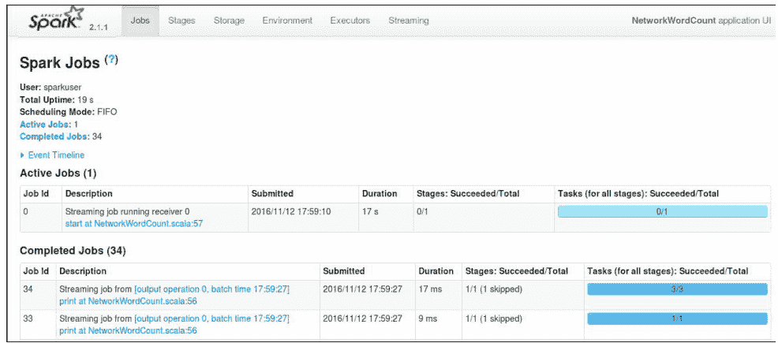

Spark UI 的部分是惰性创建的，在需要时可见。例如，活跃作业部分只有在存在当前正在运行的作业时才可见。同样，失败作业和已完成作业部分只有在存在失败或成功完成的作业时才可见。

Spark UI 的作业选项卡部分使用以下类呈现：

```
org.apache.spark.ui.jobs.JobsTab class that uses
org.apache.spark.ui.jobs.JobProgressListener to get the statistics of the job.
```

在 Spark REPL（也称为 CLI 部分）中执行完提到的所有作业后，Spark UI 将如下所示：

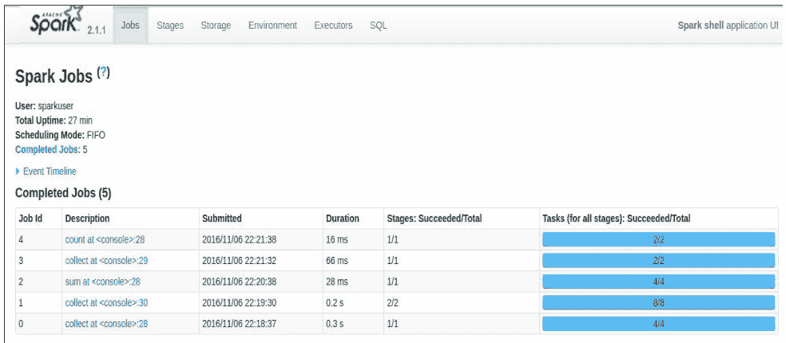

另外，如果展开事件时间线部分，您可以看到 sparkContext 启动的时间（即驱动程序启动）以及作业执行的时间及其状态：

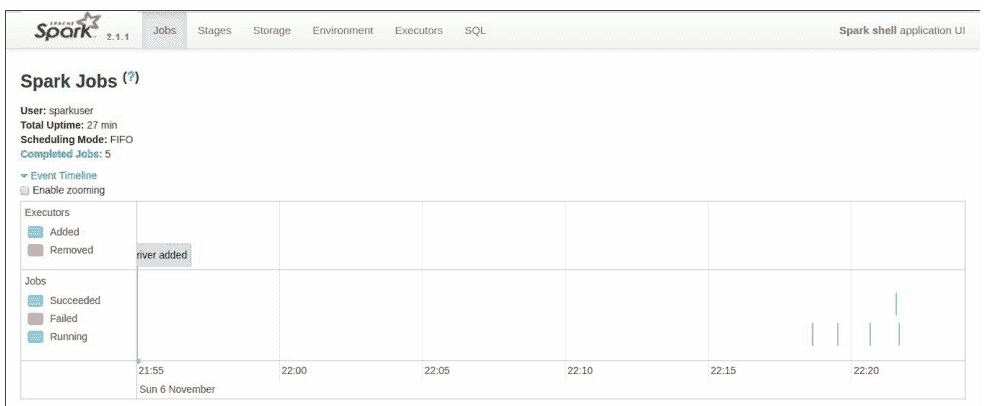

另外，单击任何作业，您可以查看作业的详细信息，即作业的事件时间线以及作业执行期间执行的转换和阶段的 DAG，如下所示：

### 作业 4 的详细信息
状态：成功
已完成阶段：1

- 事件时间线
- DAG 可视化

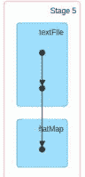

### 已完成阶段 (1)

| 阶段 ID | 描述 | 提交时间 | 持续时间 | 任务：成功/总数 | 输入 | 输出 | Shuffle 读取 | Shuffle 写入 |
|---|---|---|---|---|---|---|---|---|
| 5 | count at <console>:29 | 2016/11/06 22:21:38 | 13 ms | 2/2 | 48.0 B | | | |

## 阶段

阶段选项卡列出并提供在 SparkContext 中执行的每个作业的所有阶段的当前状态。可以在 http://localhost:4040/stages/ 访问它。Spark UI 的阶段选项卡使用 org.apache.spark.ui.jobs.StagesTab 类呈现。

与作业选项卡一样，阶段选项卡也包含三个部分：

- 活跃阶段：此部分用于当前正在运行的活跃作业的阶段
- 已完成阶段：此部分用于活跃/失败/已完成作业中成功完成的阶段
- 失败阶段：此部分用于活跃/失败/已完成作业中失败的阶段

在 Spark REPL（也称为 CLI 部分）中执行完提到的所有作业后，阶段选项卡将如下所示：

| 阶段 ID | 描述 | 提交时间 | 持续时间 | 任务：成功/总数 | 输入 | 输出 | Shuffle 读取 | Shuffle 写入 |
|---|---|---|---|---|---|---|---|---|
| 5 | count at <console>:28 | +details 2016/11/06 22:21:38 | 13 ms | 2/2 | 48.0 B | | | |
| 4 | collect at <console>:29 | +details 2016/11/06 22:21:32 | 61 ms | 2/2 | 48.0 B | | | |
| 3 | sum at <console>:28 | +details 2016/11/06 22:20:38 | 24 ms | 4/4 | | | | |
| 2 | collect at <console>:30 | +details 2016/10/06 22:19:30 | 62 ms | 4/4 | | | 309.0 B | |
| 1 | map at <console>:26 | +details 2016/11/06 22:19:30 | 87 ms | 4/4 | | | | 309.0 B |
| 0 | collect at <console>:28 | +details 2016/11/06 22:18:37 | 0.1 s | 4/4 | | | | |

如果单击任何阶段，您可以查看阶段的各种详细信息，即已执行任务的 DAG、事件时间线等。此外，此页面还提供在阶段中执行的执行器和任务的各种详细信息的度量：

### 阶段 4 的详细信息 (尝试 0)

所有任务的总时间：4 ms
本地性级别摘要：进程本地：2
输入大小/记录数：4.0 B / 3

### DAG 可视化

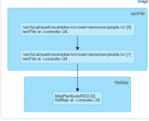

### 显示其他度量

- 事件时间线
- 启用缩放

- 调度延迟
- 任务反序列化时间
- Shuffle 读取时间
- 执行器计算时间
- Shuffle 写入时间
- 结果序列化时间
- 获取结果时间

| 驱动程序 / 本地主机 | |
|---|---|
| | |
| 320 | 321 | 322 | 323 | 324 | 325 | 326 | 327 | 328 | 329 | 330 | 331 | 332 | 333 | 334 | 335 |
| 16:24.45 | |

## 存储

如果在作业执行期间，用户持久化/缓存了一个 RDD，则可以在该选项卡上检索有关该 RDD 的信息。可以在 http://localhost:4040/storage/ 访问它。

让我们再次启动 Spark shell，读取一个文件，并在其上运行一个操作。但是，这次我们将在运行操作之前缓存该文件。

最初，当您启动 Spark shell 时，存储选项卡显示为空白。


让我们使用 SparkContext 读取文件，如下所示：

```
scala> val file = sc.textFile("/usr/local/spark/examples/src/main/resources/people.txt")
file: org.apache.spark.rdd.RDD[String] = /usr/local/spark/examples/src/main/resourc...
```

这次我们将缓存此 RDD。默认情况下，它将被缓存在内存中：

```
scala> file.cache
res0: file.type = /usr/local/spark/examples/src/main/resources/people.txt MapPartiti...
```

如前所述，转换的 DAG 仅在执行操作时才会执行，因此当我们对 RDD 运行操作时，缓存步骤也会执行。所以让我们对其运行一个 collect：

```
scala> file.collect
res1: Array[String] = Array(Michael, 29, Andy, 30, Justin, 19)
```

现在，您可以在存储选项卡上找到有关被缓存的 RDD 的信息。


## 存储

| RDD 名称 | 存储级别 | 缓存分区 | 缓存比例 | 内存大小 | 磁盘大小 |
| --- | --- | --- | --- | --- | --- |
| /usr/local/spark/examples/src/main/resources/people.txt | Memory Deserialized 1x Replicated | 2 | 100% | 232.0 B | 0.0 B |

单击 RDD 名称后，将提供有关 RDD 上分区的信息以及存储 RDD 的主机地址。

## MapPartitionsRDD 的 RDD 存储信息

存储级别: Memory Deserialized 1x Replicated
缓存分区数: 2
总分区数: 2
内存大小: 360.0 B
磁盘大小: 0.0 B

## 1 个执行器上的数据分布

| 主机 | 内存使用量 | 磁盘使用量 |
| --- | --- | --- |
| 192.168.0.106:38543 | 360.0 B (366.3 MB 剩余) | 0.0 B |

## 2 个分区

| 块名称 | 存储级别 | 内存大小 | 磁盘大小 | 执行器 |
| --- | --- | --- | --- | --- |
| rdd_9_0 | Memory Deserialized 1x Replicated | 232.0 B | 0.0 B | 192.168.0.106:38543 |
| rdd_9_1 | Memory Deserialized 1x Replicated | 128.0 B | 0.0 B | 192.168.0.106:38543 |

## 环境

“环境”选项卡提供有关 Spark 应用程序（或 SparkContext）中使用的各种属性和环境变量的信息。可通过 http://localhost:4040/environment/ 访问。

用户可以在该选项卡上获取关于各种 Spark 属性的非常有用的信息，而无需翻阅属性文件。

| 名称 | 值 |
| --- | --- |
| Java Home | /usr/lib/jvm/java-8-oracle/jre |
| Java Version | 1.8.0_101 (Oracle Corporation) |
| Scala Version | version 2.11.8 |

| 名称 | 值 |
| --- | --- |
| spark.app.id | local-1478449502954 |
| spark.app.name | Spark shell |
| spark.driver.host | 192.168.0.106 |
| spark.driver.port | 39321 |
| spark.executor.id | driver |
| spark.home | /usr/local/spark |
| spark.jars | |
| spark.master | local[*] |
| spark.repl.class.outputDir | /tmp/spark-7be4ae9e-bd96-44df-4d7c-aae82b92496c/repl-6e3e7f08-1228-4d38-9e17-d40d1ac9e2ba |
| spark.repl.class.uri | spark://192.168.0.106:39321/classes |
| spark.scheduler.mode | FIFO |
| spark.sql.catalogImplementation | hive |
| spark.submit.deployMode | client |

## 执行器

Spark UI 的“执行器”选项卡提供有关执行器正在使用的内存、核心和其他资源的信息。这些信息既可在每个执行器级别查看，也可在汇总级别查看。可通过 http://localhost:4040/executors/ 访问。

“执行器”选项卡上的所有信息均使用 org.apache.spark.ui.exec.ExecutorsListener 类检索。

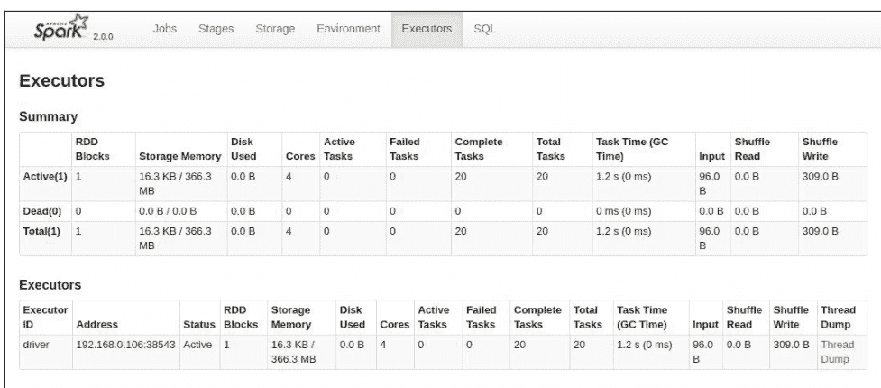

此外，该选项卡还提供一个选项，用于对执行器进程进行线程转储，这对于调试问题非常有用。用户可以通过将 spark.ui.threadDumpsEnabled 设置为 false 来关闭此选项（默认情况下，此项设置为 true）。

## SQL

Spark UI 中的 SQL 选项卡提供非常有用的 Spark SQL 查询。我们将在第 8 章 “使用 Spark SQL” 中学习 Spark SQL 框架的工作原理。目前，请在 Spark shell 上运行以下命令。可通过 http://localhost:4040/SQL 访问。

在以下示例中，我们将使用 SparkSession 库在 Spark 中读取 JSON 文件，在 JSON 数据上创建临时视图，然后在表上运行 Spark SQL 查询：

```
scala> import org.apache.spark.sql.SparkSession
import org.apache.spark.sql.SparkSession
scala> import spark.implicits._
import spark.implicits._

scala> val spark = SparkSession.builder().appName("Spark SQL basic example").getOrCreate
16/11/13 22:27:51 WARN SparkSession$Builder: Use an existing SparkSession, some con
spark: org.apache.spark.sql.SparkSession = org.apache.spark.sql.SparkSession@53fd599

scala> val df = spark.read.json("/usr/local/spark/examples/src/main/resources/people.json")
df: org.apache.spark.sql.DataFrame = [age: bigint, name: string]

scala> df.createOrReplaceTempView("people")

scala> val sqlDF = spark.sql("SELECT * FROM people")
sqlDF: org.apache.spark.sql.DataFrame = [age: bigint, name: string]

scala> sqlDF.show()
+-+---+------+
| age| name|
+-+---+------+
|null|Michael|
| 30| Andy|
| 19| Justin|
+-+---+------+
```

运行前面的示例后，SQL 选项卡中可以找到 SQL 查询的详细信息。它提供了 SQL 查询的 DAG 以及查询计划，该计划显示 Spark 如何优化了执行的 SQL 查询。

SQL 选项卡使用以下内容检索所有这些信息：
org.apache.spark.sql.execution.ui.SQLListener。

## 查询 0 的详细信息

提交时间: 2016/11/13 22:29:49
持续时间: 0.8s
成功作业数: 0

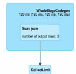

### 详细信息

```
== Parsed Logical Plan ==
GlobalLimit 21
+- LocalLimit 21
   +- Project [age#0, name#1]
      +- SubqueryAlias people
         +- Relation[age#0,name#1] json

== Analyzed Logical Plan ==
age: bigint, name: string
GlobalLimit 21
+- LocalLimit 21
   +- Project [age#0, name#1]
      +- SubqueryAlias people
         +- Relation[age#0,name#1] json

== Optimized Logical Plan ==
GlobalLimit 21
+- LocalLimit 21
   +- Relation[age#0,name#1] json

== Physical Plan ==
CollectLimit 21
+- *Scan json [age#0,name#1] Format: JSON, InputPaths: file:/usr/local/spark/examples/src/main/resources/people.json, PushedFilters: [], ReadSchema: struct<age:bigint,name:string>
```

## 流处理

如您所料，“流处理”选项卡显示有关 Spark Streaming 作业的信息。当您在 SparkContext 中执行流处理作业时，此选项卡将出现。

我们将在第 9 章 “使用 Spark Streaming 进行近实时处理” 中学习 Spark Streaming 框架的工作原理。目前，请运行以下作业，该作业将监听端口 10000 并对传入的消息执行单词计数。

首先，在端口 10000 上打开连接：

```
sparkuser@~$ nc -lk 10000
```

现在，执行 Spark Package 中捆绑的 NetworkWordCount 示例：

```
sparkuser@~$ $SPARK_HOME/bin/run-example streaming.NetworkWordCount localhost 10000
```

运行后，“流处理”选项卡将出现，可通过 http://localhost:4040/streaming/ 访问：

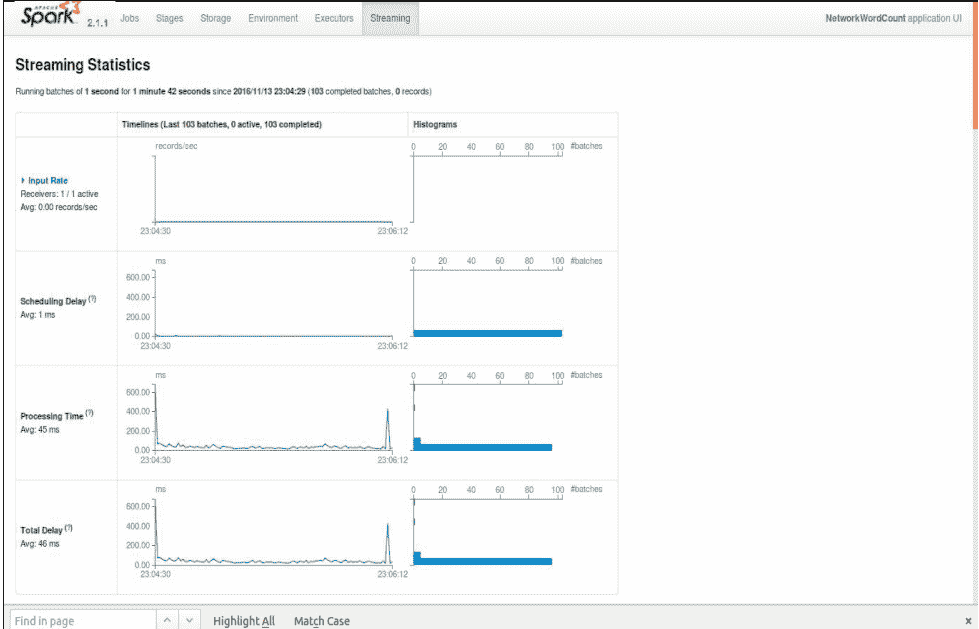

它提供了大量有关流处理作业的信息，例如输入速率、处理流时的调度延迟、流的处理时间等等。这些信息对 Spark Streaming 作业的性能调优非常有用，因为流处理需要应对传入数据的速度以避免延迟。

此外，它还提供有关已处理批次的信息，这在调试问题时很有用。

在本节中，我们将学习 Spark UI 的各种功能。

在下一节中，我们将学习一些用于监控 Spark 作业的 REST API。

## Spark 作业配置和提交

启动 Spark 作业时，会创建一个 `sparkConf` 对象并将其传递给 `SparkContext` 的构造函数。`sparkConf()` 对象包含可自定义参数的近乎详尽列表，可根据集群资源调整 Spark 作业。一旦将 `SparkConf` 对象传递以调用 `SparkContext()` 构造函数，它将变为不可变，因此在创建 `SparkContext` 对象之前，不仅要识别，还要修改所有 `SparkConf` 参数非常重要。

配置 Spark 作业有多种方式。

Spark 的 `conf` 目录提供执行 Spark 作业的默认配置。`SPARK_CONF_DIR` 参数可用于替代 `conf` 目录的默认位置（通常为 `SPARK_HOME/conf`），该文件夹中预期的一些配置文件为 `spark-defaults.conf`、`spark-env.sh` 和 `log4j.properties`。Spark 用于日志机制的 `Log4j` 可通过修改 `log4j.properties.template` 进行配置。Spark 环境变量可使用 shell 脚本文件 `spark-env.sh` 进行配置，但默认情况下不可用，可从 `spark-env.sh.template` 复制。

环境变量列表如下：

| 环境变量 | 含义 |
| :--- | :--- |
| JAVA_HOME | 计算机上可用的 Java 路径。 |
| | 用于在驱动程序中为 PySpark 使用的 Python 二进制可执行文件。 |


| 变量 | 描述 |
| --- | --- |
| PYSPARK_PYTHON | 工作节点（如果可用，默认为 Python 2.7，否则为 Python）。 |
| PYSPARK_DRIVER_PYTHON | 用于仅在驱动程序中使用 PySpark 的 Python 二进制可执行文件（默认值为 PYSPARK_PYTHON）。 |
| SPARKR_DRIVER_R | 用于 SparkR shell 的 R 二进制可执行文件（默认值为 R）。 |
| SPARK_LOCAL_IP | 要绑定的机器 IP 地址。 |
| SPARK_PUBLIC_DNS | Spark 程序将向其他机器宣传的主机名。 |

通过 `SparkConf` 对象传递给 Spark 作业的默认值可在 `spark-defaults.conf` 文件中找到。常用配置如下：

| 参数名 | 默认值 | 含义 |
| --- | --- | --- |
| spark.app.name | none | Spark 作业的名称，将显示在 Spark UI 和日志中。 |
| spark.driver.cores | 1 | 在集群模式下，驱动程序可用的 CPU 核心数。 |
| spark.driver.memory | 1g | 驱动程序可利用的内存大小。 |
| spark.executor.cores | YARN: 1 OTHERS: Available cores | 执行器使用的核心数。在 YARN 中默认值为 1，在独立模式下为工作节点上的所有可用核心。 |
| spark.executor.memory | 1g | 每个执行器可利用的内存。 |
| spark.master | none | 集群管理器的 URL。 |
| spark.submit.deployMode | none | 在集群上本地（客户端）或远程（集群）部署 Spark 作业。 |
| spark.local.dir | /tmp | Spark 中用于暂存空间的目录。从 Spark 1.0 开始，它被集群管理器设置的 SPARK_LOCAL_DIRS（独立模式、Mesos）或 LOCAL_DIRS（YARN）环境变量覆盖。 |

由于 SparkContext 对象对任何 Spark 作业的所有工作节点都可用，因此无法用于配置节点特定的配置。因此，Mesos 和 YARN 集群中分别提供了 SPARK_LOCAL_DIRS 或 LOCAL_DIRS，用于设置合并和排序中间输出文件的本地目录。

通过 spark-defaults.conf、SparkConf 对象和 Spark-Submit 工具设置的 Spark 作业配置和属性，可以在 Spark UI 的 Environment 选项卡中查看，网址为 http://<driver>:4040。

Spark 配置也可以使用 `spark-submit` 工具动态设置。最常用的参数可以直接使用 `spark-submit` 工具设置，例如 `--master`、`--name`（每个参数都以双连字符开头），但其他参数可以使用 `--conf` 参数传递：

```
$ bin/spark-submit \
--class com.foo.Bar \
--master local[3] \
--name "AnotherFooBar App" \
--conf spark.ui.port=37777\
fooBar.jar
```

另一种方便的传递参数的方式是使用包含空格分隔的键/值对的配置文件。可以使用 `--properties-file` 参数指定配置文件名。除非另有说明，否则配置文件的默认位置为 `SPARK_HOME/conf` 目录：

```
$ bin/spark-submit \
--class com.foo.Bar \
--properties-file job-config.conf \
foo.jar
++++ Contents of job-config.conf ++++
spark.master local[3]
spark.app.name "AnotherFooBar App"
spark.ui.port 37777
++++ Contents of job-config.conf finish ++++
```

SparkConf 也可以通过先使用所需参数构造 SparkConf() 对象，然后使用它调用 SparkContext 构造函数，以编程方式显式设置：

```
// Construct a Spark conf
SparkConf conf = new SparkConf();
conf.set("spark.app.name", "AnotherFooBar App");
conf.set("spark.master", "local[3]");
conf.set("spark.ui.port", "37777");
// Instantiate SparkContext with the Spark conf
JavaSparkContext sc = JavaSparkContext(conf);
```

在客户端模式下执行 Spark 作业时，应注意不要以编程方式传递驱动程序相关参数，因为驱动程序 JVM 已经启动，因此不会对驱动程序配置产生任何影响。在这种情况下，可以选择使用 `spark-defaults.conf` 文件或在 `spark-submit` 工具中使用 `--driver-memory` 参数来传递驱动程序相关配置。

SparkConf 的不同设置方式，需要定义每个选项可能适用的优先级顺序。最高优先级是 Spark 作业本身中显式传递的值。之后，使用 Spark-Submit 工具传递的参数优先级次之。其余参数最终从 SPARK_HOME/conf 文件夹的 spark-defaults.conf 文件中获取。

## Spark REST APIs

在开发 Web 服务时，**表示状态传输 (REST)** 架构被广泛使用。如今，Hadoop、Apache Storm 等许多框架都提供了 RESTful Web 服务，帮助用户与框架进行交互或监控框架。Apache Spark 同样也提供了可用于监控 Spark 应用程序的 REST Web 服务。在本节中，我们将学习 Apache Spark 提供的 REST APIs。

Spark REST APIs 的响应类型为 JSON，可用于为 Spark 应用程序设计自定义监控。REST 端点挂载在 /api/v1，这意味着对于运行 UI 的 SparkContext https://localhost:4040，REST 端点将挂载在 https://localhost:4040/api/v1。

是时候探索 Apache Spark 提供的一些 REST APIs 了。为此，启动 Spark shell 并运行 Spark REPL（也称为 CLI 部分）中提到的任何作业：

执行以下命令以列出 SparkContext 中执行/运行的应用程序：

```
curl http://localhost:4040/api/v1/applications
[
{
"id" : "local-1479401168077",
"name" : "Spark shell",
"attempts" : [ {
"startTime" : "2016-11-17T16:46:05.429GMT",
"endTime" : "1969-12-31T23:59:59.999GMT",
"lastUpdated": "2016-11-17T16:46:05.429GMT",
"duration" : 0,
"sparkUser" : "",
"completed" : false,
"startTimeEpoch" : 1479401165429,
"endTimeEpoch" : -1,
"lastUpdatedEpoch" : 1479401165429
} ]
}
]
```

先前提供的 REST API 还接受一些请求参数，例如 status=running，它提供具有请求状态的应用程序列表：

```
curl http://localhost:4040/api/v1/applications?status=running
[
  {
    "id" : "local-1479401168077",
    "name" : "Spark shell",
    "attempts" : [ {
      "startTime" : "2016-11-17T16:46:05.429GMT",
      "endTime" : "1969-12-31T23:59:59.999GMT",
      "lastUpdated" : "2016-11-17T16:46:05.429GMT",
      "duration" : 0,
      "sparkUser" : "",
      "completed" : false,
      "startTimeEpoch" : 1479401165429,
      "endTimeEpoch" : -1,
      "lastUpdatedEpoch" : 1479401165429
    } ]
  }
]
```

执行以下命令以列出应用程序执行的作业（REST URL：http://localhost:4040/api/v1/applications/[app-id]/jobs）：

```
curl http://localhost:4040/api/v1/applications/local-1479401168077/jobs
[
  {
    "jobId" : 1,
    "name" : "count at <console>:28",
    "submissionTime" : "2016-11-17T16:47:33.799GMT",
    "completionTime" : "2016-11-17T16:47:33.827GMT",
    "stageIds" : [ "1" ],
    "status" : "SUCCEEDED",
    "numTasks" : 2,
    "numActiveTasks" : 0,
    "numCompletedTasks" : 2,
    "numSkippedTasks" : 0,
    "numFailedTasks" : 0,
    "numActiveStages" : 0,
    "numCompletedStages" : 1,
    "numSkippedStages" : 0,
    "numFailedStages" : 0
  }, {
    "jobId" : 0,
    "name" : "collect at <console>:29",
    "submissionTime" : "2016-11-17T16:47:26.329GMT",
    "completionTime" : "2016-11-17T16:47:26.754GMT",
    "stageIds" : [ "0" ],
    "status" : "SUCCEEDED",
    "numTasks" : 2,
    "numActiveTasks" : 0,
    "numCompletedTasks" : 2,
    "numSkippedTasks" : 0,
    "numFailedTasks" : 0,
    "numActiveStages" : 0,
    "numCompletedStages" : 1,
    "numSkippedStages" : 0,
    "numFailedStages" : 0
  } ]
```

以下是 Apache Spark 提供的完整 RESTful API 列表及其用法：

| REST 端点 | 用途 | 允许的请求参数 |
|---|---|---|
| /applications | 列出 SparkContext 中执行/运行的所有应用程序。 | ?status=[completed|running] 用于列出请求状态的应用程序。?minDate=[date] 用于列出在提供日期之后启动的所有应用程序。示例：?minDate=2016-11-16，?minDate=2015-11-16T100:00:00.000GMT。?maxDate=[date] 用于列出在提供日期之前启动的所有应用程序。示例：?maxDate=2016-11-16，?maxDate=2015-11-16T100:00:00.000GMT。 |
| /applications/[app-id]/jobs | 列出 Spark 应用程序中执行的所有作业。 | ?status=[complete|succeeded|failed] 用于列出请求状态的作业。 |
| /applications/[app-id]/jobs/[job-id] | 获取 Spark 应用程序中特定作业的详细信息。 | |
| /applications/[app-id]/stages | 列出 Spark 应用程序中执行的所有阶段。 | |


| /applications/[app-id]/stages/[stage-id] | 获取在 Spark 应用程序中执行的特定阶段的详细信息。 | 用于列出请求状态的阶段，使用 ?status=[active|complete|pending|failed]。 |
| --- | --- | --- |
| /applications/[app-id]/stages/[stage-id]/[stage-attempt-id] | 获取特定阶段特定尝试的详细信息。 | |
| /applications/[app-id]/stages/[stage-id]/[stage-attempt-id]/taskSummary | 获取特定阶段特定尝试中所有任务的汇总指标。 | 用于使用给定的分位数汇总指标，使用 ?quantiles。示例：?quantiles=0.01,0.5,0.99。 |
| /applications/[app-id]/stages/[stage-id]/[stage-attempt-id]/taskList | 列出特定阶段特定尝试的所有任务。 | 用于在给定偏移范围内列出任务，使用 ?offset=[offset]&length=[len]。用于按给定值对任务进行排序，使用 ?sortBy=[runtime|-runtime]。 |
| /applications/[app-id]/executors | 列出 Spark 应用程序的所有执行器。 | |
| /applications/[app-id]/storage/rdd | 列出 Spark 应用程序的所有存储 RDD。 | |
| /applications/[app-id]/storage/rdd/[rdd-id] | 获取特定存储 RDD 状态的详细信息。 | |
| /applications/[base-app-id]/logs | 下载特定应用程序所有尝试的事件日志。将以 ZIP 文件形式提供。 | |
| /applications/[base-app-id]/[attempt-id]/logs | 下载应用程序特定尝试的事件日志。将以 ZIP 文件形式提供。 | |

在下一节中，我们将学习各种可帮助进行 Spark 应用程序性能调优的配置。

# 摘要

本章我们学习了如何搭建 Apache Spark 独立集群，并使用 Spark CLI 与其交互。随后，我们重点了解了各种 Spark 组件，以及 Spark 作业在集群环境中的执行方式。还讨论了不同的 Spark 作业配置和 Spark Web UI，以及用于作业提交和状态监控的 REST API。

在下一章中，我们将进一步讨论 RDD 及其操作。

# 理解 Spark 编程模型

本章将通过使用 Java 在 Apache Spark 中解释单词计数问题，并同时设置 IDE 来逐步推进。随后，我们将解释常见的 RDD 动作和转换。我们还将简要介绍 Spark 的内置缓存功能以及 RDD 的持久化，以提高 Spark 作业性能。

# Hello Spark

在本节中，我们将为 Spark 创建一个 Hello World 程序，然后了解 Spark 的内部工作原理。在大数据世界中，Hello World 程序也称为单词计数程序。给定文本数据作为输入，我们将计算文本数据中每个单词的频率或每个单词出现的次数，即每个单词在文本中出现了多少次。假设我们有以下文本数据：

Where there is a will there is a way

此数据中每个单词的出现次数如下：

| 单词 | 频率 |
| :--- | :--- |
| Where | 1 |
| There | 2 |
| Is | 2 |
| A | 2 |
| Will | 1 |
| Way | 1 |

现在我们将使用 Spark 解决这个问题。那么，让我们开发一个 Spark WordCount 应用程序。

## 前提条件

准备 Spark 应用程序的先决条件如下：

- Java 应用程序 IDE：我们将使用 Eclipse IDE 开发 Spark 应用程序。用户可以根据自己的选择使用任何 IDE。此外，IDE 应该已安装 Maven 插件（最新版本的 Eclipse，如 Mars 和 Neon，包含内置 Maven 插件）。
- Java 7 或更高版本，但推荐 Java 8。
- Maven 包。

在 Java IDE 中开始使用 Maven 项目的步骤如下：

- 1. 第一步是创建 Maven 项目。在 Eclipse 中，可以通过 File|New|Project 创建。
- 2. 然后搜索 Maven，如下图所示：

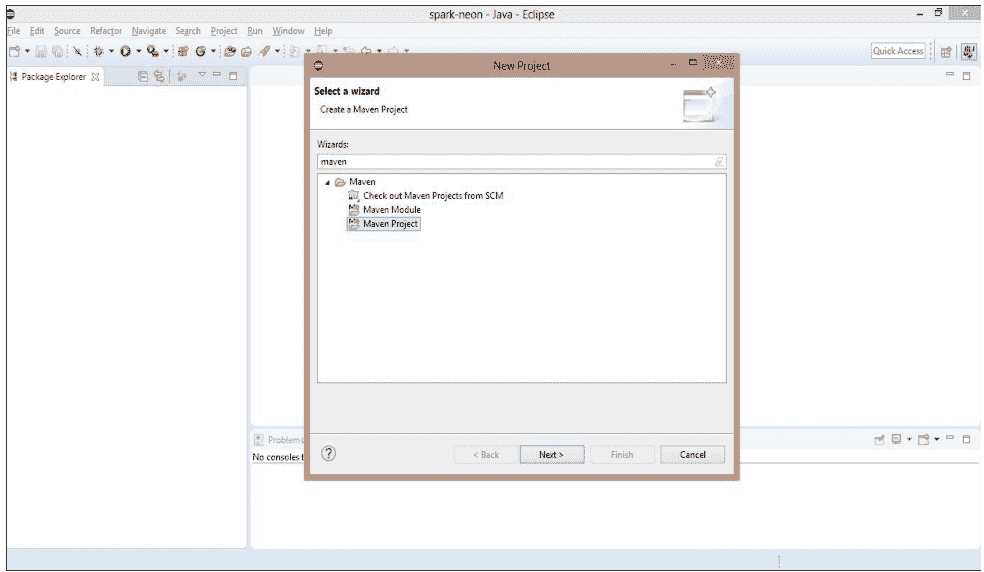

- 3. 选择 Maven Project 并单击 Next。在下一屏幕中，选中 Create a simple project（跳过原型选择）旁边的复选框，然后单击 Next。在下一屏幕中，按如下添加 Group Id 和 Artifact Id 值，然后单击 Finish：

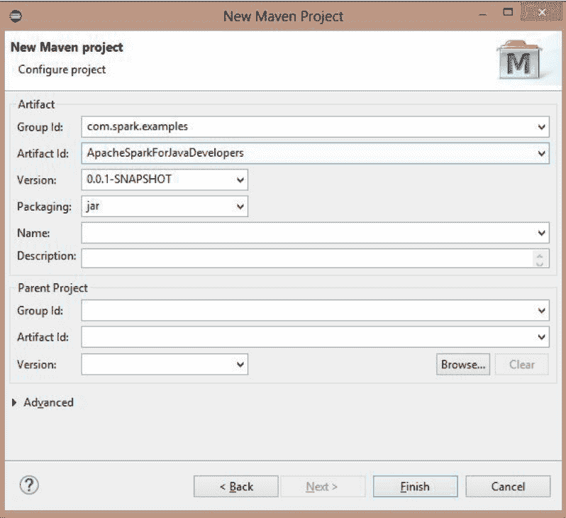

- 4. Eclipse 将为您创建 Maven 项目。Maven 项目也可以使用 mvn 命令行工具创建，如下所示：

```
mvn archetype:generate -DgroupId=com.spark.examples -DartifactId=Apache1
```

> 使用 mvn 命令行工具创建项目后，需要将其导入到 IDE 中。

- 5. 创建 Maven 项目后，展开 Maven 项目并编辑 pom.xml，添加以下依赖项：

```
<dependency>
    <groupId>org.apache.spark</groupId>
    <artifactId>spark-core_2.11</artifactId>
    <version>2.0.0</version>
</dependency>
```

- 6. 以下是 pom.xml 文件的内容：

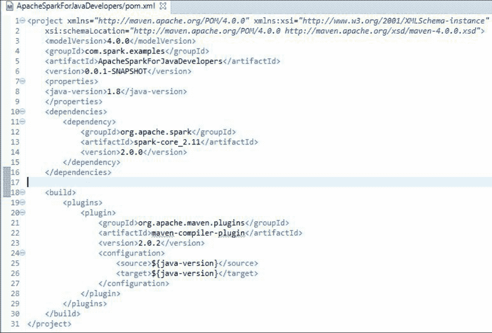

以下是关于 Maven 项目编译的一些有用提示：

- 已添加 Maven 编译器插件，有助于设置编译项目的 Java 版本。当前设置为 1.8，因此可以使用 Java 8 功能。Java 版本可根据需要更改。
- Hadoop 不是在系统中运行 Spark 作业的必先安装组件。但是，在某些场景下，可能会出现诸如“在 hadoop 二进制路径中未找到 winutils 二进制文件”之类的错误，因为它正在 HADOOP_HOME 的 bin 文件夹中搜索名为 winutils 的二进制文件。

可能需要以下步骤来修复此类错误：

- 1. 从任何存储库下载 winutils 可执行文件。
- 2. 创建一个虚拟目录来存放下载的可执行文件 winutils.exe。例如，E:\SparkForJavaDev\Hadoop\bin。
- 3. 添加环境变量 HADOOP_HOME，指向 E:\SparkForJavaDev\Hadoop，可使用以下任一选项：Eclipse | 可作为 Java 应用程序运行的类（包含 static main 方法） | 右键单击 | 以运行方式运行 | 运行配置 | 环境选项卡：

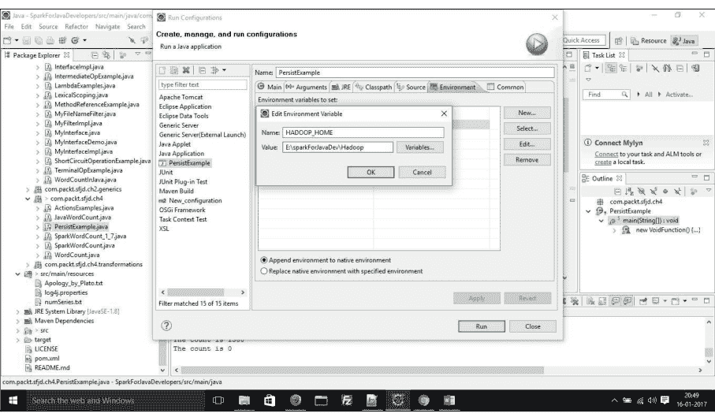

- 4. 在 Java 主类本身中添加以下代码行：

```
System.setProperty("hadoop.home.dir", "PATH_OF_HADOOP_HOME");
```

下一步是为 Spark 应用程序创建 Java 类。以下是使用 Java 7 的 SparkWordCount 应用程序：

```
public class SparkWordCount {
public static void main(String[] args) {
SparkConf conf = new SparkConf().setMaster("local").setAppName("WordCount");
JavaSparkContext javaSparkContext = new JavaSparkContext(conf);
JavaRDD<String> inputData = javaSparkContext.textFile("path_of_input_file");
JavaPairRDD<String, Integer> flattenPairs = inputData.flatMapToPair(new PairFlatMapFunction<String, String, Integer>() {
@Override
public Iterator<Tuple2<String, Integer>> call(String text) throws
Exception {
    List<Tuple2<String,Integer>> tupleList =new ArrayList<>();
    String[] textArray = text.split(" ");
    for (String word:textArray) {
        tupleList.add(new Tuple2<String, Integer>(word, 1));
    }
    return tupleList.iterator();
}};
JavaPairRDD<String, Integer> wordCountRDD = flattenPairs.reduceByKey(new
Function2<Integer, Integer, Integer>() {
    @Override
    public Integer call(Integer v1, Integer v2) throws Exception {
        return v1+v2;
    }});
wordCountRDD.saveAsTextFile("path_of_output_file");
}
}
```

以下是使用 Java 8 的 SparkWordCount 应用程序：

```
public class SparkWordCount {
    public static void main(String[] args) {
        SparkConf conf =new
        SparkConf().setMaster("local").setAppName("WordCount");
        JavaSparkContext javaSparkContext = new JavaSparkContext(conf);
        JavaRDD<String> inputData =
        javaSparkContext.textFile("path_of_input_file");
        JavaPairRDD<String, Integer> flattenPairs =
        inputData.flatMapToPair(text -> Arrays.asList(text.split(" ")).stream().map(word ->new Tuple2<String,Integer>(word,1)).iterator());
        JavaPairRDD<String, Integer> wordCountRDD = flattenPairs.reduceByKey((v1,
        v2) -> v1+v2);
        wordCountRDD.saveAsTextFile("path_of_output_file");
    }
}
```

在前面的 WordCount 应用程序示例中，我们执行了以下步骤：

- 1. 初始化 SparkContext：我们从创建 SparkConf 对象开始：

```
new SparkConf().setMaster("local").setAppName("WordCount");
```

在这里，setMaster("local") 定义应用程序将在单个 JVM 内运行；也就是说，我们可以直接在 IDE 中执行它。这对于调试 Spark 应用程序和创建测试


单位亦适用。在 Spark 集群上运行 Spark 应用程序时，setMaster() 应指向 Spark Master URL。（注：我们将在第 6 章 Spark On Cluster 中详细介绍此内容。）

setAppName("WordCount") 用于为我们的 Spark 应用程序提供名称。在此示例中，我们将应用程序命名为 WordCount。不过，用户可以根据需要为应用程序提供任何名称。

所有其他配置参数均可使用 SparkConf 对象设置。然后，借助 SparkConf 对象，我们初始化了 JavaSparkContext：

```java
new JavaSparkContext(conf);
```

JavaSparkContext 专用于 Java Spark 应用程序。如前几章所述，SparkContext 是 Spark 应用程序的必需组件。此外，一个 Spark 应用程序只能包含一个 SparkContext。现在，借助 SparkContext，我们可以创建 RDD，并可创建 RDD 转换的 DAG。

- 2. 加载输入数据：使用 javaSparkContext，我们从文本文件中加载了数据：

```java
javaSparkContext.textFile("path_of_input_file");
```

还有其他加载数据的方式。不过，在此示例中，我们使用文本文件作为输入。始终建议提供绝对路径，因为相对路径取决于程序执行所在的位置。

此外，我们可以通过在 SparkContext 上执行 parallelize() 函数来创建 RDD，如下所示：

```java
JavaRDD<String> data = javaSparkContext.parallelize(Arrays.asList("where there is a way"));
```

- 3. 展平输入数据并创建元组：加载数据后，我们将其展平，并使用 flatMapToPair 转换将其转换为诸如 <key,value> 对之类的元组：

```java
inputData.flatMapToPair(text -> Arrays.asList(text.split(" ")).stream().map(
    -> new Tuple2<String, Integer>(word, 1)).iterator())
```

请考虑文本文件的内容：Where there is a will there is a way。

因此，flatMapToPair 转换将首先将文本数据拆分为单词（在我们的示例中，我们假设单词由空格 (" ") 分隔），并按以下方式创建元组：

```
(where,1)
(there,1)
(is,1)
(a,1)
(will,1)
(there,1)
(is,1)
(a,1)
(way,1)
```

- 4. 聚合（求和）每个键的值：一旦数据按先前描述的方式转换为元组形式，就会在数据上执行另一个转换 reduceByKey，以求和每个键的值，这有助于我们找到数据中每个单词的出现次数或频率：

```java
flattenPairs.reduceByKey((v1, v2) -> v1+v2);
```

因此，前述数据将被约简如下：

```
(where, (1)) -> (where,1)
(there, (1+1)) -> (there,2)
(is,(1+1)) -> (is,2)
(a,(1+1)) -> (a,2)
(will, (1)) -> (will,1)
(way, (1)) -> (way,1)
```

这样就得到了所需结果。如果在集群中运行，RDD 会被分区，然后相同的键会被洗牌到同一个执行器，因此此转换也会产生网络流量（我们将在第 7 章 Spark Programming Model-Advanced 中了解分区概念）。

- 5. **运行最终操作**：如前几章所述，转换是惰性操作。转换的 DAG 只有在执行操作时才会执行。因此，最后一步是执行操作。在此示例中，我们执行了 saveToTextFile，它将输出保存到文本文件中：

```java
wordCountRDD.saveAsTextFile("path_of_output_file");
```

在本节中，我们讨论了经典的单词计数问题，并学习了如何使用 Spark 和 Java 解决它。在解决单词计数问题的过程中，我们还设置了 Eclipse IDE 以执行 Spark 作业。

在下一节中，我们将讨论一些常见的 RDD 转换，并简要介绍 RDD 操作中的窄依赖和宽依赖。

## 常见的 RDD 转换

如第 1 章 Introduction of Spark 中所述，如果对 RDD 的操作输出一个 RDD，那么它就是一个转换。换句话说，对 RDD 的转换会在 RDD 的元素上执行一个函数，并创建一个表示转换后元素的新 RDD。目标 RDD 中的元素数量可以与源 RDD 不同。

Spark 中的转换是惰性操作，会在操作时触发；也就是说，转换链只有在执行操作时才会执行。

转换的一个重要方面还涉及对父 RDD 分区的依赖。如果生成的 RDD 的每个分区都依赖于父 RDD 的一个固定分区，则称为 **窄依赖**。同样，宽依赖涉及生成的 RDD 依赖于父 RDD 多个分区的操作。通常，map、filter 及类似操作（将在即将到来的章节中讨论）具有窄依赖，而 `groupByKey`、`sortByKey` 等则具有宽依赖。

由于窄依赖依赖于特定分区进行操作，因此对这些分区的顺序操作彼此独立。这不仅提高了并行度，还缩短了计算时间。另一方面，宽依赖取决于跨不同分区传输数据的 shuffle 操作的效率。即使在节点故障期间，窄依赖操作也只会重新计算父节点丢失的分区，而在宽依赖的情况下，父 RDD 的所有依赖分区都会被重新计算。

让我们来看看一些有用的 Spark 转换：

### Map

在 map 转换中，源 RDD 和目标 RDD 的元素之间存在一对一映射。会在源 RDD 的每个元素上执行一个函数，并创建表示执行函数结果的目标 RDD。

以下是 map 转换的一个示例，它将整数 RDD 的每个元素加 1：

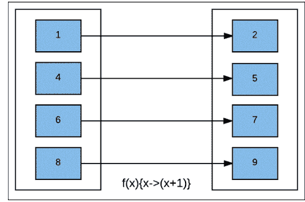

我们将按如下方式创建 JavaSparkContext：

```java
SparkConf conf = new SparkConf().setMaster("local").setAppName(
    "ApacheSparkForJavaDevelopers");
JavaSparkContext javaSparkContext = new JavaSparkContext(conf);
```

请注意，setMaster 应指向分布式集群的主节点 URL。不过，设置为 local 表示 Spark 作业将在单个 JVM 中运行。在 IDE（例如 Eclipse）内部运行作业以进行调试时非常有用。

现在，我们将创建一个整数 RDD：

```java
List<Integer> intList = Arrays.asList(1, 2, 3, 4, 5, 6, 7, 8, 9, 10);
JavaRDD<Integer> intRDD = javaSparkContext.parallelize(intList, 2);
```

创建后，可以按如下方式在 RDD 上执行将每个元素加 1 的 map 转换：

Java 7：
```java
intRDD.map(new Function<Integer, Integer>() {
    @Override
    public Integer call(Integer x) throws Exception {
        return x + 1;
    }
});
```
Java 8：
```java
intRDD.map(x -> x + 1);
```

### Filter

使用 filter 转换时，函数会在源 RDD 的所有元素上执行，仅选择函数返回 true 的元素来形成目标 RDD。在此转换中，目标 RDD 的元素数量可以小于或等于源 RDD 的元素数量。

以下是针对整数 RDD 运行的 filter 转换示例，它仅选择偶数元素，即能被 2 整除的元素：

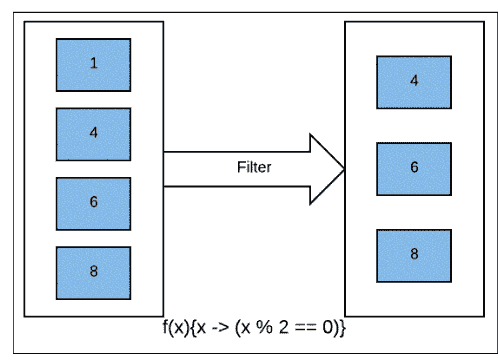

可以按如下方式使用 Java 7 在先前示例中创建的 intRDD 上执行 filter 转换：

```java
intRDD.filter(new Function<Integer, Boolean>() {
    @Override
    public Boolean call(Integer x) throws Exception {
        return (x % 2 == 0);
    }
});
```

### 使用 Java 8 的 intRDD 示例：

```java
intRDD.filter(x -> (x % 2 == 0));
```

### flatMap

在 flatMap() 转换中，源 RDD 的一个元素可以映射到目标 RDD 的一个或多个元素。会在源 RDD 的每个元素上执行一个函数，生成一个或多个输出。flatMap() 函数的返回类型是 java.util.Iterator，即它返回一个元素序列。

以下 flatMap() 转换示例将在字符串 RDD 上执行一个函数，该函数将每个字符串元素拆分为单词，并生成一个以这些单词作为其单独元素的 RDD：

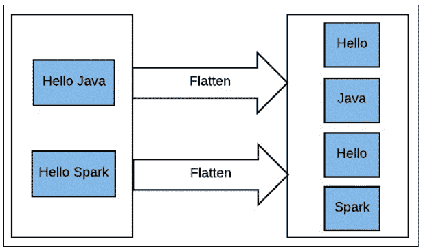

我们将使用 javaSparkContext 创建一个字符串 RDD：

```java
JavaRDD<String> stringRDD = javaSparkContext.parallelize(Arrays.asList("Hello Spark", "Hello Java"));
```

### Java 7：

```java
stringRDD.flatMap(new FlatMapFunction<String, String>() {
    @Override
    public Iterator<String> call(String t) throws Exception {
        return Arrays.asList(t.split(" ")).iterator();
    }
});
```

### Java 8：

```java
stringRDD.flatMap(t -> Arrays.asList(t.split(" ")).iterator());
```


在这种情况下，目标 RDD 的元素数量大于或等于源 RDD 的元素数量。

## mapToPair

它与 map 转换类似；然而，此转换生成 PairRDD，即由键值对组成的 RDD。此转换特定于 Java RDD。对于其他 RDD，map 转换可以执行 map 和 mapToPair() 这两项任务。

与 map 转换类似，它也在源 RDD 和目标 RDD 的元素之间建立一对一映射。因此，目标 RDD 的元素数量等于源 RDD 的元素数量。

本转换的以下示例将 Map 转换章节中创建的 intRDD 转换为 <String, Integer> 类型的 JavaPairRDD，即目标 RDD 的键为字符串类型、值为整数类型，键用于指定元素是偶数还是奇数：

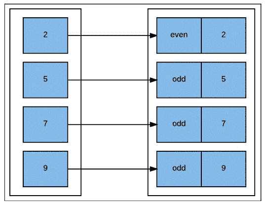

### Java 7

```java
JavaPairRDD<String, Integer> pairRDD = intRDD.mapToPair(new PairFunction<Integer, String, Integer>() {
    @Override
    public Tuple2<String, Integer> call(Integer i) throws Exception {
        return (i % 2 == 0) ? new Tuple2<String, Integer>("even", i) : new Tuple2<String, Integer>("odd", i);
    }
});
```

### Java 8

```java
JavaPairRDD<String, Integer> mapToPair = intRDD.mapToPair(i -> (i % 2 == 0) ? new Tuple2<String, Integer>("even", i) : new Tuple2<String, Integer>("odd", i));
```

## flatMapToPair

它与 flatMap() 类似，但目标 RDD 是 PairRDD 类型，即由键值对组成的 RDD。与 mapToPair() 类似，此操作也特定于 JavaRDDs。

让我们扩展 FlatMap() 转换的示例，创建一个以单词为键、单词长度为值的 RDD：

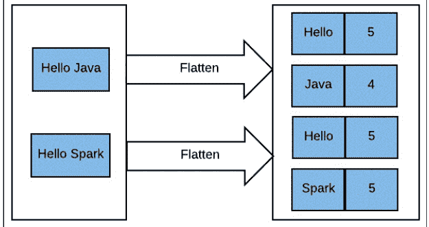

### Java 7

```java
stringRDD.flatMapToPair(new PairFlatMapFunction<String, String, Integer>() {
    @Override
    public Iterator<Tuple2<String, Integer>> call(String s) throws Exception {
        List<Tuple2<String, Integer>> list = new ArrayList<>();
        for (String token : s.split(" ")) {
            list.add(new Tuple2<String, Integer>(token, token.length()));
        }
        return list.iterator();
    }
});
```

### Java 8

```java
stringRDD.flatMapToPair(s -> Arrays.asList(s.split(" ")).stream().map(token -> new
```

## union

顾名思义，此转换将两个 RDD 合并为一个。目标包含源 RDD 的所有元素。union 转换的以下示例合并了两个 Integer RDD：

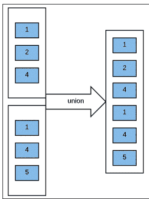

我们将使用 JavaSparkContext 创建一个整数 RDD，然后将此 RDD 与 map() 转换章节中创建的整数 RDD 进行 union：

```java
JavaRDD<Integer> intRDD2 = javaSparkContext.parallelize(Arrays.asList(1, 2, 3));
intRDD.union(intRDD2);
```

## Intersection

它生成源 RDD 元素的交集，即目标 RDD 由源 RDD 中相同的元素组成。

以下示例将生成两个整数 RDD 的交集：

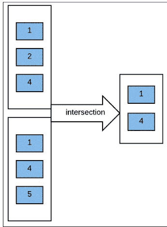

Intersection 转换可以按以下方式执行：

```java
intRDD.intersection(intRDD2);
```

## Distinct

如你所料，distinct 操作将通过获取源 RDD 的所有不同元素来返回一个 RDD。Distinct 使用对象的 hashCode 和 equals 方法来查找不同元素：

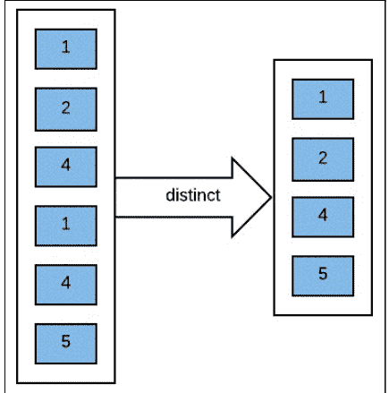

让我们创建一个包含重复元素的整数 RDD：

```java
JavaRDD<Integer> rddwithdupElements = javaSparkContext.parallelize(Arrays.asList(1;
```

RDD 上的 distinct 操作可以按以下方式执行：

```java
rddwithdupElements.distinct();
```

## Cartesian

Cartesian 转换生成两个 RDD 的笛卡尔积。我们的第一个 RDD 的每个元素都与第二个 RDD 的每个元素配对。因此，如果在类型为 X 的 RDD 和类型为 Y 的 RDD 上执行 cartesian 操作，它将返回一个由 <x, y> 对组成的 RDD。结果 RDD 将包含所有可能的 <x, y> 对。

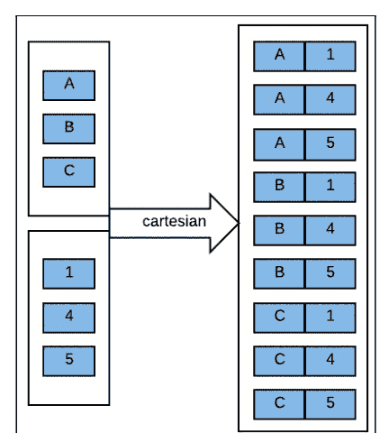

字符串 RDD 和整数 RDD 的 Cartesian 转换可以按以下方式执行：

```java
JavaRDD<String> rddStrings = javaSparkContext.parallelize(Arrays.asList("A", "B", "C"));
JavaRDD<Integer> rddIntegers = javaSparkContext.parallelize(Arrays.asList(1, 4, 5));
rddStrings.cartesian(rddIntegers);
```

下一组转换作用于 PairRDDs：

## groupByKey

groupByKey 转换适用于 PairRDD（即由 (key, value) 对组成的 RDD）。它用于将与键相关的所有值分组。它有助于将由 <key, value> 对组成的 PairRDD 转换为由 <key, Iterable<value>> 对组成的 PairRDD。

在以下示例中，我们将在 mapToPair() 转换章节中生成的 pairRDD 上执行 groupByKey 操作。

groupByKey 操作可以按以下方式执行：

```java
pairRDD.groupByKey()
```

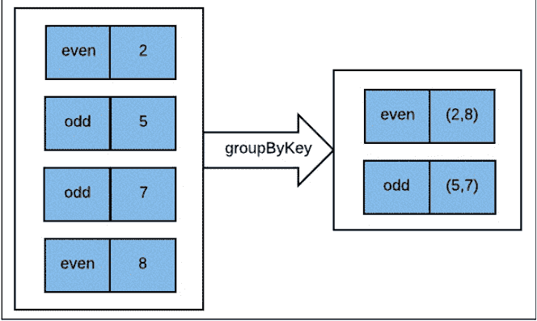

此转换函数有一个可用的重载，允许用户提供 Partitioner：

```java
groupByKey(Partitioner partitioner)
```

由于 RDD 跨多个节点分区。一个键可能出现在多个分区中。在 groupByKey 等操作中，数据将跨多个分区混洗。因此，混洗后键将落在哪个正在运行的执行器上由 Partitioner 决定。默认情况下，Spark 使用 Hash Partitioner，它使用键的 hashCode 来决定应将其混洗到哪个执行器。用户也可以根据要求提供自定义分区器。

> RDD 分区概念将在第 7 章“Spark 编程模型-进阶”中详细说明。

groupByKey() 是一个非常昂贵的操作，因为它需要大量混洗。一个键对应的数据将跨网络混洗，在处理大数据集时可能会导致严重问题。

## reduceByKey

这是另一种用于 Pair RDD 的转换，它借助关联约减函数帮助聚合与键对应的数据。将一个函数作为参数传递给此转换，该函数有助于聚合与键对应的值。

例如，对于在 groupByKey 中使用的同一 PairRDD，可以对其执行 reduceByKey 操作，如下所示：

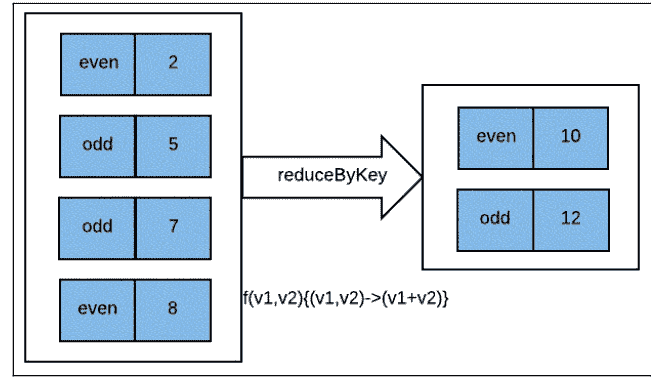

### Java 7

```java
pairRDD.reduceByKey(new Function2<Integer, Integer, Integer>() {
    @Override
    public Integer call(Integer v1, Integer v2) throws Exception {
        return v1 + v2;
    }
});
```

### Java 8

```java
pairRDD.reduceByKey((v1, v2) -> v1 + v2);
```

在前一个示例中，reduceByKey 转换将对与键对应的所有值求和。该函数接受两个参数。两个参数的类型和函数的返回类型与 PairRDD 的值类型相同。第一个参数是累积值，第二个值是下一个要合并的对的值。

与 group by key 类似，reduceByKey 函数也提供一个接受分区器作为参数的重载：

```java
reduceByKey(Partitioner partitioner, new Function2<T, T, T>() func)
```

对于具有多个分区的 RDD，reduceByKey 转换在混洗前在分区级别聚合值，这有助于减少网络数据传输。它类似于 Hadoop MapReduce 中 combiner 的概念。对于大数据集，这能大幅节省通过网络传输的数据。因此，建议使用 reduceByKey 而非 groupByKey。

## sortByKey

sortByKey() 属于 OrderedRDDFunctions。它用于按键对 pair RDD 进行升序或降序排序。

在 PairRDD 上执行 sortByKey() 时，键应为有序类型。在 Java 世界中，键类型应实现了 comparable，否则会抛出异常。因此，对于自定义键类型，用户应实现 comparable 接口。

sortByKey() 转换的示例如下：

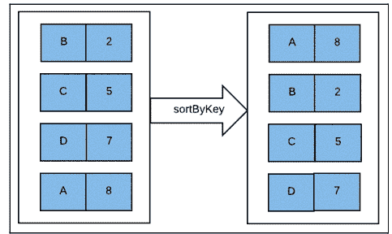

让我们先使用 JavaSparkContext 创建一个 <String, Integer> 类型的 pair RDD：

```java
JavaPairRDD<String, Integer> unsortedPairRDD = javaSparkContext.parallelizePairs(
    Arrays.asList(new Tuple2<String, Integer>("B", 2), new Tuple2<String, Integer>("C",
```

现在，让我们在其上执行 sortByKey 转换以将其降序排序：

```java
unsortedPairRDD.sortByKey()
```

sortByKey() 函数有一个接受布尔参数的可用重载：

```java
sortByKey(boolean ascending)
```

此函数可用于按键对 RDD 进行降序排序，如下所示


follows:

```
unsortedPairRDD.sortByKey(false);
```

此函数还有其他可用的重载，允许用户为键类型提供一个 `Comparator`。因此，如果键未实现 Comparable，可以使用此函数：

```
sortByKey(Comparator<T> comp, boolean ascending)
```

此转换还需要在分区之间进行数据混洗。随着 DataFrames 和 Datasets 的引入，也可以使用 Spark SQL 操作对数据进行排序（这些操作将在第 8 章《使用 Spark SQL》中详细讨论）。

## Join

它用于连接 Pair RDD。此转换与数据库中的 Join 操作非常相似。假设我们有两个类型为 <x,y> 和 <x,z> 的 Pair RDD。当在这些 RDD 上执行 Join 转换时，它将返回类型为 <x,(y,z)> 的 RDD。

以下是 join 操作的示例：

首先创建两个 PairRDD：

```
JavaPairRDD<String, String> pairRDD1 = javaSparkContext.parallelizePairs(Arrays.asL
JavaPairRDD<String, Integer> pairRDD2 = javaSparkContext.parallelizePairs( Arrays.a
```

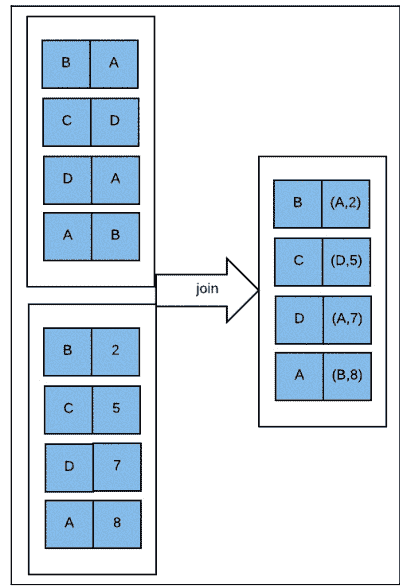

现在，pairRDD1 将与 pairRDD2 连接，如下所示：

```
JavaPairRDD<String, Tuple2<String, Integer>> joinedRDD = pairRDD1.join(pairRDD2);
```

还支持 LeftOuterJoin、RightOuterJoin 和 FullOuterJoin，可以按以下方式执行：

```
pairRDD1.leftOuterJoin(pairRDD2);
pairRDD1.rightOuterJoin(pairRDD2);
pairRDD1.fullOuterJoin(pairRDD2);
```

对于跨多个节点分区的 RDD，相同的键将被混洗到某个执行器节点以执行连接操作。因此，所有连接操作都提供了重载，并允许用户提供分区器：

```
join(JavaPairRDD<K,V> other,Partitioner partitioner)
leftOuterJoin(JavaPairRDD<K,V> other,Partitioner partitioner);
rightOuterJoin(JavaPairRDD<K,V> other,Partitioner partitioner);
fullOuterJoin(JavaPairRDD<K,V> other,Partitioner partitioner);
```

## CoGroup

此操作也用于对两个 PairRDD 进行分组。假设我们有两个类型为 <x,Y> 和 <x,Z> 的 PairRDD。当在这些 RDD 上执行 coGroup 转换时，它将返回类型为 <x, (Iterable<Y>,Iterable<Z>)> 的 RDD。此操作也称为 groupwith。

以下是 coGroup 转换的示例。首先创建两个 Pair RDD：

```
JavaPairRDD<String, String> pairRDD1 = javaSparkContext.parallelizePairs(Arrays.asL
JavaPairRDD<String, Integer> pairRDD2 = javaSparkContext.parallelizePairs(Arrays.as
```

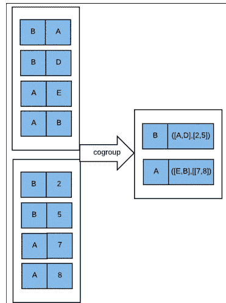

对这些 RDD 执行 CoGroup 转换可以按以下方式进行：

```
JavaPairRDD<String, Tuple2<Iterable<String>, Iterable<Integer>>> cogroupedRDD = pai
```

或

```
JavaPairRDD<String, Tuple2<Iterable<String>, Iterable<Integer>>> groupWithRDD = pai
```

由于此操作也需要在分区 RDD 上将相同的键混洗到一个执行器，因此提供了可用于提供分区器的重载函数：

```
cogroup(JavaPairRDD<K,V> other,Partitioner partitioner)
```

本节介绍了各种有用的转换、它们的用法及其在 Java 中的实现。在下一节中，我们将学习 Spark 中可在 RDD 上执行的各种动作。

## 常见 RDD 动作

在上一节中，我们探讨了各种会生成另一个 RDD 的 RDD 转换，然而，触发作业计算并返回非 RDD 值的 RDD 操作称为动作。之前讨论的所有转换在调用动作之前都不会被求值。不同的转换仅有助于物化惰性求值的 DAG。动作是唯一触发将数据加载到 RDD、计算转换，并将最终结果发送到 Driver 程序或写入文件系统的操作。

Spark 中广泛使用的一些常见动作将如下讨论：

### isEmpty

如果 RDD 不包含任何元素，isEmpty 将返回布尔值 True。需要注意的是，即使 RDD 有一个或多个分区，它也可能为空。在以下示例中，我们创建了包含三个整数的 RDD，然后过滤掉父 RDD 中不存在的元素，从而生成一个空 RDD：

### Java 7：

```
// isEmpty
JavaRDD<Integer> intRDD = sparkContext.parallelize(Arrays.asList(1,2,3));
boolean isRDDEmpty = intRDD.filter(new Function<Integer, Boolean>() {
@Override
public Boolean call(Integer v1) throws Exception {
return v1.equals(5);
}
}).isEmpty();
System.out.println("The RDD is empty ::"+isRDDEmpty);
```

### Java 8：

```
JavaRDD<Integer> intRDD = sparkContext.parallelize(Arrays.asList(1,2,3));
boolean isRDDEmpty = intRDD.filter(a -> a.equals(5)).isEmpty();
System.out.println("The RDD is empty ::"+isRDDEmpty);
```

### collect

Collect 会将 RDD 不同分区中的数据检索到驱动程序中的数组中。应谨慎仅在数据量相当小的 RDD 上调用 collect 动作，否则可能会导致驱动程序崩溃。

通常，在应用一组转换后，当数据量缩小时，会调用 collect 动作。调用 collect() 的最简单示例如下，即过滤特定值：

```
//Collect
List<Integer> collectedList= intRDD.collect();
for(Integer elements: collectedList){
    System.out.println("The collected elements are ::"+elements);
}
```

### collectAsMap

collectAsMap 动作用于在 PairRDD 上调用，以在驱动程序中以键/值格式收集数据集。由于 RDD 的所有分区数据都会被转储到驱动程序，因此应尽量减小数据大小：

```java
// collectAsMap
List<Tuple2<String, Integer>> list= new ArrayList<Tuple2<String, Integer>>();
list.add(new Tuple2<String, Integer>("a", 1));
list.add(new Tuple2<String, Integer>("b", 2));
list.add(new Tuple2<String, Integer>("c", 3));
list.add(new Tuple2<String, Integer>("a", 4));
JavaPairRDD<String, Integer> pairRDD = sparkContext.parallelizePairs(list);
Map<String, Integer> collectMap=pairRDD.collectAsMap();
for(Entry<String, Integer> entrySet :collectMap.entrySet()) {
System.out.println("The key of Map is : "+entrySet.getKey()+" and the value is : "+entrySet.getValue());
}
```

在示例中，可以注意到 RDD 中有两个具有相同键的元组，只要不将其作为 Map 收集，它就能正常工作，因为在这种情况下，键的一个值会被另一个值覆盖。

### count

count 方法返回 RDD 跨分区存在的元素数量：

```
//count()
long countVal=intRDD.count();
System.out.println("The number of elements in the RDD are :"+countVal);
```

### countByKey

countByKey 是对 count() 动作的扩展，它用于 Pair RDD 以计算 Pair RDD 中键的出现次数。CountByKey() 方法返回一个 Map，其键为 RDD 元素的键，值为该键的计数：

```
//CountByKey
List<Tuple2<String,Integer>> list= new ArrayList<Tuple2<String,Integer>>();
list.add(new Tuple2<String,Integer>("a", 1));
list.add(new Tuple2<String,Integer>("b", 2));
list.add(new Tuple2<String,Integer>("c", 3));
list.add(new Tuple2<String,Integer>("a", 4));
JavaPairRDD<String, Integer> pairRDD = sparkContext.parallelizePairs(list);
Map<String, Long> countByKeyMap= pairRDD.countByKey();
for( Entry<String, Long> entrySet :countByKeyMap.entrySet() ){
System.out.println("The key of Map is : " + entrySet.getKey() + " and the value is : " + entrySet.getValue());
}
```

### countByValue

countByValue() 方法可同时应用于 RDD 和 Pair RDD，但两种情况下返回的对象签名不同。例如，当对 RDD 应用 countByValue() 时，它会统计该 RDD 中具有特定值的元素出现次数，并返回一个以 RDD 元素为键、出现次数为值的 Map：

```
//countByValue
List<Tuple2<String,Integer>> list= new ArrayList<Tuple2<String,Integer>>();
list.add(new Tuple2<String,Integer>("a", 1));
list.add(new Tuple2<String,Integer>("b", 2));
list.add(new Tuple2<String,Integer>("c", 3));
list.add(new Tuple2<String,Integer>("a", 4));
JavaPairRDD<String, Integer> pairRDD = sparkContext.parallelizePairs(list);
Map<Tuple2<String, Integer>, Long> countByValueMap = pairRDD.countByValue();
for(Entry<Tuple2<String, Integer>, Long> entrySet :countByValueMap.entrySet()) {
System.out.println("The key of Map is a tuple having value : "+entrySet.getKey()._1()+" and "+entrySet.getKey()._2()+" and the value of count is : "+entrySet.getValue());
}
```

当对 Pair RDD 应用 countByValue() 时，它会将 RDD 中每个唯一值的计数作为 (value, count) 对的 Map 返回，其中 value 是 RDD 的元组。在代码片段中可以看到，有两个具有相同键（即 a）但值不同的元组。因此，当对它们应用 countByValue() 动作时，它会将具有 a 的两个键视为不同。最终的合并步骤在主节点上本地执行，相当于运行单个 reduce 任务。


## Max

动作 max 返回 RDD 中的最大值，元素之间的比较由作为参数传递的比较器决定：

### Java 7:

```java
// max()
JavaRDD<Integer> intRDD = sparkContext.parallelize(Arrays.asList(1,2,3));
Integer maxVal=intRDD.max(new IntegerComparator());
System.out.println("The max value of RDD is "+maxVal);
//Also create a Comparator class as below
static class IntegerComparator implements Comparator<Integer>, Serializable {
private static final long serialVersionUID = 1L;
@Override
public int compare(Integer a, Integer b) {
return a.compareTo(b);
}
}
```

### Java 8:

```java
JavaRDD<Integer> intRDD = sparkContext.parallelize(Arrays.asList(1,2,3));
Integer maxVal=intRDD.max(Comparator.naturalOrder());
System.out.println("The max value of RDD is "+maxVal);
```

## Min

方法 min() 计算 RDD 中的最小值。将比较器作为参数传递给方法 min()，以决定 RDD 中元素的比较：

### Java 7:

```java
//min()
JavaRDD<Integer> intRDD = sparkContext.parallelize(Arrays.asList(1,2,3));
Integer minVal=intRDD.min(new IntegerComparator());
System.out.println("The min value of RDD is "+minVal);
//Also create a Comparator class as below
static class IntegerComparator implements Comparator<Integer>, Serializable {
private static final long serialVersionUID = 1L;
@Override
public int compare(Integer a, Integer b) {
return a.compareTo(b);
}
}
```

### Java 8:

```java
JavaRDD<Integer> intRDD = sparkContext.parallelize(Arrays.asList(1,2,3));
Integer minVal=intRDD.min(Comparator.naturalOrder());
System.out.println("The min value of RDD is "+minVal);
```

## First

first 方法返回 RDD 的第一个元素：

```java
//first()
JavaRDD<Integer> intRDD = sparkContext.parallelize(Arrays.asList(1,2,3));
Integer first=intRDD.first();
System.out.println("The first value of RDD is "+first);
```

## Take

动作 `take` 返回包含 n 个元素的列表，其中 n 是要传递给方法 `take()` 的参数：

```java
//take()
JavaRDD<Integer> intRDD = sparkContext.parallelize(Arrays.asList(1,2,3));
List<Integer> takeTwo=intRDD.take(2);
for(Integer intVal:takeTwo){
    System.out.println("The take elements are :: "+intVal);
}
```

现在可以观察到，带参数 1 的方法 `take()` 将返回与方法 `first()` 相同的值。换句话说，`take(1)` 的输出与运行 `first` 动作相同。

## takeOrdered

可以使用方法 takeOrdered() 基于数据集的自然或自定义顺序返回 RDD 的元素。基于元素自然顺序获取元素的示例如下：

```java
//TakeOrdered()
JavaRDD<Integer> intRDD = sparkContext.parallelize(Arrays.asList(1,4,3));
List<Integer> takeOrderedTwo= intRDD.takeOrdered(2);
for(Integer intVal:takeOrderedTwo){
System.out.println("The take ordered elements are :: "+intVal);
}
```

同样，如果要基于自定义顺序获取 RDD 的元素，则需要实现并传递一个自定义比较器作为参数给 takeOrdered() 方法：

### Java 7:

```java
//TakeOrdered
JavaRDD<Integer> intRDD = sparkContext.parallelize(Arrays.asList(1,4,3));
List<Integer> takeCustomOrderedTwo= intRDD.takeOrdered(2, new IntegerReverseComparator());
for(Integer intVal:takeCustomOrderedTwo){
System.out.println("The take custom ordered elements are :: "+intVal);
}
//Also create a Comparator class as below
static class IntegerReverseComparator implements
Comparator<Integer>,Serializable {
private static final long serialVersionUID = 1L;
@Override
public int compare(Integer a, Integer b) {
return b.compareTo(a);
}
}
```

### Java 8:

```java
JavaRDD<Integer> intRDD = sparkContext.parallelize(Arrays.asList(1,4,3));
List<Integer> takeCustomOrderedTwo= intRDD.takeOrdered(2,
Comparator.reverseOrder());
for(Integer intVal:takeCustomOrderedTwo) {
System.out.println("The take custom ordered elements are :: "+intVal);
}
```

## takeSample

takeSample 方法允许我们从 RDD 获取随机元素列表到驱动程序。takeSample() 方法的一个变体允许传递两个参数，其中第一个参数 withReplacement 是一个布尔值，表示 RDD 中每个元素被选中并重复出现的可能性（设置为 True 时），否则 RDD 中的任何元素只能被选中一次。方法中的第二个参数是采样列表的大小：

```java
//takeSample()
JavaRDD<Integer> intRDD = sparkContext.parallelize(Arrays.asList(1,4,3));
List<Integer> takeSampleTrueList= intRDD.takeSample(true, 4);
for(Integer intVal:takeSampleTrueList) {
System.out.println("The take sample vals for true are : "+intVal);
}
```

尽管 RDD 只有三个元素，但输出结果将包含四个元素，这是因为我们将 withReplacement 参数设置为 True，因此在获取每个样本元素时会考虑整个 RDD 数据集。现在让我们尝试将 withReplacement 参数设置为 False 的同一示例：

```java
//TakeSample()
JavaRDD<Integer> intRDD = sparkContext.parallelize(Arrays.asList(1,4,3));
List<Integer> takeSampleFalseList=intRDD.takeSample(false, 4);
for(Integer intVal:takeSampleFalseList){
System.out.println("The take sample vals for false are : "+intVal);
}
```

在这种情况下，尽管将样本大小设置为四，列表中也只有三个元素。现在应该很明显了，如果我们将 withReplacement 参数设置为 False，那么在这种情况下样本大小的元素不会重复，但是样本大小可能小于所需大小。

takeSample() 方法的另一个变体添加了一个名为 seed 的另一个参数，当保持相同时，无论对相同数据集的 RDD 采样多少次，都将返回相同的值列表。也就是说，多次使用相同的种子值执行将返回相同的结果。它非常适合通过保持采样数据相同来复制测试场景：

```java
//takeSample()
JavaRDD<Integer> intRDD = sparkContext.parallelize(Arrays.asList(1,4,3));
List<Integer> takeSampleTrueSeededList=intRDD.takeSample(true, 4, 9);
for(Integer intVal:takeSampleTrueSeededList) {
System.out.println("The take sample vals with seed are : "+intVal);
}
```

## top

RDD 动作 top 返回基于 RDD 中元素的自然或自定义顺序的 n 个元素的列表：

```java
//top()
JavaRDD<Integer> intRDD = sparkContext.parallelize(Arrays.asList(1,4,3));
List<Integer> topTwo=intRDD.top(2);
for(Integer intVal:topTwo) {
System.out.println("The top two values of the RDD are : "+intVal);
}
```

为了对元素进行自定义排序，将比较器作为参数传递给 top() 方法：

### Java 7:

```java
//top()
JavaRDD<Integer> intRDD = sparkContext.parallelize(Arrays.asList(1,4,3));
List<Integer> topTwo=intRDD.top(2, new IntegerReverseComparator());
for(Integer intVal:topTwo) {
System.out.println("The top two values of the RDD are : "+intVal);
}

//Also create a Comparator class as below
static class IntegerReverseComparator implements
Comparator<Integer>, Serializable {
private static final long serialVersionUID = 1L;
@Override
public int compare(Integer a, Integer b) {
return b.compareTo(a);
}
}
```

### Java 8:

```java
//top()
JavaRDD<Integer> intRDD = sparkContext.parallelize(Arrays.asList(1,4,3));
List<Integer> topTwo=intRDD.top(2,Comparator.reverseOrder());
for(Integer intVal:topTwo) {
System.out.println("The top two values of the RDD are : "+intVal);
}
```

## reduce

reduce 方法将 RDD 的元素传递给一个函数进行操作，然后返回与输入函数具有相同数据类型的计算输出。reduce() 函数的最简单实现是对 RDD 的所有元素进行求和、乘积或计数：

### Java 7:

```java
//reduce()
JavaRDD<Integer> intRDD = sparkContext.parallelize(Arrays.asList(1,4,3));
Integer sumInt=intRDD.reduce(new Function2<Integer, Integer, Integer>() {
private static final long serialVersionUID = 1L;
@Override
public Integer call(Integer v1, Integer v2) throws Exception {
return v1+v2;
}
});
System.out.println("The sum of all the elements of RDD using reduce is "+sumInt);
```

### Java 8:

```java
JavaRDD<Integer> intRDD = sparkContext.parallelize(Arrays.asList(1,4,3));
Integer sumInt=intRDD.reduce((a,b)->a+b);
System.out.println("The sum of all the elements of RDD using reduce is "+sumInt);
```


## Fold

就像 `reduce()` 函数一样，`fold()` 函数也通过将每个元素传递给聚合函数并计算相同数据类型的结果值来聚合 RDD 元素的值。但是，`fold()` 函数还需要一个零值，该零值在初始化对 RDD 分区的调用时使用。根据聚合函数的类型，零值理想情况下应该会变化，例如在对 RDD 元素的值求和时零值可以是 0，同样在乘法时可以是 1，在拼接字符串时可以是空格。从数学上讲，零值应为正在计算的聚合函数的单位元：

### Java 7:

```java
//fold()
JavaRDD<Integer> intRDD = sparkContext.parallelize(Arrays.asList(1,4,3));
Integer foldInt=intRDD.fold(0, new Function2<Integer, Integer, Integer>() {
@Override
public Integer call(Integer v1, Integer v2) throws Exception {
return v1+v2;
}
});
System.out.println("The sum of all the elements of RDD using fold is "+foldInt);
```

### Java 8:

```java
JavaRDD<Integer> intRDD = sparkContext.parallelize(Arrays.asList(1,4,3));
Integer foldInt=intRDD.fold(0, (a,b)-> a+b);
System.out.println("The sum of all the elements of RDD using fold is "+foldInt);
```

## aggregate

除了 `reduce` 和 `fold` 函数外，Spark 还提供了一种用于 RDD 元素聚合的方法，称为 `aggregate` 函数。aggregate 函数的独特之处在于，该函数的返回类型不必与正在操作的 RDD 元素的类型相同。

aggregate 函数有三个输入参数，第一个参数是零值，它充当数据类型的单位元，RDD 的最终聚合结果将作为输出返回。第二个参数是累加器函数，用于定义 RDD 每个分区内的聚合逻辑，第三个参数是用于合并在 RDD 每个分区上工作的每个累加器输出的函数：

### Java 7:

```java
JavaRDD<Integer> rdd = sc.parallelize(Arrays.asList(1, 2, 3,4,5),3);
System.out.println("The no of partitions are ::"+rdd.getNumPartitions());
Function2<String,Integer,String> agg=new Function2<String, Integer, String>()
{
@Override
public String call(String v1, Integer v2) throws Exception {
return v1+v2;
}
};
Function2<String,String,String> combineAgg=new Function2<String, String, String>() {
@Override
public String call(String v1, String v2) throws Exception {
return v1+v2;
}
};
String result= rdd.aggregate("X", agg, combineAgg);
System.out.println("The aggregate value is ::"+result);
```

### Java 8:

```java
JavaRDD<Integer> rdd = sc.parallelize(Arrays.asList(1, 2, 3,4,5),3);
System.out.println("The no of partitions are ::"+rdd.getNumPartitions());
String result= rdd.aggregate("X", (x,y)->x+y, (x,z)->x+z);
System.out.println("The aggregate value is ::"+result);
```

需要注意的是，在从各分区累积数据时，零值会对每个分区使用一次，然后在合并所有这些累积的输出结果时再次使用。示例的输出有四个 x，其中三个 x 代表 RDD 的三个分区，第四个 x 代表各分区部分输出的聚合。还可以注意到，虽然 RDD 元素是 Integer 类型，但 aggregate 函数的输出是 String。

## forEach

为了在不将整个数据集获取到驱动程序的情况下遍历 RDD 的所有元素以执行某些重复性任务，可以使用 foreach() 函数：

### Java 7:

```java
//forEach()
JavaRDD<Integer> rdd = sc.parallelize(Arrays.asList(1, 2, 3,4,5),3);
rdd.foreach(new VoidFunction<Integer>() {
  @Override
  public void call(Integer t) throws Exception {
    System.out.println("The element values of the RDD are ::"+t);
  }
});
```

### Java 8:

```java
JavaRDD<Integer> rdd = sc.parallelize(Arrays.asList(1, 2, 3,4,5),3);
rdd.foreach(x->System.out.println("The element values of the RDD are ::"+x));
```

## saveAsTextFile

RDD 的数据可以使用 saveAsTextFile() 操作保存到本地文件系统、HDFS 或任何其他 Hadoop 支持的文件系统中。RDD 的每个元素在保存到文件系统之前，首先通过对其调用 toString() 函数将其转换为一行字符串：

saveAsTextFile() 使用 Java 7 的示例：

```java
//saveAsTextFile()
JavaRDD<Integer> rdd = sc.parallelize(Arrays.asList(1, 2, 3,4,5),3);
rdd.saveAsTextFile("TextFileDir");
JavaRDD<String> textRDD= sparkContext.textFile("TextFileDir");
textRDD.foreach(new VoidFunction<String>() {
@Override
public void call(String x) throws Exception {
System.out.println("The elements read from TextFileDir are :"+x);
}});
```

### Java 8:

```java
JavaRDD<Integer> rdd = sc.parallelize(Arrays.asList(1, 2, 3, 4, 5),3);
rdd.saveAsTextFile("TextFileDir");
JavaRDD<String> textRDD= sparkContext.textFile("TextFileDir");
textRDD.foreach(x->System.out.println("The elements read from TextFileDir are :"+x));
```

如示例所示，文件系统上的文本文件可以使用 SparkContext 的 textFile() 方法读取。

## saveAsObjectFile

使用 saveAsTextFile() 方法读写文件时，RDD 元素会被转换为字符串对象，因此我们会丢失关于正在写入或从文件中读取的对象的数据类型的重要元数据信息。为了存储和检索数据及其数据类型的元数据信息，可以使用 saveAsObjectFile()。它使用 Java 序列化将数据存储到文件系统中，同样，可以使用 SparkContext 的 objectFile() 方法读取数据：

### Java 7:

```java
//saveAsObjectFile()
JavaRDD<Integer> rdd = sc.parallelize(Arrays.asList(1, 2, 3,4,5),3);
rdd.saveAsObjectFile("ObjectFileDir");
JavaRDD<Integer> objectRDD= sparkContext.objectFile("ObjectFileDir");
objectRDD.foreach(new VoidFunction<Integer>() {
@Override
public void call(Integer x) throws Exception
{
System.out.println("The elements read from ObjectFileDir are :"+x);
}
});
```

### Java 8:

```java
JavaRDD<Integer> rdd = sc.parallelize(Arrays.asList(1, 2, 3,4,5),3);
rdd.saveAsObjectFile("ObjectFileDir");
JavaRDD<Integer> objectRDD= sparkContext.objectFile("ObjectFileDir");
objectRDD.foreach(x->System.out.println("The elements read from ObjectFileDir are :
```

本节介绍了 RDD 操作 action 及其在 Spark 作业评估中的重要性。我们还讨论了常用 action 及其用法和影响。下一节介绍 RDD 缓存以及 RDD 缓存如何提高 Spark 作业的性能。

## RDD persistence and cache

Spark 作业通常包含多个中间 RDD，可以在其中调用多个 action 来计算不同的问题。但是，每次调用 action 时，该 action 的完整 DAG 都会被调用，这不仅增加了计算时间，而且从 CPU 和其他资源来看也是浪费的。为了克服重新计算整个迭代作业的限制，Spark 提供了两种不同的选项来持久化中间 RDD，即 cache() 和 persist()。cache() 方法默认将数据未序列化地持久化在内存中。这可能是检索持久化数据的最快方式。但是，使用 cache() 会带来一些权衡。计算 RDD 分区的每个节点都会将结果持久化在该节点上，因此在节点故障的情况下，RDD 分区的数据将丢失。然后会重新计算，但在此过程中会损失一定的计算时间。同样，持久化的数据也是未序列化的，因此会占用更多内存。

可以通过使用 persist() 方法并结合最佳副本数以及对数据进行序列化来克服这些限制。persist() 方法还提供了选择不同存储级别的灵活性，即内存、磁盘和堆外内存。存储级别中的数字值 (_2) 定义了持久化数据的副本数。

| 存储级别 | 内存占用 | 计算时间 | 副本 | 序列化对象 |
|---|---|---|---|---|
| MEMORY_ONLY | 高 | 低 | 否 | 否 |
| MEMORY_ONLY_2 | 高 | 低 | 是 | 否 |


| MEMORY_ONLY_SER | 低 | 高 | 否 | 是 |
|---|---|---|---|---|
| MEMORY_ONLY_SER_2 | 低 | 高 | 是 | 是 |
| DISK_ONLY | 低 | 高 | 否 | 是 |
| DISK_ONLY_2 | 低 | 高 | 是 | 是 |
| MEMORY_AND_DISK | 高 | 中等 | 否 | 部分 |
| MEMORY_AND_DISK_2 | 高 | 中等 | 是 | 部分 |
| MEMORY_AND_DISK_SER | 低 | 高 | 否 | 是 |
| MEMORY_AND_DISK_SER_2 | 低 | 高 | 是 | 是 |
| OFF_HEAP | 低 | 高 | 否 | 是 |

## Persist() 中的存储级别列表

将数据写入 `DISK_ONLY` 或 `OFF_HEAP` 时，数据始终会被序列化，因此在仅选择磁盘或堆外存储时，不存在名称中包含 `_SER` 的存储级别。使用 `MEMORY_ONLY` 存储级别时，可能会出现需要持久化的数据量超过可用内存的情况，在这种情况下，Spark 会使用 **最近最少使用 (LRU)** 算法删除分区。但是，如果这些被删除的分区再次需要，则会重新计算。为了克服这种内存限制，可以选择 `MEMORY_ONLY_SER`（它会略微减少数据的内存占用），或者选择 `MEMORY_AND_DISK` 存储级别的变体：

```
//cache() and persist()
JavaRDD<Integer> rdd = sparkContext.parallelize(Arrays.asList(1, 2,
3, 4, 5),3).cache();
JavaRDD<Integer> evenRDD= rdd.filter(new org.apache.spark.api.java.function.Function:
@Override
public Boolean call(Integer v1) throws Exception {
return (((v1%2)==0)?true:false;
}});
evenRDD.persist(StorageLevel.MEMORY_AND_DISK());
evenRDD.foreach(new VoidFunction<Integer>() {
@Override
public void call(Integer t) throws Exception {
System.out.println("The value of RDD are :"+t);
}});
//unpersisting the RDD
evenRDD.unpersist();
rdd.unpersist();
```

需要注意的是，`cache()` 方法只是使用 `persist()` 方法（存储级别为 `MEMORY_ONLY`）的语法糖。为 RDD 持久化选择存储级别对 Spark 作业的性能至关重要，但没有规则规定应如何选择。不过，以下一些因素可以作为选择更好存储级别的指导原则：

- 只要完整的 RDD 可以持久化在内存中，就优先使用 `MEMORY_ONLY` 存储。
- 如果 RDD 持久化所需的内存略多于可用内存，请尝试 `MEMORY_ONLY_SER`，但此选项会增加操作时间，因为部分计算会用于数据的序列化和反序列化。
- 将 RDD 数据溢写到磁盘有时可能比重新计算分区本身要昂贵得多。
- 对于需要极高吞吐量的用例，应选择数据复制，以免不惜一切代价避免重新计算丢失分区所损失的时间。

Spark 使用 **最近最少使用 (LRU)** 算法监控 `cache()` 的使用情况，未使用的旧分区会被自动删除，不过，也可以使用 `unpersist()` 方法手动从缓存中驱逐 RDD。

## 摘要

本章首先介绍了 Hello World 程序以及设置 IDE（Eclipse）以执行 Spark 作业。接着，我们讨论了各种 RDD 转换以及 map、flatMap、mapToPair 等常见转换。我们还探讨了常用的 RDD 动作及其相关用例。此外，我们还了解了如何利用 Apache Spark 内置的缓存和持久化机制来提升 Spark 作业性能。

下一章将重点介绍 Apache Spark 在数据和存储层面的交互特性。我们将学习 Spark 与 HDFS、S3 等外部存储系统的集成，以及其处理 XML、JSON 等各种数据格式的能力。
