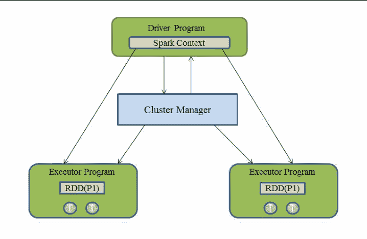
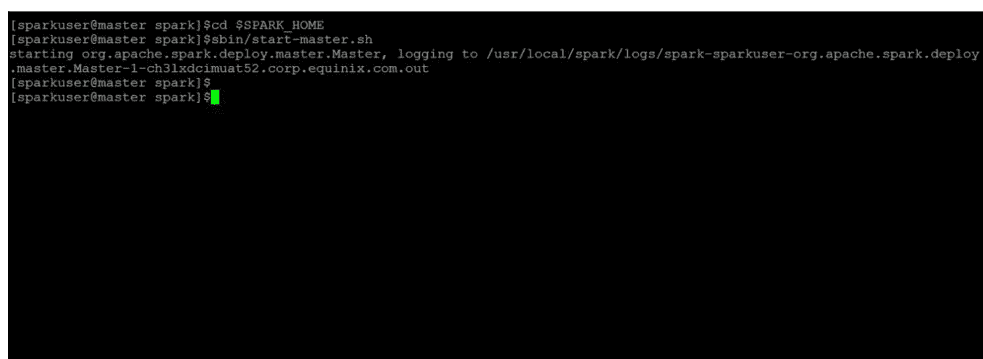
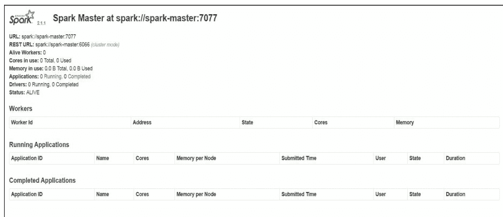
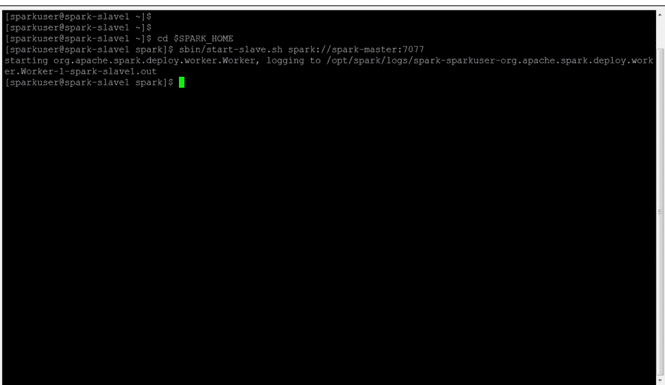
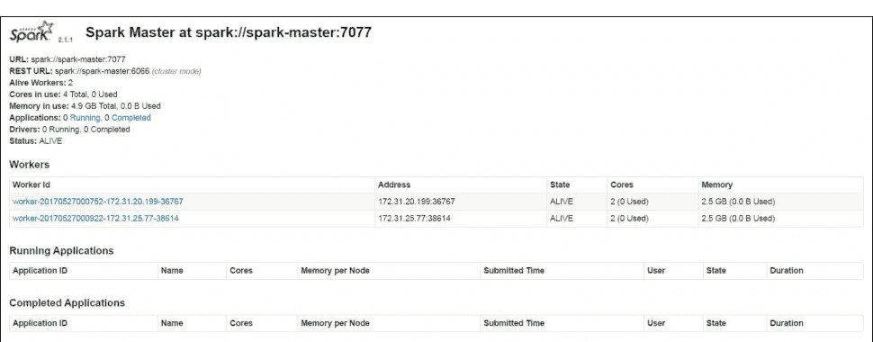
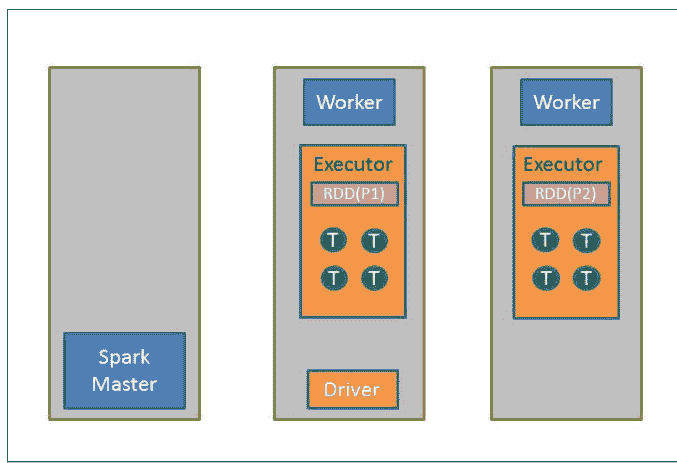
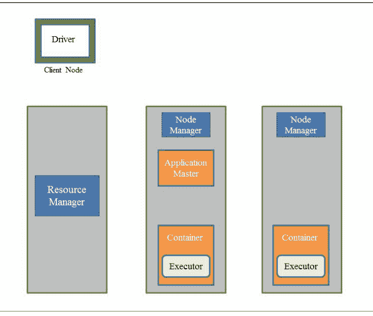
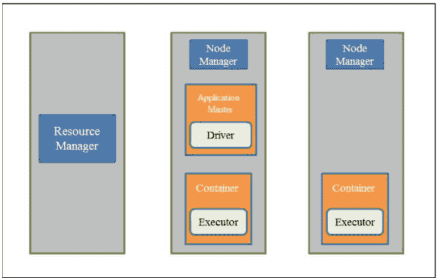

## Spark on Cluster

在前面的章节中，我们已看到在本地模式下使用 Spark shell 或使用本地主模式执行 Spark 程序的 Spark 示例。由于 Spark 是一个分布式处理引擎，它设计为在集群上运行，以实现高性能、可扩展性和容错行为。

在本章中，我们将讨论分布式模式下的 Spark 应用程序架构。本章还将解释分布式模式下 Spark 各组件如何交互。与此同时，本章将重点介绍可用于在集群中运行 Spark 作业的各种集群管理器。此外，我们将讨论在集群模式下运行作业的一些有效性能参数。读完本章后，读者将能够在分布式模式下有效地执行 Spark 作业。

### Spark application in distributed-mode

Spark 应用程序由 **驱动程序** 和 **执行器** 进程组成。Spark 中的每个应用程序包含一个驱动程序进程和一个或多个执行器进程。驱动程序是应用程序的中央协调器，用于驱动应用程序。Spark 驱动程序在一个或多个执行器之间通信并分配工作。在分布式模式下，Spark 驱动程序和每个执行器在独立的 JVM 中运行。



分布式模式下 Spark 应用程序的逻辑表示

### Driver program

SparkContext 在驱动程序 JVM 中初始化。Spark 驱动程序可以被视为 Spark 应用程序的主节点。以下是 Spark 驱动程序的职责：

- 它基于操作的 DAG 创建任务执行的物理计划。
- 它在执行器上调度任务。它根据数据本地性原则将任务包传递给执行器。
- Spark 驱动程序跟踪 RDD 分区到执行器的映射，以执行未来任务。

Spark 驱动程序是 Spark 应用程序的单点故障。如果驱动程序崩溃，应用程序将结束。因此，如果驱动程序终止，应用程序需要重新启动。

### Executor program

执行器可以被视为驱动程序进程的从属 JVM。这些是实际应用程序逻辑执行的 JVM 进程。Spark 中的应用程序由许多任务组成，任务是要执行的最小工作单元，例如，从 HDFS 读取文件的所有块，运行 RDD 分区的 map 操作等等。

在传统的 Hadoop MapReduce 中，对于一链 MR 作业，会执行多个映射器和缩减器，每个映射器和缩减器作为单独的 JVM 运行。因此，启动每个映射器和缩减器任务的 JVM 有大量开销。但是，在 Spark 的情况下，执行器在应用程序执行开始时启动一次，并运行直到应用程序结束。所有应用程序逻辑都在执行器内部运行，作为单独的线程执行各个任务。以下是执行器的主要职责：

- 1. 按照驱动程序的指示执行任务。
- 2. 将任务执行所在的 RDD 分区缓存到内存中。
- 3. 将任务结果报告给驱动程序。

执行器不是单点故障。如果执行器崩溃，重启它是集群管理器的职责。我们将在下一节讨论集群管理器操作。

迄今为止，我们一直在本地模式下运行 Spark 应用程序。

> 在本地模式下，Spark 驱动程序和执行器都在单个 JVM 进程中运行。

### Cluster managers

集群管理器用于以集群模式部署 Spark 应用程序。Spark 可以配置为运行各种集群管理器。Spark 发行版提供一个名为 *Spark 独立模式* 的内置集群管理器。除此之外，Spark 还可以在大数据世界中其他流行的集群管理器（如 YARN 和 Mesos）之上运行。在本节中，我们将讨论如何使用 Spark 独立模式和 YARN 部署 Spark 应用程序。

### Spark standalone

Spark 独立管理器在 Spark 发行版中提供。它以非常高效和便捷的方式帮助以集群模式部署 Spark 应用程序。

Spark 独立管理器遵循主从架构。它由一个 Spark 主节点和多个工作节点组成，其中工作节点是 Spark 主节点的从属节点。类似于其他主从框架，Spark 主节点充当提交的 Spark 应用程序的调度程序。它在工作节点上调度应用程序，执行应用程序的进程将在工作节点上运行。

### Installation of Spark standalone cluster

在本节中，我们将学习如何安装 Spark 独立集群。Spark 发行版提供 `init` 脚本来安装 Spark 独立集群。我们首先需要下载 Scala 和 Spark。有关下载和设置 Scala 和 Spark 的详细说明，请参阅第 3 章 _让我们开始_ 中的 _Spark 入门_ 部分。让我们快速回顾设置 Spark 的步骤。

用户可以从以下 URL 下载 Spark 发行版：https://spark.apache.org/downloads.html。

在本书中，我们使用的是 Spark 2.1.1，这是本书出版时的最新版本。下载后，运行以下命令：

```
tar -zxf spark-2.1.1-bin-hadoop2.7.tgz
sudo mv spark-2.1.1-bin-hadoop2.7 /usr/local/spark
```

*目录位置可根据用户要求不同。*

此外，建议设置以下环境变量（非强制）：

```
export SPARK_HOME=/usr/local/spark
export PATH=$PATH:$SPARK_HOME/bin
```

由于我们将启动 Spark 集群，请在所有节点上重复上述步骤。完成步骤后，Spark 独立集群可以如下启动：

### Start master

首先，如下启动 Spark 主节点：

```
$cd $SPARK_HOME
sbin/start-master.sh
```



初始化 Spark 主节点

用户可以在端口 8080 上访问 Spark 主节点 UI。Spark 主节点启动后，Web UI 将如下所示：



Spark 主节点 UI

在这里，spark-master 是运行 Spark 主节点的节点的主机名。

前面截图中显示的 URL 用于启动从节点。

### Start slave

启动 Spark 主节点后，可以使用 Spark 主节点 URL 启动 Spark 从节点，如下所示：

```
cd $SPARK_HOME
sbin/start-slave.sh spark://spark-master:7077
```



初始化 Spark 从节点

以下是显示两个活动工作节点的 Spark 主节点 Web UI：



带有两个从节点的 Spark 主节点 UI

所有从节点/工作节点可以一起启动。节点的主机名应添加到主节点上的 $SPARK_HOME/conf/slaves 文件中，如下所示：

```
[sparkuser@master spark]$cd $SPARK_HOME
[sparkuser@master spark]$cat conf/slaves
spark-slave1
spark-slave2
[sparkuser@master spark]$
```

Spark 从节点文件

然后，执行以下命令一起启动所有从节点：

```
cd $SPARK_HOME
sbin/start-slaves.sh
```

- start-slaves.sh 脚本使用 SSH 协议登录到所有从节点。因此，建议在主节点和从节点之间设置免密码 SSH。否则，每次登录都需要手动输入密码。
- 如果 Spark 主节点上的用户名与 Spark 从节点不同，则主机名条目应按以下方式添加：username@slave-host。


## 停止主节点和从节点

Spark 主节点和从节点可以使用以下脚本停止：

- $SPARK_HOME/sbin/stop-master.sh：此脚本用于停止 Spark Master 节点。
- $SPARK_HOME/sbin/stop-slave.sh：此脚本用于停止单个 slave 节点。应在单个节点上执行。
- $SPARK_HOME/sbin/stop-slaves.sh：此脚本用于一起停止所有 slave 节点。应在 Spark master 节点上执行。所有 slave 节点的主机名应添加到 $SPARK_HOME/conf/slaves 文件中。

除上述脚本外，以下脚本可用于一起启动/停止 Spark master 和 Spark slave：

sbin/start-all.sh：此脚本用于启动 Spark master 和 Spark slave 节点。应在 Spark master 节点上执行。所有 slave 节点的主机名应添加到 $SPARK_HOME/conf/slaves 文件中。

sbin/stop-all.sh：此脚本用于停止 Spark master 和 Spark slave 节点。应在 Spark master 节点上执行。所有 slave 节点的主机名应添加到 $SPARK_HOME/conf/slaves 文件中。

## 在 Spark 独立集群上部署应用程序

在上一节中，我们学习了如何启动和停止 Spark 独立集群。一旦 Spark 独立集群运行，就可以在集群上部署 Spark 应用程序。在将应用程序部署到集群之前，让我们先讨论一下应用程序组件在 Spark Standalone 模式下如何运行：



独立集群上 Spark 应用程序的逻辑表示

上图显示了一个包含三个节点的 Spark 独立集群。Spark master 运行在一个节点上，workers 运行在另外两个节点上。Spark 应用程序已部署到集群上。Driver JVMs 运行在 worker 节点之一上。该应用程序由在每个 worker 节点上运行的两个 Executor JVMs 组成。Executor JVMs 显示一个带有两个分区并缓存在内存中的 RDD，并且在每个 Executor 中有四个任务正在运行，这些任务执行应用程序的实际业务逻辑。

在 Spark standalone 模式下，每个 worker 节点每个应用程序最多可以执行一个 executor。

当客户端向 Spark Master 提交 Spark 应用程序请求时，Spark driver 会在客户端程序或 worker 节点的独立 JVM 中启动（取决于应用程序的部署模式）。启动应用程序的 Driver 后，它会联系 spark master 并提供应用程序所需的核心数。然后，Spark master 会为已向 driver 注册的应用程序启动 executors。之后，Driver 将执行的物理计划提交给 executors 进行处理。Spark master 通常会在每个 worker 节点上各启动一个 executor 以实现应用程序处理的负载均衡。

Spark 发行版提供了 spark-submit 二进制文件，用于在每个集群管理器上部署 Spark 应用程序。

独立集群上的 Spark 应用程序可以以下列两种模式部署：

### Client 模式

在 Client 模式中，driver 在提交应用程序的客户端进程中执行。因此，客户端程序会保持活动状态，直到 Spark 应用程序执行完成。在本示例中，我们将在 Spark 独立集群的 Client 模式下运行 Spark PI 应用程序。

要在 Spark 独立集群的 Client 模式下运行 Spark 应用程序，请登录集群中的任意节点并运行以下命令：

```
cd $SPARK_HOME
./bin/spark-submit --master spark://spark-master:7077 --deploy-mode client --class
```

在上述代码中：

- --master：定义提交应用程序的 Spark master URL。
- --deploy-mode：定义应用程序执行的模式。如果未提供此参数，则应用程序默认以 Client 模式启动。
- --class：定义 Spark 应用程序的主类。

最后，提供包含主类的应用程序包（JAR 文件）。此外，spark-shell 可以按以下方式在 Client 模式下执行：

```
bin/spark-shell --master spark://spark-master:7077
```

### Cluster 模式

在 Cluster 模式中，客户端向 Spark master 提交请求并退出。Spark master 会在其中一个节点上调度 driver，然后过程如上一节中所述。在本示例中，我们将在 Spark 独立集群的 Cluster 模式下运行 Spark PI 应用程序。

要在 Spark 独立集群的 Cluster 模式下运行 Spark 应用程序，请登录集群中的任意节点并运行以下命令：

```
cd $SPARK_HOME
./bin/spark-submit --master spark://spark-master:7077 --deploy-mode cluster --class
```

Cluster 模式不支持 Spark Shell。

### 实用作业配置

在本节中，我们将讨论提交作业时可以配置的一些有用作业配置：

- --jars：此参数用于提供 Spark 应用程序引用的外部 jar 文件。如果用户未创建应用程序的 uber jar，则可以使用此参数将外部库提供给作业：

```
./bin/spark-submit --master spark://spark-master:7077 --jars /path/of/external
```

- --driver-memory：此参数用于指定 Spark driver 所需的内存：

```
./bin/spark-submit --master spark://spark-master:7077 --driver-memory 1G --de
```

- --executor-memory：此参数用于指定每个 executor 所需的内存：

```
./bin/spark-submit --master spark://spark-master:7077 --executor-memory 1G --
```

- --total-executor-cores：此参数用于指定应用程序所需的总核心数：


在 Spark standalone 中，没有选项可用于指定应用程序的总 executor 数量。Spark master 通常会在每个 worker 节点上运行每个 executor，以平衡应用程序处理的负载。

```
./bin/spark-submit --master spark://spark-master:7077 --total-executor-cores
```

- --supervise：提供 supervise 配置后，Spark master 将监督 Spark Driver，如果 Driver 停止运行，则会重新启动 driver：


如果 Spark driver 重新启动，则所有 Spark executors 也需要重新启动。换句话说，所有 Spark 应用程序都将重新启动。

```
bin/spark-submit --master spark://spark-master:7077 --supervise --deploy-
```

--executor-cores：此参数用于指定每个 executor 的总核心数。在 standalone 模式下，默认值为 worker 上可用的所有核心。

### 实用集群级配置（Spark standalone）

在本节中，我们将讨论 Spark standalone 中的一些有用集群级配置。这些配置可以在 `$SPARK_HOME/confdir` 的 `spark-env.sh` 中设置。更改这些配置中的任何一项都需要重新启动 worker JVM 或集群。以下是一些有用的配置：

- **SPARK_LOCAL_DIRS**：此参数指定集群中每个节点上用于 Spark shuffle 操作和磁盘上 RDD 持久化的本地目录的逗号分隔列表
- **SPARK_MASTER_HOST**：此参数用于将 Spark master 绑定到 IP 或主机名
- **SPARK_MASTER_PORT**：此参数用于将 Spark master 绑定到系统上的端口。此参数的默认值为 7077
- **SPARK_WORKER_CORES**：此参数用于指定 worker 可为该节点上运行的 executors 进程提供的总核心数
- **SPARK_WORKER_MEMORY**：此参数用于指定 worker 可为该节点上运行的 executors 进程提供的总内存量

### YARN（Yet Another Resource Negotiator）

**Hadoop YARN** 是大数据世界中最受欢迎的资源管理器之一。Apache Spark 与 YARN 提供无缝集成。Apache Spark 应用程序可以使用相同的 `spark-submit` 命令部署到 YARN。

Apache Spark 需要设置 `HADOOP_CONF_DIR` 或 `YARN_CONF_DIR` 环境变量，并将其指向包含 `core-site.xml`、`yarn-site.xml` 等的 Hadoop 配置目录。这些配置用于连接到 YARN 集群。

要在 YARN 上运行 Spark 应用程序，应先启动 YARN 集群。有关如何启动 YARN 集群的官方 Hadoop 文档，请参阅：https://hadoop.apache.org/docs

YARN 通常由一个 **资源管理器 (RM)** 和多个 **节点管理器 (NM)** 组成，其中资源管理器是主节点，节点管理器是从节点。NM 在每个定义的间隔向 RM 发送详细报告，告诉 RM NM 上有多少资源（例如 CPU 插槽和 RAM）可用。

要部署应用程序，客户端连接到 RM 并提交应用程序。根据应用程序配置，RM 在一个 NM 上找到可用的插槽，并在该插槽上为提交的应用程序运行 **应用程序主节点 (AM)**。AM 一初始化，就会连接到 RM 并协商资源（请求容器）以运行应用程序。然后，根据集群资源可用性，RM 将 NM 的地址连同凭证（安全令牌）一起提供给 AM，以便在 NM 上运行容器。AM 使用安全凭证连接到 NM，NM 为该应用程序调度容器。当容器启动后，它们连接到 AM 并运行应用程序。


在 YARN 中，如果 AM 崩溃，RM 会重启它（在同一节点或不同节点上），但是，在这种情况下，所有应用容器都需要重启。

类似于独立集群，Yarn 上的 Spark 应用程序也运行以下模式：

## YARN 客户端

在 YARN 客户端模式中，Spark Driver 运行在客户端节点。客户端向 RM 提交请求，RM 为集群上的应用程序启动应用，该应用与 RM 协商资源。然后 AM 根据 RM 提供的信息连接到 NM，NM 为应用程序启动容器。Executor 进程在容器内运行并执行应用程序。Executor 进程连接到客户端节点上的驱动程序应用。



在 YARN 中，AM 和容器由 RM 调度，但是，运行应用程序的任务由 Spark Driver 本身调度。

要在 YARN 客户端模式下运行 spark shell，请执行以下命令：

```
cd $SPARK_HOME
./bin/spark-shell --master yarn --deploy-mode client
```


## 所有应用

- 关于
- 节点
- 节点标签
- 应用程序
- 新建保存
- 已提交
- 已接受
- 运行中
- 已完成
- 已失败
- 已终止
- 调度器
- 工具

| 提交的应用 | 待处理的应用 | 运行中的应用 | 已完成的应用 | 运行中的容器 | 已用内存 | 内存总量 | 预留内存 | 已用 VCores | VCores 总量 | 预留 VCores | 活跃节点 | 已下线节点 | 丢失节点 | 不健康节点 | 重启节点 |
|---|---|---|---|---|---|---|---|---|---|---|---|---|---|---|---|
| 1 | 0 | 1 | 0 | 3 | 5 GB | 8 GB | 0 B | 3 | 8 | 0 | 1 | 0 | 0 | 0 | 0 |

| 调度器类型 | 调度资源类型 | 最小分配 | 最大分配 |
|---|---|---|---|
| Capacity Scheduler | [内存] | <memory:1024, vCores:1> | <memory:8192, vCores:8> |

| ID | 用户 | 名称 | 应用程序类型 | 队列 | 开始时间 | 结束时间 | 状态 | 最终状态 | 进度 | 跟踪 UI | 黑名单节点 |
|---|---|---|---|---|---|---|---|---|---|---|---|
| application_1487343202085_0001 | gse | Spark shell | SPARK | default | Tue Jun 13 16:26:42 +0800 2017 | N/A | RUNNING | UNDEFINED | | Application/master | 0 |

## YARN 集群

在 YARN 集群中，客户端连接到 RM，提交请求，然后退出。RM 在某个 NM 上启动 Spark 应用程序的 AM，AM 与 RM 协商资源，然后启动驱动程序线程。NM 启动连接到 AM 的容器。容器初始化后，AM 在容器中启动 Executor，Executor 连接到 AM 中的 Driver 以运行应用程序。



在以下命令中，我们将在 YARN 集群上部署一个 Spark PI 应用程序：

```
cd $SPARK_HOME
./bin/spark-submit --master yarn --deploy-mode cluster --class org.apache.spark.exa
```

> 要从远程系统部署 YARN 上的 Spark 应用程序，请将 Hadoop 配置文件复制到远程系统，并设置环境变量 HADOOP_CONF_DIR，该变量应指向包含 Hadoop 配置文件的目录。

## 有用的作业配置

除了 Spark 独立模式中提到的作业配置外，以下是 YARN 模式下可用的一些有用配置：

- --num-executors: Spark on YARN 集群允许用户为应用程序定义 Executor 的数量。此选项在 Spark 独立模式中尚不可用

- --queue: 此选项允许用户提供用于提交应用程序的 YARN 队列名称。

除了 Spark 独立模式和 YARN 外，Spark 还可以在 Mesos 集群管理器上运行。

## 总结

在本章中，我们了解了分布式模式下 Spark 应用程序的架构。我们还通过示例讨论了在 Spark 独立模式和 YARN 集群管理器上运行的 Spark 应用程序。

在下一章中，我们将学习 Spark 编程模型的高级概念。我们还将讨论 RDD 上的分区概念，以及 Spark 中的高级转换和操作。
