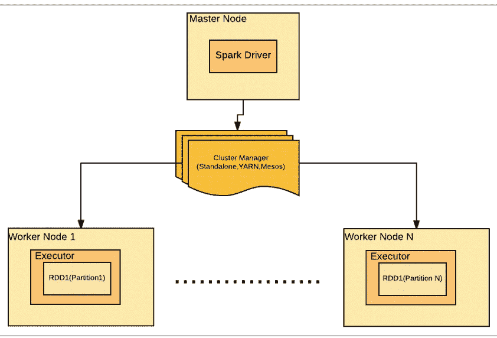
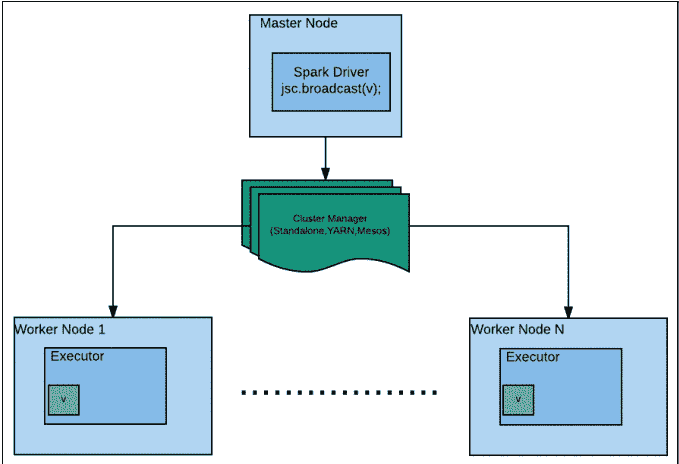

## Spark 编程模型 - 高级

在上一章中，我们讨论了 Spark 组件如何部署到集群上。现在是时候学习 Spark 编程模型的高级概念了。

我们将讨论 RDD 如何在集群上进行分区，以及可以在 RDD 上执行的一些高级转换和操作。我们还将讨论集群范围的变量，这些变量可以被在不同工作节点上运行的不同 Executor 上执行的各种任务访问。

## RDD 分区

如前几章所示，Spark 将数据加载到 RDD 中。由于 Spark 以分布式模式运行，不同的 Executor 可以在不同的工作机器上运行，并且 RDD 被加载到 Executor 的内存中。RDD 作为分布式数据集被分割到各个 Executor 上。这些分割称为 RDD 分区。

换句话说，分区是加载到不同 Executor 内存中的 RDD 分割。下图描绘了 RDD 在各种工作节点上分区的逻辑表示：



> 一个 Executor 的内存中可以加载一个 RDD 的多个分区。

Spark 在创建时对 RDD 进行分区，即使用户没有显式提供分区计数。但是，用户也可以提供分区计数。让我们以编程方式讨论一下：

```
SparkConf conf = new SparkConf().setMaster("local").setAppName("Partitioning Example");
JavaSparkContext jsc = new JavaSparkContext(conf);
JavaRDD<Integer> intRDD = jsc.parallelize(Arrays.asList(1, 2, 3, 4, 5, 6, 7, 8, 9, 10));
```

在此示例中，创建了一个整数 RDD，numPartitions 参数的值为 3。要验证分区数量，可以使用：

```
intRDD.getNumPartitions()
```

如果用户未指定 numPartitions 的值，配置参数 spark.default.parallelism 的值将决定分区数量。根据 Spark 文档 (https://spark.apache.org/docs/latest/configuration.html)，此参数的值取决于以下因素：

- 对于分布式 shuffle 操作，如 reduceByKey 和 join，取决于父 RDD 中分区数量的最大值。对于如 parallelize 且没有父 RDD 的操作，则取决于集群管理器：
  - 本地模式：本地机器上的核心数量
  - Mesos 精细模式：8
  - 其他：所有 Executor 节点上的核心总数或二者中较大的那个

- 从本地文件系统或 HDFS 加载数据时，默认情况下 Spark 创建的分区数量等于块的数量。在本地文件系统的情况下，参数 hadoop fs.local.block.size 的值（默认为 32 MB）被用作分区大小。如果是 HDFS，dfs.blocksize 的值（在 Hadoop 2.x 中为 128 MB）被视为分区大小。但是，用户也可以按如下方式指定 numPartitions 值：

```
jsc.textFile("hdfs://localhost:8020/user/spark/data.csv",4)
```


> 由于 RDD 的一个分区存储在 Executor 内存中，分区的大小受到 Executor 进程可用内存的限制。

分区的主要优势在于数据处理的并行性。不需要 shuffle 的转换（例如 map）可以在 RDD 的所有分区上并行执行。

Apache Spark 每个分区最多运行一个任务。因此，为了充分发挥 Spark 集群的最大效率，RDD 应该进行良好分区。因此，在拥有 256 个核心的 Spark 集群上，RDD 应该包含 250-255 个分区，以充分利用集群。在读取不可分割格式的文件时，例如像 gz 这样的压缩格式，Apache Spark 不会将其拆分为分区，因此整个文件将加载到一个分区中。例如：

```
JavaRDD<String> textFile = jsc.textFile("test.gz", 2);
System.out.println(textFile.getNumPartitions());
```

前面的代码将返回 1 作为分区计数，即使明确将 2 作为 numPartitions 参数的值提供。


## 重新分区

加载 RDD 后，可以使用名为 repartition 的转换来调整 RDD 的分区数量：

```java
JavaRDD<String> textFile = jsc.textFile("test.txt", 3);
System.out.println("Before repartition:" + textFile.getNumPartitions());
JavaRDD<String> textFileRepartitioned = textFile.repartition(4);
System.out.println("After repartition:" + textFileRepartitioned.getNumPartitions());
```

根据前面的代码示例，重新分区前的分区数量为三，重新分区后将增加到四。
repartition 也适用于压缩文件。因此，使用 repartition 函数读取 gzip 文件后，可以增加其分区数量：

```java
JavaRDD<String> textFile = jsc.textFile("test.gz", 3);
System.out.println("Before repartition:" + textFile.getNumPartitions());
JavaRDD<String> textFileRepartitioned = textFile.repartition(4);
System.out.println("After repartition:" + textFileRepartitioned.getNumPartitions());
```

在这种情况下，重新分区前的分区数量为一，重新分区后为四。重新分区时可能会发生 shuffle，因为新分区可能会分布在不同的节点上。

## Spark 如何计算带有 shuffle 的转换（宽转换）的分区数量

像 reduceByKey、groupByKey、aggregateByKey 等转换会导致数据 shuffle，属于同一个键的数据会被 shuffle 到同一个 executor。因此，这一类中的每个转换都提供一个重载函数，允许用户提供自己选择的分区器。

如果用户指定了分区器，转换后创建的分区数量将基于该分区器的逻辑。但是，如果用户未指定分区器，Apache Spark 默认使用 **哈希分区器**。

根据 HashPartitioner，给定键的结果分区由以下公式决定：

```
{hashCode of the key} % {number of partitions}
```

由于 Spark 无法自行确定分区数量，因此它保持：分区数量 = 最大上游 RDD 的分区数量，其中最大上游 RDD 是上游 DAG 中分区数量最多的 RDD。

这也有助于 Spark 避免内存溢出错误，因为转换前后的分区数量将等于最大上游 RDD 的分区数量；也就是说，该 DAG 中某个阶段的最多分区数量。

## 分区器

如前所述，对于 Pair RDD 上的任何 shuffle 操作，键的目标分区由 shuffle 期间使用的分区器决定。shuffle 期间使用的分区器在决定数据 shuffle 量方面起着重要作用。

分区器的基本要求是相似的键应落在同一个分区中。Apache Spark 提供了一个名为 `partitionBy` 的转换，它可以帮助在任何点根据用户的选择对 RDD 进行分区。此外，如前所述，用户还可以在需要 shuffle 的 Pair RDD 转换（如 `reduceByKey`、`aggregateByKey`、`foldByKey` 等）期间提供自己选择的分区器。

Spark 中提供两种内置类型的分区器。Spark 还提供指定自定义分区器的选项。Spark 中可用的分区器实现如下：

- 1. 哈希分区器
- 2. 范围分区器

## 哈希分区器

**哈希分区器**根据键的 **hashCode** 对键进行分区。它使用以下公式确定结果分区：

```
(hashCode of the key) % (total number of partitions)
```

其中 **hashCode** 是 Java 对象的 **hashCode**

让我们使用 HashPartitioner 对整数 RDD 进行分区：

```java
SparkConf conf = new SparkConf().setMaster("local").setAppName("Partitioning");
JavaSparkContext jsc = new JavaSparkContext(conf);
JavaPairRDD<Integer, String> pairRdd = jsc.parallelizePairs(Arrays.asList(new Tupl
```

我们已初始化 `JavaSparkContext` 并创建了 `pairRdd`，其中键为整数类型，值为字符串类型，并且 numPartitions=3。

如果打印先前创建的 RDD 的分区数量，结果应为 3。让我们使用 `HashPartitioner` 对此 RDD 进行分区：

```java
JavaPairRDD<Integer, String> hashPartitioned = pairRdd.partitionBy(new HashPartition
```

org.apache.spark.HashPartitioner 提供一个参数化构造函数，接受一个参数，即分区数量，如下所示：

```
HashPartitioner(int partitions)
```

由于我们将分区计数的值设置为 2，因此生成的 RDD 将有两个分区，可以按以下方式验证：

```java
System.out.println(hashPartitioned.getNumPartitions());
```

根据 HashPartitioner 公式 - (键的 hashCode) % (分区总数) - 键为 (2, 4, 6, 8) 的元组应位于分区 0，键为 (1, 3, 5, 7) 的元组应位于分区 1。

我们可以按以下方式检查键在分区中的分布：

```java
JavaRDD<String> mapPartitionsWithIndex = hashPartitioned.mapPartitionsWithIndex((in
while(tupleIterator.hasNext()){ list.add("Partition number:"+index+", key:"+tupleIte
return list.iterator();}, true);
System.out.println(mapPartitionsWithIndex.collect());
```

我们将在下一节（高级转换）中讨论 mapPartitionsWithIndex 转换

## 范围分区器

范围分区器基于范围对键进行分区。落在同一范围内的所有键都将落在同一分区中。建议数据类型遵循自然排序，例如整数、long 等。

org.apache.spark.RangePartitioner 提供一个接受五个参数的参数化构造函数，如下所示：

```
RangePartitioner(int partitions, RDD<? extends scala.Product2<K, V>> rdd, bool
```

其中：

- **参数 1：** 分区数量
- **参数 2：** 要分区的 RDD
- **参数 3：** 范围的升序/降序
- **参数 4：** 键的排序方法
- **参数 5：** 键的类标记

让我们按以下方式使用 RangePartitioner 对先前创建的 pairRDD 进行分区：

```java
RangePartitioner rangePartitioner = new RangePartitioner(4, org.apache.spark.api.java.JavaPairRDD<Integer, String> rangePartitioned = pairRdd.partitionBy(rangePartitionione
```

这里，我们对排序和类标记参数使用了 Scala 对象。此外，Java RDD 需要转换为 org.apache.spark.rdd.RDD 才能与 RangePartitioner 一起使用。

由于我们将输出分区数量的值设置为 4，因此生成的 RDD 将包含四个分区，根据范围分区器，键的分布逻辑应如下：

- (1, 2) - 分区 0
- (3, 4) - 分区 1
- (5, 6) - 分区 2
- (7, 8) - 分区 3

以下代码可用于检查键的分布：

```java
JavaRDD<String> mapPartitionsWithIndex = rangePartitioned .mapPartitionsWithIndex((.
while(tupleIterator.hasNext()){ list.add("Partition number:"+index+", key:"+tupleIte
return list.iterator();}, true));
System.out.println(mapPartitionsWithIndex.collect());
```

## 自定义分区器

与哈希分区器和范围分区器一起，Apache Spark 提供在需要时指定自定义分区器的选项。要创建自定义分区器，用户需要扩展 org.apache.spark.Partitioner 类并提供所需方法的实现。

假设我们有一个键为 StringType 的 Pair RDD。我们的要求是根据键的长度将所有元组分区到两个分区中——长度为奇数的键应在一个分区中，另一个分区应包含所有长度为偶数的键。

让我们根据这些要求创建自定义分区器：

```java
import org.apache.spark.Partitioner;
public class CustomPartitioner extends Partitioner{
final int maxPartitions=2;
@Override
public int getPartition(Object key) {
return (((String) key).length())%maxPartitions;
}
@Override
public int numPartitions() {
return maxPartitions;
}}
```

现在，我们将使用此分区器对带有 StringType 键的 RDD 进行分区：

```java
JavaPairRDD<String, String> pairRdd = jsc.parallelizePairs(Arrays.asList(new Tuple2:
JavaPairRDD<String, String> customPartitioned = pairRdd.partitionBy(new CustomParti
```

为了验证分区是否按预期工作，我们将按以下方式打印每个分区所属的键：

```java
JavaRDD<String> mapPartitionsWithIndex = customPartitioned .mapPartitionsWithIndex(
while(tupleIterator.hasNext()){ list.add("Partition number:"+index+", key:"+tupleIte
return list.iterator();}, true);
System.out.println(mapPartitionsWithIndex.collect());
```

它将产生以下输出，显示分区器的行为符合预期：


| 分区编号:0, 键:France, 分区编号:1, 键:India, 分区编号:1, 键:

本节详细介绍了 RDD 分区，并学习了不同的分区器，包括每个分区器的工作示例。在下一节中，我们将了解 Spark 中可用的一些高级转换。

## 高级转换

如前所述，如果 RDD 操作返回一个 RDD，则称为转换。在第 4 章“理解 Spark 编程模型”中，我们学习了常用的有用转换。现在我们将探讨一些高级转换。

### mapPartitions

此转换的工作方式与 map 转换类似。不过，它不是作用于 RDD 的每个元素，而是作用于 RDD 的每个分区。因此，map 函数会为每个 RDD 分区执行一次。因此，源 RDD 分区与目标 RDD 分区之间存在一对一映射。

由于 RDD 的一个分区整体存储在一个节点上，此转换不需要进行 shuffling。

在以下示例中，我们将创建一个整数 RDD，并使用 mapPartitions 将 RDD 的所有元素加 1：

```java
JavaRDD<Integer> intRDD = jsc.parallelize(Arrays.asList(1, 2, 3, 4, 5, 6, 7, 8, 9, 10), 2);
```

**Java 7:**

```java
intRDD.mapPartitions(new FlatMapFunction<Iterator<Integer>, Integer>() {
    @Override
    public Iterator<Integer> call(Iterator<Integer> iterator) throws Exception {
        List<Integer> intList = new ArrayList<>();
        while (iterator.hasNext()) {
            intList.add(iterator.next() + 1);
        }
        return intList.iterator();
    }
});
```

**Java 8:**

```java
intRDD.mapPartitions(iterator -> {
    List<Integer> intList = new ArrayList<>();
    while (iterator.hasNext()) {
        intList.add(iterator.next() + 1);
    }
    return intList.iterator();
});
```

> mapPartitions 提供一个迭代器，用于访问属于该分区的 RDD 的每个元素。

如前一章所述，如果在 map 阶段需要与外部系统（例如从数据库读取数据）进行交互，则 `mapPartitions` 转换非常有用。假设 RDD 包含 100 个元素，分为三个分区。如果在 map 阶段需要根据元素的值从数据库读取一些数据，则运行 `map` 转换将创建 100 个数据库连接。然而，使用 `mapPartitions` 仅会创建三个连接。可以创建连接池机制来处理此类场景。然而，`mapPartitions` 在此类情况下隐式地提供了优势。在以下示例中，我们根据 RDD 的每个元素从 MySQL 表中读取行：

```java
intRDD.mapPartitions(iterator -> {
    Class.forName("com.mysql.jdbc.Driver");
    Connection con = DriverManager.getConnection("jdbc:mysql://localhost:3306/test", "r
    Statement stmt = con.createStatement();
    List<String> names = new ArrayList<>();
    while (iterator.hasNext()) {
        ResultSet rs = stmt.executeQuery("select name from emp where empId = " + iterator.n
        names.add(rs.getString("empName"));
    }
    return names.iterator();
});
```

由于使用了 `mapPartitions`，我们可以使用同一个连接遍历 RDD 的所有元素。如果是 `map` 转换，则会为每个元素创建一个到 MySQL 的连接。

`mapPartitions` 转换提供一个重载，允许用户提供一个布尔参数，用于决定是否应保留分区信息。以下是其 Scala 声明：

```scala
def mapPartitions[U](f: FlatMapFunction[JIterator[T], U], preservesPartitioning: Bo
```

根据 Spark 文档，除非在 pair RDD 上执行 `mapPartitions` 且输入函数不修改键，否则此参数的值应为 false。

RDD 的分区信息存储在 RDD 对象本身中。RDD 类包含对分区器类实例的引用。执行 map 转换后，此信息会丢失，这似乎很合理，因为元素的值正在被转换。pair RDD 的情况亦然，因为 Spark 默认不保留分区信息。mapPartitions 会创建 com.javachen.spark.examples.rdd.MapPartitionsRDD 类的实例，并将 preservesPartitioning 的值作为构造函数参数传递，其默认值为 false。

map 转换也会使用 preservesPartitioning 的默认值（即 false）实例化 com.javachen.spark.examples.rdd.MapPartitionsRDD。另一方面，filter 转换会将 preservesPartitioning 值设置为 true 来实例化 MapPartitionsRDD。因此，在 filter 转换的情况下，分区信息仍然保留。

### mapPartitionsWithIndex

此转换与 mapPartitions 类似。不过，在此转换中，分区索引的值也可用。在本章第一节（RDD 分区）讨论分区器时，我们展示了此转换的示例。

在以下示例中，对 int RDD 执行 mapPartitionsWithIndex 转换，以找出哪些元素属于哪个分区：

**Java 7:**

```java
intRDD.mapPartitionsWithIndex(new Function2<Integer, Iterator<Integer>, Iterator<St
    @Override
    public Iterator<String> call(Integer index, Iterator<Integer> iterator) throws Ex
    List<String> list = new ArrayList<String>();
    while (iterator.hasNext()) {
        list.add("Element " + iterator.next() + " belongs to partition " + index);
    }
    return list.iterator();
    }, false);
```

**Java 8:**

```java
intRDD.mapPartitionsWithIndex((index, iterator) -> {
    List<String> list = new ArrayList<String>();
    while (iterator.hasNext()) {
        list.add("Element " + iterator.next() + " belongs to partition " + index);
    }
    return list.iterator();
}, false);
```

它还接受一个布尔参数，用于指示 preservesPartitioning 的值。

### mapPartitionsToPair

这是 mapPartitions 和 mapToPair 的累积形式。与 mapPartitions 类似，它在 RDD 的每个分区上运行 map 转换，但此转换返回的是 JavaPairRDD<K,V> 而不是 JavaRDD<T>。

在以下示例中，将使用 mapPartitionsToPair 将 <String, Integer> 类型的 JavaPairRDD 进行转换：

**Java 7:**

```java
JavaPairRDD<String, Integer> pairRDD = intRDD.mapPartitionsToPair(new PairFlatMapFunction
    @Override
    public Iterator<Tuple2<String, Integer>> call(Iterator<Integer> t) throws Exception
    List<Tuple2<String, Integer>> list = new ArrayList<>();
    while (t.hasNext()) {
        int element = t.next();
        list.add(element % 2 == 0 ? new Tuple2<String, Integer>("even", element) : new Tuple2<String, Integer>("odd", element));
    }
    return list.iterator();
});
```

**Java 8:**

```java
JavaPairRDD<String, Integer> pairRDD = intRDD.mapPartitionsToPair(t -> {
    List<Tuple2<String, Integer>> list = new ArrayList<>();
    while (t.hasNext()) {
        int element = t.next();
        list.add(element % 2 == 0 ? new Tuple2<String, Integer>("even", element) : new Tuple2<String, Integer>("odd", element));
    }
    return list.iterator();
});
```

与 mapPartitions 和 mapPartitionsWithIndex 类似，mapPartitionsToPair 也提供一个重载方法，帮助用户指定 preservePartitioning 的值。

### mapValues

mapValues 仅适用于 pair RDD。顾名思义，此转换只对 pair RDD 的值进行操作，而不是对整个元组进行操作。

作用于 pair RDD 时，它在 RDD 值上运行 map 操作。如果用户只对转换 pair RDD 上的值感兴趣，此转换非常有用。

以下是 mapValues 转换的示例：

**Java 7:**

```java
pairRDD.mapValues(new Function<Integer, Integer>() {
    @Override
    public Integer call(Integer v1) throws Exception {
        return v1 * 3;
    }
});
```

**Java 8:**

```java
pairRDD.mapValues(v1 -> v1 * 3);
```

mapValues 的另一个有用特性是它会保留分区信息；也就是说，它将 preservesPartitioning 的值设置为 true 来实例化 com.javachen.spark.examples.rdd.MapPartitionsRDD，这很合理，因为此转换仅对值进行操作。


## flatMapValues

这与 mapValues 类似，但 flatMapValues 在 PairRDD 的值上运行 flatMap 函数。

假设我们有一个 PairRDD，包含月份到费用列表的映射，如下所示：

```
| JavaPairRDD<String, String> monExpRDD = jsc.parallelizePairs(
| Arrays.asList(new Tuple2<String, String>("Jan", "50,100,214,10"), new Tuple2<String>
```

我们的要求是，不再将费用作为列表保留，而是需要包含月份作为键和费用金额作为值的单个元组。让我们使用 flatMapValues 来满足此要求：

### Java 7:

```
| JavaPairRDD<String, Integer> monExpflattened = monExpRDD.flatMapValues(new Function
| @Override
| public Iterable<Integer> call(String v1) throws Exception {
| List<Integer> list =new ArrayList<>();
| String[] split = v1.split(",");
| for (String s:split)
| {
| list.add(Integer.parseInt(s));
| }
| return list;
| }
| });
```

### Java 8:

```
| JavaPairRDD<String, Integer> monExpflattened =monExpRDD.flatMapValues(v -> Arrays.a
```

## repartitionAndSortWithinPartitions

repartitionAndSortWithinPartitions 是 OrderedRDDFunctions 的一种，类似于 SortByKey。它是 pairRDD 函数。它首先根据给定的分区器重新分区 pairRDD，并按 pairRDD 的键对每个分区进行排序。repartitionAndSortWithinPartitions 要求将分区器实例作为参数。以下是该转换的声明：

```
| repartitionAndSortWithinPartitions(Partitioner partitioner)
```

让我们使用 repartitionAndSortWithinPartitions 重新分区 <Integer,String> 类型的 PairRDD。我们将 HashPartitioner 的实例作为参数提供：

```
| JavaPairRDD<Integer, String> unPartitionedRDD = jsc.parallelizePairs(Arrays.asList(
| unPartitionedRDD.repartitionAndSortWithinPartitions(new HashPartitioner(2));
```

默认情况下，键将按照其自然顺序进行排序。但是，此转换还提供一个重载方法，帮助用户提供比较器以根据要求对键进行排序。在自定义对象用作键的情况下，这也很有用：

```
| repartitionAndSortWithinPartitions(Partitioner partitioner,Comparator<K> comp)
```

## coalesce

Spark 中的 coalesce 转换用于减少分区数量。

如果分区数量过高，用户在执行 join 操作前可能需要减少分区数量。分别连接大小为 n 和 m 的两个 RDD 需要 n*m 个任务。因此，如果分区大小（每个分区的元素数量）较小，在连接 RDD 之前减少分区数量可能是一个有用的决定。

repartition 转换也可用于减少 RDD 的分区数量。但是，repartition 需要进行全量数据洗牌。而 coalesce 则避免了全量洗牌。

例如，一个 RDD 有 x 个分区，用户执行 coalesce 将分区数减少到 (x-n)，那么只有 n 个分区（x-(x-n)）的数据会被洗牌。这将最大限度地减少节点间的数据移动。

可以按以下方式执行 coalesce 转换：

```
| pairRDD.coalesce(2)
```

## foldByKey

foldByKey 可以被视为带有初始零值的 reduceByKey。就像 reduceByKey 一样，它使用结合函数来合并每个键的值，但它也使用初始零值：

```
| foldByKey(V zeroValue,Function2<V,V,V> func);
```

根据 Spark 文档，初始值应为中性值；也就是说，它可以被任意次数地加到最终结果中，但不应影响最终结果。例如，加法中的 0，乘法中的 1，列表连接中的空列表。

零值充当可变缓冲区。它在每个分区中按键初始化一次。一旦在分区中首次遇到该键并为其初始化零值，它就充当可变缓冲区。该分区中属于该键的每个值都会合并到可变缓冲区中。因此，与 reduceByKey 中每次创建新对象不同，此可变对象用于折叠键的值。如果对象创建开销较大，这有助于垃圾回收。

此值应为中性值，但如果需要将某个值添加到每个分区中每个键的合并值，它也可以用作定量值。

foldByKey 可按以下方式用于运行单词计数：

### Java 7:

```
JavaRDD<String> stringRDD = jsc.parallelize(Arrays.asList("Hello Spark", "Hello Jav
JavaPairRDD<String, Integer> flatMapToPair = stringRDD.flatMapToPair(new PairFlatMa
@Override
public Iterator<Tuple2<String, Integer>> call(String t) throws Exception {
List<Tuple2<String,Integer>> list = new ArrayList<>());
for (String s :t.split(" "))
{
list.add(new Tuple2<String, Integer>(s,1));
}
return list.iterator();
}};
JavaPairRDD<String, Integer> foldByKey = flatMapToPair.foldByKey(0,new
Function2<Integer, Integer, Integer>() {
@Override
public Integer call(Integer v1, Integer v2) throws Exception {
return v1+v2;
}
}});
```

### Java 8:

```
| JavaRDD<String> stringRDD = jsc.parallelize(Arrays.asList("Hello Spark", "Hello Java
| JavaPairRDD<String, Integer> flatMapToPair = stringRDD.flatMapToPair(s -> Arrays.as
| flatMapToPair.foldByKey(0,(v1, v2) -> v1+v2).collect();
```

foldByKey 还提供以下重载方法：

```
| foldByKey(V zeroValue,Partitioner partitionerFunction2<V, V, V> func);
```

由于 aggregateByKey 涉及数据洗牌，此方法允许用户根据要求提供分区器实例，例如 Hash Partitioner、Merge Partitioner 或自定义分区器：

```
| foldByKey(V zeroValue,int numPartitions,Function2<V, V, V> func);
```

在这里，用户可以提供分区数量。在这种情况下，foldByKey 将创建一个带有用户提供的分区数量的 Hash Partitioner 实例并调用前述变体。

## aggregateByKey

aggregateByKey 与 reduceByKey/foldByKey 类似。但是，它的行为更通用。reduceByKey/foldByKey 可以被视为 aggregateByKey 的特例。aggregateByKey 允许用户返回与输入 RDD 具有不同值类型的 pairRDD；也就是说，它可以将 (k1,v1) 类型的 RDD 转换为 (k1,v2) 类型，而 reduceByKey/foldByKey 则无法做到。

aggregateByKey 接受以下参数：

```
| aggregateByKey(V2 zeroValue, Function2<V2,V1,V2> seqFunction, Function2<V2,V2,V2> c
```


初始零值在 foldByKey 部分中有说明。

聚合一个分区中值的函数可以将 v1 类型的值转换为 v2。合并跨分区值的函数。根据要求，v2 可以与 v1 不同，也可以相同。假设我们有一个类型为 <String,String> 的 Pair RDD，如下所示：

```
| JavaPairRDD<String, String> pairRDD = jsc.parallelizePairs(Arrays.asList(new Tuple2
```

我们的要求是按键查找以 `a` 开头的值的计数。我们将使用 aggregateByKey 以如下方式实现此要求：

### Java 7:

```
pairRDD.aggregateByKey(0, new Function2<Integer, String, Integer>() {
@Override
public Integer call(Integer v1, String v2) throws Exception {
if(v2.startsWith("A"))
{
v1+=1;
}
return v1;
}},
new Function2<Integer, Integer, Integer>() {
@Override
public Integer call(Integer v1, Integer v2) throws Exception {
return v1+v2;
}});
```

### Java 8:

```
pairRDD.aggregateByKey(0, (v1, v2) -> {
    if(v2.startsWith("A"))){
    v1+=1;
    }
    return v1;
}, (v1, v2) -> v1+v2);
```

在上面的示例中，输入 RDD 的值类型为字符串，但输出 RDD 的值类型为整数。与 foldByKey 类似，aggregateByKey 还提供以下重载方法：

```
aggregateByKey(V2 zeroValue, Partitioner partitioner, Function2<V2,V1,V2> seqFunction,
aggregateByKey(V2 zeroValue, int numPartitions, Function2<V2,V1,V2> seqFunction,Fun
```


## combineByKey

这是最通用的函数形式，它基于键组合键值对 RDD 的值，例如 reduceByKey、groupByKey、foldByKey、aggregateByKey 等。它比 aggregateByKey 更进一步，因为它允许用户创建初始合并函数。combineByKey 转换接受以下三个参数：

- createCombiner: 为键创建合并器的函数；即，当键在分区中首次遇到时，为该键创建初始值。
- mergeValueWithinPartition: 在分区内将键的值合并到其现有合并器值上的函数。仅当为键创建了初始合并器值时，此函数才会触发。换句话说，对于某个键，仅当该键在分区中出现超过一次时，此函数才会触发。
- mergeCombiners: 获取各分区中为键创建的合并值，并将其合并以生成最终结果的函数。

```
combineByKey(Function<V1,V2> createCombiner, Function2<V2,V1,V2> mergeValue,
```

combineByKey 转换可用于解决 aggregateByKey 部分中描述的问题，如下所示：

### Java 7:

```
JavaPairRDD<String, Integer> combineByKey = pairRDD.combineByKey(new Function<String,
@Override
public Integer call(String v1) throws Exception {
if(v1.startsWith("A")) {
return 1;
}
else{
return 0;
}}, new Function2<Integer, String, Integer>() {
@Override
public Integer call(Integer v1, String v2) throws Exception {
if(v2.startsWith("A")){
v1+=1;
}
return v1;
}}, new Function2<Integer, Integer, Integer>() {
@Override
```

```
public Integer call(Integer v1, Integer v2) throws Exception {
return v1+v2;
}});
```

### Java 8:

```
pairRDD.combineByKey(v1 -> {
if(v1.startsWith("A"))){
return 1;
}
else{
return 0;
}
}, (v1, v2) -> {
if(v2.startsWith("A"))){
v1+=1;
}
return v1;
}, (v1, v2) -> v1+v2);
```

根据此代码示例，对于 RDD 中的每个 <键,值> 元组，如果键是第一次遇到，则 createCombiner 函数将创建合并器，并在元组中的值以 A 开头时将计数器设置为 1，否则设置为 0。然后，如果键在分区中出现超过一次，第二个函数将触发，并且仅当元组的值以 A 开头时才会递增合并器值。

最后，第三个函数将跨分区对各键的值求和并生成最终结果。与 aggregateByKey/foldByKey 类似，combineByKey 还提供一个重载方法，允许用户提供分区器实例或 numPartitions，如下所示：

```
combineByKey(Function<V1,V2> createCombiner, Function2<V2,V1,V2> mergeValue, Function...
combineByKey(Function<V1,V2> createCombiner, Function2<V2,V1,V2> mergeValue, Function...
```


请参阅 foldByKey 部分，了解分区器实例和 numPartitions 参数的用法。

除上述变体外，它还提供另一个重载方法，允许用户指定用于混洗数据的序列化器，以及一个布尔值来指定是否执行 mapSideCombine。

```
combineByKey(Function<V1,V2> createCombiner, Function2<V2,V1,V2> mergeValue, Function...
```

mapSideCombiner 通过在混洗数据之前合并分区内属于同一键的数据来帮助减少网络 IO。如果需要，用户可以将其关闭。例如，groupByKey 会关闭 mapSideCombine，而 reduceByKey/FoldByKey/aggregateByKey 会执行 mapSideCombine。因此，groupByKey 执行的网络混洗比其他操作更多。

在本节中，我们学习了高级转换；在下一节中，我们将学习 Spark 中可用的高级操作。

## 高级操作

到目前为止，我们已介绍了专注于处理整个数据（无论其大小）的操作。在某些用例中，我们可能只需要近似值，或者需要一个不等待结果的异步操作，甚至只需要特定分区的数据。在本节中，我们将介绍满足这些特定需求的适当操作。

## 近似操作

在上一章中，我们介绍了可对 RDD 进行采样以生成随机输出的不同方法。只要我们想要调试或测试应用程序，这种方法就很有效。然而，在其他场景中，我们可能不希望获得执行时间很长的精确结果，而是希望在一定误差百分比内按时获得近似结果。Spark 引入了近似算法来满足此类需求，其中作业可以保证在规定的时间范围内和/或在误差百分比内给出结果。其中一些操作如下：

- countApprox: 在规定时间内返回 RDD 的近似值，无论作业是否完成。通常，超时（以毫秒为单位）越短，误差因子越高。

```
// countApprox(long timeout)
JavaRDD<Integer> intRDD = sparkContext.parallelize(Arrays.asList(1,4,3,5,7));
PartialResult<BoundedDouble> countAprx = intRDD.countApprox(2);
System.out.println("Confidence ::"+countAprx.getFinalValue().confidence());
System.out.println("high ::"+countAprx.getFinalValue().high());
System.out.println("Low ::"+countAprx.getFinalValue().low());
System.out.println("Mean ::"+countAprx.getFinalValue().mean());
System.out.println("Final ::"+countAprx.getFinalValue().toString());
```

countApprox 还有另一个重载版本，它也会考虑近似结果的置信度，其中置信度是结果在该百分比点上为真实值的概率。如果 countApprox 方法的置信度为 0.7，则可以预期 70% 的结果包含真实计数。此外，timeout 的值以毫秒为单位，而 confidence 的值范围为 [0,1]。

```
//countApprox(long timeout, double confidence)
PartialResult<BoundedDouble> countAprx = intRDD.countApprox(1, 0.95);
System.out.println("Confidence ::"+countAprx.getFinalValue().confidence());
System.out.println("high ::"+countAprx.getFinalValue().high());
System.out.println("Low ::"+countAprx.getFinalValue().low());
System.out.println("Mean ::"+countAprx.getFinalValue().mean());
System.out.println("Final ::"+countAprx.getFinalValue().toString());
```

- countByKeyApprox: 应用于 pairRDD，在超时时间内返回近似结果。返回值为 PartialResult 类型，并包含 high()、low()、mean() 等不同变体的结果。

```
// countByKeyApprox(long timeout);
PartialResult<Map<String, BoundedDouble>> countByKeyApprx = pairRDD.countByKey
for( Entry<String, BoundedDouble> entrySet: countByKeyApprx.getFinalValue().
System.out.println("Confidence for "+entrySet.getKey()+""
::+entrySet.getValue().confidence()));
System.out.println("high for "+entrySet.getKey()+""
::+entrySet.getValue().high()));
System.out.println("Low for "+entrySet.getKey()+""
::+entrySet.getValue().low()));
System.out.println("Mean for "+entrySet.getKey()+""
::+entrySet.getValue().mean()));
System.out.println("Final val for "+entrySet.getKey()+""
::+entrySet.getValue().toString()));
}
```

如果结果的准确性比生成结果所需的时间更重要，可以使用 countByKeyApprox 的另一种变体，它还会考虑置信度，即对生成结果正确性的度量。

```
//countByKeyApprox(long timeout, double confidence)
PartialResult<Map<String, BoundedDouble>> countByKeyApprx = pairRDD.countByKey
for( Entry<String, BoundedDouble> entrySet: countByKeyApprx.getFinalValue()
System.out.println("Confidence for "+entrySet.getKey()+""
::+entrySet.getValue().confidence()));
System.out.println("high for "+entrySet.getKey()+""
::+entrySet.getValue().high()));
System.out.println("Low for "+entrySet.getKey()+""
::+entrySet.getValue().low()));
System.out.println("Mean for "+entrySet.getKey()+""
::+entrySet.getValue().mean()));
System.out.println("Final val for "+entrySet.getKey()+""
::+entrySet.getValue().toString()));
}
```

- countByValueApprox: 对于 pair RDD，还可以使用 countByValueApprox() 操作来近似计算值的计数。此操作在规定的超时时间内返回相当准确的结果，可以使用辅助方法 confidence() 进行检查。

```
// countByKeyApprox(long timeout);
PartialResult<Map<Tuple2<String, Integer>, BoundedDouble>> countByValueApprx
for(Entry<Tuple2<String, Integer>, BoundedDouble> entrySet : countByValueApprx
System.out.println("Confidence for key "+entrySet.getKey()._1() +"
and value "+ entrySet.getKey()._2()+"
::+entrySet.getValue().confidence()));
```


```java
System.out.println("high for key "+entrySet.getKey()._1()+" and value "+entrySet.getKey()._2());
System.out.println("Low for key "+entrySet.getKey()._1()+" and value "+entrySet.getKey()._2()+" :: "+entrySet.getValue().low());
System.out.println("Mean for key "+entrySet.getKey()._1()+" and value "+entrySet.getKey()._2());
System.out.println("Final val for key "+entrySet.getKey()._1()+" and value "+entrySet.getKey()._2());
```

与其他近似操作一样，countByValueApprox 还有一个变体，用于满足结果的置信度要求：

```java
// countByKeyApprox(long timeout, double confidence)
PartialResult<Map<Tuple2<String, Integer>, BoundedDouble>>
countByValueApprox = pairRDD.countByValueApprox(1, 0.85);
for (Entry<Tuple2<String, Integer>, BoundedDouble> entrySet :
        countByValueApprox.getFinalValue().entrySet()) {
    System.out.println("Confidence for key " + entrySet.getKey()._1() + " and value " + entrySet.getKey()._2() + " :: " + entrySet.getValue().confidence());
    System.out.println("high for key " + entrySet.getKey()._1() + " and value " + entrySet.getKey()._2() + " :: " + entrySet.getValue().high());
    System.out.println("Low for key " + entrySet.getKey()._1() + " and value " + entrySet.getKey()._2() + " :: " + entrySet.getValue().low());
    System.out.println("Mean for key " + entrySet.getKey()._1() + " and value " + entrySet.getKey()._2() + " :: " + entrySet.getValue().mean());
    System.out.println("Final val for key " + entrySet.getKey()._1() + " and value " + entrySet.getKey()._2() + " :: " + entrySet.getValue().toString());
}
```

- countApproxDistinct: 基于 **HyperLogLog** 算法，countApproxDistinct 返回 RDD 中不同元素的估计数。该操作的输入参数称为 'relativeSD'，其值必须大于 0.000017，因为较小的值会创建更多计数器并因此需要更多空间。为了获得更高精度的结果，计算时间会以更快的速度增加，并且存在实际结果计算时间少于高精度近似结果的可能性。

```java
long countApproxDistinct = intRDD.countApproxDistinct(0.95);
System.out.println("The approximate distinct element count is :: " + countApproxDistinct);
```

对于 pair RDD，还可以使用名为 countApproxDistinctByKey 的操作来计算每个键的值的近似不同计数：

```java
JavaPairRDD<String, Long> approxCountOfKey = pairRDD.countApproxDistinctByKey();
approxCountOfKey.foreach(new VoidFunction<Tuple2<String, Long>>() {
    @Override
    public void call(Tuple2<String, Long> tuple) throws Exception {
        System.out.println("The approximate distinct values for Key :" + tuple._1() + " is ::" + tuple._2());
    }
});
```

## 异步操作

虽然大多数 Spark 操作本质上是同步的，但也有少数操作可以异步执行。在某些场景中，当 Spark 集群的资源未被完全利用时，可以在不同的 RDD 上同时执行不同的异步操作。有无数场景可以充分利用异步操作，因为所有异步操作都返回 FutureAction，它继承了 Java 并发包中 Future 类的特性。

- countAsync: countAsync 操作返回一个 FutureAction，其值为 RDD 中元素的总数。FutureAction 类有一些重要的辅助方法，例如 isDone() 用于检查操作是否完成，cancel() 方法尝试取消正在执行的操作，而 get() 方法在必要时等待计算完成，然后检索其结果。

```java
JavaFutureAction<Long> intCount = intRDD1.countAsync();
System.out.println(" The async count for " + intCount);
```

- collectAsync: 这是另一个异步操作，返回一个用于检索此 RDD 所有元素的 future。先前讨论的所有 FutureAction 辅助方法也适用于此操作：

```java
JavaFutureAction<List<Integer>> intCol = intRDD2.collectAsync();
for (Integer val : intCol.get()) {
    System.out.println("The collect val is " + val);
}
```

- takeAsync: 异步操作 takeAsync 在 FutureAction 中检索 RDD 的前 n 个元素：

```java
JavaFutureAction<List<Integer>> takeAsync = intRDD.takeAsync(3);
for (Integer val : takeAsync.get()) {
    System.out.println(" The async value of take is :: " + val);
}
```

- foreachAsync: 异步地将函数应用于 RDD 的每个元素：

```java
intRDD.foreachAsync(new VoidFunction<Integer>() {
    @Override
    public void call(Integer t) throws Exception {
        System.out.println("The val is :" + t);
    }
});
```

同样，foreachPartitionAsync 操作将函数应用于 RDD 的每个分区。

## 其他操作

以下操作不属于任何特定标准，但在处理与分区相关的操作时很有帮助：

- lookup(): lookup() 操作获取 pair RDD 中与键相关的值列表。如果 RDD 具有已知分区器，则此操作会高效执行，仅搜索键映射到的分区：

```java
List<Integer> lookupVal = pairRDD.lookup("a");
for (Integer val : lookupVal) {
    System.out.println("The lookup val is ::" + val);
}
```

- getNumPartitions(): getNumPartitions 操作返回 RDD 中的分区数：

```java
int numberOfPartitions = intRDD2.getNumPartitions();
System.out.println("The no of partitions in the RDD are ::" + numberOfPartitions);
```

- collectPartitions: collectPartitions 操作返回一个数组，包含 RDD 特定分区中的所有元素：

```java
List<Integer>[] collectPart = intRDD1.collectPartitions(new int[]{1, 2});
System.out.print("The length of collectPart is " + collectPart.length);
for (List<Integer> i : collectPart) {
    for (Integer it : i) {
        System.out.println(" The val of collect is " + it);
    }
}
```

## 共享变量

Spark 将作业分解为最小的可能操作（即闭包），在不同节点上运行，并且每个节点都有 Spark 作业所有变量的副本。对这些变量所做的任何更改都不会反映在驱动程序中，因此为了克服这一限制，Spark 提供了两个特殊变量：广播变量和累加器（也称为共享变量）。

## 广播变量

广播变量是一个在每个执行器节点之间共享的只读变量。一旦变量被广播，它就会被复制到每个执行器的内存中，并在程序执行过程中需要时随时引用。

如果在程序各个阶段执行任务期间需要引用某些数据，广播变量是一个非常有用的功能。类似于 Hadoop 中的分布式缓存概念，其中可以将查找表中的数据放置用于映射端连接，广播变量可以在 Spark 中用于将查找数据保留在每个执行器的内存中。

## 广播变量的属性

以下是广播变量的属性：

- 广播变量是只读的：广播变量是不可变的，即一旦初始化，其值就不能更改。
- 广播变量在创建时会被复制到执行器内存中：广播变量仅在创建时被缓存到执行器的内存中一次。因此，它提高了 Spark 的性能，因为查找值不需要多次传递给转换/操作函数以供引用。
- 应该能够放入执行器内存中：广播变量的大小应该足够小，以便能够放入执行器的内存中。它们适用于大小较小且可以分布在集群中的查找值。

让我们先使用 JavaSparkContext 创建一个广播变量：

```java
SparkConf conf = new SparkConf().setMaster("local").setAppName("Broadcast Example");
JavaSparkContext jsc = new JavaSparkContext(conf);
Broadcast<String> broadcastVar = jsc.broadcast("Hello Spark");
```

使用 SparkSession 创建广播变量的代码：

```java
SparkSession sparkSession =
        SparkSession.builder().master("local").appName("My App")
                .config("spark.sql.warehouse.dir", "file:////C:/Users/sgulati/spark-warehouse").getOrCreate();
Broadcast<String> broadcastVar = sparkSession.sparkContext().broadcast("Hello Spark");
```

广播变量的值可以如下读取：

```java
broadcastVar.getValue();
```


## 广播变量的生命周期

Broadcast variables are created using SparkContext and their lifecycle is managed by BroadcastManager and contextCleaner. When a broadcast variable is created, it gets copied to each executor's memory.



BroadcastManager is a service that gets initialized as soon as SparkContext is created. The BroadcastManager service initializes a TorrentBroadcastFactory (https://jaceklaskowski.gitbooks.io/mastering-apache-spark/content/spark-TorrentBroadcastFactory.html) object, which is used to create a broadcast variable. BroadcastManager manages all the broadcast variables created, using SparkContext to keep track of them.

Once the broadcast variable is no longer needed, it should be removed from the executor's memory. There are two ways to do this:

- unpersist(): User can unpersist a broadcast variable when it is not needed any more. It can be done as follows:

```
broadcastVar.unpersist();
```

The unpersist() method removes the copies the broadcast variable from the executor's memory asynchronously. However, this method provides an overload where the user can run unpersist synchronously as well.

```
public void unpersist(boolean blocking)
```

Therefore, unpersist can be done synchronously as follows:

```
broadcastVar.unpersist(true);
```

The `unpersist()` method removes the broadcast variable from the executor's memory. However, it does not remove it from the driver's memory. If the broadcast variable is used again in the program after `unpersist()` is called, it will be resent to the executors.

- Destroy: The `destroy` method removes all the data and metadata related to the broadcast variable from executors and drivers asynchronously. Once, the broadcast variable has been destroyed, it cannot be called again. Any attempt to do so will throw an exception. It can be done as follows:

```
broadcastVar.destroy();
```

Similarly to the `unpersist` method, the `destroy` method also provides an overload, so it can be called synchronously as follows:

```
broadcastVar.destroy(true);
```

It is recommended to unpersist a broadcast variable before destroying it as it gets removed from the executors memory asynchronously first and does not block the Spark program execution.

Once a broadcast variable has been destroyed and garbage collected, all the data and metadata related to it is cleaned by `contextCleaner`.

`ContextCleaner` is a Spark service which is responsible for cleaning up RDDs, broadcasts, accumulators, and so on. It also gets created with SparkContext. It maintains a weak reference to RDDs, broadcast variables, accumulators, and so on, and when the object is garbage collected it cleans up the data and metadata related to it using a daemon thread called Spark Context Cleaner thread.

## Map-side join using broadcast variable

Anyone familiar with Hive concepts will be well aware of Map-side join concepts. In distributed systems, data is spread amongst different nodes. So when two distributed datasets are joined based on a key or column, the data needs to be shuffled over the network perform such operations as data belonging to same key should reach to the same node.

Map-side join comes into the picture when one of the datasets taking part in a join operation is small. To avoid shuffling the data over the network, the small dataset is loaded in the distributed cache memory and then the map operation is performed on the large dataset where it is joined with the small dataset loaded in memory. This type of join operation is known as a Map-side Join.

In Apache Spark, a Map-side join can be performed with the help of a broadcast variable. Consider we have the following datasets:

- User ID to Country ID mapping to all the users logged in to a popular website throughout the world in the last week. Country ID to country name mapping.
- Our requirement is to find the name of the country for every user ID. The straight forward solution to that problem is joining both datasets. However, as we know, the dataset containing the country ID to country name mapping should be small (as of 2017, there are less than two hundred countries in the world), so we can load it in memory. Let's look at it programmatically.

The two datasets are:

```
JavaPairRDD<String, String> userIdToCityId = jsc.parallelizePairs(Arrays.asList(new
JavaPairRDD<String, String> cityIdToCityName = jsc.parallelizePairs(Arrays.asList(n
```

We have kept datasets small for the purpose of this example. In reality, datasets will be loaded from external systems.

Now, if you join the datasets, shuffling is bound to happen. As already described in Chapter 4, Understanding Spark Programming Model a join transformation provides an overloaded method, using which the user can provide a custom partitioner for purpose of shuffling.

Instead of running the join operation, we will broadcast the dataset cityIdToCityName as follows:

```
Broadcast<Map<String, String>> citiesBroadcasted = jsc.broadcast(cityIdToCityName.c
```

Now, we can simply run the map operation of RDD userIdToCityId to achieve our goal without the need of shuffling (as map transformation does not shuffle data ) as follows:

```
JavaRDD<Tuple3<String, String, String>> joined = userIdToCityId.map(
v1 -> new Tuple3<String, String, String>(v1._1(), v1._2(),
citiesBroadcasted.value().get(v1._2())));
System.out.println(joined.collect());
```

The output dataset will contain three fields in every row: userId, countryid, and the respective country name. In this section, we learnt about broadcast variables, their lifecycle and applications in the real world. In the next section we will learn about another cluster-wide shared variable called Accumulator.

## Accumulators

Accumulators are shared variables which are used for aggregating values from executor nodes to driver node. Some characteristics of accumulators are:

- 1. Accumulators are write-only shared variables.
- 2. Operations that are associative and cumulative in nature are only supported by Accumulators.
- 3. The executor nodes do not have access to the accumulator's value but can only aggregate to the value.
- 4. The driver program has access to the accumulator's final value.

Although accumulators can be used both in transformation and action, Spark guarantees that it is only action in which accumulators will be run once. Accumulators used in a transformation could have duplicate values if there are any task failures or speculative execution, however rare that may be.

Spark has some built-in accumulators, such as `longAccumulator()`, `doubleAccumulator()`, and `collectionAccumulator()`, to perform basic aggregation over standards data types. Accumulators can also be understood in relation to what counters stood for in MapReduce. Let's work through the following example to understand accumulators. In our use case, we have an application log file with multiple exception entries and, depending on the count of occurrence of exceptions, a certain predefined task can be called. Now to approach such a problem we can use multiple techniques, and using accumulator can be one such way to solve it:

```
LongAccumulator longAccumulator = sparkContext.sc().longAccumulator("ExceptionCount")
JavaRDD<String> textFile = sparkContext.textFile("src/main/resources/logFileWithExc")
textFile.foreach(new VoidFunction<String>() {
@Override
public void call(String line) throws Exception {
if(line.contains("Exception")) {
longAccumulator.add(1);
System.out.println("The intermediate value in loop " + longAccumulator.value()));
}
}
}
}});
System.out.println("The final value of Accumulator : " + longAccumulator.value()));
```

While longAccumulator and doubleAccumulator return long and double respectively,
the collectionAccumulator() returns a list of added elements. So, we repeat our
previous use case and use a collectionAccumulator() instead of longAccumulator(),
and we get a list of elements each representing the added element:

```
CollectionAccumulator<Long> collectionAccumulator = sparkContext.sc().collectionAccumulator()
textFile.foreach(new VoidFunction<String>() {
@Override
public void call(String line) throws Exception {
if(line.contains("Exception")){
collectionAccumulator.add(1L);
System.out.println("The intermediate value in loop " + collectionAccumulator.value());
}
}
System.out.println("The final value of Accumulator : " + collectionAccumulator.value(
```

Custom accumulators can also be written by sub-classing the AccumulatorV2
class. AccumulatorV2 is an abstract class that accumulates inputs of type IN, and
produces output of type OUT. OUT should be a type that can be read atomically
(for example, int, long), or thread-safely (for example, synchronized
collections) because it will be read from other threads. Unlike built-in
accumulators, custom accumulators need to be registered in SparkContext
register() method and only then will they behave like a shared variable. Also
there is a helper method isRegistered() in AccumulatorV2 class that returns a
Boolean value to check if the custom accumulator has been registered or not.
Let's reuse our previous use case again and build a custom accumulator that
accepts a string value but returns a list of integers:

```
//Custom Accumulator
public class ListAccumulator extends AccumulatorV2<String, CopyOnWriteArrayList<Integer>>
private static final long serialVersionUID = 1L;
private CopyOnWriteArrayList<Integer> accList = null;
public ListAccumulator() {
accList = new CopyOnWriteArrayList<Integer>();
}
public ListAccumulator(CopyOnWriteArrayList<Integer> value) {
if (value.size() != 0) {
accList = new CopyOnWriteArrayList<Integer>(value);
}
}
@Override
public void add(String arg) {
if (!arg.isEmpty())


## 驱动程序

以下是从 Spark 作业主函数中实例化和调用累加器的代码：

```java
ListAccumulator listAccumulator = new ListAccumulator();
sparkContext.sc().register(listAccumulator, "ListAccumulator");
textFile.foreach(new VoidFunction<String>() {
    @Override
    public void call(String line) throws Exception {
        if (line.contains("Exception")) {
            listAccumulator.add("1");
            System.out.println("The intermediate value in loop " + listAccumulator.value());
        }
    }
});
System.out.println("The final value of Accumulator : " + listAccumulator.value());
```

## 总结

本章介绍了管辖类 RDD 分区运行的各种主题，随后使用了高级转换和操作来实现特定需求。我们还探讨了跨执行器节点共享变量的局限性，以及如何使用广播变量和累加器来实现这一目标。

下一章将介绍 Spark SQL 及相关概念，如 DataFrame、Dataset、UDF 等。我们还将讨论 `SQLContext` 和新引入的 `SparkSession`，以及其引入如何简化处理 Hive 元数据存储的整个过程。
