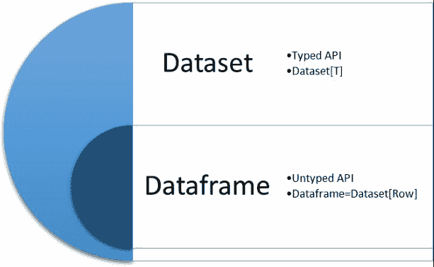

## 使用 Spark SQL

本章将介绍 Spark SQL 及相关概念，如 DataFrame 和 Dataset。将从 Apache Spark 的角度讨论 Schema 和高级 SQL 函数；编写自定义 **用户定义函数（UDF）** 以及处理各种数据源也将被涉及。

本章使用 Java API 创建 `sqlContext/SparkSession`，并从 Java RDD 为原始数据（如 CSV）和结构化数据（如 JSON）实现 DataFrame/Dataset。

## SQLContext 和 HiveContext

在 Spark 2.0 之前，SparkContext 曾是 Spark 应用程序的入口点，而 SQLContext 和 HiveContext 曾是运行 Spark SQL 的入口点。HiveContext 是 SQLContext 的超集。需要创建 SQLContext 才能在 RDD 上运行 Spark SQL。

SQLContext 提供对各种数据源的连接。可以从这些数据源读取数据，并执行 Spark SQL 以根据需要转换数据。可以使用 SparkContext 如下创建它：

```java
JavaSparkContext javaSparkContext = new JavaSparkContext(conf);
SQLContext sqlContext = new SQLContext(javaSparkContext);
```

SQLContext 在 SparkContext 之上创建了一个包装器，并提供 SQL 功能和用于处理结构化数据的函数。它带有基本级别的 SQL 函数。

作为 SQLContext 的超集，HiveContext 提供了更多功能。HiveContext 允许你使用 Hive QL 解析器编写查询，这意味着可以使用 HiveContext 访问所有 Hive 函数。例如，可以使用 javaSparkContext 的 HiveContext 执行窗口函数。与此同时，它还提供对 Hive UDF 的访问。与 SQLContext 类似，可以使用 SparkContext 如下创建 HiveContext：

```java
JavaSparkContext javaSparkContext = new JavaSparkContext(conf);
HiveContext hiveContext = new HiveContext(javaSparkContext);
```

HiveContext 运行不需要 Hive。但是，如果需要，可以使用 HiveContext 查询 Hive 表。访问 Hive 表需要 hive-site.xml。此外，所有使用 SQLContext 可访问的数据源，也可以使用 HiveContext 访问。

HiveContext 需要包含所有 Hive 依赖项。因此，如果只需要基本 SQL 函数，则 SQLContext 就足够了。但是，建议使用 HiveContext，因为它提供了广泛的功能。

在 Spark 2.x 中，这两个 API 均可用。但是，根据文档，它们已被弃用。Spark 2.0 为所有 Spark 应用程序引入了一个名为 SparkSession 的新入口点。

```
JavaSparkContext SparkSession
```

在第 5 章“使用数据和存储”中，我们使用了 SparkSession 连接到 Cassandra 并读取各种格式的数据。在本节中，我们将详细讨论 SparkSession。

The SparkSession was introduced in Spark 2.0 as the single entry point for all Spark applications. Prior to Spark 2.0, sparkContext used to be the entry point for Spark applications: SQLContext and HiveContext were used for Spark SQL, StreamingContext was used for Spark streaming applications, and so on.

We will explain Spark streaming in the next chapter.

In Spark 2.x, SparkSession can be used as the entry point for every Spark application. It combines all the functions of SQLContext, HiveContext, and StreamingContext. The SparkSession internally requires a SparkContext for computation.

Another key difference in SparkSession is that there can be multiple SparkSession instances in a single Spark application, which was not possible with SparkContext.

SparkSession 于 Spark 2.0 引入，作为所有 Spark 应用程序的单一入口点。在 Spark 2.0 之前，sparkContext 曾是 Spark 应用程序的入口点：SQLContext 和 HiveContext 用于 Spark SQL，StreamingContext 用于 Spark 流式处理应用程序，等等。

我们将在下一章解释 Spark 流式处理。

在 Spark 2.x 中，SparkSession 可以用作每个 Spark 应用程序的入口点。它结合了 SQLContext、HiveContext 和 StreamingContext 的所有功能。SparkSession 在内部需要一个 SparkContext 来进行计算。

SparkSession 的另一个关键区别是，在单个 Spark 应用程序中可以存在多个 SparkSession 实例，而使用 SparkContext 时则不可能。

## 初始化 SparkSession

让我们创建一个 SparkSession 对象。SparkSession 遵循建造者设计模式，因此我们可以按如下方式初始化 SparkSession：

```java
SparkSession sparkSession = SparkSession.builder()
    .master("local")
    .appName("Spark Session Example")
    .getOrCreate();
```

你一定已经注意到，我们没有为初始化 SparkSession 创建任何 SparkContext 或 SparkConf 对象。SparkConf 和 SparkContext 已封装在 sparkSession 中。使用 SparkSession 时不需要显式初始化这些对象。

可以使用 SparkSession 对象按如下方式访问 SparkConf 和 SparkContext：

```java
SparkContext sparkContext = sparkSession.sparkContext();
SparkConf conf = sparkSession.sparkContext().getConf();
```

可以使用 sparkSession 运行 Spark SQL。但是，默认情况下未启用 Hive SQL 支持。要启用它，可以按如下方式初始化 SparkSession：

```java
SparkSession sparkSession = SparkSession.builder()
    .master("local")
    .appName("Spark Session Example")
    .enableHiveSupport()
    .getOrCreate();
```

如第 3 章“让我们 Spark”中所述，可以在初始化 sparkContext 之前在 SparkConf 对象中设置运行时配置。由于创建 SparkSession 不需要显式创建 SparkConf，因此可以在 SparkSession 中提供 Spark 应用程序的配置参数，如下所示：

```java
SparkSession sparkSession = SparkSession.builder()
    .master("local")
    .appName("Spark Session Example")
    .config("spark.driver.memory", "2G")
    .getOrCreate();
```

初始化 Spark 对象后，还可以按如下方式更改运行时配置：

```java
sparkSession.conf().set("spark.driver.memory", "3G");
```

## 使用 SparkSession 读取 CSV

在第 5 章“使用数据和存储”中，我们使用 sparkSession 以 Java RDD 的形式读取了 CSV。不过，这次我们将以 Dataset 的形式读取 CSV。假设你有一个包含以下内容的 CSV：

```
emp_id,emp_name,emp_dept
1,Foo,Engineering
2,Bar,Admin
```

可以使用 SparkSession 按如下方式读取此 CSV 文件：

```java
Dataset<Row> csv = sparkSession.read().format("csv").option("header", "true").load("");
```

类似于 RDD 上的 collect() 函数，Dataset 提供 show() 函数，可用于读取 Dataset 的内容：

```java
csv.show();
```

执行此函数将显示带有标题的 CSV 文件内容，看起来类似于关系表。Dataset 的内容可以使用 Spark SQL 进行转换/过滤，这将在后续章节中讨论。


## Dataframe 和 dataset

Dataframe 在 Spark 1.3 中被引入。Dataframe 建立在为数据提供架构的概念之上。RDD 基本上由原始数据组成。虽然它提供多种处理数据的函数，但它是 Java 对象的集合，并涉及垃圾回收和序列化的开销。另外，只有当它包含某种架构时，才能利用 Spark SQL 概念。因此，Spark 的早期版本提供了另一种称为 SchemaRDD 的 RDD 版本。

### SchemaRDD

顾名思义，它是带有架构的 RDD。由于它包含架构，可以在数据上运行关系查询，以及基本的 RDD 函数。SchemaRDD 可以注册为表，以便使用 Spark SQL 在其上执行 SQL 查询。它在 Spark 的早期版本中可用。但是，随着 Spark 1.3 版本的发布，SchemaRDD 已被弃用，并引入了 dataframe。

### Dataframe

尽管是 SchemaRDD 的演进版本，dataframe 与 RDD 有很大不同。它作为 Project Tungsten 的一部分引入，允许数据以二进制格式存储在堆外。这有助于减轻垃圾回收开销。

Dataframe 始终随数据携带架构的概念（Spark 框架管理架构，仅在节点之间传递数据）。由于 Spark 理解架构且数据以二进制格式存储在堆外，无需使用 Java（或 Kryo）序列化对数据进行编码，这也减少了序列化工作。

另外，dataframe API 引入了构建可由 Spark Catalyst 优化器执行的优化查询计划的概念。与 RDD 类似，dataframe 也遵循惰性求值，因此它允许在执行前创建优化的查询计划。最终，操作仅发生在 RDD 上，但这对用户是透明的。考虑以下查询：

```
select a.name, b.title from a, b where a.id = b.id where b.title = 'Architect'
```

这里，不是先连接表然后根据标题过滤数据，而是会先过滤数据，然后根据优化的查询计划进行连接。这有助于减少网络混洗。

尽管有所有这些进步，dataframe 仍有一些缺点。Dataframe 不提供编译时安全性。考虑 Spark 1.6 中的以下 dataframe 示例：

```
JavaRDD<Employee> empRDD = jsc.parallelize(Arrays.asList(new Employee("Foo", 1), new
SQLContext sqlContext = new SQLContext(jsc));

DataFrame df = sqlContext.createDataFrame(empRDD, Employee.class);
```

这里我们使用 sqlContext 创建了 Employee 对象的 dataframe。Employee 对象的构造函数接受两个参数：name、ID。

JavaBean 应包含默认构造函数并可序列化，才能用作 RDD、dataframe 或 dataset 的元素。

请注意，DataFrame 不包含任何类型。要过滤元素，可以在 DataFrame 上按以下方式执行 filter 操作：

```
DataFrame filter = df.filter("id > 1");
```

这里，编译器无法识别过滤条件中指定的列名是否存在。如果不存在，它将在运行时抛出异常。

dataframe 的另一个缺点是它以 Scala 为中心。并非所有 API 都可在 Java 或 Python 中使用。

### Dataset

Dataset 在 Spark 1.6 中引入。它是 RDD 和 dataframe 的结合体。Dataset 将编译时安全性、RDD 的面向对象编程风格以及 dataframe 的进步结合在一起。因此，它是一个不可变的强类型对象，使用架构来描述数据。它使用高效的堆外存储机制 Tungsten，并创建由 Spark Catalyst 优化器执行的优化查询计划。

Dataset 还引入了编码器的概念。编码器在 JVM 对象和 Spark 内部二进制格式之间充当转换器。带架构的数据的表格表示以 Spark 二进制格式存储。编码器允许对序列化数据进行操作。Spark 自带各种内置编码器，以及用于 JavaBean 的编码器 API。编码器允许在无需反序列化整个对象的情况下访问单个属性。因此，它减少了序列化工作和负载。

### 使用编码器创建 Dataset

可以按以下方式使用 empRDD 创建 Dataset：

```
Dataset<Employee> dsEmp = sparkSession.createDataset(empRDD.rdd(), org.apache.spa
```

请注意，Dataset 是一个强类型对象。我们创建了一个包含 Employee 元素的 Dataset 对象。

我们可以在 Dataset 上运行以下操作来过滤 ID > 1 的员工：

```
Dataset<Employee> filter = dsEmp.filter(emp -> emp.getId() > 1);
filter.show();
```

Dataset 的另一个优点是它同时提供 Scala 和 Java API，这使 Java 工程师能够高效地处理 Dataset。

### 使用 StructType 创建 Dataset

在前一节中，我们讨论了在编码器的帮助下从 RDD 创建 Dataset。同样在第 5 章“使用数据和存储”中，我们还讨论了从 JSON、CSV 和 XML 文件创建 Dataframes（Dataset (row) 的别名）的几种不同方法。还有一种方法，我们可以动态创建架构，从而形成 Dataset (row) 对象。第一步涉及使用 RowFactory 类的工厂模式方法将 RDD(T) 转换为 RDD(row)。然后我们识别数据中的字段数并创建表示 RDD(row) 结构的 StructType 架构，最后将架构应用于 SparkSession 的 createDataFrame 方法。

举例来说，假设我们有一个文本文件，其第一行表示列名称，其余行表示数据：

```
//Create a RDD
JavaRDD<String> deptRDD = sparkSession.sparkContext()
    .textFile("src/main/resources/dept.txt", 1)
    .toJavaRDD();

//Convert the RDD to RDD<Rows>
JavaRDD<Row> deptRows = deptRDD.filter(str -> !str.contains("deptno")).map(new Funct.
private static final long serialVersionUID = 1L;
@Override
public Row call(String rowString) throws Exception {
    String[] cols = rowString.split(",");
    return RowFactory.create(cols[0].trim(), cols[1].trim(), cols[2].trim());
});

//Create schema
String[] schemaArr = deptRDD.first().split(",");
List<StructField> structFieldList = new ArrayList<>();
for (String fieldName : schemaArr) {
    StructField structField = DataTypes.createStructField(fieldName, DataTypes.String,
    structFieldList.add(structField);
}
StructType schema = DataTypes.createStructType(structFieldList);

Dataset<Row> deptDf = sparkSession.createDataFrame(deptRows, schema);
deptDf.printSchema();
deptDf.show();
```

### 统一的 Dataframe 和 Dataset API

随着 Spark 2.x 的发展，Dataframe 的非类型特征和 Dataset 的类型特征已合并到 Dataset 中。因此，从根本上说，Dataframe 是 Dataset (row) 中泛型对象集合的别名，其中 row 是通用非类型 JVM 对象。在 Java 中，Dataframe 表示为 Dataset (row)。Dataframe 与 Dataset 的统一使我们能够以多种方式操作数据，例如：

- 使用强类型 API：Java 函数在处理 Dataset 时提供类型安全性，也称为类型转换：

```
dsEmp.filter(newFilterFunction<Employee>() {
@Override
public boolean call(Employee emp) throws Exception {
return emp.getEmpId() > 1;
}
}).show();
//Using Java 8
dsEmp.filter(emp -> emp.getEmpId() > 1).show();
```

- 使用非类型 API：非类型转换提供类似 SQL 的列特定名称，操作可用于对数据进行操作：

```
dsEmp.filter("empID > 1").show();
```

- 使用 DSL：Dataframes/Dataset 为结构化数据操作提供领域特定语言。在 Java 中，可以通过导入 Spark SQL 包 org.apache.spark.sql.functions.col 来使用 col() 函数，该函数为 Dataframe 的非类型列名称提供静态类型函数。

```
dsEmp.filter(col("empId").gt(1)).show();
```




图 8.1: 统一数据集 API Spark 2.x

## 数据持久化

默认情况下，除非配置 `spark.sql.sources.default` 设置为其他格式，否则 Spark 中的数据将使用 Parquet 文件格式进行持久化。除了原生支持的文件格式（JSON、Parquet、JDBC、ORC、LIBSVM、CSV 和文本）外，应使用完全限定的文件格式名称作为数据源。尽管原生文件格式对数据集有内置支持，但仍存在一些限制，例如：以文本文件格式保存数据时仅支持单列；同样，保存 ORC 文件格式时，创建 SparkSession 时应启用 Hive 支持。数据可以使用数据集提供的任何选项进行持久化。

```
deptDf.write().mode(SaveMode.Overwrite).json("DirectoryLocation");
deptDf.write().mode("overwrite").format("csv").save("src/main/resources/output/dept");
deptDf.write().mode(SaveMode.Overwrite).format("csv").save("DirectoryLocation");
```

数据持久化模式是决定如果磁盘上已存在数据时如何保存数据的一个非常重要的方面。SaveMode 提供四个不同的选项来处理此类场景，默认选项为 error，如果数据已存在则会抛出异常，如下表所示：

| SaveMode | 任何语言 | 含义 |
|---|---|---|
| SaveMode.ErrorIfExists | error | 将数据帧保存到数据源时，如果数据已存在，预期会抛出异常。 |
| SaveMode.Append | append | 将数据帧保存到数据源时，如果数据/表已存在，预期会将数据帧的内容追加到现有数据中。 |
| SaveMode.Overwrite | overwrite | 将数据帧保存到数据源时，如果数据/表已存在，预期会将现有数据替换为数据帧的内容。 |
| SaveMode.Ignore | ignore | 将数据帧保存到数据源时，如果数据已存在，预期不会保存数据帧的内容，也不会更改现有数据。这类似于 SQL 中的 CREATE TABLE IF NOT EXISTS。 |

## Spark SQL 操作

在 Spark SQL 中，工作主要分为三个阶段：创建数据集、应用 SQL 操作，最后是持久化数据集。目前为止，我们已能够从 RDD 和其他数据源创建数据集（请参阅第 5 章，使用数据和存储），并如上一节所述持久化数据集。现在让我们看看可以将 SQL 操作应用于数据集的一些方式。

### 无类型数据集操作

创建数据集后，Spark 提供了一些方便的函数来执行基本的 SQL 操作和分析，例如：

- show()：以表格形式显示数据集的前 20 行。超过 20 个字符的字符串将被截断，所有单元格均右对齐：

```
emp_ds.show();
```

show() 函数的另一个变体允许用户通过传递一个布尔值 false 来启用或禁用 show() 函数中的 20 个字符限制，以禁用字符串截断：

```
emp_ds.show(false);
```

- printSchema()：此函数以树形格式将架构打印到控制台：

```
emp_ds.printSchema();
```

- select()：此函数从数据集中选择作为参数传递的一组列：

```
emp_ds.select("empName", "empId").show();
```

通过静态导入函数 org.apache.spark.sql.functions.col，可以使用与 col() 关联的辅助函数为列添加额外功能，例如创建别名、递增列的值、转换为特定数据类型等：

```
emp_ds.select(col("empName").name("Employee Name") ,col("empId").cast(Di
```

- filter()：此函数用于选择满足作为参数传递给 `filter()` 函数的条件的行：

```
emp_ds.sort(col("empId").asc()).filter(col("salary").gt("2500"));
```

- groupBy()：此函数使用指定的列对数据集进行分组，以便可以对其进行聚合：

```
emp_ds.select("job").groupBy(col("job")).count().show();
```

- join()：此函数使用给定的连接表达式与另一个数据帧进行连接。该函数接受三个参数：第一个是另一个数据集；第二个是数据将连接的列；第三个是 joinType--inner、outer、left_outer、right_outer 和 leftsemi。以下在 emp_ds 和 deptDf 之间执行左外连接：

```
emp_ds.as("A").join(deptDf.as("B"),emp_ds.col("deptno").equalTo(deptDf.col('
```

### 临时视图

Spark SQL 提供了使用临时视图处理 SQL 查询的所有功能。临时视图的所有数据和元数据信息在会话或应用程序结束后将被删除。临时视图中查询的结果作为 Dataset<Row> 返回。

```
deptDF.createOrReplaceTempView("dept");
Dataset<Row> result = sparkSession.sql("select dname,loc from dept where deptno > 2");
result.show();
```

临时视图在同一会话中可访问，如果从另一个会话访问则会抛出错误。以下示例将抛出异常 Table or view not found: dept，因为我们正在尝试从新会话访问临时视图。

```
deptDF.createOrReplaceTempView("dept");
Dataset<Row> result = sparkSession.sql("select loc,count(loc) from dept where deptn
```

在以下部分中，我们将讨论如何避免此类错误，以及如何使用全局临时视图跨会话共享数据。

### 全局临时视图

全局临时视图主要用于在会话中共享，并在会话结束后自动删除。这些会话作用域视图也可作为临时表使用，可以对其执行 SQL 查询，并存储在数据库 global_temp 中。数据库名称可以通过修改 SQL 配置 spark.sql.globalTempDatabase 来更改。但是，应使用限定名称来访问 GlobalTempView(database.tableName)，否则会抛出错误 Table or view not found：

```
deptDf.createGlobalTempView("dept_global_view");
sparkSession.newSession().sql("SELECT deptno,dname,loc, rank() OVER (PARTITION BY 1;
```

在多会话（spark.sql.hive.thriftServer.singleSession = false）中使用 Thrift Server 时，可以使用全局临时视图从不同会话访问数据。在 Spark 2.1 之前，跨会话共享数据的唯一方法是持久化数据，然后使用 catalog 访问它。

### Spark UDF

UDF 是增强 Spark SQL 中 SQL 功能的一种特殊方式。它在单行上操作，并返回与单行对应的单个输出值。一些最常用的 UDF 包括连接字符串、格式化日期、更改字符串值的大小写等。除了默认 UDF 之外，还可以创建自定义 UDF 并使用别名将其注册到 Spark SQL 中。然后可以将别名作为 SQL 查询中的标准函数使用。

编写 UDF 时需要注意的一些要点包括：

- 在 Java 中，根据输入参数的数量，UDF 类会实现更改，因此仅具有一个输入参数的 UDF 实现 UDF1，具有两个输入参数时类更改为 UDF2，以此类推
- 可以选择数组或结构体作为输入参数，以避免最大 22 个输入参数的限制
- 一旦 UDF 类已编写并实例化，它会在 Spark SQL 会话中注册该实例
- 已注册的 UDF 不能与数据帧的**特定领域语言** (**DSL**) 一起使用。查询优化引擎 catalyst 将 UDF 视为黑盒，不提供任何优化

例如，让我们创建一个 UDF 来计算今天与传递日期之间的天数：

```
public class CalcDaysUDF implements UDF2<String,String, Long> {
private static final long serialVersionUID = 1L;
@Override
public Long call(String dateString,String format) throws Exception {
SimpleDateFormat myFormat = new SimpleDateFormat(format);
Date date1 = myFormat.parse(dateString);
Date date2 = new Date();
long diff = date2.getTime() - date1.getTime();
return TimeUnit.DAYS.convert(diff, TimeUnit.MILLISECONDS);
}
}
```

现在让我们在 SQL 查询中调用此类：


```
UDF2 calcDays=new CalcDaysUDF();
//Registering the UDFs in Spark Session created above
sparkSession.udf().register("calcDays", calcDays, DataTypes.LongType);
emp_ds.createOrReplaceTempView("emp_ds");
sparkSession.sql("select calcDays(hiredate, 'dd-MM-yyyy') from emp_ds").show();
```

## Spark UDAF

The **user defined aggregate function** (**UDAF**) operates upon more than one row while returning single value results. UDAF normally works in conjunction with a group by clause where some analysis or aggregation may be required on a set of data identified using the group by clause. In Spark, two different types of UDAF can be created untyped and type-safe UDAF.

### Untyped UDAF

A custom untyped UDAF can be written extending UserDefinedAggregateFunction and then defining the following functions:

- public StructType inputSchema(): The datatype of the input argument(s) of the aggregate function is defined in this method.

- public DataType dataType(): The return value of the UDAF will correspond to the datatype defined in this method.

- public boolean deterministic(): If the function is deterministic, that is, given the same input, always return the same output and it should return true or false.

- public StructType bufferSchema(): The internal fields that are required to compute aggregation are defined in this method, such as for calculating the average, one would need sum and count. For a UDAF with two intermediate values of DoubleType and LongType, the returned StructType will be as follows :

```
new StructType() .add("sumVal", DoubleType) .add("countVal", LongType)
```

The names of the field defined in StructType are used to identify the buffer values.

- public void initialize(MutableAggregationBuffer arg0): The method initializes the values of the fields defined in the bufferSchema() method. The rule for initializing the values is that, while applying the merge function on two initial buffers, it should return the same initial buffer, that is, merge(initialBuffer, initialBuffer) should equal initialBuffer. On each node, the initialize() method is called once for each group of rows.

- public void update(MutableAggregationBuffer arg0, Row arg1): The update method updates the values of bufferSchema() with new input data from input. Since UDAF operates over multiple rows, this method gets called once per input row.

- public void merge(MutableAggregationBuffer arg0, Row arg1): The merge function aggregates two partial bufferSchema while returning the updated value in MutableAggregationBuffer.

- public Object evaluate(Row arg0): The evaluate method operates upon the aggregated bufferSchema to return the final output value of datatype defined in method dataType().

As an example, let's understand how average gets calculated in Spark SQL:

```
public class AverageUDAF extends UserDefinedAggregateFunction {
  private static final long serialVersionUID = 1L;
  @Override
  public StructType inputSchema() {
    return new StructType(new StructField[] { new StructField("counter", DataTypes.DoubleType)
  }
  @Override
  public DataType dataType() {
    return DataTypes.DoubleType;
  }
  @Override
  public boolean deterministic() {
    return false;
  }
  @Override
  public StructType bufferSchema() {
    return new StructType() .add("sumVal", DataTypes.DoubleType) .add("countVal", DataTypes.LongType)
  }
  @Override
  public void initialize(MutableAggregationBuffer bufferAgg) {
    bufferAgg.update(0, 0.0);
    bufferAgg.update(1, 0.0);
  }
  @Override
  public void update(MutableAggregationBuffer bufferAgg, Row row) {
    bufferAgg.update(0, bufferAgg.getDouble(0)+row.getDouble(0));
    bufferAgg.update(1, bufferAgg.getDouble(1)+2.0);
  }
  @Override
  public void merge(MutableAggregationBuffer bufferAgg, Row row) {
    bufferAgg.update(0, bufferAgg.getDouble(0)+row.getDouble(0));
    bufferAgg.update(1, bufferAgg.getDouble(1)+row.getDouble(1));
  }
  @Override
  public Object evaluate(Row row) {
    return row.getDouble(0)/row.getDouble(1);
  }
}
```

Calling the UDAF function from Spark is similar to UDF, that is, instantiate the UDAF function, register to SparkSession, and finally call the alias of UDAF used while registering in SparkSession:

```
//Instantiate UDAF
AverageUDAF calcAvg= new AverageUDAF();
//Register UDAF to SparkSession
sparkSession.udf().register("calAvg", calcAvg);
//Use UDAF
sparkSession.sql("select deptno,calAvg(salary) from emp_ds group by deptno ").show();
```

### Type-safe UDAF

Type-safe UDAF in Spark can be implemented by extending the abstract class Aggregator and applying it to datasets. It is loosely based on Aggregator from algebird: https://github.com/twitter/algebird. The following methods needs to be defined after extending the Aggregator class:

- public Encoder<Average> bufferEncoder(): Encoder is for the intermediate value type and is similar to the untyped UDAF function bufferSchema().

- public Encoder<Double> outputEncoder(): Specifies the encoder for the final output value type, that is, the output of the UDAF function and similar to untyped the UDAF function dataType().

- public Average zero(): The zero() method should satisfy the property that any b + zero = b. It is similar to the untyped UDAF function initialize().

- public Average reduce(Average buffer, Employee employee): Aggregates two values of the same kind and returns the updated value. It is similar to the untyped UDAF function update().

- public Average merge(Average b1, Average b2): Merges two intermediate values and is similar to the untyped UDAF function merge().

- public Double finish(Average reduction): Calculates the final output of UDAF and is similar to the untyped UDAF function evaluate().

Drawing a similarity between the previous untyped UDAF to calculate the average, let's follow the same objective of calculating the average but using a type-safe UDAF.

Create a class with variables whose final values for a given iteration will determine the output of the UDAF, such as, in the case of average, the two variables are sum and count:

```
public class Average implements Serializable {
    private static final long serialVersionUID = 1L;
    private double sumVal;
    private long countVal;

    public Average() {
    }

    public Average(long sumVal, long countVal) {
        super();
        this.sumVal = sumVal;
        this.countVal = countVal;
    }

    public double getSumVal() {
        return sumVal;
    }

    public void setSumVal(double sumVal) {
        this.sumVal = sumVal;
    }

    public long getCountVal() {
        return countVal;
    }

    public void setCountVal(long countVal) {
        this.countVal = countVal;
    }
}
```

Create a UDAF class extending the Aggregator class of package org.apache.spark.sql.expressions.Aggregator:

```
public class TypeSafeUDAF extends Aggregator<Employee, Average, Double> implements Serializable {
    private static final long serialVersionUID = 1L;

    public Average zero() {
        return new Average(0L, 0L);
    }

    public Average reduce(Average buffer, Employee employee) {
        double newSum = buffer.getSumVal() + employee.getSalary();
        long newCount = buffer.getCountVal() + 1;
        buffer.setSumVal(newSum);
        buffer.setCountVal(newCount);
        return buffer;
    }

    public Average merge(Average b1, Average b2) {
        double mergedSum = b1.getSumVal() + b2.getSumVal();
        long mergedCount = b1.getCountVal() + b2.getCountVal();
        b1.setSumVal(mergedSum);
        b1.setCountVal(mergedCount);
        return b1;
    }

    public Double finish(Average reduction) {
        return ((double) reduction.getSumVal()) / reduction.getCountVal();
    }

    public Encoder<Average> bufferEncoder() {
        return Encoders.bean(Average.class);
    }

    public Encoder<Double> outputEncoder() {
        return Encoders.DOUBLE();
    }
}
```

Instantiate the UDAF class, convert the instance to a typed column giving it an alias as the column name, and then pass it to the dataset:

```
TypeSafeUDAF typeSafeUDAF = new TypeSafeUDAF();
Dataset<Employee> emf = emp_ds.as(Encoders.bean(Employee.class));
TypedColumn<Employee, Double> averageSalary = typeSafeUDAF.toColumn().name("averageSalary");
Dataset<Double> result = emf.select(averageSalary);
```


## Hive integration

Spark 与 Hive 集成得非常好，尽管它不包含大部分依赖项，并期望这些依赖项可在其类路径中使用。以下步骤说明如何将 Spark 与 Hive 集成：

- 1. Place hive-site.xml, core-site.xml, and hdfs-site.xml files in the SPARK_HOME/conf folder.

  将 hive-site.xml、core-site.xml 和 hdfs-site.xml 文件放置在 SPARK_HOME/conf 文件夹中。

- 2. Instantiate SparkSession with Hive support and, if hive-site.xml is not configured, then the context automatically creates metastore_db in the current directory and creates a warehouse directory configured by spark.sql.warehouse.dir, which defaults to the directory spark-warehouse.

  启用 Hive 支持实例化 SparkSession，如果未配置 hive-site.xml，则上下文会在当前目录中自动创建 metastore_db，并创建由 spark.sql.warehouse.dir 配置的仓库目录，默认目录为 spark-warehouse。

```
SparkSession sparkSession = SparkSession
.builder()
.master("local")
.config("spark.sql.warehouse.dir", "Path of Warehouse")
.appName("DatasetOperations")
.enableHiveSupport()
.getOrCreate();
```

- 3. Once we have created a sparkSession with Hive support enabled, we can proceed to use it with the added benefits of query support from Hive. One way to identify the difference between Hive query function support and Spark query function support is by checking all the functions supported by Hive.

  一旦创建了启用 Hive 支持的 sparkSession，就可以使用它并享受 Hive 查询支持带来的额外好处。区分 Hive 查询函数支持和 Spark 查询函数支持的一种方法是检查 Hive 支持的所有函数。

```
sparkSession.sql("show functions").show(false);
```

- 4. If we know the name of the function, then we can also use the describe function with the name of the function as follows:

  如果知道函数名称，还可以使用 describe 函数，并传入函数名称，如下所示：

```
sparkSession.sql("DESCRIBE FUNCTION add_months").show(false);
```

- 5. One can also look for an extended description for usage details of the function:

  还可以查找函数用法详情的扩展描述：

```
sparkSession.sql("DESCRIBE FUNCTION EXTENDED add_months").show(false);
```

## Table Persistence

saveAsTable 函数可用于将数据集作为表持久化到 Hive 元存储中。默认情况下，Spark 在配置 spark.sql.warehouse.dir 提到的路径上创建托管表。SaveMode 和 format 的各种选项保持不变，如前一节所讨论。

```
deptDf.write().mode(SaveMode.Overwrite).format("csv").saveAsTable("Department");
```

## Summary

在本章中，我们讨论了 sparkSession，它是 Spark 2.x 版本的单一入口点。我们讨论了数据集和 DataFrame API 的统一。然后，我们使用 RDD 创建了数据集，并通过示例讨论了各种数据集操作。我们还学习了如何通过创建临时视图在数据集上执行 Spark SQL 操作。最后，我们学习了如何通过示例在 Spark SQL 中创建 UDF。

在下一章中，我们将学习如何使用 Spark 处理实时流。
