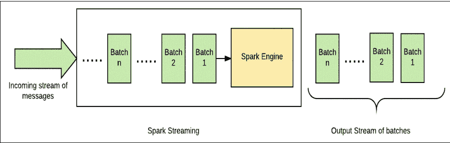
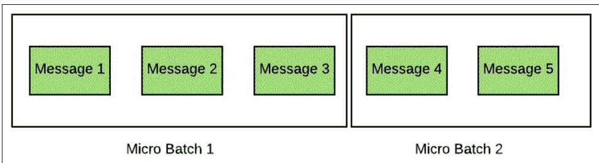
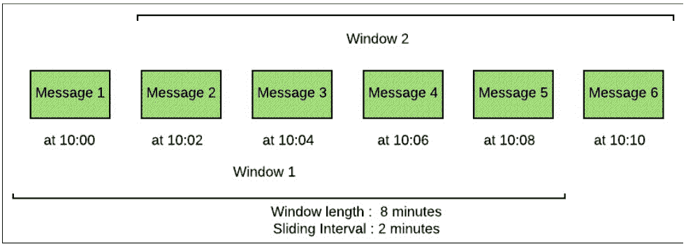
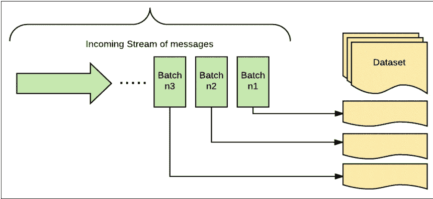
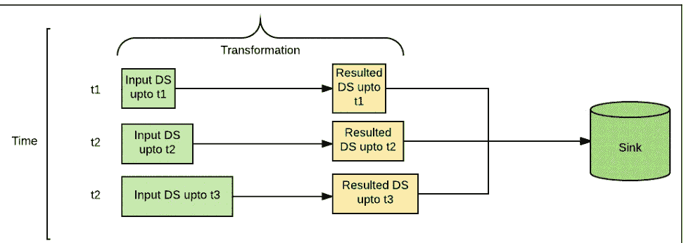
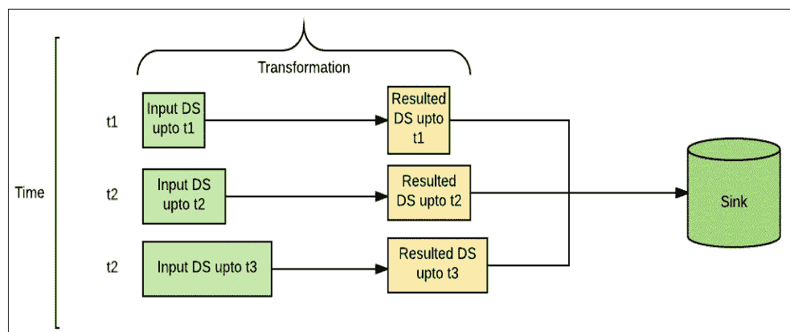

## Near Real-Time Processing with Spark Streaming

迄今为止，在本书中，我们已使用核心库和 Spark SQL 讨论了 Spark 的批处理分析。在本章中，我们将学习 Spark 的另一个领域，即处理近实时数据流。Spark 附带一个名为 Spark Streaming 的库，它提供近实时处理数据的功能。这一扩展使 Spark 成为真正的通用系统。

本章将解释 Spark Streaming 的内部机制，通过示例说明如何从各种数据源在 Spark 中读取数据流，以及 Spark 中称为 **结构化流** 的流处理较新扩展。

## Introducing Spark Streaming

随着大数据技术的进步和扩展，大多数公司已将重点转向数据驱动的决策。它现已成为业务中必不可少且不可分割的一部分。在当今世界，分析本身固然重要，但其可用的及时性同样重要。离线数据分析（又称批处理分析）有助于对历史数据进行分析。另一方面，在线数据分析展示实时发生的情况。它帮助组织尽早做出决策，从而始终领先于竞争对手。在线分析/近实时分析是通过读取传入的数据流（例如电子商务网站的用户活动）并处理这些流来获得有价值结果的过程。

Spark Streaming API 是一个库，允许您以近实时方式处理实时流中的数据。它提供高可扩展性、容错性、高吞吐量等功能。它还开箱即用地为实时数据流提供有状态 API，并提供各种数据源的连接器，例如 Kafka、Twitter 和 Kinesis，用于读取实时数据。

Spark Streaming 引入了一种称为离散流（又称 DStream）的抽象。传入的数据流被转换为 DStream，在内部它被创建为 RDD 序列。这使得 Spark Streaming 与 Spark Core 组件及其他扩展（如 Spark SQL、MLlib 等）能够无缝集成。

Spark Streaming 中的 DStream 由分为小批次的数据流表示，又称微批。Spark Streaming API 将数据流转换为微批，并将其馈送到 Spark 引擎进行处理。



因此，Spark Streaming 结合了批处理和流处理的优势。它不是一次处理一个事件，而是一次处理一小批事件。这样，Spark 就能为批处理和实时流处理领域保持统一的编程范式。

在进行 Spark Streaming 示例之前，让我们详细讨论微批处理的概念：

## Understanding micro batching

微批处理定义为将传入的消息流划分为小批次组并对其进行处理的过程。这有助于获得批处理的性能优势；同时，它还有助于将每条消息的处理延迟降至最低。



在这里，传入的消息流被视为小批次消息的流，每个批次被传递到处理引擎，该引擎输出已处理的批次流。

在 Spark Streaming 中，微批是基于时间而非大小创建的，即在某个时间间隔（通常为毫秒）内接收到的事件被分组到一个批次中。这确保任何消息在处理前无需等待太久，并有助于将处理延迟保持在可控范围内。

微批处理的另一个优势是有助于降低控制消息的数量。例如，如果系统要求处理引擎对每条已处理的消息发送确认，那么在微批处理中，每批消息只需发送一个确认，而不是每条消息发送一个。

微批处理也有劣势。在故障场景中，即使批次中只有一条消息失败，也需要重播整个批次。

## Getting started with Spark Streaming jobs

与之前的所有批处理作业不同，流作业的独特之处在于它是一个持续运行的作业，Spark Streaming 也不例外，尽管它被称为微批处理。在进一步讨论之前，让我们先在 Spark Streaming 中编写一个 hello world 程序，再好不过的是从流源（套接字）上的单词计数问题开始。在以下示例中，我们将统计每个微批中的单词数量：

```java
SparkConf sparkConf = new SparkConf().setAppName("WordCountSocketEx").setMaster("lo
JavaStreamingContext streamingContext = new JavaStreamingContext(sparkConf, Duration
JavaReceiverInputDStream<String> StreamingLines = streamingContext.socketTextStream
JavaDStream<String> words = StreamingLines.flatMap( str -> Arrays.asList(str.split(
JavaPairDStream<String, Integer> wordCounts = words.mapToPair(str-> new Tuple2<>(st
wordCounts.print();
streamingContext.start();
streamingContext.awaitTermination());
```

在示例中，编写流作业时需要注意的几点如下：

- For any streaming job, create a StreamingContext, in case of Java it's JavaStreamingContext.

  对于任何流作业，创建 StreamingContext，在 Java 中则为 JavaStreamingContext。

- Each streaming context accepts two parameters, SparkConf and batchDuration. Batch duration determines the interval of micro batching and hence should be chosen very carefully.

  每个流上下文接受两个参数，SparkConf 和 batchDuration。批次持续时间决定微批处理的间隔，因此应非常谨慎地选择。

- Any Spark Streaming job does not start computation until and unless the start() method of streaming context is called.

  任何 Spark Streaming 作业在调用流上下文的 start() 方法之前都不会开始计算。

- Also call the method awaitTermination() or stop() explicitly to stop the streaming job.

  还应显式调用 awaitTermination() 或 stop() 方法来停止流作业。

- Never set the master URL as local or local[1] as that transpires into running only one thread per job. While DStream-based receivers (sockets, Kafka, Flume, Kinesis, and so on), require one thread to

  切勿将 master URL 设置为 local 或 local[1]，因为这会导致每个作业只运行一个线程。基于 DStream 的接收器（套接字、Kafka、Flume、Kinesis 等）需要一个线程来


执行接收器，而另一个可用于处理 DStream 数据。因此，始终建议使用 `local[n]` 配置，其中 `n` 大于 1，或者更好的做法是使用 `local[*]`。类似逻辑也可扩展到在集群上运行的 Streaming 作业，分配给 Spark Streaming 应用程序的核心数必须多于接收器的数量。

- 此外，请添加以下 Maven 依赖项以使用 Spark Streaming：

```
<dependency>
<groupId>org.apache.spark</groupId>
<artifactId>spark-streaming_2.11</artifactId>
<version>2.1.1</version>
</dependency>
```

> 要在基于 Linux 的机器上通过套接字流式传输数据，可以使用名为 Netcat 的实用程序/命令。使用以下命令创建服务器端套接字以流式传输数据：
> $nc -lk <Port Number>

## 流式数据源

在 Spark Streaming 中，流式数据源分为两类，即基本源和高级源。所有可直接通过 `streamingContext` 获得的源（如文件系统和套接字流）称为**基本源**，而需要依赖链接的源（如 Kafka、Flume 等）称为**高级源**。流式数据源也可基于可靠性定义；如果在接收并复制消息后向源系统发送确认，则此类接收器称为**可靠接收器**，例如 Kafka API。同样，如果系统不向源系统发送确认，则称其为不可靠。

除前面示例中讨论的套接字流式传输外，一些常见的流式数据源将在下一节中介绍。

### fileStream

可以使用 StreamingContext 的 fileStream() API 从任何目录读取数据文件。fileStream() API 接受四个值，即要监视的用于流式传输文件的目录、键类、值类和 InputFormat 类。对于与 Hadoop 兼容且包含文本数据的文件，可以使用以下语法进行流式传输数据：

```
streamingContext.fileStream(inputDirectory, LongWritable.class, Text.class, TextInpu
```

还有一个更简单的 API，它隐藏了所有键、值和文本输入格式详细信息，在读取简单文本文件时非常有用：

```
streamingContext.textFileStream(inputDirectory);
```

与之前的套接字流式传输示例相比，一个重要的不同点是，由于流式传输文件系统数据不需要接收器，因此不需要额外线程来运行接收器进程。处理文件流数据时需要记住的几个要点是：仅考虑在 Spark 作业已启动并处于运行状态后移动的文件，此外，文件一旦移动到流式传输目录后不应再进行更改。

### Kafka

Kafka 是一个发布-订阅消息系统，提供可靠的 Spark Streaming 数据源。借助最新的 Kafka direct API，它在 Kafka 分区与 DStream 生成的 RDD 分区之间提供一对一映射，并可访问元数据和偏移量。由于就 Spark Streaming 而言 Kafka 是高级流式数据源，因此需要在流式应用程序的构建工具中添加其依赖项。在开始 Kafka 集成之前，应在首选的构建工具中添加以下 Maven 构件：

```
groupId = org.apache.spark
artifactId = spark-streaming-kafka-0-10_2.11
version = 2.1.1
```

添加依赖项后，还需要了解 Kafka 设置的一些基本信息，例如 Kafka 托管所在的服务器（bootstrap.servers）以及描述消息的某些基本配置，例如序列化器、组 ID 等。以下是用于描述 Kafka 连接的几个常用属性：

- bootstrap.servers: 此属性描述 Kafka 服务器的主机和端口，多个之间用逗号分隔。
- key.deserializer: 这是用于反序列化来自 Kafka 的消息键的类名。
- value.deserializer: 这指的是反序列化消息值的类。通常，由于消息是文本，因此 StringDeserializer 类足以满足需求。
- group.id: 这唯一标识消息消费者所属的消费者进程组。
- auto.offset.reset: 当我们开始从 Kafka 主题消费消息，但在 Kafka 中没有初始偏移量，或者当前偏移量在服务器上不再存在时使用；以下选项之一有助于 Kafka 策略决定偏移量：
  - earliest: 这会自动将偏移量重置为最早的偏移量
  - latest: 这会自动将偏移量重置为最新的偏移量
  - none: 如果未找到消费者的先前偏移量，这会向消费者抛出异常

在继续之前，我们先来了解在 Spark Streaming 中如何编写基本的 Kafka 消费者。作为用例，我们将尝试从 Kafka 流式数据源消费推文，并统计每个微批次间隔内的标签数量：

```
JavaSparkContext sc = new JavaSparkContext(conf);
JavaStreamingContext streamingContext = new JavaStreamingContext(sc, Durati
Map<String, Object> kafkaParams = new HashMap<>();
kafkaParams.put("bootstrap.servers", "10.0.75.1:9092");
kafkaParams.put("key.deserializer", StringDeserializer.class);
kafkaParams.put("value.deserializer", StringDeserializer.class);
kafkaParams.put("group.id", "use_a_separate_group_id_for_each_strea");
kafkaParams.put("auto.offset.reset", "latest");
Collection<String> topics = Arrays.asList("mytopic", "anothertopic");
SparkConf sparkConf = new SparkConf().setAppName("WordCountSocketEx").setMaster("lo
final JavaInputDStream<ConsumerRecord<String, String>> stream = KafkaUtils.
ConsumerStrategies.<String, String>Subscribe(topics, kaf
JavaPairDStream<String, String> pairRDD = stream.mapToPair(record-> new Tup
pairRDD.foreachRDD(pRDD-> { pRDD.foreach(tuple-> System.out.println(new Dat
JavaDStream<String> tweetRDD = pairRDD.map(x-> x._2())).map(new TweetText())
tweetRDD.foreachRDD(tRDD -> tRDD.foreach(x->System.out.println(new Date())))
JavaDStream<String> hashtagRDD = tweetRDD.flatMap(twt-> Arrays.stream(twt.sp
hashtagRDD.foreachRDD(tRDD -> tRDD.foreach(x->System.out.println(x)));
JavaPairDStream<String, Long> cntByVal = hashtagRDD.countByValue();
cntByVal.foreachRDD(tRDD -> tRDD.foreach(x->System.out.println(new Date())))
```

如前面部分所讨论，对于任何流式应用程序，都需要 StreamingContext，Kafka 也是如此。创建 StreamingContext 后，应定义 Kafka 连接器的配置参数，并将它们组合在一个 Map 中，同样将所有主题组合在一个集合 List 中。现在，我们使用 KafkaUtils 辅助方法 createDirectStream() 创建 DStream 对象，传入 StreamingContext、LocationStrategy 和 ConsumerStrategy，后者包含主题集合和消费者配置映射。这足以将 Kafka 消费为 DStreams，其中来自 Kafka 的每条消息都包含一个键值对。

不过，我们更感兴趣的是包含推文的消息值部分，因此我们会筛选推文文本，然后按空格拆分单词，最后统计每个包含标签的单词。

本节介绍了流式数据源的基础知识。从 Kafka 消费消息的某些方面需要更多细节和用例理解，因此超出了当前上下文的范围。尽管如此，Kafka 和 Spark 文档详细介绍了如何自定义实现偏移策略，以及如何使用检查点（请参阅容错和可靠性部分）和其他机制从故障中恢复状态。在下一节中，我们将学习流式转换，例如有状态和无状态操作。


## 流式转换

与之前的单词计数示例一样，我们看到每行中的单词都只被计数一次，对于下一组记录，计数器会重置。但如果我们想要将之前状态的计数添加到即将到来的下一批次的新单词中呢？我们可以做到吗？如何做到？问题的第一部分答案是，在 Spark Streaming 中有两种转换：有状态转换和无状态转换，因此如果我们想要保留之前的状态，就必须选择有状态转换，而不是我们在之前示例中实现的无状态转换。

基于需求，流处理可以是无状态的或有状态的。某些流处理问题可能需要在一段时间内维护状态，而其他问题则不需要。

假设一家航空公司想要实时处理所有活跃航班温度读数的数据。如果航空公司只想实时打印或存储从航班接收到的读数，则无需维护状态，这被视为无状态流处理。另一种场景是，每隔 10 分钟，航空公司想要找出过去一小时内每个活跃航班的平均温度读数。在这种情况下，可以定义一个一小时的窗口，滑动间隔为 10 分钟。因此，在此场景中需要维护状态，这可以被视为窗口时间框架内的有状态流处理。

假设如果一家航空公司想要找出每个航班整个旅程的平均温度读数，即从起飞到降落，那么就需要维护外部状态，因为不同航班的旅程时间不同，且航班也可能延误。因此，无法定义特定的窗口持续时间。此类流式用例也被视为有状态流处理，其状态在 Spark Streaming 作业执行会话期间一直被维护。

让我们使用 Spark Streaming 开发这些用例。

假设，起飞后航班以以下 JSON 格式发送数据：

```
{"flightId":"tz302", "timestamp":1494423926816, "temperature":21.12,"landed":false}
where flightId = unique id of the flight
timestamp = time at which event is generated
temperature = temperature reading at the time of event generation
landed = boolean flag which defines whether flight has been landed or still on the
```

以下 POJO 将用于将消息映射为 Java 对象以供进一步处理：

```
public class FlightDetails implements Serializable {
private String flightId;
private double temp;
private boolean landed;
private long temperature;
}
```

> 在本示例中，我们将从套接字读取消息。在现实场景中，消息应推送到持久的消息代理/队列，例如 Kafka、Kinesis 等等。

## 无状态转换

最简单的无状态转换是 map 函数，其中每个传递的元素都被视为相互独立。在以下示例中，我们将从流中读取传入消息并将其映射为 FlightDetails 对象，如下所示：

```
JavaReceiverInputDStream<String> inStream= jssc.socketTextStream("localhost", 9999)
JavaDStream<FlightDetails> flightDetailsStream = inStream.map(x -> {
ObjectMapper mapper = new ObjectMapper();
return mapper.readValue(x, FlightDetails.class);
});
```

传入消息可以按如下方式打印或存储到 HDFS：

```
flightDetailsStream.print();
flightDetailsStream.foreachRDD((VoidFunction<JavaRDD<FlightDetails>>) rdd -> rdd.sa'
```

一些常见的无状态转换如下表所示：

| 转换 | 描述 |
|---|---|
| flatMap(func) | 返回展平数据的 DStream；即，每个输入项可以返回多个输出项 |
| filter(func) | 过滤满足作为参数传递的函数的记录 |
| join(otherStream, [numTasks]) | 对于拥有 (K, V) 和 (K, X) 对 RDD 的 DStream，它返回拥有 (k, (V,X)) 对 RDD 的新 DStream |
| union(otherStream) | 返回一个拥有两个不同 DStream 元素并集的 DStream |

| 函数 | 描述 |
|---|---|
| count() | 通过计算源 DStream 中每个 RDD 的元素数量，返回一个单元素 RDD 的新 DStream |
| reduce(func) | 聚合函数在返回单元素 RDD 的新 DStream 的同时减少 DStream 的元素 |
| reduceByKey(func, [numTasks]) | 对于对 DStream RDD，它返回 (K, V) 对的新 DStream，其中每个键的值使用给定的 reduce 函数进行聚合 |

## 有状态转换

有状态转换在一段时间内维护状态，该时间长于微批次间隔，可以长达整个 Spark Streaming 作业会话。这是通过在流式应用程序上创建检查点来实现的，尽管严格来说，窗口化（请参阅窗口化部分）可能不需要检查点，但窗口化上的其他操作可能需要。让我们找出如何对流式应用程序进行检查点。

## 检查点

在第 4 章“理解 Spark 编程模型”中，我们讨论了缓存/持久化 RDD 的各种技术，以避免故障时的所有重新计算。相同的技术也可以应用于 DStream 类型。但是，由于流式应用程序旨在全天运行，应用程序也可能因系统故障或网络故障而失败。为了使 Spark Streaming 应用程序能够从这些故障中恢复，它应该被检查点到外部位置，最好是容错存储，例如 HDFS 等等。

Spark Streaming 允许我们检查点以下类型的信息：

- 元数据检查点：这有助于检查点 Spark Streaming 应用程序的元数据，例如提交应用程序时提供的配置、正在处理的数据批次、定义要对传入 DStream 执行的一组操作等等。
- 数据检查点/生成的 DStream 检查点：这有助于在有状态操作的情况下检查点生成的 DStream，因为生成的 DStream 可以是跨多个批次的各种转换 DStream 的组合，并且这个链在流式应用程序中不断增长。因此，它必须被检查点。

在 Spark Streaming 中，有状态转换的情况下，检查点生成的 DStream 是强制性的。但是，用户也可以在无状态转换的情况下创建检查点，以检查点 Spark Streaming 应用程序的元数据或避免重新计算。甚至 RDD 也可以被检查点。

要在 Spark Streaming 应用程序中启用检查点，可以在 Spark Streaming 上下文上调用以下方法：

```
jssc.checkpoint("/path/of/the/checkpoint_directory");
```

建议将检查点保存在容错文件系统中，最好是 HDFS。

两种转换，即基于窗口的和基于完整会话的，可以在 Spark Streaming 中使用状态实现。基于完整会话的有状态转换在任何 Spark Streaming 作业的生命周期中维护会话，在整个生命周期中维护状态的最流行方法之一是 updateStateByKey。但是，Apache Spark 1.6 引入了 updateStateByKey 的一种高效替代方案，它不仅性能更好，而且更容易编码。

让我们计算航班整个旅程的平均温度。由于不同航班的旅程时间不同，并且考虑到航班延误的情况，我们将使用 mapWithState 有状态流处理来解决此用例。

mapWithState 转换可以在 PairDStream 类型上执行，因此让我们将 flightDetailsStream 转换为 PairStream 类型，键为 flightId，值为 flightDetailsObject：

```
JavaPairDStream<String, FlightDetails> flightDetailsPairStream = flightDetailsStream
```

mapWithState 转换接受 org.apache.spark.streaming.StateSpec 的一个对象，它是一个抽象类型。

其实现需要以下内容的实现：

org.apache.spark.api.java.function.Function3 或 org.apache.spark.api.java.function.l

以下是用于创建 StateSpec 对象的 Function3 接口的实现：

```
Function3<String, Optional<FlightDetails>, State<List<FlightDetails>>, Tuple2<String,
    //fetch existing state else create new list.
    List<FlightDetails> details = state.exists() ? state.get() : \
    boolean isLanded = false;
    /*if optional object is present, add it in the list and check set the b
    if (curFlightDetail.isPresent()) {
    details.add(curFlightDetail.get());
    if (curFlightDetail.get().isLanded()) {
    isLanded = true;
    }
```


```
//Calculate average value of the all temperature values
Double avgSpeed = details.stream().mapToDouble(f -> f.getTemperature())
/*Remove the state if flight has landed else update the state with the upd...
if (isLanded) {
    state.remove();
} else {
    state.update(details);
}
//Return the current average
return new Tuple2<String, Double>(flightId, avgSpeed);
});
```

如前所示的代码示例，Function3 包含四个参数，用于创建 StateSpec 对象：

- KeyType: PairStream 的键类型，在我们的示例中为 String。
- Optional<ValueType>: ValueType 的可选对象，在我们的示例中为 FlightDetails。该参数是可选的，因为一个批次可能包含也可能不包含特定键的数据。
- org.apache.spark.streaming.State<T>: 我们将状态存储为 List<FlightDetails>。
- MappedType: 这是用户希望输出的最终类型。由于我们要计算平均温度，因此将其保留为 Double 类型。

> 请务必阅读代码中添加的注释，以了解 Function3 实现的工作原理。

现在，我们将按如下方式对 flightDetailsPairStream 执行有状态转换：

```
JavaMapWithStateDStream<String, FlightDetails, List<FlightDetails>, Tuple2<String, Double>>
mapWithState.print();
```

> 如前一节所定义，每个流式应用程序的末尾都需要添加以下语句以启动流式上下文：
> `jssc.start();`
> `jssc.awaitTermination();`

每次接收到航班消息时，都会计算并打印截至该时间的平均温度，一旦航班着陆，将计算最终平均值并移除状态。

在实际场景中，发送消息的设备可能因某种原因而失败。因此，为了处理此类情况，可以配置超时，如果在特定时间段内未收到任何消息，则将移除状态。

可以在定义 StateSpec 对象时配置超时，如下所示：

```
flightDetailsPairStream.mapWithState(StateSpec.function(mappingFunc).timeout(Durations.minutes(5)))
```

这表示如果设备在五分钟内未发送消息，则将移除状态。用户可以根据需要设置超时限制。

## 窗口操作

在 Spark Streaming 中，传入的消息流会根据一个间隔（称为批处理间隔）进行分组，系统按批处理间隔接收数据批次。因此，如果我们创建了一个批处理间隔为（例如）两分钟的 streamingContext，则输入 DStream 将以每两分钟一个间隔从接收的数据生成 RDD 并独立处理它们。但是，对于诸如每两分钟计算过去八分钟数据的词频，或每六分钟查找过去半小时读数中股票最大值等用例，需要保留之前批处理间隔的 RDD 状态。为了解决这些需要将任何批处理间隔的 RDD 状态维护一定有限时间段的用例，我们使用基于窗口的有状态转换。

窗口由两个参数定义，即 windowDuration 和 slideInterval。如下图所示，定义了长度为 8 分钟的窗口，每两分钟滑动一次。在这种情况下，传入的消息流最初将收集 8 分钟，然后在第 10 分钟，将丢弃前两分钟接收到的消息，并用第 2 分钟到第 10 分钟接收到的消息形成一个窗口，此过程将每两分钟重复一次。



因此，根据图示，Window 1 将包含 Message 1 到 Message 5，**Window 2** 将包含 **Message 2** 到 **Message 6**，以此类推，这与无状态转换有根本区别，在无状态转换中，属于一个批次的消息不会出现在另一个批次中。

并非所有窗口进程都需要维护外部检查点，状态可以保存在内存中，但驱动程序失败时存在数据丢失的风险。可以通过调用以下函数在 JavaDStream RDD 上定义传入流上的滑动窗口：

```
window(Duration windowDuration, Duration slideDuration)
```

在窗口进程中，固定时长的窗口会按滑动间隔值不断滑动，但必须注意的是，窗口时长和滑动时长必须是批处理间隔的倍数，因为接收到的数据是按批处理间隔划分的。

窗口流的窗口时长和滑动间隔如下表所示：

| 窗口流（批处理间隔 2 分钟） | 说明 |
| --- | --- |
| jDStream.window(Durations.minutes(8)) | 有效的窗口流 |
| jDStream.window(Durations.minutes(8),Durations.minutes(2)) | 有效的窗口流 |
| jDStream.window(Durations.minutes(12),Durations.minutes(8)) | 有效的窗口流 |
| jDStream.window(Durations.minutes(2),Durations.minutes(2)) | 有效的窗口流 |
| jDStream.window(Durations.minutes(12),Durations.minutes(12)) | 有效的窗口流 |

| 表达式 | 原因 |
| --- | --- |
| jDStream.window(Durations.minutes(5), Durations.minutes(2)) | 无效的窗口流，因为窗口时长不是批处理间隔的倍数 |
| jDStream.window(Durations.minutes(10), Durations.minutes(1)) | 无效的窗口流，因为滑动时长不是批处理间隔的倍数 |

现在让我们在传入的数据流上定义一个窗口，以查找过去一小时内每个活跃航班（正在发送数据的航班）的平均温度，并且此结果应每 10 分钟计算一次：

```
JavaDStream<FlightDetails> window = flightDetailsStream.window(Durations.minutes(60))
```

我们可以按如下方式对窗口执行转换，以查找每个活跃航班的平均温度：

```
JavaPairDStream<String, Double> transformedWindow = window.mapToPair(f -> new Tuple2<String, Double>())
.mapValues(t -> new Tuple2<Double, Integer>(t, 1))
.reduceByKey((t1, t2) -> new Tuple2<Double, Integer>(t1._1() + t2._1(), t1._2() + t2._2()));
transformedWindow.cache();
transformedWindow.print();
```

每次窗口滑动时都会执行此转换，即在此示例中每 10 分钟执行一次。

在窗口操作中，始终建议对 DStream 进行检查点，以便在发生故障时避免重新计算，因为流式应用程序发生故障时存在数据丢失的可能性。

> 如前一节所定义，每个流式应用程序的末尾都需要添加以下语句以启动流式上下文：
> `jssc.start();`
> `jssc.awaitTermination();`

在本节中，我们了解了 Spark Streaming 中的无状态和有状态转换。在下一节中，我们将通过连接到各种数据源来读取数据流，对 Spark Streaming 进行练习。

## 转换操作

迄今为止，我们对 DStreams 进行了转换，但并非所有 RDD 操作都在 DStream API 中可用。transform 操作克服了这种限制，允许在 DStream 上执行 RDD 操作。假设一种场景，其中 DStream 数据可以与 RDD 连接，然后对它们应用一些分析操作。这将流式数据暴露给 RDD 中可用的一整套非典型操作，因此使其功能极其强大。

以此为例，假设我们有一个单词列表，与其他单词相比，这些单词的权重应优先。因此，如果我们运行词频统计示例，如果 RDD 中的单词存在于 DStream 中，则计数应反映来自 RDD 和 DStream 的总和值：

```
JavaStreamingContext streamingContext = new JavaStreamingContext(sparkConf, Duration
List<Tuple2<String, Integer>> tuples = Arrays.asList(new Tuple2<>("hello", 10), new
JavaPairRDD<String, Integer> initialRDD = streamingContext.sparkContext().parallelize
JavaReceiverInputDStream<String> StreamingLines = streamingContext.socketTextStream
JavaDStream<String> words = StreamingLines.flatMap( str -> Arrays.asList(str.split(
JavaPairDStream<String, Integer> wordCounts = words.mapToPair(str-> new Tuple2<>(st
wordCounts.print();

JavaPairDStream<String, Integer> joinedDstream = wordCounts.transformToPair(newFunc
@Override
public JavaPairRDD<String, Integer> call(JavaPairRDD<String, Integer> rdd) throws
JavaPairRDD<String, Integer> modRDD = rdd.join(initialRDD).mapToPair(
newPairFunction<Tuple2<String, Tuple2<Integer, Integer>>, String, Integer>() {
@Override
public Tuple2<String, Integer> call(
Tuple2<String, Tuple2<Integer, Integer>> joinedTuple) throws Exception {
return new Tuple2<>(joinedTuple._1(), (joinedTuple._2()._1() + joinedTuple
});
return modRDD;
}});
joinedDstream.print();
streamingContext.start();
streamingContext.awaitTermination();
```


在此示例中，我们使用 transformToPair 将 DStream 与 RDD 连接，并使用 RDD 可用的 mapToPair 函数，如果关键字匹配则对值求和。这种变换操作展示了 Spark 的通用性，使 Spark 能够将同一组数据暴露给不同的 Spark 模块，从而无需编写多个作业即可解决跨领域用例。

## 故障容错与可靠性

流式作业设计为持续运行，作业失败可能导致数据、状态或两者的丢失。使流式作业具有故障容错能力是编写流式作业的首要目标之一。任何流式作业都通过设计或实现某些配置特性提供一些保证，这些保证规定系统处理消息的次数：

- 最多一次保证：此类系统中的记录要么处理一次，要么根本不处理。就流式解决方案而言，这些系统最不可靠。
- 至少一次保证：系统至少会处理一次记录，因此从设计上讲不会丢失消息，但消息可能会被处理多次，从而产生重复问题。不过，这种情况优于前一种情况，并且存在重复数据可能不会造成任何问题或可轻易识别的用例。
- 精确一次保证：此处的记录将被处理精确一次，并保证既不会丢失数据，也不会多次处理数据。这是任何流式作业通过设计或配置更改都推崇的可实现理想场景。

有了这三种可能的保证，让我们了解 Spark Streaming 作业中的失败场景以及可能的恢复方式。从高层面上讲，任何 Spark 作业都包含三个阶段，即数据接收器、转换和输出，任何阶段都可能发生故障。为了使流式作业保证端到端的精确一次处理，作业的每个阶段也应提供相同的保证。Spark Streaming 作业的阶段如下：



### 数据接收器阶段

数据接收器阶段的故障可能由于不同接收器的多种原因而发生，相应地，处理保证会从精确一次变化到至少一次。

### 文件流

如果流式作业处理来自容错文件系统（如 HDFS、GlusterFS、MapR-FS 等）的数据，那么 Spark Streaming 将始终提供精确一次处理数据的保证，因为它始终能够从文件系统恢复数据。

### 高级流式源

对于基于接收器的源，流式作业的故障容错取决于两个因素，即失败场景和接收器类型。接收器接收数据并将其复制到两个 Spark 执行器上以实现故障容错，因此如果某个执行器失败，Spark 会在另一个节点上执行任务和接收器，不会丢失任何数据。但是，如果驱动器失败，那么从设计上讲所有执行器都会失败，计算数据和其他元数据将丢失。为了在驱动器节点上实现故障容错，应对 DStreams 进行检查点操作，它将 DStreams 的 DAG 保存到检查点的容错存储中。当失败的驱动器重新启动时，它会从检查点位置查找元数据以启动新的执行器并重新启动接收器。但是，要重新启动失败的驱动器，仅提及检查点文件夹位置是不够的。在集群上提交作业时，需要使用自动驱动器重新启动配置，例如，在 YARN 中，作业应以集群模式运行并在配置 yarn.resourcemanager.am.max-attempts 中设置重试次数。同样，在 Spark 独立模式中，应以集群模式和 --supervise 标志提交 Spark 作业，而在 Mesos marathon 中可以重新启动应用程序或使用 --supervise 标志。

除设置集群配置外，重新启动的作业还应能够判断流式作业是需要从检查点恢复 StreamingContext 还是创建一个新的 StreamingContext。可以通过按照以下准则编写代码来实现：

- 设置代码应编写在返回 StreamingContext 的函数中。
- 在同一函数中，还应将检查点目录作为 StreamingContext 上 checkpoint() 方法的参数进行说明。
- 使用 StreamingContext 上的工厂方法 getOrCreate() 设置上下文，并传递检查点目录和返回 StreamingContext 的函数名作为参数。当流式作业重新启动时，它首先会查看检查点目录以创建 StreamingContext，如果指定文件夹中不存在，则会创建一个新的 StreamingContext。

在前面的章节中，我们编写了一个从套接字接受数据的流式单词计数作业示例。我们可以扩展同一示例，通过重构代码并将流式逻辑移至返回 StreamingContext 的函数，使流式作业在驱动器失败时可恢复。我们还通过添加 mapWithState 函数使作业具有状态，该函数在整个会话期间保留单词及其计数：

```
protected static JavaStreamingContext createContext(String ip, int port, String chec
SparkConf sparkConf = new SparkConf().setAppName("WordCountRecoverableEx");
JavaStreamingContext streamingContext = new JavaStreamingContext(sparkConf, Durat.
streamingContext.checkpoint(checkpointDirectory);
// Initial state RDD input to mapWithState
@SuppressWarnings("unchecked")
List<Tuple2<String, Integer>> tuples = Arrays.asList(new Tuple2<>("hello", 1), ne
JavaPairRDD<String, Integer> initialRDD = streamingContext.sparkContext().paralle.
JavaReceiverInputDStream<String> StreamingLines = streamingContext.socketTextStre
StorageLevels.MEMORY_AND_DISK_SER);
JavaDStream<String> words = StreamingLines.flatMap(str -> Arrays.asList(str.split
JavaPairDStream<String, Integer> wordCounts = words.mapToPair(str -> new Tuple2<>
// Update the cumulative count function
Function3<String, Optional<Integer>, State<Integer>, Tuple2<String, Integer>> map|
i
public Tuple2<String, Integer> call(String word, Optional<Integer> one
int sum = one.orElse(0) + (state.exists() ? state.get() : 0);
Tuple2<String, Integer> output = new Tuple2<>(word, sum);
state.update(sum);
return output;
};
};
// DStream made of get cumulative counts that get updated in every batch
JavaMapWithStateDStream<String, Integer, Integer, Tuple2<String, Integer>> stateD
stateDStream.print();
return streamingContext;
}
```

createContext() 方法现在可以从 main 方法按如下方式调用：

```
Function0<JavaStreamingContext> createContextFunc = newFunction0<JavaStreamingConte:
@Override
public JavaStreamingContext call() {
return createContext(ip, port, checkpointDirectory);
}
};
JavaStreamingContext ssc = JavaStreamingContext.getOrCreate(checkpointDirectory, cr
ssc.start();
ssc.awaitTermination();
```

虽然按照前述准则启用检查点确实能保证 Spark 驱动器恢复，但驱动器重新启动时内存中的缓冲数据块会丢失。可靠接收器会向源发送确认，因此如果接收器在缓冲数据本身时失败，则不会向源发送确认。当接收器恢复时，源会再次发送数据，数据将被接收器消费并确认。但可能出现一种情况：确认已发送，但在消息处理过程中驱动器失败，从设计上讲所有其他执行器也会被终止，因此正在处理的数据会丢失。另一方面，不可靠接收器根本不发送确认，因此当接收器从失败中恢复时，数据可能会丢失。为解决此问题，Spark Streaming 引入了一种称为 **预写日志（WAL）** 的功能，它会先将数据写入检查点目录，然后再开始流式处理。在启用 WAL 的驱动器恢复情况下，数据从 `checkpoint` 目录读取，从而避免了驱动器的数据丢失。虽然此过程会略微降低性能，但它使驱动器恢复不丢失数据。可以通过将以下 Spark 配置设置为 true 来启用 WAL：

```
sparkConf.set("spark.streaming.receiver.writeAheadLog.enable", "true")
```

WAL 与检查点结合，确保至少一次语义（无数据丢失），但不保证 **精确一次** 处理。让我们分析一个场景：接收器将数据写入 WAL，但在尝试更新 Kafka 偏移量时失败。过一段时间后，接收器从失败中恢复，首先处理 WAL 中的消息，然后从 Kafka 请求一组新数据，但由于接收器失败时未在 Kafka 中更新偏移量，因此 Kafka 会再次发送同一组数据，消息会被再次处理。虽然在某些用例中这可能无关紧要，但在其他用例中，必须开发某种机制来处理此类重复记录。

为克服数据重复并确保精确一次语义，Spark Streaming 引入了 Kafka Direct API（如流式源章节所述），它取消了 WAL，并在从主题消费数据时将 Kafka 视为文件系统。Kafka Direct 的一些显著特性


API 是：

- 它确保精确一次语义
- 数据不使用 Kafka 接收器消费，而是由执行器使用简单消费者 API 直接从 Kafka 消费数据
- 在发生故障时不使用 WAL，在从任何故障中恢复时，数据将直接从 Kafka 重新消费
- Spark 驱动程序计算下一个微批间隔要消费的偏移量范围，然后由 Spark 执行器使用简单消费者 API 来消费这些偏移量

## 转换阶段

一旦数据被 DStream 接收，它就会将其转换为 RDD，然后使用 Spark 核心引擎进行处理。就 Spark 核心中的数据处理而言，它是精确一次的，因为对接收的输入 RDD 进行的转换始终会有相同的记录集，因此也会有相同的输出。

## 输出阶段

默认情况下，输出操作保证对流消息进行至少一次处理。将输出写入磁盘的操作就足够了，因为即使数据被写入多次，也只会覆盖磁盘上已写入的数据，因此会给人一种只处理一次数据的印象。在遍历 DStream 中每个元素的操作（例如 foreachRDD）中应小心，因为在发生故障时，相同的数据可能会被再次遍历，我们没有任何自动机制来处理这种情况。可以遵循一些准则来实现精确一次语义：

- 幂等操作：确保输出操作中精确一次语义的最简单方法是确保操作是幂等的，就像 saveAs***Files 操作的情况一样，相同的数据会被多次写入文件，覆盖之前的失败尝试。
- 事务性更新：如果可以为每个微批标识一个标识符，那么可以通过检查标识符是否重复来使后续操作变为事务性的，如果标识符确实重复，则确定如何处理它们。选择标识符的自由度取决于编写流式代码的设计，然而，一种流行的方法是使用 foreachRDD 中可用的批处理时间和 RDD 的分区索引来创建标识符。

## 结构化流

结构化流是 Apache Spark 流式处理领域的全新版本。它是构建在 Spark SQL 引擎之上的流式处理引擎。随着结构化流的引入，批处理和流式处理之间建立了统一关系，因为它允许我们开发类似于批处理应用程序的流式处理应用程序。同时，它还具有可扩展性和容错性。

根据 Apache Spark 的文档，“结构化流提供快速、可扩展、容错的端到端精确一次流式处理，无需用户考虑流式处理方面的问题”。

在结构化流中，不再使用 DStream，而是可以使用数据集 API，Spark SQL 引擎负责在新的流式数据到达时保持数据集更新。由于使用了数据集 API，所有 Spark SQL 操作都可用。因此，用户可以使用优化的 Spark SQL 引擎对流数据执行 SQL 查询，它提供了一种更简单的流式数据聚合方式。

> 结构化流的 Alpha 版本已在 Spark 2.1 中发布，但尚未准备好用于生产部署。

让我们通过示例来了解结构化流的概念。我们将使用结构化流来解决使用有状态处理所解决的平均航班温度问题。

## 用例回顾

在继续之前，让我们先回顾一下用例，我们希望通过处理实时接收的数据来计算航班整个行程的平均温度。因此，每次接收到消息时，都需要计算自第一条消息接收以来相应航班的平均温度。

包含温度信息的数据消息格式如下：

```
{"flightId":"tz302","timestamp":1494423926816,"temperature":21.12,"landed":false}
where flightId = unique id of the flight
timestamp = time at which event is generated
temperature = temperature reading at the time of event generation
landed = boolean flag which defines whether flight has been landed or still on the w
```

用于将消息映射为 Java 对象以进行后续处理的 **普通旧 Java 对象 (POJO)** 类：

```
public class FlightDetails implements Serializable {
    private String flightId;
    private double temp;
    private boolean landed;
    private long temperature;
}
```

让我们使用结构化流来实现针对给定问题的此解决方案。

> **提示** 在本示例中，我们将从套接字读取消息。在实际场景中，消息应推送到持久化消息代理/队列，例如 Kafka、Kinesis 等。

启动 SparkSession 后的第一步是从传入源读取数据，在我们的例子中该源是套接字：

```
Dataset<Row> inStream = sparkSession.readStream().format("socket").option("host", "
```

如前面的代码所示，传入消息不再作为 DStream 接收，而是以数据集的形式提供。请将其视为无界数据集。流中接收的每条消息都会添加到此数据集中。

输入流作为无界数据集的逻辑表示如下图所示：



由于数据集是带有架构的类型安全 RDD，而 RDD 是不可变的，因此每次将新数据集与旧数据集连接时都会创建一个合并的数据集。

下一步是将行类型映射到 FlightDetails 对象：

```
Dataset<FlightDetails> dsFlightDetails = inStream.as(Encoders.STRING()).map(x -> {
ObjectMapper mapper = new ObjectMapper();
return mapper.readValue(x, FlightDetails.class);
}, Encoders.bean(FlightDetails.class));
```

如前面的代码所示，传入消息被编码为 STRING 类型，然后映射到 FlightDetails 对象。因此，我们使用 Spark 编码器将 Dataset<Row> 转换为 Dataset<FlightDetails>。

为了获得所需结果，我们可以在数据集上注册临时视图，并使用 SparkSession 运行 SQL，如下所示：

```
dsFlightDetails.createOrReplaceTempView("flight_details");
Dataset<Row> avgFlightDetails = sparkSession.sql("select flightId, avg(temperature)
```

这与在批处理数据上运行 Spark SQL 完全相同。因此，该框架使流式计算变得非常简单，并帮助用户以相同的方式执行批处理和流式计算。因此，它降低了用户的学习曲线。

生成的数据集可以使用以下操作写入外部接收器：

```
StreamingQuery query = avgFlightDetails.writeStream()
.outputMode("complete")
.format("console")
.start();

query.awaitTermination();
```

在这里，我们将输出写入控制台。

每次接收到传入消息时，输入消息都会追加到现有数据集项中并创建一个新数据集。会在数据集 ID 上创建 SQL 查询，这将创建一个新的结果数据集，然后可以进一步转换或将结果数据集写入接收器。



## 结构化流 - 编程模型

如前面的代码示例所示，在将结果数据集写入接收器时需要输出模式。结构化流提供的各种输出模式如下：

- append: 只有追加到结果数据集的新项目将写入接收器。
- update: 只有结果数据集中更新的项目将写入接收器。
- complete: 结果数据集中的所有项目都将写入接收器。在这种情况下处理重复项是用户的责任。

如果用户在传入数据集的转换过程中执行某些聚合操作（例如前面示例中的 avg），则无法使用 append 模式。在该类场景中，将适用 update 或 complete 模式。


## 内置输入源和输出端

结构化流库提供了一些内置的输入源和输出端，无需任何外部库即可轻松插入。

### 输入源

以下是结构化流库中可用的内置源：

- **Socket 源：** 如前例所示，通过套接字源可以读取以 UTF-8 格式从套接字传输的数据。
- **文件源：** 这允许我们将目录中的文件作为数据流读取。支持文本、CSV、JSON 和 Parquet 等多种文件类型。
- **Kafka 源：** 提供了 Kafka 消费者用于从 Kafka 代理读取数据。这对于生产用例非常有用。支持 Kafka Broker 版本 0.10.0 或更高版本。

### 内置输出端

一些常见的内置输出端如下：

- **控制台输出端**：如前例所示，此输出端有助于将输出打印到控制台。它对于调试目的非常有用：

```
writeStream
.format("console")
.outputMode("complete")
.start()
```

- **内存输出端**：此输出端帮助我们以内存表形式将数据写入内存。与控制台输出端类似，它也有助于调试：

```
writeStream
.format("memory")
.queryName("tableName")
.outputMode("append")
.start()
```

- **文件输出端**：此输出端帮助将输出以文件形式存储到外部位置：

```
writeStream
.format("csv") // can be "orc", "json", "csv", etc.
.option("path", "path/to/destination/dir")
.outputMode("complete")
.start()
```

## 摘要

本章重点介绍了如何处理来自 Kafka、套接字和文件系统等源的流数据。我们还介绍了 DStream 的各种有状态和无状态转换，以及数据检查点。但仅靠数据检查点不能保证容错能力，因此我们还讨论了其他方法来使 Spark Streaming 作业具备容错能力。我们还讨论了 transform 操作，当 DStreams 中不可用 RDD API 操作时，它非常有用。Spark 2.0 将结构化流作为独立模块引入，但由于其与 Spark Streaming 相似，我们也讨论了结构化流新引入的 API。

在下一章中，我们将重点介绍机器学习概念，然后转向使用 Apache Spark MLlib 库进行实现。我们还将使用 Spark MLlib 讨论一些实际问题。
