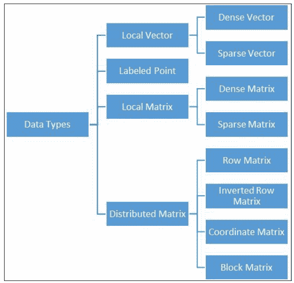
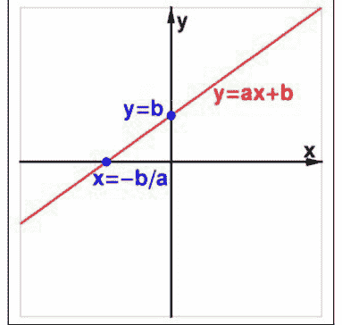

## 使用 Spark MLlib 进行机器学习分析

迄今为止，我们已经讨论了使用 Spark 的批处理和流应用程序以及 SQL 操作。在本章中，我们将讨论 Spark 机器学习模块。我们将简要讨论什么是机器学习，然后继续介绍 Spark 的机器学习实现。

我们将主要关注 Spark 的 spark.ml 包，该包以 DataFrame 作为输入数据类型。我们将涵盖管道等主题，然后继续介绍特征操作。

### 机器学习简介

Spark MLlib 是一个通用机器学习库，它提供了 Spark 的所有优势，即分布式计算、可扩展性和容错能力，以及与不同 Spark 模块和其他库的轻松互操作性。机器学习不是一个新概念，当然也并非仅由 Spark 开发，使 Spark MLlib 独树一帜的是其易用性以及使用管道开发任何 ML 算法的通用性。同样，管道作为一种概念已被 scikit-learn 库使用，而 Apache Spark 通过在分布式模式下使用相同的概念做出了出色工作。通常，Spark 机器学习模块包含：

- 常见机器学习算法。
- 用于加载、提取、转换和选择特征的工具。
- 使用管道链式多个操作的能力。
- 保存和加载算法、模型及管道的能力。
- 执行线性代数和统计操作的能力。

多年来，就像机器学习一样，Spark 的实现也经历了巨大变革。Spark 最初版本使用 spark.mllib 包，该包具有基于 RDD 的 API，但随着 Spark 2.0 的发布，引入了一个名为 spark.ml 的新包，用于操作 DataFrame。从 RDD 到 DataFrame 的这一转变有许多优势，例如：

  - Tungsten 和 Catalyst 优化器的所有优势都可以应用于 MLlib 操作
  - 可通过 DataFrame 访问的各种数据源现在可以直接在 MLlib 中使用
  - 特征提取和转换可以利用 Spark SQL 操作
  - 基于 DataFrame 的 API 在 MLlib 操作内部和跨 Spark 模块之间也提供了一致性，并且非常易于使用

在抽象层面上，Spark ML 包的实现可以看作是 DataFrame 上的一组 UDF 操作。

在继续介绍 Spark 的机器学习实现之前，让我们先了解机器学习作为一门学科及其相关概念。

### 机器学习概念

定义机器学习的还原论方法是，一种编程范式，其中现有数据有助于像分类算法那样推广结果，或进行一些预测。机器学习的先驱之一吴恩达（Andrew Ng）将机器学习定义为计算机在未被明确编程的情况下学习的科学。无论哪种观点与你共鸣，有一点是明确的，即机器学习涵盖从健康诊断到太空探索，以及你如何与网上朋友联系到食物如何送到你家门口等领域并解决相关问题。

每天，系统智能都在被添加到服务中，使机器更加智能，同时向我们展示优化和改进的方法。机器学习大致可分为四类：

- **受监督学习**：从现有数据集输出（标签）中学习，然后利用它们预测未标记数据集的输出值或标签的算法构成了受监督学习。受监督学习的一些示例是回归和分类模型。回归模型用于预测值，而分类模型用于对事物（例如垃圾邮件）进行分类。
- **无监督学习**：无监督学习具有探索性，机器学习用于查找输入数据集中的模式或相关性。无监督学习的示例包括 K-means 聚类和 **主成分分析 (PCA)**。
- **半监督学习**：它涉及一种混合方法，结合监督学习和无监督学习来解决问题。该技术是处理一小部分标记数据和一大部分未标记数据以得出输出。语音和图像处理利用这种方法来解决其领域特定问题。
- **强化学习**：强化学习用于人工智能及其相关领域。它允许机器和软件代理在特定上下文中自动确定理想行为，以最大化其性能。

机器学习还有一些特定于其领域的术语，值得讨论：

- **特征**：对于任何观察，特征代表一组定量描述实体的特征。例如，对于汽车，特征可以是其颜色、车型、座位数等。
- **标签**：标签是一个依赖实体，其结果与特征的值相关。例如，汽车的特征取决于车型和座位数，标签可能是汽车的制造商。

迄今为止，我们已熟悉机器学习的基本术语；但是，Spark 的机器学习实现除了之前讨论过的主题外，还增加了一些所需的概念。虽然 `spark.mllib` 包目前处于维护模式，并可能按计划在 Spark 3.0 中弃用，但 RDD-based API 中需要介绍的关键组件之一是 MLlib 的数据类型。


## 数据类型

尽管数据帧已成为执行 ML 操作的事实上的标准，但我们仍将按照以下内容介绍基于传统 RDD 的 Spark MLlib 数据类型的基础知识：

- 本地向量：本地向量存储在单台机器上，其值为 double 类型，每个值的索引均从零开始的整数存储。本地向量可进一步细分为稠密向量和稀疏向量。表示其值的 double 数组称为稠密向量，而稀疏向量则分别包含表示索引和值的两个数组。

例如，向量 ( 2.0, 0.0, 5.0, 3.0 ) 可表示为：

- 稠密向量：[ 2.0, 0.0, 5.0, 3.0]
- 稀疏向量：[4, (0,2,3), (2,0,5.0,3.0) ]
- 标注点：带有标签或响应值的稠密或稀疏本地向量称为标注点。它们在监督学习中更为突出，尤其用于分类和回归算法。标注点值以 double 类型存储。

| 算法 | 值 |
|---|---|
| 二分类 | 0 或 1 |
| 多分类 | 0, 1, 2... |
| 回归 | Double |

- 本地矩阵：存储在单台机器上、值为 double 类型且行列索引表示为整数的矩阵称为本地矩阵。它可进一步划分为稠密矩阵（其值按列序存储在单个 double 数组中）和稀疏矩阵（按列序在 Compressed Sparse Column (CSC) 格式中存储非零值）。

- 分布式矩阵：分布式矩阵存储在一个或多个 RDD 中，因此本质上是分布式的。此外，分布式矩阵的行列索引为 long 类型，值为 double 类型。将分布式矩阵转换为其他任何类型可能需要进行混洗，因此是一项昂贵操作。分布式矩阵已进一步分为以下子类别：
  - 行矩阵：面向行的分布式矩阵，无有意义的行索引（即无行索引的向量序列 RDD）
  - 索引行矩阵：类似于行矩阵，但带有有意义的行索引
  - 坐标矩阵：元素值通过 IndexedRow(row_index, col_index, value) 显式定义
  - 块矩阵：包含矩阵块集合（row_index, col_index, matrix）



Spark 2.0 在 Spark 中实现机器学习算法的方式上引入了范式转变。它们不仅通过引入新的 spark.ml 包将 RDD-based 操作改为基于数据帧的操作，还专注于使用管道解决问题。有关管道及其相关术语的重要概念将在以下各节中讨论。

## 机器学习工作流

机器学习工作流通常涉及两组操作：一组涉及训练模型，另一组涉及使用较新的数据集测试已训练的模型。

| 训练 | 测试模型 |
|---|---|
| 加载数据 | 加载测试数据 |
| 提取特征 | 提取特征 |
| 训练模型 | 使用模型进行预测 |
| 评估 | 结果 |

ML 工作流需要反复在同一组训练数据上进行迭代，同时只更改调参参数。这种迭代过程的目标是在评估训练数据上的值时实现误差最小化，随后才将模型输入测试数据以给出结果输出。为了在 ML 工作流中合并数据预处理、特征提取、模型拟合和验证等所有这些阶段序列，Spark 引入了管道。

## 管道

管道 API 是 `spark.ml` 包的一部分，它由一系列阶段组成，例如数据清洗、特征提取、模型训练、模型验证、模型测试等等。它提供了将所有这些不同阶段按序链接起来以开发任何机器学习算法的能力。首先让我们熟悉使用管道的 ML 工作流中常用的术语：

- 数据帧：与 `spark.mllib` 包不同，其数据类型基于 RDD，而在 `spark.ml` 中数据类型是数据帧。每个管道都期望输入数据为数据帧，该数据帧可从第 8 章《使用 Spark SQL》中讨论的各种数据源创建，例如来自文件系统、外部数据库和其他数据生成源。

- 转换器：转换器通过在现有数据集中添加更多列或更改数据帧值本身，将一个数据帧转换为另一个数据帧，从而在新数据帧中给出结果。转换器的一些示例包括：
  - Binarizer 转换器根据阈值将数据帧的输入列转换为 `0` 或 `1`
  - 机器学习模型从数据帧接受特征向量，然后将预测标签作为新列附加到结果数据帧中

转换器应用 `transform()` 方法转换数据帧：

- 估计器：估计器是任何在训练数据上进行训练或拟合以生成模型的机器学习算法，该模型本身也是一个转换器。随后该模型转换测试数据，在输出数据帧中产生结果值。例如：
  - K-means 是一个估计器，接受训练数据帧以生成 K-means 模型
  - 决策树是一个估计器，生成决策树模型

估计器具有 fit() 方法，需在学习数据帧上调用该方法以生成可转换输入数据的模型。

- 管道：管道将机器学习工作流的多个阶段链接在一起，每个阶段包含一个转换器或一个估计器。作业链接的序列特定于算法或用例，因此传递给管道的 PipelineStages（即转换器和估计器）的顺序至关重要。

现在我们已理解这些常用术语，让我们编写第一个机器学习算法，并理解这些参数之间的关系。为简单起见，我们将尝试理解一个名为线性回归的非常基本的回归模型。请提前注意，结果不会完美，因为我们在此仅旨在理解 ML 工作流中的主要组件。

简单的线性回归模型可表示为以下形式的方程：

```
y = ax + b
```

其中 x 是变量，或在 ML 术语中称为特征向量，a 是直线的斜率。b 是一个常数，表示当 x=0 时在 y 轴上的截距。



使用此线性回归模型，我们将尝试预测 **总展示量** 的值，这是 Facebook 帖子根据特征向量参数（如 Post Month、Post Weekday、Post Hour 等）获得的点赞、评论和分享的总和。

数据集可从 http://archive.ics.uci.edu/ml/datasets/Facebook+metrics 下载，包含约 500 条记录。为保持模型简单，我们将从前面的数据集中仅选择几列并将其称为 formattedDF。从特征向量 formattedDF 中，我们将数据集拆分为两部分，一部分为训练数据集，另一部分为测试数据集。此外，由于线性回归模型接受单个特征向量，我们将使用 VectorAssembler（一种将多个原始特征合并为单个特征向量的转换器）。随后我们将 VectorAssembler 的实例和 LinearRegression 的实例一起传递给管道，它们共同返回一个名为 lrPipeline 的转换器实例。然后使用训练数据对管道实例 lrPipeline 使用 fit() 方法进行训练。fit() 方法返回一个 PipelineModel，测试数据可在其上进行测试：

```
Dataset<Row> formattedDF = ds.select(col("Page total likes"),col("Category"),col("Post Month"),col("Post Weekday"),col("Post Hour"),col("Paid"),col("Lifetime People who have liked your Page and engaged with your post"),col("Total Interactions"));
formattedDF.show();
//Split the sample into Training and Test data
Dataset<Row>[] data = formattedDF.na().drop().randomSplit(new double[]{0.7,0.3});
System.out.println("We have training examples count ::"+data[0].count() +
" and test examples count ::"+data[1].count()));

String[] featuresCols = formattedDF.drop("Total Interactions").columns();

//This concatenates all feature columns into a single feature vector in a new column "rawFeatures".
VectorAssembler vectorAssembler = new VectorAssembler().setInputCols(featuresCols).setOutputCol("rawFeatures");

//StandardScaler scaler = new StandardScaler().setInputCol("rawFeatures").setOutputCol("features").setWithStd(true).setWithMean(false);

LinearRegression lr = new LinearRegression().setLabelCol("Total Interactions").setFeaturesCol("rawFeatures").setMaxIter(10).setRegParam(0.3).setElasticNetParam(0.8);

// Chain vectorAssembler and lr in a Pipeline
```


Pipeline lrPipeline = new Pipeline().setStages(new PipelineStage[]
{vectorAssembler, lr});
// Train model.
PipelineModel lrModel = lrPipeline.fit(data[0]);
// Make predictions.
Dataset<Row> lrPredictions = lrModel.transform(data[1]);
// Select example rows to display.
lrPredictions.show(20);

在继续之前，你应该注意到预测结果并不十分准确。这是因为：

- 我们的机器学习模型非常简单，即使线性回归的定义也只考虑了最简单的可能性 Linear Regression，且该模型是一个线性方程
- 样本量非常有限，总共只有约 500 条记录，其中 350 条作为训练数据
- 我们没有将详尽的参数列表作为特征向量包含在内
- 我们也没有专注于模型选择或参数调优

现在让我们来讨论上述每个原因的解决方案：

- 1. 我们对使用机器学习算法的理解应当非常精确，例如，在 Spark 2.0 中，线性回归有两种变体，一种称为 **线性回归**，另一种称为 **广义线性回归**。不仅如此，在广义线性回归下，还有各种实现选项，例如高斯、二项分布、泊松、伽马和 Tweedie。因此，至关重要的是正在使用哪种类型的机器学习算法，以及该算法是否存在相关的子类型。如果存在，那么哪种变体最适合我们的用例。这个问题没有简单直接的答案；然而，数据科学的领域知识无疑将有助于在决定选择哪种模型时得出更好的结论。
- 2. 样本的选择应当足够详尽，以涵盖功能的大部分，如果不是全部可能场景的话。
- 3. 机器学习算法的选择起着重要作用；同样重要的是代表特征向量的参数的选择。例如，在前面的用例中，我们没有涵盖发布消息的用户的性别，但有些研究表明，用户的性别在生成展示量（即评论、点赞或分享）方面也起着重要作用。另一个重要方面是在特征向量中添加或删除人为偏差因素。微软推出了两款自学习聊天机器人 Tay 和 Zo，但它们惨败了，因为本应让它们从无法由公司控制的交互中学习。这对他们来说一直是个令人担忧的问题，整个场景也应引起任何机器学习算法开发者的注意，开发者需要有意识地决定是否要在特征向量中添加人为偏差。
- 4. 每个机器学习工作流都有自己的一组可调优参数，可以对其进行微调以生成一组或另一组结果。哪种参数组合适合任何用例的需求，既取决于经验，也取决于我们围绕各种参数进行调整并评估结果的能力。

在本节中，我们讨论了使用管道和链接各种组件来实现机器学习工作流。在下一节中，我们将讨论各种提取、转换和选择特征的技术。

## 特征向量上的操作

虽然 spark.ml 包将数据帧用于机器学习工作流，但取决于用例，可能需要从原始数据帧中提取数据，或将数据帧转换为机器学习算法所需的格式，有时可能只需要少量选定的参数作为特征向量。所有这些不同类型的操作都需要使用专门开发的 API，这些 API 可以分为以下几类。

## 特征提取器

当原始数据帧中的数据不以机器学习算法期望的形式明确存在时，我们使用特征提取器来提取这些特征。常见的特征提取器有：

- **计数向量器**：CountVectorizer 将文档集合转换为表示文档中单词计数的向量。CountVectorizer 的工作方式有两种，取决于词典值的填充方式。首先假设用户没有关于将填充文本数据集的数据类型的先验信息；在这种情况下，词典是根据数据集中的术语频率出现情况来准备的。VocabSize 定义词典可以容纳的单词数量，而可选参数 minDF 则限制词典中单词的加入，如果该单词在文档中的出现次数少于 minDF 的值：

```
List<Row> data = Arrays.asList(
RowFactory.create(Arrays.asList("w1", "w2", "w3")),
RowFactory.create(Arrays.asList("w1", "w2", "w4", "w5", "w2"))
);
StructType schema = new StructType(new StructField[]{
new StructField("text", new ArrayType(DataTypes.StringType, true), false)
});
Dataset<Row> df = spark.createDataFrame(data, schema);

CountVectorizerModel cvModel = new CountVectorizer()
.setInputCol("text")
.setOutputCol("feature")
.setVocabSize(5)
.setMinDF(2)
.fit(df);

System.out.println("The words in the Vocabulary are :: " +
cvModel.transform(df).show(false));
```

上述代码的输出如下：

| text | feature |
| --- | --- |
| [w1, w2, w3] | (2,[0,1],[1.0,1.0]) |
| [w1, w2, w4, w5, w2] | (2,[0,1],[2.0,1.0]) |

当未定义词典时，CountVectorizer 会遍历数据集两次以根据频率和大小准备词典。如果知道构成词典的单词值，则可以优化准备特征向量的过程，从而节省一次遍历。在此场景中，在实例化 CountVectorizer 时会构建一个 _先验_ 词典，因此如果在与之前示例相同的数据集上运行以下转换：

```
CountVectorizerModel cvMod = new CountVectorizerModel(new String[]{"w1", "w2"})
.setInputCol("text")
.setOutputCol("feature");
System.out.println("The words in the Vocabulary are :: " +
cvMod.transform(df).show(false));
```

我们得到以下输出：

词汇表中的单词为：[w1, w2, w3]

| text | feature |
| --- | --- |
| [w1, w2, w3] | (3,[0,1,2],[1.0,1.0,1.0]) |
| [w1, w2, w4, w5, w2] | (3,[0,1],[1.0,2.0]) |

- **词频-逆文档频率（TF-IDF）**：它被用作一种特征提取技术。TF-IDF 用于计算文档中单个单词的权重，而不是整个数据集。这里的权重是指统计评估，用于衡量集合或数据集中文档内单词的重要性。随着文档中单词频率的增加，其重要性也随之提高，但在 TF-IDF 中，这会被该单词在整个集合或数据集中的频率所抵消。TF-IDF 由两部分组成，即：

- **术语频率（TF）**：它是衡量术语在文档中出现频率的统计量。例如，如果在一个文档中 spark 出现五次，而该文档中的单词总数为 20，则：

TF= 文档中单词出现的频率 / 文档中的单词总数
=5/20=0.25

在 Spark ML 库中，可以使用 `HashingTF` 或 `CountVectorizer` 来计算 TF：

- **逆文档频率（IDF）** 衡量术语在集合或整个数据集中的重要性。它考虑了这样一个事实：某些术语，如 *is, are, the* 等，尽管出现频率较高，但就数据集而言，其重要性很小。因此，如果单词 spark 出现在考虑数据集的 100,000 个文档中的 100 个文档中，则：

IDF= loge(文档总数/包含特定术语或单词的文档数)
= loge(10000/100) = 4.6
因此 TF-IDF 的值 = TF*IDF
= 0.25*4.6=1.15

在 Spark 中，IDF 是一个估计器，通过在数据集上使用 `fit()` 方法生成 IDFModel。然后使用 `transform()` 方法将由 `HashingTF` 或 `CountVectorizer` 创建的特征向量传递给它，该方法会重新缩放或偏移原始向量值：

```
List<Row> data = Arrays.asList(
RowFactory.create(0.0, "Spark"),
RowFactory.create(0.0, "Spark"),
RowFactory.create(0.5, "MLIB"),
RowFactory.create(0.6, "MLIB"),
RowFactory.create(0.7, "MLIB"),
RowFactory.create(1.0, "ML")
);
StructType schema = new StructType(new StructField[]{
new StructField("label", DataTypes.DoubleType, false, Metadata.empty),
new StructField("words", DataTypes.StringType, false, Metadata.empty)
});
Dataset<Row> rowData = spark.createDataFrame(data, schema);
Tokenizer tokenizer = new Tokenizer().setInputCol("words").setOutputCol("tokenizedWords");
Dataset<Row> tokenizedData =
tokenizer.transform(rowData);
int numFeatures = 20;
HashingTF hashingTF = new HashingTF()
.setInputCol("tokenizedWords")
.setOutputCol("rawFeatures")
.setNumFeatures(numFeatures);
Dataset<Row> featurizedData = hashingTF.transform(tokenizedData);
IDF idf = new IDF().setInputCol("rawFeatures").setOutputCol("features");
IDFModel idfModel = idf.fit(featurizedData);


```java
Dataset<Row> rescaledData = idfModel.transform(featurizedData);
rescaledData.select("label", "features").show(false);
```

Word2Vec 作为一个估计器，通过接受由句子或词序列组成的数据集值（这些值共同表示为文档）来生成 Word2VecModel。该模型通过使用文档中所有单词的平均值将文档转换为向量，从而生成一个固定大小的向量。Word2Vec 广泛用于预测、文档相似度计算等：

```java
List<Row> data = Arrays.asList(
    RowFactory.create(Arrays.asList("Learning Apache Spark")),
    RowFactory.create(Arrays.asList("Spark has API for Java")),
    RowFactory.create(Arrays.asList("API in above language"))
);
StructType schema = new StructType(new StructField[]{
    new StructField("text", new ArrayType(DataTypes.StringType, true))
});
Dataset<Row> documentDF = spark.createDataFrame(data, schema);
Word2Vec word2Vec = new Word2Vec()
    .setInputCol("text")
    .setOutputCol("result")
    .setVectorSize(10)
    .setMinCount(0);
Word2VecModel model = word2Vec.fit(documentDF);
Dataset<Row> result = model.transform(documentDF);
result.show(false);
```

| 特征提取 | CountVectorizer |
|---|---|
| | TF-IDF |
| | Word2Vec |
| 转换 | Tokenizer |
| | StopWordsRemover |
| | n-gram |
| | VectorAssembler 等等。 |
| 选择 | ChiSqSelector |
| | RFormula |
| | VectorSlicer |

## 特征转换器

特征转换器是通过缩放、转换或修改父数据框的特征来转换数据的转换器。一些常见的特征转换器如下：

- **Tokenizer**: Tokenizer 通过将句子或文档拆分为单个单词来转换它们。如下示例所示，数据框中的句子将被拆分为单词：

```java
List<Row> data = Arrays.asList(
    RowFactory.create(0, "Learning Apache Spark"),
    RowFactory.create(1, "Spark has API for Java, Scala, and R"),
    RowFactory.create(2, "API in above language are very rich")
);

StructType schema = new StructType(new StructField[]{
    new StructField("id", DataTypes.IntegerType, false, Metadata),
    new StructField("sentence", DataTypes.StringType, false)
});

Dataset<Row> sentenceDataFrame = spark.createDataFrame(data, schema);
Tokenizer tokenizer = new Tokenizer().setInputCol("sentence");
Dataset<Row> tokenized = tokenizer.transform(sentenceDataFrame);
tokenized.show(false);
```

Tokenizer 提供了一个非常直接的用途，即基于空格拆分句子，因此由于其简单性，有时其可用性会受到限制。RegexTokenizer 可用于克服基于正则表达式拆分单词的这一局限性。

- **StopWordsRemover**: 这是一个转换器，用于从文档中删除常用词，因为这些词对文档内容的贡献不大，而是对上下文有贡献，例如 is、a、the 等词。默认情况下，停用词删除的语言为英语，但可以使用 loadDefaultStopWords (languages) 方法进行更改，支持的语言包括英语、法语、意大利语、俄语等。还可以使用 stopWords 参数指定自定义停用词列表：

```java
List<Row> data = Arrays.asList(
    RowFactory.create(Arrays.asList("This", "is", "a", "book")),
    RowFactory.create(Arrays.asList("The", "language", "used"))
);

StructType schema = new StructType(new StructField[]{
    new StructField("raw", DataTypes.createArrayType(DataTypes.StringType, true))
});

StopWordsRemover remover = new StopWordsRemover()
    .setInputCol("raw")
    .setOutputCol("filtered");

Dataset<Row> dataset = spark.createDataFrame(data, schema);
remover.transform(dataset).show(false);
```

示例代码的输出为

| 原始 | 过滤后 |
|---|---|
| [This, is, a, book, on, Spark] | [book, Spark] |
| [The, language, used, is, Java] | [language, used, Java] |

- **VectorAssembler**: 这被用作一个转换器，用于将数据框中的多个列合并为单个向量列。在某些算法（如线性回归、逻辑回归或决策树）中，输入数据集预期具有一个单一特征向量，VectorAssembler 就在此类场景中发挥作用。但是，VectorAssembler 有一些限制，取决于输入列的数据类型，它接受所有数值、布尔型和向量数据类型：

```java
Dataset<Row> featSet = emp_ds.select(col("empId"), col("salary"), col("deptno"));
String[] featuresCols = featSet.columns();
VectorAssembler vectorAssembler = new VectorAssembler().setInputCols(featuresCols);
Dataset<Row> output = vectorAssembler.transform(featSet);
output.show(false);
```

## 特征选择器

数据框可能包含不需要的列，或者有时不够重要，无法以任何方式为标签计算做出贡献。特征选择器是帮助从更大的特征集中选择特征子集的转换器。常见的特征选择器如下：

- **ChiSqSelector**: ChiSqSelector 使用卡方独立性检验从特征向量中选择特征。卡方独立性检验的详细内容超出了本书的范围，但简单来说，选择器会根据 NumTopFeatures 参数的值动态选择最佳的特征数量，这将影响 ML 算法的预测输出：

```java
List<Row> data = Arrays.asList(
    RowFactory.create(1, Vectors.dense(0.1, 0.0, 1.0, 20.0)),
    RowFactory.create(2, Vectors.dense(0.2, 1.0, 13.0, 40.6)),
    RowFactory.create(3, Vectors.dense(0.3, 2.0, 21.0, 1.1))
);
StructType schema = new StructType(new StructField[]{
    new StructField("id", DataTypes.IntegerType, false, Metadata),
    new StructField("rawfeatures", new VectorUDT(), false),
    new StructField("label", DataTypes.DoubleType, false, Metadata)
});

Dataset<Row> df = spark.createDataFrame(data, schema);

ChiSqSelector selector = new ChiSqSelector()
    .setNumTopFeatures(1)
    .setFeaturesCol("rawfeatures")
    .setLabelCol("label")
    .setOutputCol("features");

Dataset<Row> result = selector.fit(df).transform(df);
result.show();
```

- **VectorSlicer**: 这是一个接受特征向量并返回原始特征向量子集的特征向量的转换器。当原始特征向量中包含对数据集上应用的算法无关的特征时，需要此类转换。可以将列索引或名称传递给 VectorSlicer 以选择子集特征向量，但是，为了使用名称过滤特征，需要先使用 setNames() 方法设置特征名称：

```java
Dataset<Row> featSet = emp_ds.select(col("empId"), col("salary"), col("deptno"));
String[] featuresCols = featSet.columns();
Dataset<Row> vecAssembler = new VectorAssembler().setInputCols(featuresCols);
VectorSlicer vectorSlicer = new VectorSlicer().setInputCol(featuresCols);
vectorSlicer.setIndices(new int[]{1, 2});
Dataset<Row> output = vectorSlicer.transform(vecAssembler);
output.show(false);
```

## 摘要

本章讨论了机器学习作为一门研究领域及其各种子分类。接着，我们进一步讨论了与机器学习相关的各种术语，以及机器学习在 Apache Spark 中的实现方式。我们还介绍了 spark.mllib 包中使用的数据类型，然后讨论了使用管道进行作业链。管道相关的术语也详细讨论了，并结合了用例。最后，讨论了特征上的操作。

在下一章中，我们将深入探讨 Spark 的另一个模块，即 GraphX，并了解 GraphX RDD 的类型及其相关的各种操作。我们还将讨论围绕 GraphX 实现的用例。


