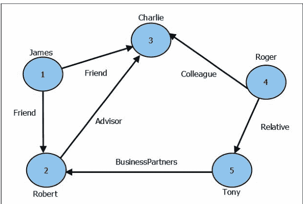
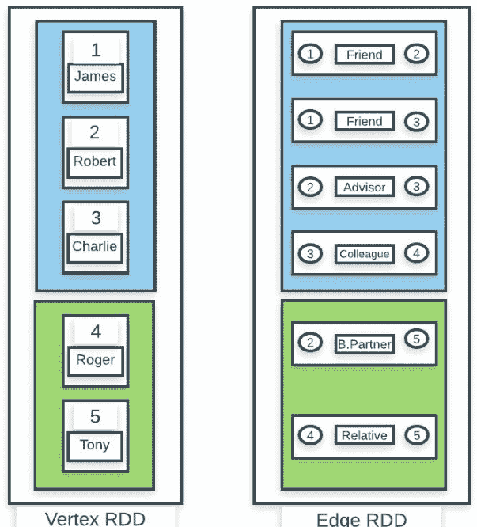
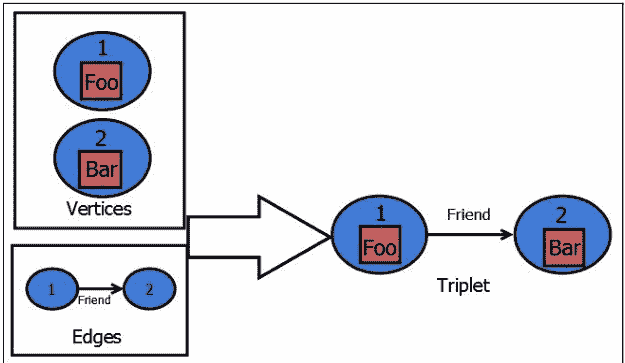
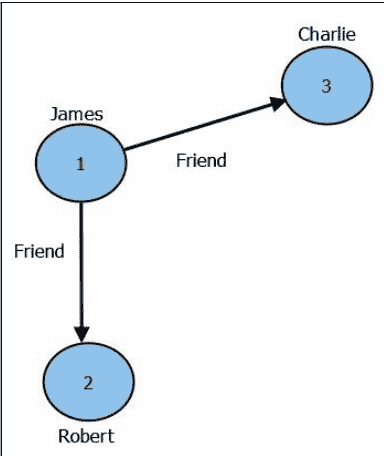
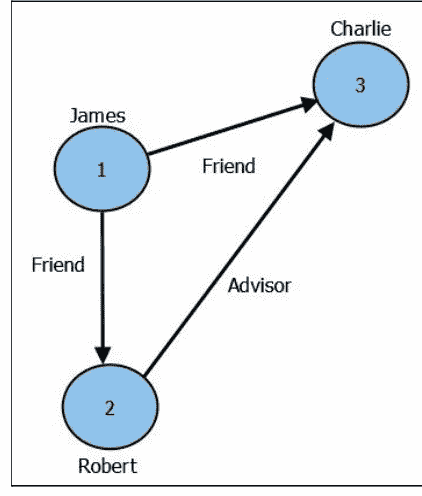
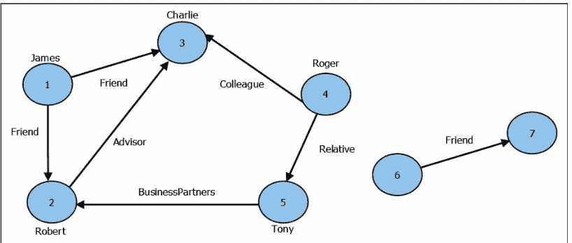

## 学习 Spark GraphX

在本章中，我们将讨论 Spark GraphX 库，它有助于在 Spark 之上执行基于图的计算。本章的目的是让读者熟悉 GraphX 库。我们将讨论如何在 Spark 中存储图，以及可以在图上执行的内置操作。我们还将讨论 GraphX 库中可用的一些基于图的算法。

## GraphX 简介

根据 Apache Spark 文档：“GraphX 是 Apache Spark 的图和图并行计算 API”。随着技术的进步，基于图的计算变得非常流行。无论是查找两点之间的最短路径、匹配 DNA，还是社交媒体，图计算都已无处不在。

图由顶点和边组成，其中顶点定义实体或节点，边定义实体之间的关系。根据要求，边可以是单向或双向。例如，描述 Facebook 上两个用户之间友谊关系的边是双向的；然而，描述 Twitter 上两个用户之间关注者关系的边可能是双向的，也可能不是，因为一个人可以在 Twitter 上关注另一个人，而不会被那个人关注。

Spark GraphX 库有助于在 Spark 之上运行基于图的计算。它在 Spark RDD 上提供了一种基于图的抽象，称为属性图（Property Graph），它是一个有向多重图，其中每个顶点和边都关联一个属性。GraphX 库提供各种变换集来运行图计算。它还带有基本的基于图的算法，例如 PageRank、三角形计数等，这些有助于运行基于图的分析。

让我们开始探索 GraphX 库！

## 属性图简介

它是 `graphx` API 的基本抽象。属性图是一个有向多重图，其中每个顶点和边都关联一个属性。属性图中的每个顶点还关联一个唯一的 64 位长整型标识符（`VertexId`）。有向多重图定义为有向图，其中相同顶点之间可以有多个边（`关系`），例如 A 可以既是 B 的朋友，也是队友。

以下是属性图的逻辑表示：



属性图的逻辑表示

这里，我们有一个包含五个顶点的属性图。图中的每个顶点包含一个 `vertexId` 和一个 `property`，在本例中该属性是字符串对象，每条边也关联一个属性，同样也是字符串对象，用于描述顶点之间的关系。

Spark 将顶点和边存储在不同的 RDD 中，如下所示：



## 属性图的存储表示

顶点 RDD 的每个元素包含一个 `vertexId` 和关联的属性，边 RDD 的每个元素包含源顶点的 ID、目标顶点的 ID 和关联的属性。蓝色和绿色块代表 RDD 的分区。

以下是图抽象的一些属性：

- 由于属性图存储为 RDD，它们具有 RDD 的所有属性，例如分区和分布、不可变性、容错性、惰性求值等等
- 由于顶点和边存储为独立的 RDD，这使得可以转换顶点或边而无需转换另一个
- 在转换过程中，创建新图时可以复用图中不受影响的结构、属性和索引部分
- 顶点 ID 用于在不同节点之间对 RDD 范围进行分区

## 开始使用 GraphX API

在本节中，我们将使用 GraphX API 创建一个图。这里我们将首先创建顶点和边 RDD，然后使用它们来创建图。

> 从 Spark 2.1.x 开始，GraphX 库仅提供稳定的 Scala API。GraphX 的 Java API 仍处于 ALPHA 版本。在本章中，我们将在 Java 中调用 GraphX 的 Scala API（在需要时）来执行 GraphX 库中提供的图操作。

让我们从使用上一节中提供的示例开始创建图。以下是创建图的方法。

## 使用顶点和边 RDD

- 1. 首先我们定义顶点和边 RDD 如下：

```
List<Tuple2<Object, String>> vertices = new ArrayList<>();

vertices.add(new Tuple2<Object, String>(11, "James"));
vertices.add(new Tuple2<Object, String>(21, "Robert"));
vertices.add(new Tuple2<Object, String>(31, "Charlie"));
vertices.add(new Tuple2<Object, String>(41, "Roger"));
vertices.add(new Tuple2<Object, String>(51, "Tony"));

List<Edge<String>> edges = new ArrayList<>();

edges.add(new Edge<String>(1, 2, "Friend"));
edges.add(new Edge<String>(2, 3, "Advisor"));
edges.add(new Edge<String>(1, 3, "Friend"));
edges.add(new Edge<String>(4, 3, "colleague"));
edges.add(new Edge<String>(4, 5, "Relative"));
edges.add(new Edge<String>(5, 2, "BusinessPartners"));

JavaRDD<Tuple2<Object, String>> verticesRDD = javaSparkContext.parallelize(vertices);
JavaRDD<Edge<String>> edgesRDD = javaSparkContext.parallelize(edges);
```

org.apache.spark.graphx.Graph API 要求顶点类型和边类型使用 scala.reflect.ClassTag 对象。这些是 Scala 对象，本质上是单例。

- 2. 这些可以通过在 Java 中调用 Scala API 定义如下：

```
ClassTag<String> stringTag = scala.reflect.ClassTag$.MODULE$.apply(String.class);
```

由于顶点和边关联的属性都是 String 类型，因此前面的 ClassTag 对象可同时用于两者。

- 3. 使用这些 RDD，可以按以下方式创建 Graph()：

```
Graph<String, String> graph = Graph.apply(verticesRDD.rdd(), edgesRDD.rdd());
```

- 4. 可以使用 collect() 操作打印顶点和边，如下所示：

```
graph.vertices().toJavaRDD().collect().forEach(System.out::println);
graph.edges().toJavaRDD().collect().forEach(System.out::println);
```

## 从边创建

图也可以仅使用边创建，如下所示：

```
Graph<String, String> graph = Graph.fromEdges(edgeRDD.rdd(), "", StorageLevel.MEMORY_ONLY());
```

然而在这种情况下，顶点没有关联的属性。需要在顶点上执行 Map 转换来将属性关联到顶点。我们将在下一节讨论图上的 Map 转换。

## EdgeTriplet

除了 Edge 类之外，GraphX 库还提供另一种抽象，称为 EdgeTriplet。EdgeTriplet 扩展了 Edge 类，并添加了源顶点和目标顶点的属性。

因此，除了 Edge 类的字段（如源顶点 ID、目标顶点 ID 和边属性）之外，它还包含源顶点和目标顶点的属性。



EdgeTriplet 的逻辑表示

图上的 triplets() 函数提供图的 EdgeTriplets，如下所示：

```
RDD<EdgeTriplet<String, String>> triplets = graph.triplets();
```

图的所有 EdgeTriplet 元素可以按如下方式打印：

```
graph.triplets().toJavaRDD().collect().forEach(System.out::println);
```

## 图操作

GraphX 库提供各种可以在属性图上执行的内置操作。在本节中，我们将讨论这些操作。

## mapVertices

类似于 RDD 上的 map 转换，mapVertices 允许用户转换图的顶点。mapVertices 方法的签名如下：

```
mapVertices(scala.Function2<Object, VD, VD2> map, scala.reflect.ClassTag<VD2> evidence)
```

要在 Java 中实现 scala.Function2，可以使用 scala.runtime.AbstractFunction2，因为在 Java 中实现 scala.Function2 要求用户实现大量抽象方法，这会生成大量字节码。

为了减少匿名函数（如 scala.Function0、scala.Function1、scala.Function2 等）生成的字节码，引入了 AbstractFunction0、AbstractFunction1、AbstractFunction2 等。这就是它们位于 scala.runtime 包中的原因。在 Java 中调用图操作时可以利用它们。但是，由于这些是抽象类，我们无法将它们实现为 Lambda 表达式：

```
public class AbsFunc1 extends scala.runtime.AbstractFunction2<Object, String, String> {
  @Override
  public String apply(Object arg0, String arg1) {
    return "Vertex:" + arg1;
  }
}
```

这里通过在每个顶点名称前添加 "Vertex:" 字符串来转换顶点的属性。请注意，AbsFunc1 也实现了 Serializable，这是强制性的，因为 Spark 作为分布式处理系统，要求对象必须可序列化。

如前一节所述，可以在 Java 中按以下方式创建 scala.reflect.ClassTag：

```
ClassTag<String> stringTag = scala.reflect.ClassTag$.MODULE$.apply(String.class);
```

scala.Predef.$eq$colon$eq 也是一个 Scala 对象，可以在 Java 中按以下方式定义：


$eq$colon$eq<String, String> tpEquals = scala.Predef.$eq$colon$eq$.MODULE$.tpEquals

因此，可以按如下方式执行 mapVertices()：

```
Graph<String, String> mapVertices = graph.mapVertices(new AbsFunc1(), stringTag, tpl
```

要验证，可以按如下方式打印所有顶点：

```
mapVertices.vertices().toJavaRDD().collect().forEach(System.out::println);
```

mapVertices() 等同于对顶点 RDD 执行 map 操作，以获取转换后的顶点输出值，即：

```
JavaRDD<String> map = graph.vertices().toJavaRDD().map(x -> "Vertex:" + x);
```

但是请注意，它不会保留图索引或结构。它返回 JavaRDD，需要使用它来重新构建图。因此，推荐使用 mapVertices()。

## mapEdges

与 mapVertices 类似，mapEdges 用于转换边。mapEdges 的签名如下：

```
mapEdges(scala.Function1<Edge<ED>, ED2> map, scala.reflect.ClassTag<ED2> evidence$4)
```

先前创建的图对象的边具有字符串类型的属性。在此示例中，我们将把边属性转换为与字符串长度相等的整数值。转换函数的定义如下：

```
public class AbsFunc1 extends AbstractFunction1<Edge<String>, Integer> implements Serializable
@Override
public Integer apply(Edge<String> edge) {
return edge.attr().length();
}
```

因此，可以按如下方式执行 mapEdges：

```
graph.mapEdges(new AbsFunc1(), scala.reflect.ClassTag$.MODULE$.apply(Integer.class))
```

## mapTriplets

与 mapVertices 和 mapEdges 类似，mapTriplets 用于转换边三元组。该方法的签名如下：

```
mapTriplets(scala.Function1<EdgeTriplet<VD, ED>, ED2> map, scala.reflect.ClassTag<ED2>)
```

在此，我们将执行与 mapEdges 章节中相同的操作；即，将边属性转换为整数值。转换函数的定义如下：

```
public class AbsFunc1 extends AbstractFunction1<EdgeTriplet<String, String>, Integer>
@Override
public Integer apply(EdgeTriplet<String, String> triplet) {
  return triplet.attr().length();
}
```

mapTriplets 转换可以按如下方式执行：

```
graph.mapTriplets(new AbsFunc1(), scala.reflect.ClassTag$.MODULE$.apply(Integer.class))
```

## reverse

reverse() 转换用于反转图中边的方向。此操作仅反转边的源索引和目标索引，而不更新任何顶点和边属性。可以按如下方式执行：

```
Graph<String, String> reversedGraph = graph.reverse();
```

要验证，请打印三元组：

```
reversedGraph.triplets().toJavaRDD().collect().forEach(System.out::println);
```

## subgraph

顾名思义，子图操作返回图的一部分。此操作返回满足用户定义条件的顶点和边组成的图。在此示例中，我们将获取边属性为 Friend 的图的部分。

subgraph 方法的签名如下：

```
subgraph(scala.Function1<EdgeTriplet<VD, ED>, Object> epred, scala.Function2<Object, Object, Object> vpred)
```

第一个参数用于过滤边，第二个参数用于根据用户定义的条件过滤顶点。由于我们要过滤边属性为 Friend 的图，因此无需在第二个参数中指定任何过滤条件。两个参数的实现如下：

```
public class AbsFunc1 extends AbstractFunction1<EdgeTriplet<String, String>, Object>
@Override
public Object apply(EdgeTriplet<String, String> arg0) {
return arg0.attr().equals("Friend");
}
}

public class AbsFunc2 extends AbstractFunction2<Object, String, Object> implements Serializable
@Override
public Object apply(Object arg0, String arg1) {
return true;
}
}
```

因此，可以按如下方式执行子图操作：

```
Graph<String, String> subgraph = graph.subgraph(new AbsFunc1(), new AbsFunc2());
subgraph.triplets().toJavaRDD().collect().forEach(System.out::println);
```

前面操作在图上的逻辑输出如下：



子图操作输出的逻辑表示

## aggregateMessages

在基于图的计算中，汇总顶点数据非常常见。例如，查找用户在 Facebook 上的好友总数或查找用户在 Twitter 上的关注者总数。aggregateMessages 转换是 GraphX 的主要聚合函数。该方法的签名如下：

```
aggregateMessages(scala.Function1<EdgeContext<VD, ED, A>, scala.runtime.BoxedUnit>)
```

aggregateMessages 作为 MapReduce 函数工作。sendMessage 函数可视为 mapFunction，用于从源向目标或从目标向源发送消息。它以 EdgeContext 对象作为参数，该对象公开了在源顶点和目标顶点之间发送消息的方法。mergeMsg 函数可视为 reduce 函数，用于聚合使用 sendMessage 函数发送的消息。

Triplets 对象可用于指定 sendMsg 函数中使用的 EdgeContext 的哪一部分（例如源属性或目标属性），以优化行为。该参数的默认值为 TripletFields.All。

在此示例中，我们将统计一个顶点是多少条有向边的目标。这类似于统计用户在 Twitter 上有多少关注者。

sendMsg 函数的定义如下：

```
public class AbsFunc1 extends AbstractFunction1<EdgeContext<String, String, Integer>, BoxedUnit>
@Override
public BoxedUnit apply(EdgeContext<String, String, Integer> arg0) {
  arg0.sendToDst(1);
  return BoxedUnit.UNIT;
}
```

此处我们正在从源向目标顶点发送值为 1 的消息。mergeMsg 函数可定义如下：

```
public class AbsFunc1 extends scala.runtime.AbstractFunction2<Integer, Integer, Integer>
@Override
public Integer apply(Integer i1, Integer i2) {
  return i1 + i2;
}
```

在此函数中，我们正在对顶点接收到的所有消息求和。这可以被视为 MapReduce 中的单词计数程序。

使用上述用户定义的函数，可以按如下方式执行 aggregateMessages 操作：

```
VertexRDD<Integer> aggregateMessages = graph.aggregateMessages(new AbsFunc4(), new AbsFunc5());
aggregateMessages.toJavaRDD().collect().forEach(System.out::println);
```

如上例所示，它返回一种 VertexRDD 类型，包含顶点 ID 和聚合结果。未作为任何有向边目标的顶点不包含在生成的 RDD 中。

## outerJoinVertices

在分析系统中，连接数据集是一项非常流行的操作。outerJoinVertices 操作用于将图与外部 RDD 进行连接。在某些外部属性需要合并到图中时，将图与外部数据集连接非常有用。

outerJoinVertices 转换的签名如下：

```
outerJoinVertices(RDD<scala.Tuple2<Object, U>> other, scala.Function3<Object, VD, U, Object>)
```

在此，第一个参数是要连接的数据集。图顶点的顶点 ID 与 Tuple 对象/键元素进行连接。第二个参数是用户定义的连接函数。正如操作名称所暗示的，它作为外连接操作工作。因此，连接函数接受一个 scala.Option 选项，如果在外部数据集中未找到顶点 ID 的匹配项，则该选项为空。

其余参数是 Scala 对象、classTag 和 eq；我们已在前一节中定义过它们。让我们定义外部 RDD。顶点属性是前几节中定义的随机名称的图。在此，我们将定义一个为这些名称提供姓氏的 RDD：

```
List<Tuple2<Object, String>> dataToJoin = new ArrayList<>();
dataToJoin.add(new Tuple2<Object, String>(11, "Wilson"));
dataToJoin.add(new Tuple2<Object, String>(21, "Harmon"));
dataToJoin.add(new Tuple2<Object, String>(31, "Johnson"));
dataToJoin.add(new Tuple2<Object, String>(41, "Peterson"));
dataToJoin.add(new Tuple2<Object, String>(51, "Adams"));
JavaRDD<Tuple2<Object, String>> dataToJoinRdd = javaSparkContext.parallelize(dataToJoin);
```

以下是定义与顶点外连接一起执行的操作的用户定义函数：

```
public class AbsFunc1 extends AbstractFunction3<Object, String, Option<String>, String>
@Override
public String apply(Object o, String s1, Option<String> s2) {
  if (s2.isEmpty()) {
    return s1;
  }
```


}
else {
    return s1 + "" + s2.get();
}
}
}

如果未找到匹配项，则返回名称本身。

因此，可以按以下方式执行 outerJoinVertices 操作：

```
Graph<String, String> outerJoinVertices = graph.outerJoinVertices(dataToJoinRdd.rdd outerJoinVertices.vertices().toJavaRDD().collect().forEach(System.out::println);
```

在本节中，我们学习了各种基于图的操作。在下一节中，我们将使用 *GraphX* 库实现一些图算法。

## 页面排名（PageRank）

Spark GraphX 库为一些非常流行的图算法提供了内置实现。这些实现有助于以简化的方式执行各种基于图的分析。org.apache.Spark.graphx.GraphOps API 允许在图上执行这些操作。在本节中，我们将使用以下实现运行基于图的分析：

### 页面排名（PageRank）

**页面排名（PageRank）** 是图论中最流行的算法之一。它根据顶点的重要性对顶点进行排名。顶点的重要性是通过指向该顶点的边数量来计算的。例如，用户在 Twitter 上的排名很高，这取决于其追随者数量，即指向该用户顶点的有向边数量。

页面排名算法由 Google 创始人 _拉里·佩奇_ 和 _谢尔盖·布林_ 开发，用于衡量网页的重要性。因此，页面排名实现的最佳示例是 Google 搜索引擎。Google 根据页面的重要性对其进行排名。例如，如果页面 X 包含指向页面 Y 的超链接，那么页面 Y 对页面 X 具有重要性，因为其排名会提升。Google 非常高效地使用此算法对页面进行排名，并根据用户搜索查询中的关键词首先输出排名靠前的页面。

Spark Graphx 提供以下两种执行页面排名的方式。

#### 静态页面排名

staticPageRank 运行定义的迭代次数以计算页面排名。以下是静态页面排名操作的签名：

```
staticPageRank(int numIter, double resetProb)
```

此方法需要两个参数。第一个参数是计算页面排名所需的迭代次数，第二个参数是重置概率，用于计算页面排名中的 *阻尼系数*，其值应为 0.0<resetProb<1.0。请参阅 [阻尼系数详细信息](http://infolab.stanford.edu/~backrub/google.html) 以获取有关阻尼系数的详细信息。

可以按以下方式在图上执行静态页面排名：

```
Graph<Object, Object> graphWithStaticRanking = graph.ops().staticPageRank(1,0.20);
```

此操作会生成一个包含带有排名的顶点的图。要查找排名，可以按以下方式打印顶点元素：

```
graphWithStaticRanking.vertices().toJavaRDD().collect().forEach(System.out::println);
```

考虑到本章提供的图示例，**顶点 3** 应排名最高。

#### 动态页面排名

动态页面排名不以定义的迭代次数作为输入，而是要求用户提供容差值（double）。在此情况下，迭代次数是动态的，因为排名将不断计算，直到排名值的变化超过指定的容差值。以下是该方法的签名：

```
pageRank(double tol, double resetProb)
```

因此，可以按以下方式执行动态页面排名：

```
graph.ops().pageRank(0.00001,0.20)
```

根据前面的示例，动态页面排名将继续运行，直到排名值的变化超过 0.00001。

### 三角形计数

三角形计数是图论中另一种常见的算法。图论中的三角形是一个三节点图，其中每个顶点都相互连接。例如，如果 A 和 B 在 Facebook 上是好友，C 是他们的共同好友，而 A、B、C 形成一个三角形，那么包含更多三角形的图是紧密连接的。

Spark 集群上的三角形计数要求对图进行分区：

```
graph.partitionBy(PartitionStrategy.CanonicalRandomVertexCut$.MODULE$);
```

在此，我们使用了 CanonicalRandomVertexCut 策略来对图进行分区。图上的 TriangleCount 操作可以按以下方式执行：

```
Graph<Object, String> triangleCountedGraph = graph.ops().triangleCount();
```

此操作返回一个图，其中每个顶点都包含一个计数，该计数等于与其关联的三角形数量。引用在“属性图”部分中提供的图的逻辑表示，该图包含一个三角形，如下所示：



要验证，可以按以下方式打印顶点属性：

```
triangleCountedGraph.vertices().toJavaRDD().collect().forEach(System.out::println);
```

结果应显示节点 1、2 和 3 具有一个关联三角形，而节点 4 和 5 没有关联三角形。

### 连通分量

在图论中，连通分量是指任何两个顶点都可以通过边路径到达的子图。整个图也可以是一个单一的连通分量。请考虑以下示例，它是“属性图”部分中提供的示例的扩展：



包含两个连通分量的图的逻辑表示

在此，我们有两个连通分量。节点 1 到 5 形成一个连通分量，其中每个节点都通过某条边路径相互连接。同样，节点 6 和 7 形成另一个连通分量。

connectedComponents 操作会使用连通分量中编号最小的顶点的顶点 ID 来标记图中连通分量中的每个其他节点。因此，考虑到之前提供的示例，节点 1 到 5 将被标记为 1，节点 6 和 7 将被标记为 6。

Spark 图上的 connectedComponents 操作可以按以下方式执行：

```
Graph<Object, String> connectedComponentsGraph = graph.ops().connectedComponents();
```

此操作将返回一个图，其中顶点属性是顶点的相应标签，可以按以下方式验证：

```
connectedComponentsGraph.vertices().toJavaRDD().collect().forEach(System.out::println);
```

## 总结

在本章中，我们讨论了 Spark Graphx 库。我们首先介绍了 Graphx 库中称为属性图的图抽象，然后讨论了 Graphx 库提供的各种图操作及其代码示例。最后，我们讨论了 Graphx 库提供的内置图算法及其代码示例。

本书的目的是详细解释 Spark 的概念并提供其 Java 实现，这也是我们在编写本书每一章时所关注的重点。我们要感谢本书的所有读者，并希望本书能满足您期望的学习目的。您的反馈对我们非常宝贵，因此请随时就本书向 Packt Publishing 提供您的反馈。正如所说，一旦你学会走路，就可以始终努力奔跑，我们希望本书能帮助读者在 Apache Spark 之路上前进，并指导他们实现目标。

本书从 AvaxHome 下载！

访问我的博客以获取更多新书：

www.avxhm.se/blogs/AlenMiler
