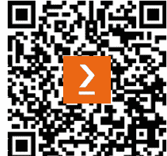

# 机器学习的 Apache Spark

## 贡献者

### 关于作者

**迪帕克·高达** 是一名数据科学家和 AI/ML 专家，拥有十多年经验，在包括供应链、网络安全和数据中心基础设施在内的各个行业领导创新解决方案。他拥有超过 30 项已授权专利，为自动化、预测分析和 AI 驱动的优化做出了贡献。他的工作涵盖数据工程、机器学习和分布式系统，专注于构建可扩展且有影响力的产品。作为一名充满热情的发明家、导师、作者和 FAA 认证飞行员，迪帕克还致力于内容创作，通过写作、演讲和指导分享他的专业知识。他继续不断推动技术的边界，跨行业推动创新。

### 关于审稿人

**卡西克·赫布利** 是一名后端和 AI 工程师，在 Infosys、Thomson Reuters、StateStreet 和 Dell Technologies 等领先全球公司拥有十多年经验，精通分布式系统、ML 和 AI。他在时间序列预测、日志解析和 NLP 领域做出了重要贡献，并因此获得多项专利认可，凸显了他在行业中的创新影响。他是 SaaS 平台开发的领军人物。卡西克也是一位成就斐然的作者，曾在 Amazon 上出版一本关于 LLM 的电子书和另一本专注于 ML 和 AI 前沿发展的书籍。他作为 Packt 出版社的图书审稿人的工作为塑造 AI 和数据科学的未来提供了宝贵见解。

**西瓦·拉马·克里希纳·科塔帕利** 是一位经验丰富的数据科学家和软件工程师，拥有超过 9 年经验，致力于利用深度学习技术和数据推动业务增长。他的专业知识涵盖 Transformer 模型、基于 LLM 的自然语言处理和深度学习技术。西瓦的显著工作包括开发尖端的 **检索增强生成 (RAG)** 系统，将最先进的语言模型与向量数据库集成，以实现高效的知识检索和上下文响应生成。他开发了强大的安全解决方案，并构建了可扩展的数据平台，以实现安全的数据交换和实时洞察。


## 前言

欢迎踏上机器学习与 Apache Spark 世界的探索之旅。这一强大组合正在当今快节奏的数字环境中改变数据的处理和分析方式。本书旨在为你提供对机器学习概念的全面理解，并结合实际洞察，说明如何使用 Apache Spark（一款领先的大数据处理平台）来实现这些概念。

随着各行各业对大规模数据处理需求的不断增长，能够高效地大规模应用机器学习技术变得愈发关键。本书旨在弥合理论与实践之间的鸿沟，不仅提供机器学习基础的坚实基础，还提供利用 Apache Spark 功能构建和部署复杂模型的实际示例。

## 本书适合人群

本书面向数据科学家、机器学习工程师和软件开发人员，他们渴望在机器学习领域（尤其是大数据环境下）扩展知识和技能。无论你是经验丰富的专业人士还是该领域的新手，本书都将使用 Apache Spark，为你提供关于机器学习理论基础及其实际应用的宝贵见解。

本书内容针对那些希望提升处理大型数据集能力并在实际场景中部署机器学习模型的人群而编写。如果你有兴趣了解如何将机器学习集成到大数据工作流中，本书将作为一本全面的指南。

## 本书内容概览

第 1 章 机器学习概念概述，向你介绍机器学习的核心原理，包括监督学习、无监督学习和强化学习，以及它们在 Apache Spark 环境下的相关性。你还将学习如何在本地机器上设置 Apache Spark，以开始探索其功能。

第 2 章 Spark 数据处理，深入探讨数据预处理、转换和清洗等关键流程，这些流程为有效的机器学习做好数据准备至关重要。本章介绍了在 Spark 中处理大型数据集的关键技术和最佳实践。

第 3 章 特征提取与转换，专注于将原始数据转换为适合训练机器学习模型格式的技术。你将探索各种特征提取和转换方法，学习如何在 Spark 中实现这些方法。

第 4 章 构建回归系统，深入探讨回归分析（监督学习中的基础技术）的世界。本章将指导你使用 Spark 的机器学习库构建和评估回归模型。

第 5 章 构建分类系统，介绍分类问题，并解释决策树、逻辑回归和随机森林等关键算法。本章包含实际示例、性能评估和改进策略。

第 6 章 构建聚类系统，通过 K-means 和层次聚类等聚类算法探索无监督学习。本章提供了在 Spark 中实现这些技术的实际示例。

第 7 章 构建推荐系统，侧重于机器学习在开发推荐系统方面的实际应用，推荐系统是当今许多行业中的重要工具。你将学习如何使用协同过滤及其他技术在 Spark 中构建推荐系统。

第 8 章 挖掘频繁模式，讨论数据挖掘中关键任务——频繁模式挖掘所使用的技术，并展示如何使用 Apache Spark 应用这些方法来发现大型数据集中的隐藏模式。

第 9 章 部署模型，涵盖机器学习模型的部署阶段，强调将数据驱动洞察转化为实际运营的重要性。你将了解各种部署策略、模型监控，以及如何确保模型在生产环境中有效运行。

## 如何充分利用本书

为充分受益于本书，建议你具备机器学习概念的基础理解，并对 Apache Spark 有一定的了解。贯穿全书，你将发现实用示例、代码片段和分步说明，这些内容设计易于遵循并应用于你自己的项目。

要遵循本书中的说明，你需要以下内容：

| 涉及的软件/硬件 | 操作系统要求 |
|---|---|
| Python 3.x | Windows、macOS 或 Linux |
| Apache Spark 3.x.x | |
| ECMAScript 11 | |

**如果你使用的是本书的数字版，我们建议你亲自输入代码，或从本书的 GitHub 仓库获取代码（下一节中提供了链接）。这样做可以帮助你避免与复制和粘贴代码相关的潜在错误。**

## 下载示例代码文件

以下是下载和运行代码的步骤：

- 1. **克隆或下载仓库**：你可以使用 Git 将仓库克隆到本地机器，或下载包含所有代码文件的 ZIP 文件。如果你熟悉 Git，克隆仓库将使你轻松拉取更新。要克隆仓库，请使用以下命令：
    ```bash
    git clone https://github.com/PacktPublishing/Apache-Spark-for-Machine-Learning.git
    ```
- 2. **导航到所需章节**：每个章节在仓库中都有自己的文件夹。导航到适当的文件夹，找到与你正在阅读的章节相关的代码文件。
- 3. **运行代码示例**：代码示例使用 Python 编写，其中大部分需要在你的机器上安装 Apache Spark。请遵循本书中提供的设置说明，确保环境配置正确。你可以直接在 Python 或 PySpark 环境中运行代码示例。
- 4. **修改并实验**：随意修改代码以尝试不同的参数或数据集。这将帮助你更好地理解概念，并查看更改如何影响结果。

你可以从 GitHub 上的 `https://github.com/PacktPublishing/Apache-Spark-for-Machine-Learning` 下载本书的示例代码文件。

如果代码有更新，将在 GitHub 仓库中进行更新。

我们还在 `https://github.com/PacktPublishing/` 提供来自丰富图书和视频目录的其他代码包。请查看！

## 本书使用的约定

贯穿全书使用了一系列文本约定。

**正文中的代码**：表示正文中的代码词、数据库表名、文件夹名、文件名、文件扩展名、路径名、虚拟 URL、用户输入和 Twitter 账号。示例：“确保 JAVA_HOME 环境变量已正确设置。”


代码块设置如下：

```
from pyspark.sql import SparkSession
spark = SparkSession.builder \
.appName("HDFS Read Example") \
.getOrCreate()
```

任何命令行输入或输出均按以下格式编写：

```
tar -xvf spark-3.x.x-bin-hadoop3.x.tgz
```

**粗体**：表示新术语、重要词汇或屏幕上看到的词汇。例如，菜单或对话框中的词以**粗体**显示。这是一个示例：“对于本地开发，您可以选择 **针对 Apache Hadoop 预构建** 选项。”

> 提示或重要说明
> 显示如下。

## 联系我们

始终欢迎读者反馈。

**一般反馈**：如果您对本书的任何方面有疑问，请发送电子邮件至 customercare@packtpub.com，并在邮件主题中注明书名。

**勘误**：尽管我们已竭力确保内容的准确性，但错误仍难免发生。如果您在本书中发现了错误，我们将不胜感激如果您能向我们报告。请访问 www.packtpub.com/support/errata 并填写表格。

**盗版**：如果您在互联网上以任何形式发现我们作品的非法副本，我们将不胜感激如果您能向我们提供位置地址或网站名称。请通过 copyright@packt.com 与我们联系，并附上材料的链接。

**如果您有兴趣成为作者**：如果您在某个主题上有专长，并有兴趣撰写或参与编写书籍，请访问 authors.packtpub.com。

## 分享您的想法

阅读完《Apache Spark for Machine Learning》后，我们很乐意听取您的想法！请点击此处直接前往本书的 Amazon 评论页面并分享您的反馈。

您的评论对我们和技术社区很重要，并将帮助我们确保提供高质量的内容。

## 下载本书的免费 PDF 副本

感谢您购买本书！

您是否喜欢随时随地阅读，但无法随身携带印刷书籍？

您购买的电子书是否与您选择的设备不兼容？

别担心，现在每购买一本 Packt 图书，您就可以免费获得该图书的无 DRM 的 PDF 版本。

随时随地、在任何设备上阅读。直接从您喜爱的技术书籍中搜索、复制并粘贴代码到您的应用程序中。

福利远不止于此，您每天还可以在收件箱中独家获取折扣、时事通讯和精彩免费内容。

按照以下简单步骤获取权益：

1. 扫描二维码或访问下方链接



https://packt.link/free-ebook/9781804618165

2. 提交购买证明

3. 完成！我们会将免费 PDF 和其他权益直接发送到您的邮箱。
