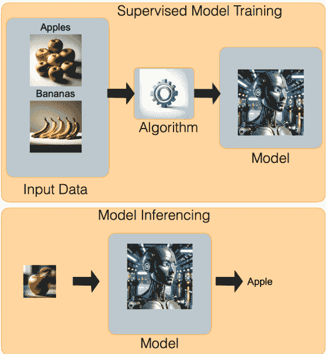
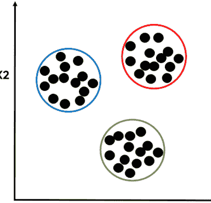
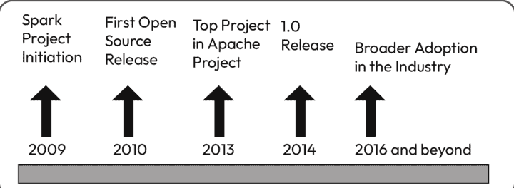
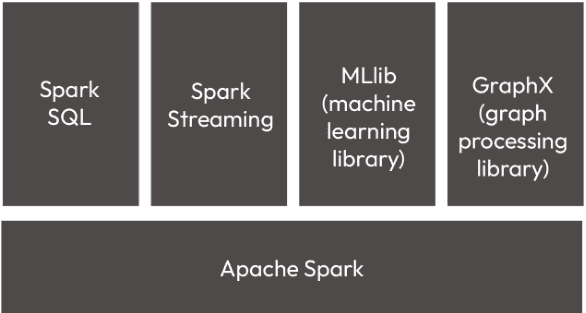

## 机器学习概念概述

本章全面介绍了机器学习在 Apache Spark 生态系统中的集成。首先阐述了监督学习、无监督学习和强化学习等基本机器学习原理，以及它们与 Spark 分布式计算范式的相关性。您将了解用于分类、回归、聚类和推荐任务的丰富算法集。此外，本章阐述了为何使用 Spark 进行机器学习，探讨其用例和优势。它还将帮助您在本地计算机上设置 Apache Spark。

本章将涵盖以下主题：

- 了解机器学习
- Apache Spark 简介
- 为何为机器学习选择 Apache Spark？
- 设置 Apache Spark

本章结束时，您将了解机器学习、Apache Spark 的基础知识以及如何设置它。

### 技术要求

在本地计算机上运行 Apache Spark 时，通常需要以下技术要求：

- **操作系统**：Apache Spark 与 Linux、macOS 和 Windows 兼容。
- **Java 开发工具包 (JDK)**：Apache Spark 使用 Java 实现，因此您需要安装 JDK。确保 `JAVA_HOME` 环境变量已正确设置。
- **Python**：如果您计划使用 PySpark（Apache Spark 的 Python API），则需要安装 Python。建议使用 Python 3.x。

本章的代码文件可在 GitHub 上找到，网址为 https://github.com/PacktPublishing/Apache-Spark-for-Machine-Learning/tree/main/Chapter01。

### 了解机器学习

我们将从机器学习的温和入门开始。机器学习 (ML) 是人工智能 (AI) 的一个分支。它专注于开发算法和技术，使计算机能够从数据中学习并随时间推移提高其在特定任务上的性能，而无需明确编程。从本质上讲，机器学习是关于从数据中提取模式和洞察，以进行预测或决策。

机器学习中有几个关键范式：

- **监督学习**：这涉及在标记数据上训练模型，算法学习将输入数据映射到相应的输出标签。它用于分类和回归等任务。
- **无监督学习**：这涉及在未标记数据上训练模型，算法学习在数据中查找隐藏模式或结构。它用于聚类和降维等任务。
- **强化学习**：这涉及通过与环境交互并以奖励或惩罚形式接收反馈，训练模型进行序贯决策。

机器学习算法还可根据其功能进一步分类，例如决策树、神经网络和支持向量机。

机器学习的成功高度依赖于数据质量、数量和相关性。此外，特征工程、模型选择、超参数调优和评估指标等因素在开发有效的机器学习系统中起着至关重要的作用。

机器学习已广泛应用于医疗保健、金融、营销、自动驾驶汽车和推荐系统等多个领域。其分析大量数据、识别复杂模式并进行数据驱动预测的能力，使组织能够获得宝贵洞察、优化流程并做出明智决策，从而在当今数据驱动的世界中推动创新和变革。

想象您有一个婴儿，想教它识别不同的物体。这个过程类似于监督机器学习。

让我们了解机器学习解决方案的流程：

- **训练数据**：在机器学习中，这就像给婴儿一组玩具并告诉他每个玩具是什么。例如，您给婴儿看一个球并说：“这是一个球”，然后给他看一根骨头并说：“这是一根骨头”。

  在机器学习中，我们向计算机算法提供一个数据集，该数据集包含示例（例如图像的输入数据）及其对应的标签（输出或所需结果，例如狗或猫）。

- **学习算法**：学习算法是婴儿的大脑。它通过观察和理解每个对象的特征来学习。

  在机器学习中，算法处理训练数据并学习有助于其进行预测或分类的模式和特征。

- **测试与评估**：现在，您向婴儿展示他从未见过的新物体，例如足球或气球，看看他能否根据所学内容正确识别它们。

  在机器学习中，您在单独的数据集（测试数据）上测试训练后的算法，以评估其性能，并查看它对新的未见示例的泛化程度。

- **调整与迭代**：如果婴儿犯错，您可以通过说“不，那不是球，是足球”来纠正他。婴儿会从这些纠正中学习。

  在机器学习中，如果算法出错，您可以调整其参数甚至其考虑的特征以提高准确性。此过程可能涉及多次迭代。

- **模型部署**：一旦婴儿能持续正确识别物体，就可以说他已作为可靠的对象识别器成功“部署”。

  在机器学习中，当算法在测试数据上表现良好并达到所需精度时，可以将其部署以对新的现实世界数据进行预测。

此示例通过将其与涉及学习和识别的熟悉场景进行类比，帮助简化机器学习的复杂过程。请记住，这是一种简化的表示，机器学习涉及各种可能更为复杂的算法、模型和技术。

构建机器学习模型需要三个关键要素。让我们看看这三个重要组成部分：

- 数据
- 算法
- 硬件

数据是机器学习中一个基本且关键的组件。它是机器学习模型学习模式、进行预测和获得洞察的原材料。


理解数据的特征和质量对于机器学习项目的成功至关重要。高质量、相关且具有代表性的数据对模型对新未见样本的泛化能力贡献显著。更多细节在第2章“使用Spark进行数据处理”中介绍。以下是机器学习中数据的一些关键方面：

- **质量数据**：质量数据是干净的、结构化的、具有代表性的、平衡的、有标签的和充足的。例如，用于图像分类的高质量数据集会包含不同物体的清晰且一致的图像，类别分布多样且平衡，每张图像都有准确的标签。高质量数据帮助ML模型有效学习并在新数据上表现良好。

- **低质量数据**：低质量数据包含噪声、不一致、有偏见、不平衡、缺失或重复。例如，用于情感分析的低质量数据集会包含损坏的文本数据、不完整或含有拼写错误的文本、偏颇或不具代表性的意见样本，以及每段文本缺失或错误的标签。

机器学习算法是数学模型或计算过程，使计算机能够从数据中学习并做出预测或决策，而无需显式编程。这些算法构成机器学习系统的核心，旨在发现数据中的模式、关系和洞察。理解不同算法的特性、优势和局限性，对于为特定机器学习任务选择最合适的算法至关重要。算法的选择取决于数据的性质、手头的问题以及可用的计算资源等因素。有关更多详细信息，请参阅本节后面的表1.1。

硬件在机器学习中同样发挥着至关重要的作用，影响模型训练和部署的速度、效率和规模。硬件的选择取决于机器学习任务的复杂性、数据集大小以及算法的计算要求。选择合适的硬件取决于数据集的大小、模型的复杂性以及机器学习任务的特定要求等因素。随着硬件架构和技术的不断进步，该领域持续发展。

### 机器学习的类型

根据学习方法和训练数据的性质，机器学习大致可分为三种主要类型：

- 监督学习
- 无监督学习
- 强化学习

这些类型可以进一步细分如下：

- 半监督学习
- 迁移学习
- 集成学习
- 深度学习

我们将详细讨论每种主要类型。

## 监督学习

在监督学习中，算法在带有标签的数据集上进行训练，输入与相应的所需标签配对。监督学习的目标是开发一个预测模型，能够准确地将输入数据映射到所需的输出标签，从而对新的未见数据进行准确的预测或分类。

监督学习的用例包括以下内容：

- **分类**：预测电子邮件是否为垃圾邮件
- **回归**：根据房屋特征预测房屋价格

下图显示了监督模型训练及其输出的示例：



图1.1 – 监督学习示例

例如，如果你想对苹果和香蕉等水果进行分类，你需要一个包含苹果和香蕉图像的数据集，其中每张图像都有一个标签，指示它是哪种水果。随后，算法学习识别区分苹果和香蕉的特征，并能够对其从未见过的新图像预测标签。对苹果和香蕉进行监督学习的一种方法是使用**卷积神经网络（CNN）**。

## 无监督学习

无监督学习涉及在无标签数据集上训练算法，算法必须在没有显式指导的情况下自行发现数据中的模式和关系。

目标通常是识别隐藏的结构、将相似的数据点分组，或降低数据的维度。

无监督学习的用例包括以下内容：

- **聚类**：根据客户的购买行为对客户进行分组
- **降维**：减少数据集中的特征数量

K-means 是一种用于无监督学习的流行算法。

假设你有一个数据集，包含零售店中不同类型客户的信息，但数据中不包含这些客户的任何标签或类别。你希望根据客户在购买行为、人口统计学或其他相关特征方面的相似性，将这些客户细分为不同的组，但你没有为他们预定义的类别。

K-means算法输出一组K个聚类，将具有相似特征的客户分组在一起。下图显示了无监督训练产生的几个聚类：



在此图中，有多个数据点，每个数据点由一个小圆圈表示。具有相似特征的数据点被分组在一起，每个聚类使用不同的颜色。

## 强化学习

强化学习是一种机器学习类型，其中智能体通过在环境中执行动作来实现目标，从而学习如何做出决策。智能体不是通过显式指导学习，而是通过奖励和惩罚系统，从其行为的后果中学习。智能体的目标是学习一种策略，以最大化随时间推移的累积奖励。

强化学习的用例包括以下内容：

- 游戏：训练计算机程序下棋或围棋
- 机器人技术：教导机器人在物理世界中执行任务

强化学习的一个经典示例是训练智能体下棋等游戏。在此示例中，环境是棋盘，智能体是决定下哪步棋的玩家。智能体的目标是赢得比赛。智能体最初对游戏知之甚少或一无所知。它不知道最佳走法，但通过试错来学习。每走一步后，智能体会获得奖励（好走法）或惩罚（坏走法）。在无数场比赛中，并从各种行为的结果中学习后，智能体变得精通下棋。


图1.3 – 强化学习

这些主要的机器学习类型还可以进一步细分为子类型和专门的方法。其他一些类别包括以下内容：

- **半监督学习**：结合监督学习和无监督学习的元素。模型在包含有标签和无标签示例的数据集上进行训练。
- **迁移学习**：涉及在一项任务上训练模型，然后将所学知识应用到不同但相关的任务上。
- **集成学习**：涉及结合多个模型以提高整体性能和鲁棒性。
- **深度学习**：利用具有多层的神经网络（深度神经网络）自动学习数据的分层表示。它是机器学习的一个子集，对于图像和语音识别等任务特别有效。

理解这些机器学习类型对于为给定任务或问题选择合适的方法至关重要。不同的类型可能更合适，具体取决于数据的性质、可用资源以及机器学习应用的特定目标。

表1.1讨论了不同机器学习应用中使用的各种算法以及一些常见用例：

| 机器学习类型 | 算法示例 | 用例 |
| --- | --- | --- |
| 监督学习 | 线性回归<br>决策树<br>**支持向量机（SVMs）**<br>神经网络 | 图像分类<br>股票价格预测<br>垃圾邮件检测 |
| 无监督学习 | K-means聚类<br>层次聚类<br>**主成分分析（PCA）** | 客户细分<br>异常检测<br>降维 |
| 强化学习 | Q学习<br>**深度Q网络（DQNs）**<br>策略梯度方法 | 游戏（例如，AlphaGo）<br>机器人技术<br>自主系统 |
| 半监督学习 | 自训练<br>协同训练<br>多视图学习 | 文本和语音处理<br>图像识别 |


| Transfer learning | Fine-tuning pre-trained models<br>• Feature extraction<br>• Domain adaptation | Image recognition (for example, using pre-trained CNNs)<br>• Natural Language Processing (NLP) |
|---|---|---|
| Ensemble learning | Random forests<br>• Gradient Boosting Machines (GBMs)<br>• AdaBoost | Improved classification accuracy<br>• Robust predictions |
| Deep learning | CNNs<br>• Recurrent Neural Networks (RNNs)<br>• Transformer models (for example, GPT) | Image and speech recognition<br>• NLP<br>• Deep reinforcement learning |

表 1.1 – 算法及其应用场景

迄今为止，我们一直专注于学习机器学习的基础知识及其一些热门算法。现在，我们将重点转移到学习Apache Spark上。

## An introduction to Apache Spark

Apache Spark是一个功能强大、开源的统一分析引擎，专为大规模数据处理和机器学习任务而设计。它为Java、Scala、Python和R提供高级API，并拥有一个优化的引擎，支持用于数据分析的通用计算图，为开发者提供速度和易用性。Spark的核心功能加上其SQL、流处理、机器学习和图处理库，使其成为一个多功能工具，适用于从批处理到实时分析和机器学习的广泛数据处理和分析任务。

### The background and motivation of Apache Spark

Apache Spark的背景和动机

在大数据时代，对可扩展、快速且灵活的数据处理框架的需求变得越来越明显。传统解决方案，例如Apache Hadoop MapReduce（https://en.wikipedia.org/wiki/MapReduce），为分布式数据处理铺平了道路，但在速度和易用性方面存在不足。为应对这些挑战，研究人员于2009年在UC Berkeley的AMPLab构想了Apache Spark这一革命性开源项目。

本节深入探讨了Apache Spark创建背后的背景和动机，强调了其作为强大数据处理框架的演变过程。

### Challenges with MapReduce

MapReduce面临的挑战

Apache Hadoop MapReduce虽然具有开创性，但存在阻碍其广泛采用的局限性。基于磁盘的中间数据存储特性以及每次map和reduce操作后必须写入磁盘的需求引入了延迟，影响了整体处理速度。此外，MapReduce程序复杂且冗长的特性，包括以下其他挑战，使其对开发者不够友好：

- **Complexity and verbosity**: 实现MapReduce程序可能既复杂又冗长。开发者必须为map和reduce两个阶段编写代码，这可能导致大量样板代码。

- **Programming paradigm**: MapReduce遵循函数式编程范式，对于习惯于传统命令式编程语言的开发者来说可能不熟悉。这种思维转变对某些开发者来说可能构成学习曲线。

- **Data movement overhead**: MapReduce中的洗牌和排序阶段涉及网络上的大量数据移动，这可能导致开销。高效管理和最小化数据移动对于优化性能至关重要。

- **Limited support for iterative algorithms**: MapReduce不适合迭代算法，而迭代算法在机器学习和图处理任务中很常见。为迭代算法运行多个MapReduce作业会引入额外的复杂性和性能开销。

- **Debugging and testing**: 调试MapReduce作业可能具有挑战性。传统调试工具在分布式环境中可能效果不佳。开发者通常依赖日志分析和自定义调试技术。

- **Limited support for real-time processing**: MapReduce专为批处理设计，可能不是实时或低延迟处理需求的最佳选择。其他框架（如Apache Spark）已应运而生以应对这些用例。

Apache Spark的开发旨在解决MapReduce处理模型的局限性，该模型是Apache Hadoop生态系统中的主要数据处理框架。

Here is a brief timeline of how Apache Spark came into existence:

以下是Apache Spark诞生过程的简要时间线：



Figure 1.4 – A Spark development timeline

图 1.4 – Spark开发时间线

当今，Apache Spark被广泛用于大规模数据处理、机器学习、图分析等领域。其多功能性、速度以及对内存处理的支持促成了其流行，并使其成为现代大数据架构中的基础组件。Apache Spark是一个开源的分布式计算系统，为大数据处理提供了一个快速且通用的集群计算框架。

Let's discuss the key features of Apache Spark that make it exciting to use for ML:

让我们讨论Apache Spark使其在机器学习领域使用令人兴奋的关键特性：

- **In-memory processing**: Apache Spark的一个关键差异化特点是其内存处理能力。通过将中间数据存储在内存中而非持久化到磁盘，Spark显著加速了迭代算法和交互式数据分析。这种方法提升了性能，并便于在大型数据集上进行复杂计算。

- **Unified processing engine**: Apache Spark为批处理和流处理、机器学习、图处理及SQL查询提供统一的处理引擎。这种多功能性消除了为不同任务使用独立工具的需求，简化了开发过程并降低了用户的学习曲线。

- **Fault tolerance**: Spark的容错机制对于在分布式计算环境中维护数据完整性至关重要。如果发生节点故障，Spark可以通过血统信息重建丢失的数据。这种弹性确保了Spark应用程序即使在大型且动态的集群中也能可靠运行。

- **Ease of use**: Apache Spark在设计时充分考虑了用户友好性，为Java、Scala、Python和R提供高级API。这种设计选择扩大了其可访问性，使数据工程师和数据科学家能够利用其功能。Spark简洁的语法和交互式Shell提供了更直观的用户体验。

Next, we will discuss the architecture of Apache Spark and how various components interact with each other.

接下来，我们将讨论Apache Spark的架构以及各个组件如何相互交互。

### Components of Apache Spark

Apache Spark的组件

Apache Spark由多个组件组成，它们协同工作，为大数据处理和分析提供全面且统一的引擎。下图显示了Apache Spark中存在的各个组件：



Figure 1.5 – Spark components

图 1.5 – Spark组件

Let us learn what each component does:

让我们了解每个组件的功能：

- **Spark Core**: Apache Spark的核心是Spark Core，为整个Spark生态系统提供基本功能。它包括任务调度、内存管理和故障恢复，构成了其他Spark库的基础。

- **Spark SQL**: Spark SQL通过SQL命令便于查询结构化数据。该组件将SQL查询与Spark程序无缝集成，面向数据分析师和精通SQL的用户，因为对他们而言，SQL是一个熟悉且高效的工具。

- **Spark Streaming**: 为满足实时分析的需求，Spark Streaming使用微批处理以近乎实时的方式处理数据流。它使Spark强大的批处理能力能够应用于流式数据源。

- **MLlib (Machine Learning Library)**: MLlib是Spark的机器学习库，为各种机器学习算法提供可扩展的实现。借助MLlib，数据科学家可以在大型数据集上构建和部署机器学习模型，利用Spark的内存处理能力实现更快的训练。

- **GraphX**: GraphX是Spark的图处理库，提供一个具有弹性的分布式图系统。它使你能够创建和操作图，非常适合复杂关系和网络分析应用。


### Apache Spark 的用例与应用

让我们来看看 Spark 的用例和实际示例列表：

- **大规模数据处理**：Apache Spark 的主要用例之一是大规模数据处理。组织部署 Spark 用于日志分析、数据清洗和 **提取、转换和加载 (ETL)** 等操作，受益于其高效且可扩展的处理能力。例如，Apache Spark 在处理日志方面非常有用，因为日志高度复杂且涉及太字节级的数据。

- **实时分析**：Spark Streaming 处理实时数据流的能力使 Apache Spark 成为实时分析领域的关键参与者。它服务于寻求从社交媒体、传感器和日志等流式数据源中获取及时洞察的企业。实时分析的一个用例是处理传入的遥测数据以检测异常。

- **大规模机器学习**：MLlib 赋能数据科学家大规模构建和部署机器学习模型。Spark 的内存处理能力显著加速了复杂模型的训练，使其成为拥有大型数据集的组织的理想选择。例如，MLlib 可用于在包含数十亿行的数据集上训练机器学习模型，例如用于监控数据中心健康状况的传感器数据。

在下一部分，我们将探讨 Apache Spark 的优势及其机器学习算法集。

### 为什么为机器学习选择 Apache Spark？

Apache Spark 为机器学习应用提供了多项优势，使其成为可扩展和分布式 ML 任务的热门选择。以下是使用 Apache Spark 进行机器学习的一些主要优势：

- **内存处理**：Spark 将中间数据存储在内存中的能力加速了机器学习中常用的迭代算法，显著缩短了计算时间。

- **分布式计算**：Spark 的分布式计算能力允许在机器集群上并行处理大型数据集，从而实现 ML 任务的可扩展性。

- **弹性分布式数据集 (RDDs)**：Spark 的基本数据结构 RDDs 提供了容错的并行处理。在机器学习的背景下，这意味着如果某个节点失败，计算可以在其他节点上继续而不会丢失进度。

- **统一平台**：Spark 为数据处理和机器学习提供了统一平台，消除了对独立工具的需求。这简化了整体工作流并增强了集成的便捷性。

- **易用性**：Spark 提供了 Java、Scala、Python 和 R 的高级 API，使许多开发者和数据科学家都能使用。这种易用性便于机器学习模型的开发和部署。

- **MLlib**：MLlib 是 Spark 的机器学习库，为机器学习任务提供了丰富的算法和工具集。它包括可扩展的分类、回归、聚类、协同过滤等实现。

- **数据处理能力**：Spark 的数据预处理、清洗和转换功能与其机器学习库无缝集成。这简化了构建和部署机器学习模型的端到端过程。

- **流式集成**：Spark Streaming 允许将实时数据流集成到机器学习管道中。这对于需要实时预测或持续模型更新的应用程序至关重要。

- **图处理 (GraphX)**：对于涉及图结构数据的机器学习任务，Spark 的 GraphX 库简化了图算法和分析的开发，允许将图处理集成到 ML 工作流中。

- **社区支持与生态系统**：Spark 得到充满活力的开源社区和不断增长的库和工具生态系统的支持。这为从事机器学习项目的开发者和数据科学家提供了额外的资源和支持。

- **与 Hadoop 生态系统的兼容性**：Spark 可以在 Hadoop 集群上运行，利用现有的 Hadoop 基础设施。这种兼容性使得已部署 Hadoop 的组织更容易采用 Spark 进行机器学习，而无需进行重大架构更改。

- **性能优化**：Spark 包含多种性能优化，包括缓存、流水线和查询优化，有助于提高机器学习计算的效率。

### Apache Spark 中的算法

Apache Spark 的机器学习库 MLlib 为各种任务提供了广泛的机器学习算法，包括分类、回归、聚类和协同过滤。以下是 Apache Spark MLlib 中可用的一些关键机器学习算法：

- **监督学习**：
  - **线性回归**：用于基于一个或多个预测特征预测连续变量
  - **逻辑回归**：适用于二分类问题，预测事件发生的概率
  - **决策树**：构建基于输入特征预测结果的树状模型，可用于分类和回归
  - **随机森林**：一种集成方法，构建多个决策树并组合其预测结果以提高准确性和鲁棒性
  - **梯度提升树 (GBTs)**：构建一系列弱决策树并将其组合以创建强预测模型
  - **朴素贝叶斯**：一种概率算法，常用于分类任务，尤其是文本分类
  - **支持向量机 (SVM)**：适用于分类和回归任务，专注于寻找最优分离超平面

- **无监督学习**：
  - **K-means**：一种基于相似性将数据划分为 *k* 个簇的聚类算法
  - **高斯混合模型 (GMM)**：一种表示高斯分布混合的概率模型；用于聚类
  - **主成分分析 (PCA)**：在尽可能保留数据变异性的同时降低数据维度；常用于特征提取

- **协同过滤**：
  - **交替最小二乘法 (ALS)**：一种矩阵分解算法，常用于推荐系统中的协同过滤

- **特征转换与选择**：
  - **Word2vec**：将单词转换为向量，捕获单词之间的语义关系。常用于 NLP 任务
  - **词频-逆文档频率 (TF-IDF)**：TF-IDF 是一种常用于文本挖掘的特征提取技术

Spark 中可用的实用工具包括以下内容：

- **管道**：允许用户以声明方式定义一系列数据处理和机器学习阶段
- **交叉验证**：通过提供在不同数据子集上训练和评估模型的工具，支持模型选择和超参数调优

这些只是 Apache Spark MLlib 中可用的一些机器学习算法示例。该库在不断发展；较新版本可能会引入其他算法和改进。此外，Spark 与其他机器学习库（例如 TensorFlow 和 scikit-learn）的兼容性允许用户在 Spark 环境中利用更广泛的算法范围。

### Apache Spark 用例

Apache Spark 在各个行业中被广泛采用，并被各种不同的组织用于机器学习任务。以下是一些利用 Apache Spark 进行机器学习的主要用户和行业：

- **技术公司**：包括云计算、数据分析和人工智能领域在内的领先技术公司，常使用 Apache Spark 进行大规模机器学习任务。Google、Amazon、Microsoft 和 IBM 等公司将 Spark 集成到其平台和服务中。

- **金融服务**：银行和金融机构使用 Apache Spark 进行欺诈检测、风险评估、客户细分和算法交易等任务。实时处理大量金融数据的能力使 Spark 成为该行业的重要工具。

- **医疗保健与生命科学**：医疗保健和生命科学领域的组织利用 Apache Spark 进行基因组分析、药物发现、患者数据分析和个性化医疗等任务。Spark 处理多种数据类型和大型数据集的能力在这些应用中非常有益。

- **零售与电子商务**：零售商和电子商务公司利用 Apache Spark 进行推荐系统、客户细分、需求预测和供应链优化。Spark 的机器学习功能帮助这些企业从客户和交易数据中提取有价值的洞察。

- **制造业与工业 4.0**：制造公司采用 Apache Spark 进行预测性维护、质量控制、供应链优化和传感器数据分析。Spark 处理流式数据的能力在涉及物联网 (IoT) 设备的场景中尤其有价值。

- **能源与公用事业**：能源公司使用 Apache Spark 进行预测性设备维护、能源消耗预测和电网优化等任务。Spark 处理和分析时间序列数据的能力在该领域非常有益。

接下来，我们将讨论如何安装和设置 Apache Spark。


### 设置 Apache Spark

在本地开发环境中设置 Apache Spark，涉及在你的机器上安装 Spark，并将其配置为独立模式运行。以下是设置 Apache Spark 以进行本地开发的一般步骤：

> **注意**
> 以下说明假设你的机器上已安装 Java，而 Apache Spark 需要 Java。

- 1. **下载 Apache Spark:**
  - I. 访问官方 Apache Spark 网站：https://spark.apache.org/。
  - II. 转到 **下载** 部分。
  - III. 选择要下载的 Spark 版本。
  - IV. 选择包类型。对于本地开发，你可以选择 **预构建的 Apache Hadoop** 选项。
  - V. 下载包含 Spark 的 tarball (.tgz) 或 ZIP 文件。

- 2. **提取 Spark 存档:**
  - I. 导航到下载 Spark 存档的目录。
  - II. 提取存档的内容，使用像 `tar` 这样的工具，或者如果你下载了 ZIP 文件，可以使用图形工具：

  ```
  tar -xvf spark-3.x.x-bin-hadoop3.x.tgz
  ```

- 3. **配置环境变量:**
  - I. 打开你的 shell 配置文件。例如，如果你使用 Bash，请使用以下命令编辑你的 `bashrc` 文件：

  ```
  ~/.bashrc
  ```

  或者，使用此方法：

  ```
  ~/.bash_profile
  nano ~/.bashrc
  ```

  - II. 添加以下行以设置环境变量：

  ```
  export SPARK_HOME=/path/to/extracted/spark-3.x.x-bin-hadoop3.x
  export PATH=$PATH:$SPARK_HOME/bin
  ```

  - III. 将 /path/to/extracted/spark-3.x.x-bin-hadoop3.x 替换为提取 Spark 的实际路径。
  - IV. 保存文件并退出文本编辑器。
  - V. 运行以下命令以应用更改：

  ```
  source ~/.bashrc
  ```

- 4. 以独立模式启动 Spark:
  - I. 导航到 Spark 目录：

  ```
  cd $SPARK_HOME
  ```

  - II. 启动 Spark master：

  ```
  ./sbin/start-master.sh
  ```

  - III. 启动 Spark worker：

  ```
  ./sbin/start-worker.sh spark://localhost:7077
  ```

- 5. 访问 Spark Web UI:
  - I. 打开 Web 浏览器并访问 http://localhost:8080/ 以查看 Spark Web UI。master 和 worker 应该会被列出。

- 6. 测试 Spark 安装:
  - I. 打开一个新终端窗口。
  - II. 导航到 Spark 目录：

  ```
  cd $SPARK_HOME
  ```

  - III. 运行一个简单示例来测试安装：

  ```
  ./bin/run-example SparkPi
  ```

  此命令使用 Spark 计算 Pi 的近似值。

- 7. 停止 Spark:
  - I. 停止 Spark worker 和 master：

  ```
  ./sbin/stop-worker.sh
  ./sbin/stop-master.sh
  ```

除了使用上述方法设置 Spark 之外，以下是运行 PySpark 的其他方式：

- 使用 PyPI:

```
pip install pyspark
pyspark
```

- 使用预构建的 docker 镜像:

```
docker run -it --rm spark:python3 /opt/spark/bin/pyspark
```

> 注意
> 本书中的代码示例使用 Apache Spark 版本 3.5.1。

这完成了设置 Spark 的步骤。

### 总结

当我们结束本入门章节时，很明显 Apache Spark 已成为大数据处理领域的一股变革力量。其内存计算、统一处理引擎和易用性，使其成为面临大规模数据分析挑战的组织的首选解决方案。Apache Spark 也已成为大规模数据工程和机器学习的热门平台。

在本章中，我们了解了机器学习的基础知识、不同类型的学习算法、Spark 的组件，以及它在机器学习中的优势。

在后续章节中，我们将深入探讨 Apache Spark 的每个组件，探索实际应用，并提供动手示例来说明其功能。在下一章中，我们将学习 Apache Spark 中的各种数据处理技术。
