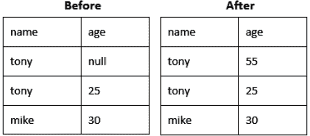
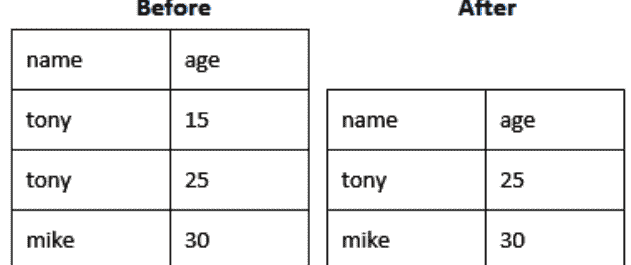
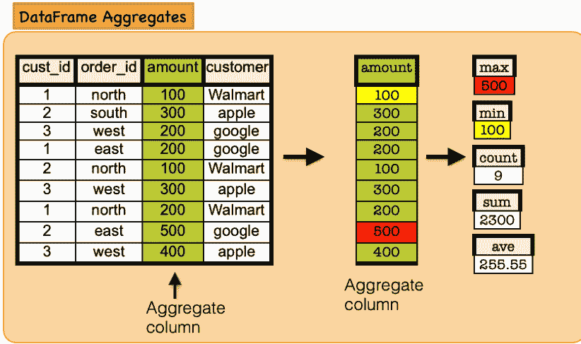
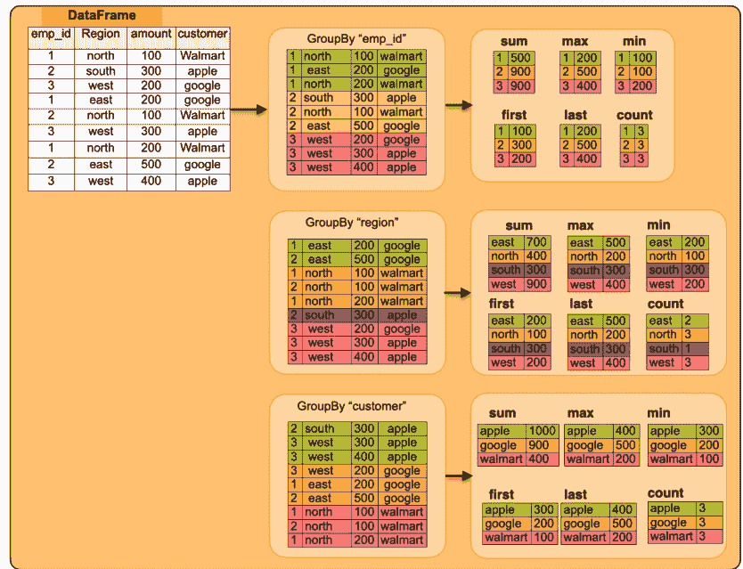
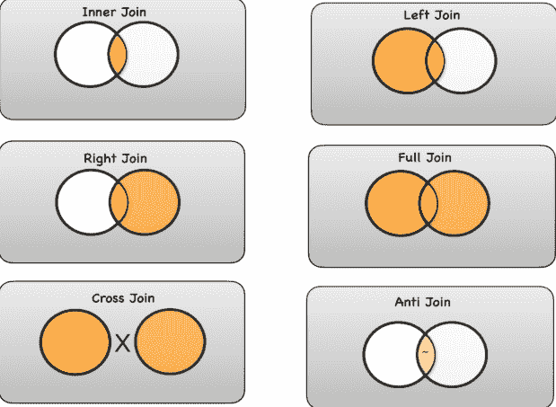
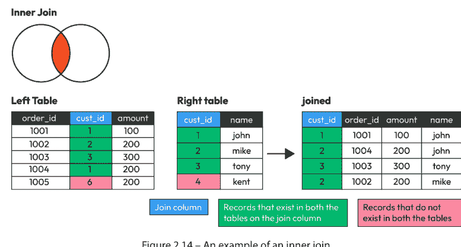
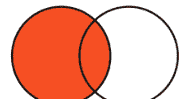
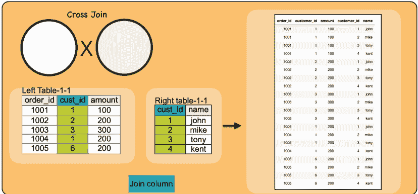
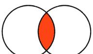

## 使用 Spark 进行数据处理

数据处理是数据分析和机器学习的关键步骤，因为它涉及将原始数据转换、清理和集成到适合进一步处理的格式中。在本章中，我们将介绍数据处理的基本概念和原则，并提供一些使用 Apache Spark 进行数据预处理的实际示例和用例。

在本章中，我们将涵盖以下主题：

- 了解数据预处理
- 数据摄入
- 清理和转换数据
- 聚合数据
- Spark 中的窗口操作
- 数据连接

到本章结束时，你将了解使用 Spark 的不同数据处理技术。

### 技术要求

你可以在 GitHub 上找到本章的代码文件，网址为 https://github.com/PacktPublishing/Apache-Spark-for-Machine-Learning/tree/main/Chapter02。

### 了解数据预处理

**数据预处理** 是数据挖掘过程中的一个基本步骤。它涉及对原始数据进行一系列操作，将其转换为适合进一步分析和建模的格式，特别是在机器学习和 AI 应用中。数据预处理的关键目标是基于历史数据提升天气预测的质量、可靠性和效率。

数据处理的主要步骤包括以下内容：

- 1. **数据收集**: 第一步涉及从各种来源提取原始数据。数据可以有多种格式，可以包括数字、文本和图像。

- 2. **数据准备**: 此步骤涉及为处理准备数据。它可能包括对数据进行排序，并将其组织成表格、数据库或文件。

- 3. **数据清理**: 数据清理涉及通过数据插值填充缺失值，其中缺失值被替换为诸如均值、中位数和最大值等替代值。它还可能涉及移除异常值并纠正数据中错误、不完整、无关或重复的部分。此步骤对于保持数据质量至关重要。

- 4. **数据转换**: 这涉及将数据转换或转换为适合分析的格式。它还可以涉及归一化或缩放数据、聚合数据点或转换数据类型。

- 5. **数据集成**: 如果数据从多个来源收集，可能需要将其合并或集成到一个连贯的数据集中。这可能涉及合并数据库、表格或文件，并对齐不同的数据格式。

- 6. **数据编码**: 这包括将分类数据转换为数值格式，以便机器学习算法可以使用。常见技术包括标签编码和独热编码。

- 7. **特征选择和特征工程**: 这涉及识别分析或模型中最相关的特征，并从现有数据中创建新特征，以提高模型性能。

数据预处理可以通过减少数据的复杂性和大小、选择最相关的特征以及处理错误和不一致性来提高机器学习模型的性能和可扩展性。数据预处理可以区分成功的机器学习项目和失败的机器学习项目。因此，在将数据馈送给机器学习模型之前，应用适当的数据预处理技术和工具非常重要。

由于缺乏数据预处理而导致的失败机器学习项目的一个例子是 **IBM Watson for Oncology** 项目。数据未被正确清理和验证，因为它包含错误、不一致和过时信息。数据也没有被集成和标准化，因为它来自不同的来源和格式，例如医疗记录、临床试验和研究论文。

现在，让我们看看如何摄取数据进行预处理。

### 数据摄入

数据摄入是将数据导入和加载到系统（例如数据库、数据仓库或数据湖）的过程。数据摄入可以手动或自动完成，使用各种工具和技术。数据摄入是数据分析和机器学习的第一步，因为它为进一步处理和使用做好数据准备。


Apache Spark 是一个强大的分布式数据处理系统，可以从各种数据源读取数据。它能够与多种多样的数据存储系统集成，这是其在大数据处理和分析中广受欢迎的原因之一。以下是 Apache Spark 可以从中摄取数据的一些关键数据源。

#### 文件系统

让我们探讨从 Hadoop 分布式文件系统 (HDFS) 摄取数据的示例。以下是从 HDFS 读取数据的示例代码片段：

```
from pyspark.sql import SparkSession
spark = SparkSession.builder \
.appName("HDFS Read Example") \
.getOrCreate()
##### Define the HDFS path
hdfs_path = "hdfs://namenode:port/path/to/your/file.csv"
##### Read the CSV file into a DataFrame
df = spark.read.csv(hdfs_path, header=True, inferSchema=True)
##### Show the DataFrame
df.show()
```

##### Amazon S3

现在，让我们看看从 Amazon S3 摄取数据的示例。要从 S3 存储桶读取数据，可以使用以下代码片段：

```
from pyspark.sql import SparkSession
##### Initialize a SparkSession
spark = SparkSession.builder \
.appName("Read Data from S3") \
.config("spark.hadoop.fs.s3a.access.key", "YOUR_ACCESS_KEY") \
.config("spark.hadoop.fs.s3a.secret.key", "YOUR_SECRET_KEY") \
.config("spark.hadoop.fs.s3a.impl", \
"org.apache.hadoop.fs.s3a.S3AFileSystem") \
.getOrCreate()
##### Replace 's3a://your-bucket-name/your-data-file' with your S3 bucket
and file
s3_file_path = "s3a://your-bucket-name/your-data-file"
##### Read the data into a DataFrame
df = spark.read.csv(s3_file_path, header=True, inferSchema=True)

##### Show the DataFrame
df.show()

##### Stop the SparkSession
spark.stop()
```

##### Azure Blob 存储

接下来，我们将查看从 Azure Blob 存储摄取数据的示例。以下是从 Azure Blob 存储读取数据的示例代码片段：

```
from pyspark.sql import SparkSession

##### Initialize a SparkSession
spark = SparkSession.builder \
 .appName("Read Data from Azure Blob Storage") \
 .config("fs.azure", \
 "org.apache.hadoop.fs.azure.NativeAzureFileSystem") \
 .config(
 "fs.azure.account.key.YOUR_STORAGE_ACCOUNT_NAME.blob.core.windows.net", \
 "YOUR_STORAGE_ACCOUNT_ACCESS_KEY") \
 .getOrCreate()

##### Replace with your Azure Storage account details
storage_account_name = "YOUR_STORAGE_ACCOUNT_NAME"
container_name = "YOUR_CONTAINER_NAME"
file_path = "YOUR_FILE_PATH" # e.g., "folder/data.csv"
##### Construct the full Azure Blob Storage path
blob_file_path = f"wasbs://{container_name}@{storage_account_name} \
.blob.core.windows.net/{file_path}"

##### Read the data into a DataFrame
##### Replace 'spark.read.csv' with the appropriate method for your data format
##### Use "spark.read.parquet" for parquet files
##### Use "spark.read.json" for JSON files
df = spark.read.csv(blob_file_path, header=True, inferSchema=True)

##### Show the DataFrame
df.show()

##### Stop the SparkSession
spark.stop()
```

##### 关系型数据库

我们也将查看从关系型数据库摄取数据的示例。

以下数据库可用于在 Apache Spark 中摄取数据：

- MySQL
- PostgreSQL
- Oracle
- SQL Server

要从 PostgreSQL 数据库读取数据，可以尝试以下代码片段：

```
from pyspark.sql import SparkSession
##### Initialize a SparkSession
spark = SparkSession.builder \
    .appName("Read Data from PostgreSQL") \
    .getOrCreate()

##### PostgreSQL database details
jdbc_url = "jdbc:postgresql://hostname:port/database_name"
properties = {
    "user": "username",
    "password": "password",
    "driver": "org.postgresql.Driver"
}

##### Name of the table you want to read
table_name = "your_table"

##### Read data from PostgreSQL into a DataFrame
df = spark.read.jdbc(
    url=jdbc_url, table=table_name, properties=properties)

##### Show the DataFrame
df.show()

##### Stop the SparkSession
spark.stop()
```

##### NoSQL 数据库

让我们回顾一下从 NoSQL 数据库摄取数据的示例。

以下 NoSQL 数据库可用于数据摄取：

- Cassandra
- HBase
- MongoDB

以下是从 Cassandra NoSQL 数据库读取数据的示例代码片段：

```
from pyspark.sql import SparkSession

##### Configure the Spark session to use the Spark Cassandra Connector
##### Replace with the correct version
connector_package = "com.datastax.spark:spark-cassandra-connector_2.12:3.0.0"

spark = SparkSession.builder \
    .appName("PySpark Cassandra Example") \
    .config("spark.jars.packages", connector_package) \
    .config("spark.cassandra.connection.host", "cassandra_host") \
    .config("spark.cassandra.connection.port", "cassandra_port") \
    .config("spark.cassandra.auth.username", "username") \
    .config("spark.cassandra.auth.password", "password") \
    .getOrCreate()

##### Now you can use the Spark session to read from or write to Cassandra
##### Example: Reading data from a Cassandra table
keyspace = "your_keyspace"
table = "your_table"

df = spark.read \
    .format("org.apache.spark.sql.cassandra") \
    .options(keyspace=keyspace, table=table) \
    .load()

df.show()

##### Remember to stop the Spark session
spark.stop()
```

##### 其他数据源

除了前面讨论的数据摄取源外，还有其他一些格式：

- 大数据文件格式：
  - Parquet：一种高效的列式存储格式，适用于 Hadoop 生态系统中的任何项目
  - Avro：一种基于行的存储格式，以其在序列化大量数据时的高效性和效果而闻名
  - 优化行列式 (ORC)：一种高效率且提供出色压缩比的格式
  - JavaScript Object Notation (JSON)：一种常用的数据交换格式
  - Comma-Separated Values (CSV)：一种用于表格数据的简单格式
- 数据流：
  - Kafka：一个用于构建实时数据管道和流式应用程序的分布式流媒体平台
  - Flume：一种用于高效收集、聚合和移动大量日志数据的服务
  - Kinesis 和 Event Hubs：云服务提供商提供的可扩展且持久的实时数据流式传输服务
- 数据仓库解决方案：
  - Apache Hive：一个用于 Hadoop 的数据仓库系统，支持轻松的数据汇总、查询和分析
  - Amazon Redshift：来自 Amazon 的快速、可扩展的数据仓库服务
  - Google Big Query：Google 的无服务器、高度可扩展且经济高效的多云数据仓库
  - Elasticsearch：一个分布式的 RESTful 搜索和分析引擎，用于解决日益增长的用例

Apache Spark 可以处理各种数据处理场景，从批处理到实时流式数据。它能够连接如此多种多样的数据源，使其成为数据工程师和数据科学家的强大工具。

在下一部分中，让我们了解如何清洗和转换数据。

### 清洗和转换数据

清洗和转换数据是数据预处理阶段中的关键步骤，用于为分析和建模准备原始数据。每个步骤包含的内容如下：

- 数据清洗涉及识别和纠正数据中的错误、数据损坏、不一致性和不准确性。此过程对于确保数据在用于分析之前的质量和可靠性至关重要。
- 数据转换涉及将数据从其原始格式或结构转换为更适合分析的格式。此步骤对于使数据与各种分析工具和技术兼容至关重要。

PySpark 提供了各种函数和方法，用于高效地清洗和转换数据。

#### 数据清洗

数据清洗是 ML 管道中的关键步骤，因为它直接影响机器学习模型的性能和可靠性。通过确保数据干净且组织良好，您可以构建更准确、高效且可解释的模型。

数据清洗中的关键任务包括：

- 删除重复项：消除重复条目，以确保每个数据点都是唯一的
- 处理缺失值：决定如何处理数据中的缺口，例如使用计算值（均值、中位数、众数）填充、插值，或完全删除受影响的记录
- 纠正错误：识别并修正数据中的错误，可能包括拼写错误、标记错误的类别或错误的测量值
- 标准化格式：确保单位、日期格式和分类标签的一致性，以避免可能扭曲分析的差异

在接下来的小节中，我们将探讨 PySpark 中一些常见的数据清洗操作。

### 删除重复项

要从 DataFrame 或列子集中删除重复行，可以使用 `dropDuplicates()` 方法：

```
import pyspark
from pyspark.sql import SparkSession
spark = SparkSession \
 .builder \
 .appName("Python Spark SQL basic example") \
 .getOrCreate()
```


```
df = spark.createDataFrame(
    [('tony', 25), ('tony', 25), ('mike', 40)], ["name", "age"])
df.dropDuplicates().show()
```

将获得以下输出：

之前

| 姓名 | 年龄 |
|---|---|
| tony | 25 |
| tony | 25 |
| mike | 30 |

之后

| 姓名 | 年龄 |
|---|---|
| tony | 25 |
| mike | 30 |

图 2.1 – 删除重复记录

#### 处理缺失值

您可以使用`dropna()`删除任何列中包含缺失值的行：

```
##### Drops rows with any null values
df = df.dropna(how='any')
```

将获得以下输出：

之前

| 姓名 | 年龄 |
|---|---|
| tony | None |
| tony | 25 |
| mike | 30 |

之后

| 姓名 | 年龄 |
|---|---|
| tony | 25 |
| mike | 30 |

图 2.2 – 删除包含缺失值的行

## 填充缺失值

我们将通过示例学习如何填充缺失值。

使用`fillna()`将空值替换为指定值：

```
df = spark.createDataFrame([('tony', None), ('tony', 25),
 ('mike', 40)], ["name", "age"])
df.na.fill({'age': 55}).show()
```

结果如下：



图 2.3 – 填充缺失值概览

#### 过滤数据

您可以基于条件过滤行，使用`filter()`或`where()`方法：

```
df = df.filter(df['age'] > 20)
```

更新后的结果如下：



图 2.4 – 过滤操作概览

现在，让我们将注意力转向数据转换。

#### 数据转换

数据转换是机器学习工作流中数据处理的一个关键方面。Apache Spark 提供了强大的功能来高效执行各种数据转换。

数据转换的关键任务包括：

- 更改数据类型：此操作涉及将列从一种数据类型转换为另一种，例如从字符串转换为整数
- 重命名列：此转换涉及为列分配新名称，这有助于保持数据集的一致性和清晰度
- 修剪字符串：此过程涉及删除列中字符串值的前导和尾随空格
- 排序数据：此转换涉及根据一个或多个列的值排序数据集的行，可以是升序或降序

让我们详细回顾每个操作。

## 转换数据类型

要更改列的数据类型，请使用`withColumn()`配合`cast()`：

```
df = spark.createDataFrame(
    [('tony', 35), ('tony', 25), ('mike', 40)], ["name", "age"])
df.withColumn("age", df["age"].cast("integer")).show()
```

## 重命名列

接下来，我们将通过示例学习如何重命名列。您可以使用`withColumnRenamed()`重命名 DataFrame 列：

```
df = df.withColumnRenamed("name", "new_name")
```

将获得以下结果：

| 姓名 | 年龄 | 新姓名 | 年龄 |
|---|---|---|---|
| tony | 15 | tony | 15 |
| tony | 25 | tony | 25 |
| mike | 30 | mike | 30 |

图 2.5 – 重命名列操作概览

## 修剪字符串

要从字符串列中删除前导和尾随空格，请使用`trim()`：

```
from pyspark.sql.functions import trim
df = df.withColumn("new_column_name", trim(df["name"]))
```

结果如下：

| 姓名 | 年龄 |
|---|---|
| "tony" | 15 |
| "tony" | 25 |
| " mike" | 30 |

| 姓名 | 年龄 | 新名称 |
|---|---|---|
| "tony" | 15 | "tony" |
| "tony" | 25 | "tony" |
| " mike" | 30 | " mike" |

图 2.6 – 修剪字符串概览

## 排序数据

使用`orderBy()`排序数据：

```
df = df.orderBy(df["age"].desc())
```

输出如下：

| 姓名 | 年龄 |
|---|---|
| tony | 25 |
| tony | 15 |
| mike | 30 |

| 姓名 | 年龄 |
|---|---|
| tony | 15 |
| tony | 25 |
| mike | 30 |

图 2.7 – 排序操作概览

在下一节中，我们将学习数据聚合。

#### 聚合数据

在人工智能和机器学习的背景下，数据聚合是指将原始数据转换为更适合分析或模型训练的摘要或简化表示的过程。

数据聚合是数据预处理和分析中的关键步骤，原因有以下几点：

- **复杂性降低**：聚合通过汇总详细数据，帮助将多行数据转换为更少行的数据。例如，单个销售交易可以聚合为按天、月或年显示的总销售额。这种复杂性的降低可以使算法更容易识别模式和趋势。
- **改善信噪比**：通过汇总或平均数据，聚合可以在减少噪声（无关信息）的同时增强底层信号（相关信息）。这可以带来更好的模型性能，尤其是在噪声数据集中。
- **降维**：聚合可以减少数据集中的特征数量（降维），这对许多机器学习算法有益。它有助于缓解过拟合等问题，并可提高模型的效率和性能。
- **处理时间序列数据**：在时间序列分析中，聚合常用于将数据重采样为不同的时间帧（例如，将五秒间隔数据转换为分钟级汇总）。这对于需要特定间隔数据或需要随时间查看简化趋势的模型至关重要。
- **提高数据质量**：聚合有助于处理缺失或不完整的数据。通过聚合数据，可以减轻缺失值的影响，尤其是当聚合过程涉及平均值或求和等计算时。
- **促进特征工程**：聚合后的数据可用于创建比原始数据提供更多洞察的新特征。例如，按时间聚合客户购买行为可以创建代表长期趋势或客户忠诚度的特征。
- **资源效率**：使用聚合数据的计算强度低于使用原始详细数据。在处理异常大的数据集（大数据）时，这一点尤为重要。

在实践中，聚合方法和聚合级别的选择取决于 AI/ML 项目的具体目标、数据的性质以及项目旨在发现的模式或洞察类型。常见的聚合函数包括 sum、average、count、max、min 和 median。高级聚合可能涉及更复杂的统计方法或针对特定数据特征或业务需求定制的算法。

接下来我们将讨论两种类型的聚合。

## 基本聚合

数据分析中的基本聚合涉及应用简单的统计或数学运算来汇总数据。这些运算将多个值的数据减少到单个值，从而提供对数据集的简化概览或关键洞察。以下是一些最常见的基本聚合函数类型：

- max(): 查找列中的最大值
- min(): 查找列中的最小值
- count(): 计算表中的行数
- sum(): 计算列中值的总和
- mean(): 计算列中值的平均值

让我们查看包含四列的数据集，如图 2.8 所示。由于聚合函数只能应用于数值列，在列“amount”上应用各种聚合函数会产生如下图右侧部分所示的输出：



图 2.8 – 基本聚合示例

以下代码创建一个包含四列的 Spark DataFrame df，列名分别为 emp_id、region、sales 和 customer：

```
df = spark.createDataFrame(
 [(1,"north",100,"walmart"),(2,"south",300,"apple"),
 (3,"west",200,"google"),(1,"east",200,"google"),
 (2,"north",100,"walmart"),(3,"west",300,"apple"),
 (1,"north",200,"walmart"),(2,"east",500,"google"),
 (3,"west",400,"apple")], ["emp_id", "region", "sales", "customer"])
```

现在我们已创建 DataFrame，可以在 sales 列上应用聚合函数 sum：

```
df.agg({"sales": "sum"}).show()
```

sum 函数将列中所有值相加，输出值为 2300：

```
+-----------+
|sum(sales) |
+-----------+
|       2300|
+-----------+
```

以下代码计算 sales 列中的最小值：

```
df.agg({"sales": "min"}).show()
```

输出如下：

```
+-----------+
|min(sales) |
+-----------+
|       100 |
+-----------+
```

以下代码计算 sales 列中的最大值：

```
df.agg({"sales": "max"}).show()
```

输出如下：

```
+-----------+
|max(sales) |
+-----------+
|       500 |
+-----------+
```


以下代码计算数据集中的行数：

```
df.agg({"sales": "count"}).show()
```

以下是输出：

| count (sales) |
|---------------|
| 9 |

以下代码计算 `sales` 列中所有值的平均值：

```
df.agg({"sales": "mean"}).show()
```

以下是输出：

| avg (sales) |
|-------------|
| 255.55555555555554 |

以下代码展示如何同时应用两个聚合函数：

```
df.agg({"sales": "mean", "customer": "count"}).show()
```

以下是输出：

| avg (sales) | count (customer) |
|-------------|------------------|
| 255.55555555555554 | 9 |

## 分组聚合

**分组聚合** 在数据处理中，特别是在 SQL、数据分析以及 Python 等编程语言的语境下，是指通过将数据集划分为子集或组，对其进行计算或统计操作的过程。当你希望在数据的特定片段中分析模式或计算指标时，这尤其有用。分组聚合是数据分析的基础，能够为数据集提供详细且分段的洞察。它们将大型、详细的数据集转化为汇总的、可操作的信息。

让我们看看分组聚合是如何工作的：

- 1. **对数据进行分组**：首先，根据一个或多个键将数据划分为不同的组。这些键可以是数据集中的列，例如类别、日期或地区。

- 2. **应用聚合函数**：数据分组后，可以对每个组独立应用各种聚合函数。常见的聚合函数包括求和、平均值（mean）、计数、最大值、最小值和标准差。

- 3. **结果**：结果是一个新数据集，其中每个组由单行表示，列包含聚合后的值。

以下图示展示了如何根据列值在多个列上应用 GroupBy 函数来对记录进行分组。中心部分显示了分组后的记录。

然后可以对这些分组后的记录分别应用聚合函数，以获取特定于各组的聚合结果，如右侧部分所示。



图 2.9 – 对分组数据应用聚合函数的示例

PySpark 中的方法链允许你以简洁且顺序的方式对 DataFrame 执行多个操作。无需将中间 DataFrame 赋值给变量，你可以直接将方法链在一起。

以下代码计算每位员工实现的总销售额。首先，它按 emp_id 列的每个唯一值对记录进行分组。对于每个组（即每个员工 ID），它计算总和。然后，输出按员工 ID 排序。

```
df.groupby("emp_id").agg({"sales": "sum"}).orderBy("emp_id").show()
```

以下是输出：

| emp_id | sum(sales) |
|--------|------------|
| 1      | 500        |
| 2      | 900        |
| 3      | 900        |

以下代码计算每位员工实现的最大销售额。它首先按 emp_id 列的每个唯一值对记录进行分组。对于每个组（即每个员工 ID），它计算最大值。然后，输出按员工 ID 排序。

```
df.groupby("emp_id").agg({"sales": "max"}).orderBy("emp_id").show()
```

以下是输出：

| emp_id | max(sales) |
|--------|------------|
| 1      | 200        |
| 2      | 500        |
| 3      | 400        |

以下代码输出每位员工最近的销售额。它首先按 emp_id 列的每个唯一值对记录进行分组。对于每个组（即每个员工 ID），它读取每个组中的最后一条销售记录。然后，输出按员工 ID 排序。

```
df.groupby("emp_id").agg({"sales": "last"}).orderBy("emp_id").show()
```

以下是输出：

| emp_id | last(sales) |
|--------|-------------|
| 1      | 200         |
| 2      | 500         |
| 3      | 400         |

以下代码输出每个地区的平均销售额。它首先按 region 列的每个唯一值对记录进行分组。对于每个组（即每个地区），它计算每个组中的平均销售额。然后，输出按地区排序。

```
df.groupby("region").agg({ "sales": "sum" }).orderBy('region').show()
```

以下是输出：

| region | sum(sales) |
|--------|------------|
| 东部   | 700        |
| 北部   | 400        |
| 南部   | 300        |
| 西部   | 900        |

以下代码输出每个客户的总销售额。它首先按 customer 列的每个唯一值对记录进行分组。对于每个组（即每个客户），它计算总销售额。然后，输出按客户排序。

```
df.groupby("customer").agg({ "sales": "sum" }).orderBy('customer').show()
```

以下是输出：

| customer | sum(sales) |
|----------|------------|
| apple    | 1000       |
| google   | 900        |
| walmart  | 400        |

在下一节中，我们将学习数据窗口化。

#### Spark 中的窗口化

**数据窗口化** 是机器学习和人工智能中的关键技术，尤其是在处理时间序列数据、序列数据或任何时间或序列上下文重要的数据时。它将大型顺序数据点系列拆分为较小的顺序系列（数据窗口），以便从每个数据分区中推导出洞察。在这些领域，窗口化有助于将数据以适当的方式结构化，用于分析和模型训练。它在 ML 和 AI 中的应用方式如下：

- 时间序列数据的特征工程：
  - **创建时间帧**：窗口化可用于从连续时间序列数据中创建固定大小的时间帧。例如，如果你有连续的传感器数据，可以创建一分钟间隔的窗口，以便在这些离散块中分析传感器读数。
  - **捕捉时间模式**：通过将数据分割为窗口，你可以捕捉时间模式，这对 ARIMA、**长短期记忆（LSTM）**网络和**循环神经网络（RNNs）**等预测模型至关重要。

- 处理序列数据：
  - **自然语言处理（NLP）**：在文本分析中，窗口化技术用于在周围单词的上下文中处理单词，这对于理解语言结构和含义至关重要。
  - **基因组学**：在 DNA 序列分析中，窗口化有助于分析基因组序列的特定区域，以识别模式或异常。

- 信号处理：
  - **信号特征提取**：窗口化用于从音频、心电图信号或其他时变信号中提取特征，用于分类或分析任务。
  - **减少频谱分析中的边缘效应**：在傅里叶变换及相关频谱分析技术中，窗口函数用于减轻边缘效应，确保更准确的频域表示。
  - **异常检测**：窗口化有助于识别随时间变化的指标或模式中的突变，这在异常检测系统中至关重要。
  - **数据平滑和降噪**：窗口化技术用于应用移动平均或其他滤波器来平滑数据，减少噪声，使底层模式更加明显。
  - **实时数据处理**：在流数据分析中，窗口化用于实时处理数据，将连续的数据流分割成可管理的离散块以供分析。

- ML 和 AI 中的窗口类型：
  - **滑动窗口**：相邻窗口之间存在重叠，常用于语音和音频处理
  - **滚动窗口**：不重叠的顺序窗口，常用于实时分析
  - **扩展窗口**：从固定点开始并随时间增长，适用于累积指标计算

## 为何需要窗口化及其在 Spark 中的示例

让我们探讨窗口化必要且有益的一些主要原因：

- **跨行执行计算**：与传统聚合函数不同，窗口函数会对与当前行相关的一组行执行计算，而不会将它们合并为单个输出行。这对于需要保留单行详细信息的分析至关重要。
- **数据分区**：窗口函数允许你将数据分组，而不会更改输出的行结构。这种分区允许在数据子集内进行比较和聚合分析，例如在每个组内计算求和、平均值或其他指标。
- **排名和行号**：它们提供了在数据集中对项目进行排名的能力，而无需复杂的子查询。`ROW_NUMBER()`、`RANK()` 和 `DENSE_RANK()` 等函数对于按地区或部门对销售数据进行排名、识别表现最佳的产品，或根据特定顺序为行分配唯一标识符等任务非常有价值。
- **运行总计和移动平均**：窗口函数对于财务和统计分析特别有用，例如计算运行总计、移动平均或累积和。此功能对于时间序列分析、预算编制、财务报告和趋势分析至关重要。
- **访问前行和后行值**：`LEAD()` 和 `LAG()` 等函数允许你访问同一结果集中前一行或后一行的数据。此功能对于将当前行数据与前一行或后一行进行比较至关重要，例如计算销售或股票变动的环比变化，或检测序列模式。

让我们通过一些示例问题来理解多个 `groupby` 操作。

### 问题 1

**问题陈述**：如何为每个组计算一个新列，该列的行值等于当前行及前两行之和？

如 *图 2.10* 所示，该数据集包含三列，即 `dept_name`、`emp_id` 和 `salary`。我们创建一个新列 `sum`。这个新 `sum` 列中的每个行值都是当前行值加上 `salary` 列中前两行值的总和。


## 单元格值等于当前行加上前两行之和

| 部门名称 | 员工ID | 薪资 |
|---|---|---|
| 销售 | 10 | 6000 |
| 人力资源 | 7 | 3000 |
| 信息技术 | 5 | 5000 |
| 销售 | 2 | 6000 |
| 人力资源 | 3 | 2000 |
| 人力资源 | 4 | 6000 |
| 信息技术 | 8 | 8000 |
| 销售 | 9 | 5000 |
| 销售 | 1 | 7000 |
| 信息技术 | 6 | 6000 |

| 部门名称 | 员工ID | 薪资 | 总和 |
|---|---|---|---|
| 销售 | 1 | 7000 | 7000 |
| 销售 | 2 | 6000 | 13000 |
| 销售 | 9 | 5000 | 18000 |
| 销售 | 10 | 6000 | 17000 |
| 人力资源 | 3 | 2000 | 2000 |
| 人力资源 | 4 | 6000 | 8000 |
| 人力资源 | 7 | 3000 | 11000 |
| 信息技术 | 5 | 5000 | 5000 |
| 信息技术 | 6 | 6000 | 11000 |
| 信息技术 | 8 | 8000 | 19000 |

## 图 2.10 – 窗口函数示例

以下是每行值如何从前几行计算的解释：

- `sum` 列的第一行值 = 当前行的 `salary` 值 + 前两行的值：
  
  7,000 = 7,000 + 0（注意不存在前几行，因此为 0）。

- 同样，`sum` 列的第二行值 = 当前行的 `salary` 值 + 前两行的值：
  
  13,000 = 6,000 + 7,000（注意只存在一行前几行，因此为 7,000）。

- 同样，`sum` 列的第三行值 = 当前行的 `salary` 值 + 前两行的值：
  
  18,000 = 5,000 + 13,000（注意只存在两行前几行，因此为 6,000 和 7,000）

现在，让我们编写代码来执行窗口函数，在数据集中推导一个新的 `sum` 列。

在图 2.10 中，左侧部分的数据集未经转换。我们首先定义一个窗口函数，名为 `window`。此函数通过对 `dept_id` 列应用 `partitionBy` 来对数据集进行分区。此操作根据 `dept_id` 列中的唯一值对记录进行分组。然后，它对每个分组记录中的 `emp_id` 列进行排序。接着，函数通过 `rowsBetween` 定义窗口的起点和终点。减号表示前几行。

```
from pyspark.sql import functions as func
from pyspark.sql import Window
df = spark.createDataFrame(
[(1,"north",100,"walmart"),(2,"south",300,"apple"),
(3, "west",200, "google"), (1, "east", 200, "google"),
(2, "north", 100, "walmart"), (3, "west", 300, "apple"),
(1, "north", 200, "walmart"), (2, "east", 500, "google"),
(3, "west", 400, "apple") ],
["emp_name", "region", "sales", "department", "customer"] )
window = Window.partitionBy("dept_id")\\
.orderBy("emp_id").rowsBetween(-2,0
```

我们将使用聚合 sum 函数和上一行代码中定义的窗口函数，创建一个名为 sum 的新列：

```
df.withColumn("sum", func.sum("salary").over(window)).show()
```

以下输出显示了带有新列 sum 的转换后的数据集：

| 部门名称 | 员工ID | 薪资 | 总和 |
|---|---|---|---|
| 销售 | 1 | 7000 | 7000 |
| 销售 | 2 | 6000 | 13000 |
| 销售 | 9 | 5000 | 18000 |
| 销售 | 10 | 6000 | 17000 |
| 人力资源 | 3 | 2000 | 2000 |
| 人力资源 | 4 | 6000 | 8000 |
| 人力资源 | 7 | 3000 | 11000 |
| 信息技术 | 5 | 5000 | 5000 |
| 信息技术 | 6 | 6000 | 11000 |
| 信息技术 | 8 | 8000 | 19000 |

## 问题 2

**问题陈述**：如何为每个组计算一个新列，使得该列的行值等于当前行及其后两行之和？

如图 2.11 所示，数据集包含三列，即 dept_id、emp_id 和 salary。我们创建一个新列 sum。该新 sum 列中的每行值是 salary 列中当前行值加上后两行值的总和。

单元格值等于基于分区的当前行加上后两行之和。

## 分区列：dept_id 排序列：emp_id

| dept_id | emp_id | salary |
| :--- | :--- | :--- |
| 销售 | 10 | 6000 |
| 人力资源 | 7 | 3000 |
| 信息技术 | 5 | 5000 |
| 销售 | 2 | 6000 |
| 人力资源 | 3 | 2000 |
| 人力资源 | 4 | 6000 |
| 信息技术 | 8 | 8000 |
| 销售 | 9 | 5000 |
| 销售 | 1 | 7000 |
| 信息技术 | 6 | 6000 |

| dept_id | emp_id | salary | sum |
| :--- | :--- | :--- | :--- |
| 销售 | 1 | 7000 | 18000 |
| 销售 | 2 | 6000 | 17000 |
| 销售 | 9 | 5000 | 11000 |
| 销售 | 10 | 6000 | 6000 |
| 人力资源 | 3 | 2000 | 11000 |
| 人力资源 | 4 | 6000 | 9000 |
| 人力资源 | 7 | 3000 | 3000 |
| 信息技术 | 5 | 5000 | 19000 |
| 信息技术 | 6 | 6000 | 14000 |
| 信息技术 | 8 | 8000 | 8000 |

### 图 2.11 - 窗口函数示例

以下是每行值如何从前几行计算的解释：

- sum 列的第一行值 = 当前行的 salary 值 + 后两行的值：
  
  18,000 = 7,000 + 6,000 + 5,000

- 同样，sum 列的第二行值 = 当前行的 salary 值 + 后两行的值：
  
  17,000 = 6,000 + 5,000 + 6,000

- 同样，sum 列的最后一行值 = 当前行的 salary 值 + 后两行的值：
  
  8,000 = 8,000 + 0（注意不存在后几行，因此为 0）

在图 2.11 中，左侧部分的数据集未经转换。我们首先定义窗口函数。该函数通过对列应用 partitionBy 来对数据集进行分区。此操作根据 dept_id 列中的唯一值对记录进行分组。然后，它对每个分组记录中的 emp_id 列进行排序。接着，函数通过 rowsBetween 定义窗口的起点和终点。

```
window = Window.partitionBy("dept_id") \\
.orderBy("emp_id").rowsBetween(0, 2)
```

我们将使用聚合 sum 函数和上一行代码中定义的窗口函数，创建一个名为 sum 的新列：

```
df.withColumn("sum", func.sum("salary").over(window)).show()
```

以下输出显示了带有新列 sum 的转换后的数据集：

| dept_id | emp_id | salary | sum |
|---|---|---|---|
| 销售 | 1 | 7000 | 18000 |
| 销售 | 2 | 6000 | 17000 |
| 销售 | 9 | 5000 | 11000 |
| 销售 | 10 | 6000 | 6000 |
| 人力资源 | 3 | 2000 | 11000 |
| 人力资源 | 4 | 6000 | 9000 |
| 人力资源 | 7 | 3000 | 3000 |
| 信息技术 | 5 | 5000 | 19000 |
| 信息技术 | 6 | 6000 | 14000 |
| 信息技术 | 8 | 8000 | 8000 |

在下一节中，我们将看到如何计算滞后值。

#### 如何计算滞后值

SQL 中的 LAG 函数是一种窗口函数，允许您访问同一数据集中前几行的数据，而无需自联接。它对于在同一数据集中将当前行值与前几行的值进行比较特别有用。

用例如下：

- 计算行之间的差异
- 识别趋势
- 计算行之间的时间间隔

如图 2.12 所示，数据集包含三列，即 dept_id、emp_id 和 salary。我们将创建一个新列 prev。该新 prev 列中的每行值是前一行的值。

## 滞后（LAG）——返回当前行之前的值

| dept_id | emp_id | salary |
|---|---|---|
| 销售 | 10 | 6000 |
| 人力资源 | 7 | 3000 |
| 信息技术 | 5 | 5000 |
| 销售 | 2 | 6000 |
| 人力资源 | 3 | 2000 |
| 人力资源 | 4 | 6000 |
| 信息技术 | 8 | 8000 |
| 销售 | 9 | 5000 |
| 销售 | 1 | 7000 |
| 信息技术 | 6 | 6000 |

### 分区列：dept_id 排序列：salary_desc

| dept_id | emp_id | salary | prev |
|---|---|---|---|
| 销售 | 1 | 7000 | NaN |
| 销售 | 10 | 6000 | 7000.0 |
| 销售 | 2 | 6000 | 6000.0 |
| 销售 | 9 | 5000 | 6000.0 |
| 人力资源 | 4 | 6000 | NaN |
| 人力资源 | 7 | 3000 | 6000.0 |
| 人力资源 | 3 | 2000 | 3000.0 |
| 信息技术 | 8 | 8000 | NaN |
| 信息技术 | 6 | 6000 | 8000.0 |
| 信息技术 | 5 | 5000 | 6000.0 |

### 图 2.12 – LAG 示例

让我们逐步了解 LAG 值的计算方式：

- prev 列的第一行值 = 前一行的 salary 值：
  7,000 = NaN（注意不存在前几行，因此为 NaN）

- 同样，prev 列的第二行值 = 前一行的 salary 值：
  7,000 = 7,000（注意前一行的值为 7,000）

以下代码片段创建窗口，然后在其上计算滞后值：

```
window = Window.partitionBy("dept_id") \\
.orderBy(func.col("salary").desc())
df.withColumn("previousrow_salary", \\
func.lag('salary',1).over(window)).show()
```

以下是输出：

| dept_id | emp_id | salary | previousrow_salary |
|---|---|---|---|
| 销售 | 1 | 7000 | null |
| 销售 | 10 | 6000 | 7000 |
| 销售 | 2 | 6000 | 6000 |


| sales | 9 | 5000 | 6000 |
| --- | --- | --- | --- |
| hr | 4 | 6000 | null |
| hr | 7 | 3000 | 6000 |
| hr | 3 | 2000 | 3000 |
| it | 8 | 8000 | null |
| it | 6 | 6000 | 8000 |
| it | 5 | 5000 | 6000 |

在下一节中，我们将探讨另一个重要的数据操作，即连接。

#### 数据连接

数据连接是机器学习和人工智能项目数据准备阶段中的关键步骤。其重要性源于几个关键因素：

- **全面的数据集**：机器学习模型需要全面的数据集来进行学习。通过连接多个数据源的数据，您可以创建完整且更全面的数据集。这个集成的数据集可以提供更广泛的问题领域视图，提高模型做出准确预测或决策的能力。
- **特征丰富**：连接数据集可以引入额外的特征（变量），这些特征对模型性能可能至关重要。这些由结合不同数据源而来的新特征可以提供更多洞察，并提高模型学习复杂模式的能力。
- **增强的上下文理解**：结合数据集可以为机器学习模型使用的数据添加上下文。例如，将客户交易数据与客户人口统计信息连接，可以帮助模型更好地理解购买行为。
- **数据质量改进**：连接数据还可以帮助识别不同数据源之间的不一致、重复或错误，这些在数据预处理中至关重要，需要加以解决。干净且高质量的数据对于构建有效的 ML 模型至关重要。
- **时间序列数据增强**：在时间序列分析中，连接不同来源的数据可以提供额外的时间上下文，这对于预测和异常检测任务可能至关重要。
- **支持领域特定要求**：在基因组学、机器人学或气候学等专业领域，连接各种数据集通常是满足分析特定要求或遵守领域特定标准所必需的。

总之，数据连接是准备机器学习和 AI 数据的重要过程。它有助于丰富、清理和增强数据集，从而直接影响最终模型的性能和准确性。

#### 数据连接的类型

有几种数据连接类型用于基于相关列合并两个或多个表中的记录。了解这些不同的连接类型对于有效操作和分析数据至关重要。图 2.13 显示了 Apache Spark 支持的最常见的连接类型：



图 2.13 – 各种数据连接类型

以下是这些连接类型的快速概述：

- **内连接**：返回两个表中都具有匹配值的行。如果任一表中的某行没有匹配项，则该行不会包含在结果集中。
- **左连接**：返回左表的所有行和右表中的匹配行。如果没有匹配项，右侧的结果为 null。
- **右连接**：返回右表的所有行和左表中的匹配行。如果没有匹配项，左侧的结果为 null。
- **全连接**：当左表或右表中有匹配项时返回所有行。此连接结合了左外连接和右外连接的结果。
- **交叉连接**：返回两个表的笛卡尔积，即将第一个表的每一行与第二个表的每一行组合。此类连接不需要条件，并可能导致输出中产生异常大量的行。
- **反连接**：返回第一个表中在第二个表中找不到匹配项的行。它是内连接的相反操作。

每种连接类型都有不同的用途，并根据具体任务的数据要求进行选择。了解这些连接的工作原理是关系型数据库操作和数据分析任务的基础。

现在让我们详细讨论图 2.13 中显示的连接。

## 内连接

内连接是 Spark SQL 中的默认连接。它选择两个表中都具有匹配值的行。

图 2.14 解释了内连接操作。如图所示，有两个表，分别名为 Left_Table 和 Right_table。cust_id 列同时存在于两个表中，因此可以用作连接列。



以下代码创建一个 Spark DataFrame，名为 df_left，包含三个列，分别名为 order_id、customer_id 和 amount：

```
df_left = spark.createDataFrame(
    [(1001,1,100),(1002,2,200),
    (1003,3,300),(1004,1,200),(1005,6,200)] ,
    ["order_id","customer_id","amount"])
df_left.show()
```

以下代码创建一个 Spark DataFrame，名为 df_right，包含两个列，分别名为 customer_id 和 name：

```
df_right = spark.createDataFrame(
    [(1,"john"), (2,"mike"), (3,"tony"), (4,"kent")] ,
    ["customer_id", "name"])
df_right.show()
```

以下代码使用 cust_id 列连接两个表：

```
df_left.join(df_right, on="cust_id", how="inner").show()
```

我们得到以下输出：

```
+-------+----------+------+-----+
|cust_id|order_id |amount|name |
+-------+----------+------+-----+
|      1|     1001|   100| john|
|      1|     1004|   200| john|
|      2|     1002|   200| mike|
|      3|     1003|   300| tony|
+-------+----------+------+-----+
```

## 左连接

左连接返回左表的所有值和右表中的匹配值，如果没有匹配项，则追加 NULL。它也称为左外连接。LEFT JOIN 和 LEFT OUTER JOIN 是等效的。

图 2.15 解释了左连接操作。在下图中，有两个表，分别名为 Left_Table-1 和 Right_table-1。cust_id 列同时存在于两个表中，因此可以用作连接列。

### 左连接



| order_id | cust_id | amount |
|---|---|---|
| 1001 | 1 | 100 |
| 1002 | 2 | 200 |
| 1003 | 3 | 300 |
| 1004 | 1 | 200 |
| 1005 | 6 | 200 |

| cust_id | name |
|---|---|
| 1 | john |
| 2 | mike |
| 3 | tony |
| 4 | kent |

| cust_id | order_id | amount | name |
|---|---|---|---|
| 6 | 1005 | 200 | NULL |
| 1 | 1001 | 100 | john |
| 1 | 1004 | 200 | john |
| 3 | 1003 | 300 | tony |
| 2 | 1002 | 200 | mike |

连接列 未匹配的记录 左表中存在且与右表匹配的记录

图 2.15 – 左连接示例

以下代码使用 cust_id 列连接两个表：

```
df_left.join(df_right,on="cust_id",how="left").show()
df_left.join(df_right,on="cust_id",how="left_outer").show()
df_left.join(df_right,on="cust_id",how="leftouter").show()
```

输出如下：

```
+-----+---------+--------+------+
| cust_id|order_id|amount| name |
+-----+---------+--------+------+
| 6 | 1005 | 200 | NULL|
| 1 | 1001 | 100 | john|
| 1 | 1004 | 200 | john|
| 3 | 1003 | 300 | tony|
| 2 | 1002 | 200 | mike|
+-----+---------+--------+------+
```

## 右连接

右连接会获取存在于右表中的数据，即使左表中没有匹配记录。

图 2.16 解释了右连接操作。在下图中，有两个表，分别名为 Left_Table-1 和 Right_table-1。cust_id 列同时存在于两个表中，因此可以用作连接列。

### 右连接


| order_id | cust_id | amount |
|---|---|---|
| 1001 | 1 | 100 |
| 1002 | 2 | 200 |
| 1003 | 3 | 300 |
| 1004 | 1 | 200 |
| 1005 | 6 | 200 |

| cust_id | name |
|---|---|
| 1 | john |
| 2 | mike |
| 3 | tony |
| 4 | kent |

| cust_id | order_id | amount | name |
|---|---|---|---|
| 1 | 1001 | 100 | john |
| 1 | 1004 | 200 | john |
| 3 | 1003 | 300 | tony |
| 2 | 1002 | 200 | mike |
| 4 | NULL | NULL | kent |

图 2.16 – 右连接示例


以下代码使用 cust_id 列连接两个表：

```
df_left.join(df_right,on="cust_id",how="right").show()
df_left.join(df_right,on="cust_id",how="right_outer").show()
df_left.join(df_right,on="cust_id",how="rightouter").show()
```

输出如下：

| 客户ID | 订单ID | 金额 | 姓名 |
|---|---|---|---|
| 1 | 1001 | 100 | john |
| 1 | 1004 | 200 | john |
| 3 | 1003 | 300 | tony |
| 2 | 1002 | 200 | mike |
| 4 | NaN | NaN | kent |

## 全连接

全连接会获取两个表中任意一个表存在的数据。

图 2.17 解释了全连接操作。在下图中，有两个表，分别名为 Left_Table-1 和 Right_table-1。cust_id 列在两个表中都存在，因此可以用作连接列。

## 全连接


### 左表 - 1

| 订单ID | 客户ID | 金额 |
|---|---|---|
| 1001 | 1 | 100 |
| 1002 | 2 | 200 |
| 1003 | 3 | 300 |
| 1004 | 1 | 200 |
| 1005 | 6 | 200 |

### 右表 - 1

| 客户ID | 姓名 |
|---|---|
| 1 | john |
| 2 | mike |
| 3 | tony |
| 4 | kent |

### 连接结果 - 1

| 客户ID | 订单ID | 金额 | 姓名 |
|---|---|---|---|
| 6 | 1005 | 200 | None |
| 1 | 1001 | 100 | john |
| 1 | 1004 | 200 | john |
| 3 | 1003 | 300 | tony |
| 2 | 1002 | 200 | mike |
| 4 | NaN | NaN | kent |

连接列
同时存在于右表和左表中的记录

图 2.17 – 全连接示例

以下代码使用 cust_id 列连接两个表：

```
df_left.join(df_right,on="cust_id",how="full").show()
df_left.join(df_right,on="cust_id",how="fullouter").show()
df_left.join(df_right,on="cust_id",how="full_outer").show()
```

输出与图 2.17 中所示一致。

## 交叉连接

交叉连接返回两个关系的笛卡尔积。

交叉连接是一种代价极高的数据连接操作，通常需要大量内存。因此，在使用之前需要启用它，如下面的代码所示：

```
spark.conf.set("spark.sql.crossJoin.enabled", "true")
df_left.crossJoin(df_right).show()
```

此输出如图 2.18 所示，该图解释了交叉连接操作。在下图中，有两个表，分别名为 Left Table-1-1 和 Right table-1-1。cust_id 列在两个表中都存在，因此可以用作连接列。



图 2.18 – 交叉连接示例

以下代码演示了使用 semi、leftsemi 和 left_semi 等连接连接两个表：

```
df_left.join(df_right,on="customer_id", how="semi").show()
```

| 客户ID | 订单ID | 金额 |
|---|---|---|
| 1 | 1001 | 100 |
| 1 | 1004 | 200 |
| 3 | 1003 | 300 |
| 2 | 1002 | 200 |

以下代码片段连接两个表并显示已连接的表：

```
df_left.join(df_right,on="customer_id",how="leftsemi").show()
```

输出如下：

| 客户ID | 订单ID | 金额 |
|---|---|---|
| 1 | 1001 | 100 |
| 1 | 1004 | 200 |
| 3 | 1003 | 300 |
| 2 | 1002 | 200 |

以下代码片段连接两个表并显示已连接的表：

```
df_left.join(df_right,on="customer_id",how="left_semi").show()
```

输出如下：

| 客户ID | 订单ID | 金额 |
|---|---|---|
| 1 | 1001 | 100 |
| 1 | 1004 | 200 |
| 3 | 1003 | 300 |
| 2 | 1002 | 200 |

## 反连接

反连接返回一个 DataFrame 中没有在另一个 DataFrame 中有对应行的行。它类似于 LEFT OUTER JOIN，结果被过滤为仅包含左 DataFrame 中在右 DataFrame 中没有匹配项的行。

图 2.19 解释了反连接操作。在下图中，有两个表，分别名为 Left Table-1-2 和 Right Table-1-2。cust_id 列在两个表中都存在，因此可以用作连接列。

### 反连接



| 订单ID | 客户ID | 金额 |
|---|---|---|
| 1001 | 1 | 100 |
| 1002 | 2 | 200 |
| 1003 | 3 | 300 |
| 1004 | 1 | 200 |
| 1005 | 6 | 200 |

| 客户ID | 姓名 |
|---|---|
| 1 | john |
| 2 | mike |
| 3 | tony |
| 4 | kent |

| 客户ID | 订单ID | 金额 |
|---|---|---|
| 1005 | 6 | 200 |

连接列
同时存在于右表和左表中的记录

图 2.19 – 反连接示例

以下代码演示了使用 anti、leftanti 和 left_anti 等连接连接两个表：

```
df_left.join(df_right,on="customer_id",how="anti").show()
df_left.join(df_right,on="customer_id",how="leftanti").show()
df_left.join(df_right,on="customer_id",how="left_anti").show()
```

以下输出显示了三行代码的结果：

```
+-------+--------+------+
|customer_id|order_id|amount|
+-------+--------+------+
|      6|    1005|   200|
+-------+--------+------+
```

至此，我们通过多个代码示例讲解了连接的相关内容。

### 总结

在本章中，我们了解了数据预处理以及 Spark 如何支持各种数据操作，例如数据摄入、清洗和转换、聚合、数据窗口化以及数据连接。我们通过多个代码示例了解了不同类型的数据操作。

在下一章中，我们将学习特征重构。
